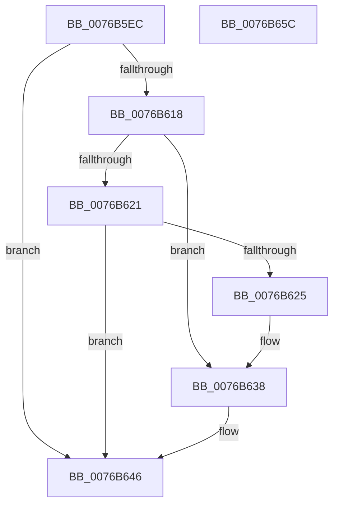

# PopAdaptiveConsoleSessionOverrideClear

- RVA: `0x0076B5EC`–`0x0076B65D` (길이 `113` bytes)
- VA: `0x000000014076B5EC`
- 실행 섹션: `PAGE`
- PDB 이름 있음: `예`; PDB Function 태그: `아니요`
- unwind 정보 RVA: `0x0006F978`
- 디코드: `30`개 명령, `113/113` bytes 표시
- 미해석 바이트: `0` (있으면 어셈블리에 `.byte`로 보존)

> 이 문서는 커널 이미지의 기계어와 PDB 기호를 분석해 생성했습니다. 4번과 5번은 함수 원형과 자료형을 바이너리 사용 방식에서 추정한 C 해석이며 원본 소스 복구 결과는 아닙니다.

## 1. Dependencies

- 직접 호출 지점: **2**; 고유 호출 대상: **2**
- 직접 호출자로 확인된 함수: **2**
- RIP 상대 이미지 참조: **3**

### Outgoing calls
- `0x0076B633` → [ExQueueWorkItem](../../text/2F/ExQueueWorkItem_function_002F9520.md) (function, `0x002F9520`)
- `0x0076B641` → [PopDiagTraceAdaptiveOverrideClear](PopDiagTraceAdaptiveOverrideClear_function_007605FC.md) (function, `0x007605FC`)

### Direct callers
- [PopAdaptiveWnfCallback](PopAdaptiveWnfCallback_function_0076BAB0.md) at `0x0076BB8B`
- [PopAdaptiveGetConsoleSessionState](../91/PopAdaptiveGetConsoleSessionState_function_00913FB4.md) at `0x00914300`
- [PopAdaptiveGetConsoleSessionState](../91/PopAdaptiveGetConsoleSessionState_function_00913FB4.md) at `0x00914312`

### Static image references
- `0x0076B604` → RVA `0x00F08240` (`.data`; read)
- `0x0076B625` → RVA `0x00F08200` (`.data`; read)
- `0x0076B62C` → RVA `0x00FD81F0` (`PAGEDATA`; write)

## 2. Other-region calls and transfers

- 다른 실행 섹션으로 향하는 call: **1**
  - `0x0076B633` → [ExQueueWorkItem](../../text/2F/ExQueueWorkItem_function_002F9520.md) (`PAGE` → `.text`)
- 별도 외부 분기/꼬리 이동을 확인하지 못했습니다.

## 3. Assembly (complete function range)

```asm
0076B5EC  48 89 5C 24 08                  mov qword ptr [rsp + 8], rbx
0076B5F1  48 89 74 24 10                  mov qword ptr [rsp + 0x10], rsi
0076B5F6  48 89 7C 24 18                  mov qword ptr [rsp + 0x18], rdi
0076B5FB  41 56                           push r14
0076B5FD  48 83 EC 20                     sub rsp, 0x20
0076B601  48 63 D9                        movsxd rbx, ecx
0076B604  4C 8D 35 35 CC 79 00            lea r14, [rip + 0x79cc35]
0076B60B  8B FA                           mov edi, edx
0076B60D  48 8D 34 5B                     lea rsi, [rbx + rbx*2]
0076B611  41 80 3C F6 00                  cmp byte ptr [r14 + rsi*8], 0
0076B616  74 2E                           je 0x14076b646
0076B618  BA 01 00 00 00                  mov edx, 1
0076B61D  3B DA                           cmp ebx, edx
0076B61F  75 17                           jne 0x14076b638
0076B621  3B FA                           cmp edi, edx
0076B623  75 21                           jne 0x14076b646
0076B625  48 8D 0D D4 CB 79 00            lea rcx, [rip + 0x79cbd4]
0076B62C  C6 05 BD CB 86 00 00            mov byte ptr [rip + 0x86cbbd], 0
0076B633  E8 E8 DE B8 FF                  call 0x1402f9520
0076B638  8B D7                           mov edx, edi
0076B63A  41 C6 04 F6 00                  mov byte ptr [r14 + rsi*8], 0
0076B63F  8B CB                           mov ecx, ebx
0076B641  E8 B6 4F FF FF                  call 0x1407605fc
0076B646  48 8B 5C 24 30                  mov rbx, qword ptr [rsp + 0x30]
0076B64B  48 8B 74 24 38                  mov rsi, qword ptr [rsp + 0x38]
0076B650  48 8B 7C 24 40                  mov rdi, qword ptr [rsp + 0x40]
0076B655  48 83 C4 20                     add rsp, 0x20
0076B659  41 5E                           pop r14
0076B65B  C3                              ret
0076B65C  CC                              int3
```

## 4. C-style interpretation (structured pseudocode)

```c
__int64 __fastcall PopAdaptiveConsoleSessionOverrideClear(int a1, int a2)
{
    __int64 result;
    __int64 v_rsp;
    unsigned __int64 v_stack_p10;
    unsigned __int64 v_stack_p18;
    unsigned __int64 v_stack_p8;

    v_stack_p8 = v_rbx;
    v_stack_p10 = v_rsi;
    v_stack_p18 = v_rdi;
    v_rsp = (v_rsp) - (32);
    if ((*(unsigned __int8 *)(v_rip + 7982133 + (int)(a1) + (int)(a1) * 2 * 8)) == 0) goto loc_0076B646;
    if (((unsigned int)((int)(a1))) != 1) goto loc_0076B638;
    if (((unsigned int)((unsigned int)(a2))) != 1) goto loc_0076B646;
    *(unsigned __int8 *)(v_rip + 8833981) = 0;
    result = ExQueueWorkItem(v_rip + 7982036, 1, a3, a4);
loc_0076B638:
    *(unsigned __int8 *)(v_rip + 7982133 + (int)(a1) + (int)(a1) * 2 * 8) = 0;
    result = PopDiagTraceAdaptiveOverrideClear((unsigned int)((unsigned int)((int)(a1))), (unsigned int)((unsigned int)((unsigned int)(a2))), a3, a4);
loc_0076B646:
    v_rsp = (v_rsp) + (32);
    return result;
}
```

## 5. (Beta) C Style

```c
int64_t PopAdaptiveConsoleSessionOverrideClear(void *Arg1, int32_t Arg2)
{
    uint8_t *arg1 = (uint8_t *)Arg1;

    int64_t result;
    int64_t local_rsp;
    uint64_t v_stack_p10;
    uint64_t v_stack_p18;
    uint64_t v_stack_p8;

    v_stack_p8 = local_rbx;
    v_stack_p10 = local_rsi;
    v_stack_p18 = local_rdi;
    local_rsp = (local_rsp) - (32);
    if ((*(uint8_t *)(v_rip + 0x79CC35 + (int32_t)(arg1) + (int32_t)(arg1) * 2 * 8)) == 0) goto loc_0076B646;
    if (((uint32_t)((int32_t)(Arg1))) != 1) goto loc_0076B638;
    if (((uint32_t)((uint32_t)(Arg2))) != 1) goto loc_0076B646;
    *(uint8_t *)(v_rip + 0x86CBBD) = 0;
    result = ExQueueWorkItem(v_rip + 7982036, 1, a3, a4);
loc_0076B638:
    *(uint8_t *)(v_rip + 0x79CC35 + (int32_t)(arg1) + (int32_t)(arg1) * 2 * 8) = 0;
    result = PopDiagTraceAdaptiveOverrideClear((uint32_t)((uint32_t)((int32_t)(Arg1))), (uint32_t)((uint32_t)((uint32_t)(Arg2))), a3, a4);
loc_0076B646:
    local_rsp = (local_rsp) + (32);
    return result;
}
```

### 관측된 메모리 오프셋

구조체 형식이 확인되지 않은 접근은 인자 기준의 오프셋으로만 기록했습니다.

| 기준 인자 | 오프셋 표현 | 폭 (bit) | 접근 |
|---|---:|---:|---|
| `Arg1` | `+ 0x0 + rbx*2` | `64` | `R` |

## 6. Execution-region graph

[열기: 2D/3D 그래프와 함수 탐색 컨트롤 패널](../../../control-panel.html?section=page&rva=0x0076B5EC&view=graph)

- 2D 그래프는 위에서 아래로 흐르고, 3D 그래프는 빈 공간을 드래그해 회전합니다. Shift+드래그는 이동, 휠은 확대·축소, 함수 노드 선택은 대상 보고서 이동입니다.

### Static fallback


