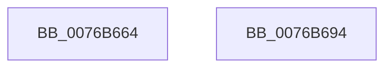

# PopAdaptiveConsoleSessionOverrideTrigger

- RVA: `0x0076B664`–`0x0076B695` (길이 `49` bytes)
- VA: `0x000000014076B664`
- 실행 섹션: `PAGE`
- PDB 이름 있음: `예`; PDB Function 태그: `아니요`
- unwind 정보 RVA: `0x0005C788`
- 디코드: `12`개 명령, `49/49` bytes 표시
- 미해석 바이트: `0` (있으면 어셈블리에 `.byte`로 보존)

> 이 문서는 커널 이미지의 기계어와 PDB 기호를 분석해 생성했습니다. 4번과 5번은 함수 원형과 자료형을 바이너리 사용 방식에서 추정한 C 해석이며 원본 소스 복구 결과는 아닙니다.

## 1. Dependencies

- 직접 호출 지점: **1**; 고유 호출 대상: **1**
- 직접 호출자로 확인된 함수: **3**
- RIP 상대 이미지 참조: **1**

### Outgoing calls
- `0x0076B68A` → [PopDiagTraceAdaptiveOverrideTriggered](PopDiagTraceAdaptiveOverrideTriggered_function_007606CC.md) (function, `0x007606CC`)

### Direct callers
- [PopAdaptiveWnfCallback](PopAdaptiveWnfCallback_function_0076BAB0.md) at `0x0076BB82`
- [PopSessionConnected](PopSessionConnected_function_0076BC74.md) at `0x0076BCFF`
- [PopSessionConnectedV2](PopSessionConnectedV2_function_0076BD2C.md) at `0x0076BDBC`

### Static image references
- `0x0076B66F` → RVA `0x00F08240` (`.data`; read)

## 2. Other-region calls and transfers

- 다른 실행 섹션으로 향하는 call: **0**
- 별도 외부 분기/꼬리 이동을 확인하지 못했습니다.

## 3. Assembly (complete function range)

```asm
0076B664  48 83 EC 28                     sub rsp, 0x28
0076B668  48 63 C2                        movsxd rax, edx
0076B66B  4C 8D 14 40                     lea r10, [rax + rax*2]
0076B66F  48 8D 05 CA CB 79 00            lea rax, [rip + 0x79cbca]
0076B676  42 C6 04 D0 01                  mov byte ptr [rax + r10*8], 1
0076B67B  4A 89 4C D0 08                  mov qword ptr [rax + r10*8 + 8], rcx
0076B680  46 89 44 D0 10                  mov dword ptr [rax + r10*8 + 0x10], r8d
0076B685  46 89 4C D0 14                  mov dword ptr [rax + r10*8 + 0x14], r9d
0076B68A  E8 3D 50 FF FF                  call 0x1407606cc
0076B68F  48 83 C4 28                     add rsp, 0x28
0076B693  C3                              ret
0076B694  CC                              int3
```

## 4. C-style interpretation (structured pseudocode)

```c
__int64 __fastcall PopAdaptiveConsoleSessionOverrideTrigger(__int64 a1, int a2, int a3, int a4)
{
    __int64 result;
    __int64 v_rsp;

    v_rsp = (v_rsp) - (40);
    *(unsigned __int8 *)(v_rip + 7982026 + (int)(a2) + (int)(a2) * 2 * 8) = 1;
    *(unsigned __int64 *)(v_rip + 7982026 + (int)(a2) + (int)(a2) * 2 * 8 + 8) = a1;
    *(unsigned int *)(v_rip + 7982026 + (int)(a2) + (int)(a2) * 2 * 8 + 16) = a3;
    *(unsigned int *)(v_rip + 7982026 + (int)(a2) + (int)(a2) * 2 * 8 + 20) = a4;
    result = PopDiagTraceAdaptiveOverrideTriggered(a1, a2, a3, a4);
    v_rsp = (v_rsp) + (40);
    return result;
}
```

## 5. (Beta) C Style

```c
int64_t PopAdaptiveConsoleSessionOverrideTrigger(int64_t Arg1, void *Arg2, int32_t Arg3, int32_t Arg4)
{
    uint8_t *arg2 = (uint8_t *)Arg2;

    int64_t result;
    int64_t local_rsp;

    local_rsp = (local_rsp) - (40);
    *(uint8_t *)(v_rip + 0x79CBCA + (int32_t)(arg2) + (int32_t)(arg2) * 2 * 8) = 1;
    *(uint64_t *)(v_rip + 0x79CBCA + (int32_t)(arg2) + (int32_t)(arg2) * 2 * 8 + 0x8) = Arg1;
    *(uint32_t *)(v_rip + 0x79CBCA + (int32_t)(arg2) + (int32_t)(arg2) * 2 * 8 + 0x10) = Arg3;
    *(uint32_t *)(v_rip + 0x79CBCA + (int32_t)(arg2) + (int32_t)(arg2) * 2 * 8 + 0x14) = Arg4;
    result = PopDiagTraceAdaptiveOverrideTriggered(Arg1, Arg2, Arg3, Arg4);
    local_rsp = (local_rsp) + (40);
    return result;
}
```

### 관측된 메모리 오프셋

구조체 형식이 확인되지 않은 접근은 인자 기준의 오프셋으로만 기록했습니다.

| 기준 인자 | 오프셋 표현 | 폭 (bit) | 접근 |
|---|---:|---:|---|
| `Arg2` | `+ 0x0 + rax*2` | `64` | `R` |

## 6. Execution-region graph

[열기: 2D/3D 그래프와 함수 탐색 컨트롤 패널](../../../control-panel.html?section=page&rva=0x0076B664&view=graph)

- 2D 그래프는 위에서 아래로 흐르고, 3D 그래프는 빈 공간을 드래그해 회전합니다. Shift+드래그는 이동, 휠은 확대·축소, 함수 노드 선택은 대상 보고서 이동입니다.

### Static fallback


