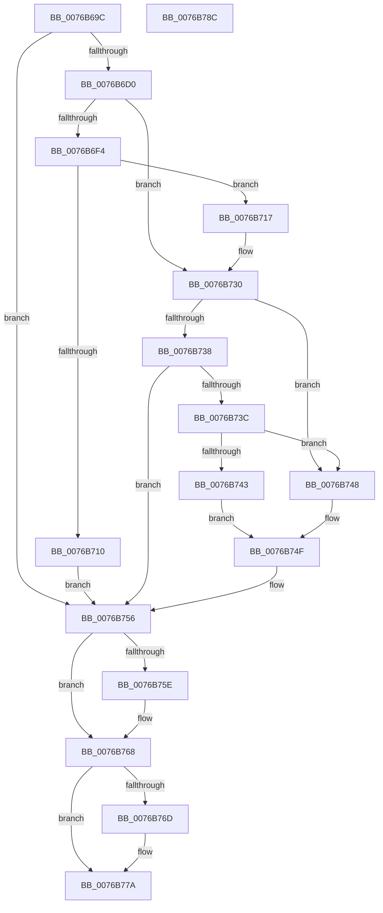

# PopAdaptiveGetSystemInitiatedRebootTargetBootEntry

- RVA: `0x0076B69C`–`0x0076B78D` (길이 `241` bytes)
- VA: `0x000000014076B69C`
- 실행 섹션: `PAGE`
- PDB 이름 있음: `예`; PDB Function 태그: `아니요`
- unwind 정보 RVA: `0x000CD370`
- 디코드: `65`개 명령, `241/241` bytes 표시
- 미해석 바이트: `0` (있으면 어셈블리에 `.byte`로 보존)

> 이 문서는 커널 이미지의 기계어와 PDB 기호를 분석해 생성했습니다. 4번과 5번은 함수 원형과 자료형을 바이너리 사용 방식에서 추정한 C 해석이며 원본 소스 복구 결과는 아닙니다.

## 1. Dependencies

- 직접 호출 지점: **6**; 고유 호출 대상: **5**
- 직접 호출자로 확인된 함수: **1**
- RIP 상대 이미지 참조: **2**

### Outgoing calls
- `0x0076B6C1` → [BcdOpenObject](../91/BcdOpenObject_function_00916704.md) (function, `0x00916704`)
- `0x0076B6E6` → [BcdGetElementData](../A3/BcdGetElementData_function_00A3E390.md) (function, `0x00A3E390`)
- `0x0076B703` → [ExAllocatePool2](../../poolcode/B8/ExAllocatePool2_function_00B820F0.md) (function, `0x00B820F0`)
- `0x0076B729` → [BcdGetElementData](../A3/BcdGetElementData_function_00A3E390.md) (function, `0x00A3E390`)
- `0x0076B763` → [BcdCloseObject](../A3/BcdCloseObject_function_00A3FB08.md) (function, `0x00A3FB08`)
- `0x0076B775` → [ExFreePoolWithTag](../../poolcode/B8/ExFreePoolWithTag_function_00B82870.md) (function, `0x00B82870`)

### Direct callers
- [PopAdaptivePersistSystemInitatedRebootState](../../text/5D/PopAdaptivePersistSystemInitatedRebootState_function_005DC30C.md) at `0x005DC376`

### Static image references
- `0x0076B6BA` → RVA `0x0001A4D0` (`.rdata`; read)
- `0x0076B748` → RVA `0x0001A4B0` (`.rdata`; read)

## 2. Other-region calls and transfers

- 다른 실행 섹션으로 향하는 call: **2**
  - `0x0076B703` → [ExAllocatePool2](../../poolcode/B8/ExAllocatePool2_function_00B820F0.md) (`PAGE` → `POOLCODE`)
  - `0x0076B775` → [ExFreePoolWithTag](../../poolcode/B8/ExFreePoolWithTag_function_00B82870.md) (`PAGE` → `POOLCODE`)
- 별도 외부 분기/꼬리 이동을 확인하지 못했습니다.

## 3. Assembly (complete function range)

```asm
0076B69C  48 8B C4                        mov rax, rsp
0076B69F  48 89 58 08                     mov qword ptr [rax + 8], rbx
0076B6A3  48 89 68 10                     mov qword ptr [rax + 0x10], rbp
0076B6A7  57                              push rdi
0076B6A8  48 83 EC 20                     sub rsp, 0x20
0076B6AC  48 83 48 20 FF                  or qword ptr [rax + 0x20], 0xffffffffffffffff
0076B6B1  4C 8D 40 20                     lea r8, [rax + 0x20]
0076B6B5  48 8B EA                        mov rbp, rdx
0076B6B8  33 FF                           xor edi, edi
0076B6BA  48 8D 15 0F EE 8A FF            lea rdx, [rip - 0x7511f1]
0076B6C1  E8 3E B0 1A 00                  call 0x140916704
0076B6C6  8B D8                           mov ebx, eax
0076B6C8  85 C0                           test eax, eax
0076B6CA  0F 88 86 00 00 00               js 0x14076b756
0076B6D0  48 8B 4C 24 48                  mov rcx, qword ptr [rsp + 0x48]
0076B6D5  4C 8D 4C 24 40                  lea r9, [rsp + 0x40]
0076B6DA  21 7C 24 40                     and dword ptr [rsp + 0x40], edi
0076B6DE  45 33 C0                        xor r8d, r8d
0076B6E1  BA 02 00 00 24                  mov edx, 0x24000002
0076B6E6  E8 A5 2C 2D 00                  call 0x140a3e390
0076B6EB  8B D8                           mov ebx, eax
0076B6ED  3D 23 00 00 C0                  cmp eax, 0xc0000023
0076B6F2  75 3C                           jne 0x14076b730
0076B6F4  8B 54 24 40                     mov edx, dword ptr [rsp + 0x40]
0076B6F8  B9 00 01 00 00                  mov ecx, 0x100
0076B6FD  41 B8 50 64 69 67               mov r8d, 0x67696450
0076B703  E8 E8 69 41 00                  call 0x140b820f0
0076B708  48 8B F8                        mov rdi, rax
0076B70B  48 85 C0                        test rax, rax
0076B70E  75 07                           jne 0x14076b717
0076B710  BB 9A 00 00 C0                  mov ebx, 0xc000009a
0076B715  EB 3F                           jmp 0x14076b756
0076B717  48 8B 4C 24 48                  mov rcx, qword ptr [rsp + 0x48]
0076B71C  4C 8D 4C 24 40                  lea r9, [rsp + 0x40]
0076B721  4C 8B C0                        mov r8, rax
0076B724  BA 02 00 00 24                  mov edx, 0x24000002
0076B729  E8 62 2C 2D 00                  call 0x140a3e390
0076B72E  8B D8                           mov ebx, eax
0076B730  81 FB 25 02 00 C0               cmp ebx, 0xc0000225
0076B736  74 10                           je 0x14076b748
0076B738  85 DB                           test ebx, ebx
0076B73A  78 1A                           js 0x14076b756
0076B73C  83 7C 24 40 00                  cmp dword ptr [rsp + 0x40], 0
0076B741  74 05                           je 0x14076b748
0076B743  0F 10 07                        movups xmm0, xmmword ptr [rdi]
0076B746  EB 07                           jmp 0x14076b74f
0076B748  0F 10 05 61 ED 8A FF            movups xmm0, xmmword ptr [rip - 0x75129f]
0076B74F  F3 0F 7F 45 00                  movdqu xmmword ptr [rbp], xmm0
0076B754  33 DB                           xor ebx, ebx
0076B756  48 83 7C 24 48 FF               cmp qword ptr [rsp + 0x48], -1
0076B75C  74 0A                           je 0x14076b768
0076B75E  48 8B 4C 24 48                  mov rcx, qword ptr [rsp + 0x48]
0076B763  E8 A0 43 2D 00                  call 0x140a3fb08
0076B768  48 85 FF                        test rdi, rdi
0076B76B  74 0D                           je 0x14076b77a
0076B76D  BA 50 64 69 67                  mov edx, 0x67696450
0076B772  48 8B CF                        mov rcx, rdi
0076B775  E8 F6 70 41 00                  call 0x140b82870
0076B77A  48 8B 6C 24 38                  mov rbp, qword ptr [rsp + 0x38]
0076B77F  8B C3                           mov eax, ebx
0076B781  48 8B 5C 24 30                  mov rbx, qword ptr [rsp + 0x30]
0076B786  48 83 C4 20                     add rsp, 0x20
0076B78A  5F                              pop rdi
0076B78B  C3                              ret
0076B78C  CC                              int3
```

## 4. C-style interpretation (structured pseudocode)

```c
__int64 __fastcall PopAdaptiveGetSystemInitiatedRebootTargetBootEntry(__int64 a1, __int64 a2)
{
    __int64 result;
    __int64 v_rbx;
    __int64 v_rdi;
    __int64 v_rsp;
    unsigned __int64 v_stack_p10;
    unsigned __int64 v_stack_p18;
    unsigned __int64 v_stack_p20;
    unsigned __int64 v_stack_p8;

    *(unsigned __int64 *)(v_rsp + 8) = v_rbx;
    *(unsigned __int64 *)(v_rsp + 16) = v_rbp;
    v_rsp = (v_rsp) - (32);
    v_rdi = 0;
    result = BcdOpenObject(a1, v_rip - 7672305, v_rsp + 32, a4);
    if (sign_flag) goto loc_0076B756;
    a3 = 0;
    result = BcdGetElementData(v_stack_p20, (unsigned int)(0x24000002ULL), a3, v_stack_p18);
    if (((unsigned int)(result)) != 0xC0000023ULL) goto loc_0076B730;
    result = ExAllocatePool2(256, (unsigned int)(v_stack_p18), (unsigned int)(0x67696450ULL), v_stack_p18);
    if (result != 0) goto loc_0076B717;
    goto loc_0076B756;
loc_0076B717:
    result = BcdGetElementData(v_stack_p20, (unsigned int)(0x24000002ULL), result, v_stack_p18);
loc_0076B730:
    if (((unsigned int)((unsigned int)((unsigned int)(result)))) == 0xC0000225ULL) goto loc_0076B748;
    if (sign_flag) goto loc_0076B756;
    if (v_stack_p18 == 0) goto loc_0076B748;
    goto loc_0076B74F;
loc_0076B748:
loc_0076B74F:
    *(unsigned __int64 *)(a2) = v_xmm0;
    v_rbx = 0;
loc_0076B756:
    if (v_stack_p20 != -1) {
        a1 = v_stack_p20;
        result = BcdCloseObject(a1, (unsigned int)(0x24000002ULL), result, v_stack_p18);
    }
    if (result != 0) {
        a2 = 0x67696450ULL;
        a1 = result;
        result = ExFreePoolWithTag(a1, a2, result, v_stack_p18);
    }
    v_rsp = (v_rsp) + (32);
    return 0;
}
```

## 5. (Beta) C Style

```c
int64_t PopAdaptiveGetSystemInitiatedRebootTargetBootEntry(int64_t Arg1, void *Arg2)
{
    uint8_t *arg2 = (uint8_t *)Arg2;

    int64_t result;
    int64_t local_rbx;
    int64_t local_rdi;
    int64_t local_rsp;
    uint64_t v_stack_p10;
    uint64_t v_stack_p18;
    uint64_t v_stack_p20;
    uint64_t v_stack_p8;

    *(uint64_t *)(local_rsp + 0x8) = local_rbx;
    *(uint64_t *)(local_rsp + 0x10) = local_rbp;
    local_rsp = (local_rsp) - (32);
    local_rdi = 0;
    result = BcdOpenObject(Arg1, v_rip - 7672305, local_rsp + 32, a4);
    if (sign_flag) goto loc_0076B756;
    a3 = 0;
    result = BcdGetElementData(v_stack_p20, (uint32_t)(0x24000002ULL), a3, v_stack_p18);
    if (((uint32_t)(result)) != 0xC0000023ULL) goto loc_0076B730;
    result = ExAllocatePool2(256, (uint32_t)(v_stack_p18), (uint32_t)(0x67696450ULL), v_stack_p18);
    if (result != 0) goto loc_0076B717;
    goto loc_0076B756;
loc_0076B717:
    result = BcdGetElementData(v_stack_p20, (uint32_t)(0x24000002ULL), result, v_stack_p18);
loc_0076B730:
    if (((uint32_t)((uint32_t)((uint32_t)(result)))) == 0xC0000225ULL) goto loc_0076B748;
    if (sign_flag) goto loc_0076B756;
    if (v_stack_p18 == 0) goto loc_0076B748;
    goto loc_0076B74F;
loc_0076B748:
loc_0076B74F:
    *(uint64_t *)(arg2) = v_xmm0;
    local_rbx = 0;
loc_0076B756:
    if (v_stack_p20 != -1) {
        Arg1 = v_stack_p20;
        result = BcdCloseObject(Arg1, (uint32_t)(0x24000002ULL), result, v_stack_p18);
    }
    if (result != 0) {
        Arg2 = 0x67696450ULL;
        Arg1 = result;
        result = ExFreePoolWithTag(Arg1, Arg2, result, v_stack_p18);
    }
    local_rsp = (local_rsp) + (32);
    return 0;
}
```

### 관측된 메모리 오프셋

구조체 형식이 확인되지 않은 접근은 인자 기준의 오프셋으로만 기록했습니다.

| 기준 인자 | 오프셋 표현 | 폭 (bit) | 접근 |
|---|---:|---:|---|
| `Arg2` | `+ 0x0` | `128` | `W` |

## 6. Execution-region graph

[열기: 2D/3D 그래프와 함수 탐색 컨트롤 패널](../../../control-panel.html?section=page&rva=0x0076B69C&view=graph)

- 2D 그래프는 위에서 아래로 흐르고, 3D 그래프는 빈 공간을 드래그해 회전합니다. Shift+드래그는 이동, 휠은 확대·축소, 함수 노드 선택은 대상 보고서 이동입니다.

### Static fallback


