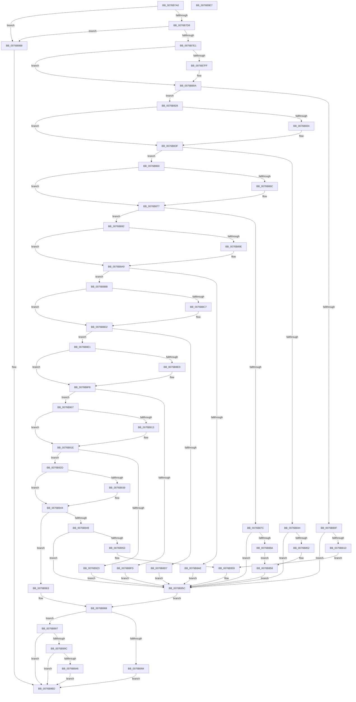

# PopAdaptivePowerSettingCallback

- RVA: `0x0076B7A0`–`0x0076B9E8` (길이 `584` bytes)
- VA: `0x000000014076B7A0`
- 실행 섹션: `PAGE`
- PDB 이름 있음: `예`; PDB Function 태그: `아니요`
- unwind 정보 RVA: `0x000CD3A4`
- 디코드: `147`개 명령, `584/584` bytes 표시
- 미해석 바이트: `0` (있으면 어셈블리에 `.byte`로 보존)

> 이 문서는 커널 이미지의 기계어와 PDB 기호를 분석해 생성했습니다. 4번과 5번은 함수 원형과 자료형을 바이너리 사용 방식에서 추정한 C 해석이며 원본 소스 복구 결과는 아닙니다.

## 1. Dependencies

- 직접 호출 지점: **6**; 고유 호출 대상: **6**
- 직접 호출자로 확인된 함수: **1**
- RIP 상대 이미지 참조: **32**

### Outgoing calls
- `0x0076B7EB` → [PopAcquireAdaptiveLock](../A3/PopAcquireAdaptiveLock_function_00A3B0E8.md) (function, `0x00A3B0E8`)
- `0x0076B95C` → [PopDiagTracePolicyChange](../70/PopDiagTracePolicyChange_function_00705718.md) (function, `0x00705718`)
- `0x0076B968` → [PopReleaseAdaptiveLock](../91/PopReleaseAdaptiveLock_function_009137DC.md) (function, `0x009137DC`)
- `0x0076B990` → [PopBroadcastSessionInfo](../91/PopBroadcastSessionInfo_function_00912598.md) (function, `0x00912598`)
- `0x0076B9B1` → [PopSendSessionInfo](../91/PopSendSessionInfo_function_00911E6C.md) (function, `0x00911E6C`)
- `0x0076B9C7` → [_security_check_cookie](../../text/6A/_security_check_cookie_function_006AC640.md) (function, `0x006AC640`)

### Direct callers
- [PopVideoPowerSettingCallback](../../text/4C/PopVideoPowerSettingCallback_function_004C9F50.md) at `0x004CA069`

### Static image references
- `0x0076B7B9` → RVA `0x00E0A740` (`.data`; read)
- `0x0076B7F0` → RVA `0x00024BA8` (`.rdata`; read)
- `0x0076B7FF` → RVA `0x00024BB0` (`.rdata`; read)
- `0x0076B811` → RVA `0x00F081AC` (`.data`; read)
- `0x0076B81D` → RVA `0x00F081AC` (`.data`; write)
- `0x0076B828` → RVA `0x0001E320` (`.rdata`; read)
- `0x0076B834` → RVA `0x0001E328` (`.rdata`; read)
- `0x0076B846` → RVA `0x00F081A8` (`.data`; read)
- `0x0076B852` → RVA `0x00F081A8` (`.data`; write)
- `0x0076B860` → RVA `0x00024B88` (`.rdata`; read)
- `0x0076B86C` → RVA `0x00024B90` (`.rdata`; read)
- `0x0076B87E` → RVA `0x00F081C0` (`.data`; read)
- `0x0076B88A` → RVA `0x00F081C0` (`.data`; write)
- `0x0076B892` → RVA `0x00024B38` (`.rdata`; read)
- `0x0076B89E` → RVA `0x00024B40` (`.rdata`; read)
- `0x0076B8B0` → RVA `0x00F081B0` (`.data`; write)
- `0x0076B8BB` → RVA `0x00024528` (`.rdata`; read)
- `0x0076B8C7` → RVA `0x00024530` (`.rdata`; read)
- `0x0076B8D9` → RVA `0x00F081B4` (`.data`; write)
- `0x0076B8E1` → RVA `0x00024D48` (`.rdata`; read)
- `0x0076B8ED` → RVA `0x00024D50` (`.rdata`; read)
- `0x0076B8FF` → RVA `0x00F081B8` (`.data`; write)
- `0x0076B907` → RVA `0x00024568` (`.rdata`; read)
- `0x0076B913` → RVA `0x00024570` (`.rdata`; read)
- `0x0076B925` → RVA `0x00F081BC` (`.data`; write)
- `0x0076B92D` → RVA `0x0001C368` (`.rdata`; read)
- `0x0076B939` → RVA `0x0001C370` (`.rdata`; read)
- `0x0076B94B` → RVA `0x00F081C8` (`.data`; read)
- `0x0076B953` → RVA `0x00F081C8` (`.data`; write)
- `0x0076B96D` → RVA `0x00011B88` (`.rdata`; read)
- `0x0076B99C` → RVA `0x00F08270` (`.data`; read)
- `0x0076B9A6` → RVA `0x00F08238` (`.data`; read)

## 2. Other-region calls and transfers

- 다른 실행 섹션으로 향하는 call: **1**
  - `0x0076B9C7` → [_security_check_cookie](../../text/6A/_security_check_cookie_function_006AC640.md) (`PAGE` → `.text`)
- 별도 외부 분기/꼬리 이동을 확인하지 못했습니다.

## 3. Assembly (complete function range)

```asm
0076B7A0  48 8B C4                        mov rax, rsp
0076B7A3  48 89 58 08                     mov qword ptr [rax + 8], rbx
0076B7A7  48 89 68 10                     mov qword ptr [rax + 0x10], rbp
0076B7AB  48 89 70 18                     mov qword ptr [rax + 0x18], rsi
0076B7AF  48 89 78 20                     mov qword ptr [rax + 0x20], rdi
0076B7B3  41 56                           push r14
0076B7B5  48 83 EC 50                     sub rsp, 0x50
0076B7B9  48 8B 05 80 EF 69 00            mov rax, qword ptr [rip + 0x69ef80]
0076B7C0  48 33 C4                        xor rax, rsp
0076B7C3  48 89 44 24 48                  mov qword ptr [rsp + 0x48], rax
0076B7C8  48 8B FA                        mov rdi, rdx
0076B7CB  48 8B D9                        mov rbx, rcx
0076B7CE  41 83 F8 04                     cmp r8d, 4
0076B7D2  0F 85 E0 01 00 00               jne 0x14076b9b8
0076B7D8  48 85 D2                        test rdx, rdx
0076B7DB  0F 84 D7 01 00 00               je 0x14076b9b8
0076B7E1  B1 01                           mov cl, 1
0076B7E3  45 32 F6                        xor r14b, r14b
0076B7E6  40 32 ED                        xor bpl, bpl
0076B7E9  33 F6                           xor esi, esi
0076B7EB  E8 F8 F8 2C 00                  call 0x140a3b0e8
0076B7F0  48 8B 0D B1 93 8B FF            mov rcx, qword ptr [rip - 0x746c4f]
0076B7F7  48 8B 03                        mov rax, qword ptr [rbx]
0076B7FA  48 2B C8                        sub rcx, rax
0076B7FD  75 0B                           jne 0x14076b80a
0076B7FF  48 8B 0D AA 93 8B FF            mov rcx, qword ptr [rip - 0x746c56]
0076B806  48 2B 4B 08                     sub rcx, qword ptr [rbx + 8]
0076B80A  48 85 C9                        test rcx, rcx
0076B80D  75 19                           jne 0x14076b828
0076B80F  8B 07                           mov eax, dword ptr [rdi]
0076B811  3B 05 95 C9 79 00               cmp eax, dword ptr [rip + 0x79c995]
0076B817  0F 84 3F 01 00 00               je 0x14076b95c
0076B81D  89 05 89 C9 79 00               mov dword ptr [rip + 0x79c989], eax
0076B823  E9 31 01 00 00                  jmp 0x14076b959
0076B828  48 8B 0D F1 2A 8B FF            mov rcx, qword ptr [rip - 0x74d50f]
0076B82F  48 2B C8                        sub rcx, rax
0076B832  75 0B                           jne 0x14076b83f
0076B834  48 8B 0D ED 2A 8B FF            mov rcx, qword ptr [rip - 0x74d513]
0076B83B  48 2B 4B 08                     sub rcx, qword ptr [rbx + 8]
0076B83F  48 85 C9                        test rcx, rcx
0076B842  75 1C                           jne 0x14076b860
0076B844  8B 07                           mov eax, dword ptr [rdi]
0076B846  3B 05 5C C9 79 00               cmp eax, dword ptr [rip + 0x79c95c]
0076B84C  0F 84 0A 01 00 00               je 0x14076b95c
0076B852  89 05 50 C9 79 00               mov dword ptr [rip + 0x79c950], eax
0076B858  40 B5 01                        mov bpl, 1
0076B85B  E9 FC 00 00 00                  jmp 0x14076b95c
0076B860  48 8B 0D 21 93 8B FF            mov rcx, qword ptr [rip - 0x746cdf]
0076B867  48 2B C8                        sub rcx, rax
0076B86A  75 0B                           jne 0x14076b877
0076B86C  48 8B 0D 1D 93 8B FF            mov rcx, qword ptr [rip - 0x746ce3]
0076B873  48 2B 4B 08                     sub rcx, qword ptr [rbx + 8]
0076B877  48 85 C9                        test rcx, rcx
0076B87A  75 16                           jne 0x14076b892
0076B87C  8B 07                           mov eax, dword ptr [rdi]
0076B87E  3B 05 3C C9 79 00               cmp eax, dword ptr [rip + 0x79c93c]
0076B884  0F 84 D2 00 00 00               je 0x14076b95c
0076B88A  89 05 30 C9 79 00               mov dword ptr [rip + 0x79c930], eax
0076B890  EB C6                           jmp 0x14076b858
0076B892  48 8B 0D 9F 92 8B FF            mov rcx, qword ptr [rip - 0x746d61]
0076B899  48 2B C8                        sub rcx, rax
0076B89C  75 0B                           jne 0x14076b8a9
0076B89E  48 8B 0D 9B 92 8B FF            mov rcx, qword ptr [rip - 0x746d65]
0076B8A5  48 2B 4B 08                     sub rcx, qword ptr [rbx + 8]
0076B8A9  48 85 C9                        test rcx, rcx
0076B8AC  75 0D                           jne 0x14076b8bb
0076B8AE  8B 07                           mov eax, dword ptr [rdi]
0076B8B0  89 05 FA C8 79 00               mov dword ptr [rip + 0x79c8fa], eax
0076B8B6  E9 A1 00 00 00                  jmp 0x14076b95c
0076B8BB  48 8B 0D 66 8C 8B FF            mov rcx, qword ptr [rip - 0x74739a]
0076B8C2  48 2B C8                        sub rcx, rax
0076B8C5  75 0B                           jne 0x14076b8d2
0076B8C7  48 8B 0D 62 8C 8B FF            mov rcx, qword ptr [rip - 0x74739e]
0076B8CE  48 2B 4B 08                     sub rcx, qword ptr [rbx + 8]
0076B8D2  48 85 C9                        test rcx, rcx
0076B8D5  75 0A                           jne 0x14076b8e1
0076B8D7  8B 07                           mov eax, dword ptr [rdi]
0076B8D9  89 05 D5 C8 79 00               mov dword ptr [rip + 0x79c8d5], eax
0076B8DF  EB 7B                           jmp 0x14076b95c
0076B8E1  48 8B 0D 60 94 8B FF            mov rcx, qword ptr [rip - 0x746ba0]
0076B8E8  48 2B C8                        sub rcx, rax
0076B8EB  75 0B                           jne 0x14076b8f8
0076B8ED  48 8B 0D 5C 94 8B FF            mov rcx, qword ptr [rip - 0x746ba4]
0076B8F4  48 2B 4B 08                     sub rcx, qword ptr [rbx + 8]
0076B8F8  48 85 C9                        test rcx, rcx
0076B8FB  75 0A                           jne 0x14076b907
0076B8FD  8B 07                           mov eax, dword ptr [rdi]
0076B8FF  89 05 B3 C8 79 00               mov dword ptr [rip + 0x79c8b3], eax
0076B905  EB 55                           jmp 0x14076b95c
0076B907  48 8B 0D 5A 8C 8B FF            mov rcx, qword ptr [rip - 0x7473a6]
0076B90E  48 2B C8                        sub rcx, rax
0076B911  75 0B                           jne 0x14076b91e
0076B913  48 8B 0D 56 8C 8B FF            mov rcx, qword ptr [rip - 0x7473aa]
0076B91A  48 2B 4B 08                     sub rcx, qword ptr [rbx + 8]
0076B91E  48 85 C9                        test rcx, rcx
0076B921  75 0A                           jne 0x14076b92d
0076B923  8B 07                           mov eax, dword ptr [rdi]
0076B925  89 05 91 C8 79 00               mov dword ptr [rip + 0x79c891], eax
0076B92B  EB 2F                           jmp 0x14076b95c
0076B92D  48 8B 0D 34 0A 8B FF            mov rcx, qword ptr [rip - 0x74f5cc]
0076B934  48 2B C8                        sub rcx, rax
0076B937  75 0B                           jne 0x14076b944
0076B939  48 8B 0D 30 0A 8B FF            mov rcx, qword ptr [rip - 0x74f5d0]
0076B940  48 2B 4B 08                     sub rcx, qword ptr [rbx + 8]
0076B944  48 85 C9                        test rcx, rcx
0076B947  75 1A                           jne 0x14076b963
0076B949  8B 07                           mov eax, dword ptr [rdi]
0076B94B  3B 05 77 C8 79 00               cmp eax, dword ptr [rip + 0x79c877]
0076B951  74 09                           je 0x14076b95c
0076B953  89 05 6F C8 79 00               mov dword ptr [rip + 0x79c86f], eax
0076B959  41 B6 01                        mov r14b, 1
0076B95C  E8 B7 9D F9 FF                  call 0x140705718
0076B961  EB 05                           jmp 0x14076b968
0076B963  BE 0D 00 00 C0                  mov esi, 0xc000000d
0076B968  E8 6F 7E 1A 00                  call 0x1409137dc
0076B96D  0F 10 05 14 62 8A FF            movups xmm0, xmmword ptr [rip - 0x759dec]
0076B974  83 64 24 40 00                  and dword ptr [rsp + 0x40], 0
0076B979  F3 0F 7F 44 24 30               movdqu xmmword ptr [rsp + 0x30], xmm0
0076B97F  45 84 F6                        test r14b, r14b
0076B982  74 13                           je 0x14076b997
0076B984  4C 8D 44 24 30                  lea r8, [rsp + 0x30]
0076B989  BA 14 00 00 00                  mov edx, 0x14
0076B98E  33 C9                           xor ecx, ecx
0076B990  E8 03 6C 1A 00                  call 0x140912598
0076B995  EB 26                           jmp 0x14076b9bd
0076B997  40 84 ED                        test bpl, bpl
0076B99A  74 21                           je 0x14076b9bd
0076B99C  8A 05 CE C8 79 00               mov al, byte ptr [rip + 0x79c8ce]
0076B9A2  84 C0                           test al, al
0076B9A4  74 17                           je 0x14076b9bd
0076B9A6  8B 0D 8C C8 79 00               mov ecx, dword ptr [rip + 0x79c88c]
0076B9AC  4C 8D 4C 24 30                  lea r9, [rsp + 0x30]
0076B9B1  E8 B6 64 1A 00                  call 0x140911e6c
0076B9B6  EB 05                           jmp 0x14076b9bd
0076B9B8  BE 0D 00 00 C0                  mov esi, 0xc000000d
0076B9BD  8B C6                           mov eax, esi
0076B9BF  48 8B 4C 24 48                  mov rcx, qword ptr [rsp + 0x48]
0076B9C4  48 33 CC                        xor rcx, rsp
0076B9C7  E8 74 0C F4 FF                  call 0x1406ac640
0076B9CC  48 8B 5C 24 60                  mov rbx, qword ptr [rsp + 0x60]
0076B9D1  48 8B 6C 24 68                  mov rbp, qword ptr [rsp + 0x68]
0076B9D6  48 8B 74 24 70                  mov rsi, qword ptr [rsp + 0x70]
0076B9DB  48 8B 7C 24 78                  mov rdi, qword ptr [rsp + 0x78]
0076B9E0  48 83 C4 50                     add rsp, 0x50
0076B9E4  41 5E                           pop r14
0076B9E6  C3                              ret
0076B9E7  CC                              int3
```

## 4. C-style interpretation (structured pseudocode)

```c
__int64 __fastcall PopAdaptivePowerSettingCallback(__int64 a1, __int64 a2, int a3)
{
    __int64 result;
    __int64 v_r14;
    __int64 v_rbp;
    __int64 v_rsi;
    __int64 v_rsp;
    unsigned __int64 v_stack_m10;
    unsigned int v_stack_m18;
    unsigned __int64 v_stack_m28;
    unsigned __int64 v_stack_p10;
    unsigned __int64 v_stack_p18;
    unsigned __int64 v_stack_p20;
    unsigned __int64 v_stack_p8;

    *(unsigned __int64 *)(v_rsp + 8) = v_rbx;
    *(unsigned __int64 *)(v_rsp + 16) = v_rbp;
    *(unsigned __int64 *)(v_rsp + 24) = v_rsi;
    *(unsigned __int64 *)(v_rsp + 32) = v_rdi;
    v_rsp = (v_rsp) - (80);
    result = (*(unsigned __int64 *)(v_rip + 6942592)) ^ (v_rsp);
    v_stack_m10 = result;
    if (a3 != 4) goto loc_0076B9B8;
    if (a2 == 0) goto loc_0076B9B8;
    v_r14 = 0;
    v_rbp = 0;
    v_rsi = 0;
    result = PopAcquireAdaptiveLock(1, a2, a3, a4);
    a1 = (*(unsigned __int64 *)(v_rip - 7629903)) - (*(unsigned __int64 *)(a1));
    if (!(condition_is_not_equal)) {
        a1 = *(unsigned __int64 *)(v_rip - 7629910);
        a1 = (a1) - (*(unsigned __int64 *)(a1 + 8));
    }
    if (a1 != 0) goto loc_0076B828;
    if (((unsigned int)((unsigned int)(*(unsigned int *)(a2)))) == (*(unsigned int *)(v_rip + 7981461))) goto loc_0076B95C;
    *(unsigned int *)(v_rip + 7981449) = (unsigned int)((unsigned int)(*(unsigned int *)(a2)));
    goto loc_0076B959;
loc_0076B828:
    a1 = (*(unsigned __int64 *)(v_rip - 7656719)) - ((unsigned int)(*(unsigned int *)(a2)));
    if (!(condition_is_not_equal)) {
        a1 = *(unsigned __int64 *)(v_rip - 7656723);
        a1 = (a1) - (*(unsigned __int64 *)(a1 + 8));
    }
    if (a1 != 0) goto loc_0076B860;
    if (((unsigned int)((unsigned int)(*(unsigned int *)(a2)))) == (*(unsigned int *)(v_rip + 7981404))) goto loc_0076B95C;
    *(unsigned int *)(v_rip + 7981392) = (unsigned int)((unsigned int)(*(unsigned int *)(a2)));
loc_0076B858:
    goto loc_0076B95C;
loc_0076B860:
    a1 = (*(unsigned __int64 *)(v_rip - 7630047)) - ((unsigned int)(*(unsigned int *)(a2)));
    if (!(condition_is_not_equal)) {
        a1 = *(unsigned __int64 *)(v_rip - 7630051);
        a1 = (a1) - (*(unsigned __int64 *)(a1 + 8));
    }
    if (a1 != 0) goto loc_0076B892;
    if (((unsigned int)((unsigned int)(*(unsigned int *)(a2)))) == (*(unsigned int *)(v_rip + 7981372))) goto loc_0076B95C;
    *(unsigned int *)(v_rip + 7981360) = (unsigned int)((unsigned int)(*(unsigned int *)(a2)));
    goto loc_0076B858;
loc_0076B892:
    a1 = (*(unsigned __int64 *)(v_rip - 7630177)) - ((unsigned int)(*(unsigned int *)(a2)));
    if (!(condition_is_not_equal)) {
        a1 = *(unsigned __int64 *)(v_rip - 7630181);
        a1 = (a1) - (*(unsigned __int64 *)(a1 + 8));
    }
    if (a1 != 0) goto loc_0076B8BB;
    *(unsigned int *)(v_rip + 7981306) = (unsigned int)((unsigned int)(*(unsigned int *)(a2)));
    goto loc_0076B95C;
loc_0076B8BB:
    a1 = (*(unsigned __int64 *)(v_rip - 7631770)) - ((unsigned int)(*(unsigned int *)(a2)));
    if (!(condition_is_not_equal)) {
        a1 = *(unsigned __int64 *)(v_rip - 7631774);
        a1 = (a1) - (*(unsigned __int64 *)(a1 + 8));
    }
    if (a1 != 0) goto loc_0076B8E1;
    *(unsigned int *)(v_rip + 7981269) = (unsigned int)((unsigned int)(*(unsigned int *)(a2)));
    goto loc_0076B95C;
loc_0076B8E1:
    a1 = (*(unsigned __int64 *)(v_rip - 7629728)) - ((unsigned int)(*(unsigned int *)(a2)));
    if (!(condition_is_not_equal)) {
        a1 = *(unsigned __int64 *)(v_rip - 7629732);
        a1 = (a1) - (*(unsigned __int64 *)(a1 + 8));
    }
    if (a1 != 0) goto loc_0076B907;
    *(unsigned int *)(v_rip + 7981235) = (unsigned int)((unsigned int)(*(unsigned int *)(a2)));
    goto loc_0076B95C;
loc_0076B907:
    a1 = (*(unsigned __int64 *)(v_rip - 7631782)) - ((unsigned int)(*(unsigned int *)(a2)));
    if (!(condition_is_not_equal)) {
        a1 = *(unsigned __int64 *)(v_rip - 7631786);
        a1 = (a1) - (*(unsigned __int64 *)(a1 + 8));
    }
    if (a1 != 0) goto loc_0076B92D;
    *(unsigned int *)(v_rip + 7981201) = (unsigned int)((unsigned int)(*(unsigned int *)(a2)));
    goto loc_0076B95C;
loc_0076B92D:
    a1 = (*(unsigned __int64 *)(v_rip - 7665100)) - ((unsigned int)(*(unsigned int *)(a2)));
    if (!(condition_is_not_equal)) {
        a1 = *(unsigned __int64 *)(v_rip - 7665104);
        a1 = (a1) - (*(unsigned __int64 *)(a1 + 8));
    }
    if (a1 != 0) goto loc_0076B963;
    if (((unsigned int)((unsigned int)(*(unsigned int *)(a2)))) == (*(unsigned int *)(v_rip + 7981175))) goto loc_0076B95C;
    *(unsigned int *)(v_rip + 7981167) = (unsigned int)((unsigned int)(*(unsigned int *)(a2)));
loc_0076B959:
loc_0076B95C:
    result = PopDiagTracePolicyChange(a1, a2, a3, a4);
    goto loc_0076B968;
loc_0076B963:
loc_0076B968:
    result = PopReleaseAdaptiveLock(a1, a2, a3, a4);
    v_stack_m28 = v_xmm0;
    if (1 == 0) goto loc_0076B997;
    a1 = 0;
    result = PopBroadcastSessionInfo(a1, 20, v_stack_m28, a4);
    goto loc_0076B9BD;
loc_0076B997:
    if (1 == 0) goto loc_0076B9BD;
    if ((unsigned __int8)(*(unsigned __int8 *)(v_rip + 7981262)) == 0) goto loc_0076B9BD;
    result = PopSendSessionInfo((unsigned int)(*(unsigned int *)(v_rip + 7981196)), 20, v_stack_m28, v_stack_m28);
    goto loc_0076B9BD;
loc_0076B9B8:
loc_0076B9BD:
    a1 = (v_stack_m10) ^ (v_rsp);
    result = _security_check_cookie(a1, 20, v_stack_m28, v_stack_m28);
    v_rsp = (v_rsp) + (80);
    return result;
}
```

## 5. (Beta) C Style

```c
int64_t PopAdaptivePowerSettingCallback(void *Arg1, void *Arg2, int32_t Arg3)
{
    uint8_t *arg1 = (uint8_t *)Arg1;
    uint8_t *arg2 = (uint8_t *)Arg2;

    int64_t result;
    int64_t local_r14;
    int64_t local_rbp;
    int64_t local_rsi;
    int64_t local_rsp;
    uint64_t v_stack_m10;
    uint32_t v_stack_m18;
    uint64_t v_stack_m28;
    uint64_t v_stack_p10;
    uint64_t v_stack_p18;
    uint64_t v_stack_p20;
    uint64_t v_stack_p8;

    *(uint64_t *)(local_rsp + 0x8) = local_rbx;
    *(uint64_t *)(local_rsp + 0x10) = local_rbp;
    *(uint64_t *)(local_rsp + 0x18) = local_rsi;
    *(uint64_t *)(local_rsp + 0x20) = local_rdi;
    local_rsp = (local_rsp) - (80);
    result = (*(uint64_t *)(v_rip + 0x69EF80)) ^ (local_rsp);
    v_stack_m10 = result;
    if (Arg3 != 4) goto loc_0076B9B8;
    if (Arg2 == NULL) goto loc_0076B9B8;
    local_r14 = 0;
    local_rbp = 0;
    local_rsi = 0;
    result = PopAcquireAdaptiveLock(1, Arg2, Arg3, a4);
    Arg1 = (*(uint64_t *)(v_rip - 0x746C4F)) - (*(uint64_t *)(arg1));
    if (!(condition_is_not_equal)) {
        Arg1 = *(uint64_t *)(v_rip - 0x746C56);
        Arg1 = (Arg1) - (*(uint64_t *)(arg1 + 0x8));
    }
    if (Arg1 != NULL) goto loc_0076B828;
    if (((uint32_t)((uint32_t)(*(uint32_t *)(arg2)))) == (*(uint32_t *)(v_rip + 0x79C995))) goto loc_0076B95C;
    *(uint32_t *)(v_rip + 0x79C989) = (uint32_t)((uint32_t)(*(uint32_t *)(arg2)));
    goto loc_0076B959;
loc_0076B828:
    Arg1 = (*(uint64_t *)(v_rip - 0x74D50F)) - ((uint32_t)(*(uint32_t *)(arg2)));
    if (!(condition_is_not_equal)) {
        Arg1 = *(uint64_t *)(v_rip - 0x74D513);
        Arg1 = (Arg1) - (*(uint64_t *)(arg1 + 0x8));
    }
    if (Arg1 != NULL) goto loc_0076B860;
    if (((uint32_t)((uint32_t)(*(uint32_t *)(arg2)))) == (*(uint32_t *)(v_rip + 0x79C95C))) goto loc_0076B95C;
    *(uint32_t *)(v_rip + 0x79C950) = (uint32_t)((uint32_t)(*(uint32_t *)(arg2)));
loc_0076B858:
    goto loc_0076B95C;
loc_0076B860:
    Arg1 = (*(uint64_t *)(v_rip - 0x746CDF)) - ((uint32_t)(*(uint32_t *)(arg2)));
    if (!(condition_is_not_equal)) {
        Arg1 = *(uint64_t *)(v_rip - 0x746CE3);
        Arg1 = (Arg1) - (*(uint64_t *)(arg1 + 0x8));
    }
    if (Arg1 != NULL) goto loc_0076B892;
    if (((uint32_t)((uint32_t)(*(uint32_t *)(arg2)))) == (*(uint32_t *)(v_rip + 0x79C93C))) goto loc_0076B95C;
    *(uint32_t *)(v_rip + 0x79C930) = (uint32_t)((uint32_t)(*(uint32_t *)(arg2)));
    goto loc_0076B858;
loc_0076B892:
    Arg1 = (*(uint64_t *)(v_rip - 0x746D61)) - ((uint32_t)(*(uint32_t *)(arg2)));
    if (!(condition_is_not_equal)) {
        Arg1 = *(uint64_t *)(v_rip - 0x746D65);
        Arg1 = (Arg1) - (*(uint64_t *)(arg1 + 0x8));
    }
    if (Arg1 != NULL) goto loc_0076B8BB;
    *(uint32_t *)(v_rip + 0x79C8FA) = (uint32_t)((uint32_t)(*(uint32_t *)(arg2)));
    goto loc_0076B95C;
loc_0076B8BB:
    Arg1 = (*(uint64_t *)(v_rip - 0x74739A)) - ((uint32_t)(*(uint32_t *)(arg2)));
    if (!(condition_is_not_equal)) {
        Arg1 = *(uint64_t *)(v_rip - 0x74739E);
        Arg1 = (Arg1) - (*(uint64_t *)(arg1 + 0x8));
    }
    if (Arg1 != NULL) goto loc_0076B8E1;
    *(uint32_t *)(v_rip + 0x79C8D5) = (uint32_t)((uint32_t)(*(uint32_t *)(arg2)));
    goto loc_0076B95C;
loc_0076B8E1:
    Arg1 = (*(uint64_t *)(v_rip - 0x746BA0)) - ((uint32_t)(*(uint32_t *)(arg2)));
    if (!(condition_is_not_equal)) {
        Arg1 = *(uint64_t *)(v_rip - 0x746BA4);
        Arg1 = (Arg1) - (*(uint64_t *)(arg1 + 0x8));
    }
    if (Arg1 != NULL) goto loc_0076B907;
    *(uint32_t *)(v_rip + 0x79C8B3) = (uint32_t)((uint32_t)(*(uint32_t *)(arg2)));
    goto loc_0076B95C;
loc_0076B907:
    Arg1 = (*(uint64_t *)(v_rip - 0x7473A6)) - ((uint32_t)(*(uint32_t *)(arg2)));
    if (!(condition_is_not_equal)) {
        Arg1 = *(uint64_t *)(v_rip - 0x7473AA);
        Arg1 = (Arg1) - (*(uint64_t *)(arg1 + 0x8));
    }
    if (Arg1 != NULL) goto loc_0076B92D;
    *(uint32_t *)(v_rip + 0x79C891) = (uint32_t)((uint32_t)(*(uint32_t *)(arg2)));
    goto loc_0076B95C;
loc_0076B92D:
    Arg1 = (*(uint64_t *)(v_rip - 0x74F5CC)) - ((uint32_t)(*(uint32_t *)(arg2)));
    if (!(condition_is_not_equal)) {
        Arg1 = *(uint64_t *)(v_rip - 0x74F5D0);
        Arg1 = (Arg1) - (*(uint64_t *)(arg1 + 0x8));
    }
    if (Arg1 != NULL) goto loc_0076B963;
    if (((uint32_t)((uint32_t)(*(uint32_t *)(arg2)))) == (*(uint32_t *)(v_rip + 0x79C877))) goto loc_0076B95C;
    *(uint32_t *)(v_rip + 0x79C86F) = (uint32_t)((uint32_t)(*(uint32_t *)(arg2)));
loc_0076B959:
loc_0076B95C:
    result = PopDiagTracePolicyChange(Arg1, Arg2, Arg3, a4);
    goto loc_0076B968;
loc_0076B963:
loc_0076B968:
    result = PopReleaseAdaptiveLock(Arg1, Arg2, Arg3, a4);
    v_stack_m28 = v_xmm0;
    if (1 == 0) goto loc_0076B997;
    Arg1 = 0;
    result = PopBroadcastSessionInfo(Arg1, 20, v_stack_m28, a4);
    goto loc_0076B9BD;
loc_0076B997:
    if (1 == 0) goto loc_0076B9BD;
    if ((uint8_t)(*(uint8_t *)(v_rip + 0x79C8CE)) == 0) goto loc_0076B9BD;
    result = PopSendSessionInfo((uint32_t)(*(uint32_t *)(v_rip + 0x79C88C)), 20, v_stack_m28, v_stack_m28);
    goto loc_0076B9BD;
loc_0076B9B8:
loc_0076B9BD:
    Arg1 = (v_stack_m10) ^ (local_rsp);
    result = _security_check_cookie(Arg1, 20, v_stack_m28, v_stack_m28);
    local_rsp = (local_rsp) + (80);
    return result;
}
```

### 관측된 메모리 오프셋

구조체 형식이 확인되지 않은 접근은 인자 기준의 오프셋으로만 기록했습니다.

| 기준 인자 | 오프셋 표현 | 폭 (bit) | 접근 |
|---|---:|---:|---|
| `Arg1` | `+ 0x0` | `64` | `R` |
| `Arg1` | `+ 0x8` | `64` | `R` |
| `Arg2` | `+ 0x0` | `32` | `R` |

## 6. Execution-region graph

[열기: 2D/3D 그래프와 함수 탐색 컨트롤 패널](../../../control-panel.html?section=page&rva=0x0076B7A0&view=graph)

- 2D 그래프는 위에서 아래로 흐르고, 3D 그래프는 빈 공간을 드래그해 회전합니다. Shift+드래그는 이동, 휠은 확대·축소, 함수 노드 선택은 대상 보고서 이동입니다.

### Static fallback


