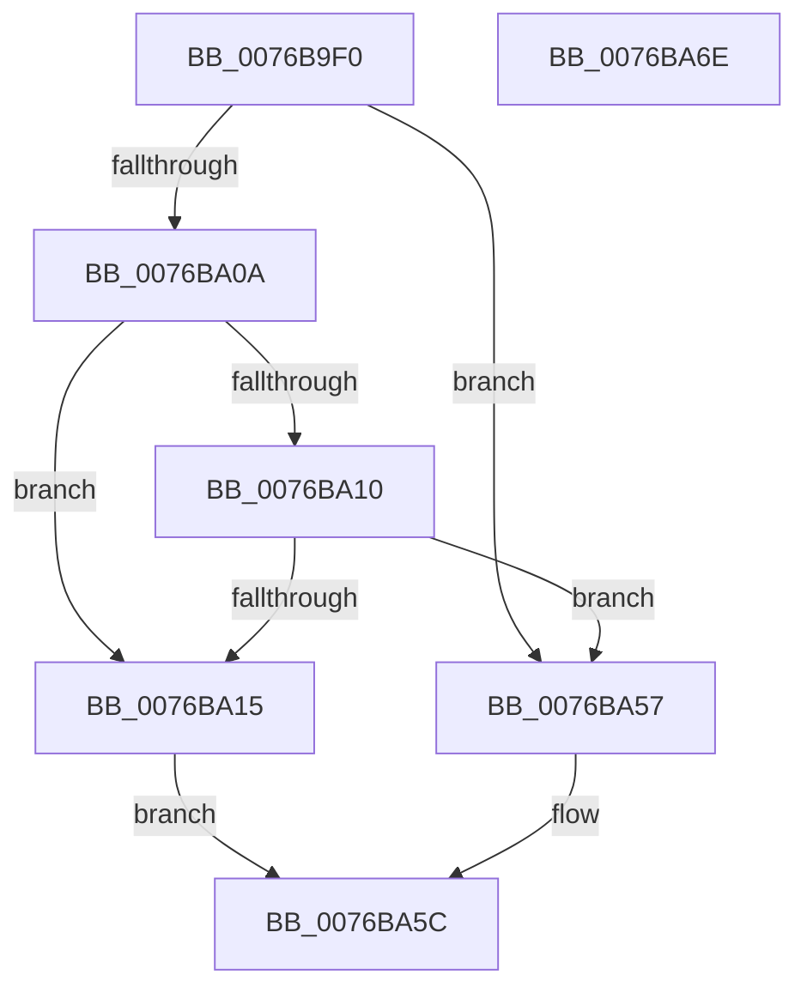

# PopAdaptiveSetSystemInitiatedRebootTargetStateOverride

- RVA: `0x0076B9F0`–`0x0076BA6F` (길이 `127` bytes)
- VA: `0x000000014076B9F0`
- 실행 섹션: `PAGE`
- PDB 이름 있음: `예`; PDB Function 태그: `아니요`
- unwind 정보 RVA: `0x00060BC4`
- 디코드: `38`개 명령, `127/127` bytes 표시
- 미해석 바이트: `0` (있으면 어셈블리에 `.byte`로 보존)

> 이 문서는 커널 이미지의 기계어와 PDB 기호를 분석해 생성했습니다. 4번과 5번은 함수 원형과 자료형을 바이너리 사용 방식에서 추정한 C 해석이며 원본 소스 복구 결과는 아닙니다.

## 1. Dependencies

- 직접 호출 지점: **2**; 고유 호출 대상: **2**
- 직접 호출자로 확인된 함수: **1**
- RIP 상대 이미지 참조: **2**

### Outgoing calls
- `0x0076BA17` → [PopAcquireAdaptiveLock](../A3/PopAcquireAdaptiveLock_function_00A3B0E8.md) (function, `0x00A3B0E8`)
- `0x0076BA50` → [PopReleaseAdaptiveLock](../91/PopReleaseAdaptiveLock_function_009137DC.md) (function, `0x009137DC`)

### Direct callers
- [PopPowerInformationInternal](../A8/PopPowerInformationInternal_function_00A8B7C0.md) at `0x00A8CDD0`

### Static image references
- `0x0076BA1F` → RVA `0x00FD8200` (`PAGEDATA`; read)
- `0x0076BA30` → RVA `0x00FD8200` (`PAGEDATA`; write)

## 2. Other-region calls and transfers

- 다른 실행 섹션으로 향하는 call: **0**
- 별도 외부 분기/꼬리 이동을 확인하지 못했습니다.

## 3. Assembly (complete function range)

```asm
0076B9F0  48 89 5C 24 08                  mov qword ptr [rsp + 8], rbx
0076B9F5  48 89 74 24 10                  mov qword ptr [rsp + 0x10], rsi
0076B9FA  57                              push rdi
0076B9FB  48 83 EC 20                     sub rsp, 0x20
0076B9FF  8B 41 0C                        mov eax, dword ptr [rcx + 0xc]
0076BA02  48 8B F1                        mov rsi, rcx
0076BA05  83 F8 06                        cmp eax, 6
0076BA08  77 4D                           ja 0x14076ba57
0076BA0A  33 DB                           xor ebx, ebx
0076BA0C  85 C0                           test eax, eax
0076BA0E  75 05                           jne 0x14076ba15
0076BA10  38 59 08                        cmp byte ptr [rcx + 8], bl
0076BA13  75 42                           jne 0x14076ba57
0076BA15  B1 01                           mov cl, 1
0076BA17  E8 CC F6 2C 00                  call 0x140a3b0e8
0076BA1C  8B 56 0C                        mov edx, dword ptr [rsi + 0xc]
0076BA1F  48 8B 05 DA C7 86 00            mov rax, qword ptr [rip + 0x86c7da]
0076BA26  83 E2 07                        and edx, 7
0076BA29  48 83 E0 F8                     and rax, 0xfffffffffffffff8
0076BA2D  48 0B D0                        or rdx, rax
0076BA30  48 89 15 C9 C7 86 00            mov qword ptr [rip + 0x86c7c9], rdx
0076BA37  8A 46 08                        mov al, byte ptr [rsi + 8]
0076BA3A  F6 D8                           neg al
0076BA3C  48 1B C9                        sbb rcx, rcx
0076BA3F  48 83 E2 F7                     and rdx, 0xfffffffffffffff7
0076BA43  83 E1 08                        and ecx, 8
0076BA46  48 0B CA                        or rcx, rdx
0076BA49  48 89 0D B0 C7 86 00            mov qword ptr [rip + 0x86c7b0], rcx
0076BA50  E8 87 7D 1A 00                  call 0x1409137dc
0076BA55  EB 05                           jmp 0x14076ba5c
0076BA57  BB 0D 00 00 C0                  mov ebx, 0xc000000d
0076BA5C  48 8B 74 24 38                  mov rsi, qword ptr [rsp + 0x38]
0076BA61  8B C3                           mov eax, ebx
0076BA63  48 8B 5C 24 30                  mov rbx, qword ptr [rsp + 0x30]
0076BA68  48 83 C4 20                     add rsp, 0x20
0076BA6C  5F                              pop rdi
0076BA6D  C3                              ret
0076BA6E  CC                              int3
```

## 4. C-style interpretation (structured pseudocode)

```c
__int64 __fastcall PopAdaptiveSetSystemInitiatedRebootTargetStateOverride(__int64 a1)
{
    __int64 result;
    __int64 v_rbx;
    __int64 v_rsp;
    unsigned __int64 v_stack_p10;
    unsigned __int64 v_stack_p8;

    v_stack_p8 = v_rbx;
    v_stack_p10 = v_rsi;
    v_rsp = (v_rsp) - (32);
    if (((unsigned int)((unsigned int)(*(unsigned int *)(a1 + 12)))) > 6) goto loc_0076BA57;
    v_rbx = 0;
    if ((unsigned int)((unsigned int)(*(unsigned int *)(a1 + 12))) != 0) goto loc_0076BA15;
    if ((*(unsigned __int8 *)(a1 + 8)) != 0) goto loc_0076BA57;
loc_0076BA15:
    result = PopAcquireAdaptiveLock(1, a2, a3, a4);
    a2 = (unsigned int)(((unsigned int)(*(unsigned int *)(a1 + 12))) & (7));
    result = (*(unsigned __int64 *)(v_rip + 8832986)) & (-8);
    a2 = (a2) | (result);
    *(unsigned __int64 *)(v_rip + 8832969) = a2;
    result = (unsigned __int8)(-(*(unsigned __int8 *)(a1 + 8)));
    a2 = (a2) & (-9);
    a1 = (unsigned int)((1) & (8));
    a1 = (a1) | (a2);
    *(unsigned __int64 *)(v_rip + 8832944) = a1;
    result = PopReleaseAdaptiveLock(a1, a2, a3, a4);
    goto loc_0076BA5C;
loc_0076BA57:
loc_0076BA5C:
    v_rsp = (v_rsp) + (32);
    return (unsigned int)((unsigned int)((unsigned int)(0xC000000DULL)));
}
```

## 5. (Beta) C Style

```c
int64_t PopAdaptiveSetSystemInitiatedRebootTargetStateOverride(void *Arg1)
{
    uint8_t *arg1 = (uint8_t *)Arg1;

    int64_t result;
    int64_t local_rbx;
    int64_t local_rsp;
    uint64_t v_stack_p10;
    uint64_t v_stack_p8;

    v_stack_p8 = local_rbx;
    v_stack_p10 = local_rsi;
    local_rsp = (local_rsp) - (32);
    if (((uint32_t)((uint32_t)(*(uint32_t *)(arg1 + 0xC)))) > 6) goto loc_0076BA57;
    local_rbx = 0;
    if ((uint32_t)((uint32_t)(*(uint32_t *)(arg1 + 0xC))) != 0) goto loc_0076BA15;
    if ((*(uint8_t *)(arg1 + 0x8)) != 0) goto loc_0076BA57;
loc_0076BA15:
    result = PopAcquireAdaptiveLock(1, a2, a3, a4);
    a2 = (uint32_t)(((uint32_t)(*(uint32_t *)(arg1 + 0xC))) & (7));
    result = (*(uint64_t *)(v_rip + 0x86C7DA)) & (-8);
    a2 = (a2) | (result);
    *(uint64_t *)(v_rip + 0x86C7C9) = a2;
    result = (uint8_t)(-(*(uint8_t *)(arg1 + 0x8)));
    a2 = (a2) & (-9);
    Arg1 = (uint32_t)((1) & (8));
    Arg1 = (Arg1) | (a2);
    *(void **)(v_rip + 0x86C7B0) = Arg1;
    result = PopReleaseAdaptiveLock(Arg1, a2, a3, a4);
    goto loc_0076BA5C;
loc_0076BA57:
loc_0076BA5C:
    local_rsp = (local_rsp) + (32);
    return (uint32_t)((uint32_t)((uint32_t)(0xC000000DULL)));
}
```

### 관측된 메모리 오프셋

구조체 형식이 확인되지 않은 접근은 인자 기준의 오프셋으로만 기록했습니다.

| 기준 인자 | 오프셋 표현 | 폭 (bit) | 접근 |
|---|---:|---:|---|
| `Arg1` | `+ 0x8` | `8` | `R` |
| `Arg1` | `+ 0xC` | `32` | `R` |

## 6. Execution-region graph

[열기: 2D/3D 그래프와 함수 탐색 컨트롤 패널](../../../control-panel.html?section=page&rva=0x0076B9F0&view=graph)

- 2D 그래프는 위에서 아래로 흐르고, 3D 그래프는 빈 공간을 드래그해 회전합니다. Shift+드래그는 이동, 휠은 확대·축소, 함수 노드 선택은 대상 보고서 이동입니다.

### Static fallback


