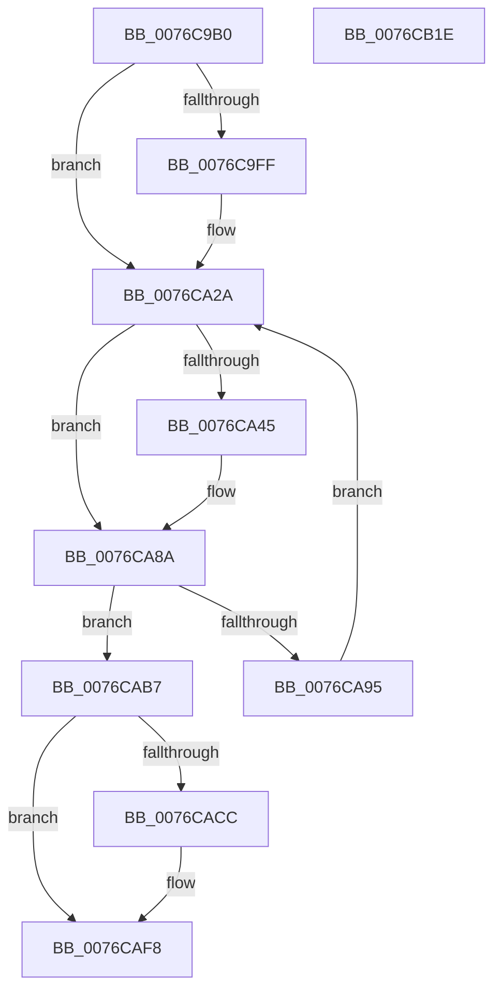

# PopAdaptiveStandbyActionWorker

- RVA: `0x0076C9B0`–`0x0076CB1F` (길이 `367` bytes)
- VA: `0x000000014076C9B0`
- 실행 섹션: `PAGE`
- PDB 이름 있음: `예`; PDB Function 태그: `아니요`
- unwind 정보 RVA: `0x000BD124`
- 디코드: `78`개 명령, `367/367` bytes 표시
- 미해석 바이트: `0` (있으면 어셈블리에 `.byte`로 보존)

> 이 문서는 커널 이미지의 기계어와 PDB 기호를 분석해 생성했습니다. 4번과 5번은 함수 원형과 자료형을 바이너리 사용 방식에서 추정한 C 해석이며 원본 소스 복구 결과는 아닙니다.

## 1. Dependencies

- 직접 호출 지점: **14**; 고유 호출 대상: **11**
- 직접 호출자로 확인된 함수: **0**
- RIP 상대 이미지 참조: **9**

### Outgoing calls
- `0x0076C9E4` → [EtwActivityIdControl](../../text/41/EtwActivityIdControl_function_0041E720.md) (function, `0x0041E720`)
- `0x0076C9ED` → [IoSetActivityIdThread](../../text/46/IoSetActivityIdThread_function_00466340.md) (function, `0x00466340`)
- `0x0076CA25` → [tlgWriteTransfer_EtwWriteTransfer](../../text/42/tlgWriteTransfer_EtwWriteTransfer_function_004260E0.md) (function, `0x004260E0`)
- `0x0076CA31` → [PopAcquireRwLockExclusive](../../text/43/PopAcquireRwLockExclusive_function_00430B44.md) (function, `0x00430B44`)
- `0x0076CA5B` → [IoGetActivityIdThread](../../text/44/IoGetActivityIdThread_function_00445030.md) (function, `0x00445030`)
- `0x0076CA85` → [tlgWriteTransfer_EtwWriteTransfer](../../text/42/tlgWriteTransfer_EtwWriteTransfer_function_004260E0.md) (function, `0x004260E0`)
- `0x0076CA9C` → [PopReleaseRwLock](../../text/2D/PopReleaseRwLock_function_002DFBBC.md) (function, `0x002DFBBC`)
- `0x0076CAA1` → [PopAcquirePolicyLock](../../pagelk/B7/PopAcquirePolicyLock_function_00B783C0.md) (function, `0x00B783C0`)
- `0x0076CAA8` → [PopPowerAggregatorTriggerAdaptiveAction](PopPowerAggregatorTriggerAdaptiveAction_function_00765240.md) (function, `0x00765240`)
- `0x0076CAAD` → [PopReleasePolicyLock](../../pagelk/B7/PopReleasePolicyLock_function_00B78410.md) (function, `0x00B78410`)
- `0x0076CABE` → [PopReleaseRwLock](../../text/2D/PopReleaseRwLock_function_002DFBBC.md) (function, `0x002DFBBC`)
- `0x0076CAF3` → [tlgWriteTransfer_EtwWriteTransfer](../../text/42/tlgWriteTransfer_EtwWriteTransfer_function_004260E0.md) (function, `0x004260E0`)
- `0x0076CAFC` → [IoClearActivityIdThread](../../text/46/IoClearActivityIdThread_function_0046BFF0.md) (function, `0x0046BFF0`)
- `0x0076CB08` → [_security_check_cookie](../../text/6A/_security_check_cookie_function_006AC640.md) (function, `0x006AC640`)

### Direct callers
- 이 함수 시작 RVA로 연결되는 직접 call은 확인되지 않았습니다. 간접 호출은 완전히 역산할 수 없습니다.

### Static image references
- `0x0076C9C2` → RVA `0x00E0A740` (`.data`; read)
- `0x0076C9F2` → RVA `0x00E082E8` (`.data`; read)
- `0x0076CA1E` → RVA `0x0004FEE1` (`.rdata`; read)
- `0x0076CA2A` → RVA `0x00F07E80` (`.data`; read)
- `0x0076CA3D` → RVA `0x00F07E6C` (`.data`; read)
- `0x0076CA63` → RVA `0x0004F963` (`.rdata`; read)
- `0x0076CA95` → RVA `0x00F07E6C` (`.data`; read/write)
- `0x0076CAB7` → RVA `0x00F07E68` (`.data`; write)
- `0x0076CADD` → RVA `0x0004F99F` (`.rdata`; read)

## 2. Other-region calls and transfers

- 다른 실행 섹션으로 향하는 call: **13**
  - `0x0076C9E4` → [EtwActivityIdControl](../../text/41/EtwActivityIdControl_function_0041E720.md) (`PAGE` → `.text`)
  - `0x0076C9ED` → [IoSetActivityIdThread](../../text/46/IoSetActivityIdThread_function_00466340.md) (`PAGE` → `.text`)
  - `0x0076CA25` → [tlgWriteTransfer_EtwWriteTransfer](../../text/42/tlgWriteTransfer_EtwWriteTransfer_function_004260E0.md) (`PAGE` → `.text`)
  - `0x0076CA31` → [PopAcquireRwLockExclusive](../../text/43/PopAcquireRwLockExclusive_function_00430B44.md) (`PAGE` → `.text`)
  - `0x0076CA5B` → [IoGetActivityIdThread](../../text/44/IoGetActivityIdThread_function_00445030.md) (`PAGE` → `.text`)
  - `0x0076CA85` → [tlgWriteTransfer_EtwWriteTransfer](../../text/42/tlgWriteTransfer_EtwWriteTransfer_function_004260E0.md) (`PAGE` → `.text`)
  - `0x0076CA9C` → [PopReleaseRwLock](../../text/2D/PopReleaseRwLock_function_002DFBBC.md) (`PAGE` → `.text`)
  - `0x0076CAA1` → [PopAcquirePolicyLock](../../pagelk/B7/PopAcquirePolicyLock_function_00B783C0.md) (`PAGE` → `PAGELK`)
  - `0x0076CAAD` → [PopReleasePolicyLock](../../pagelk/B7/PopReleasePolicyLock_function_00B78410.md) (`PAGE` → `PAGELK`)
  - `0x0076CABE` → [PopReleaseRwLock](../../text/2D/PopReleaseRwLock_function_002DFBBC.md) (`PAGE` → `.text`)
  - `0x0076CAF3` → [tlgWriteTransfer_EtwWriteTransfer](../../text/42/tlgWriteTransfer_EtwWriteTransfer_function_004260E0.md) (`PAGE` → `.text`)
  - `0x0076CAFC` → [IoClearActivityIdThread](../../text/46/IoClearActivityIdThread_function_0046BFF0.md) (`PAGE` → `.text`)
  - `0x0076CB08` → [_security_check_cookie](../../text/6A/_security_check_cookie_function_006AC640.md) (`PAGE` → `.text`)
- 별도 외부 분기/꼬리 이동을 확인하지 못했습니다.

## 3. Assembly (complete function range)

```asm
0076C9B0  48 89 5C 24 08                  mov qword ptr [rsp + 8], rbx
0076C9B5  55                              push rbp
0076C9B6  48 8D 6C 24 A9                  lea rbp, [rsp - 0x57]
0076C9BB  48 81 EC 90 00 00 00            sub rsp, 0x90
0076C9C2  48 8B 05 77 DD 69 00            mov rax, qword ptr [rip + 0x69dd77]
0076C9C9  48 33 C4                        xor rax, rsp
0076C9CC  48 89 45 47                     mov qword ptr [rbp + 0x47], rax
0076C9D0  33 C0                           xor eax, eax
0076C9D2  48 8D 55 FF                     lea rdx, [rbp - 1]
0076C9D6  0F 57 C0                        xorps xmm0, xmm0
0076C9D9  48 89 45 0F                     mov qword ptr [rbp + 0xf], rax
0076C9DD  0F 11 45 FF                     movups xmmword ptr [rbp - 1], xmm0
0076C9E1  8D 48 03                        lea ecx, [rax + 3]
0076C9E4  E8 37 1D CB FF                  call 0x14041e720
0076C9E9  48 8D 4D FF                     lea rcx, [rbp - 1]
0076C9ED  E8 4E 99 CF FF                  call 0x140466340
0076C9F2  83 3D EF B8 69 00 05            cmp dword ptr [rip + 0x69b8ef], 5
0076C9F9  48 89 45 0F                     mov qword ptr [rbp + 0xf], rax
0076C9FD  76 2B                           jbe 0x14076ca2a
0076C9FF  48 8D 4D 17                     lea rcx, [rbp + 0x17]
0076CA03  4C 8B C8                        mov r9, rax
0076CA06  48 89 4C 24 28                  mov qword ptr [rsp + 0x28], rcx
0076CA0B  4C 8D 45 FF                     lea r8, [rbp - 1]
0076CA0F  48 8D 0D D2 B8 69 00            lea rcx, [rip + 0x69b8d2]
0076CA16  C7 44 24 20 02 00 00 00         mov dword ptr [rsp + 0x20], 2
0076CA1E  48 8D 15 BC 34 8E FF            lea rdx, [rip - 0x71cb44]
0076CA25  E8 B6 96 CB FF                  call 0x1404260e0
0076CA2A  48 8D 0D 4F B4 79 00            lea rcx, [rip + 0x79b44f]
0076CA31  E8 0E 41 CC FF                  call 0x140430b44
0076CA36  83 3D AB B8 69 00 05            cmp dword ptr [rip + 0x69b8ab], 5
0076CA3D  8B 1D 29 B4 79 00               mov ebx, dword ptr [rip + 0x79b429]
0076CA43  76 45                           jbe 0x14076ca8a
0076CA45  83 65 43 00                     and dword ptr [rbp + 0x43], 0
0076CA49  48 8D 45 F7                     lea rax, [rbp - 9]
0076CA4D  48 89 45 37                     mov qword ptr [rbp + 0x37], rax
0076CA51  89 5D F7                        mov dword ptr [rbp - 9], ebx
0076CA54  C7 45 3F 04 00 00 00            mov dword ptr [rbp + 0x3f], 4
0076CA5B  E8 D0 85 CD FF                  call 0x140445030
0076CA60  4C 8B C0                        mov r8, rax
0076CA63  48 8D 15 F9 2E 8E FF            lea rdx, [rip - 0x71d107]
0076CA6A  48 8D 45 17                     lea rax, [rbp + 0x17]
0076CA6E  45 33 C9                        xor r9d, r9d
0076CA71  48 89 44 24 28                  mov qword ptr [rsp + 0x28], rax
0076CA76  48 8D 0D 6B B8 69 00            lea rcx, [rip + 0x69b86b]
0076CA7D  C7 44 24 20 03 00 00 00         mov dword ptr [rsp + 0x20], 3
0076CA85  E8 56 96 CB FF                  call 0x1404260e0
0076CA8A  48 8D 0D EF B3 79 00            lea rcx, [rip + 0x79b3ef]
0076CA91  85 DB                           test ebx, ebx
0076CA93  74 22                           je 0x14076cab7
0076CA95  83 25 D0 B3 79 00 00            and dword ptr [rip + 0x79b3d0], 0
0076CA9C  E8 1B 31 B7 FF                  call 0x1402dfbbc
0076CAA1  E8 1A B9 40 00                  call 0x140b783c0
0076CAA6  8B CB                           mov ecx, ebx
0076CAA8  E8 93 87 FF FF                  call 0x140765240
0076CAAD  E8 5E B9 40 00                  call 0x140b78410
0076CAB2  E9 73 FF FF FF                  jmp 0x14076ca2a
0076CAB7  C6 05 AA B3 79 00 00            mov byte ptr [rip + 0x79b3aa], 0
0076CABE  E8 F9 30 B7 FF                  call 0x1402dfbbc
0076CAC3  83 3D 1E B8 69 00 05            cmp dword ptr [rip + 0x69b81e], 5
0076CACA  76 2C                           jbe 0x14076caf8
0076CACC  4C 8B 4D 0F                     mov r9, qword ptr [rbp + 0xf]
0076CAD0  48 8D 45 17                     lea rax, [rbp + 0x17]
0076CAD4  48 89 44 24 28                  mov qword ptr [rsp + 0x28], rax
0076CAD9  4C 8D 45 FF                     lea r8, [rbp - 1]
0076CADD  48 8D 15 BB 2E 8E FF            lea rdx, [rip - 0x71d145]
0076CAE4  C7 44 24 20 02 00 00 00         mov dword ptr [rsp + 0x20], 2
0076CAEC  48 8D 0D F5 B7 69 00            lea rcx, [rip + 0x69b7f5]
0076CAF3  E8 E8 95 CB FF                  call 0x1404260e0
0076CAF8  48 8B 4D 0F                     mov rcx, qword ptr [rbp + 0xf]
0076CAFC  E8 EF F4 CF FF                  call 0x14046bff0
0076CB01  48 8B 4D 47                     mov rcx, qword ptr [rbp + 0x47]
0076CB05  48 33 CC                        xor rcx, rsp
0076CB08  E8 33 FB F3 FF                  call 0x1406ac640
0076CB0D  48 8B 9C 24 A0 00 00 00         mov rbx, qword ptr [rsp + 0xa0]
0076CB15  48 81 C4 90 00 00 00            add rsp, 0x90
0076CB1C  5D                              pop rbp
0076CB1D  C3                              ret
0076CB1E  CC                              int3
```

## 4. C-style interpretation (structured pseudocode)

```c
__int64 __fastcall PopAdaptiveStandbyActionWorker(void)
{
    __int64 result;
    __int64 v_rsp;
    unsigned __int64 v_stack_m18;
    unsigned int v_stack_m1C;
    unsigned int v_stack_m20;
    unsigned __int64 v_stack_m28;
    unsigned __int64 v_stack_m48;
    unsigned __int64 v_stack_m50;
    unsigned __int64 v_stack_m5F;
    unsigned __int64 v_stack_m60;
    unsigned __int64 v_stack_m68;
    unsigned __int64 v_stack_m70;
    unsigned int v_stack_m78;
    unsigned __int64 v_stack_p8;

    v_stack_p8 = v_rbx;
    v_rsp = (v_rsp) - (144);
    result = (*(unsigned __int64 *)(v_rip + 6937975)) ^ (v_rsp);
    v_stack_m18 = result;
    result = 0;
    v_stack_m50 = 0;
    v_stack_m60 = v_xmm0;
    result = EtwActivityIdControl(result + 3, v_stack_m60, a3, a4);
    result = IoSetActivityIdThread(v_stack_m60, v_stack_m60, a3, a4);
    v_stack_m50 = result;
    if ((*(unsigned int *)(v_rip + 6928623)) >= = 5) {
        a1 = v_stack_m48;
        a4 = result;
        v_stack_m70 = a1;
        a3 = v_stack_m60;
        a1 = v_rip + 6928594;
        v_stack_m78 = 2;
        a2 = v_rip - 7457604;
        result = tlgWriteTransfer_EtwWriteTransfer(a1, a2, a3, a4);
    }
    result = PopAcquireRwLockExclusive(v_rip + 7976015, a2, a3, a4);
    if ((*(unsigned int *)(v_rip + 6928555)) >= = 5) {
        result = v_stack_m68;
        v_stack_m28 = result;
        v_stack_m68 = (unsigned int)((unsigned int)(*(unsigned int *)(v_rip + 7975977)));
        v_stack_m20 = 4;
        result = IoGetActivityIdThread(v_rip + 7976015, a2, a3, a4);
        a3 = result;
        a2 = v_rip - 7459079;
        result = v_stack_m48;
        a4 = 0;
        v_stack_m70 = result;
        a1 = v_rip + 6928491;
        v_stack_m78 = 3;
        result = tlgWriteTransfer_EtwWriteTransfer(a1, a2, a3, a4);
    }
    if ((unsigned int)((unsigned int)(*(unsigned int *)(v_rip + 7975977))) == 0) goto loc_0076CAB7;
    result = PopReleaseRwLock(v_rip + 7975919, a2, a3, a4);
    result = PopAcquirePolicyLock(v_rip + 7975919, a2, a3, a4);
    result = PopPowerAggregatorTriggerAdaptiveAction((unsigned int)((unsigned int)((unsigned int)(*(unsigned int *)(v_rip + 7975977)))), a2, a3, a4);
    result = PopReleasePolicyLock((unsigned int)((unsigned int)((unsigned int)(*(unsigned int *)(v_rip + 7975977)))), a2, a3, a4);
    goto loc_0076CA2A;
loc_0076CAB7:
    *(unsigned __int8 *)(v_rip + 7975850) = 0;
    result = PopReleaseRwLock((unsigned int)((unsigned int)((unsigned int)(*(unsigned int *)(v_rip + 7975977)))), a2, a3, a4);
    if ((*(unsigned int *)(v_rip + 6928414)) >= = 5) {
        a4 = v_stack_m50;
        result = v_stack_m48;
        v_stack_m70 = result;
        a3 = v_stack_m60;
        a2 = v_rip - 7459141;
        v_stack_m78 = 2;
        a1 = v_rip + 6928373;
        result = tlgWriteTransfer_EtwWriteTransfer(a1, a2, a3, a4);
    }
    result = IoClearActivityIdThread(v_stack_m50, a2, a3, a4);
    a1 = (v_stack_m18) ^ (v_rsp);
    result = _security_check_cookie(a1, a2, a3, a4);
    v_rsp = (v_rsp) + (144);
    return result;
}
```

## 5. (Beta) C Style

```c
void PopAdaptiveStandbyActionWorker(void)
{
    int64_t result;
    int64_t local_rsp;
    uint64_t v_stack_m18;
    uint32_t v_stack_m1C;
    uint32_t v_stack_m20;
    uint64_t v_stack_m28;
    uint64_t v_stack_m48;
    uint64_t v_stack_m50;
    uint64_t v_stack_m5F;
    uint64_t v_stack_m60;
    uint64_t v_stack_m68;
    uint64_t v_stack_m70;
    uint32_t v_stack_m78;
    uint64_t v_stack_p8;

    v_stack_p8 = local_rbx;
    local_rsp = (local_rsp) - (144);
    result = (*(uint64_t *)(v_rip + 0x69DD77)) ^ (local_rsp);
    v_stack_m18 = result;
    result = 0;
    v_stack_m50 = 0;
    v_stack_m60 = v_xmm0;
    result = EtwActivityIdControl(result + 3, v_stack_m60, a3, a4);
    result = IoSetActivityIdThread(v_stack_m60, v_stack_m60, a3, a4);
    v_stack_m50 = result;
    if ((*(uint32_t *)(v_rip + 0x69B8EF)) >= = 5) {
        a1 = v_stack_m48;
        a4 = result;
        v_stack_m70 = a1;
        a3 = v_stack_m60;
        a1 = v_rip + 6928594;
        v_stack_m78 = 2;
        a2 = v_rip - 7457604;
        result = tlgWriteTransfer_EtwWriteTransfer(a1, a2, a3, a4);
    }
    result = PopAcquireRwLockExclusive(v_rip + 7976015, a2, a3, a4);
    if ((*(uint32_t *)(v_rip + 0x69B8AB)) >= = 5) {
        result = v_stack_m68;
        v_stack_m28 = result;
        v_stack_m68 = (uint32_t)((uint32_t)(*(uint32_t *)(v_rip + 0x79B429)));
        v_stack_m20 = 4;
        result = IoGetActivityIdThread(v_rip + 7976015, a2, a3, a4);
        a3 = result;
        a2 = v_rip - 7459079;
        result = v_stack_m48;
        a4 = 0;
        v_stack_m70 = result;
        a1 = v_rip + 6928491;
        v_stack_m78 = 3;
        result = tlgWriteTransfer_EtwWriteTransfer(a1, a2, a3, a4);
    }
    if ((uint32_t)((uint32_t)(*(uint32_t *)(v_rip + 0x79B429))) == 0) goto loc_0076CAB7;
    result = PopReleaseRwLock(v_rip + 7975919, a2, a3, a4);
    result = PopAcquirePolicyLock(v_rip + 7975919, a2, a3, a4);
    result = PopPowerAggregatorTriggerAdaptiveAction((uint32_t)((uint32_t)((uint32_t)(*(uint32_t *)(v_rip + 0x79B429)))), a2, a3, a4);
    result = PopReleasePolicyLock((uint32_t)((uint32_t)((uint32_t)(*(uint32_t *)(v_rip + 0x79B429)))), a2, a3, a4);
    goto loc_0076CA2A;
loc_0076CAB7:
    *(uint8_t *)(v_rip + 0x79B3AA) = 0;
    result = PopReleaseRwLock((uint32_t)((uint32_t)((uint32_t)(*(uint32_t *)(v_rip + 0x79B429)))), a2, a3, a4);
    if ((*(uint32_t *)(v_rip + 0x69B81E)) >= = 5) {
        a4 = v_stack_m50;
        result = v_stack_m48;
        v_stack_m70 = result;
        a3 = v_stack_m60;
        a2 = v_rip - 7459141;
        v_stack_m78 = 2;
        a1 = v_rip + 6928373;
        result = tlgWriteTransfer_EtwWriteTransfer(a1, a2, a3, a4);
    }
    result = IoClearActivityIdThread(v_stack_m50, a2, a3, a4);
    a1 = (v_stack_m18) ^ (local_rsp);
    result = _security_check_cookie(a1, a2, a3, a4);
    local_rsp = (local_rsp) + (144);
    return result;
}
```

## 6. Execution-region graph

[열기: 2D/3D 그래프와 함수 탐색 컨트롤 패널](../../../control-panel.html?section=page&rva=0x0076C9B0&view=graph)

- 2D 그래프는 위에서 아래로 흐르고, 3D 그래프는 빈 공간을 드래그해 회전합니다. Shift+드래그는 이동, 휠은 확대·축소, 함수 노드 선택은 대상 보고서 이동입니다.

### Static fallback


