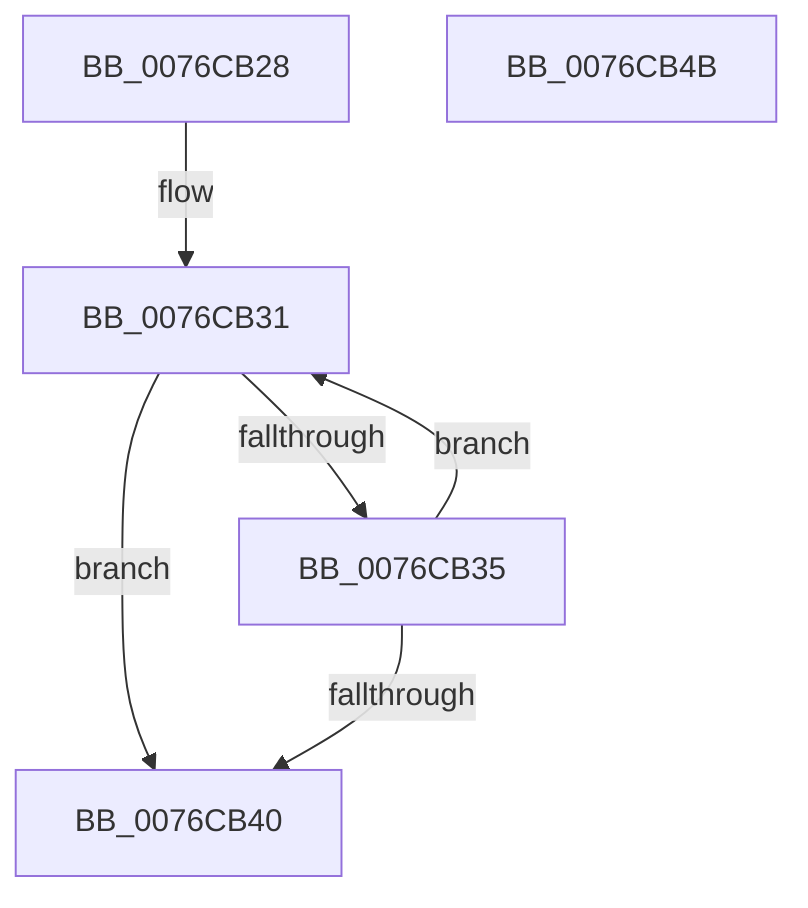

# PopAdaptiveStandbyCalculateBatteryRegion

- RVA: `0x0076CB28`–`0x0076CB4C` (길이 `36` bytes)
- VA: `0x000000014076CB28`
- 실행 섹션: `PAGE`
- PDB 이름 있음: `예`; PDB Function 태그: `아니요`
- unwind 정보 RVA: `0x000DB714`
- 디코드: `13`개 명령, `36/36` bytes 표시
- 미해석 바이트: `0` (있으면 어셈블리에 `.byte`로 보존)

> 이 문서는 커널 이미지의 기계어와 PDB 기호를 분석해 생성했습니다. 4번과 5번은 함수 원형과 자료형을 바이너리 사용 방식에서 추정한 C 해석이며 원본 소스 복구 결과는 아닙니다.

## 1. Dependencies

- 직접 호출 지점: **0**; 고유 호출 대상: **0**
- 직접 호출자로 확인된 함수: **2**
- RIP 상대 이미지 참조: **1**

### Outgoing calls
- 직접 디코드된 call 명령이 없습니다.

### Direct callers
- [PopAdaptiveStandbyHandleBatteryUpdate](../6F/PopAdaptiveStandbyHandleBatteryUpdate_function_006FD39C.md) at `0x006FD644`
- [PopAdaptiveStandbySessionStart](PopAdaptiveStandbySessionStart_function_0076E8C8.md) at `0x0076E96E`

### Static image references
- `0x0076CB2A` → RVA `0x00E0C3E8` (`.data`; read)

## 2. Other-region calls and transfers

- 다른 실행 섹션으로 향하는 call: **0**
- 별도 외부 분기/꼬리 이동을 확인하지 못했습니다.

## 3. Assembly (complete function range)

```asm
0076CB28  33 D2                           xor edx, edx
0076CB2A  48 8D 05 B7 F8 69 00            lea rax, [rip + 0x69f8b7]
0076CB31  3B 08                           cmp ecx, dword ptr [rax]
0076CB33  7F 0B                           jg 0x14076cb40
0076CB35  FF C2                           inc edx
0076CB37  48 83 C0 14                     add rax, 0x14
0076CB3B  83 FA 03                        cmp edx, 3
0076CB3E  72 F1                           jb 0x14076cb31
0076CB40  B8 02 00 00 00                  mov eax, 2
0076CB45  3B D0                           cmp edx, eax
0076CB47  0F 42 C2                        cmovb eax, edx
0076CB4A  C3                              ret
0076CB4B  CC                              int3
```

## 4. C-style interpretation (structured pseudocode)

```c
__int64 __fastcall PopAdaptiveStandbyCalculateBatteryRegion(int a1, int a2)
{
    __int64 result;

    a2 = 0;
loc_0076CB31:
    if (a1 > (*(unsigned int *)(v_rip + 6944951))) goto loc_0076CB40;
    a2 = (unsigned int)((a2) + 1);
    result = (v_rip + 6944951) + (20);
    if (a2 < 3) goto loc_0076CB31;
loc_0076CB40:
    result = 2;
    if (a2 < 2) { result = a2; }
    return result;
}
```

## 5. (Beta) C Style

```c
int64_t PopAdaptiveStandbyCalculateBatteryRegion(int32_t Arg1, int32_t Arg2)
{
    int64_t result;

    Arg2 = 0;
loc_0076CB31:
    if (Arg1 > (*(uint32_t *)(v_rip + 0x69F8B7))) goto loc_0076CB40;
    Arg2 = (uint32_t)((Arg2) + 1);
    result = (v_rip + 6944951) + (20);
    if (Arg2 < 3) goto loc_0076CB31;
loc_0076CB40:
    result = 2;
    if (Arg2 < 2) { result = Arg2; }
    return result;
}
```

## 6. Execution-region graph

[열기: 2D/3D 그래프와 함수 탐색 컨트롤 패널](../../../control-panel.html?section=page&rva=0x0076CB28&view=graph)

- 2D 그래프는 위에서 아래로 흐르고, 3D 그래프는 빈 공간을 드래그해 회전합니다. Shift+드래그는 이동, 휠은 확대·축소, 함수 노드 선택은 대상 보고서 이동입니다.

### Static fallback


