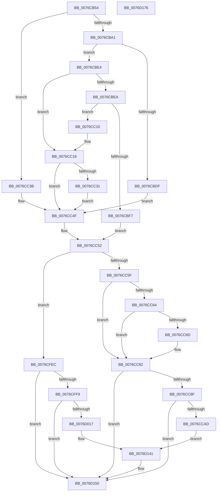

# PopAdaptiveStandbyCheckHibernateBudgetAction

- RVA: `0x0076CB54`–`0x0076D177` (길이 `1,571` bytes)
- VA: `0x000000014076CB54`
- 실행 섹션: `PAGE`
- PDB 이름 있음: `예`; PDB Function 태그: `아니요`
- unwind 정보 RVA: `0x000CD568`
- 디코드: `319`개 명령, `1,571/1,571` bytes 표시
- 미해석 바이트: `0` (있으면 어셈블리에 `.byte`로 보존)

> 이 문서는 커널 이미지의 기계어와 PDB 기호를 분석해 생성했습니다. 4번과 5번은 함수 원형과 자료형을 바이너리 사용 방식에서 추정한 C 해석이며 원본 소스 복구 결과는 아닙니다.

## 1. Dependencies

- 직접 호출 지점: **14**; 고유 호출 대상: **10**
- 직접 호출자로 확인된 함수: **1**
- RIP 상대 이미지 참조: **5**

### Outgoing calls
- `0x0076CB91` → [Feature_AdaptiveHibernateEnhancements__private_IsEnabledDeviceUsageNoInline](../../text/4F/Feature_AdaptiveHibernateEnhancements__private_IsEnabledDeviceUsageNoInline_function_004F78F0.md) (function, `0x004F78F0`)
- `0x0076CBC5` → [PopAdaptiveStandbySetPolicyTimer](PopAdaptiveStandbySetPolicyTimer_function_0076EF18.md) (function, `0x0076EF18`)
- `0x0076CBD6` → [PopAdaptiveStandbyCheckRefreshableBudgetActionPreconditions](PopAdaptiveStandbyCheckRefreshableBudgetActionPreconditions_function_0076D4BC.md) (function, `0x0076D4BC`)
- `0x0076CC13` → [PopAdaptiveStandbySetPolicyTimer](PopAdaptiveStandbySetPolicyTimer_function_0076EF18.md) (function, `0x0076EF18`)
- `0x0076CC25` → [PopAdaptiveStandbyCheckRefreshableBudgetActionV2](PopAdaptiveStandbyCheckRefreshableBudgetActionV2_function_0076D554.md) (function, `0x0076D554`)
- `0x0076CC47` → [PopAdaptiveStandbyCheckRefreshableBudgetAction](PopAdaptiveStandbyCheckRefreshableBudgetAction_function_0076D3F8.md) (function, `0x0076D3F8`)
- `0x0076CC52` → [Feature_AdaptiveHibernateEnhancements__private_IsEnabledDeviceUsageNoInline](../../text/4F/Feature_AdaptiveHibernateEnhancements__private_IsEnabledDeviceUsageNoInline_function_004F78F0.md) (function, `0x004F78F0`)
- `0x0076CC7D` → [KeCancelTimer2](../../text/3A/KeCancelTimer2_function_003A01E0.md) (function, `0x003A01E0`)
- `0x0076CCA0` → [tlgKeywordOn](../../text/42/tlgKeywordOn_function_0042EAA0.md) (function, `0x0042EAA0`)
- `0x0076CFC7` → [IoGetActivityIdThread](../../text/44/IoGetActivityIdThread_function_00445030.md) (function, `0x00445030`)
- `0x0076D00A` → [tlgKeywordOn](../../text/42/tlgKeywordOn_function_0042EAA0.md) (function, `0x0042EAA0`)
- `0x0076D121` → [IoGetActivityIdThread](../../text/44/IoGetActivityIdThread_function_00445030.md) (function, `0x00445030`)
- `0x0076D14B` → [tlgWriteTransfer_EtwWriteTransfer](../../text/42/tlgWriteTransfer_EtwWriteTransfer_function_004260E0.md) (function, `0x004260E0`)
- `0x0076D15D` → [_security_check_cookie](../../text/6A/_security_check_cookie_function_006AC640.md) (function, `0x006AC640`)

### Direct callers
- [PopAdaptiveStandbyHandleBatteryUpdate](../6F/PopAdaptiveStandbyHandleBatteryUpdate_function_006FD39C.md) at `0x006FD625`
- [PopAdaptiveStandbyHandleBatteryUpdate](../6F/PopAdaptiveStandbyHandleBatteryUpdate_function_006FD39C.md) at `0x006FD6C4`

### Static image references
- `0x0076CB70` → RVA `0x00E0A740` (`.data`; read)
- `0x0076CBAC` → RVA `0x00E0C3EC` (`.data`; read)
- `0x0076CC82` → RVA `0x00E082E8` (`.data`; read)
- `0x0076CFCF` → RVA `0x0004FAB9` (`.rdata`; read)
- `0x0076D129` → RVA `0x0004FD3D` (`.rdata`; read)

## 2. Other-region calls and transfers

- 다른 실행 섹션으로 향하는 call: **9**
  - `0x0076CB91` → [Feature_AdaptiveHibernateEnhancements__private_IsEnabledDeviceUsageNoInline](../../text/4F/Feature_AdaptiveHibernateEnhancements__private_IsEnabledDeviceUsageNoInline_function_004F78F0.md) (`PAGE` → `.text`)
  - `0x0076CC52` → [Feature_AdaptiveHibernateEnhancements__private_IsEnabledDeviceUsageNoInline](../../text/4F/Feature_AdaptiveHibernateEnhancements__private_IsEnabledDeviceUsageNoInline_function_004F78F0.md) (`PAGE` → `.text`)
  - `0x0076CC7D` → [KeCancelTimer2](../../text/3A/KeCancelTimer2_function_003A01E0.md) (`PAGE` → `.text`)
  - `0x0076CCA0` → [tlgKeywordOn](../../text/42/tlgKeywordOn_function_0042EAA0.md) (`PAGE` → `.text`)
  - `0x0076CFC7` → [IoGetActivityIdThread](../../text/44/IoGetActivityIdThread_function_00445030.md) (`PAGE` → `.text`)
  - `0x0076D00A` → [tlgKeywordOn](../../text/42/tlgKeywordOn_function_0042EAA0.md) (`PAGE` → `.text`)
  - `0x0076D121` → [IoGetActivityIdThread](../../text/44/IoGetActivityIdThread_function_00445030.md) (`PAGE` → `.text`)
  - `0x0076D14B` → [tlgWriteTransfer_EtwWriteTransfer](../../text/42/tlgWriteTransfer_EtwWriteTransfer_function_004260E0.md) (`PAGE` → `.text`)
  - `0x0076D15D` → [_security_check_cookie](../../text/6A/_security_check_cookie_function_006AC640.md) (`PAGE` → `.text`)
- 별도 외부 분기/꼬리 이동을 확인하지 못했습니다.

## 3. Assembly (complete function range)

```asm
0076CB54  40 55                           push rbp
0076CB56  53                              push rbx
0076CB57  56                              push rsi
0076CB58  57                              push rdi
0076CB59  41 54                           push r12
0076CB5B  41 55                           push r13
0076CB5D  41 56                           push r14
0076CB5F  41 57                           push r15
0076CB61  48 8D AC 24 68 FE FF FF         lea rbp, [rsp - 0x198]
0076CB69  48 81 EC 98 02 00 00            sub rsp, 0x298
0076CB70  48 8B 05 C9 DB 69 00            mov rax, qword ptr [rip + 0x69dbc9]
0076CB77  48 33 C4                        xor rax, rsp
0076CB7A  48 89 85 80 01 00 00            mov qword ptr [rbp + 0x180], rax
0076CB81  4D 8B E1                        mov r12, r9
0076CB84  48 8D 71 04                     lea rsi, [rcx + 4]
0076CB88  4D 8B F8                        mov r15, r8
0076CB8B  48 8B FA                        mov rdi, rdx
0076CB8E  48 8B D9                        mov rbx, rcx
0076CB91  E8 5A AD D8 FF                  call 0x1404f78f0
0076CB96  45 33 ED                        xor r13d, r13d
0076CB99  85 C0                           test eax, eax
0076CB9B  0F 84 9A 00 00 00               je 0x14076cc3b
0076CBA1  48 63 83 DC 00 00 00            movsxd rax, dword ptr [rbx + 0xdc]
0076CBA8  48 8D 0C 80                     lea rcx, [rax + rax*4]
0076CBAC  48 8D 05 39 F8 69 00            lea rax, [rip + 0x69f839]
0076CBB3  0F 10 04 88                     movups xmm0, xmmword ptr [rax + rcx*4]
0076CBB7  48 8B CB                        mov rcx, rbx
0076CBBA  F3 0F 7F 46 14                  movdqu xmmword ptr [rsi + 0x14], xmm0
0076CBBF  44 8B 46 14                     mov r8d, dword ptr [rsi + 0x14]
0076CBC3  8B 17                           mov edx, dword ptr [rdi]
0076CBC5  E8 4E 23 00 00                  call 0x14076ef18
0076CBCA  4D 8B CF                        mov r9, r15
0076CBCD  4C 8B C7                        mov r8, rdi
0076CBD0  48 8B D6                        mov rdx, rsi
0076CBD3  48 8B CB                        mov rcx, rbx
0076CBD6  E8 E1 08 00 00                  call 0x14076d4bc
0076CBDB  84 C0                           test al, al
0076CBDD  75 05                           jne 0x14076cbe4
0076CBDF  45 8A F5                        mov r14b, r13b
0076CBE2  EB 6B                           jmp 0x14076cc4f
0076CBE4  83 7F 0C 0A                     cmp dword ptr [rdi + 0xc], 0xa
0076CBE8  7F 2E                           jg 0x14076cc18
0076CBEA  8B 17                           mov edx, dword ptr [rdi]
0076CBEC  41 B8 08 07 00 00               mov r8d, 0x708
0076CBF2  41 3B D0                        cmp edx, r8d
0076CBF5  72 19                           jb 0x14076cc10
0076CBF7  41 B6 01                        mov r14b, 1
0076CBFA  44 88 36                        mov byte ptr [rsi], r14b
0076CBFD  45 89 2F                        mov dword ptr [r15], r13d
0076CC00  41 C7 04 24 04 00 00 00         mov dword ptr [r12], 4
0076CC08  41 BC 01 00 00 00               mov r12d, 1
0076CC0E  EB 42                           jmp 0x14076cc52
0076CC10  48 8B CB                        mov rcx, rbx
0076CC13  E8 00 23 00 00                  call 0x14076ef18
0076CC18  8B 57 14                        mov edx, dword ptr [rdi + 0x14]
0076CC1B  4D 8B CF                        mov r9, r15
0076CC1E  44 8B 47 04                     mov r8d, dword ptr [rdi + 4]
0076CC22  48 8B CE                        mov rcx, rsi
0076CC25  E8 2A 09 00 00                  call 0x14076d554
0076CC2A  44 8A F0                        mov r14b, al
0076CC2D  84 C0                           test al, al
0076CC2F  74 1E                           je 0x14076cc4f
0076CC31  41 C7 04 24 01 00 00 00         mov dword ptr [r12], 1
0076CC39  EB 14                           jmp 0x14076cc4f
0076CC3B  4D 8B CF                        mov r9, r15
0076CC3E  4C 8B C7                        mov r8, rdi
0076CC41  48 8B D6                        mov rdx, rsi
0076CC44  48 8B CB                        mov rcx, rbx
0076CC47  E8 AC 07 00 00                  call 0x14076d3f8
0076CC4C  44 8A F0                        mov r14b, al
0076CC4F  45 8B E5                        mov r12d, r13d
0076CC52  E8 99 AC D8 FF                  call 0x1404f78f0
0076CC57  85 C0                           test eax, eax
0076CC59  0F 84 8D 03 00 00               je 0x14076cfec
0076CC5F  45 84 F6                        test r14b, r14b
0076CC62  74 1E                           je 0x14076cc82
0076CC64  44 38 AB 50 01 00 00            cmp byte ptr [rbx + 0x150], r13b
0076CC6B  74 15                           je 0x14076cc82
0076CC6D  48 8D 8B 58 01 00 00            lea rcx, [rbx + 0x158]
0076CC74  44 88 AB 50 01 00 00            mov byte ptr [rbx + 0x150], r13b
0076CC7B  33 D2                           xor edx, edx
0076CC7D  E8 5E 35 C3 FF                  call 0x1403a01e0
0076CC82  83 3D 5F B6 69 00 05            cmp dword ptr [rip + 0x69b65f], 5
0076CC89  0F 86 C1 04 00 00               jbe 0x14076d150
0076CC8F  48 BA 00 00 00 00 00 40 00 00   movabs rdx, 0x400000000000
0076CC99  48 8D 0D 48 B6 69 00            lea rcx, [rip + 0x69b648]
0076CCA0  E8 FB 1D CC FF                  call 0x14042eaa0
0076CCA5  84 C0                           test al, al
0076CCA7  0F 84 A3 04 00 00               je 0x14076d150
0076CCAD  8B 07                           mov eax, dword ptr [rdi]
0076CCAF  48 8B 93 F0 00 00 00            mov rdx, qword ptr [rbx + 0xf0]
0076CCB6  83 BB F8 00 00 00 02            cmp dword ptr [rbx + 0xf8], 2
0076CCBD  48 89 45 98                     mov qword ptr [rbp - 0x68], rax
0076CCC1  48 8D 45 98                     lea rax, [rbp - 0x68]
0076CCC5  48 89 45 D0                     mov qword ptr [rbp - 0x30], rax
0076CCC9  8B 46 14                        mov eax, dword ptr [rsi + 0x14]
0076CCCC  48 8D 4A FF                     lea rcx, [rdx - 1]
0076CCD0  89 44 24 54                     mov dword ptr [rsp + 0x54], eax
0076CCD4  48 0F 45 CA                     cmovne rcx, rdx
0076CCD8  48 8D 44 24 54                  lea rax, [rsp + 0x54]
0076CCDD  48 C7 45 D8 08 00 00 00         mov qword ptr [rbp - 0x28], 8
0076CCE5  48 89 45 E0                     mov qword ptr [rbp - 0x20], rax
0076CCE9  8B 47 0C                        mov eax, dword ptr [rdi + 0xc]
0076CCEC  89 44 24 58                     mov dword ptr [rsp + 0x58], eax
0076CCF0  48 8D 44 24 58                  lea rax, [rsp + 0x58]
0076CCF5  48 89 45 F0                     mov qword ptr [rbp - 0x10], rax
0076CCF9  8B 47 10                        mov eax, dword ptr [rdi + 0x10]
0076CCFC  89 44 24 5C                     mov dword ptr [rsp + 0x5c], eax
0076CD00  48 8D 44 24 5C                  lea rax, [rsp + 0x5c]
0076CD05  48 89 45 00                     mov qword ptr [rbp], rax
0076CD09  8B 46 18                        mov eax, dword ptr [rsi + 0x18]
0076CD0C  89 44 24 60                     mov dword ptr [rsp + 0x60], eax
0076CD10  48 8D 44 24 60                  lea rax, [rsp + 0x60]
0076CD15  48 89 45 10                     mov qword ptr [rbp + 0x10], rax
0076CD19  41 0F B6 C6                     movzx eax, r14b
0076CD1D  89 44 24 64                     mov dword ptr [rsp + 0x64], eax
0076CD21  48 8D 44 24 64                  lea rax, [rsp + 0x64]
0076CD26  48 89 45 20                     mov qword ptr [rbp + 0x20], rax
0076CD2A  41 8B 07                        mov eax, dword ptr [r15]
0076CD2D  89 44 24 68                     mov dword ptr [rsp + 0x68], eax
0076CD31  48 8D 44 24 68                  lea rax, [rsp + 0x68]
0076CD36  48 89 45 30                     mov qword ptr [rbp + 0x30], rax
0076CD3A  48 8B 83 00 01 00 00            mov rax, qword ptr [rbx + 0x100]
0076CD41  48 89 45 A0                     mov qword ptr [rbp - 0x60], rax
0076CD45  48 8D 45 A0                     lea rax, [rbp - 0x60]
0076CD49  48 89 45 40                     mov qword ptr [rbp + 0x40], rax
0076CD4D  48 8D 45 A8                     lea rax, [rbp - 0x58]
0076CD51  48 89 45 50                     mov qword ptr [rbp + 0x50], rax
0076CD55  48 8D 45 80                     lea rax, [rbp - 0x80]
0076CD59  48 89 45 60                     mov qword ptr [rbp + 0x60], rax
0076CD5D  8B 46 1C                        mov eax, dword ptr [rsi + 0x1c]
0076CD60  89 44 24 6C                     mov dword ptr [rsp + 0x6c], eax
0076CD64  48 8D 44 24 6C                  lea rax, [rsp + 0x6c]
0076CD69  48 89 45 70                     mov qword ptr [rbp + 0x70], rax
0076CD6D  8B 46 20                        mov eax, dword ptr [rsi + 0x20]
0076CD70  89 44 24 70                     mov dword ptr [rsp + 0x70], eax
0076CD74  48 8D 44 24 70                  lea rax, [rsp + 0x70]
0076CD79  48 89 85 80 00 00 00            mov qword ptr [rbp + 0x80], rax
0076CD80  8B 83 DC 00 00 00               mov eax, dword ptr [rbx + 0xdc]
0076CD86  89 44 24 74                     mov dword ptr [rsp + 0x74], eax
0076CD8A  48 8D 44 24 74                  lea rax, [rsp + 0x74]
0076CD8F  48 89 85 90 00 00 00            mov qword ptr [rbp + 0x90], rax
0076CD96  8B 47 04                        mov eax, dword ptr [rdi + 4]
0076CD99  48 89 45 88                     mov qword ptr [rbp - 0x78], rax
0076CD9D  48 8D 45 88                     lea rax, [rbp - 0x78]
0076CDA1  48 89 85 A0 00 00 00            mov qword ptr [rbp + 0xa0], rax
0076CDA8  48 8D 44 24 78                  lea rax, [rsp + 0x78]
0076CDAD  48 89 85 B0 00 00 00            mov qword ptr [rbp + 0xb0], rax
0076CDB4  8B 83 EC 00 00 00               mov eax, dword ptr [rbx + 0xec]
0076CDBA  89 44 24 7C                     mov dword ptr [rsp + 0x7c], eax
0076CDBE  48 8D 44 24 7C                  lea rax, [rsp + 0x7c]
0076CDC3  48 89 85 C0 00 00 00            mov qword ptr [rbp + 0xc0], rax
0076CDCA  48 C7 45 E8 04 00 00 00         mov qword ptr [rbp - 0x18], 4
0076CDD2  48 C7 45 F8 04 00 00 00         mov qword ptr [rbp - 8], 4
0076CDDA  48 C7 45 08 04 00 00 00         mov qword ptr [rbp + 8], 4
0076CDE2  48 C7 45 18 04 00 00 00         mov qword ptr [rbp + 0x18], 4
0076CDEA  48 C7 45 28 04 00 00 00         mov qword ptr [rbp + 0x28], 4
0076CDF2  48 C7 45 38 04 00 00 00         mov qword ptr [rbp + 0x38], 4
0076CDFA  48 C7 45 48 08 00 00 00         mov qword ptr [rbp + 0x48], 8
0076CE02  48 89 55 A8                     mov qword ptr [rbp - 0x58], rdx
0076CE06  48 C7 45 58 08 00 00 00         mov qword ptr [rbp + 0x58], 8
0076CE0E  48 89 4D 80                     mov qword ptr [rbp - 0x80], rcx
0076CE12  48 C7 45 68 08 00 00 00         mov qword ptr [rbp + 0x68], 8
0076CE1A  48 C7 45 78 04 00 00 00         mov qword ptr [rbp + 0x78], 4
0076CE22  48 C7 85 88 00 00 00 04 00 00 00  mov qword ptr [rbp + 0x88], 4
0076CE2D  48 C7 85 98 00 00 00 04 00 00 00  mov qword ptr [rbp + 0x98], 4
0076CE38  48 C7 85 A8 00 00 00 08 00 00 00  mov qword ptr [rbp + 0xa8], 8
0076CE43  44 89 64 24 78                  mov dword ptr [rsp + 0x78], r12d
0076CE48  48 C7 85 B8 00 00 00 04 00 00 00  mov qword ptr [rbp + 0xb8], 4
0076CE53  48 C7 85 C8 00 00 00 04 00 00 00  mov qword ptr [rbp + 0xc8], 4
0076CE5E  8A 83 88 00 00 00               mov al, byte ptr [rbx + 0x88]
0076CE64  B9 01 00 00 00                  mov ecx, 1
0076CE69  22 C1                           and al, cl
0076CE6B  48 89 8D D8 00 00 00            mov qword ptr [rbp + 0xd8], rcx
0076CE72  88 44 24 30                     mov byte ptr [rsp + 0x30], al
0076CE76  48 8D 44 24 30                  lea rax, [rsp + 0x30]
0076CE7B  48 89 85 D0 00 00 00            mov qword ptr [rbp + 0xd0], rax
0076CE82  8B 83 8C 00 00 00               mov eax, dword ptr [rbx + 0x8c]
0076CE88  89 44 24 34                     mov dword ptr [rsp + 0x34], eax
0076CE8C  48 8D 44 24 34                  lea rax, [rsp + 0x34]
0076CE91  48 89 85 E0 00 00 00            mov qword ptr [rbp + 0xe0], rax
0076CE98  8B 83 90 00 00 00               mov eax, dword ptr [rbx + 0x90]
0076CE9E  89 44 24 38                     mov dword ptr [rsp + 0x38], eax
0076CEA2  48 8D 44 24 38                  lea rax, [rsp + 0x38]
0076CEA7  48 89 85 F0 00 00 00            mov qword ptr [rbp + 0xf0], rax
0076CEAE  8B 83 94 00 00 00               mov eax, dword ptr [rbx + 0x94]
0076CEB4  89 44 24 3C                     mov dword ptr [rsp + 0x3c], eax
0076CEB8  48 8D 44 24 3C                  lea rax, [rsp + 0x3c]
0076CEBD  48 89 85 00 01 00 00            mov qword ptr [rbp + 0x100], rax
0076CEC4  8B 83 98 00 00 00               mov eax, dword ptr [rbx + 0x98]
0076CECA  89 44 24 40                     mov dword ptr [rsp + 0x40], eax
0076CECE  48 8D 44 24 40                  lea rax, [rsp + 0x40]
0076CED3  48 89 85 10 01 00 00            mov qword ptr [rbp + 0x110], rax
0076CEDA  8A 83 9C 00 00 00               mov al, byte ptr [rbx + 0x9c]
0076CEE0  22 C1                           and al, cl
0076CEE2  48 C7 85 E8 00 00 00 04 00 00 00  mov qword ptr [rbp + 0xe8], 4
0076CEED  88 44 24 31                     mov byte ptr [rsp + 0x31], al
0076CEF1  48 8D 44 24 31                  lea rax, [rsp + 0x31]
0076CEF6  48 89 85 20 01 00 00            mov qword ptr [rbp + 0x120], rax
0076CEFD  8B 83 A0 00 00 00               mov eax, dword ptr [rbx + 0xa0]
0076CF03  89 44 24 44                     mov dword ptr [rsp + 0x44], eax
0076CF07  48 8D 44 24 44                  lea rax, [rsp + 0x44]
0076CF0C  48 89 85 30 01 00 00            mov qword ptr [rbp + 0x130], rax
0076CF13  8B 83 A4 00 00 00               mov eax, dword ptr [rbx + 0xa4]
0076CF19  89 44 24 48                     mov dword ptr [rsp + 0x48], eax
0076CF1D  48 8D 44 24 48                  lea rax, [rsp + 0x48]
0076CF22  48 89 85 40 01 00 00            mov qword ptr [rbp + 0x140], rax
0076CF29  8B 83 A8 00 00 00               mov eax, dword ptr [rbx + 0xa8]
0076CF2F  89 44 24 4C                     mov dword ptr [rsp + 0x4c], eax
0076CF33  48 8D 44 24 4C                  lea rax, [rsp + 0x4c]
0076CF38  48 89 85 50 01 00 00            mov qword ptr [rbp + 0x150], rax
0076CF3F  8B 83 AC 00 00 00               mov eax, dword ptr [rbx + 0xac]
0076CF45  89 44 24 50                     mov dword ptr [rsp + 0x50], eax
0076CF49  48 8D 44 24 50                  lea rax, [rsp + 0x50]
0076CF4E  48 89 85 60 01 00 00            mov qword ptr [rbp + 0x160], rax
0076CF55  48 8D 45 90                     lea rax, [rbp - 0x70]
0076CF59  48 89 85 70 01 00 00            mov qword ptr [rbp + 0x170], rax
0076CF60  48 C7 85 F8 00 00 00 04 00 00 00  mov qword ptr [rbp + 0xf8], 4
0076CF6B  48 C7 85 08 01 00 00 04 00 00 00  mov qword ptr [rbp + 0x108], 4
0076CF76  48 C7 85 18 01 00 00 04 00 00 00  mov qword ptr [rbp + 0x118], 4
0076CF81  48 89 8D 28 01 00 00            mov qword ptr [rbp + 0x128], rcx
0076CF88  48 C7 85 38 01 00 00 04 00 00 00  mov qword ptr [rbp + 0x138], 4
0076CF93  48 C7 85 48 01 00 00 04 00 00 00  mov qword ptr [rbp + 0x148], 4
0076CF9E  48 C7 85 58 01 00 00 04 00 00 00  mov qword ptr [rbp + 0x158], 4
0076CFA9  48 C7 85 68 01 00 00 04 00 00 00  mov qword ptr [rbp + 0x168], 4
0076CFB4  48 C7 45 90 00 00 00 01         mov qword ptr [rbp - 0x70], 0x1000000
0076CFBC  48 C7 85 78 01 00 00 08 00 00 00  mov qword ptr [rbp + 0x178], 8
0076CFC7  E8 64 80 CD FF                  call 0x140445030
0076CFCC  4C 8B C0                        mov r8, rax
0076CFCF  48 8D 15 E3 2A 8E FF            lea rdx, [rip - 0x71d51d]
0076CFD6  48 8D 45 B0                     lea rax, [rbp - 0x50]
0076CFDA  48 89 44 24 28                  mov qword ptr [rsp + 0x28], rax
0076CFDF  C7 44 24 20 1D 00 00 00         mov dword ptr [rsp + 0x20], 0x1d
0076CFE7  E9 55 01 00 00                  jmp 0x14076d141
0076CFEC  83 3D F5 B2 69 00 05            cmp dword ptr [rip + 0x69b2f5], 5
0076CFF3  0F 86 57 01 00 00               jbe 0x14076d150
0076CFF9  48 BA 00 00 00 00 00 40 00 00   movabs rdx, 0x400000000000
0076D003  48 8D 0D DE B2 69 00            lea rcx, [rip + 0x69b2de]
0076D00A  E8 91 1A CC FF                  call 0x14042eaa0
0076D00F  84 C0                           test al, al
0076D011  0F 84 39 01 00 00               je 0x14076d150
0076D017  8B 07                           mov eax, dword ptr [rdi]
0076D019  48 89 45 90                     mov qword ptr [rbp - 0x70], rax
0076D01D  48 8D 45 90                     lea rax, [rbp - 0x70]
0076D021  48 89 45 D0                     mov qword ptr [rbp - 0x30], rax
0076D025  8B 46 04                        mov eax, dword ptr [rsi + 4]
0076D028  89 44 24 50                     mov dword ptr [rsp + 0x50], eax
0076D02C  48 8D 44 24 50                  lea rax, [rsp + 0x50]
0076D031  48 89 45 E0                     mov qword ptr [rbp - 0x20], rax
0076D035  8B 47 0C                        mov eax, dword ptr [rdi + 0xc]
0076D038  89 44 24 4C                     mov dword ptr [rsp + 0x4c], eax
0076D03C  48 8D 44 24 4C                  lea rax, [rsp + 0x4c]
0076D041  48 89 45 F0                     mov qword ptr [rbp - 0x10], rax
0076D045  8B 47 10                        mov eax, dword ptr [rdi + 0x10]
0076D048  89 44 24 48                     mov dword ptr [rsp + 0x48], eax
0076D04C  48 8D 44 24 48                  lea rax, [rsp + 0x48]
0076D051  48 89 45 00                     mov qword ptr [rbp], rax
0076D055  8B 46 08                        mov eax, dword ptr [rsi + 8]
0076D058  89 44 24 44                     mov dword ptr [rsp + 0x44], eax
0076D05C  48 8D 44 24 44                  lea rax, [rsp + 0x44]
0076D061  48 89 45 10                     mov qword ptr [rbp + 0x10], rax
0076D065  41 0F B6 C6                     movzx eax, r14b
0076D069  89 44 24 40                     mov dword ptr [rsp + 0x40], eax
0076D06D  48 8D 44 24 40                  lea rax, [rsp + 0x40]
0076D072  48 89 45 20                     mov qword ptr [rbp + 0x20], rax
0076D076  41 8B 07                        mov eax, dword ptr [r15]
0076D079  89 44 24 3C                     mov dword ptr [rsp + 0x3c], eax
0076D07D  48 8D 44 24 3C                  lea rax, [rsp + 0x3c]
0076D082  48 89 45 30                     mov qword ptr [rbp + 0x30], rax
0076D086  48 8B 83 F0 00 00 00            mov rax, qword ptr [rbx + 0xf0]
0076D08D  48 89 45 88                     mov qword ptr [rbp - 0x78], rax
0076D091  48 8D 45 88                     lea rax, [rbp - 0x78]
0076D095  48 89 45 40                     mov qword ptr [rbp + 0x40], rax
0076D099  8B 46 0C                        mov eax, dword ptr [rsi + 0xc]
0076D09C  89 44 24 38                     mov dword ptr [rsp + 0x38], eax
0076D0A0  48 8D 44 24 38                  lea rax, [rsp + 0x38]
0076D0A5  48 89 45 50                     mov qword ptr [rbp + 0x50], rax
0076D0A9  8B 46 10                        mov eax, dword ptr [rsi + 0x10]
0076D0AC  89 44 24 34                     mov dword ptr [rsp + 0x34], eax
0076D0B0  48 8D 44 24 34                  lea rax, [rsp + 0x34]
0076D0B5  48 89 45 60                     mov qword ptr [rbp + 0x60], rax
0076D0B9  48 8D 45 80                     lea rax, [rbp - 0x80]
0076D0BD  48 89 45 70                     mov qword ptr [rbp + 0x70], rax
0076D0C1  48 C7 45 D8 08 00 00 00         mov qword ptr [rbp - 0x28], 8
0076D0C9  48 C7 45 E8 04 00 00 00         mov qword ptr [rbp - 0x18], 4
0076D0D1  48 C7 45 F8 04 00 00 00         mov qword ptr [rbp - 8], 4
0076D0D9  48 C7 45 08 04 00 00 00         mov qword ptr [rbp + 8], 4
0076D0E1  48 C7 45 18 04 00 00 00         mov qword ptr [rbp + 0x18], 4
0076D0E9  48 C7 45 28 04 00 00 00         mov qword ptr [rbp + 0x28], 4
0076D0F1  48 C7 45 38 04 00 00 00         mov qword ptr [rbp + 0x38], 4
0076D0F9  48 C7 45 48 08 00 00 00         mov qword ptr [rbp + 0x48], 8
0076D101  48 C7 45 58 04 00 00 00         mov qword ptr [rbp + 0x58], 4
0076D109  48 C7 45 68 04 00 00 00         mov qword ptr [rbp + 0x68], 4
0076D111  48 C7 45 80 00 00 00 01         mov qword ptr [rbp - 0x80], 0x1000000
0076D119  48 C7 45 78 08 00 00 00         mov qword ptr [rbp + 0x78], 8
0076D121  E8 0A 7F CD FF                  call 0x140445030
0076D126  4C 8B C0                        mov r8, rax
0076D129  48 8D 15 0D 2C 8E FF            lea rdx, [rip - 0x71d3f3]
0076D130  48 8D 45 B0                     lea rax, [rbp - 0x50]
0076D134  48 89 44 24 28                  mov qword ptr [rsp + 0x28], rax
0076D139  C7 44 24 20 0D 00 00 00         mov dword ptr [rsp + 0x20], 0xd
0076D141  45 33 C9                        xor r9d, r9d
0076D144  48 8D 0D 9D B1 69 00            lea rcx, [rip + 0x69b19d]
0076D14B  E8 90 8F CB FF                  call 0x1404260e0
0076D150  41 8A C6                        mov al, r14b
0076D153  48 8B 8D 80 01 00 00            mov rcx, qword ptr [rbp + 0x180]
0076D15A  48 33 CC                        xor rcx, rsp
0076D15D  E8 DE F4 F3 FF                  call 0x1406ac640
0076D162  48 81 C4 98 02 00 00            add rsp, 0x298
0076D169  41 5F                           pop r15
0076D16B  41 5E                           pop r14
0076D16D  41 5D                           pop r13
0076D16F  41 5C                           pop r12
0076D171  5F                              pop rdi
0076D172  5E                              pop rsi
0076D173  5B                              pop rbx
0076D174  5D                              pop rbp
0076D175  C3                              ret
0076D176  CC                              int3
```

## 4. C-style interpretation (structured pseudocode)

```c
__int64 __fastcall PopAdaptiveStandbyCheckHibernateBudgetAction(__int64 a1, __int64 a2, __int64 a3, __int64 a4)
{
    __int64 result;
    __int64 v_r13;
    __int64 v_rsp;
    unsigned __int64 v_stack_m100;
    unsigned __int64 v_stack_m108;
    unsigned __int64 v_stack_m110;
    unsigned __int64 v_stack_m118;
    unsigned __int64 v_stack_m120;
    unsigned __int64 v_stack_m128;
    unsigned __int64 v_stack_m130;
    unsigned __int64 v_stack_m138;
    unsigned __int64 v_stack_m140;
    unsigned __int64 v_stack_m148;
    unsigned __int64 v_stack_m150;
    unsigned __int64 v_stack_m158;
    unsigned __int64 v_stack_m160;
    unsigned __int64 v_stack_m168;
    unsigned __int64 v_stack_m170;
    unsigned __int64 v_stack_m178;
    unsigned __int64 v_stack_m180;
    unsigned __int64 v_stack_m188;
    unsigned __int64 v_stack_m190;
    unsigned __int64 v_stack_m198;
    unsigned __int64 v_stack_m1A0;
    unsigned __int64 v_stack_m1A8;
    unsigned __int64 v_stack_m1B0;
    unsigned __int64 v_stack_m1B8;
    unsigned __int64 v_stack_m1C0;
    unsigned __int64 v_stack_m1C8;
    unsigned __int64 v_stack_m1D0;
    unsigned __int64 v_stack_m1D8;
    unsigned __int64 v_stack_m1E0;
    unsigned __int64 v_stack_m1E8;
    unsigned __int64 v_stack_m1F0;
    unsigned __int64 v_stack_m1F8;
    unsigned __int64 v_stack_m200;
    unsigned __int64 v_stack_m208;
    unsigned __int64 v_stack_m228;
    unsigned __int64 v_stack_m230;
    unsigned __int64 v_stack_m238;
    unsigned __int64 v_stack_m240;
    unsigned __int64 v_stack_m248;
    unsigned __int64 v_stack_m250;
    unsigned __int64 v_stack_m258;
    unsigned int v_stack_m25C;
    unsigned __int64 v_stack_m260;
    unsigned int v_stack_m264;
    unsigned int v_stack_m268;
    unsigned int v_stack_m26C;
    unsigned int v_stack_m270;
    unsigned int v_stack_m274;
    unsigned int v_stack_m278;
    unsigned int v_stack_m27C;
    unsigned int v_stack_m280;
    unsigned int v_stack_m284;
    unsigned int v_stack_m288;
    unsigned int v_stack_m28C;
    unsigned int v_stack_m290;
    unsigned int v_stack_m294;
    unsigned int v_stack_m298;
    unsigned int v_stack_m29C;
    unsigned int v_stack_m2A0;
    unsigned int v_stack_m2A4;
    unsigned __int8 v_stack_m2A7;
    unsigned __int8 v_stack_m2A8;
    unsigned __int64 v_stack_m2B0;
    unsigned int v_stack_m2B8;
    unsigned __int64 v_stack_m58;
    unsigned __int64 v_stack_m60;
    unsigned __int64 v_stack_m68;
    unsigned __int64 v_stack_m70;
    unsigned __int64 v_stack_m78;
    unsigned __int64 v_stack_m80;
    unsigned __int64 v_stack_m88;
    unsigned __int64 v_stack_m90;
    unsigned __int64 v_stack_m98;
    unsigned __int64 v_stack_mA0;
    unsigned __int64 v_stack_mA8;
    unsigned __int64 v_stack_mB0;
    unsigned __int64 v_stack_mB8;
    unsigned __int64 v_stack_mC0;
    unsigned __int64 v_stack_mC8;
    unsigned __int64 v_stack_mD0;
    unsigned __int64 v_stack_mD8;
    unsigned __int64 v_stack_mE0;
    unsigned __int64 v_stack_mE8;
    unsigned __int64 v_stack_mF0;
    unsigned __int64 v_stack_mF8;

    v_rsp = (v_rsp) - (664);
    result = (*(unsigned __int64 *)(v_rip + 6937545)) ^ (v_rsp);
    v_stack_m58 = result;
    result = Feature_AdaptiveHibernateEnhancements__private_IsEnabledDeviceUsageNoInline(a1, a2, a3, a4);
    v_r13 = 0;
    if ((unsigned int)(result) == 0) goto loc_0076CC3B;
    *(unsigned __int64 *)(a1 + 4 + 20) = v_xmm0;
    result = PopAdaptiveStandbySetPolicyTimer(a1, (unsigned int)(*(unsigned int *)(a2)), (unsigned int)(*(unsigned int *)(a1 + 4 + 20)), a4);
    result = PopAdaptiveStandbyCheckRefreshableBudgetActionPreconditions(a1, a1 + 4, a2, a3);
    if ((unsigned __int8)(result) != 0) goto loc_0076CBE4;
    goto loc_0076CC4F;
loc_0076CBE4:
    if ((*(unsigned int *)(a2 + 12)) > 10) goto loc_0076CC18;
    if (((unsigned int)((unsigned int)(*(unsigned int *)(a2)))) < ((unsigned int)((unsigned int)(0x708ULL)))) goto loc_0076CC10;
    *(unsigned __int8 *)(a1 + 4) = 1;
    *(unsigned int *)(a3) = 0;
    *(unsigned int *)(a4) = 4;
    goto loc_0076CC52;
loc_0076CC10:
    result = PopAdaptiveStandbySetPolicyTimer(a1, (unsigned int)(*(unsigned int *)(a2)), (unsigned int)(0x708ULL), a3);
loc_0076CC18:
    result = PopAdaptiveStandbyCheckRefreshableBudgetActionV2(a1 + 4, (unsigned int)(*(unsigned int *)(a2 + 20)), (unsigned int)(*(unsigned int *)(a2 + 4)), a3);
    if ((unsigned __int8)(result) == 0) goto loc_0076CC4F;
    *(unsigned int *)(1) = 1;
    goto loc_0076CC4F;
loc_0076CC3B:
    result = PopAdaptiveStandbyCheckRefreshableBudgetAction(a1, a1 + 4, a2, a3);
loc_0076CC4F:
loc_0076CC52:
    result = Feature_AdaptiveHibernateEnhancements__private_IsEnabledDeviceUsageNoInline(a1, a1 + 4, a2, a3);
    if ((unsigned int)(result) == 0) goto loc_0076CFEC;
    if ((unsigned __int8)((unsigned __int8)(result)) == 0) goto loc_0076CC82;
    if ((*(unsigned __int8 *)(a1 + 336)) != 0) {
        a1 = a1 + 344;
        *(unsigned __int8 *)(a1 + 336) = 0;
        a2 = 0;
        result = KeCancelTimer2(a1, a2, a2, a3);
    }
    if ((*(unsigned int *)(v_rip + 6927967)) <= 5) goto loc_0076D150;
    result = tlgKeywordOn(v_rip + 6927944, a2, a2, a3);
    if ((unsigned __int8)(result) == 0) goto loc_0076D150;
    v_stack_m240 = (unsigned int)(*(unsigned int *)(a2));
    v_stack_m208 = v_stack_m240;
    v_stack_m284 = (unsigned int)((unsigned int)(*(unsigned int *)(a1 + 4 + 20)));
    a1 = *(unsigned __int64 *)(a1 + 240) - 1;
    if ((*(unsigned int *)(a1 + 248)) != 2) { a1 = *(unsigned __int64 *)(a1 + 240); }
    v_stack_m200 = 8;
    v_stack_m1F8 = v_stack_m284;
    v_stack_m280 = (unsigned int)((unsigned int)(*(unsigned int *)(a2 + 12)));
    v_stack_m1E8 = v_stack_m280;
    v_stack_m27C = (unsigned int)((unsigned int)(*(unsigned int *)(a2 + 16)));
    v_stack_m1D8 = v_stack_m27C;
    v_stack_m278 = (unsigned int)((unsigned int)(*(unsigned int *)(a1 + 4 + 24)));
    v_stack_m1C8 = v_stack_m278;
    v_stack_m274 = (unsigned int)((unsigned __int8)((unsigned __int8)(result)));
    v_stack_m1B8 = v_stack_m274;
    v_stack_m270 = (unsigned int)((unsigned int)(*(unsigned int *)(a3)));
    v_stack_m1A8 = v_stack_m270;
    v_stack_m238 = *(unsigned __int64 *)(a1 + 256);
    v_stack_m198 = v_stack_m238;
    v_stack_m188 = v_stack_m230;
    v_stack_m178 = v_stack_m258;
    v_stack_m26C = (unsigned int)((unsigned int)(*(unsigned int *)(a1 + 4 + 28)));
    v_stack_m168 = v_stack_m26C;
    v_stack_m268 = (unsigned int)((unsigned int)(*(unsigned int *)(a1 + 4 + 32)));
    v_stack_m158 = v_stack_m268;
    v_stack_m264 = (unsigned int)((unsigned int)(*(unsigned int *)(a1 + 220)));
    v_stack_m148 = v_stack_m264;
    v_stack_m250 = (unsigned int)(*(unsigned int *)(a2 + 4));
    v_stack_m138 = v_stack_m250;
    v_stack_m128 = v_stack_m260;
    v_stack_m25C = (unsigned int)((unsigned int)(*(unsigned int *)(a1 + 236)));
    v_stack_m118 = v_stack_m25C;
    v_stack_m1F0 = 4;
    v_stack_m1E0 = 4;
    v_stack_m1D0 = 4;
    v_stack_m1C0 = 4;
    v_stack_m1B0 = 4;
    v_stack_m1A0 = 4;
    v_stack_m190 = 8;
    v_stack_m230 = *(unsigned __int64 *)(a1 + 240);
    v_stack_m180 = 8;
    v_stack_m258 = a1;
    v_stack_m170 = 8;
    v_stack_m160 = 4;
    v_stack_m150 = 4;
    v_stack_m140 = 4;
    v_stack_m130 = 8;
    v_stack_m260 = 0;
    v_stack_m120 = 4;
    v_stack_m110 = 4;
    result = (unsigned __int8)((*(unsigned __int8 *)(a1 + 136)) & (1));
    v_stack_m100 = 1;
    v_stack_m2A8 = (unsigned __int8)(result);
    v_stack_m108 = v_stack_m2A8;
    v_stack_m2A4 = (unsigned int)((unsigned int)(*(unsigned int *)(a1 + 140)));
    v_stack_mF8 = v_stack_m2A4;
    v_stack_m2A0 = (unsigned int)((unsigned int)(*(unsigned int *)(a1 + 144)));
    v_stack_mE8 = v_stack_m2A0;
    v_stack_m29C = (unsigned int)((unsigned int)(*(unsigned int *)(a1 + 148)));
    v_stack_mD8 = v_stack_m29C;
    v_stack_m298 = (unsigned int)((unsigned int)(*(unsigned int *)(a1 + 152)));
    v_stack_mC8 = v_stack_m298;
    result = (unsigned __int8)((*(unsigned __int8 *)(a1 + 156)) & (1));
    v_stack_mF0 = 4;
    v_stack_m2A7 = (unsigned __int8)(result);
    v_stack_mB8 = v_stack_m2A7;
    v_stack_m294 = (unsigned int)((unsigned int)(*(unsigned int *)(a1 + 160)));
    v_stack_mA8 = v_stack_m294;
    v_stack_m290 = (unsigned int)((unsigned int)(*(unsigned int *)(a1 + 164)));
    v_stack_m98 = v_stack_m290;
    v_stack_m28C = (unsigned int)((unsigned int)(*(unsigned int *)(a1 + 168)));
    v_stack_m88 = v_stack_m28C;
    v_stack_m288 = (unsigned int)((unsigned int)(*(unsigned int *)(a1 + 172)));
    v_stack_m78 = v_stack_m288;
    v_stack_m68 = v_stack_m248;
    v_stack_mE0 = 4;
    v_stack_mD0 = 4;
    v_stack_mC0 = 4;
    v_stack_mB0 = 1;
    v_stack_mA0 = 4;
    v_stack_m90 = 4;
    v_stack_m80 = 4;
    v_stack_m70 = 4;
    v_stack_m248 = 0x1000000ULL;
    v_stack_m60 = 8;
    result = IoGetActivityIdThread(1, *(unsigned __int64 *)(a1 + 240), a2, a3);
    v_stack_m2B0 = v_stack_m228;
    v_stack_m2B8 = 29;
    goto loc_0076D141;
loc_0076CFEC:
    if ((*(unsigned int *)(v_rip + 6927093)) <= 5) goto loc_0076D150;
    result = tlgKeywordOn(v_rip + 6927070, v_rip - 7460125, result, a3);
    if ((unsigned __int8)(result) == 0) goto loc_0076D150;
    v_stack_m248 = (unsigned int)(*(unsigned int *)(a2));
    v_stack_m208 = v_stack_m248;
    v_stack_m288 = (unsigned int)((unsigned int)(*(unsigned int *)(a1 + 4 + 4)));
    v_stack_m1F8 = v_stack_m288;
    v_stack_m28C = (unsigned int)((unsigned int)(*(unsigned int *)(a2 + 12)));
    v_stack_m1E8 = v_stack_m28C;
    v_stack_m290 = (unsigned int)((unsigned int)(*(unsigned int *)(a2 + 16)));
    v_stack_m1D8 = v_stack_m290;
    v_stack_m294 = (unsigned int)((unsigned int)(*(unsigned int *)(a1 + 4 + 8)));
    v_stack_m1C8 = v_stack_m294;
    v_stack_m298 = (unsigned int)((unsigned __int8)((unsigned __int8)(result)));
    v_stack_m1B8 = v_stack_m298;
    v_stack_m29C = (unsigned int)((unsigned int)(*(unsigned int *)(a3)));
    v_stack_m1A8 = v_stack_m29C;
    v_stack_m250 = *(unsigned __int64 *)(a1 + 240);
    v_stack_m198 = v_stack_m250;
    v_stack_m2A0 = (unsigned int)((unsigned int)(*(unsigned int *)(a1 + 4 + 12)));
    v_stack_m188 = v_stack_m2A0;
    v_stack_m2A4 = (unsigned int)((unsigned int)(*(unsigned int *)(a1 + 4 + 16)));
    v_stack_m178 = v_stack_m2A4;
    v_stack_m168 = v_stack_m258;
    v_stack_m200 = 8;
    v_stack_m1F0 = 4;
    v_stack_m1E0 = 4;
    v_stack_m1D0 = 4;
    v_stack_m1C0 = 4;
    v_stack_m1B0 = 4;
    v_stack_m1A0 = 4;
    v_stack_m190 = 8;
    v_stack_m180 = 4;
    v_stack_m170 = 4;
    v_stack_m258 = 0x1000000ULL;
    v_stack_m160 = 8;
    result = IoGetActivityIdThread(v_rip + 6927070, v_rip - 7460125, result, a3);
    v_stack_m2B0 = v_stack_m228;
    v_stack_m2B8 = 13;
loc_0076D141:
    a4 = 0;
    result = tlgWriteTransfer_EtwWriteTransfer(v_rip + 6926749, v_rip - 7459827, result, a4);
loc_0076D150:
    a1 = (v_stack_m58) ^ (v_rsp);
    result = _security_check_cookie(a1, v_rip - 7459827, result, a4);
    v_rsp = (v_rsp) + (664);
    return result;
}
```

## 5. (Beta) C Style

```c
int64_t PopAdaptiveStandbyCheckHibernateBudgetAction(void *Arg1, void *Arg2, void *Arg3, void *Arg4)
{
    uint8_t *arg1 = (uint8_t *)Arg1;
    uint8_t *arg2 = (uint8_t *)Arg2;
    uint8_t *arg3 = (uint8_t *)Arg3;
    uint8_t *arg4 = (uint8_t *)Arg4;

    int64_t result;
    int64_t local_r13;
    int64_t local_rsp;
    uint64_t v_stack_m100;
    uint64_t v_stack_m108;
    uint64_t v_stack_m110;
    uint64_t v_stack_m118;
    uint64_t v_stack_m120;
    uint64_t v_stack_m128;
    uint64_t v_stack_m130;
    uint64_t v_stack_m138;
    uint64_t v_stack_m140;
    uint64_t v_stack_m148;
    uint64_t v_stack_m150;
    uint64_t v_stack_m158;
    uint64_t v_stack_m160;
    uint64_t v_stack_m168;
    uint64_t v_stack_m170;
    uint64_t v_stack_m178;
    uint64_t v_stack_m180;
    uint64_t v_stack_m188;
    uint64_t v_stack_m190;
    uint64_t v_stack_m198;
    uint64_t v_stack_m1A0;
    uint64_t v_stack_m1A8;
    uint64_t v_stack_m1B0;
    uint64_t v_stack_m1B8;
    uint64_t v_stack_m1C0;
    uint64_t v_stack_m1C8;
    uint64_t v_stack_m1D0;
    uint64_t v_stack_m1D8;
    uint64_t v_stack_m1E0;
    uint64_t v_stack_m1E8;
    uint64_t v_stack_m1F0;
    uint64_t v_stack_m1F8;
    uint64_t v_stack_m200;
    uint64_t v_stack_m208;
    uint64_t v_stack_m228;
    uint64_t v_stack_m230;
    uint64_t v_stack_m238;
    uint64_t v_stack_m240;
    uint64_t v_stack_m248;
    uint64_t v_stack_m250;
    uint64_t v_stack_m258;
    uint32_t v_stack_m25C;
    uint64_t v_stack_m260;
    uint32_t v_stack_m264;
    uint32_t v_stack_m268;
    uint32_t v_stack_m26C;
    uint32_t v_stack_m270;
    uint32_t v_stack_m274;
    uint32_t v_stack_m278;
    uint32_t v_stack_m27C;
    uint32_t v_stack_m280;
    uint32_t v_stack_m284;
    uint32_t v_stack_m288;
    uint32_t v_stack_m28C;
    uint32_t v_stack_m290;
    uint32_t v_stack_m294;
    uint32_t v_stack_m298;
    uint32_t v_stack_m29C;
    uint32_t v_stack_m2A0;
    uint32_t v_stack_m2A4;
    uint8_t v_stack_m2A7;
    uint8_t v_stack_m2A8;
    uint64_t v_stack_m2B0;
    uint32_t v_stack_m2B8;
    uint64_t v_stack_m58;
    uint64_t v_stack_m60;
    uint64_t v_stack_m68;
    uint64_t v_stack_m70;
    uint64_t v_stack_m78;
    uint64_t v_stack_m80;
    uint64_t v_stack_m88;
    uint64_t v_stack_m90;
    uint64_t v_stack_m98;
    uint64_t v_stack_mA0;
    uint64_t v_stack_mA8;
    uint64_t v_stack_mB0;
    uint64_t v_stack_mB8;
    uint64_t v_stack_mC0;
    uint64_t v_stack_mC8;
    uint64_t v_stack_mD0;
    uint64_t v_stack_mD8;
    uint64_t v_stack_mE0;
    uint64_t v_stack_mE8;
    uint64_t v_stack_mF0;
    uint64_t v_stack_mF8;

    local_rsp = (local_rsp) - (664);
    result = (*(uint64_t *)(v_rip + 0x69DBC9)) ^ (local_rsp);
    v_stack_m58 = result;
    result = Feature_AdaptiveHibernateEnhancements__private_IsEnabledDeviceUsageNoInline(Arg1, Arg2, Arg3, Arg4);
    local_r13 = 0;
    if ((uint32_t)(result) == 0) goto loc_0076CC3B;
    *(uint64_t *)(arg1 + 0x4 + 0x14) = v_xmm0;
    result = PopAdaptiveStandbySetPolicyTimer(Arg1, (uint32_t)(*(uint32_t *)(arg2)), (uint32_t)(*(uint32_t *)(arg1 + 0x4 + 0x14)), Arg4);
    result = PopAdaptiveStandbyCheckRefreshableBudgetActionPreconditions(Arg1, Arg1 + 4, Arg2, Arg3);
    if ((uint8_t)(result) != 0) goto loc_0076CBE4;
    goto loc_0076CC4F;
loc_0076CBE4:
    if ((*(uint32_t *)(arg2 + 0xC)) > 10) goto loc_0076CC18;
    if (((uint32_t)((uint32_t)(*(uint32_t *)(arg2)))) < ((uint32_t)((uint32_t)(0x708ULL)))) goto loc_0076CC10;
    *(uint8_t *)(arg1 + 0x4) = 1;
    *(uint32_t *)(arg3) = 0;
    *(uint32_t *)(arg4) = 4;
    goto loc_0076CC52;
loc_0076CC10:
    result = PopAdaptiveStandbySetPolicyTimer(Arg1, (uint32_t)(*(uint32_t *)(arg2)), (uint32_t)(0x708ULL), Arg3);
loc_0076CC18:
    result = PopAdaptiveStandbyCheckRefreshableBudgetActionV2(Arg1 + 4, (uint32_t)(*(uint32_t *)(arg2 + 0x14)), (uint32_t)(*(uint32_t *)(arg2 + 0x4)), Arg3);
    if ((uint8_t)(result) == 0) goto loc_0076CC4F;
    *(uint32_t *)(1) = 1;
    goto loc_0076CC4F;
loc_0076CC3B:
    result = PopAdaptiveStandbyCheckRefreshableBudgetAction(Arg1, Arg1 + 4, Arg2, Arg3);
loc_0076CC4F:
loc_0076CC52:
    result = Feature_AdaptiveHibernateEnhancements__private_IsEnabledDeviceUsageNoInline(Arg1, Arg1 + 4, Arg2, Arg3);
    if ((uint32_t)(result) == 0) goto loc_0076CFEC;
    if ((uint8_t)((uint8_t)(result)) == 0) goto loc_0076CC82;
    if ((*(uint8_t *)(arg1 + 0x150)) != 0) {
        Arg1 = Arg1 + 344;
        *(uint8_t *)(arg1 + 0x150) = 0;
        Arg2 = 0;
        result = KeCancelTimer2(Arg1, Arg2, Arg2, Arg3);
    }
    if ((*(uint32_t *)(v_rip + 0x69B65F)) <= 5) goto loc_0076D150;
    result = tlgKeywordOn(v_rip + 6927944, Arg2, Arg2, Arg3);
    if ((uint8_t)(result) == 0) goto loc_0076D150;
    v_stack_m240 = (uint32_t)(*(uint32_t *)(arg2));
    v_stack_m208 = v_stack_m240;
    v_stack_m284 = (uint32_t)((uint32_t)(*(uint32_t *)(arg1 + 0x4 + 0x14)));
    Arg1 = *(uint64_t *)(arg1 + 0xF0) - 1;
    if ((*(uint32_t *)(arg1 + 0xF8)) != 2) { Arg1 = *(uint64_t *)(arg1 + 0xF0); }
    v_stack_m200 = 8;
    v_stack_m1F8 = v_stack_m284;
    v_stack_m280 = (uint32_t)((uint32_t)(*(uint32_t *)(arg2 + 0xC)));
    v_stack_m1E8 = v_stack_m280;
    v_stack_m27C = (uint32_t)((uint32_t)(*(uint32_t *)(arg2 + 0x10)));
    v_stack_m1D8 = v_stack_m27C;
    v_stack_m278 = (uint32_t)((uint32_t)(*(uint32_t *)(arg1 + 0x4 + 0x18)));
    v_stack_m1C8 = v_stack_m278;
    v_stack_m274 = (uint32_t)((uint8_t)((uint8_t)(result)));
    v_stack_m1B8 = v_stack_m274;
    v_stack_m270 = (uint32_t)((uint32_t)(*(uint32_t *)(arg3)));
    v_stack_m1A8 = v_stack_m270;
    v_stack_m238 = *(uint64_t *)(arg1 + 0x100);
    v_stack_m198 = v_stack_m238;
    v_stack_m188 = v_stack_m230;
    v_stack_m178 = v_stack_m258;
    v_stack_m26C = (uint32_t)((uint32_t)(*(uint32_t *)(arg1 + 0x4 + 0x1C)));
    v_stack_m168 = v_stack_m26C;
    v_stack_m268 = (uint32_t)((uint32_t)(*(uint32_t *)(arg1 + 0x4 + 0x20)));
    v_stack_m158 = v_stack_m268;
    v_stack_m264 = (uint32_t)((uint32_t)(*(uint32_t *)(arg1 + 0xDC)));
    v_stack_m148 = v_stack_m264;
    v_stack_m250 = (uint32_t)(*(uint32_t *)(arg2 + 0x4));
    v_stack_m138 = v_stack_m250;
    v_stack_m128 = v_stack_m260;
    v_stack_m25C = (uint32_t)((uint32_t)(*(uint32_t *)(arg1 + 0xEC)));
    v_stack_m118 = v_stack_m25C;
    v_stack_m1F0 = 4;
    v_stack_m1E0 = 4;
    v_stack_m1D0 = 4;
    v_stack_m1C0 = 4;
    v_stack_m1B0 = 4;
    v_stack_m1A0 = 4;
    v_stack_m190 = 8;
    v_stack_m230 = *(uint64_t *)(arg1 + 0xF0);
    v_stack_m180 = 8;
    v_stack_m258 = Arg1;
    v_stack_m170 = 8;
    v_stack_m160 = 4;
    v_stack_m150 = 4;
    v_stack_m140 = 4;
    v_stack_m130 = 8;
    v_stack_m260 = 0;
    v_stack_m120 = 4;
    v_stack_m110 = 4;
    result = (uint8_t)((*(uint8_t *)(arg1 + 0x88)) & (1));
    v_stack_m100 = 1;
    v_stack_m2A8 = (uint8_t)(result);
    v_stack_m108 = v_stack_m2A8;
    v_stack_m2A4 = (uint32_t)((uint32_t)(*(uint32_t *)(arg1 + 0x8C)));
    v_stack_mF8 = v_stack_m2A4;
    v_stack_m2A0 = (uint32_t)((uint32_t)(*(uint32_t *)(arg1 + 0x90)));
    v_stack_mE8 = v_stack_m2A0;
    v_stack_m29C = (uint32_t)((uint32_t)(*(uint32_t *)(arg1 + 0x94)));
    v_stack_mD8 = v_stack_m29C;
    v_stack_m298 = (uint32_t)((uint32_t)(*(uint32_t *)(arg1 + 0x98)));
    v_stack_mC8 = v_stack_m298;
    result = (uint8_t)((*(uint8_t *)(arg1 + 0x9C)) & (1));
    v_stack_mF0 = 4;
    v_stack_m2A7 = (uint8_t)(result);
    v_stack_mB8 = v_stack_m2A7;
    v_stack_m294 = (uint32_t)((uint32_t)(*(uint32_t *)(arg1 + 0xA0)));
    v_stack_mA8 = v_stack_m294;
    v_stack_m290 = (uint32_t)((uint32_t)(*(uint32_t *)(arg1 + 0xA4)));
    v_stack_m98 = v_stack_m290;
    v_stack_m28C = (uint32_t)((uint32_t)(*(uint32_t *)(arg1 + 0xA8)));
    v_stack_m88 = v_stack_m28C;
    v_stack_m288 = (uint32_t)((uint32_t)(*(uint32_t *)(arg1 + 0xAC)));
    v_stack_m78 = v_stack_m288;
    v_stack_m68 = v_stack_m248;
    v_stack_mE0 = 4;
    v_stack_mD0 = 4;
    v_stack_mC0 = 4;
    v_stack_mB0 = 1;
    v_stack_mA0 = 4;
    v_stack_m90 = 4;
    v_stack_m80 = 4;
    v_stack_m70 = 4;
    v_stack_m248 = 0x1000000ULL;
    v_stack_m60 = 8;
    result = IoGetActivityIdThread(1, *(uint64_t *)(arg1 + 0xF0), Arg2, Arg3);
    v_stack_m2B0 = v_stack_m228;
    v_stack_m2B8 = 29;
    goto loc_0076D141;
loc_0076CFEC:
    if ((*(uint32_t *)(v_rip + 0x69B2F5)) <= 5) goto loc_0076D150;
    result = tlgKeywordOn(v_rip + 6927070, v_rip - 7460125, result, Arg3);
    if ((uint8_t)(result) == 0) goto loc_0076D150;
    v_stack_m248 = (uint32_t)(*(uint32_t *)(arg2));
    v_stack_m208 = v_stack_m248;
    v_stack_m288 = (uint32_t)((uint32_t)(*(uint32_t *)(arg1 + 0x4 + 0x4)));
    v_stack_m1F8 = v_stack_m288;
    v_stack_m28C = (uint32_t)((uint32_t)(*(uint32_t *)(arg2 + 0xC)));
    v_stack_m1E8 = v_stack_m28C;
    v_stack_m290 = (uint32_t)((uint32_t)(*(uint32_t *)(arg2 + 0x10)));
    v_stack_m1D8 = v_stack_m290;
    v_stack_m294 = (uint32_t)((uint32_t)(*(uint32_t *)(arg1 + 0x4 + 0x8)));
    v_stack_m1C8 = v_stack_m294;
    v_stack_m298 = (uint32_t)((uint8_t)((uint8_t)(result)));
    v_stack_m1B8 = v_stack_m298;
    v_stack_m29C = (uint32_t)((uint32_t)(*(uint32_t *)(arg3)));
    v_stack_m1A8 = v_stack_m29C;
    v_stack_m250 = *(uint64_t *)(arg1 + 0xF0);
    v_stack_m198 = v_stack_m250;
    v_stack_m2A0 = (uint32_t)((uint32_t)(*(uint32_t *)(arg1 + 0x4 + 0xC)));
    v_stack_m188 = v_stack_m2A0;
    v_stack_m2A4 = (uint32_t)((uint32_t)(*(uint32_t *)(arg1 + 0x4 + 0x10)));
    v_stack_m178 = v_stack_m2A4;
    v_stack_m168 = v_stack_m258;
    v_stack_m200 = 8;
    v_stack_m1F0 = 4;
    v_stack_m1E0 = 4;
    v_stack_m1D0 = 4;
    v_stack_m1C0 = 4;
    v_stack_m1B0 = 4;
    v_stack_m1A0 = 4;
    v_stack_m190 = 8;
    v_stack_m180 = 4;
    v_stack_m170 = 4;
    v_stack_m258 = 0x1000000ULL;
    v_stack_m160 = 8;
    result = IoGetActivityIdThread(v_rip + 6927070, v_rip - 7460125, result, Arg3);
    v_stack_m2B0 = v_stack_m228;
    v_stack_m2B8 = 13;
loc_0076D141:
    Arg4 = 0;
    result = tlgWriteTransfer_EtwWriteTransfer(v_rip + 6926749, v_rip - 7459827, result, Arg4);
loc_0076D150:
    Arg1 = (v_stack_m58) ^ (local_rsp);
    result = _security_check_cookie(Arg1, v_rip - 7459827, result, Arg4);
    local_rsp = (local_rsp) + (664);
    return result;
}
```

### 관측된 메모리 오프셋

구조체 형식이 확인되지 않은 접근은 인자 기준의 오프셋으로만 기록했습니다.

| 기준 인자 | 오프셋 표현 | 폭 (bit) | 접근 |
|---|---:|---:|---|
| `Arg1` | `+ 0x0` | `8` | `W` |
| `Arg1` | `+ 0x4` | `32` | `R` |
| `Arg1` | `+ 0x4` | `64` | `R` |
| `Arg1` | `+ 0x8` | `32` | `R` |
| `Arg1` | `+ 0xC` | `32` | `R` |
| `Arg1` | `+ 0x10` | `32` | `R` |
| `Arg1` | `+ 0x14` | `32` | `R` |
| `Arg1` | `+ 0x14` | `128` | `W` |
| `Arg1` | `+ 0x18` | `32` | `R` |
| `Arg1` | `+ 0x1C` | `32` | `R` |
| `Arg1` | `+ 0x20` | `32` | `R` |
| `Arg1` | `+ 0x88` | `8` | `R` |
| `Arg1` | `+ 0x8C` | `32` | `R` |
| `Arg1` | `+ 0x90` | `32` | `R` |
| `Arg1` | `+ 0x94` | `32` | `R` |
| `Arg1` | `+ 0x98` | `32` | `R` |
| `Arg1` | `+ 0x9C` | `8` | `R` |
| `Arg1` | `+ 0xA0` | `32` | `R` |
| `Arg1` | `+ 0xA4` | `32` | `R` |
| `Arg1` | `+ 0xA8` | `32` | `R` |
| `Arg1` | `+ 0xAC` | `32` | `R` |
| `Arg1` | `+ 0xDC` | `32` | `R` |
| `Arg1` | `+ 0xEC` | `32` | `R` |
| `Arg1` | `+ 0xF0` | `64` | `R` |
| `Arg1` | `+ 0xF8` | `32` | `R` |
| `Arg1` | `+ 0x100` | `64` | `R` |
| `Arg1` | `+ 0x150` | `8` | `R` |
| `Arg1` | `+ 0x150` | `8` | `W` |
| `Arg1` | `+ 0x158` | `64` | `R` |
| `Arg2` | `+ 0x0` | `32` | `R` |
| `Arg2` | `+ 0x4` | `32` | `R` |
| `Arg2` | `+ 0xC` | `32` | `R` |

추가 오프셋 5개는 표에서 생략했습니다.

## 6. Execution-region graph

[열기: 2D/3D 그래프와 함수 탐색 컨트롤 패널](../../../control-panel.html?section=page&rva=0x0076CB54&view=graph)

- 2D 그래프는 위에서 아래로 흐르고, 3D 그래프는 빈 공간을 드래그해 회전합니다. Shift+드래그는 이동, 휠은 확대·축소, 함수 노드 선택은 대상 보고서 이동입니다.

### Static fallback


