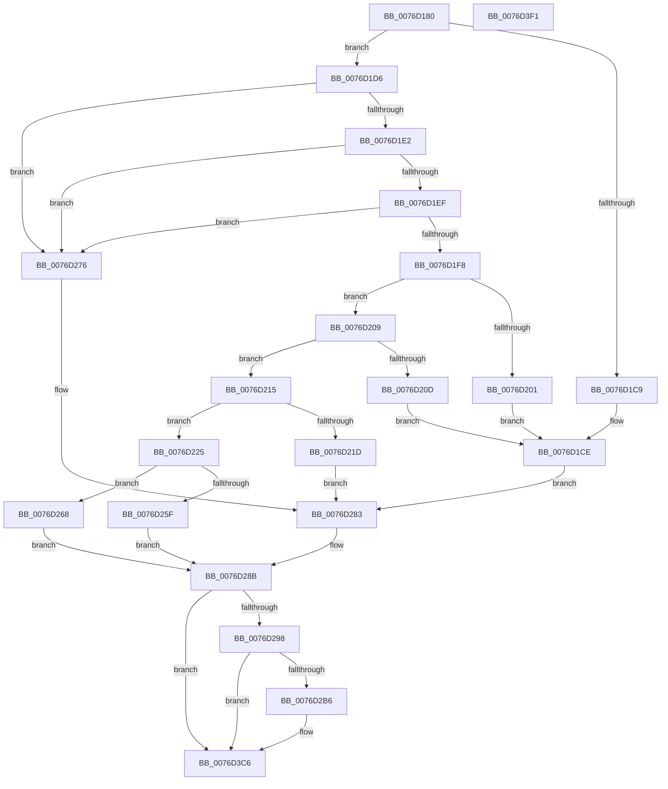

# PopAdaptiveStandbyCheckHibernateReserveAction

- RVA: `0x0076D180`–`0x0076D3F2` (길이 `626` bytes)
- VA: `0x000000014076D180`
- 실행 섹션: `PAGE`
- PDB 이름 있음: `예`; PDB Function 태그: `아니요`
- unwind 정보 RVA: `0x000CD540`
- 디코드: `150`개 명령, `626/626` bytes 표시
- 미해석 바이트: `0` (있으면 어셈블리에 `.byte`로 보존)

> 이 문서는 커널 이미지의 기계어와 PDB 기호를 분석해 생성했습니다. 4번과 5번은 함수 원형과 자료형을 바이너리 사용 방식에서 추정한 C 해석이며 원본 소스 복구 결과는 아닙니다.

## 1. Dependencies

- 직접 호출 지점: **4**; 고유 호출 대상: **4**
- 직접 호출자로 확인된 함수: **1**
- RIP 상대 이미지 참조: **3**

### Outgoing calls
- `0x0076D2A9` → [tlgKeywordOn](../../text/42/tlgKeywordOn_function_0042EAA0.md) (function, `0x0042EAA0`)
- `0x0076D396` → [IoGetActivityIdThread](../../text/44/IoGetActivityIdThread_function_00445030.md) (function, `0x00445030`)
- `0x0076D3C1` → [tlgWriteTransfer_EtwWriteTransfer](../../text/42/tlgWriteTransfer_EtwWriteTransfer_function_004260E0.md) (function, `0x004260E0`)
- `0x0076D3D0` → [_security_check_cookie](../../text/6A/_security_check_cookie_function_006AC640.md) (function, `0x006AC640`)

### Direct callers
- [PopAdaptiveStandbyHandleBatteryUpdate](../6F/PopAdaptiveStandbyHandleBatteryUpdate_function_006FD39C.md) at `0x006FD6A6`

### Static image references
- `0x0076D19E` → RVA `0x00E0A740` (`.data`; read)
- `0x0076D28B` → RVA `0x00E082E8` (`.data`; read)
- `0x0076D39E` → RVA `0x0004F893` (`.rdata`; read)

## 2. Other-region calls and transfers

- 다른 실행 섹션으로 향하는 call: **4**
  - `0x0076D2A9` → [tlgKeywordOn](../../text/42/tlgKeywordOn_function_0042EAA0.md) (`PAGE` → `.text`)
  - `0x0076D396` → [IoGetActivityIdThread](../../text/44/IoGetActivityIdThread_function_00445030.md) (`PAGE` → `.text`)
  - `0x0076D3C1` → [tlgWriteTransfer_EtwWriteTransfer](../../text/42/tlgWriteTransfer_EtwWriteTransfer_function_004260E0.md) (`PAGE` → `.text`)
  - `0x0076D3D0` → [_security_check_cookie](../../text/6A/_security_check_cookie_function_006AC640.md) (`PAGE` → `.text`)
- 별도 외부 분기/꼬리 이동을 확인하지 못했습니다.

## 3. Assembly (complete function range)

```asm
0076D180  48 89 5C 24 10                  mov qword ptr [rsp + 0x10], rbx
0076D185  48 89 74 24 20                  mov qword ptr [rsp + 0x20], rsi
0076D18A  55                              push rbp
0076D18B  57                              push rdi
0076D18C  41 54                           push r12
0076D18E  41 56                           push r14
0076D190  41 57                           push r15
0076D192  48 8D 6C 24 E0                  lea rbp, [rsp - 0x20]
0076D197  48 81 EC 20 01 00 00            sub rsp, 0x120
0076D19E  48 8B 05 9B D5 69 00            mov rax, qword ptr [rip + 0x69d59b]
0076D1A5  48 33 C4                        xor rax, rsp
0076D1A8  48 89 45 10                     mov qword ptr [rbp + 0x10], rax
0076D1AC  45 33 E4                        xor r12d, r12d
0076D1AF  4C 8D 49 28                     lea r9, [rcx + 0x28]
0076D1B3  48 8B F9                        mov rdi, rcx
0076D1B6  4C 8B F2                        mov r14, rdx
0076D1B9  45 8B FC                        mov r15d, r12d
0076D1BC  41 8A F4                        mov sil, r12b
0076D1BF  41 8D 4C 24 08                  lea ecx, [r12 + 8]
0076D1C4  45 38 21                        cmp byte ptr [r9], r12b
0076D1C7  74 0D                           je 0x14076d1d6
0076D1C9  45 8D 54 24 0D                  lea r10d, [r12 + 0xd]
0076D1CE  45 89 10                        mov dword ptr [r8], r10d
0076D1D1  E9 AD 00 00 00                  jmp 0x14076d283
0076D1D6  41 8B 41 04                     mov eax, dword ptr [r9 + 4]
0076D1DA  85 C0                           test eax, eax
0076D1DC  0F 84 94 00 00 00               je 0x14076d276
0076D1E2  45 8B 51 08                     mov r10d, dword ptr [r9 + 8]
0076D1E6  45 85 D2                        test r10d, r10d
0076D1E9  0F 84 87 00 00 00               je 0x14076d276
0076D1EF  44 8B 5F 70                     mov r11d, dword ptr [rdi + 0x70]
0076D1F3  45 85 DB                        test r11d, r11d
0076D1F6  74 7E                           je 0x14076d276
0076D1F8  44 38 A7 C4 00 00 00            cmp byte ptr [rdi + 0xc4], r12b
0076D1FF  74 08                           je 0x14076d209
0076D201  41 BA 0C 00 00 00               mov r10d, 0xc
0076D207  EB C5                           jmp 0x14076d1ce
0076D209  3B 02                           cmp eax, dword ptr [rdx]
0076D20B  76 08                           jbe 0x14076d215
0076D20D  41 BA 06 00 00 00               mov r10d, 6
0076D213  EB B9                           jmp 0x14076d1ce
0076D215  8B 52 0C                        mov edx, dword ptr [rdx + 0xc]
0076D218  83 FA 14                        cmp edx, 0x14
0076D21B  7E 08                           jle 0x14076d225
0076D21D  41 89 08                        mov dword ptr [r8], ecx
0076D220  44 8B D1                        mov r10d, ecx
0076D223  EB 5E                           jmp 0x14076d283
0076D225  41 8B 49 0C                     mov ecx, dword ptr [r9 + 0xc]
0076D229  8B C2                           mov eax, edx
0076D22B  2B C1                           sub eax, ecx
0076D22D  BB 04 00 00 00                  mov ebx, 4
0076D232  3B CA                           cmp ecx, edx
0076D234  1B C9                           sbb ecx, ecx
0076D236  23 C8                           and ecx, eax
0076D238  B8 1F 85 EB 51                  mov eax, 0x51eb851f
0076D23D  0F AF 8F 90 00 00 00            imul ecx, dword ptr [rdi + 0x90]
0076D244  F7 E1                           mul ecx
0076D246  C1 EA 05                        shr edx, 5
0076D249  69 C2 E8 03 00 00               imul eax, edx, 0x3e8
0076D24F  33 D2                           xor edx, edx
0076D251  41 F7 F3                        div r11d
0076D254  4D 8B D9                        mov r11, r9
0076D257  44 8B F8                        mov r15d, eax
0076D25A  41 3B C2                        cmp eax, r10d
0076D25D  76 09                           jbe 0x14076d268
0076D25F  44 8D 53 03                     lea r10d, [rbx + 3]
0076D263  45 89 10                        mov dword ptr [r8], r10d
0076D266  EB 23                           jmp 0x14076d28b
0076D268  40 B6 01                        mov sil, 1
0076D26B  45 8B D4                        mov r10d, r12d
0076D26E  41 88 31                        mov byte ptr [r9], sil
0076D271  45 89 20                        mov dword ptr [r8], r12d
0076D274  EB 15                           jmp 0x14076d28b
0076D276  41 C7 00 05 00 00 00            mov dword ptr [r8], 5
0076D27D  41 BA 05 00 00 00               mov r10d, 5
0076D283  4D 8B D9                        mov r11, r9
0076D286  BB 04 00 00 00                  mov ebx, 4
0076D28B  83 3D 56 B0 69 00 05            cmp dword ptr [rip + 0x69b056], 5
0076D292  0F 86 2E 01 00 00               jbe 0x14076d3c6
0076D298  48 BA 00 00 00 00 00 40 00 00   movabs rdx, 0x400000000000
0076D2A2  48 8D 0D 3F B0 69 00            lea rcx, [rip + 0x69b03f]
0076D2A9  E8 F2 17 CC FF                  call 0x14042eaa0
0076D2AE  84 C0                           test al, al
0076D2B0  0F 84 10 01 00 00               je 0x14076d3c6
0076D2B6  41 8B 06                        mov eax, dword ptr [r14]
0076D2B9  48 89 44 24 48                  mov qword ptr [rsp + 0x48], rax
0076D2BE  48 8D 44 24 48                  lea rax, [rsp + 0x48]
0076D2C3  48 89 45 80                     mov qword ptr [rbp - 0x80], rax
0076D2C7  41 8B 04 1B                     mov eax, dword ptr [r11 + rbx]
0076D2CB  89 44 24 30                     mov dword ptr [rsp + 0x30], eax
0076D2CF  48 8D 44 24 30                  lea rax, [rsp + 0x30]
0076D2D4  48 89 45 90                     mov qword ptr [rbp - 0x70], rax
0076D2D8  41 8B 46 0C                     mov eax, dword ptr [r14 + 0xc]
0076D2DC  89 44 24 34                     mov dword ptr [rsp + 0x34], eax
0076D2E0  48 8D 44 24 34                  lea rax, [rsp + 0x34]
0076D2E5  48 89 45 A0                     mov qword ptr [rbp - 0x60], rax
0076D2E9  48 8D 44 24 38                  lea rax, [rsp + 0x38]
0076D2EE  48 89 45 B0                     mov qword ptr [rbp - 0x50], rax
0076D2F2  41 8B 41 08                     mov eax, dword ptr [r9 + 8]
0076D2F6  89 44 24 3C                     mov dword ptr [rsp + 0x3c], eax
0076D2FA  48 8D 44 24 3C                  lea rax, [rsp + 0x3c]
0076D2FF  48 89 45 C0                     mov qword ptr [rbp - 0x40], rax
0076D303  40 0F B6 C6                     movzx eax, sil
0076D307  89 44 24 40                     mov dword ptr [rsp + 0x40], eax
0076D30B  48 8D 44 24 40                  lea rax, [rsp + 0x40]
0076D310  48 89 45 D0                     mov qword ptr [rbp - 0x30], rax
0076D314  48 8D 44 24 44                  lea rax, [rsp + 0x44]
0076D319  48 89 45 E0                     mov qword ptr [rbp - 0x20], rax
0076D31D  48 8B 87 F0 00 00 00            mov rax, qword ptr [rdi + 0xf0]
0076D324  48 89 44 24 50                  mov qword ptr [rsp + 0x50], rax
0076D329  48 8D 44 24 50                  lea rax, [rsp + 0x50]
0076D32E  48 89 45 F0                     mov qword ptr [rbp - 0x10], rax
0076D332  48 8D 44 24 58                  lea rax, [rsp + 0x58]
0076D337  48 89 45 00                     mov qword ptr [rbp], rax
0076D33B  48 C7 45 88 08 00 00 00         mov qword ptr [rbp - 0x78], 8
0076D343  48 C7 45 98 04 00 00 00         mov qword ptr [rbp - 0x68], 4
0076D34B  48 C7 45 A8 04 00 00 00         mov qword ptr [rbp - 0x58], 4
0076D353  44 89 7C 24 38                  mov dword ptr [rsp + 0x38], r15d
0076D358  48 C7 45 B8 04 00 00 00         mov qword ptr [rbp - 0x48], 4
0076D360  48 C7 45 C8 04 00 00 00         mov qword ptr [rbp - 0x38], 4
0076D368  48 C7 45 D8 04 00 00 00         mov qword ptr [rbp - 0x28], 4
0076D370  44 89 54 24 44                  mov dword ptr [rsp + 0x44], r10d
0076D375  48 C7 45 E8 04 00 00 00         mov qword ptr [rbp - 0x18], 4
0076D37D  48 C7 45 F8 08 00 00 00         mov qword ptr [rbp - 8], 8
0076D385  48 C7 44 24 58 00 00 00 01      mov qword ptr [rsp + 0x58], 0x1000000
0076D38E  48 C7 45 08 08 00 00 00         mov qword ptr [rbp + 8], 8
0076D396  E8 95 7C CD FF                  call 0x140445030
0076D39B  4C 8B C0                        mov r8, rax
0076D39E  48 8D 15 EE 24 8E FF            lea rdx, [rip - 0x71db12]
0076D3A5  48 8D 44 24 60                  lea rax, [rsp + 0x60]
0076D3AA  45 33 C9                        xor r9d, r9d
0076D3AD  48 89 44 24 28                  mov qword ptr [rsp + 0x28], rax
0076D3B2  48 8D 0D 2F AF 69 00            lea rcx, [rip + 0x69af2f]
0076D3B9  C7 44 24 20 0B 00 00 00         mov dword ptr [rsp + 0x20], 0xb
0076D3C1  E8 1A 8D CB FF                  call 0x1404260e0
0076D3C6  40 8A C6                        mov al, sil
0076D3C9  48 8B 4D 10                     mov rcx, qword ptr [rbp + 0x10]
0076D3CD  48 33 CC                        xor rcx, rsp
0076D3D0  E8 6B F2 F3 FF                  call 0x1406ac640
0076D3D5  4C 8D 9C 24 20 01 00 00         lea r11, [rsp + 0x120]
0076D3DD  49 8B 5B 38                     mov rbx, qword ptr [r11 + 0x38]
0076D3E1  49 8B 73 48                     mov rsi, qword ptr [r11 + 0x48]
0076D3E5  49 8B E3                        mov rsp, r11
0076D3E8  41 5F                           pop r15
0076D3EA  41 5E                           pop r14
0076D3EC  41 5C                           pop r12
0076D3EE  5F                              pop rdi
0076D3EF  5D                              pop rbp
0076D3F0  C3                              ret
0076D3F1  CC                              int3
```

## 4. C-style interpretation (structured pseudocode)

```c
__int64 __fastcall PopAdaptiveStandbyCheckHibernateReserveAction(__int64 a1, __int64 a2, __int64 a3)
{
    __int64 result;
    __int64 v_r12;
    __int64 v_rsp;
    unsigned __int64 v_stack_m100;
    unsigned __int64 v_stack_m104;
    unsigned int v_stack_m108;
    unsigned int v_stack_m10C;
    unsigned __int64 v_stack_m110;
    unsigned int v_stack_m114;
    unsigned int v_stack_m118;
    unsigned __int64 v_stack_m120;
    unsigned int v_stack_m128;
    unsigned __int64 v_stack_m28;
    unsigned __int64 v_stack_m38;
    unsigned __int64 v_stack_m40;
    unsigned __int64 v_stack_m48;
    unsigned __int64 v_stack_m50;
    unsigned __int64 v_stack_m58;
    unsigned __int64 v_stack_m60;
    unsigned __int64 v_stack_m68;
    unsigned __int64 v_stack_m70;
    unsigned __int64 v_stack_m78;
    unsigned __int64 v_stack_m80;
    unsigned __int64 v_stack_m88;
    unsigned __int64 v_stack_m90;
    unsigned __int64 v_stack_m98;
    unsigned __int64 v_stack_mA0;
    unsigned __int64 v_stack_mA8;
    unsigned __int64 v_stack_mB0;
    unsigned __int64 v_stack_mB8;
    unsigned __int64 v_stack_mC0;
    unsigned __int64 v_stack_mC8;
    unsigned __int64 v_stack_mE8;
    unsigned __int64 v_stack_mF0;
    unsigned __int64 v_stack_mF8;
    unsigned __int64 v_stack_p10;
    unsigned __int64 v_stack_p20;

    v_stack_p10 = v_rbx;
    v_stack_p20 = v_rsi;
    v_rsp = (v_rsp) - (288);
    result = (*(unsigned __int64 *)(v_rip + 6935963)) ^ (v_rsp);
    v_stack_m38 = result;
    v_r12 = 0;
    if ((*(unsigned __int8 *)(a1 + 40)) == 0) goto loc_0076D1D6;
loc_0076D1CE:
    *(unsigned int *)(a3) = (unsigned int)(v_r12 + 13);
    goto loc_0076D283;
loc_0076D1D6:
    if ((unsigned int)((unsigned int)(*(unsigned int *)(a1 + 40 + 4))) == 0) goto loc_0076D276;
    if ((unsigned int)((unsigned int)(*(unsigned int *)(a1 + 40 + 8))) == 0) goto loc_0076D276;
    if ((unsigned int)((unsigned int)(*(unsigned int *)(a1 + 112))) == 0) goto loc_0076D276;
    if ((*(unsigned __int8 *)(a1 + 196)) == 0) goto loc_0076D209;
    goto loc_0076D1CE;
loc_0076D209:
    if (((unsigned int)((unsigned int)(*(unsigned int *)(a1 + 40 + 4)))) <= (*(unsigned int *)(a2))) goto loc_0076D215;
    goto loc_0076D1CE;
loc_0076D215:
    if (((unsigned int)((unsigned int)(*(unsigned int *)(a2 + 12)))) <= 20) goto loc_0076D225;
    *(unsigned int *)(a3) = (unsigned int)(v_r12 + 8);
    goto loc_0076D283;
loc_0076D225:
    result = (unsigned int)(((unsigned int)((unsigned int)((unsigned int)(*(unsigned int *)(a2 + 12))))) - ((unsigned int)((unsigned int)(*(unsigned int *)(a1 + 40 + 12)))));
    a1 = (unsigned int)(((unsigned int)(*(unsigned int *)(a1 + 40 + 12))) & ((unsigned int)(result)));
    a1 = (unsigned int)((a1) * (*(unsigned int *)(a1 + 144)));
    a2 = (unsigned int)(((unsigned int)(*(unsigned int *)(a2 + 12))) >> (5));
    result = (unsigned int)(((unsigned int)(0x51EB851FULL)) * ((unsigned int)(a2)));
    a2 = 0;
    if (((unsigned int)(result)) <= ((unsigned int)((unsigned int)((unsigned int)(v_r12 + 8))))) goto loc_0076D268;
    *(unsigned int *)(a3) = (unsigned int)(4 + 3);
    goto loc_0076D28B;
loc_0076D268:
    *(unsigned __int8 *)(a1 + 40) = 1;
    *(unsigned int *)(a3) = 0;
    goto loc_0076D28B;
loc_0076D276:
    *(unsigned int *)(a3) = 5;
loc_0076D283:
loc_0076D28B:
    if ((*(unsigned int *)(v_rip + 6926422)) <= 5) goto loc_0076D3C6;
    result = tlgKeywordOn(v_rip + 6926399, a2, a3, a1 + 40);
    if ((unsigned __int8)(result) != 0) {
        result = *(unsigned int *)(a2);
        v_stack_m100 = result;
        result = v_stack_m100;
        v_stack_mC8 = result;
        result = *(unsigned int *)(a1 + 40 + 4 * 1);
        v_stack_m118 = (unsigned int)(result);
        result = v_stack_m118;
        v_stack_mB8 = result;
        result = *(unsigned int *)(a2 + 12);
        v_stack_m114 = (unsigned int)(result);
        result = v_stack_m114;
        v_stack_mA8 = result;
        result = v_stack_m110;
        v_stack_m98 = result;
        result = *(unsigned int *)(a1 + 40 + 8);
        v_stack_m10C = (unsigned int)(result);
        result = v_stack_m10C;
        v_stack_m88 = result;
        result = 1;
        v_stack_m108 = (unsigned int)(result);
        result = v_stack_m108;
        v_stack_m78 = result;
        result = v_stack_m104;
        v_stack_m68 = result;
        result = *(unsigned __int64 *)(a1 + 240);
        v_stack_mF8 = result;
        result = v_stack_mF8;
        v_stack_m58 = result;
        result = v_stack_mF0;
        v_stack_m48 = result;
        v_stack_mC0 = 8;
        v_stack_mB0 = 4;
        v_stack_mA0 = 4;
        v_stack_m110 = (unsigned int)((unsigned int)((unsigned int)(result)));
        v_stack_m90 = 4;
        v_stack_m80 = 4;
        v_stack_m70 = 4;
        v_stack_m104 = 5;
        v_stack_m60 = 4;
        v_stack_m50 = 8;
        v_stack_mF0 = 0x1000000ULL;
        v_stack_m40 = 8;
        result = IoGetActivityIdThread(v_rip + 6926399, a2, a3, a1 + 40);
        a3 = result;
        a2 = v_rip - 7461650;
        result = v_stack_mE8;
        a4 = 0;
        v_stack_m120 = result;
        a1 = v_rip + 6926127;
        v_stack_m128 = 11;
        result = tlgWriteTransfer_EtwWriteTransfer(a1, a2, a3, a4);
    }
    a1 = (v_stack_m38) ^ (v_rsp);
    result = _security_check_cookie(a1, a2, a3, a4);
    return result;
}
```

## 5. (Beta) C Style

```c
int64_t PopAdaptiveStandbyCheckHibernateReserveAction(void *Arg1, void *Arg2, void *Arg3)
{
    uint8_t *arg1 = (uint8_t *)Arg1;
    uint8_t *arg2 = (uint8_t *)Arg2;
    uint8_t *arg3 = (uint8_t *)Arg3;

    int64_t result;
    int64_t local_r12;
    int64_t local_rsp;
    uint64_t v_stack_m100;
    uint64_t v_stack_m104;
    uint32_t v_stack_m108;
    uint32_t v_stack_m10C;
    uint64_t v_stack_m110;
    uint32_t v_stack_m114;
    uint32_t v_stack_m118;
    uint64_t v_stack_m120;
    uint32_t v_stack_m128;
    uint64_t v_stack_m28;
    uint64_t v_stack_m38;
    uint64_t v_stack_m40;
    uint64_t v_stack_m48;
    uint64_t v_stack_m50;
    uint64_t v_stack_m58;
    uint64_t v_stack_m60;
    uint64_t v_stack_m68;
    uint64_t v_stack_m70;
    uint64_t v_stack_m78;
    uint64_t v_stack_m80;
    uint64_t v_stack_m88;
    uint64_t v_stack_m90;
    uint64_t v_stack_m98;
    uint64_t v_stack_mA0;
    uint64_t v_stack_mA8;
    uint64_t v_stack_mB0;
    uint64_t v_stack_mB8;
    uint64_t v_stack_mC0;
    uint64_t v_stack_mC8;
    uint64_t v_stack_mE8;
    uint64_t v_stack_mF0;
    uint64_t v_stack_mF8;
    uint64_t v_stack_p10;
    uint64_t v_stack_p20;

    v_stack_p10 = local_rbx;
    v_stack_p20 = local_rsi;
    local_rsp = (local_rsp) - (288);
    result = (*(uint64_t *)(v_rip + 0x69D59B)) ^ (local_rsp);
    v_stack_m38 = result;
    local_r12 = 0;
    if ((*(uint8_t *)(arg1 + 0x28)) == 0) goto loc_0076D1D6;
loc_0076D1CE:
    *(uint32_t *)(arg3) = (uint32_t)(local_r12 + 13);
    goto loc_0076D283;
loc_0076D1D6:
    if ((uint32_t)((uint32_t)(*(uint32_t *)(arg1 + 0x28 + 0x4))) == 0) goto loc_0076D276;
    if ((uint32_t)((uint32_t)(*(uint32_t *)(arg1 + 0x28 + 0x8))) == 0) goto loc_0076D276;
    if ((uint32_t)((uint32_t)(*(uint32_t *)(arg1 + 0x70))) == 0) goto loc_0076D276;
    if ((*(uint8_t *)(arg1 + 0xC4)) == 0) goto loc_0076D209;
    goto loc_0076D1CE;
loc_0076D209:
    if (((uint32_t)((uint32_t)(*(uint32_t *)(arg1 + 0x28 + 0x4)))) <= (*(uint32_t *)(arg2))) goto loc_0076D215;
    goto loc_0076D1CE;
loc_0076D215:
    if (((uint32_t)((uint32_t)(*(uint32_t *)(arg2 + 0xC)))) <= 20) goto loc_0076D225;
    *(uint32_t *)(arg3) = (uint32_t)(local_r12 + 8);
    goto loc_0076D283;
loc_0076D225:
    result = (uint32_t)(((uint32_t)((uint32_t)((uint32_t)(*(uint32_t *)(arg2 + 0xC))))) - ((uint32_t)((uint32_t)(*(uint32_t *)(arg1 + 0x28 + 0xC)))));
    Arg1 = (uint32_t)(((uint32_t)(*(uint32_t *)(arg1 + 0x28 + 0xC))) & ((uint32_t)(result)));
    Arg1 = (uint32_t)((Arg1) * (*(uint32_t *)(arg1 + 0x90)));
    Arg2 = (uint32_t)(((uint32_t)(*(uint32_t *)(arg2 + 0xC))) >> (5));
    result = (uint32_t)(((uint32_t)(0x51EB851FULL)) * ((uint32_t)(Arg2)));
    Arg2 = 0;
    if (((uint32_t)(result)) <= ((uint32_t)((uint32_t)((uint32_t)(local_r12 + 8))))) goto loc_0076D268;
    *(uint32_t *)(arg3) = (uint32_t)(4 + 3);
    goto loc_0076D28B;
loc_0076D268:
    *(uint8_t *)(arg1 + 0x28) = 1;
    *(uint32_t *)(arg3) = 0;
    goto loc_0076D28B;
loc_0076D276:
    *(uint32_t *)(arg3) = 5;
loc_0076D283:
loc_0076D28B:
    if ((*(uint32_t *)(v_rip + 0x69B056)) <= 5) goto loc_0076D3C6;
    result = tlgKeywordOn(v_rip + 6926399, Arg2, Arg3, Arg1 + 40);
    if ((uint8_t)(result) != 0) {
        result = *(uint32_t *)(arg2);
        v_stack_m100 = result;
        result = v_stack_m100;
        v_stack_mC8 = result;
        result = *(uint32_t *)(arg1 + 0x28 + 0x4 * 1);
        v_stack_m118 = (uint32_t)(result);
        result = v_stack_m118;
        v_stack_mB8 = result;
        result = *(uint32_t *)(arg2 + 0xC);
        v_stack_m114 = (uint32_t)(result);
        result = v_stack_m114;
        v_stack_mA8 = result;
        result = v_stack_m110;
        v_stack_m98 = result;
        result = *(uint32_t *)(arg1 + 0x28 + 0x8);
        v_stack_m10C = (uint32_t)(result);
        result = v_stack_m10C;
        v_stack_m88 = result;
        result = 1;
        v_stack_m108 = (uint32_t)(result);
        result = v_stack_m108;
        v_stack_m78 = result;
        result = v_stack_m104;
        v_stack_m68 = result;
        result = *(uint64_t *)(arg1 + 0xF0);
        v_stack_mF8 = result;
        result = v_stack_mF8;
        v_stack_m58 = result;
        result = v_stack_mF0;
        v_stack_m48 = result;
        v_stack_mC0 = 8;
        v_stack_mB0 = 4;
        v_stack_mA0 = 4;
        v_stack_m110 = (uint32_t)((uint32_t)((uint32_t)(result)));
        v_stack_m90 = 4;
        v_stack_m80 = 4;
        v_stack_m70 = 4;
        v_stack_m104 = 5;
        v_stack_m60 = 4;
        v_stack_m50 = 8;
        v_stack_mF0 = 0x1000000ULL;
        v_stack_m40 = 8;
        result = IoGetActivityIdThread(v_rip + 6926399, Arg2, Arg3, Arg1 + 40);
        Arg3 = result;
        Arg2 = v_rip - 7461650;
        result = v_stack_mE8;
        a4 = 0;
        v_stack_m120 = result;
        Arg1 = v_rip + 6926127;
        v_stack_m128 = 11;
        result = tlgWriteTransfer_EtwWriteTransfer(Arg1, Arg2, Arg3, a4);
    }
    Arg1 = (v_stack_m38) ^ (local_rsp);
    result = _security_check_cookie(Arg1, Arg2, Arg3, a4);
    return result;
}
```

### 관측된 메모리 오프셋

구조체 형식이 확인되지 않은 접근은 인자 기준의 오프셋으로만 기록했습니다.

| 기준 인자 | 오프셋 표현 | 폭 (bit) | 접근 |
|---|---:|---:|---|
| `Arg1` | `+ 0x0` | `8` | `R` |
| `Arg1` | `+ 0x0` | `8` | `W` |
| `Arg1` | `+ 0x4` | `32` | `R` |
| `Arg1` | `+ 0x8` | `32` | `R` |
| `Arg1` | `+ 0xC` | `32` | `R` |
| `Arg1` | `+ 0x28` | `64` | `R` |
| `Arg1` | `+ 0x70` | `32` | `R` |
| `Arg1` | `+ 0x90` | `32` | `R` |
| `Arg1` | `+ 0xC4` | `8` | `R` |
| `Arg1` | `+ 0xF0` | `64` | `R` |
| `Arg2` | `+ 0x0` | `32` | `R` |
| `Arg2` | `+ 0xC` | `32` | `R` |
| `Arg3` | `+ 0x0` | `32` | `W` |

## 6. Execution-region graph

[열기: 2D/3D 그래프와 함수 탐색 컨트롤 패널](../../../control-panel.html?section=page&rva=0x0076D180&view=graph)

- 2D 그래프는 위에서 아래로 흐르고, 3D 그래프는 빈 공간을 드래그해 회전합니다. Shift+드래그는 이동, 휠은 확대·축소, 함수 노드 선택은 대상 보고서 이동입니다.

### Static fallback


