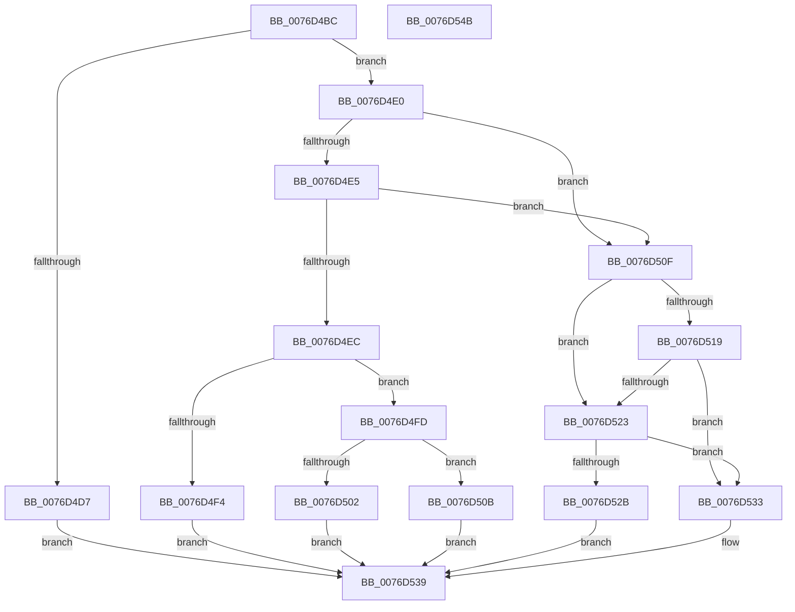

# PopAdaptiveStandbyCheckRefreshableBudgetActionPreconditions

- RVA: `0x0076D4BC`–`0x0076D54C` (길이 `144` bytes)
- VA: `0x000000014076D4BC`
- 실행 섹션: `PAGE`
- PDB 이름 있음: `예`; PDB Function 태그: `아니요`
- unwind 정보 RVA: `0x00060BC4`
- 디코드: `44`개 명령, `144/144` bytes 표시
- 미해석 바이트: `0` (있으면 어셈블리에 `.byte`로 보존)

> 이 문서는 커널 이미지의 기계어와 PDB 기호를 분석해 생성했습니다. 4번과 5번은 함수 원형과 자료형을 바이너리 사용 방식에서 추정한 C 해석이며 원본 소스 복구 결과는 아닙니다.

## 1. Dependencies

- 직접 호출 지점: **2**; 고유 호출 대상: **1**
- 직접 호출자로 확인된 함수: **2**
- RIP 상대 이미지 참조: **0**

### Outgoing calls
- `0x0076D50F` → [Feature_AdaptiveHibernateEnhancements__private_GetVariant](../../text/5D/Feature_AdaptiveHibernateEnhancements__private_GetVariant_function_005DC550.md) (function, `0x005DC550`)
- `0x0076D519` → [Feature_AdaptiveHibernateEnhancements__private_GetVariant](../../text/5D/Feature_AdaptiveHibernateEnhancements__private_GetVariant_function_005DC550.md) (function, `0x005DC550`)

### Direct callers
- [PopAdaptiveStandbyCheckHibernateBudgetAction](PopAdaptiveStandbyCheckHibernateBudgetAction_function_0076CB54.md) at `0x0076CBD6`
- [PopAdaptiveStandbyCheckRestrictedStandbyBudgetAction](PopAdaptiveStandbyCheckRestrictedStandbyBudgetAction_function_0076D5C4.md) at `0x0076D62B`

### Static image references
- 디코드된 RIP-relative 메모리 참조가 없습니다.

## 2. Other-region calls and transfers

- 다른 실행 섹션으로 향하는 call: **2**
  - `0x0076D50F` → [Feature_AdaptiveHibernateEnhancements__private_GetVariant](../../text/5D/Feature_AdaptiveHibernateEnhancements__private_GetVariant_function_005DC550.md) (`PAGE` → `.text`)
  - `0x0076D519` → [Feature_AdaptiveHibernateEnhancements__private_GetVariant](../../text/5D/Feature_AdaptiveHibernateEnhancements__private_GetVariant_function_005DC550.md) (`PAGE` → `.text`)
- 별도 외부 분기/꼬리 이동을 확인하지 못했습니다.

## 3. Assembly (complete function range)

```asm
0076D4BC  48 89 5C 24 08                  mov qword ptr [rsp + 8], rbx
0076D4C1  48 89 74 24 10                  mov qword ptr [rsp + 0x10], rsi
0076D4C6  57                              push rdi
0076D4C7  48 83 EC 20                     sub rsp, 0x20
0076D4CB  33 DB                           xor ebx, ebx
0076D4CD  49 8B F9                        mov rdi, r9
0076D4D0  48 8B F1                        mov rsi, rcx
0076D4D3  38 1A                           cmp byte ptr [rdx], bl
0076D4D5  74 09                           je 0x14076d4e0
0076D4D7  41 C7 01 0D 00 00 00            mov dword ptr [r9], 0xd
0076D4DE  EB 59                           jmp 0x14076d539
0076D4E0  39 5A 18                        cmp dword ptr [rdx + 0x18], ebx
0076D4E3  74 2A                           je 0x14076d50f
0076D4E5  8B 42 14                        mov eax, dword ptr [rdx + 0x14]
0076D4E8  85 C0                           test eax, eax
0076D4EA  74 23                           je 0x14076d50f
0076D4EC  38 99 C4 00 00 00               cmp byte ptr [rcx + 0xc4], bl
0076D4F2  74 09                           je 0x14076d4fd
0076D4F4  41 C7 01 0C 00 00 00            mov dword ptr [r9], 0xc
0076D4FB  EB 3C                           jmp 0x14076d539
0076D4FD  41 3B 00                        cmp eax, dword ptr [r8]
0076D500  76 09                           jbe 0x14076d50b
0076D502  41 C7 01 02 00 00 00            mov dword ptr [r9], 2
0076D509  EB 2E                           jmp 0x14076d539
0076D50B  B3 01                           mov bl, 1
0076D50D  EB 2A                           jmp 0x14076d539
0076D50F  E8 3C F0 E6 FF                  call 0x1405dc550
0076D514  83 F8 0A                        cmp eax, 0xa
0076D517  74 0A                           je 0x14076d523
0076D519  E8 32 F0 E6 FF                  call 0x1405dc550
0076D51E  83 F8 09                        cmp eax, 9
0076D521  75 10                           jne 0x14076d533
0076D523  39 9E DC 00 00 00               cmp dword ptr [rsi + 0xdc], ebx
0076D529  75 08                           jne 0x14076d533
0076D52B  C7 07 10 00 00 00               mov dword ptr [rdi], 0x10
0076D531  EB 06                           jmp 0x14076d539
0076D533  C7 07 01 00 00 00               mov dword ptr [rdi], 1
0076D539  48 8B 74 24 38                  mov rsi, qword ptr [rsp + 0x38]
0076D53E  8A C3                           mov al, bl
0076D540  48 8B 5C 24 30                  mov rbx, qword ptr [rsp + 0x30]
0076D545  48 83 C4 20                     add rsp, 0x20
0076D549  5F                              pop rdi
0076D54A  C3                              ret
0076D54B  CC                              int3
```

## 4. C-style interpretation (structured pseudocode)

```c
__int64 __fastcall PopAdaptiveStandbyCheckRefreshableBudgetActionPreconditions(__int64 a1, __int64 a2, __int64 a3, __int64 a4)
{
    __int64 result;
    __int64 v_rbx;
    __int64 v_rsp;
    unsigned __int64 v_stack_p10;
    unsigned __int64 v_stack_p8;

    v_stack_p8 = v_rbx;
    v_stack_p10 = v_rsi;
    v_rsp = (v_rsp) - (32);
    v_rbx = 0;
    if ((*(unsigned __int8 *)(a2)) == 0) goto loc_0076D4E0;
    *(unsigned int *)(a4) = 13;
    goto loc_0076D539;
loc_0076D4E0:
    if ((*(unsigned int *)(a2 + 24)) == 0) goto loc_0076D50F;
    if ((unsigned int)((unsigned int)(*(unsigned int *)(a2 + 20))) == 0) goto loc_0076D50F;
    if ((*(unsigned __int8 *)(a1 + 196)) == 0) goto loc_0076D4FD;
    *(unsigned int *)(a4) = 12;
    goto loc_0076D539;
loc_0076D4FD:
    if (((unsigned int)((unsigned int)(*(unsigned int *)(a2 + 20)))) <= (*(unsigned int *)(a3))) goto loc_0076D50B;
    *(unsigned int *)(a4) = 2;
    goto loc_0076D539;
loc_0076D50B:
    goto loc_0076D539;
loc_0076D50F:
    result = Feature_AdaptiveHibernateEnhancements__private_GetVariant(a1, a2, a3, a4);
    if (((unsigned int)(result)) == 10) goto loc_0076D523;
    result = Feature_AdaptiveHibernateEnhancements__private_GetVariant(a1, a2, a3, a4);
    if (((unsigned int)(result)) != 9) goto loc_0076D533;
loc_0076D523:
    if ((*(unsigned int *)(a1 + 220)) != 1) goto loc_0076D533;
    *(unsigned int *)(a4) = 16;
    goto loc_0076D539;
loc_0076D533:
    *(unsigned int *)(a4) = 1;
loc_0076D539:
    v_rsp = (v_rsp) + (32);
    return 1;
}
```

## 5. (Beta) C Style

```c
int64_t PopAdaptiveStandbyCheckRefreshableBudgetActionPreconditions(void *Arg1, void *Arg2, void *Arg3, void *Arg4)
{
    uint8_t *arg1 = (uint8_t *)Arg1;
    uint8_t *arg2 = (uint8_t *)Arg2;
    uint8_t *arg3 = (uint8_t *)Arg3;
    uint8_t *arg4 = (uint8_t *)Arg4;

    int64_t result;
    int64_t local_rbx;
    int64_t local_rsp;
    uint64_t v_stack_p10;
    uint64_t v_stack_p8;

    v_stack_p8 = local_rbx;
    v_stack_p10 = local_rsi;
    local_rsp = (local_rsp) - (32);
    local_rbx = 0;
    if ((*(uint8_t *)(arg2)) == 0) goto loc_0076D4E0;
    *(uint32_t *)(arg4) = 13;
    goto loc_0076D539;
loc_0076D4E0:
    if ((*(uint32_t *)(arg2 + 0x18)) == 0) goto loc_0076D50F;
    if ((uint32_t)((uint32_t)(*(uint32_t *)(arg2 + 0x14))) == 0) goto loc_0076D50F;
    if ((*(uint8_t *)(arg1 + 0xC4)) == 0) goto loc_0076D4FD;
    *(uint32_t *)(arg4) = 12;
    goto loc_0076D539;
loc_0076D4FD:
    if (((uint32_t)((uint32_t)(*(uint32_t *)(arg2 + 0x14)))) <= (*(uint32_t *)(arg3))) goto loc_0076D50B;
    *(uint32_t *)(arg4) = 2;
    goto loc_0076D539;
loc_0076D50B:
    goto loc_0076D539;
loc_0076D50F:
    result = Feature_AdaptiveHibernateEnhancements__private_GetVariant(Arg1, Arg2, Arg3, Arg4);
    if (((uint32_t)(result)) == 10) goto loc_0076D523;
    result = Feature_AdaptiveHibernateEnhancements__private_GetVariant(Arg1, Arg2, Arg3, Arg4);
    if (((uint32_t)(result)) != 9) goto loc_0076D533;
loc_0076D523:
    if ((*(uint32_t *)(arg1 + 0xDC)) != 1) goto loc_0076D533;
    *(uint32_t *)(arg4) = 16;
    goto loc_0076D539;
loc_0076D533:
    *(uint32_t *)(arg4) = 1;
loc_0076D539:
    local_rsp = (local_rsp) + (32);
    return 1;
}
```

### 관측된 메모리 오프셋

구조체 형식이 확인되지 않은 접근은 인자 기준의 오프셋으로만 기록했습니다.

| 기준 인자 | 오프셋 표현 | 폭 (bit) | 접근 |
|---|---:|---:|---|
| `Arg1` | `+ 0xC4` | `8` | `R` |
| `Arg1` | `+ 0xDC` | `32` | `R` |
| `Arg2` | `+ 0x0` | `8` | `R` |
| `Arg2` | `+ 0x14` | `32` | `R` |
| `Arg2` | `+ 0x18` | `32` | `R` |
| `Arg3` | `+ 0x0` | `32` | `R` |
| `Arg4` | `+ 0x0` | `32` | `W` |

## 6. Execution-region graph

[열기: 2D/3D 그래프와 함수 탐색 컨트롤 패널](../../../control-panel.html?section=page&rva=0x0076D4BC&view=graph)

- 2D 그래프는 위에서 아래로 흐르고, 3D 그래프는 빈 공간을 드래그해 회전합니다. Shift+드래그는 이동, 휠은 확대·축소, 함수 노드 선택은 대상 보고서 이동입니다.

### Static fallback


