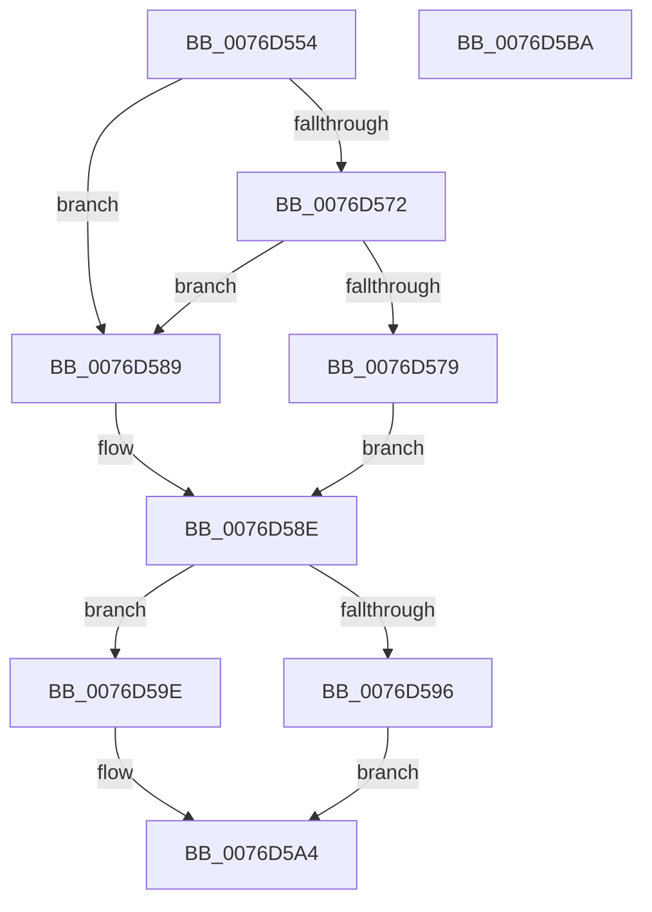

# PopAdaptiveStandbyCheckRefreshableBudgetActionV2

- RVA: `0x0076D554`–`0x0076D5BB` (길이 `103` bytes)
- VA: `0x000000014076D554`
- 실행 섹션: `PAGE`
- PDB 이름 있음: `예`; PDB Function 태그: `아니요`
- unwind 정보 RVA: `0x00069588`
- 디코드: `34`개 명령, `103/103` bytes 표시
- 미해석 바이트: `0` (있으면 어셈블리에 `.byte`로 보존)

> 이 문서는 커널 이미지의 기계어와 PDB 기호를 분석해 생성했습니다. 4번과 5번은 함수 원형과 자료형을 바이너리 사용 방식에서 추정한 C 해석이며 원본 소스 복구 결과는 아닙니다.

## 1. Dependencies

- 직접 호출 지점: **0**; 고유 호출 대상: **0**
- 직접 호출자로 확인된 함수: **2**
- RIP 상대 이미지 참조: **0**

### Outgoing calls
- 직접 디코드된 call 명령이 없습니다.

### Direct callers
- [PopAdaptiveStandbyCheckHibernateBudgetAction](PopAdaptiveStandbyCheckHibernateBudgetAction_function_0076CB54.md) at `0x0076CC25`
- [PopAdaptiveStandbyCheckRestrictedStandbyBudgetAction](PopAdaptiveStandbyCheckRestrictedStandbyBudgetAction_function_0076D5C4.md) at `0x0076D65C`

### Static image references
- 디코드된 RIP-relative 메모리 참조가 없습니다.

## 2. Other-region calls and transfers

- 다른 실행 섹션으로 향하는 call: **0**
- 별도 외부 분기/꼬리 이동을 확인하지 못했습니다.

## 3. Assembly (complete function range)

```asm
0076D554  48 89 5C 24 08                  mov qword ptr [rsp + 8], rbx
0076D559  48 89 74 24 10                  mov qword ptr [rsp + 0x10], rsi
0076D55E  48 89 7C 24 18                  mov qword ptr [rsp + 0x18], rdi
0076D563  8B 79 20                        mov edi, dword ptr [rcx + 0x20]
0076D566  45 33 D2                        xor r10d, r10d
0076D569  8B F2                           mov esi, edx
0076D56B  45 8A DA                        mov r11b, r10b
0076D56E  85 FF                           test edi, edi
0076D570  74 17                           je 0x14076d589
0076D572  8B 59 1C                        mov ebx, dword ptr [rcx + 0x1c]
0076D575  85 DB                           test ebx, ebx
0076D577  74 10                           je 0x14076d589
0076D579  33 D2                           xor edx, edx
0076D57B  41 8B C0                        mov eax, r8d
0076D57E  F7 F7                           div edi
0076D580  3B C3                           cmp eax, ebx
0076D582  0F 43 C3                        cmovae eax, ebx
0076D585  FF C0                           inc eax
0076D587  EB 05                           jmp 0x14076d58e
0076D589  B8 01 00 00 00                  mov eax, 1
0076D58E  0F AF 41 18                     imul eax, dword ptr [rcx + 0x18]
0076D592  3B F0                           cmp esi, eax
0076D594  7D 08                           jge 0x14076d59e
0076D596  41 BA 03 00 00 00               mov r10d, 3
0076D59C  EB 06                           jmp 0x14076d5a4
0076D59E  C6 01 01                        mov byte ptr [rcx], 1
0076D5A1  41 B3 01                        mov r11b, 1
0076D5A4  45 89 11                        mov dword ptr [r9], r10d
0076D5A7  41 8A C3                        mov al, r11b
0076D5AA  48 8B 5C 24 08                  mov rbx, qword ptr [rsp + 8]
0076D5AF  48 8B 74 24 10                  mov rsi, qword ptr [rsp + 0x10]
0076D5B4  48 8B 7C 24 18                  mov rdi, qword ptr [rsp + 0x18]
0076D5B9  C3                              ret
0076D5BA  CC                              int3
```

## 4. C-style interpretation (structured pseudocode)

```c
__int64 __fastcall PopAdaptiveStandbyCheckRefreshableBudgetActionV2(__int64 a1, int a2, int a3, __int64 a4)
{
    __int64 result;
    __int64 v_r10;
    unsigned __int64 v_stack_p10;
    unsigned __int64 v_stack_p18;
    unsigned __int64 v_stack_p8;

    v_stack_p8 = v_rbx;
    v_stack_p10 = v_rsi;
    v_stack_p18 = v_rdi;
    v_r10 = 0;
    if ((unsigned int)((unsigned int)(*(unsigned int *)(a1 + 32))) == 0) goto loc_0076D589;
    if ((unsigned int)((unsigned int)(*(unsigned int *)(a1 + 28))) == 0) goto loc_0076D589;
    a2 = 0;
    result = (unsigned int)(a3);
    if (((unsigned int)((unsigned int)(a3))) >= ((unsigned int)((unsigned int)(*(unsigned int *)(a1 + 28))))) { result = (unsigned int)((unsigned int)(*(unsigned int *)(a1 + 28))); }
    result = (unsigned int)((result) + 1);
    goto loc_0076D58E;
loc_0076D589:
loc_0076D58E:
    result = (unsigned int)((1) * (*(unsigned int *)(a1 + 24)));
    if (((unsigned int)((unsigned int)(a2))) >= ((unsigned int)(result))) goto loc_0076D59E;
    goto loc_0076D5A4;
loc_0076D59E:
    *(unsigned __int8 *)(a1) = 1;
loc_0076D5A4:
    *(unsigned int *)(a4) = 3;
    return 1;
}
```

## 5. (Beta) C Style

```c
int64_t PopAdaptiveStandbyCheckRefreshableBudgetActionV2(void *Arg1, int32_t Arg2, int32_t Arg3, void *Arg4)
{
    uint8_t *arg1 = (uint8_t *)Arg1;
    uint8_t *arg4 = (uint8_t *)Arg4;

    int64_t result;
    int64_t local_r10;
    uint64_t v_stack_p10;
    uint64_t v_stack_p18;
    uint64_t v_stack_p8;

    v_stack_p8 = local_rbx;
    v_stack_p10 = local_rsi;
    v_stack_p18 = local_rdi;
    local_r10 = 0;
    if ((uint32_t)((uint32_t)(*(uint32_t *)(arg1 + 0x20))) == 0) goto loc_0076D589;
    if ((uint32_t)((uint32_t)(*(uint32_t *)(arg1 + 0x1C))) == 0) goto loc_0076D589;
    Arg2 = 0;
    result = (uint32_t)(Arg3);
    if (((uint32_t)((uint32_t)(Arg3))) >= ((uint32_t)((uint32_t)(*(uint32_t *)(arg1 + 0x1C))))) { result = (uint32_t)((uint32_t)(*(uint32_t *)(arg1 + 0x1C))); }
    result = (uint32_t)((result) + 1);
    goto loc_0076D58E;
loc_0076D589:
loc_0076D58E:
    result = (uint32_t)((1) * (*(uint32_t *)(arg1 + 0x18)));
    if (((uint32_t)((uint32_t)(Arg2))) >= ((uint32_t)(result))) goto loc_0076D59E;
    goto loc_0076D5A4;
loc_0076D59E:
    *(uint8_t *)(arg1) = 1;
loc_0076D5A4:
    *(uint32_t *)(arg4) = 3;
    return 1;
}
```

### 관측된 메모리 오프셋

구조체 형식이 확인되지 않은 접근은 인자 기준의 오프셋으로만 기록했습니다.

| 기준 인자 | 오프셋 표현 | 폭 (bit) | 접근 |
|---|---:|---:|---|
| `Arg1` | `+ 0x0` | `8` | `W` |
| `Arg1` | `+ 0x18` | `32` | `R` |
| `Arg1` | `+ 0x1C` | `32` | `R` |
| `Arg1` | `+ 0x20` | `32` | `R` |
| `Arg4` | `+ 0x0` | `32` | `W` |

## 6. Execution-region graph

[열기: 2D/3D 그래프와 함수 탐색 컨트롤 패널](../../../control-panel.html?section=page&rva=0x0076D554&view=graph)

- 2D 그래프는 위에서 아래로 흐르고, 3D 그래프는 빈 공간을 드래그해 회전합니다. Shift+드래그는 이동, 휠은 확대·축소, 함수 노드 선택은 대상 보고서 이동입니다.

### Static fallback


