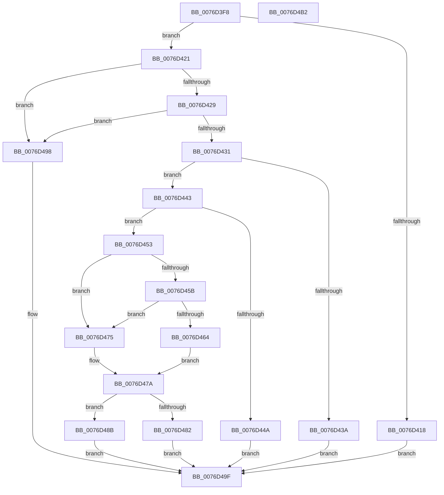

# PopAdaptiveStandbyCheckRefreshableBudgetAction

- RVA: `0x0076D3F8`–`0x0076D4B3` (길이 `187` bytes)
- VA: `0x000000014076D3F8`
- 실행 섹션: `PAGE`
- PDB 이름 있음: `예`; PDB Function 태그: `아니요`
- unwind 정보 RVA: `0x00069588`
- 디코드: `56`개 명령, `187/187` bytes 표시
- 미해석 바이트: `0` (있으면 어셈블리에 `.byte`로 보존)

> 이 문서는 커널 이미지의 기계어와 PDB 기호를 분석해 생성했습니다. 4번과 5번은 함수 원형과 자료형을 바이너리 사용 방식에서 추정한 C 해석이며 원본 소스 복구 결과는 아닙니다.

## 1. Dependencies

- 직접 호출 지점: **0**; 고유 호출 대상: **0**
- 직접 호출자로 확인된 함수: **2**
- RIP 상대 이미지 참조: **0**

### Outgoing calls
- 직접 디코드된 call 명령이 없습니다.

### Direct callers
- [PopAdaptiveStandbyCheckHibernateBudgetAction](PopAdaptiveStandbyCheckHibernateBudgetAction_function_0076CB54.md) at `0x0076CC47`
- [PopAdaptiveStandbyCheckRestrictedStandbyBudgetAction](PopAdaptiveStandbyCheckRestrictedStandbyBudgetAction_function_0076D5C4.md) at `0x0076D671`

### Static image references
- 디코드된 RIP-relative 메모리 참조가 없습니다.

## 2. Other-region calls and transfers

- 다른 실행 섹션으로 향하는 call: **0**
- 별도 외부 분기/꼬리 이동을 확인하지 못했습니다.

## 3. Assembly (complete function range)

```asm
0076D3F8  48 89 5C 24 08                  mov qword ptr [rsp + 8], rbx
0076D3FD  48 89 74 24 10                  mov qword ptr [rsp + 0x10], rsi
0076D402  48 89 7C 24 18                  mov qword ptr [rsp + 0x18], rdi
0076D407  4C 8B D2                        mov r10, rdx
0076D40A  45 32 DB                        xor r11b, r11b
0076D40D  49 8B D8                        mov rbx, r8
0076D410  48 8B D1                        mov rdx, rcx
0076D413  45 38 1A                        cmp byte ptr [r10], r11b
0076D416  74 09                           je 0x14076d421
0076D418  41 C7 01 0D 00 00 00            mov dword ptr [r9], 0xd
0076D41F  EB 7E                           jmp 0x14076d49f
0076D421  41 8B 4A 08                     mov ecx, dword ptr [r10 + 8]
0076D425  85 C9                           test ecx, ecx
0076D427  74 6F                           je 0x14076d498
0076D429  41 8B 42 04                     mov eax, dword ptr [r10 + 4]
0076D42D  85 C0                           test eax, eax
0076D42F  74 67                           je 0x14076d498
0076D431  44 38 9A C4 00 00 00            cmp byte ptr [rdx + 0xc4], r11b
0076D438  74 09                           je 0x14076d443
0076D43A  41 C7 01 0C 00 00 00            mov dword ptr [r9], 0xc
0076D441  EB 5C                           jmp 0x14076d49f
0076D443  41 8B 30                        mov esi, dword ptr [r8]
0076D446  3B C6                           cmp eax, esi
0076D448  76 09                           jbe 0x14076d453
0076D44A  41 C7 01 02 00 00 00            mov dword ptr [r9], 2
0076D451  EB 4C                           jmp 0x14076d49f
0076D453  41 8B 7A 10                     mov edi, dword ptr [r10 + 0x10]
0076D457  85 FF                           test edi, edi
0076D459  74 1A                           je 0x14076d475
0076D45B  45 8B 42 0C                     mov r8d, dword ptr [r10 + 0xc]
0076D45F  45 85 C0                        test r8d, r8d
0076D462  74 11                           je 0x14076d475
0076D464  33 D2                           xor edx, edx
0076D466  8B C6                           mov eax, esi
0076D468  F7 F7                           div edi
0076D46A  41 3B C0                        cmp eax, r8d
0076D46D  41 0F 43 C0                     cmovae eax, r8d
0076D471  FF C0                           inc eax
0076D473  EB 05                           jmp 0x14076d47a
0076D475  B8 01 00 00 00                  mov eax, 1
0076D47A  0F AF C8                        imul ecx, eax
0076D47D  39 4B 10                        cmp dword ptr [rbx + 0x10], ecx
0076D480  7D 09                           jge 0x14076d48b
0076D482  41 C7 01 03 00 00 00            mov dword ptr [r9], 3
0076D489  EB 14                           jmp 0x14076d49f
0076D48B  41 83 21 00                     and dword ptr [r9], 0
0076D48F  41 B3 01                        mov r11b, 1
0076D492  41 C6 02 01                     mov byte ptr [r10], 1
0076D496  EB 07                           jmp 0x14076d49f
0076D498  41 C7 01 01 00 00 00            mov dword ptr [r9], 1
0076D49F  48 8B 5C 24 08                  mov rbx, qword ptr [rsp + 8]
0076D4A4  41 8A C3                        mov al, r11b
0076D4A7  48 8B 74 24 10                  mov rsi, qword ptr [rsp + 0x10]
0076D4AC  48 8B 7C 24 18                  mov rdi, qword ptr [rsp + 0x18]
0076D4B1  C3                              ret
0076D4B2  CC                              int3
```

## 4. C-style interpretation (structured pseudocode)

```c
__int64 __fastcall PopAdaptiveStandbyCheckRefreshableBudgetAction(__int64 a1, __int64 a2, __int64 a3, __int64 a4)
{
    __int64 result;
    __int64 v_r11;
    unsigned __int64 v_stack_p10;
    unsigned __int64 v_stack_p18;
    unsigned __int64 v_stack_p8;

    v_stack_p8 = v_rbx;
    v_stack_p10 = v_rsi;
    v_stack_p18 = v_rdi;
    v_r11 = 0;
    if ((*(unsigned __int8 *)(a2)) == 0) goto loc_0076D421;
    *(unsigned int *)(a4) = 13;
    goto loc_0076D49F;
loc_0076D421:
    if ((unsigned int)((unsigned int)(*(unsigned int *)(a2 + 8))) == 0) goto loc_0076D498;
    if ((unsigned int)((unsigned int)(*(unsigned int *)(a2 + 4))) == 0) goto loc_0076D498;
    if ((*(unsigned __int8 *)(a1 + 196)) == 0) goto loc_0076D443;
    *(unsigned int *)(a4) = 12;
    goto loc_0076D49F;
loc_0076D443:
    if (((unsigned int)((unsigned int)(*(unsigned int *)(a2 + 4)))) <= ((unsigned int)((unsigned int)(*(unsigned int *)(a3))))) goto loc_0076D453;
    *(unsigned int *)(a4) = 2;
    goto loc_0076D49F;
loc_0076D453:
    if ((unsigned int)((unsigned int)(*(unsigned int *)(a2 + 16))) == 0) goto loc_0076D475;
    if ((unsigned int)((unsigned int)(*(unsigned int *)(a2 + 12))) == 0) goto loc_0076D475;
    a2 = 0;
    result = (unsigned int)((unsigned int)((unsigned int)(*(unsigned int *)(a3))));
    if (((unsigned int)((unsigned int)((unsigned int)((unsigned int)(*(unsigned int *)(a3)))))) >= ((unsigned int)((unsigned int)(*(unsigned int *)(a2 + 12))))) { result = (unsigned int)((unsigned int)(*(unsigned int *)(a2 + 12))); }
    result = (unsigned int)((result) + 1);
    goto loc_0076D47A;
loc_0076D475:
loc_0076D47A:
    a1 = (unsigned int)(((unsigned int)(*(unsigned int *)(a2 + 8))) * (1));
    if ((*(unsigned int *)(a3 + 16)) >= ((unsigned int)(a1))) goto loc_0076D48B;
    *(unsigned int *)(a4) = 3;
    goto loc_0076D49F;
loc_0076D48B:
    *(unsigned __int8 *)(a2) = 1;
    goto loc_0076D49F;
loc_0076D498:
    *(unsigned int *)(a4) = 1;
loc_0076D49F:
    return 1;
}
```

## 5. (Beta) C Style

```c
int64_t PopAdaptiveStandbyCheckRefreshableBudgetAction(void *Arg1, void *Arg2, void *Arg3, void *Arg4)
{
    uint8_t *arg1 = (uint8_t *)Arg1;
    uint8_t *arg2 = (uint8_t *)Arg2;
    uint8_t *arg3 = (uint8_t *)Arg3;
    uint8_t *arg4 = (uint8_t *)Arg4;

    int64_t result;
    int64_t local_r11;
    uint64_t v_stack_p10;
    uint64_t v_stack_p18;
    uint64_t v_stack_p8;

    v_stack_p8 = local_rbx;
    v_stack_p10 = local_rsi;
    v_stack_p18 = local_rdi;
    local_r11 = 0;
    if ((*(uint8_t *)(arg2)) == 0) goto loc_0076D421;
    *(uint32_t *)(arg4) = 13;
    goto loc_0076D49F;
loc_0076D421:
    if ((uint32_t)((uint32_t)(*(uint32_t *)(arg2 + 0x8))) == 0) goto loc_0076D498;
    if ((uint32_t)((uint32_t)(*(uint32_t *)(arg2 + 0x4))) == 0) goto loc_0076D498;
    if ((*(uint8_t *)(arg1 + 0xC4)) == 0) goto loc_0076D443;
    *(uint32_t *)(arg4) = 12;
    goto loc_0076D49F;
loc_0076D443:
    if (((uint32_t)((uint32_t)(*(uint32_t *)(arg2 + 0x4)))) <= ((uint32_t)((uint32_t)(*(uint32_t *)(arg3))))) goto loc_0076D453;
    *(uint32_t *)(arg4) = 2;
    goto loc_0076D49F;
loc_0076D453:
    if ((uint32_t)((uint32_t)(*(uint32_t *)(arg2 + 0x10))) == 0) goto loc_0076D475;
    if ((uint32_t)((uint32_t)(*(uint32_t *)(arg2 + 0xC))) == 0) goto loc_0076D475;
    Arg2 = 0;
    result = (uint32_t)((uint32_t)((uint32_t)(*(uint32_t *)(arg3))));
    if (((uint32_t)((uint32_t)((uint32_t)((uint32_t)(*(uint32_t *)(arg3)))))) >= ((uint32_t)((uint32_t)(*(uint32_t *)(arg2 + 0xC))))) { result = (uint32_t)((uint32_t)(*(uint32_t *)(arg2 + 0xC))); }
    result = (uint32_t)((result) + 1);
    goto loc_0076D47A;
loc_0076D475:
loc_0076D47A:
    Arg1 = (uint32_t)(((uint32_t)(*(uint32_t *)(arg2 + 0x8))) * (1));
    if ((*(uint32_t *)(arg3 + 0x10)) >= ((uint32_t)(Arg1))) goto loc_0076D48B;
    *(uint32_t *)(arg4) = 3;
    goto loc_0076D49F;
loc_0076D48B:
    *(uint8_t *)(arg2) = 1;
    goto loc_0076D49F;
loc_0076D498:
    *(uint32_t *)(arg4) = 1;
loc_0076D49F:
    return 1;
}
```

### 관측된 메모리 오프셋

구조체 형식이 확인되지 않은 접근은 인자 기준의 오프셋으로만 기록했습니다.

| 기준 인자 | 오프셋 표현 | 폭 (bit) | 접근 |
|---|---:|---:|---|
| `Arg1` | `+ 0xC4` | `8` | `R` |
| `Arg2` | `+ 0x0` | `8` | `R` |
| `Arg2` | `+ 0x0` | `8` | `W` |
| `Arg2` | `+ 0x4` | `32` | `R` |
| `Arg2` | `+ 0x8` | `32` | `R` |
| `Arg2` | `+ 0xC` | `32` | `R` |
| `Arg2` | `+ 0x10` | `32` | `R` |
| `Arg3` | `+ 0x0` | `32` | `R` |
| `Arg3` | `+ 0x10` | `32` | `R` |
| `Arg4` | `+ 0x0` | `32` | `R/W` |
| `Arg4` | `+ 0x0` | `32` | `W` |

## 6. Execution-region graph

[열기: 2D/3D 그래프와 함수 탐색 컨트롤 패널](../../../control-panel.html?section=page&rva=0x0076D3F8&view=graph)

- 2D 그래프는 위에서 아래로 흐르고, 3D 그래프는 빈 공간을 드래그해 회전합니다. Shift+드래그는 이동, 휠은 확대·축소, 함수 노드 선택은 대상 보고서 이동입니다.

### Static fallback


