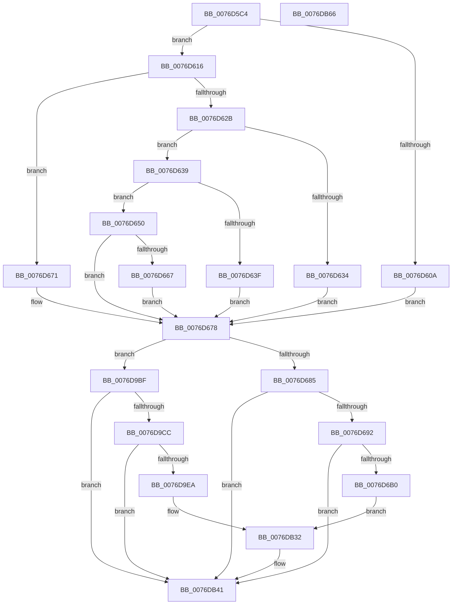

# PopAdaptiveStandbyCheckRestrictedStandbyBudgetAction

- RVA: `0x0076D5C4`–`0x0076DB67` (길이 `1,443` bytes)
- VA: `0x000000014076D5C4`
- 실행 섹션: `PAGE`
- PDB 이름 있음: `예`; PDB Function 태그: `아니요`
- unwind 정보 RVA: `0x000CD51C`
- 디코드: `291`개 명령, `1,443/1,443` bytes 표시
- 미해석 바이트: `0` (있으면 어셈블리에 `.byte`로 보존)

> 이 문서는 커널 이미지의 기계어와 PDB 기호를 분석해 생성했습니다. 4번과 5번은 함수 원형과 자료형을 바이너리 사용 방식에서 추정한 C 해석이며 원본 소스 복구 결과는 아닙니다.

## 1. Dependencies

- 직접 호출 지점: **11**; 고유 호출 대상: **8**
- 직접 호출자로 확인된 함수: **1**
- RIP 상대 이미지 참조: **4**

### Outgoing calls
- `0x0076D616` → [Feature_AdaptiveHibernateEnhancements__private_IsEnabledDeviceUsageNoInline](../../text/4F/Feature_AdaptiveHibernateEnhancements__private_IsEnabledDeviceUsageNoInline_function_004F78F0.md) (function, `0x004F78F0`)
- `0x0076D62B` → [PopAdaptiveStandbyCheckRefreshableBudgetActionPreconditions](PopAdaptiveStandbyCheckRefreshableBudgetActionPreconditions_function_0076D4BC.md) (function, `0x0076D4BC`)
- `0x0076D65C` → [PopAdaptiveStandbyCheckRefreshableBudgetActionV2](PopAdaptiveStandbyCheckRefreshableBudgetActionV2_function_0076D554.md) (function, `0x0076D554`)
- `0x0076D671` → [PopAdaptiveStandbyCheckRefreshableBudgetAction](PopAdaptiveStandbyCheckRefreshableBudgetAction_function_0076D3F8.md) (function, `0x0076D3F8`)
- `0x0076D678` → [Feature_AdaptiveHibernateEnhancements__private_IsEnabledDeviceUsageNoInline](../../text/4F/Feature_AdaptiveHibernateEnhancements__private_IsEnabledDeviceUsageNoInline_function_004F78F0.md) (function, `0x004F78F0`)
- `0x0076D6A3` → [tlgKeywordOn](../../text/42/tlgKeywordOn_function_0042EAA0.md) (function, `0x0042EAA0`)
- `0x0076D99A` → [IoGetActivityIdThread](../../text/44/IoGetActivityIdThread_function_00445030.md) (function, `0x00445030`)
- `0x0076D9DD` → [tlgKeywordOn](../../text/42/tlgKeywordOn_function_0042EAA0.md) (function, `0x0042EAA0`)
- `0x0076DB12` → [IoGetActivityIdThread](../../text/44/IoGetActivityIdThread_function_00445030.md) (function, `0x00445030`)
- `0x0076DB3C` → [tlgWriteTransfer_EtwWriteTransfer](../../text/42/tlgWriteTransfer_EtwWriteTransfer_function_004260E0.md) (function, `0x004260E0`)
- `0x0076DB4D` → [_security_check_cookie](../../text/6A/_security_check_cookie_function_006AC640.md) (function, `0x006AC640`)

### Direct callers
- [PopAdaptiveStandbyHandleBatteryUpdate](../6F/PopAdaptiveStandbyHandleBatteryUpdate_function_006FD39C.md) at `0x006FD5D4`
- [PopAdaptiveStandbyHandleBatteryUpdate](../6F/PopAdaptiveStandbyHandleBatteryUpdate_function_006FD39C.md) at `0x006FD684`

### Static image references
- `0x0076D5E0` → RVA `0x00E0A740` (`.data`; read)
- `0x0076D685` → RVA `0x00E082E8` (`.data`; read)
- `0x0076D9A2` → RVA `0x0004F201` (`.rdata`; read)
- `0x0076DB1A` → RVA `0x0004F45D` (`.rdata`; read)

## 2. Other-region calls and transfers

- 다른 실행 섹션으로 향하는 call: **8**
  - `0x0076D616` → [Feature_AdaptiveHibernateEnhancements__private_IsEnabledDeviceUsageNoInline](../../text/4F/Feature_AdaptiveHibernateEnhancements__private_IsEnabledDeviceUsageNoInline_function_004F78F0.md) (`PAGE` → `.text`)
  - `0x0076D678` → [Feature_AdaptiveHibernateEnhancements__private_IsEnabledDeviceUsageNoInline](../../text/4F/Feature_AdaptiveHibernateEnhancements__private_IsEnabledDeviceUsageNoInline_function_004F78F0.md) (`PAGE` → `.text`)
  - `0x0076D6A3` → [tlgKeywordOn](../../text/42/tlgKeywordOn_function_0042EAA0.md) (`PAGE` → `.text`)
  - `0x0076D99A` → [IoGetActivityIdThread](../../text/44/IoGetActivityIdThread_function_00445030.md) (`PAGE` → `.text`)
  - `0x0076D9DD` → [tlgKeywordOn](../../text/42/tlgKeywordOn_function_0042EAA0.md) (`PAGE` → `.text`)
  - `0x0076DB12` → [IoGetActivityIdThread](../../text/44/IoGetActivityIdThread_function_00445030.md) (`PAGE` → `.text`)
  - `0x0076DB3C` → [tlgWriteTransfer_EtwWriteTransfer](../../text/42/tlgWriteTransfer_EtwWriteTransfer_function_004260E0.md) (`PAGE` → `.text`)
  - `0x0076DB4D` → [_security_check_cookie](../../text/6A/_security_check_cookie_function_006AC640.md) (`PAGE` → `.text`)
- 별도 외부 분기/꼬리 이동을 확인하지 못했습니다.

## 3. Assembly (complete function range)

```asm
0076D5C4  40 55                           push rbp
0076D5C6  53                              push rbx
0076D5C7  56                              push rsi
0076D5C8  57                              push rdi
0076D5C9  41 54                           push r12
0076D5CB  41 55                           push r13
0076D5CD  41 56                           push r14
0076D5CF  41 57                           push r15
0076D5D1  48 8D AC 24 88 FE FF FF         lea rbp, [rsp - 0x178]
0076D5D9  48 81 EC 78 02 00 00            sub rsp, 0x278
0076D5E0  48 8B 05 59 D1 69 00            mov rax, qword ptr [rip + 0x69d159]
0076D5E7  48 33 C4                        xor rax, rsp
0076D5EA  48 89 85 60 01 00 00            mov qword ptr [rbp + 0x160], rax
0076D5F1  45 33 ED                        xor r13d, r13d
0076D5F4  48 8D 71 38                     lea rsi, [rcx + 0x38]
0076D5F8  4D 8B E1                        mov r12, r9
0076D5FB  4D 8B F8                        mov r15, r8
0076D5FE  48 8B FA                        mov rdi, rdx
0076D601  4C 8B F1                        mov r14, rcx
0076D604  44 38 69 5C                     cmp byte ptr [rcx + 0x5c], r13b
0076D608  74 0C                           je 0x14076d616
0076D60A  41 8A DD                        mov bl, r13b
0076D60D  41 C7 00 0F 00 00 00            mov dword ptr [r8], 0xf
0076D614  EB 62                           jmp 0x14076d678
0076D616  E8 D5 A2 D8 FF                  call 0x1404f78f0
0076D61B  4D 8B CF                        mov r9, r15
0076D61E  4C 8B C7                        mov r8, rdi
0076D621  48 8B D6                        mov rdx, rsi
0076D624  49 8B CE                        mov rcx, r14
0076D627  85 C0                           test eax, eax
0076D629  74 46                           je 0x14076d671
0076D62B  E8 8C FE FF FF                  call 0x14076d4bc
0076D630  84 C0                           test al, al
0076D632  75 05                           jne 0x14076d639
0076D634  41 8A DD                        mov bl, r13b
0076D637  EB 3F                           jmp 0x14076d678
0076D639  83 7F 0C 14                     cmp dword ptr [rdi + 0xc], 0x14
0076D63D  7F 11                           jg 0x14076d650
0076D63F  B3 01                           mov bl, 1
0076D641  88 1E                           mov byte ptr [rsi], bl
0076D643  45 89 2F                        mov dword ptr [r15], r13d
0076D646  41 C7 04 24 05 00 00 00         mov dword ptr [r12], 5
0076D64E  EB 28                           jmp 0x14076d678
0076D650  8B 57 10                        mov edx, dword ptr [rdi + 0x10]
0076D653  4D 8B CF                        mov r9, r15
0076D656  44 8B 07                        mov r8d, dword ptr [rdi]
0076D659  48 8B CE                        mov rcx, rsi
0076D65C  E8 F3 FE FF FF                  call 0x14076d554
0076D661  8A D8                           mov bl, al
0076D663  84 C0                           test al, al
0076D665  74 11                           je 0x14076d678
0076D667  41 C7 04 24 03 00 00 00         mov dword ptr [r12], 3
0076D66F  EB 07                           jmp 0x14076d678
0076D671  E8 82 FD FF FF                  call 0x14076d3f8
0076D676  8A D8                           mov bl, al
0076D678  E8 73 A2 D8 FF                  call 0x1404f78f0
0076D67D  85 C0                           test eax, eax
0076D67F  0F 84 3A 03 00 00               je 0x14076d9bf
0076D685  83 3D 5C AC 69 00 05            cmp dword ptr [rip + 0x69ac5c], 5
0076D68C  0F 86 AF 04 00 00               jbe 0x14076db41
0076D692  48 BA 00 00 00 00 00 40 00 00   movabs rdx, 0x400000000000
0076D69C  48 8D 0D 45 AC 69 00            lea rcx, [rip + 0x69ac45]
0076D6A3  E8 F8 13 CC FF                  call 0x14042eaa0
0076D6A8  84 C0                           test al, al
0076D6AA  0F 84 91 04 00 00               je 0x14076db41
0076D6B0  8B 07                           mov eax, dword ptr [rdi]
0076D6B2  49 8B 96 F0 00 00 00            mov rdx, qword ptr [r14 + 0xf0]
0076D6B9  41 83 BE F8 00 00 00 02         cmp dword ptr [r14 + 0xf8], 2
0076D6C1  48 89 45 98                     mov qword ptr [rbp - 0x68], rax
0076D6C5  48 8D 45 98                     lea rax, [rbp - 0x68]
0076D6C9  48 89 45 D0                     mov qword ptr [rbp - 0x30], rax
0076D6CD  8B 46 14                        mov eax, dword ptr [rsi + 0x14]
0076D6D0  48 8D 4A FF                     lea rcx, [rdx - 1]
0076D6D4  89 44 24 58                     mov dword ptr [rsp + 0x58], eax
0076D6D8  48 0F 45 CA                     cmovne rcx, rdx
0076D6DC  48 8D 44 24 58                  lea rax, [rsp + 0x58]
0076D6E1  48 89 4D 88                     mov qword ptr [rbp - 0x78], rcx
0076D6E5  48 89 45 E0                     mov qword ptr [rbp - 0x20], rax
0076D6E9  B9 01 00 00 00                  mov ecx, 1
0076D6EE  8B 47 0C                        mov eax, dword ptr [rdi + 0xc]
0076D6F1  89 44 24 5C                     mov dword ptr [rsp + 0x5c], eax
0076D6F5  48 8D 44 24 5C                  lea rax, [rsp + 0x5c]
0076D6FA  48 89 45 F0                     mov qword ptr [rbp - 0x10], rax
0076D6FE  8B 47 10                        mov eax, dword ptr [rdi + 0x10]
0076D701  89 44 24 60                     mov dword ptr [rsp + 0x60], eax
0076D705  48 8D 44 24 60                  lea rax, [rsp + 0x60]
0076D70A  48 89 45 00                     mov qword ptr [rbp], rax
0076D70E  8B 46 18                        mov eax, dword ptr [rsi + 0x18]
0076D711  89 44 24 64                     mov dword ptr [rsp + 0x64], eax
0076D715  48 8D 44 24 64                  lea rax, [rsp + 0x64]
0076D71A  48 89 45 10                     mov qword ptr [rbp + 0x10], rax
0076D71E  0F B6 C3                        movzx eax, bl
0076D721  89 44 24 68                     mov dword ptr [rsp + 0x68], eax
0076D725  48 8D 44 24 68                  lea rax, [rsp + 0x68]
0076D72A  48 89 45 20                     mov qword ptr [rbp + 0x20], rax
0076D72E  41 8B 07                        mov eax, dword ptr [r15]
0076D731  89 44 24 6C                     mov dword ptr [rsp + 0x6c], eax
0076D735  48 8D 44 24 6C                  lea rax, [rsp + 0x6c]
0076D73A  48 89 45 30                     mov qword ptr [rbp + 0x30], rax
0076D73E  49 8B 86 00 01 00 00            mov rax, qword ptr [r14 + 0x100]
0076D745  48 89 45 A0                     mov qword ptr [rbp - 0x60], rax
0076D749  48 8D 45 A0                     lea rax, [rbp - 0x60]
0076D74D  48 89 45 40                     mov qword ptr [rbp + 0x40], rax
0076D751  48 8D 45 80                     lea rax, [rbp - 0x80]
0076D755  48 89 45 50                     mov qword ptr [rbp + 0x50], rax
0076D759  48 8D 45 88                     lea rax, [rbp - 0x78]
0076D75D  48 89 45 60                     mov qword ptr [rbp + 0x60], rax
0076D761  8B 46 1C                        mov eax, dword ptr [rsi + 0x1c]
0076D764  89 44 24 70                     mov dword ptr [rsp + 0x70], eax
0076D768  48 8D 44 24 70                  lea rax, [rsp + 0x70]
0076D76D  48 89 45 70                     mov qword ptr [rbp + 0x70], rax
0076D771  8B 46 20                        mov eax, dword ptr [rsi + 0x20]
0076D774  89 44 24 74                     mov dword ptr [rsp + 0x74], eax
0076D778  48 8D 44 24 74                  lea rax, [rsp + 0x74]
0076D77D  48 89 85 80 00 00 00            mov qword ptr [rbp + 0x80], rax
0076D784  41 8B 46 60                     mov eax, dword ptr [r14 + 0x60]
0076D788  89 44 24 78                     mov dword ptr [rsp + 0x78], eax
0076D78C  48 8D 44 24 78                  lea rax, [rsp + 0x78]
0076D791  48 89 85 90 00 00 00            mov qword ptr [rbp + 0x90], rax
0076D798  41 8B 86 EC 00 00 00            mov eax, dword ptr [r14 + 0xec]
0076D79F  89 44 24 34                     mov dword ptr [rsp + 0x34], eax
0076D7A3  48 8D 44 24 34                  lea rax, [rsp + 0x34]
0076D7A8  48 89 85 A0 00 00 00            mov qword ptr [rbp + 0xa0], rax
0076D7AF  41 8A 86 88 00 00 00            mov al, byte ptr [r14 + 0x88]
0076D7B6  22 C1                           and al, cl
0076D7B8  48 C7 45 D8 08 00 00 00         mov qword ptr [rbp - 0x28], 8
0076D7C0  88 44 24 30                     mov byte ptr [rsp + 0x30], al
0076D7C4  48 8D 44 24 30                  lea rax, [rsp + 0x30]
0076D7C9  48 89 85 B0 00 00 00            mov qword ptr [rbp + 0xb0], rax
0076D7D0  41 8B 86 8C 00 00 00            mov eax, dword ptr [r14 + 0x8c]
0076D7D7  89 44 24 38                     mov dword ptr [rsp + 0x38], eax
0076D7DB  48 C7 45 E8 04 00 00 00         mov qword ptr [rbp - 0x18], 4
0076D7E3  48 C7 45 F8 04 00 00 00         mov qword ptr [rbp - 8], 4
0076D7EB  48 C7 45 08 04 00 00 00         mov qword ptr [rbp + 8], 4
0076D7F3  48 C7 45 18 04 00 00 00         mov qword ptr [rbp + 0x18], 4
0076D7FB  48 C7 45 28 04 00 00 00         mov qword ptr [rbp + 0x28], 4
0076D803  48 C7 45 38 04 00 00 00         mov qword ptr [rbp + 0x38], 4
0076D80B  48 C7 45 48 08 00 00 00         mov qword ptr [rbp + 0x48], 8
0076D813  48 89 55 80                     mov qword ptr [rbp - 0x80], rdx
0076D817  48 C7 45 58 08 00 00 00         mov qword ptr [rbp + 0x58], 8
0076D81F  48 C7 45 68 08 00 00 00         mov qword ptr [rbp + 0x68], 8
0076D827  48 C7 45 78 04 00 00 00         mov qword ptr [rbp + 0x78], 4
0076D82F  48 C7 85 88 00 00 00 04 00 00 00  mov qword ptr [rbp + 0x88], 4
0076D83A  48 C7 85 98 00 00 00 04 00 00 00  mov qword ptr [rbp + 0x98], 4
0076D845  48 C7 85 A8 00 00 00 04 00 00 00  mov qword ptr [rbp + 0xa8], 4
0076D850  48 89 8D B8 00 00 00            mov qword ptr [rbp + 0xb8], rcx
0076D857  48 8D 44 24 38                  lea rax, [rsp + 0x38]
0076D85C  48 C7 85 C8 00 00 00 04 00 00 00  mov qword ptr [rbp + 0xc8], 4
0076D867  48 89 85 C0 00 00 00            mov qword ptr [rbp + 0xc0], rax
0076D86E  41 8B 86 90 00 00 00            mov eax, dword ptr [r14 + 0x90]
0076D875  89 44 24 3C                     mov dword ptr [rsp + 0x3c], eax
0076D879  48 8D 44 24 3C                  lea rax, [rsp + 0x3c]
0076D87E  48 89 85 D0 00 00 00            mov qword ptr [rbp + 0xd0], rax
0076D885  41 8B 86 94 00 00 00            mov eax, dword ptr [r14 + 0x94]
0076D88C  89 44 24 40                     mov dword ptr [rsp + 0x40], eax
0076D890  48 8D 44 24 40                  lea rax, [rsp + 0x40]
0076D895  48 89 85 E0 00 00 00            mov qword ptr [rbp + 0xe0], rax
0076D89C  41 8B 86 98 00 00 00            mov eax, dword ptr [r14 + 0x98]
0076D8A3  89 44 24 44                     mov dword ptr [rsp + 0x44], eax
0076D8A7  48 8D 44 24 44                  lea rax, [rsp + 0x44]
0076D8AC  48 89 85 F0 00 00 00            mov qword ptr [rbp + 0xf0], rax
0076D8B3  41 8A 86 9C 00 00 00            mov al, byte ptr [r14 + 0x9c]
0076D8BA  22 C1                           and al, cl
0076D8BC  48 C7 85 D8 00 00 00 04 00 00 00  mov qword ptr [rbp + 0xd8], 4
0076D8C7  88 44 24 31                     mov byte ptr [rsp + 0x31], al
0076D8CB  48 8D 44 24 31                  lea rax, [rsp + 0x31]
0076D8D0  48 89 85 00 01 00 00            mov qword ptr [rbp + 0x100], rax
0076D8D7  41 8B 86 A0 00 00 00            mov eax, dword ptr [r14 + 0xa0]
0076D8DE  89 44 24 48                     mov dword ptr [rsp + 0x48], eax
0076D8E2  48 8D 44 24 48                  lea rax, [rsp + 0x48]
0076D8E7  48 89 85 10 01 00 00            mov qword ptr [rbp + 0x110], rax
0076D8EE  41 8B 86 A4 00 00 00            mov eax, dword ptr [r14 + 0xa4]
0076D8F5  89 44 24 4C                     mov dword ptr [rsp + 0x4c], eax
0076D8F9  48 8D 44 24 4C                  lea rax, [rsp + 0x4c]
0076D8FE  48 89 85 20 01 00 00            mov qword ptr [rbp + 0x120], rax
0076D905  41 8B 86 A8 00 00 00            mov eax, dword ptr [r14 + 0xa8]
0076D90C  89 44 24 50                     mov dword ptr [rsp + 0x50], eax
0076D910  48 8D 44 24 50                  lea rax, [rsp + 0x50]
0076D915  48 89 85 30 01 00 00            mov qword ptr [rbp + 0x130], rax
0076D91C  41 8B 86 AC 00 00 00            mov eax, dword ptr [r14 + 0xac]
0076D923  89 44 24 54                     mov dword ptr [rsp + 0x54], eax
0076D927  48 8D 44 24 54                  lea rax, [rsp + 0x54]
0076D92C  48 89 85 40 01 00 00            mov qword ptr [rbp + 0x140], rax
0076D933  48 8D 45 90                     lea rax, [rbp - 0x70]
0076D937  48 89 85 50 01 00 00            mov qword ptr [rbp + 0x150], rax
0076D93E  48 C7 85 E8 00 00 00 04 00 00 00  mov qword ptr [rbp + 0xe8], 4
0076D949  48 C7 85 F8 00 00 00 04 00 00 00  mov qword ptr [rbp + 0xf8], 4
0076D954  48 89 8D 08 01 00 00            mov qword ptr [rbp + 0x108], rcx
0076D95B  48 C7 85 18 01 00 00 04 00 00 00  mov qword ptr [rbp + 0x118], 4
0076D966  48 C7 85 28 01 00 00 04 00 00 00  mov qword ptr [rbp + 0x128], 4
0076D971  48 C7 85 38 01 00 00 04 00 00 00  mov qword ptr [rbp + 0x138], 4
0076D97C  48 C7 85 48 01 00 00 04 00 00 00  mov qword ptr [rbp + 0x148], 4
0076D987  48 C7 45 90 00 00 00 01         mov qword ptr [rbp - 0x70], 0x1000000
0076D98F  48 C7 85 58 01 00 00 08 00 00 00  mov qword ptr [rbp + 0x158], 8
0076D99A  E8 91 76 CD FF                  call 0x140445030
0076D99F  4C 8B C0                        mov r8, rax
0076D9A2  48 8D 15 58 18 8E FF            lea rdx, [rip - 0x71e7a8]
0076D9A9  48 8D 45 B0                     lea rax, [rbp - 0x50]
0076D9AD  48 89 44 24 28                  mov qword ptr [rsp + 0x28], rax
0076D9B2  C7 44 24 20 1B 00 00 00         mov dword ptr [rsp + 0x20], 0x1b
0076D9BA  E9 73 01 00 00                  jmp 0x14076db32
0076D9BF  83 3D 22 A9 69 00 05            cmp dword ptr [rip + 0x69a922], 5
0076D9C6  0F 86 75 01 00 00               jbe 0x14076db41
0076D9CC  48 BA 00 00 00 00 00 40 00 00   movabs rdx, 0x400000000000
0076D9D6  48 8D 0D 0B A9 69 00            lea rcx, [rip + 0x69a90b]
0076D9DD  E8 BE 10 CC FF                  call 0x14042eaa0
0076D9E2  84 C0                           test al, al
0076D9E4  0F 84 57 01 00 00               je 0x14076db41
0076D9EA  8B 07                           mov eax, dword ptr [rdi]
0076D9EC  48 89 45 90                     mov qword ptr [rbp - 0x70], rax
0076D9F0  48 8D 45 90                     lea rax, [rbp - 0x70]
0076D9F4  48 89 45 D0                     mov qword ptr [rbp - 0x30], rax
0076D9F8  8B 46 04                        mov eax, dword ptr [rsi + 4]
0076D9FB  89 44 24 54                     mov dword ptr [rsp + 0x54], eax
0076D9FF  48 8D 44 24 54                  lea rax, [rsp + 0x54]
0076DA04  48 89 45 E0                     mov qword ptr [rbp - 0x20], rax
0076DA08  8B 47 0C                        mov eax, dword ptr [rdi + 0xc]
0076DA0B  89 44 24 50                     mov dword ptr [rsp + 0x50], eax
0076DA0F  48 8D 44 24 50                  lea rax, [rsp + 0x50]
0076DA14  48 89 45 F0                     mov qword ptr [rbp - 0x10], rax
0076DA18  8B 47 10                        mov eax, dword ptr [rdi + 0x10]
0076DA1B  89 44 24 4C                     mov dword ptr [rsp + 0x4c], eax
0076DA1F  48 8D 44 24 4C                  lea rax, [rsp + 0x4c]
0076DA24  48 89 45 00                     mov qword ptr [rbp], rax
0076DA28  8B 46 08                        mov eax, dword ptr [rsi + 8]
0076DA2B  89 44 24 48                     mov dword ptr [rsp + 0x48], eax
0076DA2F  48 8D 44 24 48                  lea rax, [rsp + 0x48]
0076DA34  48 89 45 10                     mov qword ptr [rbp + 0x10], rax
0076DA38  0F B6 C3                        movzx eax, bl
0076DA3B  89 44 24 44                     mov dword ptr [rsp + 0x44], eax
0076DA3F  48 8D 44 24 44                  lea rax, [rsp + 0x44]
0076DA44  48 89 45 20                     mov qword ptr [rbp + 0x20], rax
0076DA48  41 8B 07                        mov eax, dword ptr [r15]
0076DA4B  89 44 24 40                     mov dword ptr [rsp + 0x40], eax
0076DA4F  48 8D 44 24 40                  lea rax, [rsp + 0x40]
0076DA54  48 89 45 30                     mov qword ptr [rbp + 0x30], rax
0076DA58  49 8B 86 F0 00 00 00            mov rax, qword ptr [r14 + 0xf0]
0076DA5F  48 89 45 88                     mov qword ptr [rbp - 0x78], rax
0076DA63  48 8D 45 88                     lea rax, [rbp - 0x78]
0076DA67  48 89 45 40                     mov qword ptr [rbp + 0x40], rax
0076DA6B  8B 46 0C                        mov eax, dword ptr [rsi + 0xc]
0076DA6E  89 44 24 3C                     mov dword ptr [rsp + 0x3c], eax
0076DA72  48 8D 44 24 3C                  lea rax, [rsp + 0x3c]
0076DA77  48 89 45 50                     mov qword ptr [rbp + 0x50], rax
0076DA7B  8B 46 10                        mov eax, dword ptr [rsi + 0x10]
0076DA7E  89 44 24 38                     mov dword ptr [rsp + 0x38], eax
0076DA82  48 8D 44 24 38                  lea rax, [rsp + 0x38]
0076DA87  48 89 45 60                     mov qword ptr [rbp + 0x60], rax
0076DA8B  41 8B 46 60                     mov eax, dword ptr [r14 + 0x60]
0076DA8F  89 44 24 34                     mov dword ptr [rsp + 0x34], eax
0076DA93  48 8D 44 24 34                  lea rax, [rsp + 0x34]
0076DA98  48 89 45 70                     mov qword ptr [rbp + 0x70], rax
0076DA9C  48 8D 45 80                     lea rax, [rbp - 0x80]
0076DAA0  48 89 85 80 00 00 00            mov qword ptr [rbp + 0x80], rax
0076DAA7  48 C7 45 D8 08 00 00 00         mov qword ptr [rbp - 0x28], 8
0076DAAF  48 C7 45 E8 04 00 00 00         mov qword ptr [rbp - 0x18], 4
0076DAB7  48 C7 45 F8 04 00 00 00         mov qword ptr [rbp - 8], 4
0076DABF  48 C7 45 08 04 00 00 00         mov qword ptr [rbp + 8], 4
0076DAC7  48 C7 45 18 04 00 00 00         mov qword ptr [rbp + 0x18], 4
0076DACF  48 C7 45 28 04 00 00 00         mov qword ptr [rbp + 0x28], 4
0076DAD7  48 C7 45 38 04 00 00 00         mov qword ptr [rbp + 0x38], 4
0076DADF  48 C7 45 48 08 00 00 00         mov qword ptr [rbp + 0x48], 8
0076DAE7  48 C7 45 58 04 00 00 00         mov qword ptr [rbp + 0x58], 4
0076DAEF  48 C7 45 68 04 00 00 00         mov qword ptr [rbp + 0x68], 4
0076DAF7  48 C7 45 78 04 00 00 00         mov qword ptr [rbp + 0x78], 4
0076DAFF  48 C7 45 80 00 00 00 01         mov qword ptr [rbp - 0x80], 0x1000000
0076DB07  48 C7 85 88 00 00 00 08 00 00 00  mov qword ptr [rbp + 0x88], 8
0076DB12  E8 19 75 CD FF                  call 0x140445030
0076DB17  4C 8B C0                        mov r8, rax
0076DB1A  48 8D 15 3C 19 8E FF            lea rdx, [rip - 0x71e6c4]
0076DB21  48 8D 45 B0                     lea rax, [rbp - 0x50]
0076DB25  48 89 44 24 28                  mov qword ptr [rsp + 0x28], rax
0076DB2A  C7 44 24 20 0E 00 00 00         mov dword ptr [rsp + 0x20], 0xe
0076DB32  45 33 C9                        xor r9d, r9d
0076DB35  48 8D 0D AC A7 69 00            lea rcx, [rip + 0x69a7ac]
0076DB3C  E8 9F 85 CB FF                  call 0x1404260e0
0076DB41  8A C3                           mov al, bl
0076DB43  48 8B 8D 60 01 00 00            mov rcx, qword ptr [rbp + 0x160]
0076DB4A  48 33 CC                        xor rcx, rsp
0076DB4D  E8 EE EA F3 FF                  call 0x1406ac640
0076DB52  48 81 C4 78 02 00 00            add rsp, 0x278
0076DB59  41 5F                           pop r15
0076DB5B  41 5E                           pop r14
0076DB5D  41 5D                           pop r13
0076DB5F  41 5C                           pop r12
0076DB61  5F                              pop rdi
0076DB62  5E                              pop rsi
0076DB63  5B                              pop rbx
0076DB64  5D                              pop rbp
0076DB65  C3                              ret
0076DB66  CC                              int3
```

## 4. C-style interpretation (structured pseudocode)

```c
__int64 __fastcall PopAdaptiveStandbyCheckRestrictedStandbyBudgetAction(__int64 a1, __int64 a2, __int64 a3, __int64 a4)
{
    __int64 result;
    __int64 v_r13;
    __int64 v_rsp;
    unsigned __int64 v_stack_m100;
    unsigned __int64 v_stack_m108;
    unsigned __int64 v_stack_m110;
    unsigned __int64 v_stack_m118;
    unsigned __int64 v_stack_m120;
    unsigned __int64 v_stack_m128;
    unsigned __int64 v_stack_m130;
    unsigned __int64 v_stack_m138;
    unsigned __int64 v_stack_m140;
    unsigned __int64 v_stack_m148;
    unsigned __int64 v_stack_m150;
    unsigned __int64 v_stack_m158;
    unsigned __int64 v_stack_m160;
    unsigned __int64 v_stack_m168;
    unsigned __int64 v_stack_m170;
    unsigned __int64 v_stack_m178;
    unsigned __int64 v_stack_m180;
    unsigned __int64 v_stack_m188;
    unsigned __int64 v_stack_m190;
    unsigned __int64 v_stack_m198;
    unsigned __int64 v_stack_m1A0;
    unsigned __int64 v_stack_m1A8;
    unsigned __int64 v_stack_m1B0;
    unsigned __int64 v_stack_m1B8;
    unsigned __int64 v_stack_m1C0;
    unsigned __int64 v_stack_m1C8;
    unsigned __int64 v_stack_m1D0;
    unsigned __int64 v_stack_m1D8;
    unsigned __int64 v_stack_m1E0;
    unsigned __int64 v_stack_m1E8;
    unsigned __int64 v_stack_m208;
    unsigned __int64 v_stack_m218;
    unsigned __int64 v_stack_m220;
    unsigned __int64 v_stack_m228;
    unsigned __int64 v_stack_m230;
    unsigned __int64 v_stack_m238;
    unsigned int v_stack_m240;
    unsigned int v_stack_m244;
    unsigned int v_stack_m248;
    unsigned int v_stack_m24C;
    unsigned int v_stack_m250;
    unsigned int v_stack_m254;
    unsigned int v_stack_m258;
    unsigned int v_stack_m25C;
    unsigned int v_stack_m260;
    unsigned int v_stack_m264;
    unsigned int v_stack_m268;
    unsigned int v_stack_m26C;
    unsigned int v_stack_m270;
    unsigned int v_stack_m274;
    unsigned int v_stack_m278;
    unsigned int v_stack_m27C;
    unsigned int v_stack_m280;
    unsigned int v_stack_m284;
    unsigned __int8 v_stack_m287;
    unsigned __int8 v_stack_m288;
    unsigned __int64 v_stack_m290;
    unsigned int v_stack_m298;
    unsigned __int64 v_stack_m58;
    unsigned __int64 v_stack_m60;
    unsigned __int64 v_stack_m68;
    unsigned __int64 v_stack_m70;
    unsigned __int64 v_stack_m78;
    unsigned __int64 v_stack_m80;
    unsigned __int64 v_stack_m88;
    unsigned __int64 v_stack_m90;
    unsigned __int64 v_stack_m98;
    unsigned __int64 v_stack_mA0;
    unsigned __int64 v_stack_mA8;
    unsigned __int64 v_stack_mB0;
    unsigned __int64 v_stack_mB8;
    unsigned __int64 v_stack_mC0;
    unsigned __int64 v_stack_mC8;
    unsigned __int64 v_stack_mD0;
    unsigned __int64 v_stack_mD8;
    unsigned __int64 v_stack_mE0;
    unsigned __int64 v_stack_mE8;
    unsigned __int64 v_stack_mF0;
    unsigned __int64 v_stack_mF8;

    v_rsp = (v_rsp) - (632);
    result = (*(unsigned __int64 *)(v_rip + 6934873)) ^ (v_rsp);
    v_stack_m58 = result;
    v_r13 = 0;
    if ((*(unsigned __int8 *)(a1 + 92)) == 0) goto loc_0076D616;
    *(unsigned int *)(a3) = 15;
    goto loc_0076D678;
loc_0076D616:
    result = Feature_AdaptiveHibernateEnhancements__private_IsEnabledDeviceUsageNoInline(a1, a2, a3, a4);
    if ((unsigned int)(result) == 0) goto loc_0076D671;
    result = PopAdaptiveStandbyCheckRefreshableBudgetActionPreconditions(a1, a1 + 56, a2, a3);
    if ((unsigned __int8)(result) != 0) goto loc_0076D639;
    goto loc_0076D678;
loc_0076D639:
    if ((*(unsigned int *)(a2 + 12)) > 20) goto loc_0076D650;
    *(unsigned __int8 *)(a1 + 56) = 1;
    *(unsigned int *)(a3) = 0;
    *(unsigned int *)(a4) = 5;
    goto loc_0076D678;
loc_0076D650:
    result = PopAdaptiveStandbyCheckRefreshableBudgetActionV2(a1 + 56, (unsigned int)(*(unsigned int *)(a2 + 16)), (unsigned int)(*(unsigned int *)(a2)), a3);
    if ((unsigned __int8)(result) == 0) goto loc_0076D678;
    *(unsigned int *)(a4) = 3;
    goto loc_0076D678;
loc_0076D671:
    result = PopAdaptiveStandbyCheckRefreshableBudgetAction(a1 + 56, (unsigned int)(*(unsigned int *)(a2 + 16)), (unsigned int)(*(unsigned int *)(a2)), a3);
loc_0076D678:
    result = Feature_AdaptiveHibernateEnhancements__private_IsEnabledDeviceUsageNoInline(a1 + 56, (unsigned int)(*(unsigned int *)(a2 + 16)), (unsigned int)(*(unsigned int *)(a2)), a3);
    if ((unsigned int)(result) == 0) goto loc_0076D9BF;
    if ((*(unsigned int *)(v_rip + 6925404)) <= 5) goto loc_0076DB41;
    result = tlgKeywordOn(v_rip + 6925381, (unsigned int)(*(unsigned int *)(a2 + 16)), (unsigned int)(*(unsigned int *)(a2)), a3);
    if ((unsigned __int8)(result) == 0) goto loc_0076DB41;
    v_stack_m220 = (unsigned int)(*(unsigned int *)(a2));
    v_stack_m1E8 = v_stack_m220;
    v_stack_m260 = (unsigned int)((unsigned int)(*(unsigned int *)(a1 + 56 + 20)));
    a1 = *(unsigned __int64 *)(a1 + 240) - 1;
    if ((*(unsigned int *)(a1 + 248)) != 2) { a1 = *(unsigned __int64 *)(a1 + 240); }
    v_stack_m230 = a1;
    v_stack_m1D8 = v_stack_m260;
    v_stack_m25C = (unsigned int)((unsigned int)(*(unsigned int *)(a2 + 12)));
    v_stack_m1C8 = v_stack_m25C;
    v_stack_m258 = (unsigned int)((unsigned int)(*(unsigned int *)(a2 + 16)));
    v_stack_m1B8 = v_stack_m258;
    v_stack_m254 = (unsigned int)((unsigned int)(*(unsigned int *)(a1 + 56 + 24)));
    v_stack_m1A8 = v_stack_m254;
    v_stack_m250 = (unsigned int)((unsigned __int8)((unsigned __int8)(result)));
    v_stack_m198 = v_stack_m250;
    v_stack_m24C = (unsigned int)((unsigned int)(*(unsigned int *)(a3)));
    v_stack_m188 = v_stack_m24C;
    v_stack_m218 = *(unsigned __int64 *)(a1 + 256);
    v_stack_m178 = v_stack_m218;
    v_stack_m168 = v_stack_m238;
    v_stack_m158 = v_stack_m230;
    v_stack_m248 = (unsigned int)((unsigned int)(*(unsigned int *)(a1 + 56 + 28)));
    v_stack_m148 = v_stack_m248;
    v_stack_m244 = (unsigned int)((unsigned int)(*(unsigned int *)(a1 + 56 + 32)));
    v_stack_m138 = v_stack_m244;
    v_stack_m240 = (unsigned int)((unsigned int)(*(unsigned int *)(a1 + 96)));
    v_stack_m128 = v_stack_m240;
    v_stack_m284 = (unsigned int)((unsigned int)(*(unsigned int *)(a1 + 236)));
    v_stack_m118 = v_stack_m284;
    result = (unsigned __int8)((*(unsigned __int8 *)(a1 + 136)) & (1));
    v_stack_m1E0 = 8;
    v_stack_m288 = (unsigned __int8)(result);
    v_stack_m108 = v_stack_m288;
    v_stack_m280 = (unsigned int)((unsigned int)(*(unsigned int *)(a1 + 140)));
    v_stack_m1D0 = 4;
    v_stack_m1C0 = 4;
    v_stack_m1B0 = 4;
    v_stack_m1A0 = 4;
    v_stack_m190 = 4;
    v_stack_m180 = 4;
    v_stack_m170 = 8;
    v_stack_m238 = *(unsigned __int64 *)(a1 + 240);
    v_stack_m160 = 8;
    v_stack_m150 = 8;
    v_stack_m140 = 4;
    v_stack_m130 = 4;
    v_stack_m120 = 4;
    v_stack_m110 = 4;
    v_stack_m100 = 1;
    v_stack_mF0 = 4;
    v_stack_mF8 = v_stack_m280;
    v_stack_m27C = (unsigned int)((unsigned int)(*(unsigned int *)(a1 + 144)));
    v_stack_mE8 = v_stack_m27C;
    v_stack_m278 = (unsigned int)((unsigned int)(*(unsigned int *)(a1 + 148)));
    v_stack_mD8 = v_stack_m278;
    v_stack_m274 = (unsigned int)((unsigned int)(*(unsigned int *)(a1 + 152)));
    v_stack_mC8 = v_stack_m274;
    result = (unsigned __int8)((*(unsigned __int8 *)(a1 + 156)) & (1));
    v_stack_mE0 = 4;
    v_stack_m287 = (unsigned __int8)(result);
    v_stack_mB8 = v_stack_m287;
    v_stack_m270 = (unsigned int)((unsigned int)(*(unsigned int *)(a1 + 160)));
    v_stack_mA8 = v_stack_m270;
    v_stack_m26C = (unsigned int)((unsigned int)(*(unsigned int *)(a1 + 164)));
    v_stack_m98 = v_stack_m26C;
    v_stack_m268 = (unsigned int)((unsigned int)(*(unsigned int *)(a1 + 168)));
    v_stack_m88 = v_stack_m268;
    v_stack_m264 = (unsigned int)((unsigned int)(*(unsigned int *)(a1 + 172)));
    v_stack_m78 = v_stack_m264;
    v_stack_m68 = v_stack_m228;
    v_stack_mD0 = 4;
    v_stack_mC0 = 4;
    v_stack_mB0 = 1;
    v_stack_mA0 = 4;
    v_stack_m90 = 4;
    v_stack_m80 = 4;
    v_stack_m70 = 4;
    v_stack_m228 = 0x1000000ULL;
    v_stack_m60 = 8;
    result = IoGetActivityIdThread(1, *(unsigned __int64 *)(a1 + 240), (unsigned int)(*(unsigned int *)(a2)), a3);
    v_stack_m290 = v_stack_m208;
    v_stack_m298 = 27;
    goto loc_0076DB32;
loc_0076D9BF:
    if ((*(unsigned int *)(v_rip + 6924578)) <= 5) goto loc_0076DB41;
    result = tlgKeywordOn(v_rip + 6924555, v_rip - 7464872, result, a3);
    if ((unsigned __int8)(result) == 0) goto loc_0076DB41;
    v_stack_m228 = (unsigned int)(*(unsigned int *)(a2));
    v_stack_m1E8 = v_stack_m228;
    v_stack_m264 = (unsigned int)((unsigned int)(*(unsigned int *)(a1 + 56 + 4)));
    v_stack_m1D8 = v_stack_m264;
    v_stack_m268 = (unsigned int)((unsigned int)(*(unsigned int *)(a2 + 12)));
    v_stack_m1C8 = v_stack_m268;
    v_stack_m26C = (unsigned int)((unsigned int)(*(unsigned int *)(a2 + 16)));
    v_stack_m1B8 = v_stack_m26C;
    v_stack_m270 = (unsigned int)((unsigned int)(*(unsigned int *)(a1 + 56 + 8)));
    v_stack_m1A8 = v_stack_m270;
    v_stack_m274 = (unsigned int)((unsigned __int8)((unsigned __int8)(result)));
    v_stack_m198 = v_stack_m274;
    v_stack_m278 = (unsigned int)((unsigned int)(*(unsigned int *)(a3)));
    v_stack_m188 = v_stack_m278;
    v_stack_m230 = *(unsigned __int64 *)(a1 + 240);
    v_stack_m178 = v_stack_m230;
    v_stack_m27C = (unsigned int)((unsigned int)(*(unsigned int *)(a1 + 56 + 12)));
    v_stack_m168 = v_stack_m27C;
    v_stack_m280 = (unsigned int)((unsigned int)(*(unsigned int *)(a1 + 56 + 16)));
    v_stack_m158 = v_stack_m280;
    v_stack_m284 = (unsigned int)((unsigned int)(*(unsigned int *)(a1 + 96)));
    v_stack_m148 = v_stack_m284;
    v_stack_m138 = v_stack_m238;
    v_stack_m1E0 = 8;
    v_stack_m1D0 = 4;
    v_stack_m1C0 = 4;
    v_stack_m1B0 = 4;
    v_stack_m1A0 = 4;
    v_stack_m190 = 4;
    v_stack_m180 = 4;
    v_stack_m170 = 8;
    v_stack_m160 = 4;
    v_stack_m150 = 4;
    v_stack_m140 = 4;
    v_stack_m238 = 0x1000000ULL;
    v_stack_m130 = 8;
    result = IoGetActivityIdThread(v_rip + 6924555, v_rip - 7464872, result, a3);
    v_stack_m290 = v_stack_m208;
    v_stack_m298 = 14;
loc_0076DB32:
    a4 = 0;
    result = tlgWriteTransfer_EtwWriteTransfer(v_rip + 6924204, v_rip - 7464644, result, a4);
loc_0076DB41:
    a1 = (v_stack_m58) ^ (v_rsp);
    result = _security_check_cookie(a1, v_rip - 7464644, result, a4);
    v_rsp = (v_rsp) + (632);
    return result;
}
```

## 5. (Beta) C Style

```c
int64_t PopAdaptiveStandbyCheckRestrictedStandbyBudgetAction(void *Arg1, void *Arg2, void *Arg3, void *Arg4)
{
    uint8_t *arg1 = (uint8_t *)Arg1;
    uint8_t *arg2 = (uint8_t *)Arg2;
    uint8_t *arg3 = (uint8_t *)Arg3;
    uint8_t *arg4 = (uint8_t *)Arg4;

    int64_t result;
    int64_t local_r13;
    int64_t local_rsp;
    uint64_t v_stack_m100;
    uint64_t v_stack_m108;
    uint64_t v_stack_m110;
    uint64_t v_stack_m118;
    uint64_t v_stack_m120;
    uint64_t v_stack_m128;
    uint64_t v_stack_m130;
    uint64_t v_stack_m138;
    uint64_t v_stack_m140;
    uint64_t v_stack_m148;
    uint64_t v_stack_m150;
    uint64_t v_stack_m158;
    uint64_t v_stack_m160;
    uint64_t v_stack_m168;
    uint64_t v_stack_m170;
    uint64_t v_stack_m178;
    uint64_t v_stack_m180;
    uint64_t v_stack_m188;
    uint64_t v_stack_m190;
    uint64_t v_stack_m198;
    uint64_t v_stack_m1A0;
    uint64_t v_stack_m1A8;
    uint64_t v_stack_m1B0;
    uint64_t v_stack_m1B8;
    uint64_t v_stack_m1C0;
    uint64_t v_stack_m1C8;
    uint64_t v_stack_m1D0;
    uint64_t v_stack_m1D8;
    uint64_t v_stack_m1E0;
    uint64_t v_stack_m1E8;
    uint64_t v_stack_m208;
    uint64_t v_stack_m218;
    uint64_t v_stack_m220;
    uint64_t v_stack_m228;
    uint64_t v_stack_m230;
    uint64_t v_stack_m238;
    uint32_t v_stack_m240;
    uint32_t v_stack_m244;
    uint32_t v_stack_m248;
    uint32_t v_stack_m24C;
    uint32_t v_stack_m250;
    uint32_t v_stack_m254;
    uint32_t v_stack_m258;
    uint32_t v_stack_m25C;
    uint32_t v_stack_m260;
    uint32_t v_stack_m264;
    uint32_t v_stack_m268;
    uint32_t v_stack_m26C;
    uint32_t v_stack_m270;
    uint32_t v_stack_m274;
    uint32_t v_stack_m278;
    uint32_t v_stack_m27C;
    uint32_t v_stack_m280;
    uint32_t v_stack_m284;
    uint8_t v_stack_m287;
    uint8_t v_stack_m288;
    uint64_t v_stack_m290;
    uint32_t v_stack_m298;
    uint64_t v_stack_m58;
    uint64_t v_stack_m60;
    uint64_t v_stack_m68;
    uint64_t v_stack_m70;
    uint64_t v_stack_m78;
    uint64_t v_stack_m80;
    uint64_t v_stack_m88;
    uint64_t v_stack_m90;
    uint64_t v_stack_m98;
    uint64_t v_stack_mA0;
    uint64_t v_stack_mA8;
    uint64_t v_stack_mB0;
    uint64_t v_stack_mB8;
    uint64_t v_stack_mC0;
    uint64_t v_stack_mC8;
    uint64_t v_stack_mD0;
    uint64_t v_stack_mD8;
    uint64_t v_stack_mE0;
    uint64_t v_stack_mE8;
    uint64_t v_stack_mF0;
    uint64_t v_stack_mF8;

    local_rsp = (local_rsp) - (632);
    result = (*(uint64_t *)(v_rip + 0x69D159)) ^ (local_rsp);
    v_stack_m58 = result;
    local_r13 = 0;
    if ((*(uint8_t *)(arg1 + 0x5C)) == 0) goto loc_0076D616;
    *(uint32_t *)(arg3) = 15;
    goto loc_0076D678;
loc_0076D616:
    result = Feature_AdaptiveHibernateEnhancements__private_IsEnabledDeviceUsageNoInline(Arg1, Arg2, Arg3, Arg4);
    if ((uint32_t)(result) == 0) goto loc_0076D671;
    result = PopAdaptiveStandbyCheckRefreshableBudgetActionPreconditions(Arg1, Arg1 + 56, Arg2, Arg3);
    if ((uint8_t)(result) != 0) goto loc_0076D639;
    goto loc_0076D678;
loc_0076D639:
    if ((*(uint32_t *)(arg2 + 0xC)) > 20) goto loc_0076D650;
    *(uint8_t *)(arg1 + 0x38) = 1;
    *(uint32_t *)(arg3) = 0;
    *(uint32_t *)(arg4) = 5;
    goto loc_0076D678;
loc_0076D650:
    result = PopAdaptiveStandbyCheckRefreshableBudgetActionV2(Arg1 + 56, (uint32_t)(*(uint32_t *)(arg2 + 0x10)), (uint32_t)(*(uint32_t *)(arg2)), Arg3);
    if ((uint8_t)(result) == 0) goto loc_0076D678;
    *(uint32_t *)(arg4) = 3;
    goto loc_0076D678;
loc_0076D671:
    result = PopAdaptiveStandbyCheckRefreshableBudgetAction(Arg1 + 56, (uint32_t)(*(uint32_t *)(arg2 + 0x10)), (uint32_t)(*(uint32_t *)(arg2)), Arg3);
loc_0076D678:
    result = Feature_AdaptiveHibernateEnhancements__private_IsEnabledDeviceUsageNoInline(Arg1 + 56, (uint32_t)(*(uint32_t *)(arg2 + 0x10)), (uint32_t)(*(uint32_t *)(arg2)), Arg3);
    if ((uint32_t)(result) == 0) goto loc_0076D9BF;
    if ((*(uint32_t *)(v_rip + 0x69AC5C)) <= 5) goto loc_0076DB41;
    result = tlgKeywordOn(v_rip + 6925381, (uint32_t)(*(uint32_t *)(arg2 + 0x10)), (uint32_t)(*(uint32_t *)(arg2)), Arg3);
    if ((uint8_t)(result) == 0) goto loc_0076DB41;
    v_stack_m220 = (uint32_t)(*(uint32_t *)(arg2));
    v_stack_m1E8 = v_stack_m220;
    v_stack_m260 = (uint32_t)((uint32_t)(*(uint32_t *)(arg1 + 0x38 + 0x14)));
    Arg1 = *(uint64_t *)(arg1 + 0xF0) - 1;
    if ((*(uint32_t *)(arg1 + 0xF8)) != 2) { Arg1 = *(uint64_t *)(arg1 + 0xF0); }
    v_stack_m230 = Arg1;
    v_stack_m1D8 = v_stack_m260;
    v_stack_m25C = (uint32_t)((uint32_t)(*(uint32_t *)(arg2 + 0xC)));
    v_stack_m1C8 = v_stack_m25C;
    v_stack_m258 = (uint32_t)((uint32_t)(*(uint32_t *)(arg2 + 0x10)));
    v_stack_m1B8 = v_stack_m258;
    v_stack_m254 = (uint32_t)((uint32_t)(*(uint32_t *)(arg1 + 0x38 + 0x18)));
    v_stack_m1A8 = v_stack_m254;
    v_stack_m250 = (uint32_t)((uint8_t)((uint8_t)(result)));
    v_stack_m198 = v_stack_m250;
    v_stack_m24C = (uint32_t)((uint32_t)(*(uint32_t *)(arg3)));
    v_stack_m188 = v_stack_m24C;
    v_stack_m218 = *(uint64_t *)(arg1 + 0x100);
    v_stack_m178 = v_stack_m218;
    v_stack_m168 = v_stack_m238;
    v_stack_m158 = v_stack_m230;
    v_stack_m248 = (uint32_t)((uint32_t)(*(uint32_t *)(arg1 + 0x38 + 0x1C)));
    v_stack_m148 = v_stack_m248;
    v_stack_m244 = (uint32_t)((uint32_t)(*(uint32_t *)(arg1 + 0x38 + 0x20)));
    v_stack_m138 = v_stack_m244;
    v_stack_m240 = (uint32_t)((uint32_t)(*(uint32_t *)(arg1 + 0x60)));
    v_stack_m128 = v_stack_m240;
    v_stack_m284 = (uint32_t)((uint32_t)(*(uint32_t *)(arg1 + 0xEC)));
    v_stack_m118 = v_stack_m284;
    result = (uint8_t)((*(uint8_t *)(arg1 + 0x88)) & (1));
    v_stack_m1E0 = 8;
    v_stack_m288 = (uint8_t)(result);
    v_stack_m108 = v_stack_m288;
    v_stack_m280 = (uint32_t)((uint32_t)(*(uint32_t *)(arg1 + 0x8C)));
    v_stack_m1D0 = 4;
    v_stack_m1C0 = 4;
    v_stack_m1B0 = 4;
    v_stack_m1A0 = 4;
    v_stack_m190 = 4;
    v_stack_m180 = 4;
    v_stack_m170 = 8;
    v_stack_m238 = *(uint64_t *)(arg1 + 0xF0);
    v_stack_m160 = 8;
    v_stack_m150 = 8;
    v_stack_m140 = 4;
    v_stack_m130 = 4;
    v_stack_m120 = 4;
    v_stack_m110 = 4;
    v_stack_m100 = 1;
    v_stack_mF0 = 4;
    v_stack_mF8 = v_stack_m280;
    v_stack_m27C = (uint32_t)((uint32_t)(*(uint32_t *)(arg1 + 0x90)));
    v_stack_mE8 = v_stack_m27C;
    v_stack_m278 = (uint32_t)((uint32_t)(*(uint32_t *)(arg1 + 0x94)));
    v_stack_mD8 = v_stack_m278;
    v_stack_m274 = (uint32_t)((uint32_t)(*(uint32_t *)(arg1 + 0x98)));
    v_stack_mC8 = v_stack_m274;
    result = (uint8_t)((*(uint8_t *)(arg1 + 0x9C)) & (1));
    v_stack_mE0 = 4;
    v_stack_m287 = (uint8_t)(result);
    v_stack_mB8 = v_stack_m287;
    v_stack_m270 = (uint32_t)((uint32_t)(*(uint32_t *)(arg1 + 0xA0)));
    v_stack_mA8 = v_stack_m270;
    v_stack_m26C = (uint32_t)((uint32_t)(*(uint32_t *)(arg1 + 0xA4)));
    v_stack_m98 = v_stack_m26C;
    v_stack_m268 = (uint32_t)((uint32_t)(*(uint32_t *)(arg1 + 0xA8)));
    v_stack_m88 = v_stack_m268;
    v_stack_m264 = (uint32_t)((uint32_t)(*(uint32_t *)(arg1 + 0xAC)));
    v_stack_m78 = v_stack_m264;
    v_stack_m68 = v_stack_m228;
    v_stack_mD0 = 4;
    v_stack_mC0 = 4;
    v_stack_mB0 = 1;
    v_stack_mA0 = 4;
    v_stack_m90 = 4;
    v_stack_m80 = 4;
    v_stack_m70 = 4;
    v_stack_m228 = 0x1000000ULL;
    v_stack_m60 = 8;
    result = IoGetActivityIdThread(1, *(uint64_t *)(arg1 + 0xF0), (uint32_t)(*(uint32_t *)(arg2)), Arg3);
    v_stack_m290 = v_stack_m208;
    v_stack_m298 = 27;
    goto loc_0076DB32;
loc_0076D9BF:
    if ((*(uint32_t *)(v_rip + 0x69A922)) <= 5) goto loc_0076DB41;
    result = tlgKeywordOn(v_rip + 6924555, v_rip - 7464872, result, Arg3);
    if ((uint8_t)(result) == 0) goto loc_0076DB41;
    v_stack_m228 = (uint32_t)(*(uint32_t *)(arg2));
    v_stack_m1E8 = v_stack_m228;
    v_stack_m264 = (uint32_t)((uint32_t)(*(uint32_t *)(arg1 + 0x38 + 0x4)));
    v_stack_m1D8 = v_stack_m264;
    v_stack_m268 = (uint32_t)((uint32_t)(*(uint32_t *)(arg2 + 0xC)));
    v_stack_m1C8 = v_stack_m268;
    v_stack_m26C = (uint32_t)((uint32_t)(*(uint32_t *)(arg2 + 0x10)));
    v_stack_m1B8 = v_stack_m26C;
    v_stack_m270 = (uint32_t)((uint32_t)(*(uint32_t *)(arg1 + 0x38 + 0x8)));
    v_stack_m1A8 = v_stack_m270;
    v_stack_m274 = (uint32_t)((uint8_t)((uint8_t)(result)));
    v_stack_m198 = v_stack_m274;
    v_stack_m278 = (uint32_t)((uint32_t)(*(uint32_t *)(arg3)));
    v_stack_m188 = v_stack_m278;
    v_stack_m230 = *(uint64_t *)(arg1 + 0xF0);
    v_stack_m178 = v_stack_m230;
    v_stack_m27C = (uint32_t)((uint32_t)(*(uint32_t *)(arg1 + 0x38 + 0xC)));
    v_stack_m168 = v_stack_m27C;
    v_stack_m280 = (uint32_t)((uint32_t)(*(uint32_t *)(arg1 + 0x38 + 0x10)));
    v_stack_m158 = v_stack_m280;
    v_stack_m284 = (uint32_t)((uint32_t)(*(uint32_t *)(arg1 + 0x60)));
    v_stack_m148 = v_stack_m284;
    v_stack_m138 = v_stack_m238;
    v_stack_m1E0 = 8;
    v_stack_m1D0 = 4;
    v_stack_m1C0 = 4;
    v_stack_m1B0 = 4;
    v_stack_m1A0 = 4;
    v_stack_m190 = 4;
    v_stack_m180 = 4;
    v_stack_m170 = 8;
    v_stack_m160 = 4;
    v_stack_m150 = 4;
    v_stack_m140 = 4;
    v_stack_m238 = 0x1000000ULL;
    v_stack_m130 = 8;
    result = IoGetActivityIdThread(v_rip + 6924555, v_rip - 7464872, result, Arg3);
    v_stack_m290 = v_stack_m208;
    v_stack_m298 = 14;
loc_0076DB32:
    Arg4 = 0;
    result = tlgWriteTransfer_EtwWriteTransfer(v_rip + 6924204, v_rip - 7464644, result, Arg4);
loc_0076DB41:
    Arg1 = (v_stack_m58) ^ (local_rsp);
    result = _security_check_cookie(Arg1, v_rip - 7464644, result, Arg4);
    local_rsp = (local_rsp) + (632);
    return result;
}
```

### 관측된 메모리 오프셋

구조체 형식이 확인되지 않은 접근은 인자 기준의 오프셋으로만 기록했습니다.

| 기준 인자 | 오프셋 표현 | 폭 (bit) | 접근 |
|---|---:|---:|---|
| `Arg1` | `+ 0x0` | `8` | `W` |
| `Arg1` | `+ 0x4` | `32` | `R` |
| `Arg1` | `+ 0x8` | `32` | `R` |
| `Arg1` | `+ 0xC` | `32` | `R` |
| `Arg1` | `+ 0x10` | `32` | `R` |
| `Arg1` | `+ 0x14` | `32` | `R` |
| `Arg1` | `+ 0x18` | `32` | `R` |
| `Arg1` | `+ 0x1C` | `32` | `R` |
| `Arg1` | `+ 0x20` | `32` | `R` |
| `Arg1` | `+ 0x38` | `64` | `R` |
| `Arg1` | `+ 0x5C` | `8` | `R` |
| `Arg1` | `+ 0x60` | `32` | `R` |
| `Arg1` | `+ 0x88` | `8` | `R` |
| `Arg1` | `+ 0x8C` | `32` | `R` |
| `Arg1` | `+ 0x90` | `32` | `R` |
| `Arg1` | `+ 0x94` | `32` | `R` |
| `Arg1` | `+ 0x98` | `32` | `R` |
| `Arg1` | `+ 0x9C` | `8` | `R` |
| `Arg1` | `+ 0xA0` | `32` | `R` |
| `Arg1` | `+ 0xA4` | `32` | `R` |
| `Arg1` | `+ 0xA8` | `32` | `R` |
| `Arg1` | `+ 0xAC` | `32` | `R` |
| `Arg1` | `+ 0xEC` | `32` | `R` |
| `Arg1` | `+ 0xF0` | `64` | `R` |
| `Arg1` | `+ 0xF8` | `32` | `R` |
| `Arg1` | `+ 0x100` | `64` | `R` |
| `Arg2` | `+ 0x0` | `32` | `R` |
| `Arg2` | `+ 0xC` | `32` | `R` |
| `Arg2` | `+ 0x10` | `32` | `R` |
| `Arg3` | `+ 0x0` | `32` | `R` |
| `Arg3` | `+ 0x0` | `32` | `W` |
| `Arg4` | `+ 0x0` | `32` | `W` |

## 6. Execution-region graph

[열기: 2D/3D 그래프와 함수 탐색 컨트롤 패널](../../../control-panel.html?section=page&rva=0x0076D5C4&view=graph)

- 2D 그래프는 위에서 아래로 흐르고, 3D 그래프는 빈 공간을 드래그해 회전합니다. Shift+드래그는 이동, 휠은 확대·축소, 함수 노드 선택은 대상 보고서 이동입니다.

### Static fallback


