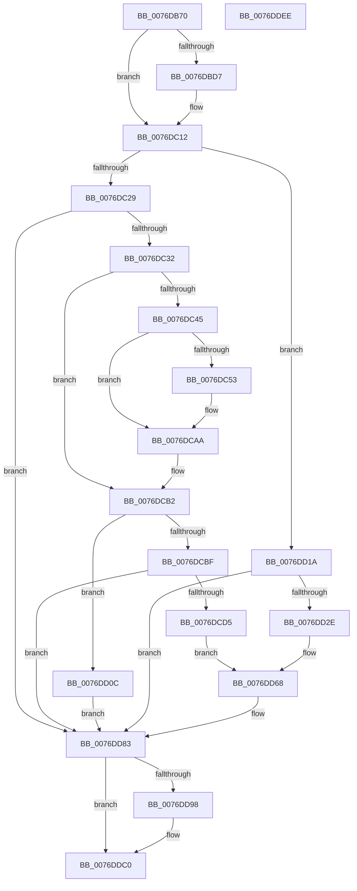

# PopAdaptiveStandbyHandlePowerMessage

- RVA: `0x0076DB70`–`0x0076DDEF` (길이 `639` bytes)
- VA: `0x000000014076DB70`
- 실행 섹션: `PAGE`
- PDB 이름 있음: `예`; PDB Function 태그: `아니요`
- unwind 정보 RVA: `0x000CD5AC`
- 디코드: `147`개 명령, `639/639` bytes 표시
- 미해석 바이트: `0` (있으면 어셈블리에 `.byte`로 보존)

> 이 문서는 커널 이미지의 기계어와 PDB 기호를 분석해 생성했습니다. 4번과 5번은 함수 원형과 자료형을 바이너리 사용 방식에서 추정한 C 해석이며 원본 소스 복구 결과는 아닙니다.

## 1. Dependencies

- 직접 호출 지점: **15**; 고유 호출 대상: **10**
- 직접 호출자로 확인된 함수: **1**
- RIP 상대 이미지 참조: **15**

### Outgoing calls
- `0x0076DBB0` → [EtwActivityIdControl](../../text/41/EtwActivityIdControl_function_0041E720.md) (function, `0x0041E720`)
- `0x0076DBB9` → [IoSetActivityIdThread](../../text/46/IoSetActivityIdThread_function_00466340.md) (function, `0x00466340`)
- `0x0076DC0D` → [tlgWriteTransfer_EtwWriteTransfer](../../text/42/tlgWriteTransfer_EtwWriteTransfer_function_004260E0.md) (function, `0x004260E0`)
- `0x0076DC19` → [PopAcquireRwLockExclusive](../../text/43/PopAcquireRwLockExclusive_function_00430B44.md) (function, `0x00430B44`)
- `0x0076DC45` → [Pdcv2ActivationClientDeactivate](../95/Pdcv2ActivationClientDeactivate_function_009552E0.md) (function, `0x009552E0`)
- `0x0076DC83` → [IoGetActivityIdThread](../../text/44/IoGetActivityIdThread_function_00445030.md) (function, `0x00445030`)
- `0x0076DCA5` → [tlgWriteTransfer_EtwWriteTransfer](../../text/42/tlgWriteTransfer_EtwWriteTransfer_function_004260E0.md) (function, `0x004260E0`)
- `0x0076DCFE` → [IoGetActivityIdThread](../../text/44/IoGetActivityIdThread_function_00445030.md) (function, `0x00445030`)
- `0x0076DD13` → [PopAdaptiveStandbyQueryReserveConfiguration](PopAdaptiveStandbyQueryReserveConfiguration_function_0076E6D0.md) (function, `0x0076E6D0`)
- `0x0076DD5C` → [IoGetActivityIdThread](../../text/44/IoGetActivityIdThread_function_00445030.md) (function, `0x00445030`)
- `0x0076DD7E` → [tlgWriteTransfer_EtwWriteTransfer](../../text/42/tlgWriteTransfer_EtwWriteTransfer_function_004260E0.md) (function, `0x004260E0`)
- `0x0076DD8A` → [PopReleaseRwLock](../../text/2D/PopReleaseRwLock_function_002DFBBC.md) (function, `0x002DFBBC`)
- `0x0076DDBB` → [tlgWriteTransfer_EtwWriteTransfer](../../text/42/tlgWriteTransfer_EtwWriteTransfer_function_004260E0.md) (function, `0x004260E0`)
- `0x0076DDC4` → [IoClearActivityIdThread](../../text/46/IoClearActivityIdThread_function_0046BFF0.md) (function, `0x0046BFF0`)
- `0x0076DDD0` → [_security_check_cookie](../../text/6A/_security_check_cookie_function_006AC640.md) (function, `0x006AC640`)

### Direct callers
- [PopUmpoProcessPowerMessage](../A2/PopUmpoProcessPowerMessage_function_00A2E9B4.md) at `0x00A2EA0B`

### Static image references
- `0x0076DB8B` → RVA `0x00E0A740` (`.data`; read)
- `0x0076DBBE` → RVA `0x00E082E8` (`.data`; read)
- `0x0076DBE1` → RVA `0x0004F0D4` (`.rdata`; read)
- `0x0076DC12` → RVA `0x00F07E80` (`.data`; read)
- `0x0076DC32` → RVA `0x00F07CC0` (`.data`; read)
- `0x0076DC39` → RVA `0x00F07CB8` (`.data`; write)
- `0x0076DC8B` → RVA `0x0004F148` (`.rdata`; read)
- `0x0076DCAA` → RVA `0x00F07CC0` (`.data`; read/write)
- `0x0076DCB2` → RVA `0x00F07CA8` (`.data`; read)
- `0x0076DCC9` → RVA `0x00F07CB0` (`.data`; write)
- `0x0076DD03` → RVA `0x0004F1A7` (`.rdata`; read)
- `0x0076DD0C` → RVA `0x00F07C40` (`.data`; read)
- `0x0076DD25` → RVA `0x00F07C9C` (`.data`; write)
- `0x0076DD61` → RVA `0x0004F0FD` (`.rdata`; read)
- `0x0076DDA9` → RVA `0x0004EF48` (`.rdata`; read)

## 2. Other-region calls and transfers

- 다른 실행 섹션으로 향하는 call: **13**
  - `0x0076DBB0` → [EtwActivityIdControl](../../text/41/EtwActivityIdControl_function_0041E720.md) (`PAGE` → `.text`)
  - `0x0076DBB9` → [IoSetActivityIdThread](../../text/46/IoSetActivityIdThread_function_00466340.md) (`PAGE` → `.text`)
  - `0x0076DC0D` → [tlgWriteTransfer_EtwWriteTransfer](../../text/42/tlgWriteTransfer_EtwWriteTransfer_function_004260E0.md) (`PAGE` → `.text`)
  - `0x0076DC19` → [PopAcquireRwLockExclusive](../../text/43/PopAcquireRwLockExclusive_function_00430B44.md) (`PAGE` → `.text`)
  - `0x0076DC83` → [IoGetActivityIdThread](../../text/44/IoGetActivityIdThread_function_00445030.md) (`PAGE` → `.text`)
  - `0x0076DCA5` → [tlgWriteTransfer_EtwWriteTransfer](../../text/42/tlgWriteTransfer_EtwWriteTransfer_function_004260E0.md) (`PAGE` → `.text`)
  - `0x0076DCFE` → [IoGetActivityIdThread](../../text/44/IoGetActivityIdThread_function_00445030.md) (`PAGE` → `.text`)
  - `0x0076DD5C` → [IoGetActivityIdThread](../../text/44/IoGetActivityIdThread_function_00445030.md) (`PAGE` → `.text`)
  - `0x0076DD7E` → [tlgWriteTransfer_EtwWriteTransfer](../../text/42/tlgWriteTransfer_EtwWriteTransfer_function_004260E0.md) (`PAGE` → `.text`)
  - `0x0076DD8A` → [PopReleaseRwLock](../../text/2D/PopReleaseRwLock_function_002DFBBC.md) (`PAGE` → `.text`)
  - `0x0076DDBB` → [tlgWriteTransfer_EtwWriteTransfer](../../text/42/tlgWriteTransfer_EtwWriteTransfer_function_004260E0.md) (`PAGE` → `.text`)
  - `0x0076DDC4` → [IoClearActivityIdThread](../../text/46/IoClearActivityIdThread_function_0046BFF0.md) (`PAGE` → `.text`)
  - `0x0076DDD0` → [_security_check_cookie](../../text/6A/_security_check_cookie_function_006AC640.md) (`PAGE` → `.text`)
- 별도 외부 분기/꼬리 이동을 확인하지 못했습니다.

## 3. Assembly (complete function range)

```asm
0076DB70  48 8B C4                        mov rax, rsp
0076DB73  48 89 58 08                     mov qword ptr [rax + 8], rbx
0076DB77  48 89 70 10                     mov qword ptr [rax + 0x10], rsi
0076DB7B  4C 89 70 18                     mov qword ptr [rax + 0x18], r14
0076DB7F  55                              push rbp
0076DB80  48 8D 68 A1                     lea rbp, [rax - 0x5f]
0076DB84  48 81 EC B0 00 00 00            sub rsp, 0xb0
0076DB8B  48 8B 05 AE CB 69 00            mov rax, qword ptr [rip + 0x69cbae]
0076DB92  48 33 C4                        xor rax, rsp
0076DB95  48 89 45 47                     mov qword ptr [rbp + 0x47], rax
0076DB99  33 C0                           xor eax, eax
0076DB9B  48 8D 55 E7                     lea rdx, [rbp - 0x19]
0076DB9F  48 8B D9                        mov rbx, rcx
0076DBA2  48 89 45 F7                     mov qword ptr [rbp - 9], rax
0076DBA6  0F 57 C0                        xorps xmm0, xmm0
0076DBA9  0F 11 45 E7                     movups xmmword ptr [rbp - 0x19], xmm0
0076DBAD  8D 48 03                        lea ecx, [rax + 3]
0076DBB0  E8 6B 0B CB FF                  call 0x14041e720
0076DBB5  48 8D 4D E7                     lea rcx, [rbp - 0x19]
0076DBB9  E8 82 87 CF FF                  call 0x140466340
0076DBBE  83 3D 23 A7 69 00 05            cmp dword ptr [rip + 0x69a723], 5
0076DBC5  4C 8D 35 1C A7 69 00            lea r14, [rip + 0x69a71c]
0076DBCC  48 89 45 F7                     mov qword ptr [rbp - 9], rax
0076DBD0  BE 04 00 00 00                  mov esi, 4
0076DBD5  76 3B                           jbe 0x14076dc12
0076DBD7  8B 0B                           mov ecx, dword ptr [rbx]
0076DBD9  4C 8D 45 E7                     lea r8, [rbp - 0x19]
0076DBDD  83 65 33 00                     and dword ptr [rbp + 0x33], 0
0076DBE1  48 8D 15 EC 14 8E FF            lea rdx, [rip - 0x71eb14]
0076DBE8  89 4D DB                        mov dword ptr [rbp - 0x25], ecx
0076DBEB  4C 8B C8                        mov r9, rax
0076DBEE  48 8D 4D DB                     lea rcx, [rbp - 0x25]
0076DBF2  89 75 2F                        mov dword ptr [rbp + 0x2f], esi
0076DBF5  48 89 4D 27                     mov qword ptr [rbp + 0x27], rcx
0076DBF9  48 8D 4D 07                     lea rcx, [rbp + 7]
0076DBFD  48 89 4C 24 28                  mov qword ptr [rsp + 0x28], rcx
0076DC02  49 8B CE                        mov rcx, r14
0076DC05  C7 44 24 20 03 00 00 00         mov dword ptr [rsp + 0x20], 3
0076DC0D  E8 CE 84 CB FF                  call 0x1404260e0
0076DC12  48 8D 0D 67 A2 79 00            lea rcx, [rip + 0x79a267]
0076DC19  E8 26 2F CC FF                  call 0x140430b44
0076DC1E  8B 0B                           mov ecx, dword ptr [rbx]
0076DC20  83 E9 13                        sub ecx, 0x13
0076DC23  0F 84 F1 00 00 00               je 0x14076dd1a
0076DC29  83 F9 01                        cmp ecx, 1
0076DC2C  0F 85 51 01 00 00               jne 0x14076dd83
0076DC32  48 8B 0D 87 A0 79 00            mov rcx, qword ptr [rip + 0x79a087]
0076DC39  C6 05 78 A0 79 00 00            mov byte ptr [rip + 0x79a078], 0
0076DC40  48 85 C9                        test rcx, rcx
0076DC43  74 6D                           je 0x14076dcb2
0076DC45  E8 96 76 1E 00                  call 0x1409552e0
0076DC4A  83 3D 97 A6 69 00 05            cmp dword ptr [rip + 0x69a697], 5
0076DC51  76 57                           jbe 0x14076dcaa
0076DC53  83 65 33 00                     and dword ptr [rbp + 0x33], 0
0076DC57  83 65 43 00                     and dword ptr [rbp + 0x43], 0
0076DC5B  89 45 DB                        mov dword ptr [rbp - 0x25], eax
0076DC5E  48 8D 45 DB                     lea rax, [rbp - 0x25]
0076DC62  48 89 45 27                     mov qword ptr [rbp + 0x27], rax
0076DC66  48 8B 05 53 A0 79 00            mov rax, qword ptr [rip + 0x79a053]
0076DC6D  48 89 45 DF                     mov qword ptr [rbp - 0x21], rax
0076DC71  48 8D 45 DF                     lea rax, [rbp - 0x21]
0076DC75  48 89 45 37                     mov qword ptr [rbp + 0x37], rax
0076DC79  89 75 2F                        mov dword ptr [rbp + 0x2f], esi
0076DC7C  C7 45 3F 08 00 00 00            mov dword ptr [rbp + 0x3f], 8
0076DC83  E8 A8 73 CD FF                  call 0x140445030
0076DC88  4C 8B C0                        mov r8, rax
0076DC8B  48 8D 15 B6 14 8E FF            lea rdx, [rip - 0x71eb4a]
0076DC92  48 8D 45 07                     lea rax, [rbp + 7]
0076DC96  45 33 C9                        xor r9d, r9d
0076DC99  48 89 44 24 28                  mov qword ptr [rsp + 0x28], rax
0076DC9E  49 8B CE                        mov rcx, r14
0076DCA1  89 74 24 20                     mov dword ptr [rsp + 0x20], esi
0076DCA5  E8 36 84 CB FF                  call 0x1404260e0
0076DCAA  48 83 25 0E A0 79 00 00         and qword ptr [rip + 0x79a00e], 0
0076DCB2  48 8B 05 EF 9F 79 00            mov rax, qword ptr [rip + 0x799fef]
0076DCB9  48 3B 43 08                     cmp rax, qword ptr [rbx + 8]
0076DCBD  75 4D                           jne 0x14076dd0c
0076DCBF  83 3D 22 A6 69 00 05            cmp dword ptr [rip + 0x69a622], 5
0076DCC6  8B 4B 10                        mov ecx, dword ptr [rbx + 0x10]
0076DCC9  89 0D E1 9F 79 00               mov dword ptr [rip + 0x799fe1], ecx
0076DCCF  0F 86 AE 00 00 00               jbe 0x14076dd83
0076DCD5  83 65 33 00                     and dword ptr [rbp + 0x33], 0
0076DCD9  83 65 43 00                     and dword ptr [rbp + 0x43], 0
0076DCDD  48 89 45 DF                     mov qword ptr [rbp - 0x21], rax
0076DCE1  48 8D 45 DF                     lea rax, [rbp - 0x21]
0076DCE5  48 89 45 27                     mov qword ptr [rbp + 0x27], rax
0076DCE9  48 8D 45 DB                     lea rax, [rbp - 0x25]
0076DCED  48 89 45 37                     mov qword ptr [rbp + 0x37], rax
0076DCF1  C7 45 2F 08 00 00 00            mov dword ptr [rbp + 0x2f], 8
0076DCF8  89 4D DB                        mov dword ptr [rbp - 0x25], ecx
0076DCFB  89 75 3F                        mov dword ptr [rbp + 0x3f], esi
0076DCFE  E8 2D 73 CD FF                  call 0x140445030
0076DD03  48 8D 15 9D 14 8E FF            lea rdx, [rip - 0x71eb63]
0076DD0A  EB 5C                           jmp 0x14076dd68
0076DD0C  48 8D 0D 2D 9F 79 00            lea rcx, [rip + 0x799f2d]
0076DD13  E8 B8 09 00 00                  call 0x14076e6d0
0076DD18  EB 69                           jmp 0x14076dd83
0076DD1A  83 3D C7 A5 69 00 05            cmp dword ptr [rip + 0x69a5c7], 5
0076DD21  48 8B 4B 08                     mov rcx, qword ptr [rbx + 8]
0076DD25  48 89 0D 70 9F 79 00            mov qword ptr [rip + 0x799f70], rcx
0076DD2C  76 55                           jbe 0x14076dd83
0076DD2E  83 65 33 00                     and dword ptr [rbp + 0x33], 0
0076DD32  8A C1                           mov al, cl
0076DD34  83 65 43 00                     and dword ptr [rbp + 0x43], 0
0076DD38  48 8D 45 D7                     lea rax, [rbp - 0x29]
0076DD3C  48 89 45 27                     mov qword ptr [rbp + 0x27], rax
0076DD40  48 8D 45 DB                     lea rax, [rbp - 0x25]
0076DD44  88 4D D7                        mov byte ptr [rbp - 0x29], cl
0076DD47  48 C1 F9 20                     sar rcx, 0x20
0076DD4B  48 89 45 37                     mov qword ptr [rbp + 0x37], rax
0076DD4F  C7 45 2F 01 00 00 00            mov dword ptr [rbp + 0x2f], 1
0076DD56  89 4D DB                        mov dword ptr [rbp - 0x25], ecx
0076DD59  89 75 3F                        mov dword ptr [rbp + 0x3f], esi
0076DD5C  E8 CF 72 CD FF                  call 0x140445030
0076DD61  48 8D 15 95 13 8E FF            lea rdx, [rip - 0x71ec6b]
0076DD68  4C 8B C0                        mov r8, rax
0076DD6B  45 33 C9                        xor r9d, r9d
0076DD6E  48 8D 45 07                     lea rax, [rbp + 7]
0076DD72  49 8B CE                        mov rcx, r14
0076DD75  48 89 44 24 28                  mov qword ptr [rsp + 0x28], rax
0076DD7A  89 74 24 20                     mov dword ptr [rsp + 0x20], esi
0076DD7E  E8 5D 83 CB FF                  call 0x1404260e0
0076DD83  48 8D 0D F6 A0 79 00            lea rcx, [rip + 0x79a0f6]
0076DD8A  E8 2D 1E B7 FF                  call 0x1402dfbbc
0076DD8F  83 3D 52 A5 69 00 05            cmp dword ptr [rip + 0x69a552], 5
0076DD96  76 28                           jbe 0x14076ddc0
0076DD98  4C 8B 4D F7                     mov r9, qword ptr [rbp - 9]
0076DD9C  48 8D 45 07                     lea rax, [rbp + 7]
0076DDA0  48 89 44 24 28                  mov qword ptr [rsp + 0x28], rax
0076DDA5  4C 8D 45 E7                     lea r8, [rbp - 0x19]
0076DDA9  48 8D 15 98 11 8E FF            lea rdx, [rip - 0x71ee68]
0076DDB0  C7 44 24 20 02 00 00 00         mov dword ptr [rsp + 0x20], 2
0076DDB8  49 8B CE                        mov rcx, r14
0076DDBB  E8 20 83 CB FF                  call 0x1404260e0
0076DDC0  48 8B 4D F7                     mov rcx, qword ptr [rbp - 9]
0076DDC4  E8 27 E2 CF FF                  call 0x14046bff0
0076DDC9  48 8B 4D 47                     mov rcx, qword ptr [rbp + 0x47]
0076DDCD  48 33 CC                        xor rcx, rsp
0076DDD0  E8 6B E8 F3 FF                  call 0x1406ac640
0076DDD5  4C 8D 9C 24 B0 00 00 00         lea r11, [rsp + 0xb0]
0076DDDD  49 8B 5B 10                     mov rbx, qword ptr [r11 + 0x10]
0076DDE1  49 8B 73 18                     mov rsi, qword ptr [r11 + 0x18]
0076DDE5  4D 8B 73 20                     mov r14, qword ptr [r11 + 0x20]
0076DDE9  49 8B E3                        mov rsp, r11
0076DDEC  5D                              pop rbp
0076DDED  C3                              ret
0076DDEE  CC                              int3
```

## 4. C-style interpretation (structured pseudocode)

```c
__int64 __fastcall PopAdaptiveStandbyHandlePowerMessage(__int64 a1)
{
    __int64 result;
    __int64 v_rsp;
    unsigned __int64 v_stack_m8;
    unsigned __int64 v_stack_m90;
    unsigned int v_stack_m98;

    *(unsigned __int64 *)(v_rsp + 8) = v_rbx;
    *(unsigned __int64 *)(v_rsp + 16) = v_rsi;
    *(unsigned __int64 *)(v_rsp + 24) = v_r14;
    v_rsp = (v_rsp) - (176);
    result = (*(unsigned __int64 *)(v_rip + 6933422)) ^ (v_rsp);
    *(unsigned __int64 *)(v_rsp - 95 + 71) = result;
    result = 0;
    *(unsigned __int64 *)(v_rsp - 95 - 9) = 0;
    *(unsigned __int64 *)(v_rsp - 95 - 25) = v_xmm0;
    result = EtwActivityIdControl(result + 3, v_rsp - 95 - 25, a3, a4);
    result = IoSetActivityIdThread(v_rsp - 95 - 25, v_rsp - 95 - 25, a3, a4);
    *(unsigned __int64 *)(v_rsp - 95 - 9) = result;
    if ((*(unsigned int *)(v_rip + 6924067)) >= = 5) {
        a1 = *(unsigned int *)(a1);
        a3 = v_rsp - 95 - 25;
        a2 = v_rip - 7465748;
        *(unsigned int *)(v_rsp - 95 - 37) = (unsigned int)(a1);
        a4 = result;
        a1 = v_rsp - 95 - 37;
        *(unsigned int *)(v_rsp - 95 + 47) = 4;
        *(unsigned __int64 *)(v_rsp - 95 + 39) = a1;
        a1 = v_rsp - 95 + 7;
        v_stack_m90 = a1;
        a1 = v_rip + 6924060;
        v_stack_m98 = 3;
        result = tlgWriteTransfer_EtwWriteTransfer(a1, a2, a3, a4);
    }
    result = PopAcquireRwLockExclusive(v_rip + 7971431, a2, a3, a4);
    a1 = (unsigned int)(((unsigned int)(*(unsigned int *)(a1))) - (19));
    if (condition_is_equal) goto loc_0076DD1A;
    if (((unsigned int)(a1)) != 1) goto loc_0076DD83;
    *(unsigned __int8 *)(v_rip + 7970936) = 0;
    if (*(unsigned __int64 *)(v_rip + 7970951) == 0) goto loc_0076DCB2;
    result = Pdcv2ActivationClientDeactivate(*(unsigned __int64 *)(v_rip + 7970951), a2, a3, a4);
    if ((*(unsigned int *)(v_rip + 6923927)) >= = 5) {
        *(unsigned int *)(v_rsp - 95 - 37) = (unsigned int)(result);
        result = v_rsp - 95 - 37;
        *(unsigned __int64 *)(v_rsp - 95 + 39) = result;
        result = *(unsigned __int64 *)(v_rip + 7970899);
        *(unsigned __int64 *)(v_rsp - 95 - 33) = result;
        result = v_rsp - 95 - 33;
        *(unsigned __int64 *)(v_rsp - 95 + 55) = result;
        *(unsigned int *)(v_rsp - 95 + 47) = 4;
        *(unsigned int *)(v_rsp - 95 + 63) = 8;
        result = IoGetActivityIdThread(*(unsigned __int64 *)(v_rip + 7970951), a2, a3, a4);
        a3 = result;
        a2 = v_rip - 7465802;
        result = v_rsp - 95 + 7;
        a4 = 0;
        v_stack_m90 = result;
        a1 = v_rip + 6924060;
        v_stack_m98 = 4;
        result = tlgWriteTransfer_EtwWriteTransfer(a1, a2, a3, a4);
    }
loc_0076DCB2:
    if ((*(unsigned __int64 *)(v_rip + 7970799)) != (*(unsigned __int64 *)(a1 + 8))) goto loc_0076DD0C;
    *(unsigned int *)(v_rip + 7970785) = (unsigned int)((unsigned int)(*(unsigned int *)(a1 + 16)));
    if ((*(unsigned int *)(v_rip + 6923810)) <= 5) goto loc_0076DD83;
    *(unsigned __int64 *)(v_rsp - 95 - 33) = *(unsigned __int64 *)(v_rip + 7970799);
    *(unsigned __int64 *)(v_rsp - 95 + 39) = v_rsp - 95 - 33;
    *(unsigned __int64 *)(v_rsp - 95 + 55) = v_rsp - 95 - 37;
    *(unsigned int *)(v_rsp - 95 + 47) = 8;
    *(unsigned int *)(v_rsp - 95 - 37) = (unsigned int)((unsigned int)(*(unsigned int *)(a1 + 16)));
    *(unsigned int *)(v_rsp - 95 + 63) = 4;
    result = IoGetActivityIdThread((unsigned int)(*(unsigned int *)(a1 + 16)), a2, a3, a4);
    goto loc_0076DD68;
loc_0076DD0C:
    result = PopAdaptiveStandbyQueryReserveConfiguration(v_rip + 7970605, v_rip - 7465827, a3, a4);
    goto loc_0076DD83;
loc_0076DD1A:
    *(unsigned __int64 *)(v_rip + 7970672) = *(unsigned __int64 *)(a1 + 8);
    if ((*(unsigned int *)(v_rip + 6923719)) <= 5) goto loc_0076DD83;
    *(unsigned __int64 *)(v_rsp - 95 + 39) = v_rsp - 95 - 41;
    *(unsigned __int8 *)(v_rsp - 95 - 41) = (unsigned __int8)(*(unsigned __int64 *)(a1 + 8));
    a1 = (*(unsigned __int64 *)(a1 + 8)) >> (32);
    *(unsigned __int64 *)(v_rsp - 95 + 55) = v_rsp - 95 - 37;
    *(unsigned int *)(v_rsp - 95 + 47) = 1;
    *(unsigned int *)(v_rsp - 95 - 37) = (unsigned int)(a1);
    *(unsigned int *)(v_rsp - 95 + 63) = 4;
    result = IoGetActivityIdThread(a1, v_rip - 7465827, a3, a4);
loc_0076DD68:
    a4 = 0;
    v_stack_m90 = v_rsp - 95 + 7;
    v_stack_m98 = 4;
    result = tlgWriteTransfer_EtwWriteTransfer(v_rip + 6924060, v_rip - 7466091, result, a4);
loc_0076DD83:
    result = PopReleaseRwLock(v_rip + 7971062, v_rip - 7466091, result, a4);
    if ((*(unsigned int *)(v_rip + 6923602)) >= = 5) {
        a4 = *(unsigned __int64 *)(v_rsp - 95 - 9);
        result = v_rsp - 95 + 7;
        v_stack_m90 = result;
        a3 = v_rsp - 95 - 25;
        a2 = v_rip - 7466600;
        v_stack_m98 = 2;
        a1 = v_rip + 6924060;
        result = tlgWriteTransfer_EtwWriteTransfer(a1, a2, a3, a4);
    }
    result = IoClearActivityIdThread(*(unsigned __int64 *)(v_rsp - 95 - 9), a2, a3, a4);
    a1 = (*(unsigned __int64 *)(v_rsp - 95 + 71)) ^ (v_rsp);
    result = _security_check_cookie(a1, a2, a3, a4);
    return result;
}
```

## 5. (Beta) C Style

```c
int64_t PopAdaptiveStandbyHandlePowerMessage(void *Arg1)
{
    uint8_t *arg1 = (uint8_t *)Arg1;

    int64_t result;
    int64_t local_rsp;
    uint64_t v_stack_m8;
    uint64_t v_stack_m90;
    uint32_t v_stack_m98;

    *(uint64_t *)(local_rsp + 0x8) = local_rbx;
    *(uint64_t *)(local_rsp + 0x10) = local_rsi;
    *(uint64_t *)(local_rsp + 0x18) = local_r14;
    local_rsp = (local_rsp) - (176);
    result = (*(uint64_t *)(v_rip + 0x69CBAE)) ^ (local_rsp);
    *(uint64_t *)(local_rsp - 0x5F + 0x47) = result;
    result = 0;
    *(uint64_t *)(local_rsp - 0x5F - 0x9) = 0;
    *(uint64_t *)(local_rsp - 0x5F - 0x19) = v_xmm0;
    result = EtwActivityIdControl(result + 3, local_rsp - 95 - 25, a3, a4);
    result = IoSetActivityIdThread(local_rsp - 95 - 25, local_rsp - 95 - 25, a3, a4);
    *(uint64_t *)(local_rsp - 0x5F - 0x9) = result;
    if ((*(uint32_t *)(v_rip + 0x69A723)) >= = 5) {
        Arg1 = *(uint32_t *)(arg1);
        a3 = local_rsp - 95 - 25;
        a2 = v_rip - 7465748;
        *(uint32_t *)(local_rsp - 0x5F - 0x25) = (uint32_t)(Arg1);
        a4 = result;
        Arg1 = local_rsp - 95 - 37;
        *(uint32_t *)(local_rsp - 0x5F + 0x2F) = 4;
        *(void **)(local_rsp - 0x5F + 0x27) = Arg1;
        Arg1 = local_rsp - 95 + 7;
        v_stack_m90 = Arg1;
        Arg1 = v_rip + 6924060;
        v_stack_m98 = 3;
        result = tlgWriteTransfer_EtwWriteTransfer(Arg1, a2, a3, a4);
    }
    result = PopAcquireRwLockExclusive(v_rip + 7971431, a2, a3, a4);
    Arg1 = (uint32_t)(((uint32_t)(*(uint32_t *)(arg1))) - (19));
    if (condition_is_equal) goto loc_0076DD1A;
    if (((uint32_t)(Arg1)) != 1) goto loc_0076DD83;
    *(uint8_t *)(v_rip + 0x79A078) = 0;
    if (*(uint64_t *)(v_rip + 0x79A087) == 0) goto loc_0076DCB2;
    result = Pdcv2ActivationClientDeactivate(*(uint64_t *)(v_rip + 0x79A087), a2, a3, a4);
    if ((*(uint32_t *)(v_rip + 0x69A697)) >= = 5) {
        *(uint32_t *)(local_rsp - 0x5F - 0x25) = (uint32_t)(result);
        result = local_rsp - 95 - 37;
        *(uint64_t *)(local_rsp - 0x5F + 0x27) = result;
        result = *(uint64_t *)(v_rip + 0x79A053);
        *(uint64_t *)(local_rsp - 0x5F - 0x21) = result;
        result = local_rsp - 95 - 33;
        *(uint64_t *)(local_rsp - 0x5F + 0x37) = result;
        *(uint32_t *)(local_rsp - 0x5F + 0x2F) = 4;
        *(uint32_t *)(local_rsp - 0x5F + 0x3F) = 8;
        result = IoGetActivityIdThread(*(uint64_t *)(v_rip + 0x79A087), a2, a3, a4);
        a3 = result;
        a2 = v_rip - 7465802;
        result = local_rsp - 95 + 7;
        a4 = 0;
        v_stack_m90 = result;
        Arg1 = v_rip + 6924060;
        v_stack_m98 = 4;
        result = tlgWriteTransfer_EtwWriteTransfer(Arg1, a2, a3, a4);
    }
loc_0076DCB2:
    if ((*(uint64_t *)(v_rip + 0x799FEF)) != (*(uint64_t *)(arg1 + 0x8))) goto loc_0076DD0C;
    *(uint32_t *)(v_rip + 0x799FE1) = (uint32_t)((uint32_t)(*(uint32_t *)(arg1 + 0x10)));
    if ((*(uint32_t *)(v_rip + 0x69A622)) <= 5) goto loc_0076DD83;
    *(uint64_t *)(local_rsp - 0x5F - 0x21) = *(uint64_t *)(v_rip + 0x799FEF);
    *(uint64_t *)(local_rsp - 0x5F + 0x27) = local_rsp - 95 - 33;
    *(uint64_t *)(local_rsp - 0x5F + 0x37) = local_rsp - 95 - 37;
    *(uint32_t *)(local_rsp - 0x5F + 0x2F) = 8;
    *(uint32_t *)(local_rsp - 0x5F - 0x25) = (uint32_t)((uint32_t)(*(uint32_t *)(arg1 + 0x10)));
    *(uint32_t *)(local_rsp - 0x5F + 0x3F) = 4;
    result = IoGetActivityIdThread((uint32_t)(*(uint32_t *)(arg1 + 0x10)), a2, a3, a4);
    goto loc_0076DD68;
loc_0076DD0C:
    result = PopAdaptiveStandbyQueryReserveConfiguration(v_rip + 7970605, v_rip - 7465827, a3, a4);
    goto loc_0076DD83;
loc_0076DD1A:
    *(uint64_t *)(v_rip + 0x799F70) = *(uint64_t *)(arg1 + 0x8);
    if ((*(uint32_t *)(v_rip + 0x69A5C7)) <= 5) goto loc_0076DD83;
    *(uint64_t *)(local_rsp - 0x5F + 0x27) = local_rsp - 95 - 41;
    *(uint8_t *)(local_rsp - 0x5F - 0x29) = (uint8_t)(*(uint64_t *)(arg1 + 0x8));
    Arg1 = (*(uint64_t *)(arg1 + 0x8)) >> (32);
    *(uint64_t *)(local_rsp - 0x5F + 0x37) = local_rsp - 95 - 37;
    *(uint32_t *)(local_rsp - 0x5F + 0x2F) = 1;
    *(uint32_t *)(local_rsp - 0x5F - 0x25) = (uint32_t)(Arg1);
    *(uint32_t *)(local_rsp - 0x5F + 0x3F) = 4;
    result = IoGetActivityIdThread(Arg1, v_rip - 7465827, a3, a4);
loc_0076DD68:
    a4 = 0;
    v_stack_m90 = local_rsp - 95 + 7;
    v_stack_m98 = 4;
    result = tlgWriteTransfer_EtwWriteTransfer(v_rip + 6924060, v_rip - 7466091, result, a4);
loc_0076DD83:
    result = PopReleaseRwLock(v_rip + 7971062, v_rip - 7466091, result, a4);
    if ((*(uint32_t *)(v_rip + 0x69A552)) >= = 5) {
        a4 = *(uint64_t *)(local_rsp - 0x5F - 0x9);
        result = local_rsp - 95 + 7;
        v_stack_m90 = result;
        a3 = local_rsp - 95 - 25;
        a2 = v_rip - 7466600;
        v_stack_m98 = 2;
        Arg1 = v_rip + 6924060;
        result = tlgWriteTransfer_EtwWriteTransfer(Arg1, a2, a3, a4);
    }
    result = IoClearActivityIdThread(*(uint64_t *)(local_rsp - 0x5F - 0x9), a2, a3, a4);
    Arg1 = (*(uint64_t *)(local_rsp - 0x5F + 0x47)) ^ (local_rsp);
    result = _security_check_cookie(Arg1, a2, a3, a4);
    return result;
}
```

### 관측된 메모리 오프셋

구조체 형식이 확인되지 않은 접근은 인자 기준의 오프셋으로만 기록했습니다.

| 기준 인자 | 오프셋 표현 | 폭 (bit) | 접근 |
|---|---:|---:|---|
| `Arg1` | `+ 0x0` | `32` | `R` |
| `Arg1` | `+ 0x8` | `64` | `R` |
| `Arg1` | `+ 0x10` | `32` | `R` |

## 6. Execution-region graph

[열기: 2D/3D 그래프와 함수 탐색 컨트롤 패널](../../../control-panel.html?section=page&rva=0x0076DB70&view=graph)

- 2D 그래프는 위에서 아래로 흐르고, 3D 그래프는 빈 공간을 드래그해 회전합니다. Shift+드래그는 이동, 휠은 확대·축소, 함수 노드 선택은 대상 보고서 이동입니다.

### Static fallback


