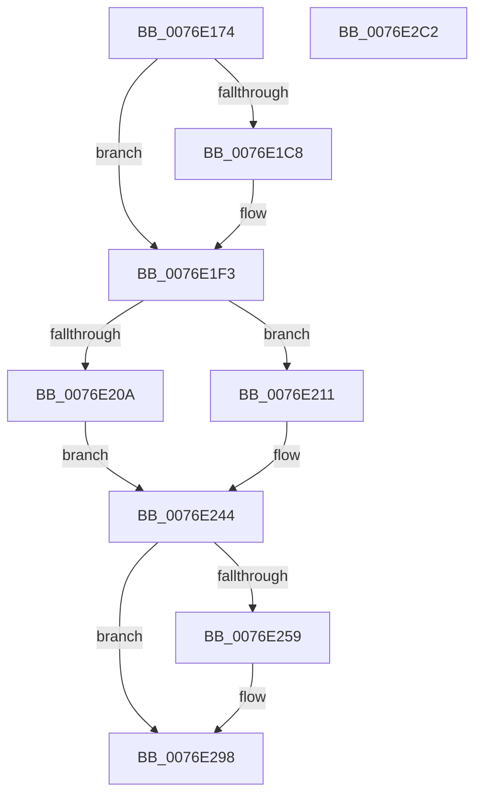

# PopAdaptiveStandbyInitializeActivator

- RVA: `0x0076E174`–`0x0076E2C3` (길이 `335` bytes)
- VA: `0x000000014076E174`
- 실행 섹션: `PAGE`
- PDB 이름 있음: `예`; PDB Function 태그: `아니요`
- unwind 정보 RVA: `0x000BAAA4`
- 디코드: `74`개 명령, `335/335` bytes 표시
- 미해석 바이트: `0` (있으면 어셈블리에 `.byte`로 보존)

> 이 문서는 커널 이미지의 기계어와 PDB 기호를 분석해 생성했습니다. 4번과 5번은 함수 원형과 자료형을 바이너리 사용 방식에서 추정한 C 해석이며 원본 소스 복구 결과는 아닙니다.

## 1. Dependencies

- 직접 호출 지점: **9**; 고유 호출 대상: **8**
- 직접 호출자로 확인된 함수: **1**
- RIP 상대 이미지 참조: **8**

### Outgoing calls
- `0x0076E1AD` → [EtwActivityIdControl](../../text/41/EtwActivityIdControl_function_0041E720.md) (function, `0x0041E720`)
- `0x0076E1B6` → [IoSetActivityIdThread](../../text/46/IoSetActivityIdThread_function_00466340.md) (function, `0x00466340`)
- `0x0076E1EE` → [tlgWriteTransfer_EtwWriteTransfer](../../text/42/tlgWriteTransfer_EtwWriteTransfer_function_004260E0.md) (function, `0x004260E0`)
- `0x0076E1FA` → [PopAcquireRwLockExclusive](../../text/43/PopAcquireRwLockExclusive_function_00430B44.md) (function, `0x00430B44`)
- `0x0076E238` → [Pdcv2ActivationClientRegister](../79/Pdcv2ActivationClientRegister_function_0079AF28.md) (function, `0x0079AF28`)
- `0x0076E24B` → [PopReleaseRwLock](../../text/2D/PopReleaseRwLock_function_002DFBBC.md) (function, `0x002DFBBC`)
- `0x0076E293` → [tlgWriteTransfer_EtwWriteTransfer](../../text/42/tlgWriteTransfer_EtwWriteTransfer_function_004260E0.md) (function, `0x004260E0`)
- `0x0076E29C` → [IoClearActivityIdThread](../../text/46/IoClearActivityIdThread_function_0046BFF0.md) (function, `0x0046BFF0`)
- `0x0076E2A8` → [_security_check_cookie](../../text/6A/_security_check_cookie_function_006AC640.md) (function, `0x006AC640`)

### Direct callers
- [PopDelayedPdcRegistrationWorker](PopDelayedPdcRegistrationWorker_function_007696F0.md) at `0x007696FD`

### Static image references
- `0x0076E18B` → RVA `0x00E0A740` (`.data`; read)
- `0x0076E1BB` → RVA `0x00E082E8` (`.data`; read)
- `0x0076E1E7` → RVA `0x0004FE72` (`.rdata`; read)
- `0x0076E1F3` → RVA `0x00F07E80` (`.data`; read)
- `0x0076E201` → RVA `0x00F07C40` (`.data`; read)
- `0x0076E211` → RVA `0x005DC590` (`PopAdaptiveStandbyActivatorCallback`; read)
- `0x0076E220` → RVA `0x00F07E70` (`.data`; read)
- `0x0076E275` → RVA `0x0004FEA5` (`.rdata`; read)

## 2. Other-region calls and transfers

- 다른 실행 섹션으로 향하는 call: **8**
  - `0x0076E1AD` → [EtwActivityIdControl](../../text/41/EtwActivityIdControl_function_0041E720.md) (`PAGE` → `.text`)
  - `0x0076E1B6` → [IoSetActivityIdThread](../../text/46/IoSetActivityIdThread_function_00466340.md) (`PAGE` → `.text`)
  - `0x0076E1EE` → [tlgWriteTransfer_EtwWriteTransfer](../../text/42/tlgWriteTransfer_EtwWriteTransfer_function_004260E0.md) (`PAGE` → `.text`)
  - `0x0076E1FA` → [PopAcquireRwLockExclusive](../../text/43/PopAcquireRwLockExclusive_function_00430B44.md) (`PAGE` → `.text`)
  - `0x0076E24B` → [PopReleaseRwLock](../../text/2D/PopReleaseRwLock_function_002DFBBC.md) (`PAGE` → `.text`)
  - `0x0076E293` → [tlgWriteTransfer_EtwWriteTransfer](../../text/42/tlgWriteTransfer_EtwWriteTransfer_function_004260E0.md) (`PAGE` → `.text`)
  - `0x0076E29C` → [IoClearActivityIdThread](../../text/46/IoClearActivityIdThread_function_0046BFF0.md) (`PAGE` → `.text`)
  - `0x0076E2A8` → [_security_check_cookie](../../text/6A/_security_check_cookie_function_006AC640.md) (`PAGE` → `.text`)
- 별도 외부 분기/꼬리 이동을 확인하지 못했습니다.

## 3. Assembly (complete function range)

```asm
0076E174  48 89 5C 24 08                  mov qword ptr [rsp + 8], rbx
0076E179  48 89 7C 24 10                  mov qword ptr [rsp + 0x10], rdi
0076E17E  55                              push rbp
0076E17F  48 8D 6C 24 A9                  lea rbp, [rsp - 0x57]
0076E184  48 81 EC 90 00 00 00            sub rsp, 0x90
0076E18B  48 8B 05 AE C5 69 00            mov rax, qword ptr [rip + 0x69c5ae]
0076E192  48 33 C4                        xor rax, rsp
0076E195  48 89 45 47                     mov qword ptr [rbp + 0x47], rax
0076E199  33 C0                           xor eax, eax
0076E19B  48 8D 55 FF                     lea rdx, [rbp - 1]
0076E19F  0F 57 C0                        xorps xmm0, xmm0
0076E1A2  48 89 45 0F                     mov qword ptr [rbp + 0xf], rax
0076E1A6  0F 11 45 FF                     movups xmmword ptr [rbp - 1], xmm0
0076E1AA  8D 48 03                        lea ecx, [rax + 3]
0076E1AD  E8 6E 05 CB FF                  call 0x14041e720
0076E1B2  48 8D 4D FF                     lea rcx, [rbp - 1]
0076E1B6  E8 85 81 CF FF                  call 0x140466340
0076E1BB  83 3D 26 A1 69 00 05            cmp dword ptr [rip + 0x69a126], 5
0076E1C2  48 89 45 0F                     mov qword ptr [rbp + 0xf], rax
0076E1C6  76 2B                           jbe 0x14076e1f3
0076E1C8  48 8D 4D 17                     lea rcx, [rbp + 0x17]
0076E1CC  4C 8B C8                        mov r9, rax
0076E1CF  48 89 4C 24 28                  mov qword ptr [rsp + 0x28], rcx
0076E1D4  4C 8D 45 FF                     lea r8, [rbp - 1]
0076E1D8  48 8D 0D 09 A1 69 00            lea rcx, [rip + 0x69a109]
0076E1DF  C7 44 24 20 02 00 00 00         mov dword ptr [rsp + 0x20], 2
0076E1E7  48 8D 15 84 1C 8E FF            lea rdx, [rip - 0x71e37c]
0076E1EE  E8 ED 7E CB FF                  call 0x1404260e0
0076E1F3  48 8D 0D 86 9C 79 00            lea rcx, [rip + 0x799c86]
0076E1FA  E8 45 29 CC FF                  call 0x140430b44
0076E1FF  33 FF                           xor edi, edi
0076E201  40 38 3D 38 9A 79 00            cmp byte ptr [rip + 0x799a38], dil
0076E208  75 07                           jne 0x14076e211
0076E20A  BB BB 00 00 C0                  mov ebx, 0xc00000bb
0076E20F  EB 33                           jmp 0x14076e244
0076E211  48 8D 05 78 E3 E6 FF            lea rax, [rip - 0x191c88]
0076E218  48 C7 45 17 01 00 00 00         mov qword ptr [rbp + 0x17], 1
0076E220  4C 8D 05 49 9C 79 00            lea r8, [rip + 0x799c49]
0076E227  48 89 45 1F                     mov qword ptr [rbp + 0x1f], rax
0076E22B  48 8D 55 17                     lea rdx, [rbp + 0x17]
0076E22F  48 89 7D 27                     mov qword ptr [rbp + 0x27], rdi
0076E233  B9 7C 00 00 00                  mov ecx, 0x7c
0076E238  E8 EB CC 02 00                  call 0x14079af28
0076E23D  85 C0                           test eax, eax
0076E23F  8B D8                           mov ebx, eax
0076E241  0F 49 DF                        cmovns ebx, edi
0076E244  48 8D 0D 35 9C 79 00            lea rcx, [rip + 0x799c35]
0076E24B  E8 6C 19 B7 FF                  call 0x1402dfbbc
0076E250  83 3D 91 A0 69 00 05            cmp dword ptr [rip + 0x69a091], 5
0076E257  76 3F                           jbe 0x14076e298
0076E259  4C 8B 4D 0F                     mov r9, qword ptr [rbp + 0xf]
0076E25D  48 8D 45 F7                     lea rax, [rbp - 9]
0076E261  48 89 45 37                     mov qword ptr [rbp + 0x37], rax
0076E265  4C 8D 45 FF                     lea r8, [rbp - 1]
0076E269  48 8D 45 17                     lea rax, [rbp + 0x17]
0076E26D  89 5D F7                        mov dword ptr [rbp - 9], ebx
0076E270  48 89 44 24 28                  mov qword ptr [rsp + 0x28], rax
0076E275  48 8D 15 29 1C 8E FF            lea rdx, [rip - 0x71e3d7]
0076E27C  48 8D 0D 65 A0 69 00            lea rcx, [rip + 0x69a065]
0076E283  C7 44 24 20 03 00 00 00         mov dword ptr [rsp + 0x20], 3
0076E28B  48 C7 45 3F 04 00 00 00         mov qword ptr [rbp + 0x3f], 4
0076E293  E8 48 7E CB FF                  call 0x1404260e0
0076E298  48 8B 4D 0F                     mov rcx, qword ptr [rbp + 0xf]
0076E29C  E8 4F DD CF FF                  call 0x14046bff0
0076E2A1  48 8B 4D 47                     mov rcx, qword ptr [rbp + 0x47]
0076E2A5  48 33 CC                        xor rcx, rsp
0076E2A8  E8 93 E3 F3 FF                  call 0x1406ac640
0076E2AD  4C 8D 9C 24 90 00 00 00         lea r11, [rsp + 0x90]
0076E2B5  49 8B 5B 10                     mov rbx, qword ptr [r11 + 0x10]
0076E2B9  49 8B 7B 18                     mov rdi, qword ptr [r11 + 0x18]
0076E2BD  49 8B E3                        mov rsp, r11
0076E2C0  5D                              pop rbp
0076E2C1  C3                              ret
0076E2C2  CC                              int3
```

## 4. C-style interpretation (structured pseudocode)

```c
__int64 __fastcall PopAdaptiveStandbyInitializeActivator(void)
{
    __int64 result;
    __int64 v_rbx;
    __int64 v_rdi;
    __int64 v_rsp;
    unsigned __int64 v_stack_m18;
    unsigned __int64 v_stack_m20;
    unsigned __int64 v_stack_m28;
    unsigned __int64 v_stack_m38;
    unsigned __int64 v_stack_m40;
    unsigned __int64 v_stack_m48;
    unsigned __int64 v_stack_m50;
    unsigned __int64 v_stack_m5F;
    unsigned __int64 v_stack_m60;
    unsigned __int64 v_stack_m68;
    unsigned __int64 v_stack_m70;
    unsigned int v_stack_m78;
    unsigned __int64 v_stack_m8;
    unsigned __int64 v_stack_p10;
    unsigned __int64 v_stack_p8;

    v_stack_p8 = v_rbx;
    v_stack_p10 = v_rdi;
    v_rsp = (v_rsp) - (144);
    result = (*(unsigned __int64 *)(v_rip + 6931886)) ^ (v_rsp);
    v_stack_m18 = result;
    result = 0;
    v_stack_m50 = 0;
    v_stack_m60 = v_xmm0;
    result = EtwActivityIdControl(result + 3, v_stack_m60, a3, a4);
    result = IoSetActivityIdThread(v_stack_m60, v_stack_m60, a3, a4);
    v_stack_m50 = result;
    if ((*(unsigned int *)(v_rip + 6922534)) >= = 5) {
        a1 = v_stack_m48;
        a4 = result;
        v_stack_m70 = a1;
        a3 = v_stack_m60;
        a1 = v_rip + 6922505;
        v_stack_m78 = 2;
        a2 = v_rip - 7463804;
        result = tlgWriteTransfer_EtwWriteTransfer(a1, a2, a3, a4);
    }
    result = PopAcquireRwLockExclusive(v_rip + 7969926, a2, a3, a4);
    v_rdi = 0;
    if ((*(unsigned __int8 *)(v_rip + 7969336)) != 0) goto loc_0076E211;
    goto loc_0076E244;
loc_0076E211:
    v_stack_m48 = 1;
    v_stack_m40 = v_rip - 1645704;
    v_stack_m38 = 0;
    result = Pdcv2ActivationClientRegister(124, v_stack_m48, v_rip + 7969865, a4);
    v_rbx = (unsigned int)((unsigned int)(result));
    if (!sign_flag) { v_rbx = 0; }
loc_0076E244:
    result = PopReleaseRwLock(v_rip + 7969845, v_stack_m48, v_rip + 7969865, a4);
    if ((*(unsigned int *)(v_rip + 6922385)) >= = 5) {
        a4 = v_stack_m50;
        result = v_stack_m68;
        v_stack_m28 = result;
        a3 = v_stack_m60;
        result = v_stack_m48;
        v_stack_m68 = (unsigned int)(v_rbx);
        v_stack_m70 = result;
        a2 = v_rip - 7463895;
        a1 = v_rip + 6922341;
        v_stack_m78 = 3;
        v_stack_m20 = 4;
        result = tlgWriteTransfer_EtwWriteTransfer(a1, a2, a3, a4);
    }
    result = IoClearActivityIdThread(v_stack_m50, a2, a3, a4);
    a1 = (v_stack_m18) ^ (v_rsp);
    result = _security_check_cookie(a1, a2, a3, a4);
    return result;
}
```

## 5. (Beta) C Style

```c
void PopAdaptiveStandbyInitializeActivator(void)
{
    int64_t result;
    int64_t local_rbx;
    int64_t local_rdi;
    int64_t local_rsp;
    uint64_t v_stack_m18;
    uint64_t v_stack_m20;
    uint64_t v_stack_m28;
    uint64_t v_stack_m38;
    uint64_t v_stack_m40;
    uint64_t v_stack_m48;
    uint64_t v_stack_m50;
    uint64_t v_stack_m5F;
    uint64_t v_stack_m60;
    uint64_t v_stack_m68;
    uint64_t v_stack_m70;
    uint32_t v_stack_m78;
    uint64_t v_stack_m8;
    uint64_t v_stack_p10;
    uint64_t v_stack_p8;

    v_stack_p8 = local_rbx;
    v_stack_p10 = local_rdi;
    local_rsp = (local_rsp) - (144);
    result = (*(uint64_t *)(v_rip + 0x69C5AE)) ^ (local_rsp);
    v_stack_m18 = result;
    result = 0;
    v_stack_m50 = 0;
    v_stack_m60 = v_xmm0;
    result = EtwActivityIdControl(result + 3, v_stack_m60, a3, a4);
    result = IoSetActivityIdThread(v_stack_m60, v_stack_m60, a3, a4);
    v_stack_m50 = result;
    if ((*(uint32_t *)(v_rip + 0x69A126)) >= = 5) {
        a1 = v_stack_m48;
        a4 = result;
        v_stack_m70 = a1;
        a3 = v_stack_m60;
        a1 = v_rip + 6922505;
        v_stack_m78 = 2;
        a2 = v_rip - 7463804;
        result = tlgWriteTransfer_EtwWriteTransfer(a1, a2, a3, a4);
    }
    result = PopAcquireRwLockExclusive(v_rip + 7969926, a2, a3, a4);
    local_rdi = 0;
    if ((*(uint8_t *)(v_rip + 0x799A38)) != 0) goto loc_0076E211;
    goto loc_0076E244;
loc_0076E211:
    v_stack_m48 = 1;
    v_stack_m40 = v_rip - 1645704;
    v_stack_m38 = 0;
    result = Pdcv2ActivationClientRegister(124, v_stack_m48, v_rip + 7969865, a4);
    local_rbx = (uint32_t)((uint32_t)(result));
    if (!sign_flag) { local_rbx = 0; }
loc_0076E244:
    result = PopReleaseRwLock(v_rip + 7969845, v_stack_m48, v_rip + 7969865, a4);
    if ((*(uint32_t *)(v_rip + 0x69A091)) >= = 5) {
        a4 = v_stack_m50;
        result = v_stack_m68;
        v_stack_m28 = result;
        a3 = v_stack_m60;
        result = v_stack_m48;
        v_stack_m68 = (uint32_t)(local_rbx);
        v_stack_m70 = result;
        a2 = v_rip - 7463895;
        a1 = v_rip + 6922341;
        v_stack_m78 = 3;
        v_stack_m20 = 4;
        result = tlgWriteTransfer_EtwWriteTransfer(a1, a2, a3, a4);
    }
    result = IoClearActivityIdThread(v_stack_m50, a2, a3, a4);
    a1 = (v_stack_m18) ^ (local_rsp);
    result = _security_check_cookie(a1, a2, a3, a4);
    return result;
}
```

## 6. Execution-region graph

[열기: 2D/3D 그래프와 함수 탐색 컨트롤 패널](../../../control-panel.html?section=page&rva=0x0076E174&view=graph)

- 2D 그래프는 위에서 아래로 흐르고, 3D 그래프는 빈 공간을 드래그해 회전합니다. Shift+드래그는 이동, 휠은 확대·축소, 함수 노드 선택은 대상 보고서 이동입니다.

### Static fallback


