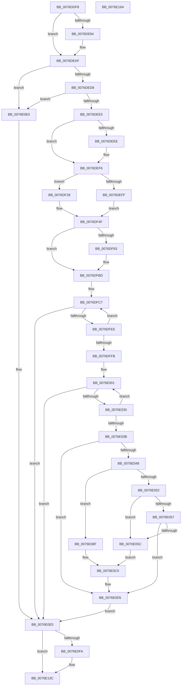

# PopAdaptiveStandbyInitialize

- RVA: `0x0076DDF8`–`0x0076E16B` (길이 `883` bytes)
- VA: `0x000000014076DDF8`
- 실행 섹션: `PAGE`
- PDB 이름 있음: `예`; PDB Function 태그: `아니요`
- unwind 정보 RVA: `0x000CD5D0`
- 디코드: `180`개 명령, `883/883` bytes 표시
- 미해석 바이트: `0` (있으면 어셈블리에 `.byte`로 보존)

> 이 문서는 커널 이미지의 기계어와 PDB 기호를 분석해 생성했습니다. 4번과 5번은 함수 원형과 자료형을 바이너리 사용 방식에서 추정한 C 해석이며 원본 소스 복구 결과는 아닙니다.

## 1. Dependencies

- 직접 호출 지점: **19**; 고유 호출 대상: **15**
- 직접 호출자로 확인된 함수: **1**
- RIP 상대 이미지 참조: **49**

### Outgoing calls
- `0x0076DE5B` → [TraceLoggingRegisterEx_EtwRegister_EtwSetInformation](../92/TraceLoggingRegisterEx_EtwRegister_EtwSetInformation_function_009208A0.md) (function, `0x009208A0`)
- `0x0076DE69` → [EtwActivityIdControl](../../text/41/EtwActivityIdControl_function_0041E720.md) (function, `0x0041E720`)
- `0x0076DE72` → [IoSetActivityIdThread](../../text/46/IoSetActivityIdThread_function_00466340.md) (function, `0x00466340`)
- `0x0076DEAA` → [tlgWriteTransfer_EtwWriteTransfer](../../text/42/tlgWriteTransfer_EtwWriteTransfer_function_004260E0.md) (function, `0x004260E0`)
- `0x0076DEC6` → [PopAcquireRwLockExclusive](../../text/43/PopAcquireRwLockExclusive_function_00430B44.md) (function, `0x00430B44`)
- `0x0076DECB` → [PopIsPlatformAoAcCapable](../../text/49/PopIsPlatformAoAcCapable_function_0049BF40.md) (function, `0x0049BF40`)
- `0x0076DED8` → [RtlIsMultiSessionSku](../A2/RtlIsMultiSessionSku_function_00A20730.md) (function, `0x00A20730`)
- `0x0076DEE5` → [Feature_AdaptiveHibernateEnhancements__private_IsEnabledDeviceUsageNoInline](../../text/4F/Feature_AdaptiveHibernateEnhancements__private_IsEnabledDeviceUsageNoInline_function_004F78F0.md) (function, `0x004F78F0`)
- `0x0076DEF6` → [Feature_AdaptiveHibernateEnhancements__private_IsEnabledDeviceUsageNoInline](../../text/4F/Feature_AdaptiveHibernateEnhancements__private_IsEnabledDeviceUsageNoInline_function_004F78F0.md) (function, `0x004F78F0`)
- `0x0076DF8A` → [Feature_AdaptiveHibernateEnhancements__private_IsEnabledDeviceUsageNoInline](../../text/4F/Feature_AdaptiveHibernateEnhancements__private_IsEnabledDeviceUsageNoInline_function_004F78F0.md) (function, `0x004F78F0`)
- `0x0076DFB8` → [PopInitializeIRTimer](../../text/5C/PopInitializeIRTimer_function_005CE5D0.md) (function, `0x005CE5D0`)
- `0x0076DFDF` → [PoRegisterPowerSettingCallback](../A8/PoRegisterPowerSettingCallback_function_00A82150.md) (function, `0x00A82150`)
- `0x0076E021` → [ExSubscribeWnfStateChange](../9D/ExSubscribeWnfStateChange_function_009D4BC0.md) (function, `0x009D4BC0`)
- `0x0076E03B` → [Feature_AdaptiveHibernateEnhancements__private_IsEnabledDeviceUsageNoInline](../../text/4F/Feature_AdaptiveHibernateEnhancements__private_IsEnabledDeviceUsageNoInline_function_004F78F0.md) (function, `0x004F78F0`)
- `0x0076E048` → [Feature_AdaptiveHibernateEnhancements__private_GetVariant](../../text/5D/Feature_AdaptiveHibernateEnhancements__private_GetVariant_function_005DC550.md) (function, `0x005DC550`)
- `0x0076E0EC` → [PopReleaseRwLock](../../text/2D/PopReleaseRwLock_function_002DFBBC.md) (function, `0x002DFBBC`)
- `0x0076E137` → [tlgWriteTransfer_EtwWriteTransfer](../../text/42/tlgWriteTransfer_EtwWriteTransfer_function_004260E0.md) (function, `0x004260E0`)
- `0x0076E140` → [IoClearActivityIdThread](../../text/46/IoClearActivityIdThread_function_0046BFF0.md) (function, `0x0046BFF0`)
- `0x0076E14C` → [_security_check_cookie](../../text/6A/_security_check_cookie_function_006AC640.md) (function, `0x006AC640`)

### Direct callers
- [PopInitPlatformSettings](../../init/C3/PopInitPlatformSettings_function_00C3D40C.md) at `0x00C3D63E`

### Static image references
- `0x0076DE13` → RVA `0x00E0A740` (`.data`; read)
- `0x0076DE23` → RVA `0x00E082E8` (`.data`; read)
- `0x0076DE31` → RVA `0x00020980` (`.rdata`; read)
- `0x0076DE41` → RVA `0x000209C0` (`.rdata`; read)
- `0x0076DE4C` → RVA `0x0001C1E0` (`.rdata`; read)
- `0x0076DEA3` → RVA `0x0004FF0D` (`.rdata`; read)
- `0x0076DEAF` → RVA `0x00F07E88` (`.data`; read/write)
- `0x0076DEB7` → RVA `0x00F07E80` (`.data`; read)
- `0x0076DEBE` → RVA `0x00F07E80` (`.data`; read/write)
- `0x0076DEEE` → RVA `0x00F07D40` (`.data`; read/write)
- `0x0076DF02` → RVA `0x00F07C7C` (`.data`; write)
- `0x0076DF0C` → RVA `0x00F07C84` (`.data`; write)
- `0x0076DF12` → RVA `0x00F07C80` (`.data`; write)
- `0x0076DF1C` → RVA `0x00F07C88` (`.data`; write)
- `0x0076DF2B` → RVA `0x00F07C8C` (`.data`; write)
- `0x0076DF35` → RVA `0x00F07C94` (`.data`; write)
- `0x0076DF3B` → RVA `0x00F07C90` (`.data`; write)
- `0x0076DF45` → RVA `0x00F07C98` (`.data`; write)
- `0x0076DF4F` → RVA `0x00F07CC8` (`.data`; read/write)
- `0x0076DF56` → RVA `0x00F07E60` (`.data`; read/write)
- `0x0076DF5E` → RVA `0x00F07E48` (`.data`; read/write)
- `0x0076DF66` → RVA `0x00F07CD0` (`.data`; write)
- `0x0076DF6C` → RVA `0x00F07CD4` (`.data`; write)
- `0x0076DF72` → RVA `0x0076C9B0` (`PopAdaptiveStandbyActionWorker`; read)
- `0x0076DF79` → RVA `0x00F07E58` (`.data`; write)
- `0x0076DF80` → RVA `0x00F07CD8` (`.data`; write)
- `0x0076DF9B` → RVA `0x0076E410` (`PopAdaptiveStandbyPolicyTimerWorker`; read)
- `0x0076DFA2` → RVA `0x005DC7C0` (`PopAdaptiveStandbyPolicyTimerCallback`; read)
- `0x0076DFB1` → RVA `0x00F07D98` (`.data`; read)
- `0x0076DFC0` → RVA `0x00E08240` (`.data`; read)
- `0x0076DFD6` → RVA `0x0076E530` (`PopAdaptiveStandbyPowerSettingCallback`; read)
- `0x0076E007` → RVA `0x0076F910` (`PopAdaptiveStandbyWnfCallback`; read)
- `0x0076E05C` → RVA `0x00E0C3A8` (`.data`; read)
- `0x0076E063` → RVA `0x00E0C3E0` (`.data`; read)
- `0x0076E069` → RVA `0x00E0C3B8` (`.data`; read)
- `0x0076E070` → RVA `0x00E0C3E8` (`.data`; read)
- `0x0076E077` → RVA `0x00E0C3C8` (`.data`; read)
- `0x0076E07E` → RVA `0x00E0C408` (`.data`; read)
- `0x0076E085` → RVA `0x00E0C3D8` (`.data`; read)
- `0x0076E08F` → RVA `0x00E0C428` (`.data`; read)
- `0x0076E096` → RVA `0x00E0C460` (`.data`; read)
- `0x0076E09C` → RVA `0x00E0C438` (`.data`; read)
- `0x0076E0AA` → RVA `0x00E0C448` (`.data`; read)
- `0x0076E0B8` → RVA `0x00E0C458` (`.data`; read)
- `0x0076E0C0` → RVA `0x00E0C420` (`.data`; write)
- `0x0076E0C6` → RVA `0x00E0C418` (`.data`; write)
- `0x0076E0CE` → RVA `0x00E0C3F8` (`.data`; read)
- `0x0076E0D5` → RVA `0x00F07C40` (`.data`; write)
- `0x0076E10E` → RVA `0x0004FE3F` (`.rdata`; read)

## 2. Other-region calls and transfers

- 다른 실행 섹션으로 향하는 call: **15**
  - `0x0076DE69` → [EtwActivityIdControl](../../text/41/EtwActivityIdControl_function_0041E720.md) (`PAGE` → `.text`)
  - `0x0076DE72` → [IoSetActivityIdThread](../../text/46/IoSetActivityIdThread_function_00466340.md) (`PAGE` → `.text`)
  - `0x0076DEAA` → [tlgWriteTransfer_EtwWriteTransfer](../../text/42/tlgWriteTransfer_EtwWriteTransfer_function_004260E0.md) (`PAGE` → `.text`)
  - `0x0076DEC6` → [PopAcquireRwLockExclusive](../../text/43/PopAcquireRwLockExclusive_function_00430B44.md) (`PAGE` → `.text`)
  - `0x0076DECB` → [PopIsPlatformAoAcCapable](../../text/49/PopIsPlatformAoAcCapable_function_0049BF40.md) (`PAGE` → `.text`)
  - `0x0076DEE5` → [Feature_AdaptiveHibernateEnhancements__private_IsEnabledDeviceUsageNoInline](../../text/4F/Feature_AdaptiveHibernateEnhancements__private_IsEnabledDeviceUsageNoInline_function_004F78F0.md) (`PAGE` → `.text`)
  - `0x0076DEF6` → [Feature_AdaptiveHibernateEnhancements__private_IsEnabledDeviceUsageNoInline](../../text/4F/Feature_AdaptiveHibernateEnhancements__private_IsEnabledDeviceUsageNoInline_function_004F78F0.md) (`PAGE` → `.text`)
  - `0x0076DF8A` → [Feature_AdaptiveHibernateEnhancements__private_IsEnabledDeviceUsageNoInline](../../text/4F/Feature_AdaptiveHibernateEnhancements__private_IsEnabledDeviceUsageNoInline_function_004F78F0.md) (`PAGE` → `.text`)
  - `0x0076DFB8` → [PopInitializeIRTimer](../../text/5C/PopInitializeIRTimer_function_005CE5D0.md) (`PAGE` → `.text`)
  - `0x0076E03B` → [Feature_AdaptiveHibernateEnhancements__private_IsEnabledDeviceUsageNoInline](../../text/4F/Feature_AdaptiveHibernateEnhancements__private_IsEnabledDeviceUsageNoInline_function_004F78F0.md) (`PAGE` → `.text`)
  - `0x0076E048` → [Feature_AdaptiveHibernateEnhancements__private_GetVariant](../../text/5D/Feature_AdaptiveHibernateEnhancements__private_GetVariant_function_005DC550.md) (`PAGE` → `.text`)
  - `0x0076E0EC` → [PopReleaseRwLock](../../text/2D/PopReleaseRwLock_function_002DFBBC.md) (`PAGE` → `.text`)
  - `0x0076E137` → [tlgWriteTransfer_EtwWriteTransfer](../../text/42/tlgWriteTransfer_EtwWriteTransfer_function_004260E0.md) (`PAGE` → `.text`)
  - `0x0076E140` → [IoClearActivityIdThread](../../text/46/IoClearActivityIdThread_function_0046BFF0.md) (`PAGE` → `.text`)
  - `0x0076E14C` → [_security_check_cookie](../../text/6A/_security_check_cookie_function_006AC640.md) (`PAGE` → `.text`)
- 별도 외부 분기/꼬리 이동을 확인하지 못했습니다.

## 3. Assembly (complete function range)

```asm
0076DDF8  48 8B C4                        mov rax, rsp
0076DDFB  48 89 70 08                     mov qword ptr [rax + 8], rsi
0076DDFF  48 89 78 10                     mov qword ptr [rax + 0x10], rdi
0076DE03  4C 89 70 18                     mov qword ptr [rax + 0x18], r14
0076DE07  55                              push rbp
0076DE08  48 8D 68 A1                     lea rbp, [rax - 0x5f]
0076DE0C  48 81 EC B0 00 00 00            sub rsp, 0xb0
0076DE13  48 8B 05 26 C9 69 00            mov rax, qword ptr [rip + 0x69c926]
0076DE1A  48 33 C4                        xor rax, rsp
0076DE1D  48 89 45 4F                     mov qword ptr [rbp + 0x4f], rax
0076DE21  33 C0                           xor eax, eax
0076DE23  48 8D 0D BE A4 69 00            lea rcx, [rip + 0x69a4be]
0076DE2A  48 89 45 FF                     mov qword ptr [rbp - 1], rax
0076DE2E  0F 57 C0                        xorps xmm0, xmm0
0076DE31  48 8D 05 48 2B 8B FF            lea rax, [rip - 0x74d4b8]
0076DE38  45 33 C0                        xor r8d, r8d
0076DE3B  48 89 45 07                     mov qword ptr [rbp + 7], rax
0076DE3F  33 D2                           xor edx, edx
0076DE41  48 8D 05 78 2B 8B FF            lea rax, [rip - 0x74d488]
0076DE48  48 89 45 0F                     mov qword ptr [rbp + 0xf], rax
0076DE4C  48 8D 05 8D E3 8A FF            lea rax, [rip - 0x751c73]
0076DE53  48 89 45 17                     mov qword ptr [rbp + 0x17], rax
0076DE57  0F 11 45 EF                     movups xmmword ptr [rbp - 0x11], xmm0
0076DE5B  E8 40 2A 1B 00                  call 0x1409208a0
0076DE60  48 8D 55 EF                     lea rdx, [rbp - 0x11]
0076DE64  B9 03 00 00 00                  mov ecx, 3
0076DE69  E8 B2 08 CB FF                  call 0x14041e720
0076DE6E  48 8D 4D EF                     lea rcx, [rbp - 0x11]
0076DE72  E8 C9 84 CF FF                  call 0x140466340
0076DE77  83 3D 6A A4 69 00 05            cmp dword ptr [rip + 0x69a46a], 5
0076DE7E  48 89 45 FF                     mov qword ptr [rbp - 1], rax
0076DE82  76 2B                           jbe 0x14076deaf
0076DE84  48 8D 4D 1F                     lea rcx, [rbp + 0x1f]
0076DE88  4C 8B C8                        mov r9, rax
0076DE8B  48 89 4C 24 28                  mov qword ptr [rsp + 0x28], rcx
0076DE90  4C 8D 45 EF                     lea r8, [rbp - 0x11]
0076DE94  48 8D 0D 4D A4 69 00            lea rcx, [rip + 0x69a44d]
0076DE9B  C7 44 24 20 02 00 00 00         mov dword ptr [rsp + 0x20], 2
0076DEA3  48 8D 15 63 20 8E FF            lea rdx, [rip - 0x71df9d]
0076DEAA  E8 31 82 CB FF                  call 0x1404260e0
0076DEAF  48 83 25 D1 9F 79 00 00         and qword ptr [rip + 0x799fd1], 0
0076DEB7  48 8D 0D C2 9F 79 00            lea rcx, [rip + 0x799fc2]
0076DEBE  48 83 25 BA 9F 79 00 00         and qword ptr [rip + 0x799fba], 0
0076DEC6  E8 79 2C CC FF                  call 0x140430b44
0076DECB  E8 70 E0 D2 FF                  call 0x14049bf40
0076DED0  84 C0                           test al, al
0076DED2  0F 84 08 02 00 00               je 0x14076e0e0
0076DED8  E8 53 28 2B 00                  call 0x140a20730
0076DEDD  84 C0                           test al, al
0076DEDF  0F 84 FB 01 00 00               je 0x14076e0e0
0076DEE5  E8 06 9A D8 FF                  call 0x1404f78f0
0076DEEA  85 C0                           test eax, eax
0076DEEC  74 08                           je 0x14076def6
0076DEEE  48 83 25 4A 9E 79 00 00         and qword ptr [rip + 0x799e4a], 0
0076DEF6  E8 F5 99 D8 FF                  call 0x1404f78f0
0076DEFB  85 C0                           test eax, eax
0076DEFD  75 29                           jne 0x14076df28
0076DEFF  83 C8 FF                        or eax, 0xffffffff
0076DF02  C7 05 70 9D 79 00 01 00 00 00   mov dword ptr [rip + 0x799d70], 1
0076DF0C  89 05 72 9D 79 00               mov dword ptr [rip + 0x799d72], eax
0076DF12  C7 05 64 9D 79 00 01 00 00 00   mov dword ptr [rip + 0x799d64], 1
0076DF1C  C7 05 62 9D 79 00 30 2A 00 00   mov dword ptr [rip + 0x799d62], 0x2a30
0076DF26  EB 27                           jmp 0x14076df4f
0076DF28  83 C8 FF                        or eax, 0xffffffff
0076DF2B  C7 05 57 9D 79 00 01 00 00 00   mov dword ptr [rip + 0x799d57], 1
0076DF35  89 05 59 9D 79 00               mov dword ptr [rip + 0x799d59], eax
0076DF3B  C7 05 4B 9D 79 00 01 00 00 00   mov dword ptr [rip + 0x799d4b], 1
0076DF45  C7 05 49 9D 79 00 30 2A 00 00   mov dword ptr [rip + 0x799d49], 0x2a30
0076DF4F  83 0D 72 9D 79 00 01            or dword ptr [rip + 0x799d72], 1
0076DF56  48 83 25 02 9F 79 00 00         and qword ptr [rip + 0x799f02], 0
0076DF5E  48 83 25 E2 9E 79 00 00         and qword ptr [rip + 0x799ee2], 0
0076DF66  89 05 64 9D 79 00               mov dword ptr [rip + 0x799d64], eax
0076DF6C  89 05 62 9D 79 00               mov dword ptr [rip + 0x799d62], eax
0076DF72  48 8D 05 37 EA FF FF            lea rax, [rip - 0x15c9]
0076DF79  48 89 05 D8 9E 79 00            mov qword ptr [rip + 0x799ed8], rax
0076DF80  C7 05 4E 9D 79 00 64 00 00 00   mov dword ptr [rip + 0x799d4e], 0x64
0076DF8A  E8 61 99 D8 FF                  call 0x1404f78f0
0076DF8F  85 C0                           test eax, eax
0076DF91  74 2A                           je 0x14076dfbd
0076DF93  C7 44 24 30 22 00 00 00         mov dword ptr [rsp + 0x30], 0x22
0076DF9B  4C 8D 0D 6E 04 00 00            lea r9, [rip + 0x46e]
0076DFA2  48 8D 15 17 E8 E6 FF            lea rdx, [rip - 0x1917e9]
0076DFA9  C7 44 24 28 06 00 00 00         mov dword ptr [rsp + 0x28], 6
0076DFB1  48 8D 0D E0 9D 79 00            lea rcx, [rip + 0x799de0]
0076DFB8  E8 13 06 E6 FF                  call 0x1405ce5d0
0076DFBD  45 33 F6                        xor r14d, r14d
0076DFC0  48 8D 35 79 A2 69 00            lea rsi, [rip + 0x69a279]
0076DFC7  48 8B 16                        mov rdx, qword ptr [rsi]
0076DFCA  48 8D 46 10                     lea rax, [rsi + 0x10]
0076DFCE  4C 8B CE                        mov r9, rsi
0076DFD1  48 89 44 24 20                  mov qword ptr [rsp + 0x20], rax
0076DFD6  4C 8D 05 53 05 00 00            lea r8, [rip + 0x553]
0076DFDD  33 C9                           xor ecx, ecx
0076DFDF  E8 6C 41 31 00                  call 0x140a82150
0076DFE4  8B F8                           mov edi, eax
0076DFE6  85 C0                           test eax, eax
0076DFE8  0F 88 F7 00 00 00               js 0x14076e0e5
0076DFEE  41 FF C6                        inc r14d
0076DFF1  48 83 C6 18                     add rsi, 0x18
0076DFF5  41 83 FE 07                     cmp r14d, 7
0076DFF9  72 CC                           jb 0x14076dfc7
0076DFFB  33 F6                           xor esi, esi
0076DFFD  4C 8D 75 07                     lea r14, [rbp + 7]
0076E001  48 83 64 24 28 00               and qword ptr [rsp + 0x28], 0
0076E007  48 8D 05 02 19 00 00            lea rax, [rip + 0x1902]
0076E00E  49 8B 16                        mov rdx, qword ptr [r14]
0076E011  48 8D 4D E7                     lea rcx, [rbp - 0x19]
0076E015  45 33 C9                        xor r9d, r9d
0076E018  48 89 44 24 20                  mov qword ptr [rsp + 0x20], rax
0076E01D  45 8D 41 01                     lea r8d, [r9 + 1]
0076E021  E8 9A 6B 26 00                  call 0x1409d4bc0
0076E026  8B F8                           mov edi, eax
0076E028  85 C0                           test eax, eax
0076E02A  0F 88 B5 00 00 00               js 0x14076e0e5
0076E030  FF C6                           inc esi
0076E032  49 83 C6 08                     add r14, 8
0076E036  83 FE 03                        cmp esi, 3
0076E039  72 C6                           jb 0x14076e001
0076E03B  E8 B0 98 D8 FF                  call 0x1404f78f0
0076E040  85 C0                           test eax, eax
0076E042  0F 84 8D 00 00 00               je 0x14076e0d5
0076E048  E8 03 E5 E6 FF                  call 0x1405dc550
0076E04D  83 E8 06                        sub eax, 6
0076E050  74 3D                           je 0x14076e08f
0076E052  83 E8 03                        sub eax, 3
0076E055  74 05                           je 0x14076e05c
0076E057  83 F8 01                        cmp eax, 1
0076E05A  75 79                           jne 0x14076e0d5
0076E05C  0F 10 05 45 E3 69 00            movups xmm0, xmmword ptr [rip + 0x69e345]
0076E063  8B 05 77 E3 69 00               mov eax, dword ptr [rip + 0x69e377]
0076E069  0F 10 0D 48 E3 69 00            movups xmm1, xmmword ptr [rip + 0x69e348]
0076E070  0F 11 05 71 E3 69 00            movups xmmword ptr [rip + 0x69e371], xmm0
0076E077  0F 10 05 4A E3 69 00            movups xmm0, xmmword ptr [rip + 0x69e34a]
0076E07E  0F 11 05 83 E3 69 00            movups xmmword ptr [rip + 0x69e383], xmm0
0076E085  F2 0F 10 05 4B E3 69 00         movsd xmm0, qword ptr [rip + 0x69e34b]
0076E08D  EB 31                           jmp 0x14076e0c0
0076E08F  0F 10 05 92 E3 69 00            movups xmm0, xmmword ptr [rip + 0x69e392]
0076E096  8B 05 C4 E3 69 00               mov eax, dword ptr [rip + 0x69e3c4]
0076E09C  0F 10 0D 95 E3 69 00            movups xmm1, xmmword ptr [rip + 0x69e395]
0076E0A3  0F 11 05 3E E3 69 00            movups xmmword ptr [rip + 0x69e33e], xmm0
0076E0AA  0F 10 05 97 E3 69 00            movups xmm0, xmmword ptr [rip + 0x69e397]
0076E0B1  0F 11 05 50 E3 69 00            movups xmmword ptr [rip + 0x69e350], xmm0
0076E0B8  F2 0F 10 05 98 E3 69 00         movsd xmm0, qword ptr [rip + 0x69e398]
0076E0C0  89 05 5A E3 69 00               mov dword ptr [rip + 0x69e35a], eax
0076E0C6  F2 0F 11 05 4A E3 69 00         movsd qword ptr [rip + 0x69e34a], xmm0
0076E0CE  0F 11 0D 23 E3 69 00            movups xmmword ptr [rip + 0x69e323], xmm1
0076E0D5  C6 05 64 9B 79 00 01            mov byte ptr [rip + 0x799b64], 1
0076E0DC  33 FF                           xor edi, edi
0076E0DE  EB 05                           jmp 0x14076e0e5
0076E0E0  BF BB 00 00 C0                  mov edi, 0xc00000bb
0076E0E5  48 8D 0D 94 9D 79 00            lea rcx, [rip + 0x799d94]
0076E0EC  E8 CB 1A B7 FF                  call 0x1402dfbbc
0076E0F1  83 3D F0 A1 69 00 05            cmp dword ptr [rip + 0x69a1f0], 5
0076E0F8  76 42                           jbe 0x14076e13c
0076E0FA  83 65 4B 00                     and dword ptr [rbp + 0x4b], 0
0076E0FE  48 8D 45 E7                     lea rax, [rbp - 0x19]
0076E102  4C 8B 4D FF                     mov r9, qword ptr [rbp - 1]
0076E106  4C 8D 45 EF                     lea r8, [rbp - 0x11]
0076E10A  48 89 45 3F                     mov qword ptr [rbp + 0x3f], rax
0076E10E  48 8D 15 2A 1D 8E FF            lea rdx, [rip - 0x71e2d6]
0076E115  48 8D 45 1F                     lea rax, [rbp + 0x1f]
0076E119  89 7D E7                        mov dword ptr [rbp - 0x19], edi
0076E11C  48 89 44 24 28                  mov qword ptr [rsp + 0x28], rax
0076E121  48 8D 0D C0 A1 69 00            lea rcx, [rip + 0x69a1c0]
0076E128  C7 44 24 20 03 00 00 00         mov dword ptr [rsp + 0x20], 3
0076E130  C7 45 47 04 00 00 00            mov dword ptr [rbp + 0x47], 4
0076E137  E8 A4 7F CB FF                  call 0x1404260e0
0076E13C  48 8B 4D FF                     mov rcx, qword ptr [rbp - 1]
0076E140  E8 AB DE CF FF                  call 0x14046bff0
0076E145  48 8B 4D 4F                     mov rcx, qword ptr [rbp + 0x4f]
0076E149  48 33 CC                        xor rcx, rsp
0076E14C  E8 EF E4 F3 FF                  call 0x1406ac640
0076E151  4C 8D 9C 24 B0 00 00 00         lea r11, [rsp + 0xb0]
0076E159  49 8B 73 10                     mov rsi, qword ptr [r11 + 0x10]
0076E15D  49 8B 7B 18                     mov rdi, qword ptr [r11 + 0x18]
0076E161  4D 8B 73 20                     mov r14, qword ptr [r11 + 0x20]
0076E165  49 8B E3                        mov rsp, r11
0076E168  5D                              pop rbp
0076E169  C3                              ret
0076E16A  CC                              int3
```

## 4. C-style interpretation (structured pseudocode)

```c
__int64 __fastcall PopAdaptiveStandbyInitialize(__int64 a1, int a2, int a3)
{
    __int64 result;
    __int64 v_r14;
    __int64 v_rdi;
    __int64 v_rsi;
    __int64 v_rsp;
    unsigned __int64 v_stack_m8;
    unsigned int v_stack_m88;
    unsigned __int64 v_stack_m90;
    unsigned int v_stack_m98;

    *(unsigned __int64 *)(v_rsp + 8) = v_rsi;
    *(unsigned __int64 *)(v_rsp + 16) = v_rdi;
    *(unsigned __int64 *)(v_rsp + 24) = v_r14;
    v_rsp = (v_rsp) - (176);
    result = (*(unsigned __int64 *)(v_rip + 6932774)) ^ (v_rsp);
    *(unsigned __int64 *)(v_rsp - 95 + 79) = result;
    result = 0;
    *(unsigned __int64 *)(v_rsp - 95 - 1) = 0;
    a3 = 0;
    *(unsigned __int64 *)(v_rsp - 95 + 7) = v_rip - 7656632;
    a2 = 0;
    *(unsigned __int64 *)(v_rsp - 95 + 15) = v_rip - 7656584;
    *(unsigned __int64 *)(v_rsp - 95 + 23) = v_rip - 7674995;
    *(unsigned __int64 *)(v_rsp - 95 - 17) = v_xmm0;
    result = TraceLoggingRegisterEx_EtwRegister_EtwSetInformation(v_rip + 6923454, a2, a3, a4);
    result = EtwActivityIdControl(3, v_rsp - 95 - 17, a3, a4);
    result = IoSetActivityIdThread(v_rsp - 95 - 17, v_rsp - 95 - 17, a3, a4);
    *(unsigned __int64 *)(v_rsp - 95 - 1) = result;
    if ((*(unsigned int *)(v_rip + 6923370)) >= = 5) {
        a1 = v_rsp - 95 + 31;
        a4 = result;
        v_stack_m90 = a1;
        a3 = v_rsp - 95 - 17;
        a1 = v_rip + 6923341;
        v_stack_m98 = 2;
        a2 = v_rip - 7462813;
        result = tlgWriteTransfer_EtwWriteTransfer(a1, a2, a3, a4);
    }
    result = PopAcquireRwLockExclusive(v_rip + 7970754, a2, a3, a4);
    result = PopIsPlatformAoAcCapable(v_rip + 7970754, a2, a3, a4);
    if ((unsigned __int8)(result) == 0) goto loc_0076E0E0;
    result = RtlIsMultiSessionSku(v_rip + 7970754, a2, a3, a4);
    if ((unsigned __int8)(result) == 0) goto loc_0076E0E0;
    result = Feature_AdaptiveHibernateEnhancements__private_IsEnabledDeviceUsageNoInline(v_rip + 7970754, a2, a3, a4);
    if ((unsigned int)(result) != 0) {
    }
    result = Feature_AdaptiveHibernateEnhancements__private_IsEnabledDeviceUsageNoInline(v_rip + 7970754, a2, a3, a4);
    if ((unsigned int)(result) != 0) goto loc_0076DF28;
    result = (unsigned int)((result) | (0xFFFFFFFFULL));
    *(unsigned int *)(v_rip + 7970160) = 1;
    *(unsigned int *)(v_rip + 7970162) = (unsigned int)(result);
    *(unsigned int *)(v_rip + 7970148) = 1;
    *(unsigned int *)(v_rip + 7970146) = 0x2A30ULL;
    goto loc_0076DF4F;
loc_0076DF28:
    result = (unsigned int)((result) | (0xFFFFFFFFULL));
    *(unsigned int *)(v_rip + 7970135) = 1;
    *(unsigned int *)(v_rip + 7970137) = (unsigned int)(result);
    *(unsigned int *)(v_rip + 7970123) = 1;
    *(unsigned int *)(v_rip + 7970121) = 0x2A30ULL;
loc_0076DF4F:
    *(unsigned int *)(v_rip + 7970148) = (unsigned int)(result);
    *(unsigned int *)(v_rip + 7970146) = (unsigned int)(result);
    *(unsigned __int64 *)(v_rip + 7970520) = v_rip - 5577;
    *(unsigned int *)(v_rip + 7970126) = 100;
    result = Feature_AdaptiveHibernateEnhancements__private_IsEnabledDeviceUsageNoInline(v_rip + 7970754, a2, a3, a4);
    if ((unsigned int)(result) != 0) {
        v_stack_m88 = 34;
        a4 = v_rip + 1134;
        a2 = v_rip - 1644521;
        v_stack_m90 = 6;
        a1 = v_rip + 7970272;
        result = PopInitializeIRTimer(a1, a2, a3, a4);
    }
    v_r14 = 0;
loc_0076DFC7:
    v_stack_m98 = v_rip + 6922873 + 16;
    a1 = 0;
    result = PoRegisterPowerSettingCallback(a1, *(unsigned __int64 *)(v_rip + 6922873), v_rip + 1363, v_rip + 6922873);
    if (sign_flag) goto loc_0076E0E5;
    v_r14 = (unsigned int)((v_r14) + 1);
    v_rsi = (v_rip + 6922873) + (24);
    if (((unsigned int)(v_r14)) < 7) goto loc_0076DFC7;
    v_rsi = 0;
loc_0076E001:
    a4 = 0;
    v_stack_m98 = v_rip + 6402;
    result = ExSubscribeWnfStateChange(v_rsp - 95 - 25, *(unsigned __int64 *)(v_rsp - 95 + 7), a4 + 1, a4);
    if (sign_flag) goto loc_0076E0E5;
    v_rsi = (unsigned int)((v_rsi) + 1);
    v_r14 = (v_rsp - 95 + 7) + (8);
    if (((unsigned int)(v_rsi)) < 3) goto loc_0076E001;
    result = Feature_AdaptiveHibernateEnhancements__private_IsEnabledDeviceUsageNoInline(v_rsp - 95 - 25, *(unsigned __int64 *)(v_rsp - 95 + 7), a4 + 1, a4);
    if ((unsigned int)(result) == 0) goto loc_0076E0D5;
    result = Feature_AdaptiveHibernateEnhancements__private_GetVariant(v_rsp - 95 - 25, *(unsigned __int64 *)(v_rsp - 95 + 7), a4 + 1, a4);
    result = (unsigned int)((result) - (6));
    if (condition_is_equal) goto loc_0076E08F;
    result = (unsigned int)((result) - (3));
    if (condition_is_equal) goto loc_0076E05C;
    if (((unsigned int)(result)) != 1) goto loc_0076E0D5;
loc_0076E05C:
    *(unsigned __int64 *)(v_rip + 6939505) = v_xmm0;
    *(unsigned __int64 *)(v_rip + 6939523) = v_xmm0;
    goto loc_0076E0C0;
loc_0076E08F:
    *(unsigned __int64 *)(v_rip + 6939454) = v_xmm0;
    *(unsigned __int64 *)(v_rip + 6939472) = v_xmm0;
loc_0076E0C0:
    *(unsigned int *)(v_rip + 6939482) = (unsigned int)((unsigned int)(*(unsigned int *)(v_rip + 6939588)));
    *(unsigned __int64 *)(v_rip + 6939466) = v_xmm0;
    *(unsigned __int64 *)(v_rip + 6939427) = v_xmm1;
loc_0076E0D5:
    *(unsigned __int8 *)(v_rip + 7969636) = 1;
    v_rdi = 0;
    goto loc_0076E0E5;
loc_0076E0E0:
loc_0076E0E5:
    result = PopReleaseRwLock(v_rip + 7970196, *(unsigned __int64 *)(v_rsp - 95 + 7), a4 + 1, a4);
    if ((*(unsigned int *)(v_rip + 6922736)) >= = 5) {
        result = v_rsp - 95 - 25;
        a4 = *(unsigned __int64 *)(v_rsp - 95 - 1);
        a3 = v_rsp - 95 - 17;
        *(unsigned __int64 *)(v_rsp - 95 + 63) = result;
        a2 = v_rip - 7463638;
        result = v_rsp - 95 + 31;
        *(unsigned int *)(v_rsp - 95 - 25) = (unsigned int)((unsigned int)(0xC00000BBULL));
        v_stack_m90 = result;
        a1 = v_rip + 6922688;
        v_stack_m98 = 3;
        *(unsigned int *)(v_rsp - 95 + 71) = 4;
        result = tlgWriteTransfer_EtwWriteTransfer(a1, a2, a3, a4);
    }
    result = IoClearActivityIdThread(*(unsigned __int64 *)(v_rsp - 95 - 1), a2, a3, a4);
    a1 = (*(unsigned __int64 *)(v_rsp - 95 + 79)) ^ (v_rsp);
    result = _security_check_cookie(a1, a2, a3, a4);
    return result;
}
```

## 5. (Beta) C Style

```c
int64_t PopAdaptiveStandbyInitialize(int64_t Arg1, int32_t Arg2, int32_t Arg3)
{
    int64_t result;
    int64_t local_r14;
    int64_t local_rdi;
    int64_t local_rsi;
    int64_t local_rsp;
    uint64_t v_stack_m8;
    uint32_t v_stack_m88;
    uint64_t v_stack_m90;
    uint32_t v_stack_m98;

    *(uint64_t *)(local_rsp + 0x8) = local_rsi;
    *(uint64_t *)(local_rsp + 0x10) = local_rdi;
    *(uint64_t *)(local_rsp + 0x18) = local_r14;
    local_rsp = (local_rsp) - (176);
    result = (*(uint64_t *)(v_rip + 0x69C926)) ^ (local_rsp);
    *(uint64_t *)(local_rsp - 0x5F + 0x4F) = result;
    result = 0;
    *(uint64_t *)(local_rsp - 0x5F - 0x1) = 0;
    Arg3 = 0;
    *(uint64_t *)(local_rsp - 0x5F + 0x7) = v_rip - 7656632;
    Arg2 = 0;
    *(uint64_t *)(local_rsp - 0x5F + 0xF) = v_rip - 7656584;
    *(uint64_t *)(local_rsp - 0x5F + 0x17) = v_rip - 7674995;
    *(uint64_t *)(local_rsp - 0x5F - 0x11) = v_xmm0;
    result = TraceLoggingRegisterEx_EtwRegister_EtwSetInformation(v_rip + 6923454, Arg2, Arg3, a4);
    result = EtwActivityIdControl(3, local_rsp - 95 - 17, Arg3, a4);
    result = IoSetActivityIdThread(local_rsp - 95 - 17, local_rsp - 95 - 17, Arg3, a4);
    *(uint64_t *)(local_rsp - 0x5F - 0x1) = result;
    if ((*(uint32_t *)(v_rip + 0x69A46A)) >= = 5) {
        Arg1 = local_rsp - 95 + 31;
        a4 = result;
        v_stack_m90 = Arg1;
        Arg3 = local_rsp - 95 - 17;
        Arg1 = v_rip + 6923341;
        v_stack_m98 = 2;
        Arg2 = v_rip - 7462813;
        result = tlgWriteTransfer_EtwWriteTransfer(Arg1, Arg2, Arg3, a4);
    }
    result = PopAcquireRwLockExclusive(v_rip + 7970754, Arg2, Arg3, a4);
    result = PopIsPlatformAoAcCapable(v_rip + 7970754, Arg2, Arg3, a4);
    if ((uint8_t)(result) == 0) goto loc_0076E0E0;
    result = RtlIsMultiSessionSku(v_rip + 7970754, Arg2, Arg3, a4);
    if ((uint8_t)(result) == 0) goto loc_0076E0E0;
    result = Feature_AdaptiveHibernateEnhancements__private_IsEnabledDeviceUsageNoInline(v_rip + 7970754, Arg2, Arg3, a4);
    if ((uint32_t)(result) != 0) {
    }
    result = Feature_AdaptiveHibernateEnhancements__private_IsEnabledDeviceUsageNoInline(v_rip + 7970754, Arg2, Arg3, a4);
    if ((uint32_t)(result) != 0) goto loc_0076DF28;
    result = (uint32_t)((result) | (0xFFFFFFFFULL));
    *(uint32_t *)(v_rip + 0x799D70) = 1;
    *(uint32_t *)(v_rip + 0x799D72) = (uint32_t)(result);
    *(uint32_t *)(v_rip + 0x799D64) = 1;
    *(uint32_t *)(v_rip + 0x799D62) = 0x2A30ULL;
    goto loc_0076DF4F;
loc_0076DF28:
    result = (uint32_t)((result) | (0xFFFFFFFFULL));
    *(uint32_t *)(v_rip + 0x799D57) = 1;
    *(uint32_t *)(v_rip + 0x799D59) = (uint32_t)(result);
    *(uint32_t *)(v_rip + 0x799D4B) = 1;
    *(uint32_t *)(v_rip + 0x799D49) = 0x2A30ULL;
loc_0076DF4F:
    *(uint32_t *)(v_rip + 0x799D64) = (uint32_t)(result);
    *(uint32_t *)(v_rip + 0x799D62) = (uint32_t)(result);
    *(uint64_t *)(v_rip + 0x799ED8) = v_rip - 5577;
    *(uint32_t *)(v_rip + 0x799D4E) = 100;
    result = Feature_AdaptiveHibernateEnhancements__private_IsEnabledDeviceUsageNoInline(v_rip + 7970754, Arg2, Arg3, a4);
    if ((uint32_t)(result) != 0) {
        v_stack_m88 = 34;
        a4 = v_rip + 1134;
        Arg2 = v_rip - 1644521;
        v_stack_m90 = 6;
        Arg1 = v_rip + 7970272;
        result = PopInitializeIRTimer(Arg1, Arg2, Arg3, a4);
    }
    local_r14 = 0;
loc_0076DFC7:
    v_stack_m98 = v_rip + 6922873 + 16;
    Arg1 = 0;
    result = PoRegisterPowerSettingCallback(Arg1, *(uint64_t *)(v_rip + 0x69A279), v_rip + 1363, v_rip + 6922873);
    if (sign_flag) goto loc_0076E0E5;
    local_r14 = (uint32_t)((local_r14) + 1);
    local_rsi = (v_rip + 6922873) + (24);
    if (((uint32_t)(local_r14)) < 7) goto loc_0076DFC7;
    local_rsi = 0;
loc_0076E001:
    a4 = 0;
    v_stack_m98 = v_rip + 6402;
    result = ExSubscribeWnfStateChange(local_rsp - 95 - 25, *(uint64_t *)(local_rsp - 0x5F + 0x7), a4 + 1, a4);
    if (sign_flag) goto loc_0076E0E5;
    local_rsi = (uint32_t)((local_rsi) + 1);
    local_r14 = (local_rsp - 95 + 7) + (8);
    if (((uint32_t)(local_rsi)) < 3) goto loc_0076E001;
    result = Feature_AdaptiveHibernateEnhancements__private_IsEnabledDeviceUsageNoInline(local_rsp - 95 - 25, *(uint64_t *)(local_rsp - 0x5F + 0x7), a4 + 1, a4);
    if ((uint32_t)(result) == 0) goto loc_0076E0D5;
    result = Feature_AdaptiveHibernateEnhancements__private_GetVariant(local_rsp - 95 - 25, *(uint64_t *)(local_rsp - 0x5F + 0x7), a4 + 1, a4);
    result = (uint32_t)((result) - (6));
    if (condition_is_equal) goto loc_0076E08F;
    result = (uint32_t)((result) - (3));
    if (condition_is_equal) goto loc_0076E05C;
    if (((uint32_t)(result)) != 1) goto loc_0076E0D5;
loc_0076E05C:
    *(uint64_t *)(v_rip + 0x69E371) = v_xmm0;
    *(uint64_t *)(v_rip + 0x69E383) = v_xmm0;
    goto loc_0076E0C0;
loc_0076E08F:
    *(uint64_t *)(v_rip + 0x69E33E) = v_xmm0;
    *(uint64_t *)(v_rip + 0x69E350) = v_xmm0;
loc_0076E0C0:
    *(uint32_t *)(v_rip + 0x69E35A) = (uint32_t)((uint32_t)(*(uint32_t *)(v_rip + 0x69E3C4)));
    *(uint64_t *)(v_rip + 0x69E34A) = v_xmm0;
    *(uint64_t *)(v_rip + 0x69E323) = v_xmm1;
loc_0076E0D5:
    *(uint8_t *)(v_rip + 0x799B64) = 1;
    local_rdi = 0;
    goto loc_0076E0E5;
loc_0076E0E0:
loc_0076E0E5:
    result = PopReleaseRwLock(v_rip + 7970196, *(uint64_t *)(local_rsp - 0x5F + 0x7), a4 + 1, a4);
    if ((*(uint32_t *)(v_rip + 0x69A1F0)) >= = 5) {
        result = local_rsp - 95 - 25;
        a4 = *(uint64_t *)(local_rsp - 0x5F - 0x1);
        Arg3 = local_rsp - 95 - 17;
        *(uint64_t *)(local_rsp - 0x5F + 0x3F) = result;
        Arg2 = v_rip - 7463638;
        result = local_rsp - 95 + 31;
        *(uint32_t *)(local_rsp - 0x5F - 0x19) = (uint32_t)((uint32_t)(0xC00000BBULL));
        v_stack_m90 = result;
        Arg1 = v_rip + 6922688;
        v_stack_m98 = 3;
        *(uint32_t *)(local_rsp - 0x5F + 0x47) = 4;
        result = tlgWriteTransfer_EtwWriteTransfer(Arg1, Arg2, Arg3, a4);
    }
    result = IoClearActivityIdThread(*(uint64_t *)(local_rsp - 0x5F - 0x1), Arg2, Arg3, a4);
    Arg1 = (*(uint64_t *)(local_rsp - 0x5F + 0x4F)) ^ (local_rsp);
    result = _security_check_cookie(Arg1, Arg2, Arg3, a4);
    return result;
}
```

## 6. Execution-region graph

[열기: 2D/3D 그래프와 함수 탐색 컨트롤 패널](../../../control-panel.html?section=page&rva=0x0076DDF8&view=graph)

- 2D 그래프는 위에서 아래로 흐르고, 3D 그래프는 빈 공간을 드래그해 회전합니다. Shift+드래그는 이동, 휠은 확대·축소, 함수 노드 선택은 대상 보고서 이동입니다.

### Static fallback


