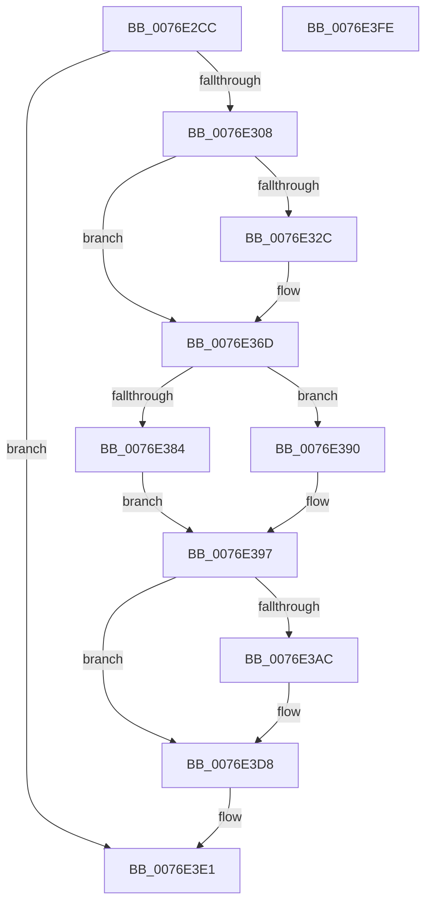

# PopAdaptiveStandbyNotifyShellPhaseState

- RVA: `0x0076E2CC`–`0x0076E3FF` (길이 `307` bytes)
- VA: `0x000000014076E2CC`
- 실행 섹션: `PAGE`
- PDB 이름 있음: `예`; PDB Function 태그: `아니요`
- unwind 정보 RVA: `0x000BD124`
- 디코드: `68`개 명령, `307/307` bytes 표시
- 미해석 바이트: `0` (있으면 어셈블리에 `.byte`로 보존)

> 이 문서는 커널 이미지의 기계어와 PDB 기호를 분석해 생성했습니다. 4번과 5번은 함수 원형과 자료형을 바이너리 사용 방식에서 추정한 C 해석이며 원본 소스 복구 결과는 아닙니다.

## 1. Dependencies

- 직접 호출 지점: **11**; 고유 호출 대상: **10**
- 직접 호출자로 확인된 함수: **1**
- RIP 상대 이미지 참조: **6**

### Outgoing calls
- `0x0076E2FB` → [PopIsPlatformAoAcCapable](../../text/49/PopIsPlatformAoAcCapable_function_0049BF40.md) (function, `0x0049BF40`)
- `0x0076E311` → [EtwActivityIdControl](../../text/41/EtwActivityIdControl_function_0041E720.md) (function, `0x0041E720`)
- `0x0076E31A` → [IoSetActivityIdThread](../../text/46/IoSetActivityIdThread_function_00466340.md) (function, `0x00466340`)
- `0x0076E368` → [tlgWriteTransfer_EtwWriteTransfer](../../text/42/tlgWriteTransfer_EtwWriteTransfer_function_004260E0.md) (function, `0x004260E0`)
- `0x0076E374` → [PopAcquireRwLockExclusive](../../text/43/PopAcquireRwLockExclusive_function_00430B44.md) (function, `0x00430B44`)
- `0x0076E389` → [PopAdaptiveStandbySessionStop](PopAdaptiveStandbySessionStop_function_0076EC94.md) (function, `0x0076EC94`)
- `0x0076E392` → [PopAdaptiveStandbySessionStart](PopAdaptiveStandbySessionStart_function_0076E8C8.md) (function, `0x0076E8C8`)
- `0x0076E39E` → [PopReleaseRwLock](../../text/2D/PopReleaseRwLock_function_002DFBBC.md) (function, `0x002DFBBC`)
- `0x0076E3D3` → [tlgWriteTransfer_EtwWriteTransfer](../../text/42/tlgWriteTransfer_EtwWriteTransfer_function_004260E0.md) (function, `0x004260E0`)
- `0x0076E3DC` → [IoClearActivityIdThread](../../text/46/IoClearActivityIdThread_function_0046BFF0.md) (function, `0x0046BFF0`)
- `0x0076E3E8` → [_security_check_cookie](../../text/6A/_security_check_cookie_function_006AC640.md) (function, `0x006AC640`)

### Direct callers
- [PdcPoCurrentPdcPhase](../../text/5D/PdcPoCurrentPdcPhase_function_005D9E70.md) at `0x005D9F83`

### Static image references
- `0x0076E2DE` → RVA `0x00E0A740` (`.data`; read)
- `0x0076E31F` → RVA `0x00E082E8` (`.data`; read)
- `0x0076E348` → RVA `0x0004EF6B` (`.rdata`; read)
- `0x0076E36D` → RVA `0x00F07E80` (`.data`; read)
- `0x0076E379` → RVA `0x00F07C40` (`.data`; read)
- `0x0076E3BD` → RVA `0x0004EFA2` (`.rdata`; read)

## 2. Other-region calls and transfers

- 다른 실행 섹션으로 향하는 call: **9**
  - `0x0076E2FB` → [PopIsPlatformAoAcCapable](../../text/49/PopIsPlatformAoAcCapable_function_0049BF40.md) (`PAGE` → `.text`)
  - `0x0076E311` → [EtwActivityIdControl](../../text/41/EtwActivityIdControl_function_0041E720.md) (`PAGE` → `.text`)
  - `0x0076E31A` → [IoSetActivityIdThread](../../text/46/IoSetActivityIdThread_function_00466340.md) (`PAGE` → `.text`)
  - `0x0076E368` → [tlgWriteTransfer_EtwWriteTransfer](../../text/42/tlgWriteTransfer_EtwWriteTransfer_function_004260E0.md) (`PAGE` → `.text`)
  - `0x0076E374` → [PopAcquireRwLockExclusive](../../text/43/PopAcquireRwLockExclusive_function_00430B44.md) (`PAGE` → `.text`)
  - `0x0076E39E` → [PopReleaseRwLock](../../text/2D/PopReleaseRwLock_function_002DFBBC.md) (`PAGE` → `.text`)
  - `0x0076E3D3` → [tlgWriteTransfer_EtwWriteTransfer](../../text/42/tlgWriteTransfer_EtwWriteTransfer_function_004260E0.md) (`PAGE` → `.text`)
  - `0x0076E3DC` → [IoClearActivityIdThread](../../text/46/IoClearActivityIdThread_function_0046BFF0.md) (`PAGE` → `.text`)
  - `0x0076E3E8` → [_security_check_cookie](../../text/6A/_security_check_cookie_function_006AC640.md) (`PAGE` → `.text`)
- 별도 외부 분기/꼬리 이동을 확인하지 못했습니다.

## 3. Assembly (complete function range)

```asm
0076E2CC  48 89 5C 24 08                  mov qword ptr [rsp + 8], rbx
0076E2D1  55                              push rbp
0076E2D2  48 8D 6C 24 A9                  lea rbp, [rsp - 0x57]
0076E2D7  48 81 EC 90 00 00 00            sub rsp, 0x90
0076E2DE  48 8B 05 5B C4 69 00            mov rax, qword ptr [rip + 0x69c45b]
0076E2E5  48 33 C4                        xor rax, rsp
0076E2E8  48 89 45 47                     mov qword ptr [rbp + 0x47], rax
0076E2EC  33 C0                           xor eax, eax
0076E2EE  0F 57 C0                        xorps xmm0, xmm0
0076E2F1  0F 11 45 FF                     movups xmmword ptr [rbp - 1], xmm0
0076E2F5  48 89 45 0F                     mov qword ptr [rbp + 0xf], rax
0076E2F9  8A D9                           mov bl, cl
0076E2FB  E8 40 DC D2 FF                  call 0x14049bf40
0076E300  84 C0                           test al, al
0076E302  0F 84 D9 00 00 00               je 0x14076e3e1
0076E308  48 8D 55 FF                     lea rdx, [rbp - 1]
0076E30C  B9 03 00 00 00                  mov ecx, 3
0076E311  E8 0A 04 CB FF                  call 0x14041e720
0076E316  48 8D 4D FF                     lea rcx, [rbp - 1]
0076E31A  E8 21 80 CF FF                  call 0x140466340
0076E31F  83 3D C2 9F 69 00 05            cmp dword ptr [rip + 0x699fc2], 5
0076E326  48 89 45 0F                     mov qword ptr [rbp + 0xf], rax
0076E32A  76 41                           jbe 0x14076e36d
0076E32C  83 65 43 00                     and dword ptr [rbp + 0x43], 0
0076E330  48 8D 4D F7                     lea rcx, [rbp - 9]
0076E334  48 89 4D 37                     mov qword ptr [rbp + 0x37], rcx
0076E338  4C 8D 45 FF                     lea r8, [rbp - 1]
0076E33C  48 8D 4D 17                     lea rcx, [rbp + 0x17]
0076E340  88 5D F7                        mov byte ptr [rbp - 9], bl
0076E343  48 89 4C 24 28                  mov qword ptr [rsp + 0x28], rcx
0076E348  48 8D 15 1C 0C 8E FF            lea rdx, [rip - 0x71f3e4]
0076E34F  48 8D 0D 92 9F 69 00            lea rcx, [rip + 0x699f92]
0076E356  C7 45 3F 01 00 00 00            mov dword ptr [rbp + 0x3f], 1
0076E35D  4C 8B C8                        mov r9, rax
0076E360  C7 44 24 20 03 00 00 00         mov dword ptr [rsp + 0x20], 3
0076E368  E8 73 7D CB FF                  call 0x1404260e0
0076E36D  48 8D 0D 0C 9B 79 00            lea rcx, [rip + 0x799b0c]
0076E374  E8 CB 27 CC FF                  call 0x140430b44
0076E379  48 8D 0D C0 98 79 00            lea rcx, [rip + 0x7998c0]
0076E380  84 DB                           test bl, bl
0076E382  75 0C                           jne 0x14076e390
0076E384  BA 01 00 00 00                  mov edx, 1
0076E389  E8 06 09 00 00                  call 0x14076ec94
0076E38E  EB 07                           jmp 0x14076e397
0076E390  33 D2                           xor edx, edx
0076E392  E8 31 05 00 00                  call 0x14076e8c8
0076E397  48 8D 0D E2 9A 79 00            lea rcx, [rip + 0x799ae2]
0076E39E  E8 19 18 B7 FF                  call 0x1402dfbbc
0076E3A3  83 3D 3E 9F 69 00 05            cmp dword ptr [rip + 0x699f3e], 5
0076E3AA  76 2C                           jbe 0x14076e3d8
0076E3AC  4C 8B 4D 0F                     mov r9, qword ptr [rbp + 0xf]
0076E3B0  48 8D 45 17                     lea rax, [rbp + 0x17]
0076E3B4  48 89 44 24 28                  mov qword ptr [rsp + 0x28], rax
0076E3B9  4C 8D 45 FF                     lea r8, [rbp - 1]
0076E3BD  48 8D 15 DE 0B 8E FF            lea rdx, [rip - 0x71f422]
0076E3C4  C7 44 24 20 02 00 00 00         mov dword ptr [rsp + 0x20], 2
0076E3CC  48 8D 0D 15 9F 69 00            lea rcx, [rip + 0x699f15]
0076E3D3  E8 08 7D CB FF                  call 0x1404260e0
0076E3D8  48 8B 4D 0F                     mov rcx, qword ptr [rbp + 0xf]
0076E3DC  E8 0F DC CF FF                  call 0x14046bff0
0076E3E1  48 8B 4D 47                     mov rcx, qword ptr [rbp + 0x47]
0076E3E5  48 33 CC                        xor rcx, rsp
0076E3E8  E8 53 E2 F3 FF                  call 0x1406ac640
0076E3ED  48 8B 9C 24 A0 00 00 00         mov rbx, qword ptr [rsp + 0xa0]
0076E3F5  48 81 C4 90 00 00 00            add rsp, 0x90
0076E3FC  5D                              pop rbp
0076E3FD  C3                              ret
0076E3FE  CC                              int3
```

## 4. C-style interpretation (structured pseudocode)

```c
__int64 __fastcall PopAdaptiveStandbyNotifyShellPhaseState(unsigned __int8 a1)
{
    __int64 result;
    __int64 v_rsp;
    unsigned __int64 v_stack_m18;
    unsigned int v_stack_m1C;
    unsigned int v_stack_m20;
    unsigned __int64 v_stack_m28;
    unsigned __int64 v_stack_m48;
    unsigned __int64 v_stack_m50;
    unsigned __int64 v_stack_m5F;
    unsigned __int64 v_stack_m60;
    unsigned __int64 v_stack_m68;
    unsigned __int64 v_stack_m70;
    unsigned int v_stack_m78;
    unsigned __int64 v_stack_p8;

    v_stack_p8 = v_rbx;
    v_rsp = (v_rsp) - (144);
    result = (*(unsigned __int64 *)(v_rip + 6931547)) ^ (v_rsp);
    v_stack_m18 = result;
    result = 0;
    v_stack_m60 = v_xmm0;
    v_stack_m50 = 0;
    result = PopIsPlatformAoAcCapable(a1, a2, a3, a4);
    if ((unsigned __int8)(result) == 0) goto loc_0076E3E1;
    result = EtwActivityIdControl(3, v_stack_m60, a3, a4);
    result = IoSetActivityIdThread(v_stack_m60, v_stack_m60, a3, a4);
    v_stack_m50 = result;
    if ((*(unsigned int *)(v_rip + 6922178)) >= = 5) {
        a1 = v_stack_m68;
        v_stack_m28 = a1;
        a3 = v_stack_m60;
        a1 = v_stack_m48;
        v_stack_m68 = a1;
        v_stack_m70 = a1;
        a2 = v_rip - 7468004;
        a1 = v_rip + 6922130;
        v_stack_m20 = 1;
        a4 = result;
        v_stack_m78 = 3;
        result = tlgWriteTransfer_EtwWriteTransfer(a1, a2, a3, a4);
    }
    result = PopAcquireRwLockExclusive(v_rip + 7969548, a2, a3, a4);
    if (a1 != 0) goto loc_0076E390;
    result = PopAdaptiveStandbySessionStop(v_rip + 7968960, 1, a3, a4);
    goto loc_0076E397;
loc_0076E390:
    a2 = 0;
    result = PopAdaptiveStandbySessionStart(v_rip + 7968960, a2, a3, a4);
loc_0076E397:
    result = PopReleaseRwLock(v_rip + 7969506, a2, a3, a4);
    if ((*(unsigned int *)(v_rip + 6922046)) >= = 5) {
        a4 = v_stack_m50;
        result = v_stack_m48;
        v_stack_m70 = result;
        a3 = v_stack_m60;
        a2 = v_rip - 7468066;
        v_stack_m78 = 2;
        a1 = v_rip + 6922005;
        result = tlgWriteTransfer_EtwWriteTransfer(a1, a2, a3, a4);
    }
    result = IoClearActivityIdThread(v_stack_m50, a2, a3, a4);
loc_0076E3E1:
    a1 = (v_stack_m18) ^ (v_rsp);
    result = _security_check_cookie(a1, a2, a3, a4);
    v_rsp = (v_rsp) + (144);
    return result;
}
```

## 5. (Beta) C Style

```c
int64_t PopAdaptiveStandbyNotifyShellPhaseState(uint8_t Arg1)
{
    int64_t result;
    int64_t local_rsp;
    uint64_t v_stack_m18;
    uint32_t v_stack_m1C;
    uint32_t v_stack_m20;
    uint64_t v_stack_m28;
    uint64_t v_stack_m48;
    uint64_t v_stack_m50;
    uint64_t v_stack_m5F;
    uint64_t v_stack_m60;
    uint64_t v_stack_m68;
    uint64_t v_stack_m70;
    uint32_t v_stack_m78;
    uint64_t v_stack_p8;

    v_stack_p8 = local_rbx;
    local_rsp = (local_rsp) - (144);
    result = (*(uint64_t *)(v_rip + 0x69C45B)) ^ (local_rsp);
    v_stack_m18 = result;
    result = 0;
    v_stack_m60 = v_xmm0;
    v_stack_m50 = 0;
    result = PopIsPlatformAoAcCapable(Arg1, a2, a3, a4);
    if ((uint8_t)(result) == 0) goto loc_0076E3E1;
    result = EtwActivityIdControl(3, v_stack_m60, a3, a4);
    result = IoSetActivityIdThread(v_stack_m60, v_stack_m60, a3, a4);
    v_stack_m50 = result;
    if ((*(uint32_t *)(v_rip + 0x699FC2)) >= = 5) {
        Arg1 = v_stack_m68;
        v_stack_m28 = Arg1;
        a3 = v_stack_m60;
        Arg1 = v_stack_m48;
        v_stack_m68 = Arg1;
        v_stack_m70 = Arg1;
        a2 = v_rip - 7468004;
        Arg1 = v_rip + 6922130;
        v_stack_m20 = 1;
        a4 = result;
        v_stack_m78 = 3;
        result = tlgWriteTransfer_EtwWriteTransfer(Arg1, a2, a3, a4);
    }
    result = PopAcquireRwLockExclusive(v_rip + 7969548, a2, a3, a4);
    if (Arg1 != 0) goto loc_0076E390;
    result = PopAdaptiveStandbySessionStop(v_rip + 7968960, 1, a3, a4);
    goto loc_0076E397;
loc_0076E390:
    a2 = 0;
    result = PopAdaptiveStandbySessionStart(v_rip + 7968960, a2, a3, a4);
loc_0076E397:
    result = PopReleaseRwLock(v_rip + 7969506, a2, a3, a4);
    if ((*(uint32_t *)(v_rip + 0x699F3E)) >= = 5) {
        a4 = v_stack_m50;
        result = v_stack_m48;
        v_stack_m70 = result;
        a3 = v_stack_m60;
        a2 = v_rip - 7468066;
        v_stack_m78 = 2;
        Arg1 = v_rip + 6922005;
        result = tlgWriteTransfer_EtwWriteTransfer(Arg1, a2, a3, a4);
    }
    result = IoClearActivityIdThread(v_stack_m50, a2, a3, a4);
loc_0076E3E1:
    Arg1 = (v_stack_m18) ^ (local_rsp);
    result = _security_check_cookie(Arg1, a2, a3, a4);
    local_rsp = (local_rsp) + (144);
    return result;
}
```

## 6. Execution-region graph

[열기: 2D/3D 그래프와 함수 탐색 컨트롤 패널](../../../control-panel.html?section=page&rva=0x0076E2CC&view=graph)

- 2D 그래프는 위에서 아래로 흐르고, 3D 그래프는 빈 공간을 드래그해 회전합니다. Shift+드래그는 이동, 휠은 확대·축소, 함수 노드 선택은 대상 보고서 이동입니다.

### Static fallback


