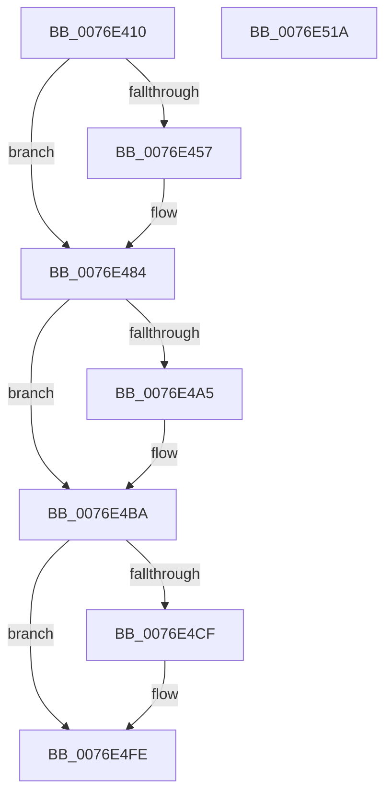

# PopAdaptiveStandbyPolicyTimerWorker

- RVA: `0x0076E410`–`0x0076E51B` (길이 `267` bytes)
- VA: `0x000000014076E410`
- 실행 섹션: `PAGE`
- PDB 이름 있음: `예`; PDB Function 태그: `아니요`
- unwind 정보 RVA: `0x000986E4`
- 디코드: `54`개 명령, `267/267` bytes 표시
- 미해석 바이트: `0` (있으면 어셈블리에 `.byte`로 보존)

> 이 문서는 커널 이미지의 기계어와 PDB 기호를 분석해 생성했습니다. 4번과 5번은 함수 원형과 자료형을 바이너리 사용 방식에서 추정한 C 해석이며 원본 소스 복구 결과는 아닙니다.

## 1. Dependencies

- 직접 호출 지점: **10**; 고유 호출 대상: **9**
- 직접 호출자로 확인된 함수: **0**
- RIP 상대 이미지 참조: **9**

### Outgoing calls
- `0x0076E43A` → [EtwActivityIdControl](../../text/41/EtwActivityIdControl_function_0041E720.md) (function, `0x0041E720`)
- `0x0076E444` → [IoSetActivityIdThread](../../text/46/IoSetActivityIdThread_function_00466340.md) (function, `0x00466340`)
- `0x0076E47F` → [tlgWriteTransfer_EtwWriteTransfer](../../text/42/tlgWriteTransfer_EtwWriteTransfer_function_004260E0.md) (function, `0x004260E0`)
- `0x0076E48B` → [PopAcquireRwLockExclusive](../../text/43/PopAcquireRwLockExclusive_function_00430B44.md) (function, `0x00430B44`)
- `0x0076E497` → [PopOkayToQueueNextWorkItem](../../text/4A/PopOkayToQueueNextWorkItem_function_004AED54.md) (function, `0x004AED54`)
- `0x0076E4B5` → [PopAdaptiveStandbyHandleBatteryUpdate](../6F/PopAdaptiveStandbyHandleBatteryUpdate_function_006FD39C.md) (function, `0x006FD39C`)
- `0x0076E4C1` → [PopReleaseRwLock](../../text/2D/PopReleaseRwLock_function_002DFBBC.md) (function, `0x002DFBBC`)
- `0x0076E4F9` → [tlgWriteTransfer_EtwWriteTransfer](../../text/42/tlgWriteTransfer_EtwWriteTransfer_function_004260E0.md) (function, `0x004260E0`)
- `0x0076E503` → [IoClearActivityIdThread](../../text/46/IoClearActivityIdThread_function_0046BFF0.md) (function, `0x0046BFF0`)
- `0x0076E510` → [_security_check_cookie](../../text/6A/_security_check_cookie_function_006AC640.md) (function, `0x006AC640`)

### Direct callers
- 이 함수 시작 RVA로 연결되는 직접 call은 확인되지 않았습니다. 간접 호출은 완전히 역산할 수 없습니다.

### Static image references
- `0x0076E414` → RVA `0x00E0A740` (`.data`; read)
- `0x0076E449` → RVA `0x00E082E8` (`.data`; read)
- `0x0076E478` → RVA `0x0004F819` (`.rdata`; read)
- `0x0076E484` → RVA `0x00F07E80` (`.data`; read)
- `0x0076E490` → RVA `0x00F07E20` (`.data`; read)
- `0x0076E49C` → RVA `0x00F07D90` (`.data`; read)
- `0x0076E4A7` → RVA `0x00F07D90` (`.data`; write)
- `0x0076E4AE` → RVA `0x00F07C40` (`.data`; read)
- `0x0076E4E3` → RVA `0x0004F83B` (`.rdata`; read)

## 2. Other-region calls and transfers

- 다른 실행 섹션으로 향하는 call: **9**
  - `0x0076E43A` → [EtwActivityIdControl](../../text/41/EtwActivityIdControl_function_0041E720.md) (`PAGE` → `.text`)
  - `0x0076E444` → [IoSetActivityIdThread](../../text/46/IoSetActivityIdThread_function_00466340.md) (`PAGE` → `.text`)
  - `0x0076E47F` → [tlgWriteTransfer_EtwWriteTransfer](../../text/42/tlgWriteTransfer_EtwWriteTransfer_function_004260E0.md) (`PAGE` → `.text`)
  - `0x0076E48B` → [PopAcquireRwLockExclusive](../../text/43/PopAcquireRwLockExclusive_function_00430B44.md) (`PAGE` → `.text`)
  - `0x0076E497` → [PopOkayToQueueNextWorkItem](../../text/4A/PopOkayToQueueNextWorkItem_function_004AED54.md) (`PAGE` → `.text`)
  - `0x0076E4C1` → [PopReleaseRwLock](../../text/2D/PopReleaseRwLock_function_002DFBBC.md) (`PAGE` → `.text`)
  - `0x0076E4F9` → [tlgWriteTransfer_EtwWriteTransfer](../../text/42/tlgWriteTransfer_EtwWriteTransfer_function_004260E0.md) (`PAGE` → `.text`)
  - `0x0076E503` → [IoClearActivityIdThread](../../text/46/IoClearActivityIdThread_function_0046BFF0.md) (`PAGE` → `.text`)
  - `0x0076E510` → [_security_check_cookie](../../text/6A/_security_check_cookie_function_006AC640.md) (`PAGE` → `.text`)
- 별도 외부 분기/꼬리 이동을 확인하지 못했습니다.

## 3. Assembly (complete function range)

```asm
0076E410  48 83 EC 78                     sub rsp, 0x78
0076E414  48 8B 05 25 C3 69 00            mov rax, qword ptr [rip + 0x69c325]
0076E41B  48 33 C4                        xor rax, rsp
0076E41E  48 89 44 24 68                  mov qword ptr [rsp + 0x68], rax
0076E423  33 C0                           xor eax, eax
0076E425  48 8D 54 24 30                  lea rdx, [rsp + 0x30]
0076E42A  0F 57 C0                        xorps xmm0, xmm0
0076E42D  48 89 44 24 40                  mov qword ptr [rsp + 0x40], rax
0076E432  0F 11 44 24 30                  movups xmmword ptr [rsp + 0x30], xmm0
0076E437  8D 48 03                        lea ecx, [rax + 3]
0076E43A  E8 E1 02 CB FF                  call 0x14041e720
0076E43F  48 8D 4C 24 30                  lea rcx, [rsp + 0x30]
0076E444  E8 F7 7E CF FF                  call 0x140466340
0076E449  83 3D 98 9E 69 00 05            cmp dword ptr [rip + 0x699e98], 5
0076E450  48 89 44 24 40                  mov qword ptr [rsp + 0x40], rax
0076E455  76 2D                           jbe 0x14076e484
0076E457  48 8D 4C 24 48                  lea rcx, [rsp + 0x48]
0076E45C  4C 8B C8                        mov r9, rax
0076E45F  48 89 4C 24 28                  mov qword ptr [rsp + 0x28], rcx
0076E464  4C 8D 44 24 30                  lea r8, [rsp + 0x30]
0076E469  48 8D 0D 78 9E 69 00            lea rcx, [rip + 0x699e78]
0076E470  C7 44 24 20 02 00 00 00         mov dword ptr [rsp + 0x20], 2
0076E478  48 8D 15 9A 13 8E FF            lea rdx, [rip - 0x71ec66]
0076E47F  E8 5C 7C CB FF                  call 0x1404260e0
0076E484  48 8D 0D F5 99 79 00            lea rcx, [rip + 0x7999f5]
0076E48B  E8 B4 26 CC FF                  call 0x140430b44
0076E490  48 8D 0D 89 99 79 00            lea rcx, [rip + 0x799989]
0076E497  E8 B8 08 D4 FF                  call 0x1404aed54
0076E49C  80 3D ED 98 79 00 00            cmp byte ptr [rip + 0x7998ed], 0
0076E4A3  74 15                           je 0x14076e4ba
0076E4A5  33 D2                           xor edx, edx
0076E4A7  C6 05 E2 98 79 00 00            mov byte ptr [rip + 0x7998e2], 0
0076E4AE  48 8D 0D 8B 97 79 00            lea rcx, [rip + 0x79978b]
0076E4B5  E8 E2 EE F8 FF                  call 0x1406fd39c
0076E4BA  48 8D 0D BF 99 79 00            lea rcx, [rip + 0x7999bf]
0076E4C1  E8 F6 16 B7 FF                  call 0x1402dfbbc
0076E4C6  83 3D 1B 9E 69 00 05            cmp dword ptr [rip + 0x699e1b], 5
0076E4CD  76 2F                           jbe 0x14076e4fe
0076E4CF  4C 8B 4C 24 40                  mov r9, qword ptr [rsp + 0x40]
0076E4D4  48 8D 44 24 48                  lea rax, [rsp + 0x48]
0076E4D9  48 89 44 24 28                  mov qword ptr [rsp + 0x28], rax
0076E4DE  4C 8D 44 24 30                  lea r8, [rsp + 0x30]
0076E4E3  48 8D 15 51 13 8E FF            lea rdx, [rip - 0x71ecaf]
0076E4EA  C7 44 24 20 02 00 00 00         mov dword ptr [rsp + 0x20], 2
0076E4F2  48 8D 0D EF 9D 69 00            lea rcx, [rip + 0x699def]
0076E4F9  E8 E2 7B CB FF                  call 0x1404260e0
0076E4FE  48 8B 4C 24 40                  mov rcx, qword ptr [rsp + 0x40]
0076E503  E8 E8 DA CF FF                  call 0x14046bff0
0076E508  48 8B 4C 24 68                  mov rcx, qword ptr [rsp + 0x68]
0076E50D  48 33 CC                        xor rcx, rsp
0076E510  E8 2B E1 F3 FF                  call 0x1406ac640
0076E515  48 83 C4 78                     add rsp, 0x78
0076E519  C3                              ret
0076E51A  CC                              int3
```

## 4. C-style interpretation (structured pseudocode)

```c
__int64 __fastcall PopAdaptiveStandbyPolicyTimerWorker(void)
{
    __int64 result;
    __int64 v_rsp;
    unsigned __int64 v_stack_m10;
    unsigned __int64 v_stack_m30;
    unsigned __int64 v_stack_m38;
    unsigned __int64 v_stack_m48;
    unsigned __int64 v_stack_m50;
    unsigned int v_stack_m58;

    v_rsp = (v_rsp) - (120);
    result = (*(unsigned __int64 *)(v_rip + 6931237)) ^ (v_rsp);
    v_stack_m10 = result;
    result = 0;
    v_stack_m38 = 0;
    v_stack_m48 = v_xmm0;
    result = EtwActivityIdControl(result + 3, v_stack_m48, a3, a4);
    result = IoSetActivityIdThread(v_stack_m48, v_stack_m48, a3, a4);
    v_stack_m38 = result;
    if ((*(unsigned int *)(v_rip + 6921880)) >= = 5) {
        a1 = v_stack_m30;
        a4 = result;
        v_stack_m50 = a1;
        a3 = v_stack_m48;
        a1 = v_rip + 6921848;
        v_stack_m58 = 2;
        a2 = v_rip - 7466086;
        result = tlgWriteTransfer_EtwWriteTransfer(a1, a2, a3, a4);
    }
    result = PopAcquireRwLockExclusive(v_rip + 7969269, a2, a3, a4);
    result = PopOkayToQueueNextWorkItem(v_rip + 7969161, a2, a3, a4);
    if ((*(unsigned __int8 *)(v_rip + 7969005)) != 0) {
        a2 = 0;
        *(unsigned __int8 *)(v_rip + 7968994) = 0;
        a1 = v_rip + 7968651;
        result = PopAdaptiveStandbyHandleBatteryUpdate(a1, a2, a3, a4);
    }
    result = PopReleaseRwLock(v_rip + 7969215, a2, a3, a4);
    if ((*(unsigned int *)(v_rip + 6921755)) >= = 5) {
        a4 = v_stack_m38;
        result = v_stack_m30;
        v_stack_m50 = result;
        a3 = v_stack_m48;
        a2 = v_rip - 7466159;
        v_stack_m58 = 2;
        a1 = v_rip + 6921711;
        result = tlgWriteTransfer_EtwWriteTransfer(a1, a2, a3, a4);
    }
    result = IoClearActivityIdThread(v_stack_m38, a2, a3, a4);
    a1 = (v_stack_m10) ^ (v_rsp);
    result = _security_check_cookie(a1, a2, a3, a4);
    v_rsp = (v_rsp) + (120);
    return result;
}
```

## 5. (Beta) C Style

```c
void PopAdaptiveStandbyPolicyTimerWorker(void)
{
    int64_t result;
    int64_t local_rsp;
    uint64_t v_stack_m10;
    uint64_t v_stack_m30;
    uint64_t v_stack_m38;
    uint64_t v_stack_m48;
    uint64_t v_stack_m50;
    uint32_t v_stack_m58;

    local_rsp = (local_rsp) - (120);
    result = (*(uint64_t *)(v_rip + 0x69C325)) ^ (local_rsp);
    v_stack_m10 = result;
    result = 0;
    v_stack_m38 = 0;
    v_stack_m48 = v_xmm0;
    result = EtwActivityIdControl(result + 3, v_stack_m48, a3, a4);
    result = IoSetActivityIdThread(v_stack_m48, v_stack_m48, a3, a4);
    v_stack_m38 = result;
    if ((*(uint32_t *)(v_rip + 0x699E98)) >= = 5) {
        a1 = v_stack_m30;
        a4 = result;
        v_stack_m50 = a1;
        a3 = v_stack_m48;
        a1 = v_rip + 6921848;
        v_stack_m58 = 2;
        a2 = v_rip - 7466086;
        result = tlgWriteTransfer_EtwWriteTransfer(a1, a2, a3, a4);
    }
    result = PopAcquireRwLockExclusive(v_rip + 7969269, a2, a3, a4);
    result = PopOkayToQueueNextWorkItem(v_rip + 7969161, a2, a3, a4);
    if ((*(uint8_t *)(v_rip + 0x7998ED)) != 0) {
        a2 = 0;
        *(uint8_t *)(v_rip + 0x7998E2) = 0;
        a1 = v_rip + 7968651;
        result = PopAdaptiveStandbyHandleBatteryUpdate(a1, a2, a3, a4);
    }
    result = PopReleaseRwLock(v_rip + 7969215, a2, a3, a4);
    if ((*(uint32_t *)(v_rip + 0x699E1B)) >= = 5) {
        a4 = v_stack_m38;
        result = v_stack_m30;
        v_stack_m50 = result;
        a3 = v_stack_m48;
        a2 = v_rip - 7466159;
        v_stack_m58 = 2;
        a1 = v_rip + 6921711;
        result = tlgWriteTransfer_EtwWriteTransfer(a1, a2, a3, a4);
    }
    result = IoClearActivityIdThread(v_stack_m38, a2, a3, a4);
    a1 = (v_stack_m10) ^ (local_rsp);
    result = _security_check_cookie(a1, a2, a3, a4);
    local_rsp = (local_rsp) + (120);
    return result;
}
```

## 6. Execution-region graph

[열기: 2D/3D 그래프와 함수 탐색 컨트롤 패널](../../../control-panel.html?section=page&rva=0x0076E410&view=graph)

- 2D 그래프는 위에서 아래로 흐르고, 3D 그래프는 빈 공간을 드래그해 회전합니다. Shift+드래그는 이동, 휠은 확대·축소, 함수 노드 선택은 대상 보고서 이동입니다.

### Static fallback


