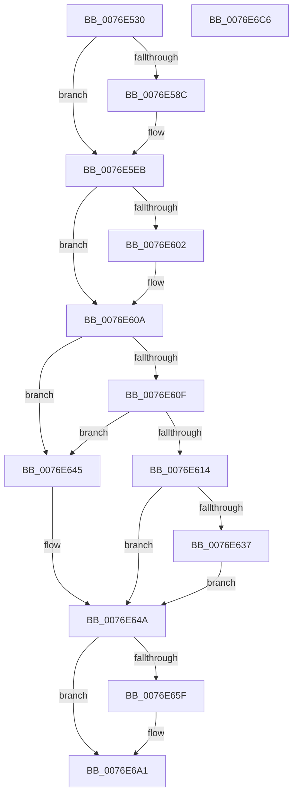

# PopAdaptiveStandbyPowerSettingCallback

- RVA: `0x0076E530`–`0x0076E6C7` (길이 `407` bytes)
- VA: `0x000000014076E530`
- 실행 섹션: `PAGE`
- PDB 이름 있음: `예`; PDB Function 태그: `아니요`
- unwind 정보 RVA: `0x000CD4FC`
- 디코드: `103`개 명령, `407/407` bytes 표시
- 미해석 바이트: `0` (있으면 어셈블리에 `.byte`로 보존)

> 이 문서는 커널 이미지의 기계어와 PDB 기호를 분석해 생성했습니다. 4번과 5번은 함수 원형과 자료형을 바이너리 사용 방식에서 추정한 C 해석이며 원본 소스 복구 결과는 아닙니다.

## 1. Dependencies

- 직접 호출 지점: **11**; 고유 호출 대상: **10**
- 직접 호출자로 확인된 함수: **0**
- RIP 상대 이미지 참조: **7**

### Outgoing calls
- `0x0076E571` → [EtwActivityIdControl](../../text/41/EtwActivityIdControl_function_0041E720.md) (function, `0x0041E720`)
- `0x0076E57A` → [IoSetActivityIdThread](../../text/46/IoSetActivityIdThread_function_00466340.md) (function, `0x00466340`)
- `0x0076E5E6` → [tlgWriteTransfer_EtwWriteTransfer](../../text/42/tlgWriteTransfer_EtwWriteTransfer_function_004260E0.md) (function, `0x004260E0`)
- `0x0076E5F2` → [PopAcquireRwLockExclusive](../../text/43/PopAcquireRwLockExclusive_function_00430B44.md) (function, `0x00430B44`)
- `0x0076E627` → [memcpy](../../text/6C/memcpy_function_006C6840.md) (function, `0x006C6840`)
- `0x0076E62E` → [Feature_AdaptiveHibernateEnhancements__private_IsEnabledDeviceUsageNoInline](../../text/4F/Feature_AdaptiveHibernateEnhancements__private_IsEnabledDeviceUsageNoInline_function_004F78F0.md) (function, `0x004F78F0`)
- `0x0076E63E` → [PopAdaptiveStandbyUpdateRegions](PopAdaptiveStandbyUpdateRegions_function_0076F86C.md) (function, `0x0076F86C`)
- `0x0076E651` → [PopReleaseRwLock](../../text/2D/PopReleaseRwLock_function_002DFBBC.md) (function, `0x002DFBBC`)
- `0x0076E69C` → [tlgWriteTransfer_EtwWriteTransfer](../../text/42/tlgWriteTransfer_EtwWriteTransfer_function_004260E0.md) (function, `0x004260E0`)
- `0x0076E6A5` → [IoClearActivityIdThread](../../text/46/IoClearActivityIdThread_function_0046BFF0.md) (function, `0x0046BFF0`)
- `0x0076E6B3` → [_security_check_cookie](../../text/6A/_security_check_cookie_function_006AC640.md) (function, `0x006AC640`)

### Direct callers
- 이 함수 시작 RVA로 연결되는 직접 call은 확인되지 않았습니다. 간접 호출은 완전히 역산할 수 없습니다.

### Static image references
- `0x0076E543` → RVA `0x00E0A740` (`.data`; read)
- `0x0076E57F` → RVA `0x00E082E8` (`.data`; read)
- `0x0076E5C1` → RVA `0x0004EFC8` (`.rdata`; read)
- `0x0076E5EB` → RVA `0x00F07E80` (`.data`; read)
- `0x0076E617` → RVA `0x00F07C40` (`.data`; read)
- `0x0076E637` → RVA `0x00F07C44` (`.data`; read)
- `0x0076E673` → RVA `0x0004F001` (`.rdata`; read)

## 2. Other-region calls and transfers

- 다른 실행 섹션으로 향하는 call: **10**
  - `0x0076E571` → [EtwActivityIdControl](../../text/41/EtwActivityIdControl_function_0041E720.md) (`PAGE` → `.text`)
  - `0x0076E57A` → [IoSetActivityIdThread](../../text/46/IoSetActivityIdThread_function_00466340.md) (`PAGE` → `.text`)
  - `0x0076E5E6` → [tlgWriteTransfer_EtwWriteTransfer](../../text/42/tlgWriteTransfer_EtwWriteTransfer_function_004260E0.md) (`PAGE` → `.text`)
  - `0x0076E5F2` → [PopAcquireRwLockExclusive](../../text/43/PopAcquireRwLockExclusive_function_00430B44.md) (`PAGE` → `.text`)
  - `0x0076E627` → [memcpy](../../text/6C/memcpy_function_006C6840.md) (`PAGE` → `.text`)
  - `0x0076E62E` → [Feature_AdaptiveHibernateEnhancements__private_IsEnabledDeviceUsageNoInline](../../text/4F/Feature_AdaptiveHibernateEnhancements__private_IsEnabledDeviceUsageNoInline_function_004F78F0.md) (`PAGE` → `.text`)
  - `0x0076E651` → [PopReleaseRwLock](../../text/2D/PopReleaseRwLock_function_002DFBBC.md) (`PAGE` → `.text`)
  - `0x0076E69C` → [tlgWriteTransfer_EtwWriteTransfer](../../text/42/tlgWriteTransfer_EtwWriteTransfer_function_004260E0.md) (`PAGE` → `.text`)
  - `0x0076E6A5` → [IoClearActivityIdThread](../../text/46/IoClearActivityIdThread_function_0046BFF0.md) (`PAGE` → `.text`)
  - `0x0076E6B3` → [_security_check_cookie](../../text/6A/_security_check_cookie_function_006AC640.md) (`PAGE` → `.text`)
- 별도 외부 분기/꼬리 이동을 확인하지 못했습니다.

## 3. Assembly (complete function range)

```asm
0076E530  40 55                           push rbp
0076E532  53                              push rbx
0076E533  56                              push rsi
0076E534  57                              push rdi
0076E535  41 56                           push r14
0076E537  48 8D 6C 24 C9                  lea rbp, [rsp - 0x37]
0076E53C  48 81 EC B0 00 00 00            sub rsp, 0xb0
0076E543  48 8B 05 F6 C1 69 00            mov rax, qword ptr [rip + 0x69c1f6]
0076E54A  48 33 C4                        xor rax, rsp
0076E54D  48 89 45 27                     mov qword ptr [rbp + 0x27], rax
0076E551  33 C0                           xor eax, eax
0076E553  41 8B F0                        mov esi, r8d
0076E556  4C 8B F2                        mov r14, rdx
0076E559  48 89 45 CF                     mov qword ptr [rbp - 0x31], rax
0076E55D  48 8B F9                        mov rdi, rcx
0076E560  48 8D 55 BF                     lea rdx, [rbp - 0x41]
0076E564  0F 57 C0                        xorps xmm0, xmm0
0076E567  49 8B D9                        mov rbx, r9
0076E56A  8D 48 03                        lea ecx, [rax + 3]
0076E56D  0F 11 45 BF                     movups xmmword ptr [rbp - 0x41], xmm0
0076E571  E8 AA 01 CB FF                  call 0x14041e720
0076E576  48 8D 4D BF                     lea rcx, [rbp - 0x41]
0076E57A  E8 C1 7D CF FF                  call 0x140466340
0076E57F  83 3D 62 9D 69 00 05            cmp dword ptr [rip + 0x699d62], 5
0076E586  48 89 45 CF                     mov qword ptr [rbp - 0x31], rax
0076E58A  76 5F                           jbe 0x14076e5eb
0076E58C  83 65 03 00                     and dword ptr [rbp + 3], 0
0076E590  48 8D 55 B7                     lea rdx, [rbp - 0x49]
0076E594  83 65 13 00                     and dword ptr [rbp + 0x13], 0
0076E598  4C 8D 45 BF                     lea r8, [rbp - 0x41]
0076E59C  83 65 23 00                     and dword ptr [rbp + 0x23], 0
0076E5A0  4C 8B C8                        mov r9, rax
0076E5A3  0F B7 CE                        movzx ecx, si
0076E5A6  66 89 4D B7                     mov word ptr [rbp - 0x49], cx
0076E5AA  89 4D 1F                        mov dword ptr [rbp + 0x1f], ecx
0076E5AD  48 8D 4D D7                     lea rcx, [rbp - 0x29]
0076E5B1  48 89 4C 24 28                  mov qword ptr [rsp + 0x28], rcx
0076E5B6  48 8D 0D 2B 9D 69 00            lea rcx, [rip + 0x699d2b]
0076E5BD  48 89 55 07                     mov qword ptr [rbp + 7], rdx
0076E5C1  48 8D 15 00 0A 8E FF            lea rdx, [rip - 0x71f600]
0076E5C8  48 89 7D F7                     mov qword ptr [rbp - 9], rdi
0076E5CC  C7 45 FF 10 00 00 00            mov dword ptr [rbp - 1], 0x10
0076E5D3  C7 45 0F 02 00 00 00            mov dword ptr [rbp + 0xf], 2
0076E5DA  4C 89 75 17                     mov qword ptr [rbp + 0x17], r14
0076E5DE  C7 44 24 20 05 00 00 00         mov dword ptr [rsp + 0x20], 5
0076E5E6  E8 F5 7A CB FF                  call 0x1404260e0
0076E5EB  48 8D 0D 8E 98 79 00            lea rcx, [rip + 0x79988e]
0076E5F2  E8 4D 25 CC FF                  call 0x140430b44
0076E5F7  4C 8B 03                        mov r8, qword ptr [rbx]
0076E5FA  48 8B 0F                        mov rcx, qword ptr [rdi]
0076E5FD  49 2B 08                        sub rcx, qword ptr [r8]
0076E600  75 08                           jne 0x14076e60a
0076E602  48 8B 4F 08                     mov rcx, qword ptr [rdi + 8]
0076E606  49 2B 48 08                     sub rcx, qword ptr [r8 + 8]
0076E60A  48 85 C9                        test rcx, rcx
0076E60D  75 36                           jne 0x14076e645
0076E60F  3B 73 0C                        cmp esi, dword ptr [rbx + 0xc]
0076E612  75 31                           jne 0x14076e645
0076E614  8B 4B 08                        mov ecx, dword ptr [rbx + 8]
0076E617  48 8D 05 22 96 79 00            lea rax, [rip + 0x799622]
0076E61E  48 03 C8                        add rcx, rax
0076E621  4C 8B C6                        mov r8, rsi
0076E624  49 8B D6                        mov rdx, r14
0076E627  E8 14 82 F5 FF                  call 0x1406c6840
0076E62C  33 DB                           xor ebx, ebx
0076E62E  E8 BD 92 D8 FF                  call 0x1404f78f0
0076E633  85 C0                           test eax, eax
0076E635  74 13                           je 0x14076e64a
0076E637  48 8D 0D 06 96 79 00            lea rcx, [rip + 0x799606]
0076E63E  E8 29 12 00 00                  call 0x14076f86c
0076E643  EB 05                           jmp 0x14076e64a
0076E645  BB 0D 00 00 C0                  mov ebx, 0xc000000d
0076E64A  48 8D 0D 2F 98 79 00            lea rcx, [rip + 0x79982f]
0076E651  E8 66 15 B7 FF                  call 0x1402dfbbc
0076E656  83 3D 8B 9C 69 00 05            cmp dword ptr [rip + 0x699c8b], 5
0076E65D  76 42                           jbe 0x14076e6a1
0076E65F  83 65 03 00                     and dword ptr [rbp + 3], 0
0076E663  48 8D 45 B7                     lea rax, [rbp - 0x49]
0076E667  4C 8B 4D CF                     mov r9, qword ptr [rbp - 0x31]
0076E66B  4C 8D 45 BF                     lea r8, [rbp - 0x41]
0076E66F  48 89 45 F7                     mov qword ptr [rbp - 9], rax
0076E673  48 8D 15 87 09 8E FF            lea rdx, [rip - 0x71f679]
0076E67A  48 8D 45 D7                     lea rax, [rbp - 0x29]
0076E67E  89 5D B7                        mov dword ptr [rbp - 0x49], ebx
0076E681  48 89 44 24 28                  mov qword ptr [rsp + 0x28], rax
0076E686  48 8D 0D 5B 9C 69 00            lea rcx, [rip + 0x699c5b]
0076E68D  C7 44 24 20 03 00 00 00         mov dword ptr [rsp + 0x20], 3
0076E695  C7 45 FF 04 00 00 00            mov dword ptr [rbp - 1], 4
0076E69C  E8 3F 7A CB FF                  call 0x1404260e0
0076E6A1  48 8B 4D CF                     mov rcx, qword ptr [rbp - 0x31]
0076E6A5  E8 46 D9 CF FF                  call 0x14046bff0
0076E6AA  8B C3                           mov eax, ebx
0076E6AC  48 8B 4D 27                     mov rcx, qword ptr [rbp + 0x27]
0076E6B0  48 33 CC                        xor rcx, rsp
0076E6B3  E8 88 DF F3 FF                  call 0x1406ac640
0076E6B8  48 81 C4 B0 00 00 00            add rsp, 0xb0
0076E6BF  41 5E                           pop r14
0076E6C1  5F                              pop rdi
0076E6C2  5E                              pop rsi
0076E6C3  5B                              pop rbx
0076E6C4  5D                              pop rbp
0076E6C5  C3                              ret
0076E6C6  CC                              int3
```

## 4. C-style interpretation (structured pseudocode)

```c
__int64 __fastcall PopAdaptiveStandbyPowerSettingCallback(__int64 a1, __int64 a2, int a3, __int64 a4)
{
    __int64 result;
    __int64 v_rbx;
    __int64 v_rsp;
    unsigned __int64 v_stack_m38;
    unsigned int v_stack_m3C;
    unsigned int v_stack_m40;
    unsigned __int64 v_stack_m48;
    unsigned int v_stack_m4C;
    unsigned int v_stack_m50;
    unsigned __int64 v_stack_m58;
    unsigned int v_stack_m5C;
    unsigned __int64 v_stack_m5F;
    unsigned int v_stack_m60;
    unsigned __int64 v_stack_m68;
    unsigned __int64 v_stack_m88;
    unsigned __int64 v_stack_m90;
    unsigned __int64 v_stack_mA0;
    unsigned __int64 v_stack_mA8;
    unsigned __int64 v_stack_mB0;
    unsigned int v_stack_mB8;

    v_rsp = (v_rsp) - (176);
    result = (*(unsigned __int64 *)(v_rip + 6930934)) ^ (v_rsp);
    v_stack_m38 = result;
    result = 0;
    v_stack_m90 = 0;
    v_stack_mA0 = v_xmm0;
    result = EtwActivityIdControl(result + 3, v_stack_mA0, a3, a4);
    result = IoSetActivityIdThread(v_stack_mA0, v_stack_mA0, a3, a4);
    v_stack_m90 = result;
    if ((*(unsigned int *)(v_rip + 6921570)) >= = 5) {
        a2 = v_stack_mA8;
        a3 = v_stack_mA0;
        a4 = result;
        a1 = (unsigned __int16)((unsigned int)(a3));
        v_stack_mA8 = (unsigned __int16)(a1);
        v_stack_m40 = (unsigned int)(a1);
        a1 = v_stack_m88;
        v_stack_mB0 = a1;
        a1 = v_rip + 6921515;
        v_stack_m58 = a2;
        a2 = v_rip - 7468544;
        v_stack_m68 = a1;
        v_stack_m60 = 16;
        v_stack_m50 = 2;
        v_stack_m48 = a2;
        v_stack_mB8 = 5;
        result = tlgWriteTransfer_EtwWriteTransfer(a1, a2, a3, a4);
    }
    result = PopAcquireRwLockExclusive(v_rip + 7968910, a2, a3, a4);
    a1 = (*(unsigned __int64 *)(a1)) - (*(unsigned __int64 *)(*(unsigned __int64 *)(a4)));
    if (!(condition_is_not_equal)) {
        a1 = *(unsigned __int64 *)(a1 + 8);
        a1 = (a1) - (*(unsigned __int64 *)(*(unsigned __int64 *)(a4) + 8));
    }
    if (a1 != 0) goto loc_0076E645;
    if (((unsigned int)((unsigned int)(a3))) != (*(unsigned int *)(a4 + 12))) goto loc_0076E645;
    a1 = ((unsigned int)(*(unsigned int *)(a4 + 8))) + (v_rip + 7968290);
    result = memcpy(a1, a2, (unsigned int)(a3), a4);
    v_rbx = 0;
    result = Feature_AdaptiveHibernateEnhancements__private_IsEnabledDeviceUsageNoInline(a1, a2, (unsigned int)(a3), a4);
    if ((unsigned int)(result) == 0) goto loc_0076E64A;
    result = PopAdaptiveStandbyUpdateRegions(v_rip + 7968262, a2, (unsigned int)(a3), a4);
    goto loc_0076E64A;
loc_0076E645:
loc_0076E64A:
    result = PopReleaseRwLock(v_rip + 7968815, a2, (unsigned int)(a3), a4);
    if ((*(unsigned int *)(v_rip + 6921355)) >= = 5) {
        result = v_stack_mA8;
        a4 = v_stack_m90;
        a3 = v_stack_mA0;
        v_stack_m68 = result;
        a2 = v_rip - 7468665;
        result = v_stack_m88;
        v_stack_mA8 = (unsigned int)((unsigned int)(0xC000000DULL));
        v_stack_mB0 = result;
        a1 = v_rip + 6921307;
        v_stack_mB8 = 3;
        v_stack_m60 = 4;
        result = tlgWriteTransfer_EtwWriteTransfer(a1, a2, a3, a4);
    }
    result = IoClearActivityIdThread(v_stack_m90, a2, a3, a4);
    a1 = (v_stack_m38) ^ (v_rsp);
    result = _security_check_cookie(a1, a2, a3, a4);
    v_rsp = (v_rsp) + (176);
    return result;
}
```

## 5. (Beta) C Style

```c
int64_t PopAdaptiveStandbyPowerSettingCallback(void *Arg1, int64_t Arg2, int32_t Arg3, void *Arg4)
{
    uint8_t *arg1 = (uint8_t *)Arg1;
    uint8_t *arg4 = (uint8_t *)Arg4;

    int64_t result;
    int64_t local_rbx;
    int64_t local_rsp;
    uint64_t v_stack_m38;
    uint32_t v_stack_m3C;
    uint32_t v_stack_m40;
    uint64_t v_stack_m48;
    uint32_t v_stack_m4C;
    uint32_t v_stack_m50;
    uint64_t v_stack_m58;
    uint32_t v_stack_m5C;
    uint64_t v_stack_m5F;
    uint32_t v_stack_m60;
    uint64_t v_stack_m68;
    uint64_t v_stack_m88;
    uint64_t v_stack_m90;
    uint64_t v_stack_mA0;
    uint64_t v_stack_mA8;
    uint64_t v_stack_mB0;
    uint32_t v_stack_mB8;

    local_rsp = (local_rsp) - (176);
    result = (*(uint64_t *)(v_rip + 0x69C1F6)) ^ (local_rsp);
    v_stack_m38 = result;
    result = 0;
    v_stack_m90 = 0;
    v_stack_mA0 = v_xmm0;
    result = EtwActivityIdControl(result + 3, v_stack_mA0, Arg3, Arg4);
    result = IoSetActivityIdThread(v_stack_mA0, v_stack_mA0, Arg3, Arg4);
    v_stack_m90 = result;
    if ((*(uint32_t *)(v_rip + 0x699D62)) >= = 5) {
        Arg2 = v_stack_mA8;
        Arg3 = v_stack_mA0;
        Arg4 = result;
        Arg1 = (uint16_t)((uint32_t)(Arg3));
        v_stack_mA8 = (uint16_t)(Arg1);
        v_stack_m40 = (uint32_t)(Arg1);
        Arg1 = v_stack_m88;
        v_stack_mB0 = Arg1;
        Arg1 = v_rip + 6921515;
        v_stack_m58 = Arg2;
        Arg2 = v_rip - 7468544;
        v_stack_m68 = Arg1;
        v_stack_m60 = 16;
        v_stack_m50 = 2;
        v_stack_m48 = Arg2;
        v_stack_mB8 = 5;
        result = tlgWriteTransfer_EtwWriteTransfer(Arg1, Arg2, Arg3, Arg4);
    }
    result = PopAcquireRwLockExclusive(v_rip + 7968910, Arg2, Arg3, Arg4);
    Arg1 = (*(uint64_t *)(arg1)) - (*(uint64_t *)(*(uint64_t *)(arg4)));
    if (!(condition_is_not_equal)) {
        Arg1 = *(uint64_t *)(arg1 + 0x8);
        Arg1 = (Arg1) - (*(uint64_t *)(*(uint64_t *)(arg4) + 0x8));
    }
    if (Arg1 != NULL) goto loc_0076E645;
    if (((uint32_t)((uint32_t)(Arg3))) != (*(uint32_t *)(arg4 + 0xC))) goto loc_0076E645;
    Arg1 = ((uint32_t)(*(uint32_t *)(arg4 + 0x8))) + (v_rip + 7968290);
    result = memcpy(Arg1, Arg2, (uint32_t)(Arg3), Arg4);
    local_rbx = 0;
    result = Feature_AdaptiveHibernateEnhancements__private_IsEnabledDeviceUsageNoInline(Arg1, Arg2, (uint32_t)(Arg3), Arg4);
    if ((uint32_t)(result) == 0) goto loc_0076E64A;
    result = PopAdaptiveStandbyUpdateRegions(v_rip + 7968262, Arg2, (uint32_t)(Arg3), Arg4);
    goto loc_0076E64A;
loc_0076E645:
loc_0076E64A:
    result = PopReleaseRwLock(v_rip + 7968815, Arg2, (uint32_t)(Arg3), Arg4);
    if ((*(uint32_t *)(v_rip + 0x699C8B)) >= = 5) {
        result = v_stack_mA8;
        Arg4 = v_stack_m90;
        Arg3 = v_stack_mA0;
        v_stack_m68 = result;
        Arg2 = v_rip - 7468665;
        result = v_stack_m88;
        v_stack_mA8 = (uint32_t)((uint32_t)(0xC000000DULL));
        v_stack_mB0 = result;
        Arg1 = v_rip + 6921307;
        v_stack_mB8 = 3;
        v_stack_m60 = 4;
        result = tlgWriteTransfer_EtwWriteTransfer(Arg1, Arg2, Arg3, Arg4);
    }
    result = IoClearActivityIdThread(v_stack_m90, Arg2, Arg3, Arg4);
    Arg1 = (v_stack_m38) ^ (local_rsp);
    result = _security_check_cookie(Arg1, Arg2, Arg3, Arg4);
    local_rsp = (local_rsp) + (176);
    return result;
}
```

### 관측된 메모리 오프셋

구조체 형식이 확인되지 않은 접근은 인자 기준의 오프셋으로만 기록했습니다.

| 기준 인자 | 오프셋 표현 | 폭 (bit) | 접근 |
|---|---:|---:|---|
| `Arg1` | `+ 0x0` | `64` | `R` |
| `Arg1` | `+ 0x8` | `64` | `R` |
| `Arg4` | `+ 0x0` | `64` | `R` |
| `Arg4` | `+ 0x8` | `32` | `R` |
| `Arg4` | `+ 0xC` | `32` | `R` |

## 6. Execution-region graph

[열기: 2D/3D 그래프와 함수 탐색 컨트롤 패널](../../../control-panel.html?section=page&rva=0x0076E530&view=graph)

- 2D 그래프는 위에서 아래로 흐르고, 3D 그래프는 빈 공간을 드래그해 회전합니다. Shift+드래그는 이동, 휠은 확대·축소, 함수 노드 선택은 대상 보고서 이동입니다.

### Static fallback


