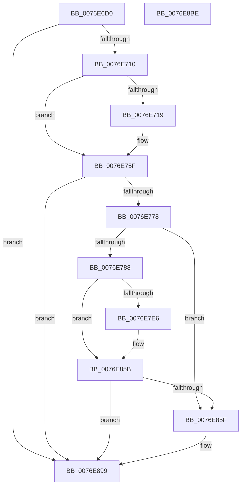

# PopAdaptiveStandbyQueryReserveConfiguration

- RVA: `0x0076E6D0`–`0x0076E8BF` (길이 `495` bytes)
- VA: `0x000000014076E6D0`
- 실행 섹션: `PAGE`
- PDB 이름 있음: `예`; PDB Function 태그: `아니요`
- unwind 정보 RVA: `0x000BCECC`
- 디코드: `112`개 명령, `495/495` bytes 표시
- 미해석 바이트: `0` (있으면 어셈블리에 `.byte`로 보존)

> 이 문서는 커널 이미지의 기계어와 PDB 기호를 분석해 생성했습니다. 4번과 5번은 함수 원형과 자료형을 바이너리 사용 방식에서 추정한 C 해석이며 원본 소스 복구 결과는 아닙니다.

## 1. Dependencies

- 직접 호출 지점: **8**; 고유 호출 대상: **6**
- 직접 호출자로 확인된 함수: **2**
- RIP 상대 이미지 참조: **6**

### Outgoing calls
- `0x0076E730` → [IoGetActivityIdThread](../../text/44/IoGetActivityIdThread_function_00445030.md) (function, `0x00445030`)
- `0x0076E75A` → [tlgWriteTransfer_EtwWriteTransfer](../../text/42/tlgWriteTransfer_EtwWriteTransfer_function_004260E0.md) (function, `0x004260E0`)
- `0x0076E7D6` → [Pdcv2ActivationClientActivate](../95/Pdcv2ActivationClientActivate_function_00953C70.md) (function, `0x00953C70`)
- `0x0076E82C` → [IoGetActivityIdThread](../../text/44/IoGetActivityIdThread_function_00445030.md) (function, `0x00445030`)
- `0x0076E856` → [tlgWriteTransfer_EtwWriteTransfer](../../text/42/tlgWriteTransfer_EtwWriteTransfer_function_004260E0.md) (function, `0x004260E0`)
- `0x0076E871` → [memset](../../text/6C/memset_function_006C6C40.md) (function, `0x006C6C40`)
- `0x0076E894` → [PopUmpoSendPowerMessage](../../text/23/PopUmpoSendPowerMessage_function_00230730.md) (function, `0x00230730`)
- `0x0076E8A0` → [_security_check_cookie](../../text/6A/_security_check_cookie_function_006AC640.md) (function, `0x006AC640`)

### Direct callers
- [PopAdaptiveStandbyHandlePowerMessage](PopAdaptiveStandbyHandlePowerMessage_function_0076DB70.md) at `0x0076DD13`
- [PopAdaptiveStandbySessionStart](PopAdaptiveStandbySessionStart_function_0076E8C8.md) at `0x0076EB1D`

### Static image references
- `0x0076E6EB` → RVA `0x00E0A740` (`.data`; read)
- `0x0076E710` → RVA `0x00E082E8` (`.data`; read)
- `0x0076E738` → RVA `0x0004F02F` (`.rdata`; read)
- `0x0076E78D` → RVA `0x00B03700` (` ?? ::NNGAKEGL::`string'`; read)
- `0x0076E7B3` → RVA `0x00B036E0` (` ?? ::NNGAKEGL::`string'`; read)
- `0x0076E834` → RVA `0x0004EC0D` (`.rdata`; read)

## 2. Other-region calls and transfers

- 다른 실행 섹션으로 향하는 call: **7**
  - `0x0076E730` → [IoGetActivityIdThread](../../text/44/IoGetActivityIdThread_function_00445030.md) (`PAGE` → `.text`)
  - `0x0076E75A` → [tlgWriteTransfer_EtwWriteTransfer](../../text/42/tlgWriteTransfer_EtwWriteTransfer_function_004260E0.md) (`PAGE` → `.text`)
  - `0x0076E82C` → [IoGetActivityIdThread](../../text/44/IoGetActivityIdThread_function_00445030.md) (`PAGE` → `.text`)
  - `0x0076E856` → [tlgWriteTransfer_EtwWriteTransfer](../../text/42/tlgWriteTransfer_EtwWriteTransfer_function_004260E0.md) (`PAGE` → `.text`)
  - `0x0076E871` → [memset](../../text/6C/memset_function_006C6C40.md) (`PAGE` → `.text`)
  - `0x0076E894` → [PopUmpoSendPowerMessage](../../text/23/PopUmpoSendPowerMessage_function_00230730.md) (`PAGE` → `.text`)
  - `0x0076E8A0` → [_security_check_cookie](../../text/6A/_security_check_cookie_function_006AC640.md) (`PAGE` → `.text`)
- 별도 외부 분기/꼬리 이동을 확인하지 못했습니다.

## 3. Assembly (complete function range)

```asm
0076E6D0  48 8B C4                        mov rax, rsp
0076E6D3  48 89 58 10                     mov qword ptr [rax + 0x10], rbx
0076E6D7  48 89 70 18                     mov qword ptr [rax + 0x18], rsi
0076E6DB  48 89 78 20                     mov qword ptr [rax + 0x20], rdi
0076E6DF  55                              push rbp
0076E6E0  48 8D 68 A1                     lea rbp, [rax - 0x5f]
0076E6E4  48 81 EC E0 00 00 00            sub rsp, 0xe0
0076E6EB  48 8B 05 4E C0 69 00            mov rax, qword ptr [rip + 0x69c04e]
0076E6F2  48 33 C4                        xor rax, rsp
0076E6F5  48 89 45 47                     mov qword ptr [rbp + 0x47], rax
0076E6F9  83 65 B7 00                     and dword ptr [rbp - 0x49], 0
0076E6FD  48 8B D9                        mov rbx, rcx
0076E700  48 8B 81 D0 00 00 00            mov rax, qword ptr [rcx + 0xd0]
0076E707  48 85 C0                        test rax, rax
0076E70A  0F 84 89 01 00 00               je 0x14076e899
0076E710  83 3D D1 9B 69 00 05            cmp dword ptr [rip + 0x699bd1], 5
0076E717  76 46                           jbe 0x14076e75f
0076E719  83 65 23 00                     and dword ptr [rbp + 0x23], 0
0076E71D  48 89 45 BF                     mov qword ptr [rbp - 0x41], rax
0076E721  48 8D 45 BF                     lea rax, [rbp - 0x41]
0076E725  48 89 45 17                     mov qword ptr [rbp + 0x17], rax
0076E729  C7 45 1F 08 00 00 00            mov dword ptr [rbp + 0x1f], 8
0076E730  E8 FB 68 CD FF                  call 0x140445030
0076E735  4C 8B C0                        mov r8, rax
0076E738  48 8D 15 F0 08 8E FF            lea rdx, [rip - 0x71f710]
0076E73F  48 8D 45 F7                     lea rax, [rbp - 9]
0076E743  45 33 C9                        xor r9d, r9d
0076E746  48 89 44 24 28                  mov qword ptr [rsp + 0x28], rax
0076E74B  48 8D 0D 96 9B 69 00            lea rcx, [rip + 0x699b96]
0076E752  C7 44 24 20 03 00 00 00         mov dword ptr [rsp + 0x20], 3
0076E75A  E8 81 79 CB FF                  call 0x1404260e0
0076E75F  83 63 70 00                     and dword ptr [rbx + 0x70], 0
0076E763  80 7B 78 00                     cmp byte ptr [rbx + 0x78], 0
0076E767  48 8B 83 D0 00 00 00            mov rax, qword ptr [rbx + 0xd0]
0076E76E  48 89 43 68                     mov qword ptr [rbx + 0x68], rax
0076E772  0F 85 21 01 00 00               jne 0x14076e899
0076E778  48 8B 8B 30 02 00 00            mov rcx, qword ptr [rbx + 0x230]
0076E77F  48 85 C9                        test rcx, rcx
0076E782  0F 84 D7 00 00 00               je 0x14076e85f
0076E788  48 83 65 D7 00                  and qword ptr [rbp - 0x29], 0
0076E78D  48 8D 05 6C 4F 39 00            lea rax, [rip + 0x394f6c]
0076E794  48 89 45 DF                     mov qword ptr [rbp - 0x21], rax
0076E798  48 8D B3 80 00 00 00            lea rsi, [rbx + 0x80]
0076E79F  48 8D 45 B7                     lea rax, [rbp - 0x49]
0076E7A3  C7 45 CF 01 00 00 00            mov dword ptr [rbp - 0x31], 1
0076E7AA  48 89 44 24 38                  mov qword ptr [rsp + 0x38], rax
0076E7AF  48 8D 55 CF                     lea rdx, [rbp - 0x31]
0076E7B3  48 8D 05 26 4F 39 00            lea rax, [rip + 0x394f26]
0076E7BA  48 89 74 24 30                  mov qword ptr [rsp + 0x30], rsi
0076E7BF  0F 57 C0                        xorps xmm0, xmm0
0076E7C2  48 89 44 24 20                  mov qword ptr [rsp + 0x20], rax
0076E7C7  45 33 C0                        xor r8d, r8d
0076E7CA  C7 45 D3 2C 01 00 00            mov dword ptr [rbp - 0x2d], 0x12c
0076E7D1  F3 0F 7F 45 E7                  movdqu xmmword ptr [rbp - 0x19], xmm0
0076E7D6  E8 95 54 1E 00                  call 0x140953c70
0076E7DB  83 3D 06 9B 69 00 05            cmp dword ptr [rip + 0x699b06], 5
0076E7E2  8B F8                           mov edi, eax
0076E7E4  76 75                           jbe 0x14076e85b
0076E7E6  8B 4D B7                        mov ecx, dword ptr [rbp - 0x49]
0076E7E9  BA 04 00 00 00                  mov edx, 4
0076E7EE  83 65 23 00                     and dword ptr [rbp + 0x23], 0
0076E7F2  83 65 33 00                     and dword ptr [rbp + 0x33], 0
0076E7F6  83 65 43 00                     and dword ptr [rbp + 0x43], 0
0076E7FA  89 45 BF                        mov dword ptr [rbp - 0x41], eax
0076E7FD  48 8D 45 BF                     lea rax, [rbp - 0x41]
0076E801  48 89 45 17                     mov qword ptr [rbp + 0x17], rax
0076E805  48 8D 45 B7                     lea rax, [rbp - 0x49]
0076E809  48 89 45 27                     mov qword ptr [rbp + 0x27], rax
0076E80D  48 8B 06                        mov rax, qword ptr [rsi]
0076E810  48 89 45 C7                     mov qword ptr [rbp - 0x39], rax
0076E814  48 8D 45 C7                     lea rax, [rbp - 0x39]
0076E818  48 89 45 37                     mov qword ptr [rbp + 0x37], rax
0076E81C  89 55 1F                        mov dword ptr [rbp + 0x1f], edx
0076E81F  89 4D B7                        mov dword ptr [rbp - 0x49], ecx
0076E822  89 55 2F                        mov dword ptr [rbp + 0x2f], edx
0076E825  C7 45 3F 08 00 00 00            mov dword ptr [rbp + 0x3f], 8
0076E82C  E8 FF 67 CD FF                  call 0x140445030
0076E831  4C 8B C0                        mov r8, rax
0076E834  48 8D 15 D2 03 8E FF            lea rdx, [rip - 0x71fc2e]
0076E83B  48 8D 45 F7                     lea rax, [rbp - 9]
0076E83F  45 33 C9                        xor r9d, r9d
0076E842  48 89 44 24 28                  mov qword ptr [rsp + 0x28], rax
0076E847  48 8D 0D 9A 9A 69 00            lea rcx, [rip + 0x699a9a]
0076E84E  C7 44 24 20 05 00 00 00         mov dword ptr [rsp + 0x20], 5
0076E856  E8 85 78 CB FF                  call 0x1404260e0
0076E85B  85 FF                           test edi, edi
0076E85D  78 3A                           js 0x14076e899
0076E85F  BF 48 00 00 00                  mov edi, 0x48
0076E864  C6 43 78 01                     mov byte ptr [rbx + 0x78], 1
0076E868  44 8B C7                        mov r8d, edi
0076E86B  48 8D 4D F7                     lea rcx, [rbp - 9]
0076E86F  33 D2                           xor edx, edx
0076E871  E8 CA 83 F5 FF                  call 0x1406c6c40
0076E876  48 8B 83 D0 00 00 00            mov rax, qword ptr [rbx + 0xd0]
0076E87D  48 8D 4D F7                     lea rcx, [rbp - 9]
0076E881  45 33 C9                        xor r9d, r9d
0076E884  48 89 45 FF                     mov qword ptr [rbp - 1], rax
0076E888  45 33 C0                        xor r8d, r8d
0076E88B  C7 45 F7 14 00 00 00            mov dword ptr [rbp - 9], 0x14
0076E892  8B D7                           mov edx, edi
0076E894  E8 97 1E AC FF                  call 0x140230730
0076E899  48 8B 4D 47                     mov rcx, qword ptr [rbp + 0x47]
0076E89D  48 33 CC                        xor rcx, rsp
0076E8A0  E8 9B DD F3 FF                  call 0x1406ac640
0076E8A5  4C 8D 9C 24 E0 00 00 00         lea r11, [rsp + 0xe0]
0076E8AD  49 8B 5B 18                     mov rbx, qword ptr [r11 + 0x18]
0076E8B1  49 8B 73 20                     mov rsi, qword ptr [r11 + 0x20]
0076E8B5  49 8B 7B 28                     mov rdi, qword ptr [r11 + 0x28]
0076E8B9  49 8B E3                        mov rsp, r11
0076E8BC  5D                              pop rbp
0076E8BD  C3                              ret
0076E8BE  CC                              int3
```

## 4. C-style interpretation (structured pseudocode)

```c
__int64 __fastcall PopAdaptiveStandbyQueryReserveConfiguration(__int64 a1, __int64 a2, __int64 a3, int a4)
{
    __int64 result;
    __int64 v_rdi;
    __int64 v_rsp;
    unsigned __int64 v_stack_m8;
    unsigned __int64 v_stack_mB0;
    unsigned __int64 v_stack_mB8;
    unsigned __int64 v_stack_mC0;
    unsigned int v_stack_mC8;

    *(unsigned __int64 *)(v_rsp + 16) = v_rbx;
    *(unsigned __int64 *)(v_rsp + 24) = v_rsi;
    *(unsigned __int64 *)(v_rsp + 32) = v_rdi;
    v_rsp = (v_rsp) - (224);
    result = (*(unsigned __int64 *)(v_rip + 6930510)) ^ (v_rsp);
    *(unsigned __int64 *)(v_rsp - 95 + 71) = result;
    if (*(unsigned __int64 *)(a1 + 208) == 0) goto loc_0076E899;
    result = *(unsigned __int64 *)(a1 + 208);
    if ((*(unsigned int *)(v_rip + 6921169)) >= = 5) {
        *(unsigned __int64 *)(v_rsp - 95 - 65) = *(unsigned __int64 *)(a1 + 208);
        result = v_rsp - 95 - 65;
        *(unsigned __int64 *)(v_rsp - 95 + 23) = result;
        *(unsigned int *)(v_rsp - 95 + 31) = 8;
        result = IoGetActivityIdThread(a1, a2, a3, a4);
        a3 = result;
        a2 = v_rip - 7468816;
        result = v_rsp - 95 - 9;
        a4 = 0;
        v_stack_mC0 = result;
        a1 = v_rip + 6921110;
        v_stack_mC8 = 3;
        result = tlgWriteTransfer_EtwWriteTransfer(a1, a2, a3, a4);
    }
    *(unsigned __int64 *)(a1 + 104) = *(unsigned __int64 *)(a1 + 208);
    if ((*(unsigned __int8 *)(a1 + 120)) != 0) goto loc_0076E899;
    if (*(unsigned __int64 *)(a1 + 560) == 0) goto loc_0076E85F;
    *(unsigned __int64 *)(v_rsp - 95 - 33) = v_rip + 3755884;
    *(unsigned int *)(v_rsp - 95 - 49) = 1;
    v_stack_mB0 = v_rsp - 95 - 73;
    v_stack_mB8 = a1 + 128;
    v_stack_mC8 = v_rip + 3755814;
    a3 = 0;
    *(unsigned int *)(v_rsp - 95 - 45) = 300;
    *(unsigned __int64 *)(v_rsp - 95 - 25) = v_xmm0;
    result = Pdcv2ActivationClientActivate(*(unsigned __int64 *)(a1 + 560), v_rsp - 95 - 49, a3, a4);
    if ((*(unsigned int *)(v_rip + 6920966)) >= = 5) {
        a1 = *(unsigned int *)(v_rsp - 95 - 73);
        a2 = 4;
        *(unsigned int *)(v_rsp - 95 - 65) = (unsigned int)(result);
        result = v_rsp - 95 - 65;
        *(unsigned __int64 *)(v_rsp - 95 + 23) = result;
        result = v_rsp - 95 - 73;
        *(unsigned __int64 *)(v_rsp - 95 + 39) = result;
        result = *(unsigned __int64 *)(a1 + 128);
        *(unsigned __int64 *)(v_rsp - 95 - 57) = result;
        result = v_rsp - 95 - 57;
        *(unsigned __int64 *)(v_rsp - 95 + 55) = result;
        *(unsigned int *)(v_rsp - 95 + 31) = (unsigned int)(a2);
        *(unsigned int *)(v_rsp - 95 - 73) = (unsigned int)(a1);
        *(unsigned int *)(v_rsp - 95 + 47) = (unsigned int)(a2);
        *(unsigned int *)(v_rsp - 95 + 63) = 8;
        result = IoGetActivityIdThread(a1, a2, a3, a4);
        a3 = result;
        a2 = v_rip - 7470126;
        result = v_rsp - 95 - 9;
        a4 = 0;
        v_stack_mC0 = result;
        a1 = v_rip + 6920858;
        v_stack_mC8 = 5;
        result = tlgWriteTransfer_EtwWriteTransfer(a1, a2, a3, a4);
    }
    v_rdi = (unsigned int)((unsigned int)(result));
    if (!(sign_flag)) {
        v_rdi = 72;
        *(unsigned __int8 *)(a1 + 120) = 1;
        a3 = (unsigned int)(v_rdi);
        a1 = v_rsp - 95 - 9;
        a2 = 0;
        result = memset(a1, a2, a3, a4);
        result = *(unsigned __int64 *)(a1 + 208);
        a1 = v_rsp - 95 - 9;
        a4 = 0;
        *(unsigned __int64 *)(v_rsp - 95 - 1) = result;
        a3 = 0;
        *(unsigned int *)(v_rsp - 95 - 9) = 20;
        a2 = (unsigned int)(v_rdi);
        result = PopUmpoSendPowerMessage(a1, a2, a3, a4);
    }
    a1 = (*(unsigned __int64 *)(v_rsp - 95 + 71)) ^ (v_rsp);
    result = _security_check_cookie(a1, a2, a3, a4);
    return result;
}
```

## 5. (Beta) C Style

```c
int64_t PopAdaptiveStandbyQueryReserveConfiguration(void *Arg1, int64_t Arg2, int64_t Arg3, int32_t Arg4)
{
    uint8_t *arg1 = (uint8_t *)Arg1;

    int64_t result;
    int64_t local_rdi;
    int64_t local_rsp;
    uint64_t v_stack_m8;
    uint64_t v_stack_mB0;
    uint64_t v_stack_mB8;
    uint64_t v_stack_mC0;
    uint32_t v_stack_mC8;

    *(uint64_t *)(local_rsp + 0x10) = local_rbx;
    *(uint64_t *)(local_rsp + 0x18) = local_rsi;
    *(uint64_t *)(local_rsp + 0x20) = local_rdi;
    local_rsp = (local_rsp) - (224);
    result = (*(uint64_t *)(v_rip + 0x69C04E)) ^ (local_rsp);
    *(uint64_t *)(local_rsp - 0x5F + 0x47) = result;
    if (*(uint64_t *)(arg1 + 0xD0) == 0) goto loc_0076E899;
    result = *(uint64_t *)(arg1 + 0xD0);
    if ((*(uint32_t *)(v_rip + 0x699BD1)) >= = 5) {
        *(uint64_t *)(local_rsp - 0x5F - 0x41) = *(uint64_t *)(arg1 + 0xD0);
        result = local_rsp - 95 - 65;
        *(uint64_t *)(local_rsp - 0x5F + 0x17) = result;
        *(uint32_t *)(local_rsp - 0x5F + 0x1F) = 8;
        result = IoGetActivityIdThread(Arg1, Arg2, Arg3, Arg4);
        Arg3 = result;
        Arg2 = v_rip - 7468816;
        result = local_rsp - 95 - 9;
        Arg4 = 0;
        v_stack_mC0 = result;
        Arg1 = v_rip + 6921110;
        v_stack_mC8 = 3;
        result = tlgWriteTransfer_EtwWriteTransfer(Arg1, Arg2, Arg3, Arg4);
    }
    *(uint64_t *)(arg1 + 0x68) = *(uint64_t *)(arg1 + 0xD0);
    if ((*(uint8_t *)(arg1 + 0x78)) != 0) goto loc_0076E899;
    if (*(uint64_t *)(arg1 + 0x230) == 0) goto loc_0076E85F;
    *(uint64_t *)(local_rsp - 0x5F - 0x21) = v_rip + 3755884;
    *(uint32_t *)(local_rsp - 0x5F - 0x31) = 1;
    v_stack_mB0 = local_rsp - 95 - 73;
    v_stack_mB8 = Arg1 + 128;
    v_stack_mC8 = v_rip + 3755814;
    Arg3 = 0;
    *(uint32_t *)(local_rsp - 0x5F - 0x2D) = 300;
    *(uint64_t *)(local_rsp - 0x5F - 0x19) = v_xmm0;
    result = Pdcv2ActivationClientActivate(*(uint64_t *)(arg1 + 0x230), local_rsp - 95 - 49, Arg3, Arg4);
    if ((*(uint32_t *)(v_rip + 0x699B06)) >= = 5) {
        Arg1 = *(uint32_t *)(local_rsp - 0x5F - 0x49);
        Arg2 = 4;
        *(uint32_t *)(local_rsp - 0x5F - 0x41) = (uint32_t)(result);
        result = local_rsp - 95 - 65;
        *(uint64_t *)(local_rsp - 0x5F + 0x17) = result;
        result = local_rsp - 95 - 73;
        *(uint64_t *)(local_rsp - 0x5F + 0x27) = result;
        result = *(uint64_t *)(arg1 + 0x80);
        *(uint64_t *)(local_rsp - 0x5F - 0x39) = result;
        result = local_rsp - 95 - 57;
        *(uint64_t *)(local_rsp - 0x5F + 0x37) = result;
        *(uint32_t *)(local_rsp - 0x5F + 0x1F) = (uint32_t)(Arg2);
        *(uint32_t *)(local_rsp - 0x5F - 0x49) = (uint32_t)(Arg1);
        *(uint32_t *)(local_rsp - 0x5F + 0x2F) = (uint32_t)(Arg2);
        *(uint32_t *)(local_rsp - 0x5F + 0x3F) = 8;
        result = IoGetActivityIdThread(Arg1, Arg2, Arg3, Arg4);
        Arg3 = result;
        Arg2 = v_rip - 7470126;
        result = local_rsp - 95 - 9;
        Arg4 = 0;
        v_stack_mC0 = result;
        Arg1 = v_rip + 6920858;
        v_stack_mC8 = 5;
        result = tlgWriteTransfer_EtwWriteTransfer(Arg1, Arg2, Arg3, Arg4);
    }
    local_rdi = (uint32_t)((uint32_t)(result));
    if (!(sign_flag)) {
        local_rdi = 72;
        *(uint8_t *)(arg1 + 0x78) = 1;
        Arg3 = (uint32_t)(local_rdi);
        Arg1 = local_rsp - 95 - 9;
        Arg2 = 0;
        result = memset(Arg1, Arg2, Arg3, Arg4);
        result = *(uint64_t *)(arg1 + 0xD0);
        Arg1 = local_rsp - 95 - 9;
        Arg4 = 0;
        *(uint64_t *)(local_rsp - 0x5F - 0x1) = result;
        Arg3 = 0;
        *(uint32_t *)(local_rsp - 0x5F - 0x9) = 20;
        Arg2 = (uint32_t)(local_rdi);
        result = PopUmpoSendPowerMessage(Arg1, Arg2, Arg3, Arg4);
    }
    Arg1 = (*(uint64_t *)(local_rsp - 0x5F + 0x47)) ^ (local_rsp);
    result = _security_check_cookie(Arg1, Arg2, Arg3, Arg4);
    return result;
}
```

### 관측된 메모리 오프셋

구조체 형식이 확인되지 않은 접근은 인자 기준의 오프셋으로만 기록했습니다.

| 기준 인자 | 오프셋 표현 | 폭 (bit) | 접근 |
|---|---:|---:|---|
| `Arg1` | `+ 0x0` | `64` | `R` |
| `Arg1` | `+ 0x68` | `64` | `W` |
| `Arg1` | `+ 0x70` | `32` | `R/W` |
| `Arg1` | `+ 0x78` | `8` | `R` |
| `Arg1` | `+ 0x78` | `8` | `W` |
| `Arg1` | `+ 0x80` | `64` | `R` |
| `Arg1` | `+ 0xD0` | `64` | `R` |
| `Arg1` | `+ 0x230` | `64` | `R` |

## 6. Execution-region graph

[열기: 2D/3D 그래프와 함수 탐색 컨트롤 패널](../../../control-panel.html?section=page&rva=0x0076E6D0&view=graph)

- 2D 그래프는 위에서 아래로 흐르고, 3D 그래프는 빈 공간을 드래그해 회전합니다. Shift+드래그는 이동, 휠은 확대·축소, 함수 노드 선택은 대상 보고서 이동입니다.

### Static fallback


