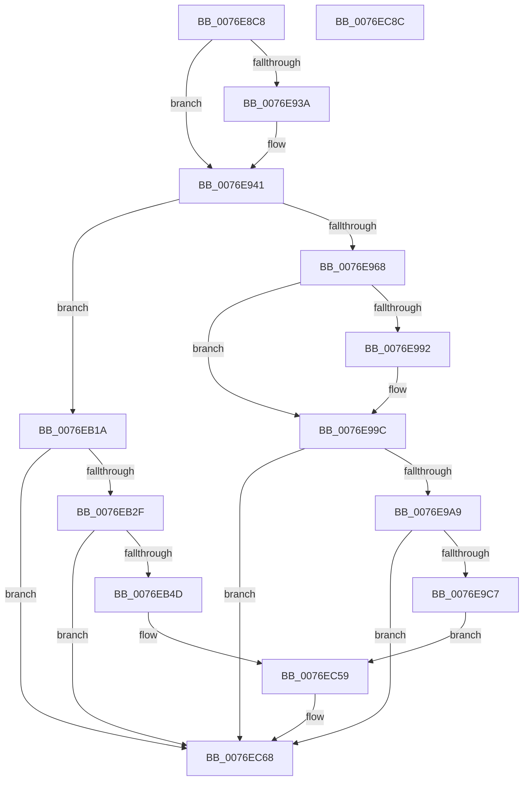

# PopAdaptiveStandbySessionStart

- RVA: `0x0076E8C8`–`0x0076EC8D` (길이 `965` bytes)
- VA: `0x000000014076E8C8`
- 실행 섹션: `PAGE`
- PDB 이름 있음: `예`; PDB Function 태그: `아니요`
- unwind 정보 RVA: `0x000CD4D8`
- 디코드: `186`개 명령, `965/965` bytes 표시
- 미해석 바이트: `0` (있으면 어셈블리에 `.byte`로 보존)

> 이 문서는 커널 이미지의 기계어와 PDB 기호를 분석해 생성했습니다. 4번과 5번은 함수 원형과 자료형을 바이너리 사용 방식에서 추정한 C 해석이며 원본 소스 복구 결과는 아닙니다.

## 1. Dependencies

- 직접 호출 지점: **11**; 고유 호출 대상: **8**
- 직접 호출자로 확인된 함수: **2**
- RIP 상대 이미지 참조: **4**

### Outgoing calls
- `0x0076E92E` → [Feature_AdaptiveHibernateEnhancements__private_IsEnabledDeviceUsageNoInline](../../text/4F/Feature_AdaptiveHibernateEnhancements__private_IsEnabledDeviceUsageNoInline_function_004F78F0.md) (function, `0x004F78F0`)
- `0x0076E95B` → [Feature_AdaptiveHibernateEnhancements__private_IsEnabledDeviceUsageNoInline](../../text/4F/Feature_AdaptiveHibernateEnhancements__private_IsEnabledDeviceUsageNoInline_function_004F78F0.md) (function, `0x004F78F0`)
- `0x0076E96E` → [PopAdaptiveStandbyCalculateBatteryRegion](PopAdaptiveStandbyCalculateBatteryRegion_function_0076CB28.md) (function, `0x0076CB28`)
- `0x0076E997` → [PopAdaptiveStandbyHandleBatteryUpdate](../6F/PopAdaptiveStandbyHandleBatteryUpdate_function_006FD39C.md) (function, `0x006FD39C`)
- `0x0076E9BA` → [tlgKeywordOn](../../text/42/tlgKeywordOn_function_0042EAA0.md) (function, `0x0042EAA0`)
- `0x0076EAF4` → [IoGetActivityIdThread](../../text/44/IoGetActivityIdThread_function_00445030.md) (function, `0x00445030`)
- `0x0076EB1D` → [PopAdaptiveStandbyQueryReserveConfiguration](PopAdaptiveStandbyQueryReserveConfiguration_function_0076E6D0.md) (function, `0x0076E6D0`)
- `0x0076EB40` → [tlgKeywordOn](../../text/42/tlgKeywordOn_function_0042EAA0.md) (function, `0x0042EAA0`)
- `0x0076EC38` → [IoGetActivityIdThread](../../text/44/IoGetActivityIdThread_function_00445030.md) (function, `0x00445030`)
- `0x0076EC63` → [tlgWriteTransfer_EtwWriteTransfer](../../text/42/tlgWriteTransfer_EtwWriteTransfer_function_004260E0.md) (function, `0x004260E0`)
- `0x0076EC6F` → [_security_check_cookie](../../text/6A/_security_check_cookie_function_006AC640.md) (function, `0x006AC640`)

### Direct callers
- [PopAdaptiveStandbyHandleBatteryUpdate](../6F/PopAdaptiveStandbyHandleBatteryUpdate_function_006FD39C.md) at `0x006FD512`
- [PopAdaptiveStandbyHandleBatteryUpdate](../6F/PopAdaptiveStandbyHandleBatteryUpdate_function_006FD39C.md) at `0x006FD536`
- [PopAdaptiveStandbyNotifyShellPhaseState](PopAdaptiveStandbyNotifyShellPhaseState_function_0076E2CC.md) at `0x0076E392`

### Static image references
- `0x0076E8E2` → RVA `0x00E0A740` (`.data`; read)
- `0x0076E99C` → RVA `0x00E082E8` (`.data`; read)
- `0x0076EAFC` → RVA `0x0004EC82` (`.rdata`; read)
- `0x0076EC40` → RVA `0x0004ED7F` (`.rdata`; read)

## 2. Other-region calls and transfers

- 다른 실행 섹션으로 향하는 call: **8**
  - `0x0076E92E` → [Feature_AdaptiveHibernateEnhancements__private_IsEnabledDeviceUsageNoInline](../../text/4F/Feature_AdaptiveHibernateEnhancements__private_IsEnabledDeviceUsageNoInline_function_004F78F0.md) (`PAGE` → `.text`)
  - `0x0076E95B` → [Feature_AdaptiveHibernateEnhancements__private_IsEnabledDeviceUsageNoInline](../../text/4F/Feature_AdaptiveHibernateEnhancements__private_IsEnabledDeviceUsageNoInline_function_004F78F0.md) (`PAGE` → `.text`)
  - `0x0076E9BA` → [tlgKeywordOn](../../text/42/tlgKeywordOn_function_0042EAA0.md) (`PAGE` → `.text`)
  - `0x0076EAF4` → [IoGetActivityIdThread](../../text/44/IoGetActivityIdThread_function_00445030.md) (`PAGE` → `.text`)
  - `0x0076EB40` → [tlgKeywordOn](../../text/42/tlgKeywordOn_function_0042EAA0.md) (`PAGE` → `.text`)
  - `0x0076EC38` → [IoGetActivityIdThread](../../text/44/IoGetActivityIdThread_function_00445030.md) (`PAGE` → `.text`)
  - `0x0076EC63` → [tlgWriteTransfer_EtwWriteTransfer](../../text/42/tlgWriteTransfer_EtwWriteTransfer_function_004260E0.md) (`PAGE` → `.text`)
  - `0x0076EC6F` → [_security_check_cookie](../../text/6A/_security_check_cookie_function_006AC640.md) (`PAGE` → `.text`)
- 별도 외부 분기/꼬리 이동을 확인하지 못했습니다.

## 3. Assembly (complete function range)

```asm
0076E8C8  48 89 5C 24 10                  mov qword ptr [rsp + 0x10], rbx
0076E8CD  48 89 74 24 18                  mov qword ptr [rsp + 0x18], rsi
0076E8D2  55                              push rbp
0076E8D3  57                              push rdi
0076E8D4  41 56                           push r14
0076E8D6  48 8D 6C 24 B0                  lea rbp, [rsp - 0x50]
0076E8DB  48 81 EC 50 01 00 00            sub rsp, 0x150
0076E8E2  48 8B 05 57 BE 69 00            mov rax, qword ptr [rip + 0x69be57]
0076E8E9  48 33 C4                        xor rax, rsp
0076E8EC  48 89 45 40                     mov qword ptr [rbp + 0x40], rax
0076E8F0  49 B8 08 00 00 00 80 F7 FF FF   movabs r8, 0xfffff78000000008
0076E8FA  48 B8 BD 42 7A E5 D5 94 BF D6   movabs rax, 0xd6bf94d5e57a42bd
0076E904  8B F2                           mov esi, edx
0076E906  48 8B D9                        mov rbx, rcx
0076E909  4D 8B 00                        mov r8, qword ptr [r8]
0076E90C  49 F7 E0                        mul r8
0076E90F  48 8B FA                        mov rdi, rdx
0076E912  48 C1 EF 17                     shr rdi, 0x17
0076E916  48 89 B9 C8 00 00 00            mov qword ptr [rcx + 0xc8], rdi
0076E91D  48 A1 14 00 00 00 80 F7 FF FF   movabs rax, qword ptr [0xfffff78000000014]
0076E927  48 89 81 D0 00 00 00            mov qword ptr [rcx + 0xd0], rax
0076E92E  E8 BD 8F D8 FF                  call 0x1404f78f0
0076E933  45 33 F6                        xor r14d, r14d
0076E936  85 C0                           test eax, eax
0076E938  74 07                           je 0x14076e941
0076E93A  48 FF 83 00 01 00 00            inc qword ptr [rbx + 0x100]
0076E941  0F 10 83 88 00 00 00            movups xmm0, xmmword ptr [rbx + 0x88]
0076E948  8B 83 98 00 00 00               mov eax, dword ptr [rbx + 0x98]
0076E94E  0F 11 83 B0 00 00 00            movups xmmword ptr [rbx + 0xb0], xmm0
0076E955  89 83 C0 00 00 00               mov dword ptr [rbx + 0xc0], eax
0076E95B  E8 90 8F D8 FF                  call 0x1404f78f0
0076E960  85 C0                           test eax, eax
0076E962  0F 84 B2 01 00 00               je 0x14076eb1a
0076E968  8B 8B 98 00 00 00               mov ecx, dword ptr [rbx + 0x98]
0076E96E  E8 B5 E1 FF FF                  call 0x14076cb28
0076E973  89 83 DC 00 00 00               mov dword ptr [rbx + 0xdc], eax
0076E979  48 8B 83 C8 00 00 00            mov rax, qword ptr [rbx + 0xc8]
0076E980  48 89 83 E0 00 00 00            mov qword ptr [rbx + 0xe0], rax
0076E987  89 8B E8 00 00 00               mov dword ptr [rbx + 0xe8], ecx
0076E98D  44 38 33                        cmp byte ptr [rbx], r14b
0076E990  74 0A                           je 0x14076e99c
0076E992  33 D2                           xor edx, edx
0076E994  48 8B CB                        mov rcx, rbx
0076E997  E8 00 EA F8 FF                  call 0x1406fd39c
0076E99C  83 3D 45 99 69 00 05            cmp dword ptr [rip + 0x699945], 5
0076E9A3  0F 86 BF 02 00 00               jbe 0x14076ec68
0076E9A9  48 BA 00 00 00 00 00 40 00 00   movabs rdx, 0x400000000000
0076E9B3  48 8D 0D 2E 99 69 00            lea rcx, [rip + 0x69992e]
0076E9BA  E8 E1 00 CC FF                  call 0x14042eaa0
0076E9BF  84 C0                           test al, al
0076E9C1  0F 84 A1 02 00 00               je 0x14076ec68
0076E9C7  48 8B 93 F0 00 00 00            mov rdx, qword ptr [rbx + 0xf0]
0076E9CE  48 8D 44 24 60                  lea rax, [rsp + 0x60]
0076E9D3  83 BB F8 00 00 00 02            cmp dword ptr [rbx + 0xf8], 2
0076E9DA  48 89 45 90                     mov qword ptr [rbp - 0x70], rax
0076E9DE  48 8D 44 24 34                  lea rax, [rsp + 0x34]
0076E9E3  48 89 45 A0                     mov qword ptr [rbp - 0x60], rax
0076E9E7  48 8B 83 00 01 00 00            mov rax, qword ptr [rbx + 0x100]
0076E9EE  48 8D 4A FF                     lea rcx, [rdx - 1]
0076E9F2  48 89 44 24 68                  mov qword ptr [rsp + 0x68], rax
0076E9F7  48 0F 45 CA                     cmovne rcx, rdx
0076E9FB  48 8D 44 24 68                  lea rax, [rsp + 0x68]
0076EA00  48 89 7C 24 60                  mov qword ptr [rsp + 0x60], rdi
0076EA05  48 89 45 B0                     mov qword ptr [rbp - 0x50], rax
0076EA09  48 8D 44 24 48                  lea rax, [rsp + 0x48]
0076EA0E  48 89 45 C0                     mov qword ptr [rbp - 0x40], rax
0076EA12  48 8D 44 24 50                  lea rax, [rsp + 0x50]
0076EA17  48 89 45 D0                     mov qword ptr [rbp - 0x30], rax
0076EA1B  8A 83 B0 00 00 00               mov al, byte ptr [rbx + 0xb0]
0076EA21  24 01                           and al, 1
0076EA23  48 C7 45 98 08 00 00 00         mov qword ptr [rbp - 0x68], 8
0076EA2B  88 44 24 30                     mov byte ptr [rsp + 0x30], al
0076EA2F  48 8D 44 24 30                  lea rax, [rsp + 0x30]
0076EA34  48 89 45 E0                     mov qword ptr [rbp - 0x20], rax
0076EA38  8B 83 B4 00 00 00               mov eax, dword ptr [rbx + 0xb4]
0076EA3E  89 44 24 38                     mov dword ptr [rsp + 0x38], eax
0076EA42  48 8D 44 24 38                  lea rax, [rsp + 0x38]
0076EA47  48 89 45 F0                     mov qword ptr [rbp - 0x10], rax
0076EA4B  8B 83 B8 00 00 00               mov eax, dword ptr [rbx + 0xb8]
0076EA51  89 44 24 3C                     mov dword ptr [rsp + 0x3c], eax
0076EA55  48 8D 44 24 3C                  lea rax, [rsp + 0x3c]
0076EA5A  48 89 45 00                     mov qword ptr [rbp], rax
0076EA5E  8B 83 BC 00 00 00               mov eax, dword ptr [rbx + 0xbc]
0076EA64  89 44 24 40                     mov dword ptr [rsp + 0x40], eax
0076EA68  48 8D 44 24 40                  lea rax, [rsp + 0x40]
0076EA6D  48 89 45 10                     mov qword ptr [rbp + 0x10], rax
0076EA71  8B 83 C0 00 00 00               mov eax, dword ptr [rbx + 0xc0]
0076EA77  89 44 24 44                     mov dword ptr [rsp + 0x44], eax
0076EA7B  48 8D 44 24 44                  lea rax, [rsp + 0x44]
0076EA80  48 89 45 20                     mov qword ptr [rbp + 0x20], rax
0076EA84  48 8D 44 24 58                  lea rax, [rsp + 0x58]
0076EA89  48 89 45 30                     mov qword ptr [rbp + 0x30], rax
0076EA8D  89 74 24 34                     mov dword ptr [rsp + 0x34], esi
0076EA91  48 C7 45 A8 04 00 00 00         mov qword ptr [rbp - 0x58], 4
0076EA99  48 C7 45 B8 08 00 00 00         mov qword ptr [rbp - 0x48], 8
0076EAA1  48 89 54 24 48                  mov qword ptr [rsp + 0x48], rdx
0076EAA6  48 C7 45 C8 08 00 00 00         mov qword ptr [rbp - 0x38], 8
0076EAAE  48 89 4C 24 50                  mov qword ptr [rsp + 0x50], rcx
0076EAB3  48 C7 45 D8 08 00 00 00         mov qword ptr [rbp - 0x28], 8
0076EABB  48 C7 45 E8 01 00 00 00         mov qword ptr [rbp - 0x18], 1
0076EAC3  48 C7 45 F8 04 00 00 00         mov qword ptr [rbp - 8], 4
0076EACB  48 C7 45 08 04 00 00 00         mov qword ptr [rbp + 8], 4
0076EAD3  48 C7 45 18 04 00 00 00         mov qword ptr [rbp + 0x18], 4
0076EADB  48 C7 45 28 04 00 00 00         mov qword ptr [rbp + 0x28], 4
0076EAE3  48 C7 44 24 58 00 00 00 01      mov qword ptr [rsp + 0x58], 0x1000000
0076EAEC  48 C7 45 38 08 00 00 00         mov qword ptr [rbp + 0x38], 8
0076EAF4  E8 37 65 CD FF                  call 0x140445030
0076EAF9  4C 8B C0                        mov r8, rax
0076EAFC  48 8D 15 7F 01 8E FF            lea rdx, [rip - 0x71fe81]
0076EB03  48 8D 44 24 70                  lea rax, [rsp + 0x70]
0076EB08  48 89 44 24 28                  mov qword ptr [rsp + 0x28], rax
0076EB0D  C7 44 24 20 0D 00 00 00         mov dword ptr [rsp + 0x20], 0xd
0076EB15  E9 3F 01 00 00                  jmp 0x14076ec59
0076EB1A  48 8B CB                        mov rcx, rbx
0076EB1D  E8 AE FB FF FF                  call 0x14076e6d0
0076EB22  83 3D BF 97 69 00 05            cmp dword ptr [rip + 0x6997bf], 5
0076EB29  0F 86 39 01 00 00               jbe 0x14076ec68
0076EB2F  48 BA 00 00 00 00 00 40 00 00   movabs rdx, 0x400000000000
0076EB39  48 8D 0D A8 97 69 00            lea rcx, [rip + 0x6997a8]
0076EB40  E8 5B FF CB FF                  call 0x14042eaa0
0076EB45  84 C0                           test al, al
0076EB47  0F 84 1B 01 00 00               je 0x14076ec68
0076EB4D  48 8D 44 24 58                  lea rax, [rsp + 0x58]
0076EB52  48 89 7C 24 58                  mov qword ptr [rsp + 0x58], rdi
0076EB57  48 89 45 90                     mov qword ptr [rbp - 0x70], rax
0076EB5B  48 8D 44 24 44                  lea rax, [rsp + 0x44]
0076EB60  48 89 45 A0                     mov qword ptr [rbp - 0x60], rax
0076EB64  48 8B 83 F0 00 00 00            mov rax, qword ptr [rbx + 0xf0]
0076EB6B  48 89 44 24 50                  mov qword ptr [rsp + 0x50], rax
0076EB70  48 8D 44 24 50                  lea rax, [rsp + 0x50]
0076EB75  48 89 45 B0                     mov qword ptr [rbp - 0x50], rax
0076EB79  8A 83 B0 00 00 00               mov al, byte ptr [rbx + 0xb0]
0076EB7F  24 01                           and al, 1
0076EB81  48 C7 45 98 08 00 00 00         mov qword ptr [rbp - 0x68], 8
0076EB89  88 44 24 30                     mov byte ptr [rsp + 0x30], al
0076EB8D  48 8D 44 24 30                  lea rax, [rsp + 0x30]
0076EB92  48 89 45 C0                     mov qword ptr [rbp - 0x40], rax
0076EB96  8B 83 B4 00 00 00               mov eax, dword ptr [rbx + 0xb4]
0076EB9C  89 44 24 40                     mov dword ptr [rsp + 0x40], eax
0076EBA0  48 8D 44 24 40                  lea rax, [rsp + 0x40]
0076EBA5  48 89 45 D0                     mov qword ptr [rbp - 0x30], rax
0076EBA9  8B 83 B8 00 00 00               mov eax, dword ptr [rbx + 0xb8]
0076EBAF  89 44 24 3C                     mov dword ptr [rsp + 0x3c], eax
0076EBB3  48 8D 44 24 3C                  lea rax, [rsp + 0x3c]
0076EBB8  48 89 45 E0                     mov qword ptr [rbp - 0x20], rax
0076EBBC  8B 83 BC 00 00 00               mov eax, dword ptr [rbx + 0xbc]
0076EBC2  89 44 24 38                     mov dword ptr [rsp + 0x38], eax
0076EBC6  48 8D 44 24 38                  lea rax, [rsp + 0x38]
0076EBCB  48 89 45 F0                     mov qword ptr [rbp - 0x10], rax
0076EBCF  8B 83 C0 00 00 00               mov eax, dword ptr [rbx + 0xc0]
0076EBD5  89 44 24 34                     mov dword ptr [rsp + 0x34], eax
0076EBD9  48 8D 44 24 34                  lea rax, [rsp + 0x34]
0076EBDE  48 89 45 00                     mov qword ptr [rbp], rax
0076EBE2  48 8D 44 24 48                  lea rax, [rsp + 0x48]
0076EBE7  48 89 45 10                     mov qword ptr [rbp + 0x10], rax
0076EBEB  89 74 24 44                     mov dword ptr [rsp + 0x44], esi
0076EBEF  48 C7 45 A8 04 00 00 00         mov qword ptr [rbp - 0x58], 4
0076EBF7  48 C7 45 B8 08 00 00 00         mov qword ptr [rbp - 0x48], 8
0076EBFF  48 C7 45 C8 01 00 00 00         mov qword ptr [rbp - 0x38], 1
0076EC07  48 C7 45 D8 04 00 00 00         mov qword ptr [rbp - 0x28], 4
0076EC0F  48 C7 45 E8 04 00 00 00         mov qword ptr [rbp - 0x18], 4
0076EC17  48 C7 45 F8 04 00 00 00         mov qword ptr [rbp - 8], 4
0076EC1F  48 C7 45 08 04 00 00 00         mov qword ptr [rbp + 8], 4
0076EC27  48 C7 44 24 48 00 00 00 01      mov qword ptr [rsp + 0x48], 0x1000000
0076EC30  48 C7 45 18 08 00 00 00         mov qword ptr [rbp + 0x18], 8
0076EC38  E8 F3 63 CD FF                  call 0x140445030
0076EC3D  4C 8B C0                        mov r8, rax
0076EC40  48 8D 15 38 01 8E FF            lea rdx, [rip - 0x71fec8]
0076EC47  48 8D 44 24 70                  lea rax, [rsp + 0x70]
0076EC4C  48 89 44 24 28                  mov qword ptr [rsp + 0x28], rax
0076EC51  C7 44 24 20 0B 00 00 00         mov dword ptr [rsp + 0x20], 0xb
0076EC59  45 33 C9                        xor r9d, r9d
0076EC5C  48 8D 0D 85 96 69 00            lea rcx, [rip + 0x699685]
0076EC63  E8 78 74 CB FF                  call 0x1404260e0
0076EC68  48 8B 4D 40                     mov rcx, qword ptr [rbp + 0x40]
0076EC6C  48 33 CC                        xor rcx, rsp
0076EC6F  E8 CC D9 F3 FF                  call 0x1406ac640
0076EC74  4C 8D 9C 24 50 01 00 00         lea r11, [rsp + 0x150]
0076EC7C  49 8B 5B 28                     mov rbx, qword ptr [r11 + 0x28]
0076EC80  49 8B 73 30                     mov rsi, qword ptr [r11 + 0x30]
0076EC84  49 8B E3                        mov rsp, r11
0076EC87  41 5E                           pop r14
0076EC89  5F                              pop rdi
0076EC8A  5D                              pop rbp
0076EC8B  C3                              ret
0076EC8C  CC                              int3
```

## 4. C-style interpretation (structured pseudocode)

```c
__int64 __fastcall PopAdaptiveStandbySessionStart(__int64 a1, __int64 a2, __int64 a3, int a4)
{
    __int64 result;
    __int64 v_r14;
    __int64 v_rdi;
    __int64 v_rsp;
    unsigned __int64 v_stack_m100;
    unsigned __int64 v_stack_m108;
    unsigned __int64 v_stack_m110;
    unsigned __int64 v_stack_m118;
    unsigned __int64 v_stack_m120;
    unsigned int v_stack_m124;
    unsigned int v_stack_m128;
    unsigned int v_stack_m12C;
    unsigned int v_stack_m130;
    unsigned __int64 v_stack_m134;
    unsigned __int8 v_stack_m138;
    unsigned __int64 v_stack_m140;
    unsigned int v_stack_m148;
    unsigned __int64 v_stack_m18;
    unsigned __int64 v_stack_m28;
    unsigned __int64 v_stack_m30;
    unsigned __int64 v_stack_m38;
    unsigned __int64 v_stack_m40;
    unsigned __int64 v_stack_m48;
    unsigned __int64 v_stack_m50;
    unsigned __int64 v_stack_m58;
    unsigned __int64 v_stack_m60;
    unsigned __int64 v_stack_m68;
    unsigned __int64 v_stack_m70;
    unsigned __int64 v_stack_m78;
    unsigned __int64 v_stack_m80;
    unsigned __int64 v_stack_m88;
    unsigned __int64 v_stack_m90;
    unsigned __int64 v_stack_m98;
    unsigned __int64 v_stack_mA0;
    unsigned __int64 v_stack_mA8;
    unsigned __int64 v_stack_mB0;
    unsigned __int64 v_stack_mB8;
    unsigned __int64 v_stack_mC0;
    unsigned __int64 v_stack_mC8;
    unsigned __int64 v_stack_mD0;
    unsigned __int64 v_stack_mD8;
    unsigned __int64 v_stack_mF8;
    unsigned __int64 v_stack_p10;
    unsigned __int64 v_stack_p18;

    v_stack_p10 = v_rbx;
    v_stack_p18 = v_rsi;
    v_rsp = (v_rsp) - (336);
    result = (*(unsigned __int64 *)(v_rip + 6930007)) ^ (v_rsp);
    v_stack_m28 = result;
    v_rdi = (a2) >> (23);
    *(unsigned __int64 *)(a1 + 200) = v_rdi;
    *(unsigned __int64 *)(a1 + 208) = result;
    result = Feature_AdaptiveHibernateEnhancements__private_IsEnabledDeviceUsageNoInline(a1, a2, *(unsigned __int64 *)(a3), a4);
    v_r14 = 0;
    if ((unsigned int)(result) != 0) {
    }
    *(unsigned __int64 *)(a1 + 176) = v_xmm0;
    *(unsigned int *)(a1 + 192) = (unsigned int)((unsigned int)(*(unsigned int *)(a1 + 152)));
    result = Feature_AdaptiveHibernateEnhancements__private_IsEnabledDeviceUsageNoInline(a1, a2, *(unsigned __int64 *)(a3), a4);
    if ((unsigned int)(result) == 0) goto loc_0076EB1A;
    result = PopAdaptiveStandbyCalculateBatteryRegion((unsigned int)(*(unsigned int *)(a1 + 152)), a2, *(unsigned __int64 *)(a3), a4);
    *(unsigned int *)(a1 + 220) = (unsigned int)(result);
    *(unsigned __int64 *)(a1 + 224) = *(unsigned __int64 *)(a1 + 200);
    *(unsigned int *)(a1 + 232) = (unsigned int)((unsigned int)(*(unsigned int *)(a1 + 152)));
    result = *(unsigned __int64 *)(a1 + 200);
    if ((*(unsigned __int8 *)(a1)) != 0) {
        a2 = 0;
        a1 = a1;
        result = PopAdaptiveStandbyHandleBatteryUpdate(a1, a2, *(unsigned __int64 *)(a3), a4);
    }
    if ((*(unsigned int *)(v_rip + 6920517)) <= 5) goto loc_0076EC68;
    result = tlgKeywordOn(v_rip + 6920494, a2, *(unsigned __int64 *)(a3), a4);
    if ((unsigned __int8)(result) == 0) goto loc_0076EC68;
    v_stack_mD8 = v_stack_m108;
    v_stack_mC8 = v_stack_m134;
    v_stack_m100 = *(unsigned __int64 *)(a1 + 256);
    a1 = *(unsigned __int64 *)(a1 + 240) - 1;
    if ((*(unsigned int *)(a1 + 248)) != 2) { a1 = *(unsigned __int64 *)(a1 + 240); }
    v_stack_m108 = v_rdi;
    v_stack_mB8 = v_stack_m100;
    v_stack_mA8 = v_stack_m120;
    v_stack_m98 = v_stack_m118;
    result = (unsigned __int8)((*(unsigned __int8 *)(a1 + 176)) & (1));
    v_stack_mD0 = 8;
    v_stack_m138 = (unsigned __int8)(result);
    v_stack_m88 = v_stack_m138;
    v_stack_m130 = (unsigned int)((unsigned int)(*(unsigned int *)(a1 + 180)));
    v_stack_m78 = v_stack_m130;
    v_stack_m12C = (unsigned int)((unsigned int)(*(unsigned int *)(a1 + 184)));
    v_stack_m68 = v_stack_m12C;
    v_stack_m128 = (unsigned int)((unsigned int)(*(unsigned int *)(a1 + 188)));
    v_stack_m58 = v_stack_m128;
    v_stack_m124 = (unsigned int)((unsigned int)(*(unsigned int *)(a1 + 192)));
    v_stack_m48 = v_stack_m124;
    v_stack_m38 = v_stack_m110;
    v_stack_m134 = (unsigned int)((unsigned int)((unsigned int)(a2)));
    v_stack_mC0 = 4;
    v_stack_mB0 = 8;
    v_stack_m120 = *(unsigned __int64 *)(a1 + 240);
    v_stack_mA0 = 8;
    v_stack_m118 = a1;
    v_stack_m90 = 8;
    v_stack_m80 = 1;
    v_stack_m70 = 4;
    v_stack_m60 = 4;
    v_stack_m50 = 4;
    v_stack_m40 = 4;
    v_stack_m110 = 0x1000000ULL;
    v_stack_m30 = 8;
    result = IoGetActivityIdThread(a1, *(unsigned __int64 *)(a1 + 240), *(unsigned __int64 *)(a3), a4);
    v_stack_m140 = v_stack_mF8;
    v_stack_m148 = 13;
    goto loc_0076EC59;
loc_0076EB1A:
    result = PopAdaptiveStandbyQueryReserveConfiguration(a1, v_rip - 7470721, result, a4);
    if ((*(unsigned int *)(v_rip + 6920127)) <= 5) goto loc_0076EC68;
    result = tlgKeywordOn(v_rip + 6920104, v_rip - 7470721, result, a4);
    if ((unsigned __int8)(result) == 0) goto loc_0076EC68;
    v_stack_m110 = v_rdi;
    v_stack_mD8 = v_stack_m110;
    v_stack_mC8 = v_stack_m124;
    v_stack_m118 = *(unsigned __int64 *)(a1 + 240);
    v_stack_mB8 = v_stack_m118;
    result = (unsigned __int8)((*(unsigned __int8 *)(a1 + 176)) & (1));
    v_stack_mD0 = 8;
    v_stack_m138 = (unsigned __int8)(result);
    v_stack_mA8 = v_stack_m138;
    v_stack_m128 = (unsigned int)((unsigned int)(*(unsigned int *)(a1 + 180)));
    v_stack_m98 = v_stack_m128;
    v_stack_m12C = (unsigned int)((unsigned int)(*(unsigned int *)(a1 + 184)));
    v_stack_m88 = v_stack_m12C;
    v_stack_m130 = (unsigned int)((unsigned int)(*(unsigned int *)(a1 + 188)));
    v_stack_m78 = v_stack_m130;
    v_stack_m134 = (unsigned int)((unsigned int)(*(unsigned int *)(a1 + 192)));
    v_stack_m68 = v_stack_m134;
    v_stack_m58 = v_stack_m120;
    v_stack_m124 = (unsigned int)((unsigned int)((unsigned int)(a2)));
    v_stack_mC0 = 4;
    v_stack_mB0 = 8;
    v_stack_mA0 = 1;
    v_stack_m90 = 4;
    v_stack_m80 = 4;
    v_stack_m70 = 4;
    v_stack_m60 = 4;
    v_stack_m120 = 0x1000000ULL;
    v_stack_m50 = 8;
    result = IoGetActivityIdThread(v_rip + 6920104, v_rip - 7470721, result, a4);
    v_stack_m140 = v_stack_mF8;
    v_stack_m148 = 11;
loc_0076EC59:
    a4 = 0;
    result = tlgWriteTransfer_EtwWriteTransfer(v_rip + 6919813, v_rip - 7470792, result, a4);
loc_0076EC68:
    a1 = (v_stack_m28) ^ (v_rsp);
    result = _security_check_cookie(a1, v_rip - 7470792, result, a4);
    return result;
}
```

## 5. (Beta) C Style

```c
int64_t PopAdaptiveStandbySessionStart(void *Arg1, int64_t Arg2, int64_t Arg3, int32_t Arg4)
{
    uint8_t *arg1 = (uint8_t *)Arg1;

    int64_t result;
    int64_t local_r14;
    int64_t local_rdi;
    int64_t local_rsp;
    uint64_t v_stack_m100;
    uint64_t v_stack_m108;
    uint64_t v_stack_m110;
    uint64_t v_stack_m118;
    uint64_t v_stack_m120;
    uint32_t v_stack_m124;
    uint32_t v_stack_m128;
    uint32_t v_stack_m12C;
    uint32_t v_stack_m130;
    uint64_t v_stack_m134;
    uint8_t v_stack_m138;
    uint64_t v_stack_m140;
    uint32_t v_stack_m148;
    uint64_t v_stack_m18;
    uint64_t v_stack_m28;
    uint64_t v_stack_m30;
    uint64_t v_stack_m38;
    uint64_t v_stack_m40;
    uint64_t v_stack_m48;
    uint64_t v_stack_m50;
    uint64_t v_stack_m58;
    uint64_t v_stack_m60;
    uint64_t v_stack_m68;
    uint64_t v_stack_m70;
    uint64_t v_stack_m78;
    uint64_t v_stack_m80;
    uint64_t v_stack_m88;
    uint64_t v_stack_m90;
    uint64_t v_stack_m98;
    uint64_t v_stack_mA0;
    uint64_t v_stack_mA8;
    uint64_t v_stack_mB0;
    uint64_t v_stack_mB8;
    uint64_t v_stack_mC0;
    uint64_t v_stack_mC8;
    uint64_t v_stack_mD0;
    uint64_t v_stack_mD8;
    uint64_t v_stack_mF8;
    uint64_t v_stack_p10;
    uint64_t v_stack_p18;

    v_stack_p10 = local_rbx;
    v_stack_p18 = local_rsi;
    local_rsp = (local_rsp) - (336);
    result = (*(uint64_t *)(v_rip + 0x69BE57)) ^ (local_rsp);
    v_stack_m28 = result;
    local_rdi = (Arg2) >> (23);
    *(uint64_t *)(arg1 + 0xC8) = local_rdi;
    *(uint64_t *)(arg1 + 0xD0) = result;
    result = Feature_AdaptiveHibernateEnhancements__private_IsEnabledDeviceUsageNoInline(Arg1, Arg2, *(uint64_t *)(Arg3), Arg4);
    local_r14 = 0;
    if ((uint32_t)(result) != 0) {
    }
    *(uint64_t *)(arg1 + 0xB0) = v_xmm0;
    *(uint32_t *)(arg1 + 0xC0) = (uint32_t)((uint32_t)(*(uint32_t *)(arg1 + 0x98)));
    result = Feature_AdaptiveHibernateEnhancements__private_IsEnabledDeviceUsageNoInline(Arg1, Arg2, *(uint64_t *)(Arg3), Arg4);
    if ((uint32_t)(result) == 0) goto loc_0076EB1A;
    result = PopAdaptiveStandbyCalculateBatteryRegion((uint32_t)(*(uint32_t *)(arg1 + 0x98)), Arg2, *(uint64_t *)(Arg3), Arg4);
    *(uint32_t *)(arg1 + 0xDC) = (uint32_t)(result);
    *(uint64_t *)(arg1 + 0xE0) = *(uint64_t *)(arg1 + 0xC8);
    *(uint32_t *)(arg1 + 0xE8) = (uint32_t)((uint32_t)(*(uint32_t *)(arg1 + 0x98)));
    result = *(uint64_t *)(arg1 + 0xC8);
    if ((*(uint8_t *)(arg1)) != 0) {
        Arg2 = 0;
        Arg1 = Arg1;
        result = PopAdaptiveStandbyHandleBatteryUpdate(Arg1, Arg2, *(uint64_t *)(Arg3), Arg4);
    }
    if ((*(uint32_t *)(v_rip + 0x699945)) <= 5) goto loc_0076EC68;
    result = tlgKeywordOn(v_rip + 6920494, Arg2, *(uint64_t *)(Arg3), Arg4);
    if ((uint8_t)(result) == 0) goto loc_0076EC68;
    v_stack_mD8 = v_stack_m108;
    v_stack_mC8 = v_stack_m134;
    v_stack_m100 = *(uint64_t *)(arg1 + 0x100);
    Arg1 = *(uint64_t *)(arg1 + 0xF0) - 1;
    if ((*(uint32_t *)(arg1 + 0xF8)) != 2) { Arg1 = *(uint64_t *)(arg1 + 0xF0); }
    v_stack_m108 = local_rdi;
    v_stack_mB8 = v_stack_m100;
    v_stack_mA8 = v_stack_m120;
    v_stack_m98 = v_stack_m118;
    result = (uint8_t)((*(uint8_t *)(arg1 + 0xB0)) & (1));
    v_stack_mD0 = 8;
    v_stack_m138 = (uint8_t)(result);
    v_stack_m88 = v_stack_m138;
    v_stack_m130 = (uint32_t)((uint32_t)(*(uint32_t *)(arg1 + 0xB4)));
    v_stack_m78 = v_stack_m130;
    v_stack_m12C = (uint32_t)((uint32_t)(*(uint32_t *)(arg1 + 0xB8)));
    v_stack_m68 = v_stack_m12C;
    v_stack_m128 = (uint32_t)((uint32_t)(*(uint32_t *)(arg1 + 0xBC)));
    v_stack_m58 = v_stack_m128;
    v_stack_m124 = (uint32_t)((uint32_t)(*(uint32_t *)(arg1 + 0xC0)));
    v_stack_m48 = v_stack_m124;
    v_stack_m38 = v_stack_m110;
    v_stack_m134 = (uint32_t)((uint32_t)((uint32_t)(Arg2)));
    v_stack_mC0 = 4;
    v_stack_mB0 = 8;
    v_stack_m120 = *(uint64_t *)(arg1 + 0xF0);
    v_stack_mA0 = 8;
    v_stack_m118 = Arg1;
    v_stack_m90 = 8;
    v_stack_m80 = 1;
    v_stack_m70 = 4;
    v_stack_m60 = 4;
    v_stack_m50 = 4;
    v_stack_m40 = 4;
    v_stack_m110 = 0x1000000ULL;
    v_stack_m30 = 8;
    result = IoGetActivityIdThread(Arg1, *(uint64_t *)(arg1 + 0xF0), *(uint64_t *)(Arg3), Arg4);
    v_stack_m140 = v_stack_mF8;
    v_stack_m148 = 13;
    goto loc_0076EC59;
loc_0076EB1A:
    result = PopAdaptiveStandbyQueryReserveConfiguration(Arg1, v_rip - 7470721, result, Arg4);
    if ((*(uint32_t *)(v_rip + 0x6997BF)) <= 5) goto loc_0076EC68;
    result = tlgKeywordOn(v_rip + 6920104, v_rip - 7470721, result, Arg4);
    if ((uint8_t)(result) == 0) goto loc_0076EC68;
    v_stack_m110 = local_rdi;
    v_stack_mD8 = v_stack_m110;
    v_stack_mC8 = v_stack_m124;
    v_stack_m118 = *(uint64_t *)(arg1 + 0xF0);
    v_stack_mB8 = v_stack_m118;
    result = (uint8_t)((*(uint8_t *)(arg1 + 0xB0)) & (1));
    v_stack_mD0 = 8;
    v_stack_m138 = (uint8_t)(result);
    v_stack_mA8 = v_stack_m138;
    v_stack_m128 = (uint32_t)((uint32_t)(*(uint32_t *)(arg1 + 0xB4)));
    v_stack_m98 = v_stack_m128;
    v_stack_m12C = (uint32_t)((uint32_t)(*(uint32_t *)(arg1 + 0xB8)));
    v_stack_m88 = v_stack_m12C;
    v_stack_m130 = (uint32_t)((uint32_t)(*(uint32_t *)(arg1 + 0xBC)));
    v_stack_m78 = v_stack_m130;
    v_stack_m134 = (uint32_t)((uint32_t)(*(uint32_t *)(arg1 + 0xC0)));
    v_stack_m68 = v_stack_m134;
    v_stack_m58 = v_stack_m120;
    v_stack_m124 = (uint32_t)((uint32_t)((uint32_t)(Arg2)));
    v_stack_mC0 = 4;
    v_stack_mB0 = 8;
    v_stack_mA0 = 1;
    v_stack_m90 = 4;
    v_stack_m80 = 4;
    v_stack_m70 = 4;
    v_stack_m60 = 4;
    v_stack_m120 = 0x1000000ULL;
    v_stack_m50 = 8;
    result = IoGetActivityIdThread(v_rip + 6920104, v_rip - 7470721, result, Arg4);
    v_stack_m140 = v_stack_mF8;
    v_stack_m148 = 11;
loc_0076EC59:
    Arg4 = 0;
    result = tlgWriteTransfer_EtwWriteTransfer(v_rip + 6919813, v_rip - 7470792, result, Arg4);
loc_0076EC68:
    Arg1 = (v_stack_m28) ^ (local_rsp);
    result = _security_check_cookie(Arg1, v_rip - 7470792, result, Arg4);
    return result;
}
```

### 관측된 메모리 오프셋

구조체 형식이 확인되지 않은 접근은 인자 기준의 오프셋으로만 기록했습니다.

| 기준 인자 | 오프셋 표현 | 폭 (bit) | 접근 |
|---|---:|---:|---|
| `Arg1` | `+ 0x0` | `8` | `R` |
| `Arg1` | `+ 0x88` | `128` | `R` |
| `Arg1` | `+ 0x98` | `32` | `R` |
| `Arg1` | `+ 0xB0` | `8` | `R` |
| `Arg1` | `+ 0xB0` | `128` | `R` |
| `Arg1` | `+ 0xB4` | `32` | `R` |
| `Arg1` | `+ 0xB8` | `32` | `R` |
| `Arg1` | `+ 0xBC` | `32` | `R` |
| `Arg1` | `+ 0xC0` | `32` | `R` |
| `Arg1` | `+ 0xC0` | `32` | `W` |
| `Arg1` | `+ 0xC8` | `64` | `R` |
| `Arg1` | `+ 0xC8` | `64` | `W` |
| `Arg1` | `+ 0xD0` | `64` | `W` |
| `Arg1` | `+ 0xDC` | `32` | `W` |
| `Arg1` | `+ 0xE0` | `64` | `W` |
| `Arg1` | `+ 0xE8` | `32` | `W` |
| `Arg1` | `+ 0xF0` | `64` | `R` |
| `Arg1` | `+ 0xF8` | `32` | `R` |
| `Arg1` | `+ 0x100` | `64` | `R` |
| `Arg1` | `+ 0x100` | `64` | `R/W` |

## 6. Execution-region graph

[열기: 2D/3D 그래프와 함수 탐색 컨트롤 패널](../../../control-panel.html?section=page&rva=0x0076E8C8&view=graph)

- 2D 그래프는 위에서 아래로 흐르고, 3D 그래프는 빈 공간을 드래그해 회전합니다. Shift+드래그는 이동, 휠은 확대·축소, 함수 노드 선택은 대상 보고서 이동입니다.

### Static fallback


