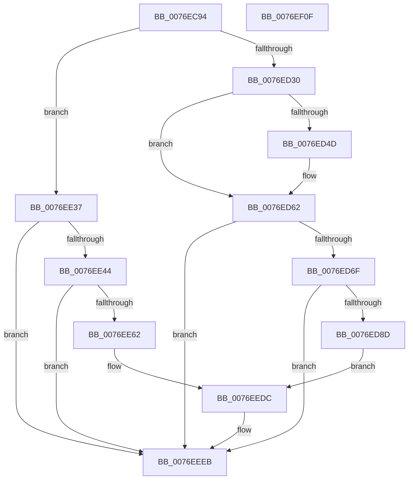

# PopAdaptiveStandbySessionStop

- RVA: `0x0076EC94`–`0x0076EF10` (길이 `636` bytes)
- VA: `0x000000014076EC94`
- 실행 섹션: `PAGE`
- PDB 이름 있음: `예`; PDB Function 태그: `아니요`
- unwind 정보 RVA: `0x000CD4B4`
- 디코드: `132`개 명령, `636/636` bytes 표시
- 미해석 바이트: `0` (있으면 어셈블리에 `.byte`로 보존)

> 이 문서는 커널 이미지의 기계어와 PDB 기호를 분석해 생성했습니다. 4번과 5번은 함수 원형과 자료형을 바이너리 사용 방식에서 추정한 C 해석이며 원본 소스 복구 결과는 아닙니다.

## 1. Dependencies

- 직접 호출 지점: **8**; 고유 호출 대상: **6**
- 직접 호출자로 확인된 함수: **2**
- RIP 상대 이미지 참조: **4**

### Outgoing calls
- `0x0076ED23` → [Feature_AdaptiveHibernateEnhancements__private_IsEnabledDeviceUsageNoInline](../../text/4F/Feature_AdaptiveHibernateEnhancements__private_IsEnabledDeviceUsageNoInline_function_004F78F0.md) (function, `0x004F78F0`)
- `0x0076ED5D` → [KeCancelTimer2](../../text/3A/KeCancelTimer2_function_003A01E0.md) (function, `0x003A01E0`)
- `0x0076ED80` → [tlgKeywordOn](../../text/42/tlgKeywordOn_function_0042EAA0.md) (function, `0x0042EAA0`)
- `0x0076EE16` → [IoGetActivityIdThread](../../text/44/IoGetActivityIdThread_function_00445030.md) (function, `0x00445030`)
- `0x0076EE55` → [tlgKeywordOn](../../text/42/tlgKeywordOn_function_0042EAA0.md) (function, `0x0042EAA0`)
- `0x0076EEBC` → [IoGetActivityIdThread](../../text/44/IoGetActivityIdThread_function_00445030.md) (function, `0x00445030`)
- `0x0076EEE6` → [tlgWriteTransfer_EtwWriteTransfer](../../text/42/tlgWriteTransfer_EtwWriteTransfer_function_004260E0.md) (function, `0x004260E0`)
- `0x0076EEF2` → [_security_check_cookie](../../text/6A/_security_check_cookie_function_006AC640.md) (function, `0x006AC640`)

### Direct callers
- [PopAdaptiveStandbyHandleBatteryUpdate](../6F/PopAdaptiveStandbyHandleBatteryUpdate_function_006FD39C.md) at `0x006FD506`
- [PopAdaptiveStandbyHandleBatteryUpdate](../6F/PopAdaptiveStandbyHandleBatteryUpdate_function_006FD39C.md) at `0x006FD52B`
- [PopAdaptiveStandbyNotifyShellPhaseState](PopAdaptiveStandbyNotifyShellPhaseState_function_0076E2CC.md) at `0x0076E389`

### Static image references
- `0x0076ECAE` → RVA `0x00E0A740` (`.data`; read)
- `0x0076ED62` → RVA `0x00E082E8` (`.data`; read)
- `0x0076EE1E` → RVA `0x0004EE62` (`.rdata`; read)
- `0x0076EEC4` → RVA `0x0004EEE2` (`.rdata`; read)

## 2. Other-region calls and transfers

- 다른 실행 섹션으로 향하는 call: **8**
  - `0x0076ED23` → [Feature_AdaptiveHibernateEnhancements__private_IsEnabledDeviceUsageNoInline](../../text/4F/Feature_AdaptiveHibernateEnhancements__private_IsEnabledDeviceUsageNoInline_function_004F78F0.md) (`PAGE` → `.text`)
  - `0x0076ED5D` → [KeCancelTimer2](../../text/3A/KeCancelTimer2_function_003A01E0.md) (`PAGE` → `.text`)
  - `0x0076ED80` → [tlgKeywordOn](../../text/42/tlgKeywordOn_function_0042EAA0.md) (`PAGE` → `.text`)
  - `0x0076EE16` → [IoGetActivityIdThread](../../text/44/IoGetActivityIdThread_function_00445030.md) (`PAGE` → `.text`)
  - `0x0076EE55` → [tlgKeywordOn](../../text/42/tlgKeywordOn_function_0042EAA0.md) (`PAGE` → `.text`)
  - `0x0076EEBC` → [IoGetActivityIdThread](../../text/44/IoGetActivityIdThread_function_00445030.md) (`PAGE` → `.text`)
  - `0x0076EEE6` → [tlgWriteTransfer_EtwWriteTransfer](../../text/42/tlgWriteTransfer_EtwWriteTransfer_function_004260E0.md) (`PAGE` → `.text`)
  - `0x0076EEF2` → [_security_check_cookie](../../text/6A/_security_check_cookie_function_006AC640.md) (`PAGE` → `.text`)
- 별도 외부 분기/꼬리 이동을 확인하지 못했습니다.

## 3. Assembly (complete function range)

```asm
0076EC94  48 89 5C 24 10                  mov qword ptr [rsp + 0x10], rbx
0076EC99  48 89 74 24 18                  mov qword ptr [rsp + 0x18], rsi
0076EC9E  55                              push rbp
0076EC9F  57                              push rdi
0076ECA0  41 56                           push r14
0076ECA2  48 8D 6C 24 B9                  lea rbp, [rsp - 0x47]
0076ECA7  48 81 EC F0 00 00 00            sub rsp, 0xf0
0076ECAE  48 8B 05 8B BA 69 00            mov rax, qword ptr [rip + 0x69ba8b]
0076ECB5  48 33 C4                        xor rax, rsp
0076ECB8  48 89 45 37                     mov qword ptr [rbp + 0x37], rax
0076ECBC  45 33 F6                        xor r14d, r14d
0076ECBF  0F 57 C0                        xorps xmm0, xmm0
0076ECC2  49 B8 08 00 00 00 80 F7 FF FF   movabs r8, 0xfffff78000000008
0076ECCC  48 B8 BD 42 7A E5 D5 94 BF D6   movabs rax, 0xd6bf94d5e57a42bd
0076ECD6  8B F2                           mov esi, edx
0076ECD8  48 8B D9                        mov rbx, rcx
0076ECDB  4D 8B 00                        mov r8, qword ptr [r8]
0076ECDE  4C 89 B1 C8 00 00 00            mov qword ptr [rcx + 0xc8], r14
0076ECE5  4C 89 B1 D0 00 00 00            mov qword ptr [rcx + 0xd0], r14
0076ECEC  0F 11 81 B0 00 00 00            movups xmmword ptr [rcx + 0xb0], xmm0
0076ECF3  49 F7 E0                        mul r8
0076ECF6  48 8B FA                        mov rdi, rdx
0076ECF9  48 C1 EF 17                     shr rdi, 0x17
0076ECFD  33 C0                           xor eax, eax
0076ECFF  89 81 C0 00 00 00               mov dword ptr [rcx + 0xc0], eax
0076ED05  44 88 71 38                     mov byte ptr [rcx + 0x38], r14b
0076ED09  44 88 71 04                     mov byte ptr [rcx + 4], r14b
0076ED0D  44 88 71 28                     mov byte ptr [rcx + 0x28], r14b
0076ED11  0F 11 41 68                     movups xmmword ptr [rcx + 0x68], xmm0
0076ED15  44 89 B1 2C 02 00 00            mov dword ptr [rcx + 0x22c], r14d
0076ED1C  44 89 B1 EC 00 00 00            mov dword ptr [rcx + 0xec], r14d
0076ED23  E8 C8 8B D8 FF                  call 0x1404f78f0
0076ED28  85 C0                           test eax, eax
0076ED2A  0F 84 07 01 00 00               je 0x14076ee37
0076ED30  C7 83 DC 00 00 00 03 00 00 00   mov dword ptr [rbx + 0xdc], 3
0076ED3A  44 89 B3 E8 00 00 00            mov dword ptr [rbx + 0xe8], r14d
0076ED41  4C 89 B3 E0 00 00 00            mov qword ptr [rbx + 0xe0], r14
0076ED48  44 38 33                        cmp byte ptr [rbx], r14b
0076ED4B  74 15                           je 0x14076ed62
0076ED4D  48 8D 8B 58 01 00 00            lea rcx, [rbx + 0x158]
0076ED54  44 88 B3 50 01 00 00            mov byte ptr [rbx + 0x150], r14b
0076ED5B  33 D2                           xor edx, edx
0076ED5D  E8 7E 14 C3 FF                  call 0x1403a01e0
0076ED62  83 3D 7F 95 69 00 05            cmp dword ptr [rip + 0x69957f], 5
0076ED69  0F 86 7C 01 00 00               jbe 0x14076eeeb
0076ED6F  48 BA 00 00 00 00 00 40 00 00   movabs rdx, 0x400000000000
0076ED79  48 8D 0D 68 95 69 00            lea rcx, [rip + 0x699568]
0076ED80  E8 1B FD CB FF                  call 0x14042eaa0
0076ED85  84 C0                           test al, al
0076ED87  0F 84 5E 01 00 00               je 0x14076eeeb
0076ED8D  48 8B 93 F0 00 00 00            mov rdx, qword ptr [rbx + 0xf0]
0076ED94  48 8D 45 A7                     lea rax, [rbp - 0x59]
0076ED98  83 BB F8 00 00 00 02            cmp dword ptr [rbx + 0xf8], 2
0076ED9F  48 89 45 D7                     mov qword ptr [rbp - 0x29], rax
0076EDA3  48 8D 45 87                     lea rax, [rbp - 0x79]
0076EDA7  48 89 45 E7                     mov qword ptr [rbp - 0x19], rax
0076EDAB  48 8B 83 00 01 00 00            mov rax, qword ptr [rbx + 0x100]
0076EDB2  48 8D 4A FF                     lea rcx, [rdx - 1]
0076EDB6  48 89 45 AF                     mov qword ptr [rbp - 0x51], rax
0076EDBA  48 0F 45 CA                     cmovne rcx, rdx
0076EDBE  48 8D 45 AF                     lea rax, [rbp - 0x51]
0076EDC2  48 89 7D A7                     mov qword ptr [rbp - 0x59], rdi
0076EDC6  BF 08 00 00 00                  mov edi, 8
0076EDCB  48 89 45 F7                     mov qword ptr [rbp - 9], rax
0076EDCF  48 8D 45 8F                     lea rax, [rbp - 0x71]
0076EDD3  48 89 7D DF                     mov qword ptr [rbp - 0x21], rdi
0076EDD7  48 89 45 07                     mov qword ptr [rbp + 7], rax
0076EDDB  48 8D 45 97                     lea rax, [rbp - 0x69]
0076EDDF  48 89 45 17                     mov qword ptr [rbp + 0x17], rax
0076EDE3  48 8D 45 9F                     lea rax, [rbp - 0x61]
0076EDE7  48 89 45 27                     mov qword ptr [rbp + 0x27], rax
0076EDEB  89 75 87                        mov dword ptr [rbp - 0x79], esi
0076EDEE  48 C7 45 EF 04 00 00 00         mov qword ptr [rbp - 0x11], 4
0076EDF6  48 89 7D FF                     mov qword ptr [rbp - 1], rdi
0076EDFA  48 89 55 8F                     mov qword ptr [rbp - 0x71], rdx
0076EDFE  48 89 7D 0F                     mov qword ptr [rbp + 0xf], rdi
0076EE02  48 89 4D 97                     mov qword ptr [rbp - 0x69], rcx
0076EE06  48 89 7D 1F                     mov qword ptr [rbp + 0x1f], rdi
0076EE0A  48 C7 45 9F 00 00 00 01         mov qword ptr [rbp - 0x61], 0x1000000
0076EE12  48 89 7D 2F                     mov qword ptr [rbp + 0x2f], rdi
0076EE16  E8 15 62 CD FF                  call 0x140445030
0076EE1B  4C 8B C0                        mov r8, rax
0076EE1E  48 8D 15 3D 00 8E FF            lea rdx, [rip - 0x71ffc3]
0076EE25  48 8D 45 B7                     lea rax, [rbp - 0x49]
0076EE29  48 89 44 24 28                  mov qword ptr [rsp + 0x28], rax
0076EE2E  89 7C 24 20                     mov dword ptr [rsp + 0x20], edi
0076EE32  E9 A5 00 00 00                  jmp 0x14076eedc
0076EE37  83 3D AA 94 69 00 05            cmp dword ptr [rip + 0x6994aa], 5
0076EE3E  0F 86 A7 00 00 00               jbe 0x14076eeeb
0076EE44  48 BA 00 00 00 00 00 40 00 00   movabs rdx, 0x400000000000
0076EE4E  48 8D 0D 93 94 69 00            lea rcx, [rip + 0x699493]
0076EE55  E8 46 FC CB FF                  call 0x14042eaa0
0076EE5A  84 C0                           test al, al
0076EE5C  0F 84 89 00 00 00               je 0x14076eeeb
0076EE62  48 8D 45 9F                     lea rax, [rbp - 0x61]
0076EE66  48 89 7D 9F                     mov qword ptr [rbp - 0x61], rdi
0076EE6A  48 89 45 D7                     mov qword ptr [rbp - 0x29], rax
0076EE6E  48 8D 45 87                     lea rax, [rbp - 0x79]
0076EE72  48 89 45 E7                     mov qword ptr [rbp - 0x19], rax
0076EE76  48 8B 83 F0 00 00 00            mov rax, qword ptr [rbx + 0xf0]
0076EE7D  48 89 45 97                     mov qword ptr [rbp - 0x69], rax
0076EE81  48 8D 45 97                     lea rax, [rbp - 0x69]
0076EE85  48 89 45 F7                     mov qword ptr [rbp - 9], rax
0076EE89  48 8D 45 8F                     lea rax, [rbp - 0x71]
0076EE8D  48 89 45 07                     mov qword ptr [rbp + 7], rax
0076EE91  48 C7 45 DF 08 00 00 00         mov qword ptr [rbp - 0x21], 8
0076EE99  89 75 87                        mov dword ptr [rbp - 0x79], esi
0076EE9C  48 C7 45 EF 04 00 00 00         mov qword ptr [rbp - 0x11], 4
0076EEA4  48 C7 45 FF 08 00 00 00         mov qword ptr [rbp - 1], 8
0076EEAC  48 C7 45 8F 00 00 00 01         mov qword ptr [rbp - 0x71], 0x1000000
0076EEB4  48 C7 45 0F 08 00 00 00         mov qword ptr [rbp + 0xf], 8
0076EEBC  E8 6F 61 CD FF                  call 0x140445030
0076EEC1  4C 8B C0                        mov r8, rax
0076EEC4  48 8D 15 17 00 8E FF            lea rdx, [rip - 0x71ffe9]
0076EECB  48 8D 45 B7                     lea rax, [rbp - 0x49]
0076EECF  48 89 44 24 28                  mov qword ptr [rsp + 0x28], rax
0076EED4  C7 44 24 20 06 00 00 00         mov dword ptr [rsp + 0x20], 6
0076EEDC  45 33 C9                        xor r9d, r9d
0076EEDF  48 8D 0D 02 94 69 00            lea rcx, [rip + 0x699402]
0076EEE6  E8 F5 71 CB FF                  call 0x1404260e0
0076EEEB  48 8B 4D 37                     mov rcx, qword ptr [rbp + 0x37]
0076EEEF  48 33 CC                        xor rcx, rsp
0076EEF2  E8 49 D7 F3 FF                  call 0x1406ac640
0076EEF7  4C 8D 9C 24 F0 00 00 00         lea r11, [rsp + 0xf0]
0076EEFF  49 8B 5B 28                     mov rbx, qword ptr [r11 + 0x28]
0076EF03  49 8B 73 30                     mov rsi, qword ptr [r11 + 0x30]
0076EF07  49 8B E3                        mov rsp, r11
0076EF0A  41 5E                           pop r14
0076EF0C  5F                              pop rdi
0076EF0D  5D                              pop rbp
0076EF0E  C3                              ret
0076EF0F  CC                              int3
```

## 4. C-style interpretation (structured pseudocode)

```c
__int64 __fastcall PopAdaptiveStandbySessionStop(__int64 a1, __int64 a2, __int64 a3, int a4)
{
    __int64 result;
    __int64 v_r14;
    __int64 v_rdi;
    __int64 v_rsp;
    unsigned __int64 v_stack_m18;
    unsigned __int64 v_stack_m28;
    unsigned __int64 v_stack_m30;
    unsigned __int64 v_stack_m38;
    unsigned __int64 v_stack_m40;
    unsigned __int64 v_stack_m48;
    unsigned __int64 v_stack_m50;
    unsigned __int64 v_stack_m58;
    unsigned __int64 v_stack_m5F;
    unsigned __int64 v_stack_m60;
    unsigned __int64 v_stack_m68;
    unsigned __int64 v_stack_m70;
    unsigned __int64 v_stack_m78;
    unsigned __int64 v_stack_m80;
    unsigned __int64 v_stack_m88;
    unsigned __int64 v_stack_mA8;
    unsigned __int64 v_stack_mB0;
    unsigned __int64 v_stack_mB8;
    unsigned __int64 v_stack_mC0;
    unsigned __int64 v_stack_mC8;
    unsigned __int64 v_stack_mD0;
    unsigned __int64 v_stack_mD8;
    unsigned __int64 v_stack_mE0;
    unsigned int v_stack_mE8;
    unsigned __int64 v_stack_p10;
    unsigned __int64 v_stack_p18;

    v_stack_p10 = v_rbx;
    v_stack_p18 = v_rsi;
    v_rsp = (v_rsp) - (240);
    result = (*(unsigned __int64 *)(v_rip + 6929035)) ^ (v_rsp);
    v_stack_m28 = result;
    v_r14 = 0;
    *(unsigned __int64 *)(a1 + 200) = 0;
    *(unsigned __int64 *)(a1 + 208) = 0;
    *(unsigned __int64 *)(a1 + 176) = v_xmm0;
    v_rdi = (a2) >> (23);
    result = 0;
    *(unsigned int *)(a1 + 192) = 0;
    *(unsigned __int8 *)(a1 + 56) = 0;
    *(unsigned __int8 *)(a1 + 4) = 0;
    *(unsigned __int8 *)(a1 + 40) = 0;
    *(unsigned __int64 *)(a1 + 104) = v_xmm0;
    *(unsigned int *)(a1 + 556) = 0;
    *(unsigned int *)(a1 + 236) = 0;
    result = Feature_AdaptiveHibernateEnhancements__private_IsEnabledDeviceUsageNoInline(a1, a2, *(unsigned __int64 *)(a3), a4);
    if ((unsigned int)(result) == 0) goto loc_0076EE37;
    *(unsigned int *)(a1 + 220) = 3;
    *(unsigned int *)(a1 + 232) = 0;
    *(unsigned __int64 *)(a1 + 224) = 0;
    if ((*(unsigned __int8 *)(a1)) != 0) {
        a1 = a1 + 344;
        *(unsigned __int8 *)(a1 + 336) = 0;
        a2 = 0;
        result = KeCancelTimer2(a1, a2, *(unsigned __int64 *)(a3), a4);
    }
    if ((*(unsigned int *)(v_rip + 6919551)) <= 5) goto loc_0076EEEB;
    result = tlgKeywordOn(v_rip + 6919528, a2, *(unsigned __int64 *)(a3), a4);
    if ((unsigned __int8)(result) == 0) goto loc_0076EEEB;
    v_stack_m88 = v_stack_mB8;
    v_stack_m78 = v_stack_mD8;
    v_stack_mB0 = *(unsigned __int64 *)(a1 + 256);
    a1 = *(unsigned __int64 *)(a1 + 240) - 1;
    if ((*(unsigned int *)(a1 + 248)) != 2) { a1 = *(unsigned __int64 *)(a1 + 240); }
    v_stack_mB8 = v_rdi;
    v_stack_m68 = v_stack_mB0;
    v_stack_m80 = 8;
    v_stack_m58 = v_stack_mD0;
    v_stack_m48 = v_stack_mC8;
    v_stack_m38 = v_stack_mC0;
    v_stack_mD8 = (unsigned int)((unsigned int)((unsigned int)(a2)));
    v_stack_m70 = 4;
    v_stack_m60 = 8;
    v_stack_mD0 = *(unsigned __int64 *)(a1 + 240);
    v_stack_m50 = 8;
    v_stack_mC8 = a1;
    v_stack_m40 = 8;
    v_stack_mC0 = 0x1000000ULL;
    v_stack_m30 = 8;
    result = IoGetActivityIdThread(a1, *(unsigned __int64 *)(a1 + 240), *(unsigned __int64 *)(a3), a4);
    v_stack_mE0 = v_stack_mA8;
    v_stack_mE8 = 8;
    goto loc_0076EEDC;
loc_0076EE37:
    if ((*(unsigned int *)(v_rip + 6919338)) <= 5) goto loc_0076EEEB;
    result = tlgKeywordOn(v_rip + 6919315, v_rip - 7471043, result, a4);
    if ((unsigned __int8)(result) == 0) goto loc_0076EEEB;
    v_stack_mC0 = 8;
    v_stack_m88 = v_stack_mC0;
    v_stack_m78 = v_stack_mD8;
    v_stack_mC8 = *(unsigned __int64 *)(a1 + 240);
    v_stack_m68 = v_stack_mC8;
    v_stack_m58 = v_stack_mD0;
    v_stack_m80 = 8;
    v_stack_mD8 = (unsigned int)((unsigned int)((unsigned int)(a2)));
    v_stack_m70 = 4;
    v_stack_m60 = 8;
    v_stack_mD0 = 0x1000000ULL;
    v_stack_m50 = 8;
    result = IoGetActivityIdThread(v_rip + 6919315, v_rip - 7471043, result, a4);
    v_stack_mE0 = v_stack_mA8;
    v_stack_mE8 = 6;
loc_0076EEDC:
    a4 = 0;
    result = tlgWriteTransfer_EtwWriteTransfer(v_rip + 6919170, v_rip - 7471081, result, a4);
loc_0076EEEB:
    a1 = (v_stack_m28) ^ (v_rsp);
    result = _security_check_cookie(a1, v_rip - 7471081, result, a4);
    return result;
}
```

## 5. (Beta) C Style

```c
int64_t PopAdaptiveStandbySessionStop(void *Arg1, int64_t Arg2, int64_t Arg3, int32_t Arg4)
{
    uint8_t *arg1 = (uint8_t *)Arg1;

    int64_t result;
    int64_t local_r14;
    int64_t local_rdi;
    int64_t local_rsp;
    uint64_t v_stack_m18;
    uint64_t v_stack_m28;
    uint64_t v_stack_m30;
    uint64_t v_stack_m38;
    uint64_t v_stack_m40;
    uint64_t v_stack_m48;
    uint64_t v_stack_m50;
    uint64_t v_stack_m58;
    uint64_t v_stack_m5F;
    uint64_t v_stack_m60;
    uint64_t v_stack_m68;
    uint64_t v_stack_m70;
    uint64_t v_stack_m78;
    uint64_t v_stack_m80;
    uint64_t v_stack_m88;
    uint64_t v_stack_mA8;
    uint64_t v_stack_mB0;
    uint64_t v_stack_mB8;
    uint64_t v_stack_mC0;
    uint64_t v_stack_mC8;
    uint64_t v_stack_mD0;
    uint64_t v_stack_mD8;
    uint64_t v_stack_mE0;
    uint32_t v_stack_mE8;
    uint64_t v_stack_p10;
    uint64_t v_stack_p18;

    v_stack_p10 = local_rbx;
    v_stack_p18 = local_rsi;
    local_rsp = (local_rsp) - (240);
    result = (*(uint64_t *)(v_rip + 0x69BA8B)) ^ (local_rsp);
    v_stack_m28 = result;
    local_r14 = 0;
    *(uint64_t *)(arg1 + 0xC8) = 0;
    *(uint64_t *)(arg1 + 0xD0) = 0;
    *(uint64_t *)(arg1 + 0xB0) = v_xmm0;
    local_rdi = (Arg2) >> (23);
    result = 0;
    *(uint32_t *)(arg1 + 0xC0) = 0;
    *(uint8_t *)(arg1 + 0x38) = 0;
    *(uint8_t *)(arg1 + 0x4) = 0;
    *(uint8_t *)(arg1 + 0x28) = 0;
    *(uint64_t *)(arg1 + 0x68) = v_xmm0;
    *(uint32_t *)(arg1 + 0x22C) = 0;
    *(uint32_t *)(arg1 + 0xEC) = 0;
    result = Feature_AdaptiveHibernateEnhancements__private_IsEnabledDeviceUsageNoInline(Arg1, Arg2, *(uint64_t *)(Arg3), Arg4);
    if ((uint32_t)(result) == 0) goto loc_0076EE37;
    *(uint32_t *)(arg1 + 0xDC) = 3;
    *(uint32_t *)(arg1 + 0xE8) = 0;
    *(uint64_t *)(arg1 + 0xE0) = 0;
    if ((*(uint8_t *)(arg1)) != 0) {
        Arg1 = Arg1 + 344;
        *(uint8_t *)(arg1 + 0x150) = 0;
        Arg2 = 0;
        result = KeCancelTimer2(Arg1, Arg2, *(uint64_t *)(Arg3), Arg4);
    }
    if ((*(uint32_t *)(v_rip + 0x69957F)) <= 5) goto loc_0076EEEB;
    result = tlgKeywordOn(v_rip + 6919528, Arg2, *(uint64_t *)(Arg3), Arg4);
    if ((uint8_t)(result) == 0) goto loc_0076EEEB;
    v_stack_m88 = v_stack_mB8;
    v_stack_m78 = v_stack_mD8;
    v_stack_mB0 = *(uint64_t *)(arg1 + 0x100);
    Arg1 = *(uint64_t *)(arg1 + 0xF0) - 1;
    if ((*(uint32_t *)(arg1 + 0xF8)) != 2) { Arg1 = *(uint64_t *)(arg1 + 0xF0); }
    v_stack_mB8 = local_rdi;
    v_stack_m68 = v_stack_mB0;
    v_stack_m80 = 8;
    v_stack_m58 = v_stack_mD0;
    v_stack_m48 = v_stack_mC8;
    v_stack_m38 = v_stack_mC0;
    v_stack_mD8 = (uint32_t)((uint32_t)((uint32_t)(Arg2)));
    v_stack_m70 = 4;
    v_stack_m60 = 8;
    v_stack_mD0 = *(uint64_t *)(arg1 + 0xF0);
    v_stack_m50 = 8;
    v_stack_mC8 = Arg1;
    v_stack_m40 = 8;
    v_stack_mC0 = 0x1000000ULL;
    v_stack_m30 = 8;
    result = IoGetActivityIdThread(Arg1, *(uint64_t *)(arg1 + 0xF0), *(uint64_t *)(Arg3), Arg4);
    v_stack_mE0 = v_stack_mA8;
    v_stack_mE8 = 8;
    goto loc_0076EEDC;
loc_0076EE37:
    if ((*(uint32_t *)(v_rip + 0x6994AA)) <= 5) goto loc_0076EEEB;
    result = tlgKeywordOn(v_rip + 6919315, v_rip - 7471043, result, Arg4);
    if ((uint8_t)(result) == 0) goto loc_0076EEEB;
    v_stack_mC0 = 8;
    v_stack_m88 = v_stack_mC0;
    v_stack_m78 = v_stack_mD8;
    v_stack_mC8 = *(uint64_t *)(arg1 + 0xF0);
    v_stack_m68 = v_stack_mC8;
    v_stack_m58 = v_stack_mD0;
    v_stack_m80 = 8;
    v_stack_mD8 = (uint32_t)((uint32_t)((uint32_t)(Arg2)));
    v_stack_m70 = 4;
    v_stack_m60 = 8;
    v_stack_mD0 = 0x1000000ULL;
    v_stack_m50 = 8;
    result = IoGetActivityIdThread(v_rip + 6919315, v_rip - 7471043, result, Arg4);
    v_stack_mE0 = v_stack_mA8;
    v_stack_mE8 = 6;
loc_0076EEDC:
    Arg4 = 0;
    result = tlgWriteTransfer_EtwWriteTransfer(v_rip + 6919170, v_rip - 7471081, result, Arg4);
loc_0076EEEB:
    Arg1 = (v_stack_m28) ^ (local_rsp);
    result = _security_check_cookie(Arg1, v_rip - 7471081, result, Arg4);
    return result;
}
```

### 관측된 메모리 오프셋

구조체 형식이 확인되지 않은 접근은 인자 기준의 오프셋으로만 기록했습니다.

| 기준 인자 | 오프셋 표현 | 폭 (bit) | 접근 |
|---|---:|---:|---|
| `Arg1` | `+ 0x0` | `8` | `R` |
| `Arg1` | `+ 0x4` | `8` | `W` |
| `Arg1` | `+ 0x28` | `8` | `W` |
| `Arg1` | `+ 0x38` | `8` | `W` |
| `Arg1` | `+ 0x68` | `128` | `R` |
| `Arg1` | `+ 0xB0` | `128` | `R` |
| `Arg1` | `+ 0xC0` | `32` | `W` |
| `Arg1` | `+ 0xC8` | `64` | `W` |
| `Arg1` | `+ 0xD0` | `64` | `W` |
| `Arg1` | `+ 0xDC` | `32` | `W` |
| `Arg1` | `+ 0xE0` | `64` | `W` |
| `Arg1` | `+ 0xE8` | `32` | `W` |
| `Arg1` | `+ 0xEC` | `32` | `W` |
| `Arg1` | `+ 0xF0` | `64` | `R` |
| `Arg1` | `+ 0xF8` | `32` | `R` |
| `Arg1` | `+ 0x100` | `64` | `R` |
| `Arg1` | `+ 0x150` | `8` | `W` |
| `Arg1` | `+ 0x158` | `64` | `R` |
| `Arg1` | `+ 0x22C` | `32` | `W` |

## 6. Execution-region graph

[열기: 2D/3D 그래프와 함수 탐색 컨트롤 패널](../../../control-panel.html?section=page&rva=0x0076EC94&view=graph)

- 2D 그래프는 위에서 아래로 흐르고, 3D 그래프는 빈 공간을 드래그해 회전합니다. Shift+드래그는 이동, 휠은 확대·축소, 함수 노드 선택은 대상 보고서 이동입니다.

### Static fallback


