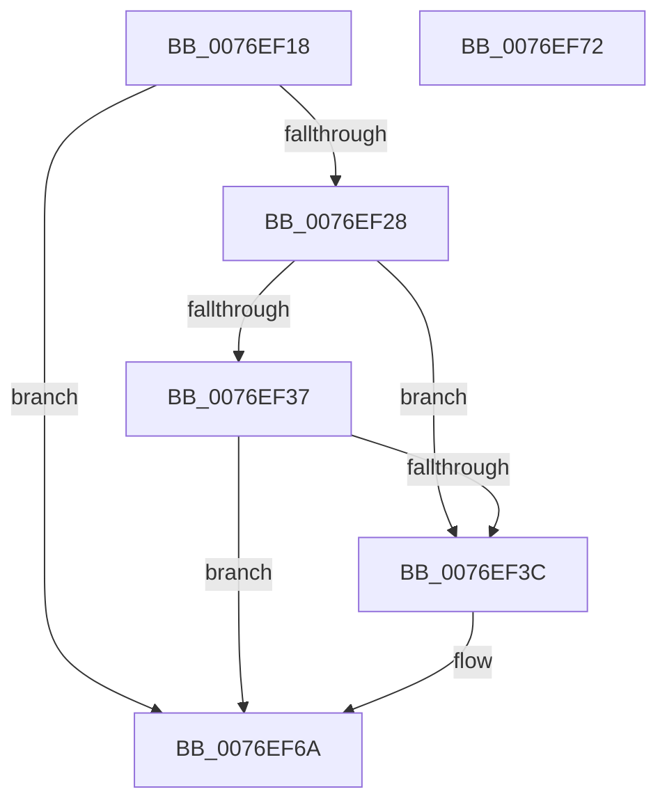

# PopAdaptiveStandbySetPolicyTimer

- RVA: `0x0076EF18`–`0x0076EF73` (길이 `91` bytes)
- VA: `0x000000014076EF18`
- 실행 섹션: `PAGE`
- PDB 이름 있음: `예`; PDB Function 태그: `아니요`
- unwind 정보 RVA: `0x0005CF00`
- 디코드: `26`개 명령, `91/91` bytes 표시
- 미해석 바이트: `0` (있으면 어셈블리에 `.byte`로 보존)

> 이 문서는 커널 이미지의 기계어와 PDB 기호를 분석해 생성했습니다. 4번과 5번은 함수 원형과 자료형을 바이너리 사용 방식에서 추정한 C 해석이며 원본 소스 복구 결과는 아닙니다.

## 1. Dependencies

- 직접 호출 지점: **1**; 고유 호출 대상: **1**
- 직접 호출자로 확인된 함수: **1**
- RIP 상대 이미지 참조: **0**

### Outgoing calls
- `0x0076EF65` → [KeSetTimer2](../../text/3A/KeSetTimer2_function_003A08E0.md) (function, `0x003A08E0`)

### Direct callers
- [PopAdaptiveStandbyCheckHibernateBudgetAction](PopAdaptiveStandbyCheckHibernateBudgetAction_function_0076CB54.md) at `0x0076CBC5`
- [PopAdaptiveStandbyCheckHibernateBudgetAction](PopAdaptiveStandbyCheckHibernateBudgetAction_function_0076CB54.md) at `0x0076CC13`

### Static image references
- 디코드된 RIP-relative 메모리 참조가 없습니다.

## 2. Other-region calls and transfers

- 다른 실행 섹션으로 향하는 call: **1**
  - `0x0076EF65` → [KeSetTimer2](../../text/3A/KeSetTimer2_function_003A08E0.md) (`PAGE` → `.text`)
- 별도 외부 분기/꼬리 이동을 확인하지 못했습니다.

## 3. Assembly (complete function range)

```asm
0076EF18  40 53                           push rbx
0076EF1A  48 83 EC 20                     sub rsp, 0x20
0076EF1E  32 DB                           xor bl, bl
0076EF20  4C 8B C9                        mov r9, rcx
0076EF23  41 3B D0                        cmp edx, r8d
0076EF26  73 42                           jae 0x14076ef6a
0076EF28  48 8D 81 54 01 00 00            lea rax, [rcx + 0x154]
0076EF2F  38 99 50 01 00 00               cmp byte ptr [rcx + 0x150], bl
0076EF35  74 05                           je 0x14076ef3c
0076EF37  44 39 00                        cmp dword ptr [rax], r8d
0076EF3A  74 2E                           je 0x14076ef6a
0076EF3C  44 89 00                        mov dword ptr [rax], r8d
0076EF3F  BB 01 00 00 00                  mov ebx, 1
0076EF44  44 2B C2                        sub r8d, edx
0076EF47  88 99 50 01 00 00               mov byte ptr [rcx + 0x150], bl
0076EF4D  42 8D 0C 03                     lea ecx, [rbx + r8]
0076EF51  45 33 C0                        xor r8d, r8d
0076EF54  48 69 D1 80 69 67 FF            imul rdx, rcx, -0x989680
0076EF5B  49 8D 89 58 01 00 00            lea rcx, [r9 + 0x158]
0076EF62  45 33 C9                        xor r9d, r9d
0076EF65  E8 76 19 C3 FF                  call 0x1403a08e0
0076EF6A  8A C3                           mov al, bl
0076EF6C  48 83 C4 20                     add rsp, 0x20
0076EF70  5B                              pop rbx
0076EF71  C3                              ret
0076EF72  CC                              int3
```

## 4. C-style interpretation (structured pseudocode)

```c
__int64 __fastcall PopAdaptiveStandbySetPolicyTimer(__int64 a1, int a2, int a3)
{
    __int64 result;
    __int64 v_rbx;
    __int64 v_rsp;

    v_rsp = (v_rsp) - (32);
    v_rbx = 0;
    if (a2 >= a3) goto loc_0076EF6A;
    if ((*(unsigned __int8 *)(a1 + 336)) == 0) goto loc_0076EF3C;
    result = a1 + 340;
    if ((*(unsigned int *)(a1 + 340)) != a3) {
        *(unsigned int *)(a1 + 340) = a3;
        v_rbx = 1;
        a3 = (unsigned int)((a3) - (a2));
        *(unsigned __int8 *)(a1 + 336) = (unsigned __int8)(v_rbx);
        a1 = v_rbx + a3 * 1;
        a3 = 0;
        a2 = (a2) * (a1);
        a1 = a1 + 344;
        a4 = 0;
        result = KeSetTimer2(a1, a2, a3, a4);
    }
    v_rsp = (v_rsp) + (32);
    return (unsigned __int8)(v_rbx);
}
```

## 5. (Beta) C Style

```c
int64_t PopAdaptiveStandbySetPolicyTimer(void *Arg1, int32_t Arg2, int32_t Arg3)
{
    uint8_t *arg1 = (uint8_t *)Arg1;

    int64_t result;
    int64_t local_rbx;
    int64_t local_rsp;

    local_rsp = (local_rsp) - (32);
    local_rbx = 0;
    if (Arg2 >= Arg3) goto loc_0076EF6A;
    if ((*(uint8_t *)(arg1 + 0x150)) == 0) goto loc_0076EF3C;
    result = Arg1 + 340;
    if ((*(uint32_t *)(arg1 + 0x154)) != Arg3) {
        *(uint32_t *)(arg1 + 0x154) = Arg3;
        local_rbx = 1;
        Arg3 = (uint32_t)((Arg3) - (Arg2));
        *(uint8_t *)(arg1 + 0x150) = (uint8_t)(local_rbx);
        Arg1 = local_rbx + Arg3 * 1;
        Arg3 = 0;
        Arg2 = (Arg2) * (Arg1);
        Arg1 = Arg1 + 344;
        a4 = 0;
        result = KeSetTimer2(Arg1, Arg2, Arg3, a4);
    }
    local_rsp = (local_rsp) + (32);
    return (uint8_t)(local_rbx);
}
```

### 관측된 메모리 오프셋

구조체 형식이 확인되지 않은 접근은 인자 기준의 오프셋으로만 기록했습니다.

| 기준 인자 | 오프셋 표현 | 폭 (bit) | 접근 |
|---|---:|---:|---|
| `Arg1` | `+ 0x0` | `32` | `R` |
| `Arg1` | `+ 0x0` | `32` | `W` |
| `Arg1` | `+ 0x150` | `8` | `R` |
| `Arg1` | `+ 0x150` | `8` | `W` |
| `Arg1` | `+ 0x154` | `64` | `R` |
| `Arg1` | `+ 0x158` | `64` | `R` |

## 6. Execution-region graph

[열기: 2D/3D 그래프와 함수 탐색 컨트롤 패널](../../../control-panel.html?section=page&rva=0x0076EF18&view=graph)

- 2D 그래프는 위에서 아래로 흐르고, 3D 그래프는 빈 공간을 드래그해 회전합니다. Shift+드래그는 이동, 휠은 확대·축소, 함수 노드 선택은 대상 보고서 이동입니다.

### Static fallback


