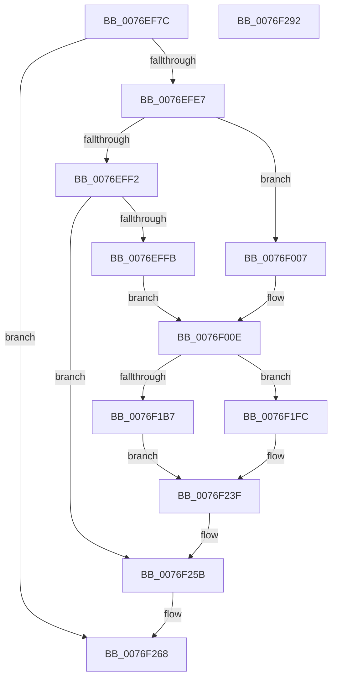

# PopAdaptiveStandbyTraceBatteryUpdate

- RVA: `0x0076EF7C`–`0x0076F293` (길이 `791` bytes)
- VA: `0x000000014076EF7C`
- 실행 섹션: `PAGE`
- PDB 이름 있음: `예`; PDB Function 태그: `아니요`
- unwind 정보 RVA: `0x000CD48C`
- 디코드: `160`개 명령, `791/791` bytes 표시
- 미해석 바이트: `0` (있으면 어셈블리에 `.byte`로 보존)

> 이 문서는 커널 이미지의 기계어와 PDB 기호를 분석해 생성했습니다. 4번과 5번은 함수 원형과 자료형을 바이너리 사용 방식에서 추정한 C 해석이며 원본 소스 복구 결과는 아닙니다.

## 1. Dependencies

- 직접 호출 지점: **20**; 고유 호출 대상: **8**
- 직접 호출자로 확인된 함수: **1**
- RIP 상대 이미지 참조: **14**

### Outgoing calls
- `0x0076EFD6` → [ExAllocatePool2](../../poolcode/B8/ExAllocatePool2_function_00B820F0.md) (function, `0x00B820F0`)
- `0x0076F02A` → [ExSystemTimeToLocalTime](../../text/2F/ExSystemTimeToLocalTime_function_002FE1C0.md) (function, `0x002FE1C0`)
- `0x0076F039` → [RtlTimeToTimeFields](../../text/42/RtlTimeToTimeFields_function_0042E0F0.md) (function, `0x0042E0F0`)
- `0x0076F055` → [RtlStringCchPrintfW](../../text/48/RtlStringCchPrintfW_function_00482D5C.md) (function, `0x00482D5C`)
- `0x0076F0AA` → [RtlStringCchPrintfW](../../text/48/RtlStringCchPrintfW_function_00482D5C.md) (function, `0x00482D5C`)
- `0x0076F0C8` → [RtlStringCchPrintfW](../../text/48/RtlStringCchPrintfW_function_00482D5C.md) (function, `0x00482D5C`)
- `0x0076F0E2` → [RtlStringCchPrintfW](../../text/48/RtlStringCchPrintfW_function_00482D5C.md) (function, `0x00482D5C`)
- `0x0076F100` → [RtlStringCchPrintfW](../../text/48/RtlStringCchPrintfW_function_00482D5C.md) (function, `0x00482D5C`)
- `0x0076F11A` → [RtlStringCchPrintfW](../../text/48/RtlStringCchPrintfW_function_00482D5C.md) (function, `0x00482D5C`)
- `0x0076F138` → [RtlStringCchPrintfW](../../text/48/RtlStringCchPrintfW_function_00482D5C.md) (function, `0x00482D5C`)
- `0x0076F152` → [RtlStringCchPrintfW](../../text/48/RtlStringCchPrintfW_function_00482D5C.md) (function, `0x00482D5C`)
- `0x0076F175` → [RtlStringCchPrintfW](../../text/48/RtlStringCchPrintfW_function_00482D5C.md) (function, `0x00482D5C`)
- `0x0076F193` → [Feature_AdaptiveHibernateEnhancements__private_IsEnabledDeviceUsageNoInline](../../text/4F/Feature_AdaptiveHibernateEnhancements__private_IsEnabledDeviceUsageNoInline_function_004F78F0.md) (function, `0x004F78F0`)
- `0x0076F1BE` → [RtlStringCchPrintfW](../../text/48/RtlStringCchPrintfW_function_00482D5C.md) (function, `0x00482D5C`)
- `0x0076F1E6` → [RtlStringCchPrintfW](../../text/48/RtlStringCchPrintfW_function_00482D5C.md) (function, `0x00482D5C`)
- `0x0076F203` → [RtlStringCchPrintfW](../../text/48/RtlStringCchPrintfW_function_00482D5C.md) (function, `0x00482D5C`)
- `0x0076F22B` → [RtlStringCchPrintfW](../../text/48/RtlStringCchPrintfW_function_00482D5C.md) (function, `0x00482D5C`)
- `0x0076F256` → [PopAdaptiveStandbyTraceSessionMetadata](PopAdaptiveStandbyTraceSessionMetadata_function_0076F29C.md) (function, `0x0076F29C`)
- `0x0076F263` → [ExFreePoolWithTag](../../poolcode/B8/ExFreePoolWithTag_function_00B82870.md) (function, `0x00B82870`)
- `0x0076F272` → [_security_check_cookie](../../text/6A/_security_check_cookie_function_006AC640.md) (function, `0x006AC640`)

### Direct callers
- [PopAdaptiveStandbyHandleBatteryUpdate](../6F/PopAdaptiveStandbyHandleBatteryUpdate_function_006FD39C.md) at `0x006FD784`

### Static image references
- `0x0076EF9B` → RVA `0x00E0A740` (`.data`; read)
- `0x0076F049` → RVA `0x00B03780` (` ?? ::NNGAKEGL::`string'`; read)
- `0x0076F099` → RVA `0x00B03740` (` ?? ::NNGAKEGL::`string'`; read)
- `0x0076F0BD` → RVA `0x00B03800` (` ?? ::NNGAKEGL::`string'`; read)
- `0x0076F0D8` → RVA `0x00B037F0` (` ?? ::NNGAKEGL::`string'`; read)
- `0x0076F0F5` → RVA `0x00B03910` (` ?? ::NNGAKEGL::`string'`; read)
- `0x0076F110` → RVA `0x00AFCAE0` (` ?? ::NNGAKEGL::`string'`; read)
- `0x0076F12D` → RVA `0x00B03880` (` ?? ::NNGAKEGL::`string'`; read)
- `0x0076F16B` → RVA `0x00B03390` (` ?? ::NNGAKEGL::`string'`; read)
- `0x0076F17D` → RVA `0x00000000` (`image boundary/outside`; read)
- `0x0076F1B7` → RVA `0x00B03300` (` ?? ::NNGAKEGL::`string'`; read)
- `0x0076F1CB` → RVA `0x00B034B0` (` ?? ::NNGAKEGL::`string'`; read)
- `0x0076F1FC` → RVA `0x00B03410` (` ?? ::NNGAKEGL::`string'`; read)
- `0x0076F210` → RVA `0x00B035A0` (` ?? ::NNGAKEGL::`string'`; read)

## 2. Other-region calls and transfers

- 다른 실행 섹션으로 향하는 call: **19**
  - `0x0076EFD6` → [ExAllocatePool2](../../poolcode/B8/ExAllocatePool2_function_00B820F0.md) (`PAGE` → `POOLCODE`)
  - `0x0076F02A` → [ExSystemTimeToLocalTime](../../text/2F/ExSystemTimeToLocalTime_function_002FE1C0.md) (`PAGE` → `.text`)
  - `0x0076F039` → [RtlTimeToTimeFields](../../text/42/RtlTimeToTimeFields_function_0042E0F0.md) (`PAGE` → `.text`)
  - `0x0076F055` → [RtlStringCchPrintfW](../../text/48/RtlStringCchPrintfW_function_00482D5C.md) (`PAGE` → `.text`)
  - `0x0076F0AA` → [RtlStringCchPrintfW](../../text/48/RtlStringCchPrintfW_function_00482D5C.md) (`PAGE` → `.text`)
  - `0x0076F0C8` → [RtlStringCchPrintfW](../../text/48/RtlStringCchPrintfW_function_00482D5C.md) (`PAGE` → `.text`)
  - `0x0076F0E2` → [RtlStringCchPrintfW](../../text/48/RtlStringCchPrintfW_function_00482D5C.md) (`PAGE` → `.text`)
  - `0x0076F100` → [RtlStringCchPrintfW](../../text/48/RtlStringCchPrintfW_function_00482D5C.md) (`PAGE` → `.text`)
  - `0x0076F11A` → [RtlStringCchPrintfW](../../text/48/RtlStringCchPrintfW_function_00482D5C.md) (`PAGE` → `.text`)
  - `0x0076F138` → [RtlStringCchPrintfW](../../text/48/RtlStringCchPrintfW_function_00482D5C.md) (`PAGE` → `.text`)
  - `0x0076F152` → [RtlStringCchPrintfW](../../text/48/RtlStringCchPrintfW_function_00482D5C.md) (`PAGE` → `.text`)
  - `0x0076F175` → [RtlStringCchPrintfW](../../text/48/RtlStringCchPrintfW_function_00482D5C.md) (`PAGE` → `.text`)
  - `0x0076F193` → [Feature_AdaptiveHibernateEnhancements__private_IsEnabledDeviceUsageNoInline](../../text/4F/Feature_AdaptiveHibernateEnhancements__private_IsEnabledDeviceUsageNoInline_function_004F78F0.md) (`PAGE` → `.text`)
  - `0x0076F1BE` → [RtlStringCchPrintfW](../../text/48/RtlStringCchPrintfW_function_00482D5C.md) (`PAGE` → `.text`)
  - `0x0076F1E6` → [RtlStringCchPrintfW](../../text/48/RtlStringCchPrintfW_function_00482D5C.md) (`PAGE` → `.text`)
  - `0x0076F203` → [RtlStringCchPrintfW](../../text/48/RtlStringCchPrintfW_function_00482D5C.md) (`PAGE` → `.text`)
  - `0x0076F22B` → [RtlStringCchPrintfW](../../text/48/RtlStringCchPrintfW_function_00482D5C.md) (`PAGE` → `.text`)
  - `0x0076F263` → [ExFreePoolWithTag](../../poolcode/B8/ExFreePoolWithTag_function_00B82870.md) (`PAGE` → `POOLCODE`)
  - `0x0076F272` → [_security_check_cookie](../../text/6A/_security_check_cookie_function_006AC640.md) (`PAGE` → `.text`)
- 별도 외부 분기/꼬리 이동을 확인하지 못했습니다.

## 3. Assembly (complete function range)

```asm
0076EF7C  48 89 5C 24 18                  mov qword ptr [rsp + 0x18], rbx
0076EF81  55                              push rbp
0076EF82  56                              push rsi
0076EF83  57                              push rdi
0076EF84  41 54                           push r12
0076EF86  41 55                           push r13
0076EF88  41 56                           push r14
0076EF8A  41 57                           push r15
0076EF8C  48 8D AC 24 20 FE FF FF         lea rbp, [rsp - 0x1e0]
0076EF94  48 81 EC E0 02 00 00            sub rsp, 0x2e0
0076EF9B  48 8B 05 9E B7 69 00            mov rax, qword ptr [rip + 0x69b79e]
0076EFA2  48 33 C4                        xor rax, rsp
0076EFA5  48 89 85 D0 01 00 00            mov qword ptr [rbp + 0x1d0], rax
0076EFAC  48 83 64 24 60 00               and qword ptr [rsp + 0x60], 0
0076EFB2  4C 8B F2                        mov r14, rdx
0076EFB5  4D 63 E0                        movsxd r12, r8d
0076EFB8  48 8B D9                        mov rbx, rcx
0076EFBB  0F 57 C0                        xorps xmm0, xmm0
0076EFBE  4D 63 F9                        movsxd r15, r9d
0076EFC1  BA 90 06 00 00                  mov edx, 0x690
0076EFC6  B9 00 01 00 00                  mov ecx, 0x100
0076EFCB  41 B8 50 6F 41 64               mov r8d, 0x64416f50
0076EFD1  0F 11 44 24 50                  movups xmmword ptr [rsp + 0x50], xmm0
0076EFD6  E8 15 31 41 00                  call 0x140b820f0
0076EFDB  48 8B F8                        mov rdi, rax
0076EFDE  48 85 C0                        test rax, rax
0076EFE1  0F 84 81 02 00 00               je 0x14076f268
0076EFE7  8B 83 F8 00 00 00               mov eax, dword ptr [rbx + 0xf8]
0076EFED  83 E8 01                        sub eax, 1
0076EFF0  74 15                           je 0x14076f007
0076EFF2  83 F8 01                        cmp eax, 1
0076EFF5  0F 85 60 02 00 00               jne 0x14076f25b
0076EFFB  48 8B B3 F0 00 00 00            mov rsi, qword ptr [rbx + 0xf0]
0076F002  48 FF CE                        dec rsi
0076F005  EB 07                           jmp 0x14076f00e
0076F007  48 8B B3 F0 00 00 00            mov rsi, qword ptr [rbx + 0xf0]
0076F00E  48 B8 14 00 00 00 80 F7 FF FF   movabs rax, 0xfffff78000000014
0076F018  48 8D 54 24 60                  lea rdx, [rsp + 0x60]
0076F01D  48 8D 4C 24 68                  lea rcx, [rsp + 0x68]
0076F022  48 8B 00                        mov rax, qword ptr [rax]
0076F025  48 89 44 24 68                  mov qword ptr [rsp + 0x68], rax
0076F02A  E8 91 F1 B8 FF                  call 0x1402fe1c0
0076F02F  48 8D 54 24 50                  lea rdx, [rsp + 0x50]
0076F034  48 8D 4C 24 60                  lea rcx, [rsp + 0x60]
0076F039  E8 B2 F0 CB FF                  call 0x14042e0f0
0076F03E  44 8B 8B EC 00 00 00            mov r9d, dword ptr [rbx + 0xec]
0076F045  48 8D 4F 0C                     lea rcx, [rdi + 0xc]
0076F049  4C 8D 05 30 47 39 00            lea r8, [rip + 0x394730]
0076F050  BA 48 00 00 00                  mov edx, 0x48
0076F055  E8 02 3D D1 FF                  call 0x140482d5c
0076F05A  0F BF 44 24 5A                  movsx eax, word ptr [rsp + 0x5a]
0076F05F  48 8D 8F AC 00 00 00            lea rcx, [rdi + 0xac]
0076F066  0F BF 54 24 58                  movsx edx, word ptr [rsp + 0x58]
0076F06B  41 BD 20 00 00 00               mov r13d, 0x20
0076F071  44 0F BF 44 24 56               movsx r8d, word ptr [rsp + 0x56]
0076F077  44 0F BF 54 24 54               movsx r10d, word ptr [rsp + 0x54]
0076F07D  44 0F BF 5C 24 52               movsx r11d, word ptr [rsp + 0x52]
0076F083  44 0F BF 4C 24 50               movsx r9d, word ptr [rsp + 0x50]
0076F089  89 44 24 40                     mov dword ptr [rsp + 0x40], eax
0076F08D  89 54 24 38                     mov dword ptr [rsp + 0x38], edx
0076F091  41 8B D5                        mov edx, r13d
0076F094  44 89 44 24 30                  mov dword ptr [rsp + 0x30], r8d
0076F099  4C 8D 05 A0 46 39 00            lea r8, [rip + 0x3946a0]
0076F0A0  44 89 54 24 28                  mov dword ptr [rsp + 0x28], r10d
0076F0A5  44 89 5C 24 20                  mov dword ptr [rsp + 0x20], r11d
0076F0AA  E8 AD 3C D1 FF                  call 0x140482d5c
0076F0AF  44 8B 8B EC 00 00 00            mov r9d, dword ptr [rbx + 0xec]
0076F0B6  48 8D 8F FC 00 00 00            lea rcx, [rdi + 0xfc]
0076F0BD  4C 8D 05 3C 47 39 00            lea r8, [rip + 0x39473c]
0076F0C4  41 8D 55 28                     lea edx, [r13 + 0x28]
0076F0C8  E8 8F 3C D1 FF                  call 0x140482d5c
0076F0CD  45 8B 4E 10                     mov r9d, dword ptr [r14 + 0x10]
0076F0D1  48 8D 8F 9C 01 00 00            lea rcx, [rdi + 0x19c]
0076F0D8  4C 8D 05 11 47 39 00            lea r8, [rip + 0x394711]
0076F0DF  41 8B D5                        mov edx, r13d
0076F0E2  E8 75 3C D1 FF                  call 0x140482d5c
0076F0E7  44 8B 8B EC 00 00 00            mov r9d, dword ptr [rbx + 0xec]
0076F0EE  48 8D 8F EC 01 00 00            lea rcx, [rdi + 0x1ec]
0076F0F5  4C 8D 05 14 48 39 00            lea r8, [rip + 0x394814]
0076F0FC  41 8D 55 28                     lea edx, [r13 + 0x28]
0076F100  E8 57 3C D1 FF                  call 0x140482d5c
0076F105  45 8B 4E 08                     mov r9d, dword ptr [r14 + 8]
0076F109  48 8D 8F 8C 02 00 00            lea rcx, [rdi + 0x28c]
0076F110  4C 8D 05 C9 D9 38 00            lea r8, [rip + 0x38d9c9]
0076F117  41 8B D5                        mov edx, r13d
0076F11A  E8 3D 3C D1 FF                  call 0x140482d5c
0076F11F  44 8B 8B EC 00 00 00            mov r9d, dword ptr [rbx + 0xec]
0076F126  48 8D 8F DC 02 00 00            lea rcx, [rdi + 0x2dc]
0076F12D  4C 8D 05 4C 47 39 00            lea r8, [rip + 0x39474c]
0076F134  41 8D 55 28                     lea edx, [r13 + 0x28]
0076F138  E8 1F 3C D1 FF                  call 0x140482d5c
0076F13D  45 8B 4E 0C                     mov r9d, dword ptr [r14 + 0xc]
0076F141  48 8D 8F 7C 03 00 00            lea rcx, [rdi + 0x37c]
0076F148  4C 8D 05 91 D9 38 00            lea r8, [rip + 0x38d991]
0076F14F  41 8B D5                        mov edx, r13d
0076F152  E8 05 3C D1 FF                  call 0x140482d5c
0076F157  44 8B 8B EC 00 00 00            mov r9d, dword ptr [rbx + 0xec]
0076F15E  48 8D 8F CC 03 00 00            lea rcx, [rdi + 0x3cc]
0076F165  41 BD 48 00 00 00               mov r13d, 0x48
0076F16B  4C 8D 05 1E 42 39 00            lea r8, [rip + 0x39421e]
0076F172  41 8B D5                        mov edx, r13d
0076F175  E8 E2 3B D1 FF                  call 0x140482d5c
0076F17A  49 8B C4                        mov rax, r12
0076F17D  4C 8D 25 7C 0E 89 FF            lea r12, [rip - 0x76f184]
0076F184  49 8B 84 C4 F0 B4 00 00         mov rax, qword ptr [r12 + rax*8 + 0xb4f0]
0076F18C  48 89 87 60 04 00 00            mov qword ptr [rdi + 0x460], rax
0076F193  E8 58 87 D8 FF                  call 0x1404f78f0
0076F198  44 8B 8B EC 00 00 00            mov r9d, dword ptr [rbx + 0xec]
0076F19F  4D 8B F7                        mov r14, r15
0076F1A2  48 8D 8F BC 04 00 00            lea rcx, [rdi + 0x4bc]
0076F1A9  41 8B D5                        mov edx, r13d
0076F1AC  4C 8D BF AC 05 00 00            lea r15, [rdi + 0x5ac]
0076F1B3  85 C0                           test eax, eax
0076F1B5  74 45                           je 0x14076f1fc
0076F1B7  4C 8D 05 42 41 39 00            lea r8, [rip + 0x394142]
0076F1BE  E8 99 3B D1 FF                  call 0x140482d5c
0076F1C3  4B 8B 84 F4 F0 B4 00 00         mov rax, qword ptr [r12 + r14*8 + 0xb4f0]
0076F1CB  4C 8D 05 DE 42 39 00            lea r8, [rip + 0x3942de]
0076F1D2  48 89 87 50 05 00 00            mov qword ptr [rdi + 0x550], rax
0076F1D9  41 8B D5                        mov edx, r13d
0076F1DC  44 8B 8B EC 00 00 00            mov r9d, dword ptr [rbx + 0xec]
0076F1E3  49 8B CF                        mov rcx, r15
0076F1E6  E8 71 3B D1 FF                  call 0x140482d5c
0076F1EB  48 63 83 D8 00 00 00            movsxd rax, dword ptr [rbx + 0xd8]
0076F1F2  49 8B 8C C4 78 B5 00 00         mov rcx, qword ptr [r12 + rax*8 + 0xb578]
0076F1FA  EB 43                           jmp 0x14076f23f
0076F1FC  4C 8D 05 0D 42 39 00            lea r8, [rip + 0x39420d]
0076F203  E8 54 3B D1 FF                  call 0x140482d5c
0076F208  4B 8B 84 F4 F0 B4 00 00         mov rax, qword ptr [r12 + r14*8 + 0xb4f0]
0076F210  4C 8D 05 89 43 39 00            lea r8, [rip + 0x394389]
0076F217  48 89 87 50 05 00 00            mov qword ptr [rdi + 0x550], rax
0076F21E  49 8B D5                        mov rdx, r13
0076F221  44 8B 8B EC 00 00 00            mov r9d, dword ptr [rbx + 0xec]
0076F228  49 8B CF                        mov rcx, r15
0076F22B  E8 2C 3B D1 FF                  call 0x140482d5c
0076F230  48 63 85 40 02 00 00            movsxd rax, dword ptr [rbp + 0x240]
0076F237  49 8B 8C C4 F0 B4 00 00         mov rcx, qword ptr [r12 + rax*8 + 0xb4f0]
0076F23F  48 89 8F 40 06 00 00            mov qword ptr [rdi + 0x640], rcx
0076F246  4C 8D 4C 24 70                  lea r9, [rsp + 0x70]
0076F24B  48 8B CE                        mov rcx, rsi
0076F24E  4C 8B C7                        mov r8, rdi
0076F251  BA 07 00 00 00                  mov edx, 7
0076F256  E8 41 00 00 00                  call 0x14076f29c
0076F25B  BA 50 6F 41 64                  mov edx, 0x64416f50
0076F260  48 8B CF                        mov rcx, rdi
0076F263  E8 08 36 41 00                  call 0x140b82870
0076F268  48 8B 8D D0 01 00 00            mov rcx, qword ptr [rbp + 0x1d0]
0076F26F  48 33 CC                        xor rcx, rsp
0076F272  E8 C9 D3 F3 FF                  call 0x1406ac640
0076F277  48 8B 9C 24 30 03 00 00         mov rbx, qword ptr [rsp + 0x330]
0076F27F  48 81 C4 E0 02 00 00            add rsp, 0x2e0
0076F286  41 5F                           pop r15
0076F288  41 5E                           pop r14
0076F28A  41 5D                           pop r13
0076F28C  41 5C                           pop r12
0076F28E  5F                              pop rdi
0076F28F  5E                              pop rsi
0076F290  5D                              pop rbp
0076F291  C3                              ret
0076F292  CC                              int3
```

## 4. C-style interpretation (structured pseudocode)

```c
__int64 __fastcall PopAdaptiveStandbyTraceBatteryUpdate(__int64 a1, __int64 a2, int a3, int a4, unsigned int a5)
{
    __int64 result;
    __int64 v_rsi;
    __int64 v_rsp;
    unsigned __int64 v_stack_m218;
    unsigned __int64 v_stack_m2A8;
    unsigned __int64 v_stack_m2B0;
    unsigned __int64 v_stack_m2B8;
    unsigned __int16 v_stack_m2BE;
    unsigned __int16 v_stack_m2C0;
    unsigned __int16 v_stack_m2C2;
    unsigned __int16 v_stack_m2C4;
    unsigned __int16 v_stack_m2C6;
    unsigned __int64 v_stack_m2C8;
    unsigned int v_stack_m2D8;
    unsigned int v_stack_m2E0;
    unsigned int v_stack_m2E8;
    unsigned int v_stack_m2F0;
    unsigned int v_stack_m2F8;
    unsigned __int64 v_stack_m48;
    unsigned __int64 v_stack_p18;

    v_stack_p18 = v_rbx;
    v_rsp = (v_rsp) - (736);
    result = (*(unsigned __int64 *)(v_rip + 6928286)) ^ (v_rsp);
    v_stack_m48 = result;
    v_stack_m2C8 = v_xmm0;
    result = ExAllocatePool2(256, (unsigned int)(0x690ULL), (unsigned int)(0x64416F50ULL), a4);
    if (result == 0) goto loc_0076F268;
    result = (unsigned int)(((unsigned int)(*(unsigned int *)(a1 + 248))) - (1));
    if (condition_is_equal) goto loc_0076F007;
    if (((unsigned int)(result)) != 1) goto loc_0076F25B;
    v_rsi = (*(unsigned __int64 *)(a1 + 240)) - 1;
    goto loc_0076F00E;
loc_0076F007:
loc_0076F00E:
    v_stack_m2B0 = *(unsigned __int64 *)(result);
    result = ExSystemTimeToLocalTime(v_stack_m2B0, v_stack_m2B8, (unsigned int)(0x64416F50ULL), a4);
    result = RtlTimeToTimeFields(v_stack_m2B8, v_stack_m2C8, (unsigned int)(0x64416F50ULL), a4);
    result = RtlStringCchPrintfW(result + 12, 72, v_rip + 3753776, (unsigned int)(*(unsigned int *)(a1 + 236)));
    v_stack_m2D8 = (unsigned int)((__int16)(v_stack_m2BE));
    v_stack_m2E0 = (unsigned int)((__int16)(v_stack_m2C0));
    v_stack_m2E8 = (unsigned int)((__int16)(v_stack_m2C2));
    v_stack_m2F0 = (unsigned int)((__int16)(v_stack_m2C4));
    v_stack_m2F8 = (unsigned int)((__int16)(v_stack_m2C6));
    result = RtlStringCchPrintfW(result + 172, 32, v_rip + 3753632, (__int16)(v_stack_m2C8));
    result = RtlStringCchPrintfW(result + 252, 32 + 40, v_rip + 3753788, (unsigned int)(*(unsigned int *)(a1 + 236)));
    result = RtlStringCchPrintfW(result + 412, 32, v_rip + 3753745, (unsigned int)(*(unsigned int *)(a2 + 16)));
    result = RtlStringCchPrintfW(result + 492, 32 + 40, v_rip + 3754004, (unsigned int)(*(unsigned int *)(a1 + 236)));
    result = RtlStringCchPrintfW(result + 652, 32, v_rip + 3725769, (unsigned int)(*(unsigned int *)(a2 + 8)));
    result = RtlStringCchPrintfW(result + 732, 32 + 40, v_rip + 3753804, (unsigned int)(*(unsigned int *)(a1 + 236)));
    result = RtlStringCchPrintfW(result + 892, 32, v_rip + 3725713, (unsigned int)(*(unsigned int *)(a2 + 12)));
    result = RtlStringCchPrintfW(result + 972, 72, v_rip + 3752478, (unsigned int)(*(unsigned int *)(a1 + 236)));
    *(unsigned __int64 *)(result + 1120) = *(unsigned __int64 *)(v_rip - 7795076 + (int)(a3) * 8 + 46320);
    result = Feature_AdaptiveHibernateEnhancements__private_IsEnabledDeviceUsageNoInline(result + 972, 72, v_rip + 3752478, (unsigned int)(*(unsigned int *)(a1 + 236)));
    if ((unsigned int)(result) == 0) goto loc_0076F1FC;
    result = RtlStringCchPrintfW(result + 1212, 72, v_rip + 3752258, (unsigned int)(*(unsigned int *)(a1 + 236)));
    *(unsigned __int64 *)(result + 1360) = *(unsigned __int64 *)(v_rip - 7795076 + (int)(a4) * 8 + 46320);
    result = RtlStringCchPrintfW(result + 1452, 72, v_rip + 3752670, (unsigned int)(*(unsigned int *)(a1 + 236)));
    goto loc_0076F23F;
loc_0076F1FC:
    result = RtlStringCchPrintfW(*(unsigned __int64 *)(v_rip - 7795076 + (int)(*(unsigned int *)(a1 + 216)) * 8 + 46456), 72, v_rip + 3752461, (unsigned int)(*(unsigned int *)(a1 + 236)));
    *(unsigned __int64 *)(result + 1360) = *(unsigned __int64 *)(v_rip - 7795076 + (int)(a4) * 8 + 46320);
    result = RtlStringCchPrintfW(result + 1452, 72, v_rip + 3752841, (unsigned int)(*(unsigned int *)(a1 + 236)));
loc_0076F23F:
    *(unsigned __int64 *)(result + 1600) = *(unsigned __int64 *)(v_rip - 7795076 + (int)(a5) * 8 + 46320);
    result = PopAdaptiveStandbyTraceSessionMetadata(*(unsigned __int64 *)(a1 + 240), 7, result, v_stack_m2A8);
loc_0076F25B:
    result = ExFreePoolWithTag(result, (unsigned int)(0x64416F50ULL), result, v_stack_m2A8);
loc_0076F268:
    a1 = (v_stack_m48) ^ (v_rsp);
    result = _security_check_cookie(a1, (unsigned int)(0x64416F50ULL), result, v_stack_m2A8);
    v_rsp = (v_rsp) + (736);
    return result;
}
```

## 5. (Beta) C Style

```c
int64_t PopAdaptiveStandbyTraceBatteryUpdate(void *Arg1, void *Arg2, int32_t Arg3, int32_t Arg4, uint32_t Arg5)
{
    uint8_t *arg1 = (uint8_t *)Arg1;
    uint8_t *arg2 = (uint8_t *)Arg2;

    int64_t result;
    int64_t local_rsi;
    int64_t local_rsp;
    uint64_t v_stack_m218;
    uint64_t v_stack_m2A8;
    uint64_t v_stack_m2B0;
    uint64_t v_stack_m2B8;
    uint16_t v_stack_m2BE;
    uint16_t v_stack_m2C0;
    uint16_t v_stack_m2C2;
    uint16_t v_stack_m2C4;
    uint16_t v_stack_m2C6;
    uint64_t v_stack_m2C8;
    uint32_t v_stack_m2D8;
    uint32_t v_stack_m2E0;
    uint32_t v_stack_m2E8;
    uint32_t v_stack_m2F0;
    uint32_t v_stack_m2F8;
    uint64_t v_stack_m48;
    uint64_t v_stack_p18;

    v_stack_p18 = local_rbx;
    local_rsp = (local_rsp) - (736);
    result = (*(uint64_t *)(v_rip + 0x69B79E)) ^ (local_rsp);
    v_stack_m48 = result;
    v_stack_m2C8 = v_xmm0;
    result = ExAllocatePool2(256, (uint32_t)(0x690ULL), (uint32_t)(0x64416F50ULL), Arg4);
    if (result == 0) goto loc_0076F268;
    result = (uint32_t)(((uint32_t)(*(uint32_t *)(arg1 + 0xF8))) - (1));
    if (condition_is_equal) goto loc_0076F007;
    if (((uint32_t)(result)) != 1) goto loc_0076F25B;
    local_rsi = (*(uint64_t *)(arg1 + 0xF0)) - 1;
    goto loc_0076F00E;
loc_0076F007:
loc_0076F00E:
    v_stack_m2B0 = *(uint64_t *)(result);
    result = ExSystemTimeToLocalTime(v_stack_m2B0, v_stack_m2B8, (uint32_t)(0x64416F50ULL), Arg4);
    result = RtlTimeToTimeFields(v_stack_m2B8, v_stack_m2C8, (uint32_t)(0x64416F50ULL), Arg4);
    result = RtlStringCchPrintfW(result + 12, 72, v_rip + 3753776, (uint32_t)(*(uint32_t *)(arg1 + 0xEC)));
    v_stack_m2D8 = (uint32_t)((int16_t)(v_stack_m2BE));
    v_stack_m2E0 = (uint32_t)((int16_t)(v_stack_m2C0));
    v_stack_m2E8 = (uint32_t)((int16_t)(v_stack_m2C2));
    v_stack_m2F0 = (uint32_t)((int16_t)(v_stack_m2C4));
    v_stack_m2F8 = (uint32_t)((int16_t)(v_stack_m2C6));
    result = RtlStringCchPrintfW(result + 172, 32, v_rip + 3753632, (int16_t)(v_stack_m2C8));
    result = RtlStringCchPrintfW(result + 252, 32 + 40, v_rip + 3753788, (uint32_t)(*(uint32_t *)(arg1 + 0xEC)));
    result = RtlStringCchPrintfW(result + 412, 32, v_rip + 3753745, (uint32_t)(*(uint32_t *)(arg2 + 0x10)));
    result = RtlStringCchPrintfW(result + 492, 32 + 40, v_rip + 3754004, (uint32_t)(*(uint32_t *)(arg1 + 0xEC)));
    result = RtlStringCchPrintfW(result + 652, 32, v_rip + 3725769, (uint32_t)(*(uint32_t *)(arg2 + 0x8)));
    result = RtlStringCchPrintfW(result + 732, 32 + 40, v_rip + 3753804, (uint32_t)(*(uint32_t *)(arg1 + 0xEC)));
    result = RtlStringCchPrintfW(result + 892, 32, v_rip + 3725713, (uint32_t)(*(uint32_t *)(arg2 + 0xC)));
    result = RtlStringCchPrintfW(result + 972, 72, v_rip + 3752478, (uint32_t)(*(uint32_t *)(arg1 + 0xEC)));
    *(uint64_t *)(result + 0x460) = *(uint64_t *)(v_rip - 0x76F184 + (int32_t)(Arg3) * 8 + 0xB4F0);
    result = Feature_AdaptiveHibernateEnhancements__private_IsEnabledDeviceUsageNoInline(result + 972, 72, v_rip + 3752478, (uint32_t)(*(uint32_t *)(arg1 + 0xEC)));
    if ((uint32_t)(result) == 0) goto loc_0076F1FC;
    result = RtlStringCchPrintfW(result + 1212, 72, v_rip + 3752258, (uint32_t)(*(uint32_t *)(arg1 + 0xEC)));
    *(uint64_t *)(result + 0x550) = *(uint64_t *)(v_rip - 0x76F184 + (int32_t)(Arg4) * 8 + 0xB4F0);
    result = RtlStringCchPrintfW(result + 1452, 72, v_rip + 3752670, (uint32_t)(*(uint32_t *)(arg1 + 0xEC)));
    goto loc_0076F23F;
loc_0076F1FC:
    result = RtlStringCchPrintfW(*(uint64_t *)(v_rip - 0x76F184 + (int32_t)(*(uint32_t *)(arg1 + 0xD8)) * 8 + 0xB578), 72, v_rip + 3752461, (uint32_t)(*(uint32_t *)(arg1 + 0xEC)));
    *(uint64_t *)(result + 0x550) = *(uint64_t *)(v_rip - 0x76F184 + (int32_t)(Arg4) * 8 + 0xB4F0);
    result = RtlStringCchPrintfW(result + 1452, 72, v_rip + 3752841, (uint32_t)(*(uint32_t *)(arg1 + 0xEC)));
loc_0076F23F:
    *(uint64_t *)(result + 0x640) = *(uint64_t *)(v_rip - 0x76F184 + (int32_t)(Arg5) * 8 + 0xB4F0);
    result = PopAdaptiveStandbyTraceSessionMetadata(*(uint64_t *)(arg1 + 0xF0), 7, result, v_stack_m2A8);
loc_0076F25B:
    result = ExFreePoolWithTag(result, (uint32_t)(0x64416F50ULL), result, v_stack_m2A8);
loc_0076F268:
    Arg1 = (v_stack_m48) ^ (local_rsp);
    result = _security_check_cookie(Arg1, (uint32_t)(0x64416F50ULL), result, v_stack_m2A8);
    local_rsp = (local_rsp) + (736);
    return result;
}
```

### 관측된 메모리 오프셋

구조체 형식이 확인되지 않은 접근은 인자 기준의 오프셋으로만 기록했습니다.

| 기준 인자 | 오프셋 표현 | 폭 (bit) | 접근 |
|---|---:|---:|---|
| `Arg1` | `+ 0xD8` | `32` | `R` |
| `Arg1` | `+ 0xEC` | `32` | `R` |
| `Arg1` | `+ 0xF0` | `64` | `R` |
| `Arg1` | `+ 0xF8` | `32` | `R` |
| `Arg2` | `+ 0x8` | `32` | `R` |
| `Arg2` | `+ 0xC` | `32` | `R` |
| `Arg2` | `+ 0x10` | `32` | `R` |

## 6. Execution-region graph

[열기: 2D/3D 그래프와 함수 탐색 컨트롤 패널](../../../control-panel.html?section=page&rva=0x0076EF7C&view=graph)

- 2D 그래프는 위에서 아래로 흐르고, 3D 그래프는 빈 공간을 드래그해 회전합니다. Shift+드래그는 이동, 휠은 확대·축소, 함수 노드 선택은 대상 보고서 이동입니다.

### Static fallback


