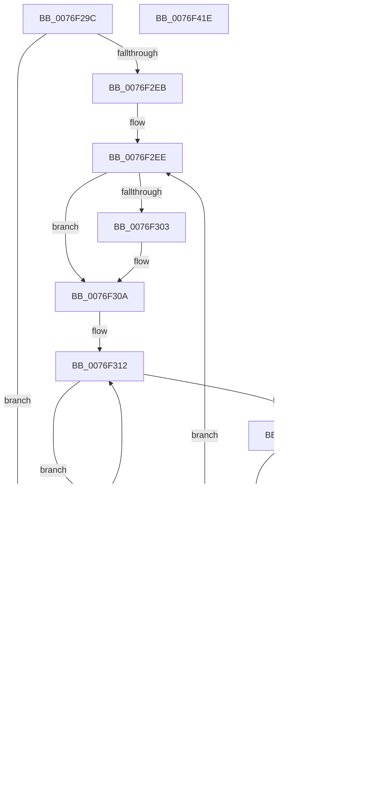

# PopAdaptiveStandbyTraceSessionMetadata

- RVA: `0x0076F29C`–`0x0076F41F` (길이 `387` bytes)
- VA: `0x000000014076F29C`
- 실행 섹션: `PAGE`
- PDB 이름 있음: `예`; PDB Function 태그: `아니요`
- unwind 정보 RVA: `0x000CD478`
- 디코드: `100`개 명령, `387/387` bytes 표시
- 미해석 바이트: `0` (있으면 어셈블리에 `.byte`로 보존)

> 이 문서는 커널 이미지의 기계어와 PDB 기호를 분석해 생성했습니다. 4번과 5번은 함수 원형과 자료형을 바이너리 사용 방식에서 추정한 C 해석이며 원본 소스 복구 결과는 아닙니다.

## 1. Dependencies

- 직접 호출 지점: **1**; 고유 호출 대상: **1**
- 직접 호출자로 확인된 함수: **2**
- RIP 상대 이미지 참조: **3**

### Outgoing calls
- `0x0076F40C` → [EtwWrite](../../text/41/EtwWrite_function_0041C720.md) (function, `0x0041C720`)

### Direct callers
- [PopAdaptiveStandbyTraceBatteryUpdate](PopAdaptiveStandbyTraceBatteryUpdate_function_0076EF7C.md) at `0x0076F256`
- [PopAdaptiveStandbyTraceSessionSettings](PopAdaptiveStandbyTraceSessionSettings_function_0076F428.md) at `0x0076F804`

### Static image references
- `0x0076F350` → RVA `0x0001EA18` (`.rdata`; read)
- `0x0076F3EE` → RVA `0x0001A7F0` (`.rdata`; read)
- `0x0076F405` → RVA `0x00F0B6B8` (`.data`; read)

## 2. Other-region calls and transfers

- 다른 실행 섹션으로 향하는 call: **1**
  - `0x0076F40C` → [EtwWrite](../../text/41/EtwWrite_function_0041C720.md) (`PAGE` → `.text`)
- 별도 외부 분기/꼬리 이동을 확인하지 못했습니다.

## 3. Assembly (complete function range)

```asm
0076F29C  48 8B C4                        mov rax, rsp
0076F29F  48 89 58 18                     mov qword ptr [rax + 0x18], rbx
0076F2A3  89 50 10                        mov dword ptr [rax + 0x10], edx
0076F2A6  48 89 48 08                     mov qword ptr [rax + 8], rcx
0076F2AA  55                              push rbp
0076F2AB  56                              push rsi
0076F2AC  57                              push rdi
0076F2AD  48 83 EC 30                     sub rsp, 0x30
0076F2B1  33 ED                           xor ebp, ebp
0076F2B3  49 C7 41 08 01 00 00 00         mov qword ptr [r9 + 8], 1
0076F2BB  88 48 20                        mov byte ptr [rax + 0x20], cl
0076F2BE  48 8D 40 20                     lea rax, [rax + 0x20]
0076F2C2  49 89 01                        mov qword ptr [r9], rax
0076F2C5  48 8D 44 24 58                  lea rax, [rsp + 0x58]
0076F2CA  49 89 41 10                     mov qword ptr [r9 + 0x10], rax
0076F2CE  4D 8B D1                        mov r10, r9
0076F2D1  49 C7 41 18 04 00 00 00         mov qword ptr [r9 + 0x18], 4
0076F2D9  44 8D 4D 02                     lea r9d, [rbp + 2]
0076F2DD  49 8B F0                        mov rsi, r8
0076F2E0  44 8B DD                        mov r11d, ebp
0076F2E3  85 D2                           test edx, edx
0076F2E5  0F 84 F0 00 00 00               je 0x14076f3db
0076F2EB  8D 5D 04                        lea ebx, [rbp + 4]
0076F2EE  41 8B C3                        mov eax, r11d
0076F2F1  4C 69 C0 F0 00 00 00            imul r8, rax, 0xf0
0076F2F8  4C 03 C6                        add r8, rsi
0076F2FB  49 8B 00                        mov rax, qword ptr [r8]
0076F2FE  48 85 C0                        test rax, rax
0076F301  75 07                           jne 0x14076f30a
0076F303  49 8D 40 0C                     lea rax, [r8 + 0xc]
0076F307  49 89 00                        mov qword ptr [r8], rax
0076F30A  49 8D 50 08                     lea rdx, [r8 + 8]
0076F30E  48 83 C9 FF                     or rcx, 0xffffffffffffffff
0076F312  48 FF C1                        inc rcx
0076F315  66 39 2C 48                     cmp word ptr [rax + rcx*2], bp
0076F319  75 F7                           jne 0x14076f312
0076F31B  49 8B 80 A0 00 00 00            mov rax, qword ptr [r8 + 0xa0]
0076F322  89 0A                           mov dword ptr [rdx], ecx
0076F324  48 85 C0                        test rax, rax
0076F327  75 0E                           jne 0x14076f337
0076F329  49 8D 80 AC 00 00 00            lea rax, [r8 + 0xac]
0076F330  49 89 80 A0 00 00 00            mov qword ptr [r8 + 0xa0], rax
0076F337  49 8D B8 A8 00 00 00            lea rdi, [r8 + 0xa8]
0076F33E  48 83 C9 FF                     or rcx, 0xffffffffffffffff
0076F342  48 FF C1                        inc rcx
0076F345  66 39 2C 48                     cmp word ptr [rax + rcx*2], bp
0076F349  75 F7                           jne 0x14076f342
0076F34B  89 0F                           mov dword ptr [rdi], ecx
0076F34D  41 FF C3                        inc r11d
0076F350  48 8D 0D C1 F6 8A FF            lea rcx, [rip - 0x75093f]
0076F357  41 8B C1                        mov eax, r9d
0076F35A  48 03 C0                        add rax, rax
0076F35D  41 83 C1 05                     add r9d, 5
0076F361  49 89 0C C2                     mov qword ptr [r10 + rax*8], rcx
0076F365  8D 4B FF                        lea ecx, [rbx - 1]
0076F368  49 C7 44 C2 08 10 00 00 00      mov qword ptr [r10 + rax*8 + 8], 0x10
0076F371  48 03 C9                        add rcx, rcx
0076F374  49 89 14 CA                     mov qword ptr [r10 + rcx*8], rdx
0076F378  49 C7 44 CA 08 04 00 00 00      mov qword ptr [r10 + rcx*8 + 8], 4
0076F381  8B 12                           mov edx, dword ptr [rdx]
0076F383  49 8B 00                        mov rax, qword ptr [r8]
0076F386  03 D2                           add edx, edx
0076F388  8B CB                           mov ecx, ebx
0076F38A  48 03 C9                        add rcx, rcx
0076F38D  41 89 54 CA 08                  mov dword ptr [r10 + rcx*8 + 8], edx
0076F392  49 89 04 CA                     mov qword ptr [r10 + rcx*8], rax
0076F396  41 89 6C CA 0C                  mov dword ptr [r10 + rcx*8 + 0xc], ebp
0076F39B  8D 4B 01                        lea ecx, [rbx + 1]
0076F39E  48 03 C9                        add rcx, rcx
0076F3A1  49 89 3C CA                     mov qword ptr [r10 + rcx*8], rdi
0076F3A5  49 C7 44 CA 08 04 00 00 00      mov qword ptr [r10 + rcx*8 + 8], 4
0076F3AE  8D 4B 02                        lea ecx, [rbx + 2]
0076F3B1  8B 17                           mov edx, dword ptr [rdi]
0076F3B3  48 03 C9                        add rcx, rcx
0076F3B6  49 8B 80 A0 00 00 00            mov rax, qword ptr [r8 + 0xa0]
0076F3BD  03 D2                           add edx, edx
0076F3BF  83 C3 05                        add ebx, 5
0076F3C2  49 89 04 CA                     mov qword ptr [r10 + rcx*8], rax
0076F3C6  41 89 54 CA 08                  mov dword ptr [r10 + rcx*8 + 8], edx
0076F3CB  41 89 6C CA 0C                  mov dword ptr [r10 + rcx*8 + 0xc], ebp
0076F3D0  44 3B 5C 24 58                  cmp r11d, dword ptr [rsp + 0x58]
0076F3D5  0F 82 13 FF FF FF               jb 0x14076f2ee
0076F3DB  41 8B C1                        mov eax, r9d
0076F3DE  48 8D 4C 24 50                  lea rcx, [rsp + 0x50]
0076F3E3  48 03 C0                        add rax, rax
0076F3E6  4C 89 54 24 20                  mov qword ptr [rsp + 0x20], r10
0076F3EB  41 FF C1                        inc r9d
0076F3EE  48 8D 15 FB B3 8A FF            lea rdx, [rip - 0x754c05]
0076F3F5  45 33 C0                        xor r8d, r8d
0076F3F8  49 89 0C C2                     mov qword ptr [r10 + rax*8], rcx
0076F3FC  49 C7 44 C2 08 08 00 00 00      mov qword ptr [r10 + rax*8 + 8], 8
0076F405  48 8B 0D AC C2 79 00            mov rcx, qword ptr [rip + 0x79c2ac]
0076F40C  E8 0F D3 CA FF                  call 0x14041c720
0076F411  48 8B 5C 24 60                  mov rbx, qword ptr [rsp + 0x60]
0076F416  48 83 C4 30                     add rsp, 0x30
0076F41A  5F                              pop rdi
0076F41B  5E                              pop rsi
0076F41C  5D                              pop rbp
0076F41D  C3                              ret
0076F41E  CC                              int3
```

## 4. C-style interpretation (structured pseudocode)

```c
__int64 __fastcall PopAdaptiveStandbyTraceSessionMetadata(__int64 a1, int a2, __int64 a3, __int64 a4)
{
    __int64 result;
    __int64 v_r11;
    __int64 v_rbp;
    __int64 v_rbx;
    __int64 v_rsp;
    unsigned __int64 v_stack_m28;
    unsigned __int64 v_stack_p10;
    unsigned __int64 v_stack_p18;
    unsigned __int64 v_stack_p8;

    *(unsigned __int64 *)(v_rsp + 24) = v_rbx;
    *(unsigned int *)(v_rsp + 16) = a2;
    *(unsigned __int64 *)(v_rsp + 8) = a1;
    v_rsp = (v_rsp) - (48);
    v_rbp = 0;
    *(unsigned __int64 *)(a4 + 8) = 1;
    *(unsigned __int8 *)(v_rsp + 32) = (unsigned __int8)(a1);
    *(unsigned __int64 *)(a4) = v_rsp + 32;
    *(unsigned __int64 *)(a4 + 16) = v_stack_p10;
    *(unsigned __int64 *)(a4 + 24) = 4;
    if (a2 == 0) goto loc_0076F3DB;
loc_0076F2EE:
    a3 = (a3) * (0);
    a3 = (a3) + (a3);
    result = *(unsigned __int64 *)(a3);
    if (*(unsigned __int64 *)(a3) == 0) {
        result = a3 + 12;
        *(unsigned __int64 *)(a3) = result;
    }
    a1 = (a1) | (-1);
loc_0076F312:
    a1 = (a1) + 1;
    if ((*(unsigned __int16 *)(result + a1 * 2)) != 0) goto loc_0076F312;
    *(unsigned int *)(a3 + 8) = (unsigned int)(a1);
    result = *(unsigned __int64 *)(a3 + 160);
    if (*(unsigned __int64 *)(a3 + 160) == 0) {
        result = a3 + 172;
        *(unsigned __int64 *)(a3 + 160) = result;
    }
    a1 = (a1) | (-1);
loc_0076F342:
    a1 = (a1) + 1;
    if ((*(unsigned __int16 *)(result + a1 * 2)) != 0) goto loc_0076F342;
    *(unsigned int *)(a3 + 168) = (unsigned int)(a1);
    v_r11 = (unsigned int)((0) + 1);
    result = ((unsigned int)((unsigned int)(v_rbp + 2))) + ((unsigned int)((unsigned int)(v_rbp + 2)));
    a4 = (unsigned int)((v_rbp + 2) + (5));
    *(unsigned __int64 *)(a4 + result * 8) = v_rip - 7670079;
    *(unsigned __int64 *)(a4 + result * 8 + 8) = 16;
    a1 = (v_rbp + 4 - 1) + (v_rbp + 4 - 1);
    *(unsigned __int64 *)(a4 + a1 * 8) = a3 + 8;
    *(unsigned __int64 *)(a4 + a1 * 8 + 8) = 4;
    a2 = (unsigned int)(((unsigned int)(*(unsigned int *)(a3 + 8))) + ((unsigned int)((unsigned int)(*(unsigned int *)(a3 + 8)))));
    a1 = ((unsigned int)((unsigned int)(v_rbp + 4))) + ((unsigned int)((unsigned int)(v_rbp + 4)));
    *(unsigned int *)(a4 + a1 * 8 + 8) = a2;
    *(unsigned __int64 *)(a4 + a1 * 8) = *(unsigned __int64 *)(a3);
    *(unsigned int *)(a4 + a1 * 8 + 12) = 0;
    a1 = (v_rbp + 4 + 1) + (v_rbp + 4 + 1);
    *(unsigned __int64 *)(a4 + a1 * 8) = a3 + 168;
    *(unsigned __int64 *)(a4 + a1 * 8 + 8) = 4;
    a1 = (v_rbp + 4 + 2) + (v_rbp + 4 + 2);
    a2 = (unsigned int)(((unsigned int)(*(unsigned int *)(a3 + 168))) + ((unsigned int)((unsigned int)(*(unsigned int *)(a3 + 168)))));
    v_rbx = (unsigned int)((v_rbp + 4) + (5));
    *(unsigned __int64 *)(a4 + a1 * 8) = *(unsigned __int64 *)(a3 + 160);
    *(unsigned int *)(a4 + a1 * 8 + 8) = a2;
    *(unsigned int *)(a4 + a1 * 8 + 12) = 0;
    if (((unsigned int)(v_r11)) < v_stack_p10) goto loc_0076F2EE;
loc_0076F3DB:
    result = ((unsigned int)((unsigned int)(a4))) + ((unsigned int)((unsigned int)(a4)));
    v_stack_m28 = a4;
    a4 = (unsigned int)((a4) + 1);
    a3 = 0;
    *(unsigned __int64 *)(a4 + result * 8) = v_stack_p8;
    *(unsigned __int64 *)(a4 + result * 8 + 8) = 8;
    result = EtwWrite(*(unsigned __int64 *)(v_rip + 7979692), v_rip - 7687173, a3, a4);
    v_rsp = (v_rsp) + (48);
    return result;
}
```

## 5. (Beta) C Style

```c
int64_t PopAdaptiveStandbyTraceSessionMetadata(int64_t Arg1, int32_t Arg2, void *Arg3, void *Arg4)
{
    uint8_t *arg3 = (uint8_t *)Arg3;
    uint8_t *arg4 = (uint8_t *)Arg4;

    int64_t result;
    int64_t local_r11;
    int64_t local_rbp;
    int64_t local_rbx;
    int64_t local_rsp;
    uint64_t v_stack_m28;
    uint64_t v_stack_p10;
    uint64_t v_stack_p18;
    uint64_t v_stack_p8;

    *(uint64_t *)(local_rsp + 0x18) = local_rbx;
    *(uint32_t *)(local_rsp + 0x10) = Arg2;
    *(uint64_t *)(local_rsp + 0x8) = Arg1;
    local_rsp = (local_rsp) - (48);
    local_rbp = 0;
    *(uint64_t *)(arg4 + 0x8) = 1;
    *(uint8_t *)(local_rsp + 0x20) = (uint8_t)(Arg1);
    *(uint64_t *)(arg4) = local_rsp + 32;
    *(uint64_t *)(arg4 + 0x10) = v_stack_p10;
    *(uint64_t *)(arg4 + 0x18) = 4;
    if (Arg2 == 0) goto loc_0076F3DB;
loc_0076F2EE:
    Arg3 = (Arg3) * (0);
    Arg3 = (Arg3) + (Arg3);
    result = *(uint64_t *)(arg3);
    if (*(uint64_t *)(arg3) == 0) {
        result = Arg3 + 12;
        *(uint64_t *)(arg3) = result;
    }
    Arg1 = (Arg1) | (-1);
loc_0076F312:
    Arg1 = (Arg1) + 1;
    if ((*(uint16_t *)(result + Arg1 * 2)) != 0) goto loc_0076F312;
    *(uint32_t *)(arg3 + 0x8) = (uint32_t)(Arg1);
    result = *(uint64_t *)(arg3 + 0xA0);
    if (*(uint64_t *)(arg3 + 0xA0) == 0) {
        result = Arg3 + 172;
        *(uint64_t *)(arg3 + 0xA0) = result;
    }
    Arg1 = (Arg1) | (-1);
loc_0076F342:
    Arg1 = (Arg1) + 1;
    if ((*(uint16_t *)(result + Arg1 * 2)) != 0) goto loc_0076F342;
    *(uint32_t *)(arg3 + 0xA8) = (uint32_t)(Arg1);
    local_r11 = (uint32_t)((0) + 1);
    result = ((uint32_t)((uint32_t)(local_rbp + 2))) + ((uint32_t)((uint32_t)(local_rbp + 2)));
    Arg4 = (uint32_t)((local_rbp + 2) + (5));
    *(uint64_t *)(arg4 + result * 8) = v_rip - 7670079;
    *(uint64_t *)(arg4 + result * 8 + 0x8) = 16;
    Arg1 = (local_rbp + 4 - 1) + (local_rbp + 4 - 1);
    *(void **)(arg4 + Arg1 * 8) = Arg3 + 8;
    *(uint64_t *)(arg4 + Arg1 * 8 + 0x8) = 4;
    Arg2 = (uint32_t)(((uint32_t)(*(uint32_t *)(arg3 + 0x8))) + ((uint32_t)((uint32_t)(*(uint32_t *)(arg3 + 0x8)))));
    Arg1 = ((uint32_t)((uint32_t)(local_rbp + 4))) + ((uint32_t)((uint32_t)(local_rbp + 4)));
    *(uint32_t *)(arg4 + Arg1 * 8 + 0x8) = Arg2;
    *(uint64_t *)(arg4 + Arg1 * 8) = *(uint64_t *)(arg3);
    *(uint32_t *)(arg4 + Arg1 * 8 + 0xC) = 0;
    Arg1 = (local_rbp + 4 + 1) + (local_rbp + 4 + 1);
    *(void **)(arg4 + Arg1 * 8) = Arg3 + 168;
    *(uint64_t *)(arg4 + Arg1 * 8 + 0x8) = 4;
    Arg1 = (local_rbp + 4 + 2) + (local_rbp + 4 + 2);
    Arg2 = (uint32_t)(((uint32_t)(*(uint32_t *)(arg3 + 0xA8))) + ((uint32_t)((uint32_t)(*(uint32_t *)(arg3 + 0xA8)))));
    local_rbx = (uint32_t)((local_rbp + 4) + (5));
    *(uint64_t *)(arg4 + Arg1 * 8) = *(uint64_t *)(arg3 + 0xA0);
    *(uint32_t *)(arg4 + Arg1 * 8 + 0x8) = Arg2;
    *(uint32_t *)(arg4 + Arg1 * 8 + 0xC) = 0;
    if (((uint32_t)(local_r11)) < v_stack_p10) goto loc_0076F2EE;
loc_0076F3DB:
    result = ((uint32_t)((uint32_t)(Arg4))) + ((uint32_t)((uint32_t)(Arg4)));
    v_stack_m28 = Arg4;
    Arg4 = (uint32_t)((Arg4) + 1);
    Arg3 = 0;
    *(uint64_t *)(arg4 + result * 8) = v_stack_p8;
    *(uint64_t *)(arg4 + result * 8 + 0x8) = 8;
    result = EtwWrite(*(uint64_t *)(v_rip + 0x79C2AC), v_rip - 7687173, Arg3, Arg4);
    local_rsp = (local_rsp) + (48);
    return result;
}
```

### 관측된 메모리 오프셋

구조체 형식이 확인되지 않은 접근은 인자 기준의 오프셋으로만 기록했습니다.

| 기준 인자 | 오프셋 표현 | 폭 (bit) | 접근 |
|---|---:|---:|---|
| `Arg3` | `+ 0x0` | `32` | `R` |
| `Arg3` | `+ 0x0` | `32` | `W` |
| `Arg3` | `+ 0x0` | `64` | `R` |
| `Arg3` | `+ 0x0` | `64` | `W` |
| `Arg3` | `+ 0x8` | `64` | `R` |
| `Arg3` | `+ 0xC` | `64` | `R` |
| `Arg3` | `+ 0xA0` | `64` | `R` |
| `Arg3` | `+ 0xA0` | `64` | `W` |
| `Arg3` | `+ 0xA8` | `64` | `R` |
| `Arg3` | `+ 0xAC` | `64` | `R` |
| `Arg4` | `+ 0x0` | `64` | `W` |
| `Arg4` | `+ 0x0 + rax*8` | `64` | `W` |
| `Arg4` | `+ 0x0 + rcx*8` | `64` | `W` |
| `Arg4` | `+ 0x8` | `64` | `W` |
| `Arg4` | `+ 0x8 + rax*8` | `64` | `W` |
| `Arg4` | `+ 0x8 + rcx*8` | `32` | `W` |
| `Arg4` | `+ 0x8 + rcx*8` | `64` | `W` |
| `Arg4` | `+ 0xC + rcx*8` | `32` | `W` |
| `Arg4` | `+ 0x10` | `64` | `W` |
| `Arg4` | `+ 0x18` | `64` | `W` |

## 6. Execution-region graph

[열기: 2D/3D 그래프와 함수 탐색 컨트롤 패널](../../../control-panel.html?section=page&rva=0x0076F29C&view=graph)

- 2D 그래프는 위에서 아래로 흐르고, 3D 그래프는 빈 공간을 드래그해 회전합니다. Shift+드래그는 이동, 휠은 확대·축소, 함수 노드 선택은 대상 보고서 이동입니다.

### Static fallback


