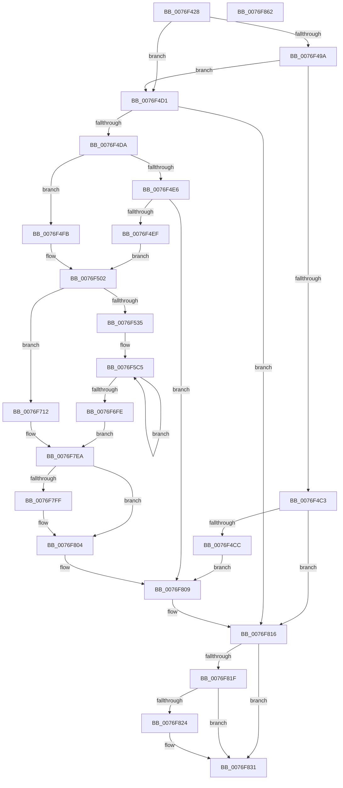

# PopAdaptiveStandbyTraceSessionSettings

- RVA: `0x0076F428`–`0x0076F863` (길이 `1,083` bytes)
- VA: `0x000000014076F428`
- 실행 섹션: `PAGE`
- PDB 이름 있음: `예`; PDB Function 태그: `아니요`
- unwind 정보 RVA: `0x000CD44C`
- 디코드: `238`개 명령, `1,083/1,083` bytes 표시
- 미해석 바이트: `0` (있으면 어셈블리에 `.byte`로 보존)

> 이 문서는 커널 이미지의 기계어와 PDB 기호를 분석해 생성했습니다. 4번과 5번은 함수 원형과 자료형을 바이너리 사용 방식에서 추정한 C 해석이며 원본 소스 복구 결과는 아닙니다.

## 1. Dependencies

- 직접 호출 지점: **28**; 고유 호출 대상: **6**
- 직접 호출자로 확인된 함수: **1**
- RIP 상대 이미지 참조: **27**

### Outgoing calls
- `0x0076F459` → [Feature_AdaptiveHibernateEnhancements__private_IsEnabledDeviceUsageNoInline](../../text/4F/Feature_AdaptiveHibernateEnhancements__private_IsEnabledDeviceUsageNoInline_function_004F78F0.md) (function, `0x004F78F0`)
- `0x0076F482` → [ExAllocatePool2](../../poolcode/B8/ExAllocatePool2_function_00B820F0.md) (function, `0x00B820F0`)
- `0x0076F491` → [Feature_AdaptiveHibernateEnhancements__private_IsEnabledDeviceUsageNoInline](../../text/4F/Feature_AdaptiveHibernateEnhancements__private_IsEnabledDeviceUsageNoInline_function_004F78F0.md) (function, `0x004F78F0`)
- `0x0076F4B1` → [ExAllocatePool2](../../poolcode/B8/ExAllocatePool2_function_00B820F0.md) (function, `0x00B820F0`)
- `0x0076F515` → [Feature_AdaptiveHibernateEnhancements__private_IsEnabledDeviceUsageNoInline](../../text/4F/Feature_AdaptiveHibernateEnhancements__private_IsEnabledDeviceUsageNoInline_function_004F78F0.md) (function, `0x004F78F0`)
- `0x0076F565` → [RtlStringCchPrintfW](../../text/48/RtlStringCchPrintfW_function_00482D5C.md) (function, `0x00482D5C`)
- `0x0076F588` → [RtlStringCchPrintfW](../../text/48/RtlStringCchPrintfW_function_00482D5C.md) (function, `0x00482D5C`)
- `0x0076F5AF` → [RtlStringCchPrintfW](../../text/48/RtlStringCchPrintfW_function_00482D5C.md) (function, `0x00482D5C`)
- `0x0076F5F6` → [RtlStringCchPrintfW](../../text/48/RtlStringCchPrintfW_function_00482D5C.md) (function, `0x00482D5C`)
- `0x0076F60F` → [RtlStringCchPrintfW](../../text/48/RtlStringCchPrintfW_function_00482D5C.md) (function, `0x00482D5C`)
- `0x0076F63D` → [RtlStringCchPrintfW](../../text/48/RtlStringCchPrintfW_function_00482D5C.md) (function, `0x00482D5C`)
- `0x0076F656` → [RtlStringCchPrintfW](../../text/48/RtlStringCchPrintfW_function_00482D5C.md) (function, `0x00482D5C`)
- `0x0076F684` → [RtlStringCchPrintfW](../../text/48/RtlStringCchPrintfW_function_00482D5C.md) (function, `0x00482D5C`)
- `0x0076F69D` → [RtlStringCchPrintfW](../../text/48/RtlStringCchPrintfW_function_00482D5C.md) (function, `0x00482D5C`)
- `0x0076F6CB` → [RtlStringCchPrintfW](../../text/48/RtlStringCchPrintfW_function_00482D5C.md) (function, `0x00482D5C`)
- `0x0076F6E4` → [RtlStringCchPrintfW](../../text/48/RtlStringCchPrintfW_function_00482D5C.md) (function, `0x00482D5C`)
- `0x0076F72A` → [RtlStringCchPrintfW](../../text/48/RtlStringCchPrintfW_function_00482D5C.md) (function, `0x00482D5C`)
- `0x0076F74D` → [RtlStringCchPrintfW](../../text/48/RtlStringCchPrintfW_function_00482D5C.md) (function, `0x00482D5C`)
- `0x0076F770` → [RtlStringCchPrintfW](../../text/48/RtlStringCchPrintfW_function_00482D5C.md) (function, `0x00482D5C`)
- `0x0076F797` → [RtlStringCchPrintfW](../../text/48/RtlStringCchPrintfW_function_00482D5C.md) (function, `0x00482D5C`)
- `0x0076F7BE` → [RtlStringCchPrintfW](../../text/48/RtlStringCchPrintfW_function_00482D5C.md) (function, `0x00482D5C`)
- `0x0076F7E5` → [RtlStringCchPrintfW](../../text/48/RtlStringCchPrintfW_function_00482D5C.md) (function, `0x00482D5C`)
- `0x0076F7EA` → [Feature_AdaptiveHibernateEnhancements__private_IsEnabledDeviceUsageNoInline](../../text/4F/Feature_AdaptiveHibernateEnhancements__private_IsEnabledDeviceUsageNoInline_function_004F78F0.md) (function, `0x004F78F0`)
- `0x0076F804` → [PopAdaptiveStandbyTraceSessionMetadata](PopAdaptiveStandbyTraceSessionMetadata_function_0076F29C.md) (function, `0x0076F29C`)
- `0x0076F811` → [ExFreePoolWithTag](../../poolcode/B8/ExFreePoolWithTag_function_00B82870.md) (function, `0x00B82870`)
- `0x0076F816` → [Feature_AdaptiveHibernateEnhancements__private_IsEnabledDeviceUsageNoInline](../../text/4F/Feature_AdaptiveHibernateEnhancements__private_IsEnabledDeviceUsageNoInline_function_004F78F0.md) (function, `0x004F78F0`)
- `0x0076F82C` → [ExFreePoolWithTag](../../poolcode/B8/ExFreePoolWithTag_function_00B82870.md) (function, `0x00B82870`)
- `0x0076F83C` → [_security_check_cookie](../../text/6A/_security_check_cookie_function_006AC640.md) (function, `0x006AC640`)

### Direct callers
- [PopAdaptiveStandbyWnfCallback](PopAdaptiveStandbyWnfCallback_function_0076F910.md) at `0x0076FD4F`
- [PopAdaptiveStandbyWnfCallback](PopAdaptiveStandbyWnfCallback_function_0076F910.md) at `0x0076FE44`

### Static image references
- `0x0076F447` → RVA `0x00E0A740` (`.data`; read)
- `0x0076F4DA` → RVA `0x00F07D38` (`.data`; read)
- `0x0076F4EF` → RVA `0x00F07D30` (`.data`; read)
- `0x0076F51A` → RVA `0x00AFCAE0` (` ?? ::NNGAKEGL::`string'`; read)
- `0x0076F535` → RVA `0x00B03530` (` ?? ::NNGAKEGL::`string'`; read)
- `0x0076F542` → RVA `0x00AFBEF0` (` ?? ::NNGAKEGL::`string'`; read)
- `0x0076F550` → RVA `0x00B03690` (` ?? ::NNGAKEGL::`string'`; read)
- `0x0076F55E` → RVA `0x00F07C90` (`.data`; read)
- `0x0076F56A` → RVA `0x00B03640` (` ?? ::NNGAKEGL::`string'`; read)
- `0x0076F57E` → RVA `0x00F07C94` (`.data`; read)
- `0x0076F58D` → RVA `0x00B03A20` (` ?? ::NNGAKEGL::`string'`; read)
- `0x0076F5A5` → RVA `0x00F07C98` (`.data`; read)
- `0x0076F5B7` → RVA `0x0000B578` (`.rdata`; read)
- `0x0076F5BE` → RVA `0x00E0C3F0` (`.data`; read)
- `0x0076F5EA` → RVA `0x00B039A0` (` ?? ::NNGAKEGL::`string'`; read)
- `0x0076F62E` → RVA `0x00B03B10` (` ?? ::NNGAKEGL::`string'`; read)
- `0x0076F675` → RVA `0x00B03A80` (` ?? ::NNGAKEGL::`string'`; read)
- `0x0076F6BC` → RVA `0x00B03BF0` (` ?? ::NNGAKEGL::`string'`; read)
- `0x0076F712` → RVA `0x00B03B90` (` ?? ::NNGAKEGL::`string'`; read)
- `0x0076F723` → RVA `0x00F07D50` (`.data`; read)
- `0x0076F72F` → RVA `0x00B03CE0` (` ?? ::NNGAKEGL::`string'`; read)
- `0x0076F743` → RVA `0x00F07D54` (`.data`; read)
- `0x0076F752` → RVA `0x00B03C80` (` ?? ::NNGAKEGL::`string'`; read)
- `0x0076F766` → RVA `0x00F07D58` (`.data`; read)
- `0x0076F78D` → RVA `0x00F07D74` (`.data`; read)
- `0x0076F7B4` → RVA `0x00F07D78` (`.data`; read)
- `0x0076F7DB` → RVA `0x00F07D7C` (`.data`; read)

## 2. Other-region calls and transfers

- 다른 실행 섹션으로 향하는 call: **27**
  - `0x0076F459` → [Feature_AdaptiveHibernateEnhancements__private_IsEnabledDeviceUsageNoInline](../../text/4F/Feature_AdaptiveHibernateEnhancements__private_IsEnabledDeviceUsageNoInline_function_004F78F0.md) (`PAGE` → `.text`)
  - `0x0076F482` → [ExAllocatePool2](../../poolcode/B8/ExAllocatePool2_function_00B820F0.md) (`PAGE` → `POOLCODE`)
  - `0x0076F491` → [Feature_AdaptiveHibernateEnhancements__private_IsEnabledDeviceUsageNoInline](../../text/4F/Feature_AdaptiveHibernateEnhancements__private_IsEnabledDeviceUsageNoInline_function_004F78F0.md) (`PAGE` → `.text`)
  - `0x0076F4B1` → [ExAllocatePool2](../../poolcode/B8/ExAllocatePool2_function_00B820F0.md) (`PAGE` → `POOLCODE`)
  - `0x0076F515` → [Feature_AdaptiveHibernateEnhancements__private_IsEnabledDeviceUsageNoInline](../../text/4F/Feature_AdaptiveHibernateEnhancements__private_IsEnabledDeviceUsageNoInline_function_004F78F0.md) (`PAGE` → `.text`)
  - `0x0076F565` → [RtlStringCchPrintfW](../../text/48/RtlStringCchPrintfW_function_00482D5C.md) (`PAGE` → `.text`)
  - `0x0076F588` → [RtlStringCchPrintfW](../../text/48/RtlStringCchPrintfW_function_00482D5C.md) (`PAGE` → `.text`)
  - `0x0076F5AF` → [RtlStringCchPrintfW](../../text/48/RtlStringCchPrintfW_function_00482D5C.md) (`PAGE` → `.text`)
  - `0x0076F5F6` → [RtlStringCchPrintfW](../../text/48/RtlStringCchPrintfW_function_00482D5C.md) (`PAGE` → `.text`)
  - `0x0076F60F` → [RtlStringCchPrintfW](../../text/48/RtlStringCchPrintfW_function_00482D5C.md) (`PAGE` → `.text`)
  - `0x0076F63D` → [RtlStringCchPrintfW](../../text/48/RtlStringCchPrintfW_function_00482D5C.md) (`PAGE` → `.text`)
  - `0x0076F656` → [RtlStringCchPrintfW](../../text/48/RtlStringCchPrintfW_function_00482D5C.md) (`PAGE` → `.text`)
  - `0x0076F684` → [RtlStringCchPrintfW](../../text/48/RtlStringCchPrintfW_function_00482D5C.md) (`PAGE` → `.text`)
  - `0x0076F69D` → [RtlStringCchPrintfW](../../text/48/RtlStringCchPrintfW_function_00482D5C.md) (`PAGE` → `.text`)
  - `0x0076F6CB` → [RtlStringCchPrintfW](../../text/48/RtlStringCchPrintfW_function_00482D5C.md) (`PAGE` → `.text`)
  - `0x0076F6E4` → [RtlStringCchPrintfW](../../text/48/RtlStringCchPrintfW_function_00482D5C.md) (`PAGE` → `.text`)
  - `0x0076F72A` → [RtlStringCchPrintfW](../../text/48/RtlStringCchPrintfW_function_00482D5C.md) (`PAGE` → `.text`)
  - `0x0076F74D` → [RtlStringCchPrintfW](../../text/48/RtlStringCchPrintfW_function_00482D5C.md) (`PAGE` → `.text`)
  - `0x0076F770` → [RtlStringCchPrintfW](../../text/48/RtlStringCchPrintfW_function_00482D5C.md) (`PAGE` → `.text`)
  - `0x0076F797` → [RtlStringCchPrintfW](../../text/48/RtlStringCchPrintfW_function_00482D5C.md) (`PAGE` → `.text`)
  - `0x0076F7BE` → [RtlStringCchPrintfW](../../text/48/RtlStringCchPrintfW_function_00482D5C.md) (`PAGE` → `.text`)
  - `0x0076F7E5` → [RtlStringCchPrintfW](../../text/48/RtlStringCchPrintfW_function_00482D5C.md) (`PAGE` → `.text`)
  - `0x0076F7EA` → [Feature_AdaptiveHibernateEnhancements__private_IsEnabledDeviceUsageNoInline](../../text/4F/Feature_AdaptiveHibernateEnhancements__private_IsEnabledDeviceUsageNoInline_function_004F78F0.md) (`PAGE` → `.text`)
  - `0x0076F811` → [ExFreePoolWithTag](../../poolcode/B8/ExFreePoolWithTag_function_00B82870.md) (`PAGE` → `POOLCODE`)
  - `0x0076F816` → [Feature_AdaptiveHibernateEnhancements__private_IsEnabledDeviceUsageNoInline](../../text/4F/Feature_AdaptiveHibernateEnhancements__private_IsEnabledDeviceUsageNoInline_function_004F78F0.md) (`PAGE` → `.text`)
  - `0x0076F82C` → [ExFreePoolWithTag](../../poolcode/B8/ExFreePoolWithTag_function_00B82870.md) (`PAGE` → `POOLCODE`)
  - `0x0076F83C` → [_security_check_cookie](../../text/6A/_security_check_cookie_function_006AC640.md) (`PAGE` → `.text`)
- 별도 외부 분기/꼬리 이동을 확인하지 못했습니다.

## 3. Assembly (complete function range)

```asm
0076F428  48 89 5C 24 08                  mov qword ptr [rsp + 8], rbx
0076F42D  48 89 6C 24 10                  mov qword ptr [rsp + 0x10], rbp
0076F432  48 89 74 24 18                  mov qword ptr [rsp + 0x18], rsi
0076F437  57                              push rdi
0076F438  41 54                           push r12
0076F43A  41 55                           push r13
0076F43C  41 56                           push r14
0076F43E  41 57                           push r15
0076F440  48 81 EC 70 02 00 00            sub rsp, 0x270
0076F447  48 8B 05 F2 B2 69 00            mov rax, qword ptr [rip + 0x69b2f2]
0076F44E  48 33 C4                        xor rax, rsp
0076F451  48 89 84 24 60 02 00 00         mov qword ptr [rsp + 0x260], rax
0076F459  E8 92 84 D8 FF                  call 0x1404f78f0
0076F45E  F7 D8                           neg eax
0076F460  BB 00 01 00 00                  mov ebx, 0x100
0076F465  41 B8 50 6F 41 64               mov r8d, 0x64416f50
0076F46B  1B C9                           sbb ecx, ecx
0076F46D  83 E1 0A                        and ecx, 0xa
0076F470  44 8D 71 06                     lea r14d, [rcx + 6]
0076F474  8B CB                           mov ecx, ebx
0076F476  49 69 D6 F0 00 00 00            imul rdx, r14, 0xf0
0076F47D  4C 89 74 24 40                  mov qword ptr [rsp + 0x40], r14
0076F482  E8 69 2C 41 00                  call 0x140b820f0
0076F487  33 ED                           xor ebp, ebp
0076F489  48 8B F0                        mov rsi, rax
0076F48C  48 89 6C 24 30                  mov qword ptr [rsp + 0x30], rbp
0076F491  E8 5A 84 D8 FF                  call 0x1404f78f0
0076F496  85 C0                           test eax, eax
0076F498  74 37                           je 0x14076f4d1
0076F49A  42 8D 14 B5 03 00 00 00         lea edx, [r14*4 + 3]
0076F4A2  41 B8 50 6F 41 64               mov r8d, 0x64416f50
0076F4A8  41 03 D6                        add edx, r14d
0076F4AB  8B CB                           mov ecx, ebx
0076F4AD  48 C1 E2 04                     shl rdx, 4
0076F4B1  E8 3A 2C 41 00                  call 0x140b820f0
0076F4B6  48 89 44 24 30                  mov qword ptr [rsp + 0x30], rax
0076F4BB  48 8B E8                        mov rbp, rax
0076F4BE  48 85 C0                        test rax, rax
0076F4C1  75 0E                           jne 0x14076f4d1
0076F4C3  48 85 F6                        test rsi, rsi
0076F4C6  0F 84 4A 03 00 00               je 0x14076f816
0076F4CC  E9 38 03 00 00                  jmp 0x14076f809
0076F4D1  48 85 F6                        test rsi, rsi
0076F4D4  0F 84 3C 03 00 00               je 0x14076f816
0076F4DA  48 8B 0D 57 88 79 00            mov rcx, qword ptr [rip + 0x798857]
0076F4E1  83 E9 01                        sub ecx, 1
0076F4E4  74 15                           je 0x14076f4fb
0076F4E6  83 F9 01                        cmp ecx, 1
0076F4E9  0F 85 1A 03 00 00               jne 0x14076f809
0076F4EF  4C 8B 2D 3A 88 79 00            mov r13, qword ptr [rip + 0x79883a]
0076F4F6  49 FF CD                        dec r13
0076F4F9  EB 07                           jmp 0x14076f502
0076F4FB  4C 8B 2D 2E 88 79 00            mov r13, qword ptr [rip + 0x79882e]
0076F502  4C 89 6C 24 38                  mov qword ptr [rsp + 0x38], r13
0076F507  48 8D 9E 9C 01 00 00            lea rbx, [rsi + 0x19c]
0076F50E  48 8D BE 8C 02 00 00            lea rdi, [rsi + 0x28c]
0076F515  E8 D6 83 D8 FF                  call 0x1404f78f0
0076F51A  4C 8D 3D BF D5 38 00            lea r15, [rip + 0x38d5bf]
0076F521  41 BC 20 00 00 00               mov r12d, 0x20
0076F527  4D 8B C7                        mov r8, r15
0076F52A  41 8B D4                        mov edx, r12d
0076F52D  85 C0                           test eax, eax
0076F52F  0F 84 DD 01 00 00               je 0x14076f712
0076F535  48 8D 05 F4 3F 39 00            lea rax, [rip + 0x393ff4]
0076F53C  48 8B CB                        mov rcx, rbx
0076F53F  48 89 06                        mov qword ptr [rsi], rax
0076F542  48 8D 05 A7 C9 38 00            lea rax, [rip + 0x38c9a7]
0076F549  48 89 86 A0 00 00 00            mov qword ptr [rsi + 0xa0], rax
0076F550  48 8D 05 39 41 39 00            lea rax, [rip + 0x394139]
0076F557  48 89 86 F0 00 00 00            mov qword ptr [rsi + 0xf0], rax
0076F55E  44 8B 0D 2B 87 79 00            mov r9d, dword ptr [rip + 0x79872b]
0076F565  E8 F2 37 D1 FF                  call 0x140482d5c
0076F56A  48 8D 05 CF 40 39 00            lea rax, [rip + 0x3940cf]
0076F571  4D 8B C7                        mov r8, r15
0076F574  48 89 86 E0 01 00 00            mov qword ptr [rsi + 0x1e0], rax
0076F57B  41 8B D4                        mov edx, r12d
0076F57E  44 8B 0D 0F 87 79 00            mov r9d, dword ptr [rip + 0x79870f]
0076F585  48 8B CF                        mov rcx, rdi
0076F588  E8 CF 37 D1 FF                  call 0x140482d5c
0076F58D  48 8D 05 8C 44 39 00            lea rax, [rip + 0x39448c]
0076F594  4D 8B C7                        mov r8, r15
0076F597  48 89 86 D0 02 00 00            mov qword ptr [rsi + 0x2d0], rax
0076F59E  48 8D 8E 7C 03 00 00            lea rcx, [rsi + 0x37c]
0076F5A5  44 8B 0D EC 86 79 00            mov r9d, dword ptr [rip + 0x7986ec]
0076F5AC  41 8B D4                        mov edx, r12d
0076F5AF  E8 A8 37 D1 FF                  call 0x140482d5c
0076F5B4  45 33 F6                        xor r14d, r14d
0076F5B7  48 8D 2D BA BF 89 FF            lea rbp, [rip - 0x764046]
0076F5BE  4C 8D 2D 2B CE 69 00            lea r13, [rip + 0x69ce2b]
0076F5C5  48 8B 45 00                     mov rax, qword ptr [rbp]
0076F5C9  42 8D 3C B5 00 00 00 00         lea edi, [r14*4]
0076F5D1  8D 4F 04                        lea ecx, [rdi + 4]
0076F5D4  48 89 44 24 20                  mov qword ptr [rsp + 0x20], rax
0076F5D9  48 69 D9 F0 00 00 00            imul rbx, rcx, 0xf0
0076F5E0  48 8D 4E 0C                     lea rcx, [rsi + 0xc]
0076F5E4  45 8B CE                        mov r9d, r14d
0076F5E7  48 03 CB                        add rcx, rbx
0076F5EA  4C 8D 05 AF 43 39 00            lea r8, [rip + 0x3943af]
0076F5F1  BA 48 00 00 00                  mov edx, 0x48
0076F5F6  E8 61 37 D1 FF                  call 0x140482d5c
0076F5FB  45 8B 4D F8                     mov r9d, dword ptr [r13 - 8]
0076F5FF  48 8D 8E AC 00 00 00            lea rcx, [rsi + 0xac]
0076F606  48 03 CB                        add rcx, rbx
0076F609  4D 8B C7                        mov r8, r15
0076F60C  49 8B D4                        mov rdx, r12
0076F60F  E8 48 37 D1 FF                  call 0x140482d5c
0076F614  48 8B 45 00                     mov rax, qword ptr [rbp]
0076F618  8D 4F 05                        lea ecx, [rdi + 5]
0076F61B  48 69 D9 F0 00 00 00            imul rbx, rcx, 0xf0
0076F622  48 8D 4E 0C                     lea rcx, [rsi + 0xc]
0076F626  48 89 44 24 20                  mov qword ptr [rsp + 0x20], rax
0076F62B  48 03 CB                        add rcx, rbx
0076F62E  4C 8D 05 DB 44 39 00            lea r8, [rip + 0x3944db]
0076F635  45 8B CE                        mov r9d, r14d
0076F638  BA 48 00 00 00                  mov edx, 0x48
0076F63D  E8 1A 37 D1 FF                  call 0x140482d5c
0076F642  45 8B 4D 00                     mov r9d, dword ptr [r13]
0076F646  48 8D 8E AC 00 00 00            lea rcx, [rsi + 0xac]
0076F64D  48 03 CB                        add rcx, rbx
0076F650  4D 8B C7                        mov r8, r15
0076F653  49 8B D4                        mov rdx, r12
0076F656  E8 01 37 D1 FF                  call 0x140482d5c
0076F65B  48 8B 45 00                     mov rax, qword ptr [rbp]
0076F65F  8D 4F 06                        lea ecx, [rdi + 6]
0076F662  48 69 D9 F0 00 00 00            imul rbx, rcx, 0xf0
0076F669  48 8D 4E 0C                     lea rcx, [rsi + 0xc]
0076F66D  48 89 44 24 20                  mov qword ptr [rsp + 0x20], rax
0076F672  48 03 CB                        add rcx, rbx
0076F675  4C 8D 05 04 44 39 00            lea r8, [rip + 0x394404]
0076F67C  45 8B CE                        mov r9d, r14d
0076F67F  BA 48 00 00 00                  mov edx, 0x48
0076F684  E8 D3 36 D1 FF                  call 0x140482d5c
0076F689  45 8B 4D 04                     mov r9d, dword ptr [r13 + 4]
0076F68D  48 8D 8E AC 00 00 00            lea rcx, [rsi + 0xac]
0076F694  48 03 CB                        add rcx, rbx
0076F697  4D 8B C7                        mov r8, r15
0076F69A  49 8B D4                        mov rdx, r12
0076F69D  E8 BA 36 D1 FF                  call 0x140482d5c
0076F6A2  48 8B 45 00                     mov rax, qword ptr [rbp]
0076F6A6  8D 4F 07                        lea ecx, [rdi + 7]
0076F6A9  48 69 D9 F0 00 00 00            imul rbx, rcx, 0xf0
0076F6B0  48 8D 4E 0C                     lea rcx, [rsi + 0xc]
0076F6B4  48 89 44 24 20                  mov qword ptr [rsp + 0x20], rax
0076F6B9  48 03 CB                        add rcx, rbx
0076F6BC  4C 8D 05 2D 45 39 00            lea r8, [rip + 0x39452d]
0076F6C3  45 8B CE                        mov r9d, r14d
0076F6C6  BA 48 00 00 00                  mov edx, 0x48
0076F6CB  E8 8C 36 D1 FF                  call 0x140482d5c
0076F6D0  45 8B 4D 08                     mov r9d, dword ptr [r13 + 8]
0076F6D4  48 8D 8E AC 00 00 00            lea rcx, [rsi + 0xac]
0076F6DB  48 03 CB                        add rcx, rbx
0076F6DE  4D 8B C7                        mov r8, r15
0076F6E1  49 8B D4                        mov rdx, r12
0076F6E4  E8 73 36 D1 FF                  call 0x140482d5c
0076F6E9  41 FF C6                        inc r14d
0076F6EC  48 8D 6D 08                     lea rbp, [rbp + 8]
0076F6F0  4D 8D 6D 14                     lea r13, [r13 + 0x14]
0076F6F4  41 83 FE 03                     cmp r14d, 3
0076F6F8  0F 82 C7 FE FF FF               jb 0x14076f5c5
0076F6FE  48 8B 6C 24 30                  mov rbp, qword ptr [rsp + 0x30]
0076F703  4C 8B 74 24 40                  mov r14, qword ptr [rsp + 0x40]
0076F708  4C 8B 6C 24 38                  mov r13, qword ptr [rsp + 0x38]
0076F70D  E9 D8 00 00 00                  jmp 0x14076f7ea
0076F712  48 8D 05 77 44 39 00            lea rax, [rip + 0x394477]
0076F719  48 89 06                        mov qword ptr [rsi], rax
0076F71C  48 8D 8E AC 00 00 00            lea rcx, [rsi + 0xac]
0076F723  44 8B 0D 26 86 79 00            mov r9d, dword ptr [rip + 0x798626]
0076F72A  E8 2D 36 D1 FF                  call 0x140482d5c
0076F72F  48 8D 05 AA 45 39 00            lea rax, [rip + 0x3945aa]
0076F736  4D 8B C7                        mov r8, r15
0076F739  48 89 86 F0 00 00 00            mov qword ptr [rsi + 0xf0], rax
0076F740  49 8B D4                        mov rdx, r12
0076F743  44 8B 0D 0A 86 79 00            mov r9d, dword ptr [rip + 0x79860a]
0076F74A  48 8B CB                        mov rcx, rbx
0076F74D  E8 0A 36 D1 FF                  call 0x140482d5c
0076F752  48 8D 05 27 45 39 00            lea rax, [rip + 0x394527]
0076F759  4D 8B C7                        mov r8, r15
0076F75C  48 89 86 E0 01 00 00            mov qword ptr [rsi + 0x1e0], rax
0076F763  49 8B D4                        mov rdx, r12
0076F766  44 8B 0D EB 85 79 00            mov r9d, dword ptr [rip + 0x7985eb]
0076F76D  48 8B CF                        mov rcx, rdi
0076F770  E8 E7 35 D1 FF                  call 0x140482d5c
0076F775  48 8D 05 14 3F 39 00            lea rax, [rip + 0x393f14]
0076F77C  4D 8B C7                        mov r8, r15
0076F77F  48 89 86 D0 02 00 00            mov qword ptr [rsi + 0x2d0], rax
0076F786  48 8D 8E 7C 03 00 00            lea rcx, [rsi + 0x37c]
0076F78D  44 8B 0D E0 85 79 00            mov r9d, dword ptr [rip + 0x7985e0]
0076F794  49 8B D4                        mov rdx, r12
0076F797  E8 C0 35 D1 FF                  call 0x140482d5c
0076F79C  48 8D 05 9D 3E 39 00            lea rax, [rip + 0x393e9d]
0076F7A3  4D 8B C7                        mov r8, r15
0076F7A6  48 89 86 C0 03 00 00            mov qword ptr [rsi + 0x3c0], rax
0076F7AD  48 8D 8E 6C 04 00 00            lea rcx, [rsi + 0x46c]
0076F7B4  44 8B 0D BD 85 79 00            mov r9d, dword ptr [rip + 0x7985bd]
0076F7BB  49 8B D4                        mov rdx, r12
0076F7BE  E8 99 35 D1 FF                  call 0x140482d5c
0076F7C3  48 8D 05 56 42 39 00            lea rax, [rip + 0x394256]
0076F7CA  4D 8B C7                        mov r8, r15
0076F7CD  48 89 86 B0 04 00 00            mov qword ptr [rsi + 0x4b0], rax
0076F7D4  48 8D 8E 5C 05 00 00            lea rcx, [rsi + 0x55c]
0076F7DB  44 8B 0D 9A 85 79 00            mov r9d, dword ptr [rip + 0x79859a]
0076F7E2  49 8B D4                        mov rdx, r12
0076F7E5  E8 72 35 D1 FF                  call 0x140482d5c
0076F7EA  E8 01 81 D8 FF                  call 0x1404f78f0
0076F7EF  4C 8B C6                        mov r8, rsi
0076F7F2  41 8B D6                        mov edx, r14d
0076F7F5  49 8B CD                        mov rcx, r13
0076F7F8  4C 8B CD                        mov r9, rbp
0076F7FB  85 C0                           test eax, eax
0076F7FD  75 05                           jne 0x14076f804
0076F7FF  4C 8D 4C 24 50                  lea r9, [rsp + 0x50]
0076F804  E8 93 FA FF FF                  call 0x14076f29c
0076F809  BA 50 6F 41 64                  mov edx, 0x64416f50
0076F80E  48 8B CE                        mov rcx, rsi
0076F811  E8 5A 30 41 00                  call 0x140b82870
0076F816  E8 D5 80 D8 FF                  call 0x1404f78f0
0076F81B  85 C0                           test eax, eax
0076F81D  74 12                           je 0x14076f831
0076F81F  48 85 ED                        test rbp, rbp
0076F822  74 0D                           je 0x14076f831
0076F824  BA 50 6F 41 64                  mov edx, 0x64416f50
0076F829  48 8B CD                        mov rcx, rbp
0076F82C  E8 3F 30 41 00                  call 0x140b82870
0076F831  48 8B 8C 24 60 02 00 00         mov rcx, qword ptr [rsp + 0x260]
0076F839  48 33 CC                        xor rcx, rsp
0076F83C  E8 FF CD F3 FF                  call 0x1406ac640
0076F841  4C 8D 9C 24 70 02 00 00         lea r11, [rsp + 0x270]
0076F849  49 8B 5B 30                     mov rbx, qword ptr [r11 + 0x30]
0076F84D  49 8B 6B 38                     mov rbp, qword ptr [r11 + 0x38]
0076F851  49 8B 73 40                     mov rsi, qword ptr [r11 + 0x40]
0076F855  49 8B E3                        mov rsp, r11
0076F858  41 5F                           pop r15
0076F85A  41 5E                           pop r14
0076F85C  41 5D                           pop r13
0076F85E  41 5C                           pop r12
0076F860  5F                              pop rdi
0076F861  C3                              ret
0076F862  CC                              int3
```

## 4. C-style interpretation (structured pseudocode)

```c
__int64 __fastcall PopAdaptiveStandbyTraceSessionSettings(int a1)
{
    __int64 result;
    __int64 v_r13;
    __int64 v_r14;
    __int64 v_rbp;
    __int64 v_rbx;
    __int64 v_rsp;
    unsigned __int64 v_stack_m248;
    unsigned __int64 v_stack_m258;
    unsigned __int64 v_stack_m260;
    unsigned __int64 v_stack_m268;
    unsigned __int64 v_stack_m278;
    unsigned __int64 v_stack_m28;
    unsigned __int64 v_stack_m38;
    unsigned __int64 v_stack_p10;
    unsigned __int64 v_stack_p18;
    unsigned __int64 v_stack_p8;

    v_stack_p8 = v_rbx;
    v_stack_p10 = v_rbp;
    v_stack_p18 = v_rsi;
    v_rsp = (v_rsp) - (624);
    result = (*(unsigned __int64 *)(v_rip + 6927090)) ^ (v_rsp);
    v_stack_m38 = result;
    result = Feature_AdaptiveHibernateEnhancements__private_IsEnabledDeviceUsageNoInline(a1, a2, a3, a4);
    result = (unsigned int)(-(result));
    a1 = (unsigned int)((a1) & (10));
    a2 = (a2) * (a1 + 6);
    v_stack_m258 = a1 + 6;
    result = ExAllocatePool2(256, a2, (unsigned int)(0x64416F50ULL), a4);
    v_rbp = 0;
    v_stack_m268 = 0;
    result = Feature_AdaptiveHibernateEnhancements__private_IsEnabledDeviceUsageNoInline(256, a2, (unsigned int)(0x64416F50ULL), a4);
    if ((unsigned int)(result) == 0) goto loc_0076F4D1;
    a2 = (unsigned int)((a1 + 6 * 4 + 3) + ((unsigned int)(a1 + 6)));
    a2 = (a2) << (4);
    result = ExAllocatePool2(256, a2, (unsigned int)(0x64416F50ULL), a4);
    v_stack_m268 = result;
    if (result != 0) goto loc_0076F4D1;
    if (result == 0) goto loc_0076F816;
    goto loc_0076F809;
loc_0076F4D1:
    if (result == 0) goto loc_0076F816;
    a1 = (unsigned int)((*(unsigned __int64 *)(v_rip + 7964759)) - (1));
    if (condition_is_equal) goto loc_0076F4FB;
    if (a1 != 1) goto loc_0076F809;
    v_r13 = (*(unsigned __int64 *)(v_rip + 7964730)) - 1;
    goto loc_0076F502;
loc_0076F4FB:
loc_0076F502:
    v_stack_m260 = *(unsigned __int64 *)(v_rip + 7964718);
    result = Feature_AdaptiveHibernateEnhancements__private_IsEnabledDeviceUsageNoInline(a1, a2, (unsigned int)(0x64416F50ULL), a4);
    if ((unsigned int)(result) == 0) goto loc_0076F712;
    *(unsigned __int64 *)(result) = v_rip + 3751924;
    *(unsigned __int64 *)(result + 160) = v_rip + 3721639;
    *(unsigned __int64 *)(result + 240) = v_rip + 3752249;
    result = RtlStringCchPrintfW(result + 412, 32, v_rip + 3724735, (unsigned int)(*(unsigned int *)(v_rip + 7964459)));
    *(unsigned __int64 *)(result + 480) = v_rip + 3752143;
    result = RtlStringCchPrintfW(result + 652, 32, v_rip + 3724735, (unsigned int)(*(unsigned int *)(v_rip + 7964431)));
    *(unsigned __int64 *)(result + 720) = v_rip + 3753100;
    result = RtlStringCchPrintfW(result + 892, 32, v_rip + 3724735, (unsigned int)(*(unsigned int *)(v_rip + 7964396)));
    v_r14 = 0;
loc_0076F5C5:
    v_stack_m278 = *(unsigned __int64 *)(v_rip - 7749702);
    v_rbx = (result + 412) * (v_r14 * 4 + 4);
    a1 = (result + 12) + (v_rbx);
    result = RtlStringCchPrintfW(a1, 72, v_rip + 3752879, 0);
    a1 = (result + 172) + (v_rbx);
    result = RtlStringCchPrintfW(a1, 32, v_rip + 3724735, (unsigned int)(*(unsigned int *)(v_rip + 6934059 - 8)));
    v_rbx = (v_rbx) * (v_r14 * 4 + 5);
    v_stack_m278 = *(unsigned __int64 *)(v_rip - 7749702);
    a1 = (result + 12) + (v_rbx);
    result = RtlStringCchPrintfW(a1, 72, v_rip + 3753179, 0);
    a1 = (result + 172) + (v_rbx);
    result = RtlStringCchPrintfW(a1, 32, v_rip + 3724735, (unsigned int)(*(unsigned int *)(v_rip + 6934059)));
    v_rbx = (v_rbx) * (v_r14 * 4 + 6);
    v_stack_m278 = *(unsigned __int64 *)(v_rip - 7749702);
    a1 = (result + 12) + (v_rbx);
    result = RtlStringCchPrintfW(a1, 72, v_rip + 3752964, 0);
    a1 = (result + 172) + (v_rbx);
    result = RtlStringCchPrintfW(a1, 32, v_rip + 3724735, (unsigned int)(*(unsigned int *)(v_rip + 6934059 + 4)));
    v_rbx = (v_rbx) * (v_r14 * 4 + 7);
    v_stack_m278 = *(unsigned __int64 *)(v_rip - 7749702);
    a1 = (result + 12) + (v_rbx);
    result = RtlStringCchPrintfW(a1, 72, v_rip + 3753261, 0);
    a1 = (result + 172) + (v_rbx);
    result = RtlStringCchPrintfW(a1, 32, v_rip + 3724735, (unsigned int)(*(unsigned int *)(v_rip + 6934059 + 8)));
    v_r14 = (unsigned int)((v_r14) + 1);
    if (((unsigned int)(v_r14)) < 3) goto loc_0076F5C5;
    goto loc_0076F7EA;
loc_0076F712:
    *(unsigned __int64 *)(result) = v_rip + 3753079;
    result = RtlStringCchPrintfW(result + 172, 32, v_rip + 3724735, (unsigned int)(*(unsigned int *)(v_rip + 7964198)));
    *(unsigned __int64 *)(result + 240) = v_rip + 3753386;
    result = RtlStringCchPrintfW(v_rbx, 32, v_rip + 3724735, (unsigned int)(*(unsigned int *)(v_rip + 7964170)));
    *(unsigned __int64 *)(result + 480) = v_rip + 3753255;
    result = RtlStringCchPrintfW(v_r14 * 4, 32, v_rip + 3724735, (unsigned int)(*(unsigned int *)(v_rip + 7964139)));
    *(unsigned __int64 *)(result + 720) = v_rip + 3751700;
    result = RtlStringCchPrintfW(result + 892, 32, v_rip + 3724735, (unsigned int)(*(unsigned int *)(v_rip + 7964128)));
    *(unsigned __int64 *)(result + 960) = v_rip + 3751581;
    result = RtlStringCchPrintfW(result + 1132, 32, v_rip + 3724735, (unsigned int)(*(unsigned int *)(v_rip + 7964093)));
    *(unsigned __int64 *)(result + 1200) = v_rip + 3752534;
    result = RtlStringCchPrintfW(result + 1372, 32, v_rip + 3724735, (unsigned int)(*(unsigned int *)(v_rip + 7964058)));
loc_0076F7EA:
    result = Feature_AdaptiveHibernateEnhancements__private_IsEnabledDeviceUsageNoInline(result + 1372, 32, v_rip + 3724735, (unsigned int)(*(unsigned int *)(v_rip + 7964058)));
    if ((unsigned int)(result) == 0) {
        a4 = v_stack_m248;
    }
    result = PopAdaptiveStandbyTraceSessionMetadata(v_stack_m260, (unsigned int)((unsigned int)(v_stack_m258)), result, a4);
loc_0076F809:
    result = ExFreePoolWithTag(result, (unsigned int)(0x64416F50ULL), result, a4);
loc_0076F816:
    result = Feature_AdaptiveHibernateEnhancements__private_IsEnabledDeviceUsageNoInline(result, (unsigned int)(0x64416F50ULL), result, a4);
    if ((unsigned int)(result) == 0) goto loc_0076F831;
    if (v_stack_m268 != 0) {
        a2 = 0x64416F50ULL;
        a1 = v_stack_m268;
        result = ExFreePoolWithTag(a1, a2, result, a4);
    }
    a1 = (v_stack_m38) ^ (v_rsp);
    result = _security_check_cookie(a1, a2, result, a4);
    return result;
}
```

## 5. (Beta) C Style

```c
int64_t PopAdaptiveStandbyTraceSessionSettings(int32_t Arg1)
{
    int64_t result;
    int64_t local_r13;
    int64_t local_r14;
    int64_t local_rbp;
    int64_t local_rbx;
    int64_t local_rsp;
    uint64_t v_stack_m248;
    uint64_t v_stack_m258;
    uint64_t v_stack_m260;
    uint64_t v_stack_m268;
    uint64_t v_stack_m278;
    uint64_t v_stack_m28;
    uint64_t v_stack_m38;
    uint64_t v_stack_p10;
    uint64_t v_stack_p18;
    uint64_t v_stack_p8;

    v_stack_p8 = local_rbx;
    v_stack_p10 = local_rbp;
    v_stack_p18 = local_rsi;
    local_rsp = (local_rsp) - (624);
    result = (*(uint64_t *)(v_rip + 0x69B2F2)) ^ (local_rsp);
    v_stack_m38 = result;
    result = Feature_AdaptiveHibernateEnhancements__private_IsEnabledDeviceUsageNoInline(Arg1, a2, a3, a4);
    result = (uint32_t)(-(result));
    Arg1 = (uint32_t)((Arg1) & (10));
    a2 = (a2) * (Arg1 + 6);
    v_stack_m258 = Arg1 + 6;
    result = ExAllocatePool2(256, a2, (uint32_t)(0x64416F50ULL), a4);
    local_rbp = 0;
    v_stack_m268 = 0;
    result = Feature_AdaptiveHibernateEnhancements__private_IsEnabledDeviceUsageNoInline(256, a2, (uint32_t)(0x64416F50ULL), a4);
    if ((uint32_t)(result) == 0) goto loc_0076F4D1;
    a2 = (uint32_t)((Arg1 + 6 * 4 + 3) + ((uint32_t)(Arg1 + 6)));
    a2 = (a2) << (4);
    result = ExAllocatePool2(256, a2, (uint32_t)(0x64416F50ULL), a4);
    v_stack_m268 = result;
    if (result != 0) goto loc_0076F4D1;
    if (result == 0) goto loc_0076F816;
    goto loc_0076F809;
loc_0076F4D1:
    if (result == 0) goto loc_0076F816;
    Arg1 = (uint32_t)((*(uint64_t *)(v_rip + 0x798857)) - (1));
    if (condition_is_equal) goto loc_0076F4FB;
    if (Arg1 != 1) goto loc_0076F809;
    local_r13 = (*(uint64_t *)(v_rip + 0x79883A)) - 1;
    goto loc_0076F502;
loc_0076F4FB:
loc_0076F502:
    v_stack_m260 = *(uint64_t *)(v_rip + 0x79882E);
    result = Feature_AdaptiveHibernateEnhancements__private_IsEnabledDeviceUsageNoInline(Arg1, a2, (uint32_t)(0x64416F50ULL), a4);
    if ((uint32_t)(result) == 0) goto loc_0076F712;
    *(uint64_t *)(result) = v_rip + 3751924;
    *(uint64_t *)(result + 0xA0) = v_rip + 3721639;
    *(uint64_t *)(result + 0xF0) = v_rip + 3752249;
    result = RtlStringCchPrintfW(result + 412, 32, v_rip + 3724735, (uint32_t)(*(uint32_t *)(v_rip + 0x79872B)));
    *(uint64_t *)(result + 0x1E0) = v_rip + 3752143;
    result = RtlStringCchPrintfW(result + 652, 32, v_rip + 3724735, (uint32_t)(*(uint32_t *)(v_rip + 0x79870F)));
    *(uint64_t *)(result + 0x2D0) = v_rip + 3753100;
    result = RtlStringCchPrintfW(result + 892, 32, v_rip + 3724735, (uint32_t)(*(uint32_t *)(v_rip + 0x7986EC)));
    local_r14 = 0;
loc_0076F5C5:
    v_stack_m278 = *(uint64_t *)(v_rip - 0x764046);
    local_rbx = (result + 412) * (local_r14 * 4 + 4);
    Arg1 = (result + 12) + (local_rbx);
    result = RtlStringCchPrintfW(Arg1, 72, v_rip + 3752879, 0);
    Arg1 = (result + 172) + (local_rbx);
    result = RtlStringCchPrintfW(Arg1, 32, v_rip + 3724735, (uint32_t)(*(uint32_t *)(v_rip + 0x69CE2B - 0x8)));
    local_rbx = (local_rbx) * (local_r14 * 4 + 5);
    v_stack_m278 = *(uint64_t *)(v_rip - 0x764046);
    Arg1 = (result + 12) + (local_rbx);
    result = RtlStringCchPrintfW(Arg1, 72, v_rip + 3753179, 0);
    Arg1 = (result + 172) + (local_rbx);
    result = RtlStringCchPrintfW(Arg1, 32, v_rip + 3724735, (uint32_t)(*(uint32_t *)(v_rip + 0x69CE2B)));
    local_rbx = (local_rbx) * (local_r14 * 4 + 6);
    v_stack_m278 = *(uint64_t *)(v_rip - 0x764046);
    Arg1 = (result + 12) + (local_rbx);
    result = RtlStringCchPrintfW(Arg1, 72, v_rip + 3752964, 0);
    Arg1 = (result + 172) + (local_rbx);
    result = RtlStringCchPrintfW(Arg1, 32, v_rip + 3724735, (uint32_t)(*(uint32_t *)(v_rip + 0x69CE2B + 0x4)));
    local_rbx = (local_rbx) * (local_r14 * 4 + 7);
    v_stack_m278 = *(uint64_t *)(v_rip - 0x764046);
    Arg1 = (result + 12) + (local_rbx);
    result = RtlStringCchPrintfW(Arg1, 72, v_rip + 3753261, 0);
    Arg1 = (result + 172) + (local_rbx);
    result = RtlStringCchPrintfW(Arg1, 32, v_rip + 3724735, (uint32_t)(*(uint32_t *)(v_rip + 0x69CE2B + 0x8)));
    local_r14 = (uint32_t)((local_r14) + 1);
    if (((uint32_t)(local_r14)) < 3) goto loc_0076F5C5;
    goto loc_0076F7EA;
loc_0076F712:
    *(uint64_t *)(result) = v_rip + 3753079;
    result = RtlStringCchPrintfW(result + 172, 32, v_rip + 3724735, (uint32_t)(*(uint32_t *)(v_rip + 0x798626)));
    *(uint64_t *)(result + 0xF0) = v_rip + 3753386;
    result = RtlStringCchPrintfW(local_rbx, 32, v_rip + 3724735, (uint32_t)(*(uint32_t *)(v_rip + 0x79860A)));
    *(uint64_t *)(result + 0x1E0) = v_rip + 3753255;
    result = RtlStringCchPrintfW(local_r14 * 4, 32, v_rip + 3724735, (uint32_t)(*(uint32_t *)(v_rip + 0x7985EB)));
    *(uint64_t *)(result + 0x2D0) = v_rip + 3751700;
    result = RtlStringCchPrintfW(result + 892, 32, v_rip + 3724735, (uint32_t)(*(uint32_t *)(v_rip + 0x7985E0)));
    *(uint64_t *)(result + 0x3C0) = v_rip + 3751581;
    result = RtlStringCchPrintfW(result + 1132, 32, v_rip + 3724735, (uint32_t)(*(uint32_t *)(v_rip + 0x7985BD)));
    *(uint64_t *)(result + 0x4B0) = v_rip + 3752534;
    result = RtlStringCchPrintfW(result + 1372, 32, v_rip + 3724735, (uint32_t)(*(uint32_t *)(v_rip + 0x79859A)));
loc_0076F7EA:
    result = Feature_AdaptiveHibernateEnhancements__private_IsEnabledDeviceUsageNoInline(result + 1372, 32, v_rip + 3724735, (uint32_t)(*(uint32_t *)(v_rip + 0x79859A)));
    if ((uint32_t)(result) == 0) {
        a4 = v_stack_m248;
    }
    result = PopAdaptiveStandbyTraceSessionMetadata(v_stack_m260, (uint32_t)((uint32_t)(v_stack_m258)), result, a4);
loc_0076F809:
    result = ExFreePoolWithTag(result, (uint32_t)(0x64416F50ULL), result, a4);
loc_0076F816:
    result = Feature_AdaptiveHibernateEnhancements__private_IsEnabledDeviceUsageNoInline(result, (uint32_t)(0x64416F50ULL), result, a4);
    if ((uint32_t)(result) == 0) goto loc_0076F831;
    if (v_stack_m268 != 0) {
        a2 = 0x64416F50ULL;
        Arg1 = v_stack_m268;
        result = ExFreePoolWithTag(Arg1, a2, result, a4);
    }
    Arg1 = (v_stack_m38) ^ (local_rsp);
    result = _security_check_cookie(Arg1, a2, result, a4);
    return result;
}
```

## 6. Execution-region graph

[열기: 2D/3D 그래프와 함수 탐색 컨트롤 패널](../../../control-panel.html?section=page&rva=0x0076F428&view=graph)

- 2D 그래프는 위에서 아래로 흐르고, 3D 그래프는 빈 공간을 드래그해 회전합니다. Shift+드래그는 이동, 휠은 확대·축소, 함수 노드 선택은 대상 보고서 이동입니다.

### Static fallback


