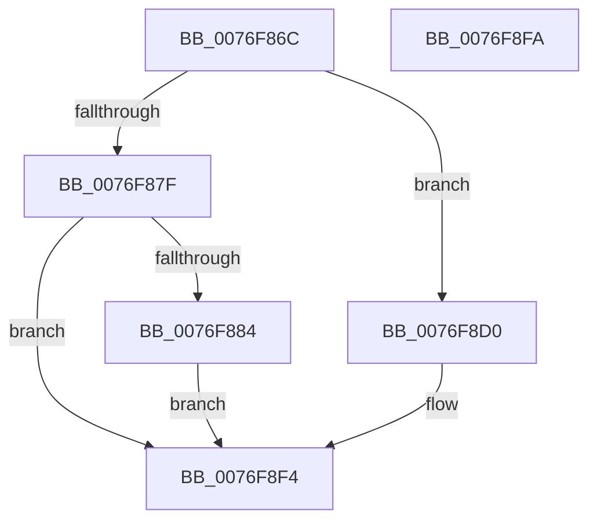

# PopAdaptiveStandbyUpdateRegions

- RVA: `0x0076F86C`–`0x0076F8FB` (길이 `143` bytes)
- VA: `0x000000014076F86C`
- 실행 섹션: `PAGE`
- PDB 이름 있음: `예`; PDB Function 태그: `아니요`
- unwind 정보 RVA: `0x0005CF00`
- 디코드: `38`개 명령, `143/143` bytes 표시
- 미해석 바이트: `0` (있으면 어셈블리에 `.byte`로 보존)

> 이 문서는 커널 이미지의 기계어와 PDB 기호를 분석해 생성했습니다. 4번과 5번은 함수 원형과 자료형을 바이너리 사용 방식에서 추정한 C 해석이며 원본 소스 복구 결과는 아닙니다.

## 1. Dependencies

- 직접 호출 지점: **1**; 고유 호출 대상: **1**
- 직접 호출자로 확인된 함수: **1**
- RIP 상대 이미지 참조: **12**

### Outgoing calls
- `0x0076F875` → [Feature_AdaptiveHibernateEnhancements__private_GetVariant](../../text/5D/Feature_AdaptiveHibernateEnhancements__private_GetVariant_function_005DC550.md) (function, `0x005DC550`)

### Direct callers
- [PopAdaptiveStandbyPowerSettingCallback](PopAdaptiveStandbyPowerSettingCallback_function_0076E530.md) at `0x0076E63E`

### Static image references
- `0x0076F887` → RVA `0x00E0C404` (`.data`; write)
- `0x0076F890` → RVA `0x00E0C400` (`.data`; write)
- `0x0076F899` → RVA `0x00E0C408` (`.data`; write)
- `0x0076F8A4` → RVA `0x00E0C40C` (`.data`; write)
- `0x0076F8AD` → RVA `0x00E0C418` (`.data`; write)
- `0x0076F8B6` → RVA `0x00E0C414` (`.data`; write)
- `0x0076F8BF` → RVA `0x00E0C41C` (`.data`; write)
- `0x0076F8C8` → RVA `0x00E0C420` (`.data`; write)
- `0x0076F8D3` → RVA `0x00E0C3F0` (`.data`; write)
- `0x0076F8DC` → RVA `0x00E0C3EC` (`.data`; write)
- `0x0076F8E5` → RVA `0x00E0C3F4` (`.data`; write)
- `0x0076F8EE` → RVA `0x00E0C3F8` (`.data`; write)

## 2. Other-region calls and transfers

- 다른 실행 섹션으로 향하는 call: **1**
  - `0x0076F875` → [Feature_AdaptiveHibernateEnhancements__private_GetVariant](../../text/5D/Feature_AdaptiveHibernateEnhancements__private_GetVariant_function_005DC550.md) (`PAGE` → `.text`)
- 별도 외부 분기/꼬리 이동을 확인하지 못했습니다.

## 3. Assembly (complete function range)

```asm
0076F86C  40 53                           push rbx
0076F86E  48 83 EC 20                     sub rsp, 0x20
0076F872  48 8B D9                        mov rbx, rcx
0076F875  E8 D6 CC E6 FF                  call 0x1405dc550
0076F87A  83 F8 06                        cmp eax, 6
0076F87D  74 51                           je 0x14076f8d0
0076F87F  83 F8 09                        cmp eax, 9
0076F882  75 70                           jne 0x14076f8f4
0076F884  8B 43 08                        mov eax, dword ptr [rbx + 8]
0076F887  89 05 77 CB 69 00               mov dword ptr [rip + 0x69cb77], eax
0076F88D  8B 43 04                        mov eax, dword ptr [rbx + 4]
0076F890  89 05 6A CB 69 00               mov dword ptr [rip + 0x69cb6a], eax
0076F896  8B 43 0C                        mov eax, dword ptr [rbx + 0xc]
0076F899  89 05 69 CB 69 00               mov dword ptr [rip + 0x69cb69], eax
0076F89F  8B 43 10                        mov eax, dword ptr [rbx + 0x10]
0076F8A2  D1 E8                           shr eax, 1
0076F8A4  89 05 62 CB 69 00               mov dword ptr [rip + 0x69cb62], eax
0076F8AA  8B 43 08                        mov eax, dword ptr [rbx + 8]
0076F8AD  89 05 65 CB 69 00               mov dword ptr [rip + 0x69cb65], eax
0076F8B3  8B 43 04                        mov eax, dword ptr [rbx + 4]
0076F8B6  89 05 58 CB 69 00               mov dword ptr [rip + 0x69cb58], eax
0076F8BC  8B 43 0C                        mov eax, dword ptr [rbx + 0xc]
0076F8BF  89 05 57 CB 69 00               mov dword ptr [rip + 0x69cb57], eax
0076F8C5  8B 43 10                        mov eax, dword ptr [rbx + 0x10]
0076F8C8  89 05 52 CB 69 00               mov dword ptr [rip + 0x69cb52], eax
0076F8CE  EB 24                           jmp 0x14076f8f4
0076F8D0  8B 43 08                        mov eax, dword ptr [rbx + 8]
0076F8D3  89 05 17 CB 69 00               mov dword ptr [rip + 0x69cb17], eax
0076F8D9  8B 43 04                        mov eax, dword ptr [rbx + 4]
0076F8DC  89 05 0A CB 69 00               mov dword ptr [rip + 0x69cb0a], eax
0076F8E2  8B 43 0C                        mov eax, dword ptr [rbx + 0xc]
0076F8E5  89 05 09 CB 69 00               mov dword ptr [rip + 0x69cb09], eax
0076F8EB  8B 43 10                        mov eax, dword ptr [rbx + 0x10]
0076F8EE  89 05 04 CB 69 00               mov dword ptr [rip + 0x69cb04], eax
0076F8F4  48 83 C4 20                     add rsp, 0x20
0076F8F8  5B                              pop rbx
0076F8F9  C3                              ret
0076F8FA  CC                              int3
```

## 4. C-style interpretation (structured pseudocode)

```c
__int64 __fastcall PopAdaptiveStandbyUpdateRegions(__int64 a1)
{
    __int64 result;
    __int64 v_rsp;

    v_rsp = (v_rsp) - (32);
    result = Feature_AdaptiveHibernateEnhancements__private_GetVariant(a1, a2, a3, a4);
    if (((unsigned int)(result)) == 6) goto loc_0076F8D0;
    if (((unsigned int)(result)) != 9) goto loc_0076F8F4;
    *(unsigned int *)(v_rip + 6933367) = (unsigned int)((unsigned int)(*(unsigned int *)(a1 + 8)));
    *(unsigned int *)(v_rip + 6933354) = (unsigned int)((unsigned int)(*(unsigned int *)(a1 + 4)));
    *(unsigned int *)(v_rip + 6933353) = (unsigned int)((unsigned int)(*(unsigned int *)(a1 + 12)));
    result = (unsigned int)(((unsigned int)(*(unsigned int *)(a1 + 16))) >> (1));
    *(unsigned int *)(v_rip + 6933346) = (unsigned int)(result);
    *(unsigned int *)(v_rip + 6933349) = (unsigned int)((unsigned int)(*(unsigned int *)(a1 + 8)));
    *(unsigned int *)(v_rip + 6933336) = (unsigned int)((unsigned int)(*(unsigned int *)(a1 + 4)));
    *(unsigned int *)(v_rip + 6933335) = (unsigned int)((unsigned int)(*(unsigned int *)(a1 + 12)));
    *(unsigned int *)(v_rip + 6933330) = (unsigned int)((unsigned int)(*(unsigned int *)(a1 + 16)));
    goto loc_0076F8F4;
loc_0076F8D0:
    *(unsigned int *)(v_rip + 6933271) = (unsigned int)((unsigned int)(*(unsigned int *)(a1 + 8)));
    *(unsigned int *)(v_rip + 6933258) = (unsigned int)((unsigned int)(*(unsigned int *)(a1 + 4)));
    *(unsigned int *)(v_rip + 6933257) = (unsigned int)((unsigned int)(*(unsigned int *)(a1 + 12)));
    *(unsigned int *)(v_rip + 6933252) = (unsigned int)((unsigned int)(*(unsigned int *)(a1 + 16)));
loc_0076F8F4:
    v_rsp = (v_rsp) + (32);
    return (unsigned int)(*(unsigned int *)(a1 + 16));
}
```

## 5. (Beta) C Style

```c
int64_t PopAdaptiveStandbyUpdateRegions(void *Arg1)
{
    uint8_t *arg1 = (uint8_t *)Arg1;

    int64_t result;
    int64_t local_rsp;

    local_rsp = (local_rsp) - (32);
    result = Feature_AdaptiveHibernateEnhancements__private_GetVariant(Arg1, a2, a3, a4);
    if (((uint32_t)(result)) == 6) goto loc_0076F8D0;
    if (((uint32_t)(result)) != 9) goto loc_0076F8F4;
    *(uint32_t *)(v_rip + 0x69CB77) = (uint32_t)((uint32_t)(*(uint32_t *)(arg1 + 0x8)));
    *(uint32_t *)(v_rip + 0x69CB6A) = (uint32_t)((uint32_t)(*(uint32_t *)(arg1 + 0x4)));
    *(uint32_t *)(v_rip + 0x69CB69) = (uint32_t)((uint32_t)(*(uint32_t *)(arg1 + 0xC)));
    result = (uint32_t)(((uint32_t)(*(uint32_t *)(arg1 + 0x10))) >> (1));
    *(uint32_t *)(v_rip + 0x69CB62) = (uint32_t)(result);
    *(uint32_t *)(v_rip + 0x69CB65) = (uint32_t)((uint32_t)(*(uint32_t *)(arg1 + 0x8)));
    *(uint32_t *)(v_rip + 0x69CB58) = (uint32_t)((uint32_t)(*(uint32_t *)(arg1 + 0x4)));
    *(uint32_t *)(v_rip + 0x69CB57) = (uint32_t)((uint32_t)(*(uint32_t *)(arg1 + 0xC)));
    *(uint32_t *)(v_rip + 0x69CB52) = (uint32_t)((uint32_t)(*(uint32_t *)(arg1 + 0x10)));
    goto loc_0076F8F4;
loc_0076F8D0:
    *(uint32_t *)(v_rip + 0x69CB17) = (uint32_t)((uint32_t)(*(uint32_t *)(arg1 + 0x8)));
    *(uint32_t *)(v_rip + 0x69CB0A) = (uint32_t)((uint32_t)(*(uint32_t *)(arg1 + 0x4)));
    *(uint32_t *)(v_rip + 0x69CB09) = (uint32_t)((uint32_t)(*(uint32_t *)(arg1 + 0xC)));
    *(uint32_t *)(v_rip + 0x69CB04) = (uint32_t)((uint32_t)(*(uint32_t *)(arg1 + 0x10)));
loc_0076F8F4:
    local_rsp = (local_rsp) + (32);
    return (uint32_t)(*(uint32_t *)(arg1 + 0x10));
}
```

### 관측된 메모리 오프셋

구조체 형식이 확인되지 않은 접근은 인자 기준의 오프셋으로만 기록했습니다.

| 기준 인자 | 오프셋 표현 | 폭 (bit) | 접근 |
|---|---:|---:|---|
| `Arg1` | `+ 0x4` | `32` | `R` |
| `Arg1` | `+ 0x8` | `32` | `R` |
| `Arg1` | `+ 0xC` | `32` | `R` |
| `Arg1` | `+ 0x10` | `32` | `R` |

## 6. Execution-region graph

[열기: 2D/3D 그래프와 함수 탐색 컨트롤 패널](../../../control-panel.html?section=page&rva=0x0076F86C&view=graph)

- 2D 그래프는 위에서 아래로 흐르고, 3D 그래프는 빈 공간을 드래그해 회전합니다. Shift+드래그는 이동, 휠은 확대·축소, 함수 노드 선택은 대상 보고서 이동입니다.

### Static fallback


