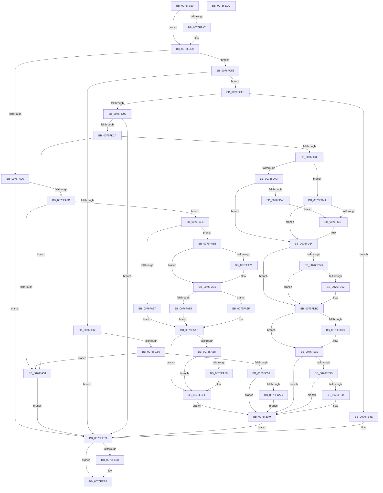

# PopAdaptiveStandbyWnfCallback

- RVA: `0x0076F910`–`0x0076FEDD` (길이 `1,485` bytes)
- VA: `0x000000014076F910`
- 실행 섹션: `PAGE`
- PDB 이름 있음: `예`; PDB Function 태그: `아니요`
- unwind 정보 RVA: `0x000CD424`
- 디코드: `328`개 명령, `1,485/1,485` bytes 표시
- 미해석 바이트: `0` (있으면 어셈블리에 `.byte`로 보존)

> 이 문서는 커널 이미지의 기계어와 PDB 기호를 분석해 생성했습니다. 4번과 5번은 함수 원형과 자료형을 바이너리 사용 방식에서 추정한 C 해석이며 원본 소스 복구 결과는 아닙니다.

## 1. Dependencies

- 직접 호출 지점: **23**; 고유 호출 대상: **12**
- 직접 호출자로 확인된 함수: **0**
- RIP 상대 이미지 참조: **37**

### Outgoing calls
- `0x0076F983` → [EtwActivityIdControl](../../text/41/EtwActivityIdControl_function_0041E720.md) (function, `0x0041E720`)
- `0x0076F98D` → [IoSetActivityIdThread](../../text/46/IoSetActivityIdThread_function_00466340.md) (function, `0x00466340`)
- `0x0076F9E4` → [tlgWriteTransfer_EtwWriteTransfer](../../text/42/tlgWriteTransfer_EtwWriteTransfer_function_004260E0.md) (function, `0x004260E0`)
- `0x0076F9F0` → [PopAcquireRwLockExclusive](../../text/43/PopAcquireRwLockExclusive_function_00430B44.md) (function, `0x00430B44`)
- `0x0076FA1E` → [ExQueryWnfStateData](../A4/ExQueryWnfStateData_function_00A4A480.md) (function, `0x00A4A480`)
- `0x0076FAAB` → [Feature_AdaptiveHibernateEnhancements__private_IsEnabledDeviceUsageNoInline](../../text/4F/Feature_AdaptiveHibernateEnhancements__private_IsEnabledDeviceUsageNoInline_function_004F78F0.md) (function, `0x004F78F0`)
- `0x0076FC0F` → [IoGetActivityIdThread](../../text/44/IoGetActivityIdThread_function_00445030.md) (function, `0x00445030`)
- `0x0076FC39` → [tlgWriteTransfer_EtwWriteTransfer](../../text/42/tlgWriteTransfer_EtwWriteTransfer_function_004260E0.md) (function, `0x004260E0`)
- `0x0076FC49` → [PopAdaptiveStandbyHandleBatteryUpdate](../6F/PopAdaptiveStandbyHandleBatteryUpdate_function_006FD39C.md) (function, `0x006FD39C`)
- `0x0076FC77` → [ExQueryWnfStateData](../A4/ExQueryWnfStateData_function_00A4A480.md) (function, `0x00A4A480`)
- `0x0076FCC1` → [IoGetActivityIdThread](../../text/44/IoGetActivityIdThread_function_00445030.md) (function, `0x00445030`)
- `0x0076FCEB` → [tlgWriteTransfer_EtwWriteTransfer](../../text/42/tlgWriteTransfer_EtwWriteTransfer_function_004260E0.md) (function, `0x004260E0`)
- `0x0076FD1B` → [ExQueryWnfStateData](../A4/ExQueryWnfStateData_function_00A4A480.md) (function, `0x00A4A480`)
- `0x0076FD4F` → [PopAdaptiveStandbyTraceSessionSettings](PopAdaptiveStandbyTraceSessionSettings_function_0076F428.md) (function, `0x0076F428`)
- `0x0076FD54` → [Feature_AdaptiveHibernateEnhancements__private_IsEnabledDeviceUsageNoInline](../../text/4F/Feature_AdaptiveHibernateEnhancements__private_IsEnabledDeviceUsageNoInline_function_004F78F0.md) (function, `0x004F78F0`)
- `0x0076FE03` → [IoGetActivityIdThread](../../text/44/IoGetActivityIdThread_function_00445030.md) (function, `0x00445030`)
- `0x0076FE2D` → [tlgWriteTransfer_EtwWriteTransfer](../../text/42/tlgWriteTransfer_EtwWriteTransfer_function_004260E0.md) (function, `0x004260E0`)
- `0x0076FE32` → [Feature_AdaptiveHibernateEnhancements__private_IsEnabledDeviceUsageNoInline](../../text/4F/Feature_AdaptiveHibernateEnhancements__private_IsEnabledDeviceUsageNoInline_function_004F78F0.md) (function, `0x004F78F0`)
- `0x0076FE44` → [PopAdaptiveStandbyTraceSessionSettings](PopAdaptiveStandbyTraceSessionSettings_function_0076F428.md) (function, `0x0076F428`)
- `0x0076FE5A` → [PopReleaseRwLock](../../text/2D/PopReleaseRwLock_function_002DFBBC.md) (function, `0x002DFBBC`)
- `0x0076FEA1` → [tlgWriteTransfer_EtwWriteTransfer](../../text/42/tlgWriteTransfer_EtwWriteTransfer_function_004260E0.md) (function, `0x004260E0`)
- `0x0076FEAA` → [IoClearActivityIdThread](../../text/46/IoClearActivityIdThread_function_0046BFF0.md) (function, `0x0046BFF0`)
- `0x0076FEBB` → [_security_check_cookie](../../text/6A/_security_check_cookie_function_006AC640.md) (function, `0x006AC640`)

### Direct callers
- 이 함수 시작 RVA로 연결되는 직접 call은 확인되지 않았습니다. 간접 호출은 완전히 역산할 수 없습니다.

### Static image references
- `0x0076F931` → RVA `0x00E0A740` (`.data`; read)
- `0x0076F992` → RVA `0x00E082E8` (`.data`; read)
- `0x0076F9C6` → RVA `0x0004F85D` (`.rdata`; read)
- `0x0076F9E9` → RVA `0x00F07E80` (`.data`; read)
- `0x0076F9F8` → RVA `0x00020980` (`.rdata`; read)
- `0x0076FABF` → RVA `0x00F07CC8` (`.data`; read)
- `0x0076FAC6` → RVA `0x00F07CD8` (`.data`; read)
- `0x0076FACC` → RVA `0x00F07CEC` (`.data`; write)
- `0x0076FAD2` → RVA `0x00F07CDC` (`.data`; read)
- `0x0076FAD9` → RVA `0x00F07CD8` (`.data`; write)
- `0x0076FB54` → RVA `0x00F07CE0` (`.data`; read)
- `0x0076FB6A` → RVA `0x00F07CE4` (`.data`; read)
- `0x0076FB80` → RVA `0x00F07CE8` (`.data`; read)
- `0x0076FBA2` → RVA `0x00F07D2C` (`.data`; read)
- `0x0076FC17` → RVA `0x0004F61F` (`.rdata`; read)
- `0x0076FC42` → RVA `0x00F07C40` (`.data`; read)
- `0x0076FC53` → RVA `0x000209C0` (`.rdata`; read)
- `0x0076FCA0` → RVA `0x00F07D04` (`.data`; write)
- `0x0076FCC9` → RVA `0x0004F765` (`.rdata`; read)
- `0x0076FCF5` → RVA `0x0001C1E0` (`.rdata`; read)
- `0x0076FD35` → RVA `0x00F07D38` (`.data`; read)
- `0x0076FD62` → RVA `0x00F07C44` (`.data`; read)
- `0x0076FD69` → RVA `0x00F07C64` (`.data`; read)
- `0x0076FD6F` → RVA `0x00F07C54` (`.data`; read)
- `0x0076FD76` → RVA `0x00F07D68` (`.data`; write)
- `0x0076FD7C` → RVA `0x00F07C98` (`.data`; read)
- `0x0076FD82` → RVA `0x00F07D48` (`.data`; read)
- `0x0076FD89` → RVA `0x00F07D8C` (`.data`; write)
- `0x0076FD8F` → RVA `0x00F07C78` (`.data`; read)
- `0x0076FD96` → RVA `0x00F07D58` (`.data`; read)
- `0x0076FD9D` → RVA `0x00F07C88` (`.data`; read)
- `0x0076FDA4` → RVA `0x00F07D6C` (`.data`; read)
- `0x0076FDAB` → RVA `0x00F07D7C` (`.data`; read)
- `0x0076FDBD` → RVA `0x00F07D30` (`.data`; write)
- `0x0076FDC4` → RVA `0x00F07D38` (`.data`; write)
- `0x0076FE0B` → RVA `0x0004F79E` (`.rdata`; read)
- `0x0076FE87` → RVA `0x0004F7F4` (`.rdata`; read)

## 2. Other-region calls and transfers

- 다른 실행 섹션으로 향하는 call: **17**
  - `0x0076F983` → [EtwActivityIdControl](../../text/41/EtwActivityIdControl_function_0041E720.md) (`PAGE` → `.text`)
  - `0x0076F98D` → [IoSetActivityIdThread](../../text/46/IoSetActivityIdThread_function_00466340.md) (`PAGE` → `.text`)
  - `0x0076F9E4` → [tlgWriteTransfer_EtwWriteTransfer](../../text/42/tlgWriteTransfer_EtwWriteTransfer_function_004260E0.md) (`PAGE` → `.text`)
  - `0x0076F9F0` → [PopAcquireRwLockExclusive](../../text/43/PopAcquireRwLockExclusive_function_00430B44.md) (`PAGE` → `.text`)
  - `0x0076FAAB` → [Feature_AdaptiveHibernateEnhancements__private_IsEnabledDeviceUsageNoInline](../../text/4F/Feature_AdaptiveHibernateEnhancements__private_IsEnabledDeviceUsageNoInline_function_004F78F0.md) (`PAGE` → `.text`)
  - `0x0076FC0F` → [IoGetActivityIdThread](../../text/44/IoGetActivityIdThread_function_00445030.md) (`PAGE` → `.text`)
  - `0x0076FC39` → [tlgWriteTransfer_EtwWriteTransfer](../../text/42/tlgWriteTransfer_EtwWriteTransfer_function_004260E0.md) (`PAGE` → `.text`)
  - `0x0076FCC1` → [IoGetActivityIdThread](../../text/44/IoGetActivityIdThread_function_00445030.md) (`PAGE` → `.text`)
  - `0x0076FCEB` → [tlgWriteTransfer_EtwWriteTransfer](../../text/42/tlgWriteTransfer_EtwWriteTransfer_function_004260E0.md) (`PAGE` → `.text`)
  - `0x0076FD54` → [Feature_AdaptiveHibernateEnhancements__private_IsEnabledDeviceUsageNoInline](../../text/4F/Feature_AdaptiveHibernateEnhancements__private_IsEnabledDeviceUsageNoInline_function_004F78F0.md) (`PAGE` → `.text`)
  - `0x0076FE03` → [IoGetActivityIdThread](../../text/44/IoGetActivityIdThread_function_00445030.md) (`PAGE` → `.text`)
  - `0x0076FE2D` → [tlgWriteTransfer_EtwWriteTransfer](../../text/42/tlgWriteTransfer_EtwWriteTransfer_function_004260E0.md) (`PAGE` → `.text`)
  - `0x0076FE32` → [Feature_AdaptiveHibernateEnhancements__private_IsEnabledDeviceUsageNoInline](../../text/4F/Feature_AdaptiveHibernateEnhancements__private_IsEnabledDeviceUsageNoInline_function_004F78F0.md) (`PAGE` → `.text`)
  - `0x0076FE5A` → [PopReleaseRwLock](../../text/2D/PopReleaseRwLock_function_002DFBBC.md) (`PAGE` → `.text`)
  - `0x0076FEA1` → [tlgWriteTransfer_EtwWriteTransfer](../../text/42/tlgWriteTransfer_EtwWriteTransfer_function_004260E0.md) (`PAGE` → `.text`)
  - `0x0076FEAA` → [IoClearActivityIdThread](../../text/46/IoClearActivityIdThread_function_0046BFF0.md) (`PAGE` → `.text`)
  - `0x0076FEBB` → [_security_check_cookie](../../text/6A/_security_check_cookie_function_006AC640.md) (`PAGE` → `.text`)
- 별도 외부 분기/꼬리 이동을 확인하지 못했습니다.

## 3. Assembly (complete function range)

```asm
0076F910  48 89 5C 24 10                  mov qword ptr [rsp + 0x10], rbx
0076F915  48 89 74 24 18                  mov qword ptr [rsp + 0x18], rsi
0076F91A  55                              push rbp
0076F91B  57                              push rdi
0076F91C  41 54                           push r12
0076F91E  41 56                           push r14
0076F920  41 57                           push r15
0076F922  48 8D AC 24 E0 FE FF FF         lea rbp, [rsp - 0x120]
0076F92A  48 81 EC 20 02 00 00            sub rsp, 0x220
0076F931  48 8B 05 08 AE 69 00            mov rax, qword ptr [rip + 0x69ae08]
0076F938  48 33 C4                        xor rax, rsp
0076F93B  48 89 85 10 01 00 00            mov qword ptr [rbp + 0x110], rax
0076F942  33 C0                           xor eax, eax
0076F944  0F 57 C9                        xorps xmm1, xmm1
0076F947  0F 57 C0                        xorps xmm0, xmm0
0076F94A  48 89 45 80                     mov qword ptr [rbp - 0x80], rax
0076F94E  48 8B DA                        mov rbx, rdx
0076F951  48 89 45 E0                     mov qword ptr [rbp - 0x20], rax
0076F955  48 8B F9                        mov rdi, rcx
0076F958  89 45 E8                        mov dword ptr [rbp - 0x18], eax
0076F95B  45 33 FF                        xor r15d, r15d
0076F95E  8D 48 03                        lea ecx, [rax + 3]
0076F961  48 8D 54 24 70                  lea rdx, [rsp + 0x70]
0076F966  4C 89 7C 24 48                  mov qword ptr [rsp + 0x48], r15
0076F96B  41 8B F1                        mov esi, r9d
0076F96E  0F 11 44 24 70                  movups xmmword ptr [rsp + 0x70], xmm0
0076F973  0F 11 45 A0                     movups xmmword ptr [rbp - 0x60], xmm0
0076F977  0F 11 4D B0                     movups xmmword ptr [rbp - 0x50], xmm1
0076F97B  0F 11 4D C0                     movups xmmword ptr [rbp - 0x40], xmm1
0076F97F  0F 11 4D D0                     movups xmmword ptr [rbp - 0x30], xmm1
0076F983  E8 98 ED CA FF                  call 0x14041e720
0076F988  48 8D 4C 24 70                  lea rcx, [rsp + 0x70]
0076F98D  E8 AE 69 CF FF                  call 0x140466340
0076F992  83 3D 4F 89 69 00 05            cmp dword ptr [rip + 0x69894f], 5
0076F999  45 8D 77 08                     lea r14d, [r15 + 8]
0076F99D  48 89 45 80                     mov qword ptr [rbp - 0x80], rax
0076F9A1  45 8D 67 04                     lea r12d, [r15 + 4]
0076F9A5  76 42                           jbe 0x14076f9e9
0076F9A7  48 8D 4C 24 40                  lea rcx, [rsp + 0x40]
0076F9AC  48 89 5D 10                     mov qword ptr [rbp + 0x10], rbx
0076F9B0  48 89 4D 20                     mov qword ptr [rbp + 0x20], rcx
0076F9B4  4C 8D 44 24 70                  lea r8, [rsp + 0x70]
0076F9B9  48 8D 4D F0                     lea rcx, [rbp - 0x10]
0076F9BD  4C 89 75 18                     mov qword ptr [rbp + 0x18], r14
0076F9C1  48 89 4C 24 28                  mov qword ptr [rsp + 0x28], rcx
0076F9C6  48 8D 15 90 FE 8D FF            lea rdx, [rip - 0x720170]
0076F9CD  48 8D 0D 14 89 69 00            lea rcx, [rip + 0x698914]
0076F9D4  89 74 24 40                     mov dword ptr [rsp + 0x40], esi
0076F9D8  4C 8B C8                        mov r9, rax
0076F9DB  4C 89 65 28                     mov qword ptr [rbp + 0x28], r12
0076F9DF  44 89 64 24 20                  mov dword ptr [rsp + 0x20], r12d
0076F9E4  E8 F7 66 CB FF                  call 0x1404260e0
0076F9E9  48 8D 0D 90 84 79 00            lea rcx, [rip + 0x798490]
0076F9F0  E8 4F 11 CC FF                  call 0x140430b44
0076F9F5  48 8B 03                        mov rax, qword ptr [rbx]
0076F9F8  48 3B 05 81 0F 8B FF            cmp rax, qword ptr [rip - 0x74f07f]
0076F9FF  0F 85 4E 02 00 00               jne 0x14076fc53
0076FA05  4C 8D 4C 24 34                  lea r9, [rsp + 0x34]
0076FA0A  C7 44 24 34 3C 00 00 00         mov dword ptr [rsp + 0x34], 0x3c
0076FA12  4C 8D 45 B0                     lea r8, [rbp - 0x50]
0076FA16  48 8B CF                        mov rcx, rdi
0076FA19  48 8D 54 24 40                  lea rdx, [rsp + 0x40]
0076FA1E  E8 5D AA 2D 00                  call 0x140a4a480
0076FA23  8B D8                           mov ebx, eax
0076FA25  85 C0                           test eax, eax
0076FA27  0F 88 26 04 00 00               js 0x14076fe53
0076FA2D  83 7C 24 34 3C                  cmp dword ptr [rsp + 0x34], 0x3c
0076FA32  74 0A                           je 0x14076fa3e
0076FA34  BB 23 00 00 C0                  mov ebx, 0xc0000023
0076FA39  E9 15 04 00 00                  jmp 0x14076fe53
0076FA3E  44 8B 75 E4                     mov r14d, dword ptr [rbp - 0x1c]
0076FA42  33 DB                           xor ebx, ebx
0076FA44  89 5D 98                        mov dword ptr [rbp - 0x68], ebx
0076FA47  0F 57 C0                        xorps xmm0, xmm0
0076FA4A  0F 11 45 88                     movups xmmword ptr [rbp - 0x78], xmm0
0076FA4E  44 89 75 8C                     mov dword ptr [rbp - 0x74], r14d
0076FA52  45 85 F6                        test r14d, r14d
0076FA55  75 14                           jne 0x14076fa6b
0076FA57  83 4D 88 01                     or dword ptr [rbp - 0x78], 1
0076FA5B  8D 4B 64                        lea ecx, [rbx + 0x64]
0076FA5E  83 CE FF                        or esi, 0xffffffff
0076FA61  89 4D 90                        mov dword ptr [rbp - 0x70], ecx
0076FA64  89 75 94                        mov dword ptr [rbp - 0x6c], esi
0076FA67  8B F9                           mov edi, ecx
0076FA69  EB 40                           jmp 0x14076faab
0076FA6B  F6 45 D4 01                     test byte ptr [rbp - 0x2c], 1
0076FA6F  74 04                           je 0x14076fa75
0076FA71  83 4D 88 01                     or dword ptr [rbp - 0x78], 1
0076FA75  8B 7D C0                        mov edi, dword ptr [rbp - 0x40]
0076FA78  8B 75 D8                        mov esi, dword ptr [rbp - 0x28]
0076FA7B  89 75 94                        mov dword ptr [rbp - 0x6c], esi
0076FA7E  89 7D 90                        mov dword ptr [rbp - 0x70], edi
0076FA81  85 FF                           test edi, edi
0076FA83  75 0A                           jne 0x14076fa8f
0076FA85  8D 4F 64                        lea ecx, [rdi + 0x64]
0076FA88  8B D9                           mov ebx, ecx
0076FA8A  89 4D 98                        mov dword ptr [rbp - 0x68], ecx
0076FA8D  EB 1C                           jmp 0x14076faab
0076FA8F  6B C6 64                        imul eax, esi, 0x64
0076FA92  33 D2                           xor edx, edx
0076FA94  8B CF                           mov ecx, edi
0076FA96  D1 E9                           shr ecx, 1
0076FA98  03 C1                           add eax, ecx
0076FA9A  B9 64 00 00 00                  mov ecx, 0x64
0076FA9F  F7 F7                           div edi
0076FAA1  3B C1                           cmp eax, ecx
0076FAA3  0F 4D C1                        cmovge eax, ecx
0076FAA6  8B D8                           mov ebx, eax
0076FAA8  89 45 98                        mov dword ptr [rbp - 0x68], eax
0076FAAB  E8 40 7E D8 FF                  call 0x1404f78f0
0076FAB0  85 C0                           test eax, eax
0076FAB2  0F 84 86 01 00 00               je 0x14076fc3e
0076FAB8  83 3D 29 88 69 00 05            cmp dword ptr [rip + 0x698829], 5
0076FABF  0F 10 05 02 82 79 00            movups xmm0, xmmword ptr [rip + 0x798202]
0076FAC6  8B 0D 0C 82 79 00               mov ecx, dword ptr [rip + 0x79820c]
0076FACC  89 0D 1A 82 79 00               mov dword ptr [rip + 0x79821a], ecx
0076FAD2  0F 11 05 03 82 79 00            movups xmmword ptr [rip + 0x798203], xmm0
0076FAD9  89 1D F9 81 79 00               mov dword ptr [rip + 0x7981f9], ebx
0076FADF  0F 10 45 88                     movups xmm0, xmmword ptr [rbp - 0x78]
0076FAE3  0F 11 05 DE 81 79 00            movups xmmword ptr [rip + 0x7981de], xmm0
0076FAEA  0F 86 4E 01 00 00               jbe 0x14076fc3e
0076FAF0  8A 45 88                        mov al, byte ptr [rbp - 0x78]
0076FAF3  24 01                           and al, 1
0076FAF5  48 C7 45 68 01 00 00 00         mov qword ptr [rbp + 0x68], 1
0076FAFD  88 44 24 38                     mov byte ptr [rsp + 0x38], al
0076FB01  48 8D 44 24 38                  lea rax, [rsp + 0x38]
0076FB06  48 89 45 60                     mov qword ptr [rbp + 0x60], rax
0076FB0A  48 8D 44 24 40                  lea rax, [rsp + 0x40]
0076FB0F  48 89 45 70                     mov qword ptr [rbp + 0x70], rax
0076FB13  48 8D 44 24 34                  lea rax, [rsp + 0x34]
0076FB18  48 89 85 80 00 00 00            mov qword ptr [rbp + 0x80], rax
0076FB1F  48 8D 44 24 54                  lea rax, [rsp + 0x54]
0076FB24  48 89 85 90 00 00 00            mov qword ptr [rbp + 0x90], rax
0076FB2B  48 8D 44 24 58                  lea rax, [rsp + 0x58]
0076FB30  48 89 85 A0 00 00 00            mov qword ptr [rbp + 0xa0], rax
0076FB37  8A 05 9F 81 79 00               mov al, byte ptr [rip + 0x79819f]
0076FB3D  24 01                           and al, 1
0076FB3F  44 89 74 24 40                  mov dword ptr [rsp + 0x40], r14d
0076FB44  88 44 24 30                     mov byte ptr [rsp + 0x30], al
0076FB48  48 8D 44 24 30                  lea rax, [rsp + 0x30]
0076FB4D  48 89 85 B0 00 00 00            mov qword ptr [rbp + 0xb0], rax
0076FB54  8B 05 86 81 79 00               mov eax, dword ptr [rip + 0x798186]
0076FB5A  89 44 24 5C                     mov dword ptr [rsp + 0x5c], eax
0076FB5E  48 8D 44 24 5C                  lea rax, [rsp + 0x5c]
0076FB63  48 89 85 C0 00 00 00            mov qword ptr [rbp + 0xc0], rax
0076FB6A  8B 05 74 81 79 00               mov eax, dword ptr [rip + 0x798174]
0076FB70  89 44 24 60                     mov dword ptr [rsp + 0x60], eax
0076FB74  48 8D 44 24 60                  lea rax, [rsp + 0x60]
0076FB79  48 89 85 D0 00 00 00            mov qword ptr [rbp + 0xd0], rax
0076FB80  8B 05 62 81 79 00               mov eax, dword ptr [rip + 0x798162]
0076FB86  89 44 24 68                     mov dword ptr [rsp + 0x68], eax
0076FB8A  48 8D 44 24 68                  lea rax, [rsp + 0x68]
0076FB8F  48 89 85 E0 00 00 00            mov qword ptr [rbp + 0xe0], rax
0076FB96  48 8D 44 24 50                  lea rax, [rsp + 0x50]
0076FB9B  48 89 85 F0 00 00 00            mov qword ptr [rbp + 0xf0], rax
0076FBA2  8B 05 84 81 79 00               mov eax, dword ptr [rip + 0x798184]
0076FBA8  89 44 24 48                     mov dword ptr [rsp + 0x48], eax
0076FBAC  48 8D 44 24 48                  lea rax, [rsp + 0x48]
0076FBB1  48 89 85 00 01 00 00            mov qword ptr [rbp + 0x100], rax
0076FBB8  4C 89 65 78                     mov qword ptr [rbp + 0x78], r12
0076FBBC  89 7C 24 34                     mov dword ptr [rsp + 0x34], edi
0076FBC0  4C 89 A5 88 00 00 00            mov qword ptr [rbp + 0x88], r12
0076FBC7  89 74 24 54                     mov dword ptr [rsp + 0x54], esi
0076FBCB  4C 89 A5 98 00 00 00            mov qword ptr [rbp + 0x98], r12
0076FBD2  89 5C 24 58                     mov dword ptr [rsp + 0x58], ebx
0076FBD6  4C 89 A5 A8 00 00 00            mov qword ptr [rbp + 0xa8], r12
0076FBDD  48 C7 85 B8 00 00 00 01 00 00 00  mov qword ptr [rbp + 0xb8], 1
0076FBE8  4C 89 A5 C8 00 00 00            mov qword ptr [rbp + 0xc8], r12
0076FBEF  4C 89 A5 D8 00 00 00            mov qword ptr [rbp + 0xd8], r12
0076FBF6  4C 89 A5 E8 00 00 00            mov qword ptr [rbp + 0xe8], r12
0076FBFD  89 4C 24 50                     mov dword ptr [rsp + 0x50], ecx
0076FC01  4C 89 A5 F8 00 00 00            mov qword ptr [rbp + 0xf8], r12
0076FC08  4C 89 A5 08 01 00 00            mov qword ptr [rbp + 0x108], r12
0076FC0F  E8 1C 54 CD FF                  call 0x140445030
0076FC14  4C 8B C0                        mov r8, rax
0076FC17  48 8D 15 01 FA 8D FF            lea rdx, [rip - 0x7205ff]
0076FC1E  48 8D 45 40                     lea rax, [rbp + 0x40]
0076FC22  45 33 C9                        xor r9d, r9d
0076FC25  48 89 44 24 28                  mov qword ptr [rsp + 0x28], rax
0076FC2A  48 8D 0D B7 86 69 00            lea rcx, [rip + 0x6986b7]
0076FC31  C7 44 24 20 0D 00 00 00         mov dword ptr [rsp + 0x20], 0xd
0076FC39  E8 A2 64 CB FF                  call 0x1404260e0
0076FC3E  48 8D 55 88                     lea rdx, [rbp - 0x78]
0076FC42  48 8D 0D F7 7F 79 00            lea rcx, [rip + 0x797ff7]
0076FC49  E8 4E D7 F8 FF                  call 0x1406fd39c
0076FC4E  E9 F6 01 00 00                  jmp 0x14076fe49
0076FC53  48 3B 05 66 0D 8B FF            cmp rax, qword ptr [rip - 0x74f29a]
0076FC5A  0F 85 95 00 00 00               jne 0x14076fcf5
0076FC60  4C 8D 4C 24 34                  lea r9, [rsp + 0x34]
0076FC65  44 89 74 24 34                  mov dword ptr [rsp + 0x34], r14d
0076FC6A  4C 8D 44 24 48                  lea r8, [rsp + 0x48]
0076FC6F  48 8B CF                        mov rcx, rdi
0076FC72  48 8D 54 24 40                  lea rdx, [rsp + 0x40]
0076FC77  E8 04 A8 2D 00                  call 0x140a4a480
0076FC7C  8B D8                           mov ebx, eax
0076FC7E  85 C0                           test eax, eax
0076FC80  0F 88 CD 01 00 00               js 0x14076fe53
0076FC86  44 39 74 24 34                  cmp dword ptr [rsp + 0x34], r14d
0076FC8B  0F 85 A3 FD FF FF               jne 0x14076fa34
0076FC91  8B 44 24 48                     mov eax, dword ptr [rsp + 0x48]
0076FC95  D1 E8                           shr eax, 1
0076FC97  24 01                           and al, 1
0076FC99  83 3D 48 86 69 00 05            cmp dword ptr [rip + 0x698648], 5
0076FCA0  88 05 5E 80 79 00               mov byte ptr [rip + 0x79805e], al
0076FCA6  0F 86 9D 01 00 00               jbe 0x14076fe49
0076FCAC  88 44 24 30                     mov byte ptr [rsp + 0x30], al
0076FCB0  48 8D 44 24 30                  lea rax, [rsp + 0x30]
0076FCB5  48 89 45 D0                     mov qword ptr [rbp - 0x30], rax
0076FCB9  48 C7 45 D8 01 00 00 00         mov qword ptr [rbp - 0x28], 1
0076FCC1  E8 6A 53 CD FF                  call 0x140445030
0076FCC6  4C 8B C0                        mov r8, rax
0076FCC9  48 8D 15 95 FA 8D FF            lea rdx, [rip - 0x72056b]
0076FCD0  48 8D 45 B0                     lea rax, [rbp - 0x50]
0076FCD4  45 33 C9                        xor r9d, r9d
0076FCD7  48 89 44 24 28                  mov qword ptr [rsp + 0x28], rax
0076FCDC  48 8D 0D 05 86 69 00            lea rcx, [rip + 0x698605]
0076FCE3  C7 44 24 20 03 00 00 00         mov dword ptr [rsp + 0x20], 3
0076FCEB  E8 F0 63 CB FF                  call 0x1404260e0
0076FCF0  E9 54 01 00 00                  jmp 0x14076fe49
0076FCF5  48 3B 05 E4 C4 8A FF            cmp rax, qword ptr [rip - 0x753b1c]
0076FCFC  0F 85 4C 01 00 00               jne 0x14076fe4e
0076FD02  4C 8D 4C 24 34                  lea r9, [rsp + 0x34]
0076FD07  C7 44 24 34 10 00 00 00         mov dword ptr [rsp + 0x34], 0x10
0076FD0F  4C 8D 45 A0                     lea r8, [rbp - 0x60]
0076FD13  48 8B CF                        mov rcx, rdi
0076FD16  48 8D 54 24 40                  lea rdx, [rsp + 0x40]
0076FD1B  E8 60 A7 2D 00                  call 0x140a4a480
0076FD20  8B D8                           mov ebx, eax
0076FD22  85 C0                           test eax, eax
0076FD24  0F 88 29 01 00 00               js 0x14076fe53
0076FD2A  83 7C 24 34 10                  cmp dword ptr [rsp + 0x34], 0x10
0076FD2F  0F 85 FF FC FF FF               jne 0x14076fa34
0076FD35  8B 05 FD 7F 79 00               mov eax, dword ptr [rip + 0x797ffd]
0076FD3B  8B 5D A8                        mov ebx, dword ptr [rbp - 0x58]
0076FD3E  83 F8 01                        cmp eax, 1
0076FD41  75 07                           jne 0x14076fd4a
0076FD43  83 FB 02                        cmp ebx, 2
0076FD46  74 0C                           je 0x14076fd54
0076FD48  EB 05                           jmp 0x14076fd4f
0076FD4A  83 F8 02                        cmp eax, 2
0076FD4D  75 05                           jne 0x14076fd54
0076FD4F  E8 D4 F6 FF FF                  call 0x14076f428
0076FD54  E8 97 7B D8 FF                  call 0x1404f78f0
0076FD59  85 C0                           test eax, eax
0076FD5B  75 55                           jne 0x14076fdb2
0076FD5D  83 FB 01                        cmp ebx, 1
0076FD60  75 50                           jne 0x14076fdb2
0076FD62  0F 10 05 DB 7E 79 00            movups xmm0, xmmword ptr [rip + 0x797edb]
0076FD69  8B 05 F5 7E 79 00               mov eax, dword ptr [rip + 0x797ef5]
0076FD6F  0F 10 0D DE 7E 79 00            movups xmm1, xmmword ptr [rip + 0x797ede]
0076FD76  89 05 EC 7F 79 00               mov dword ptr [rip + 0x797fec], eax
0076FD7C  8B 05 16 7F 79 00               mov eax, dword ptr [rip + 0x797f16]
0076FD82  0F 11 05 BF 7F 79 00            movups xmmword ptr [rip + 0x797fbf], xmm0
0076FD89  89 05 FD 7F 79 00               mov dword ptr [rip + 0x797ffd], eax
0076FD8F  0F 10 05 E2 7E 79 00            movups xmm0, xmmword ptr [rip + 0x797ee2]
0076FD96  0F 11 0D BB 7F 79 00            movups xmmword ptr [rip + 0x797fbb], xmm1
0076FD9D  0F 10 0D E4 7E 79 00            movups xmm1, xmmword ptr [rip + 0x797ee4]
0076FDA4  0F 11 05 C1 7F 79 00            movups xmmword ptr [rip + 0x797fc1], xmm0
0076FDAB  0F 11 0D CA 7F 79 00            movups xmmword ptr [rip + 0x797fca], xmm1
0076FDB2  83 3D 2F 85 69 00 05            cmp dword ptr [rip + 0x69852f], 5
0076FDB9  48 8B 45 A0                     mov rax, qword ptr [rbp - 0x60]
0076FDBD  48 89 05 6C 7F 79 00            mov qword ptr [rip + 0x797f6c], rax
0076FDC4  89 1D 6E 7F 79 00               mov dword ptr [rip + 0x797f6e], ebx
0076FDCA  76 66                           jbe 0x14076fe32
0076FDCC  48 89 44 24 68                  mov qword ptr [rsp + 0x68], rax
0076FDD1  48 8D 44 24 68                  lea rax, [rsp + 0x68]
0076FDD6  48 89 45 10                     mov qword ptr [rbp + 0x10], rax
0076FDDA  48 8D 44 24 48                  lea rax, [rsp + 0x48]
0076FDDF  48 89 45 20                     mov qword ptr [rbp + 0x20], rax
0076FDE3  8B 45 AC                        mov eax, dword ptr [rbp - 0x54]
0076FDE6  89 44 24 50                     mov dword ptr [rsp + 0x50], eax
0076FDEA  48 8D 44 24 50                  lea rax, [rsp + 0x50]
0076FDEF  48 89 45 30                     mov qword ptr [rbp + 0x30], rax
0076FDF3  4C 89 75 18                     mov qword ptr [rbp + 0x18], r14
0076FDF7  89 5C 24 48                     mov dword ptr [rsp + 0x48], ebx
0076FDFB  4C 89 65 28                     mov qword ptr [rbp + 0x28], r12
0076FDFF  4C 89 65 38                     mov qword ptr [rbp + 0x38], r12
0076FE03  E8 28 52 CD FF                  call 0x140445030
0076FE08  4C 8B C0                        mov r8, rax
0076FE0B  48 8D 15 8C F9 8D FF            lea rdx, [rip - 0x720674]
0076FE12  48 8D 45 F0                     lea rax, [rbp - 0x10]
0076FE16  45 33 C9                        xor r9d, r9d
0076FE19  48 89 44 24 28                  mov qword ptr [rsp + 0x28], rax
0076FE1E  48 8D 0D C3 84 69 00            lea rcx, [rip + 0x6984c3]
0076FE25  C7 44 24 20 05 00 00 00         mov dword ptr [rsp + 0x20], 5
0076FE2D  E8 AE 62 CB FF                  call 0x1404260e0
0076FE32  E8 B9 7A D8 FF                  call 0x1404f78f0
0076FE37  85 C0                           test eax, eax
0076FE39  75 0E                           jne 0x14076fe49
0076FE3B  83 3D F6 7E 79 00 01            cmp dword ptr [rip + 0x797ef6], 1
0076FE42  75 05                           jne 0x14076fe49
0076FE44  E8 DF F5 FF FF                  call 0x14076f428
0076FE49  41 8B DF                        mov ebx, r15d
0076FE4C  EB 05                           jmp 0x14076fe53
0076FE4E  BB 0D 00 00 C0                  mov ebx, 0xc000000d
0076FE53  48 8D 0D 26 80 79 00            lea rcx, [rip + 0x798026]
0076FE5A  E8 5D FD B6 FF                  call 0x1402dfbbc
0076FE5F  83 3D 82 84 69 00 05            cmp dword ptr [rip + 0x698482], 5
0076FE66  76 3E                           jbe 0x14076fea6
0076FE68  4C 8B 4D 80                     mov r9, qword ptr [rbp - 0x80]
0076FE6C  48 8D 44 24 48                  lea rax, [rsp + 0x48]
0076FE71  48 89 45 D0                     mov qword ptr [rbp - 0x30], rax
0076FE75  4C 8D 44 24 70                  lea r8, [rsp + 0x70]
0076FE7A  48 8D 45 B0                     lea rax, [rbp - 0x50]
0076FE7E  89 5C 24 48                     mov dword ptr [rsp + 0x48], ebx
0076FE82  48 89 44 24 28                  mov qword ptr [rsp + 0x28], rax
0076FE87  48 8D 15 66 F9 8D FF            lea rdx, [rip - 0x72069a]
0076FE8E  48 8D 0D 53 84 69 00            lea rcx, [rip + 0x698453]
0076FE95  C7 44 24 20 03 00 00 00         mov dword ptr [rsp + 0x20], 3
0076FE9D  4C 89 65 D8                     mov qword ptr [rbp - 0x28], r12
0076FEA1  E8 3A 62 CB FF                  call 0x1404260e0
0076FEA6  48 8B 4D 80                     mov rcx, qword ptr [rbp - 0x80]
0076FEAA  E8 41 C1 CF FF                  call 0x14046bff0
0076FEAF  8B C3                           mov eax, ebx
0076FEB1  48 8B 8D 10 01 00 00            mov rcx, qword ptr [rbp + 0x110]
0076FEB8  48 33 CC                        xor rcx, rsp
0076FEBB  E8 80 C7 F3 FF                  call 0x1406ac640
0076FEC0  4C 8D 9C 24 20 02 00 00         lea r11, [rsp + 0x220]
0076FEC8  49 8B 5B 38                     mov rbx, qword ptr [r11 + 0x38]
0076FECC  49 8B 73 40                     mov rsi, qword ptr [r11 + 0x40]
0076FED0  49 8B E3                        mov rsp, r11
0076FED3  41 5F                           pop r15
0076FED5  41 5E                           pop r14
0076FED7  41 5C                           pop r12
0076FED9  5F                              pop rdi
0076FEDA  5D                              pop rbp
0076FEDB  C3                              ret
0076FEDC  CC                              int3
```

## 4. C-style interpretation (structured pseudocode)

```c
__int64 __fastcall PopAdaptiveStandbyWnfCallback(__int64 a1, __int64 a2, __int64 a3, int a4)
{
    __int64 result;
    __int64 v_r15;
    __int64 v_rbx;
    __int64 v_rsi;
    __int64 v_rsp;
    unsigned __int64 v_stack_m108;
    unsigned __int64 v_stack_m110;
    unsigned __int64 v_stack_m118;
    unsigned __int64 v_stack_m120;
    unsigned __int64 v_stack_m128;
    unsigned __int64 v_stack_m130;
    unsigned __int64 v_stack_m138;
    unsigned __int64 v_stack_m148;
    unsigned __int64 v_stack_m158;
    unsigned int v_stack_m160;
    unsigned int v_stack_m164;
    unsigned __int64 v_stack_m168;
    unsigned int v_stack_m170;
    unsigned __int8 v_stack_m174;
    unsigned __int64 v_stack_m178;
    unsigned __int64 v_stack_m188;
    unsigned __int64 v_stack_m198;
    unsigned int v_stack_m19C;
    unsigned int v_stack_m1A0;
    unsigned __int64 v_stack_m1A8;
    unsigned int v_stack_m1B0;
    unsigned int v_stack_m1B4;
    unsigned int v_stack_m1B8;
    unsigned int v_stack_m1BC;
    unsigned __int64 v_stack_m1C0;
    unsigned __int64 v_stack_m1C8;
    unsigned __int64 v_stack_m1D8;
    unsigned int v_stack_m1E0;
    unsigned int v_stack_m1E8;
    unsigned int v_stack_m1EC;
    unsigned __int64 v_stack_m1F0;
    unsigned __int64 v_stack_m1F4;
    unsigned __int64 v_stack_m1F8;
    unsigned __int64 v_stack_m200;
    unsigned __int64 v_stack_m208;
    unsigned __int8 v_stack_m210;
    unsigned __int64 v_stack_m214;
    unsigned __int8 v_stack_m218;
    unsigned __int64 v_stack_m220;
    unsigned int v_stack_m228;
    unsigned __int64 v_stack_m28;
    unsigned __int64 v_stack_m38;
    unsigned __int64 v_stack_m40;
    unsigned __int64 v_stack_m48;
    unsigned __int64 v_stack_m50;
    unsigned __int64 v_stack_m58;
    unsigned __int64 v_stack_m60;
    unsigned __int64 v_stack_m68;
    unsigned __int64 v_stack_m70;
    unsigned __int64 v_stack_m78;
    unsigned __int64 v_stack_m80;
    unsigned __int64 v_stack_m88;
    unsigned __int64 v_stack_m90;
    unsigned __int64 v_stack_m98;
    unsigned __int64 v_stack_mA0;
    unsigned __int64 v_stack_mA8;
    unsigned __int64 v_stack_mB0;
    unsigned __int64 v_stack_mB8;
    unsigned __int64 v_stack_mC0;
    unsigned __int64 v_stack_mC8;
    unsigned __int64 v_stack_mD0;
    unsigned __int64 v_stack_mD8;
    unsigned __int64 v_stack_mE0;
    unsigned __int64 v_stack_mE8;
    unsigned __int64 v_stack_p10;
    unsigned __int64 v_stack_p18;

    v_stack_p10 = v_rbx;
    v_stack_p18 = v_rsi;
    v_rsp = (v_rsp) - (544);
    result = (*(unsigned __int64 *)(v_rip + 6925832)) ^ (v_rsp);
    v_stack_m38 = result;
    result = 0;
    v_stack_m1C8 = 0;
    v_stack_m168 = 0;
    v_stack_m160 = 0;
    v_r15 = 0;
    v_stack_m200 = 0;
    v_stack_m1D8 = v_xmm0;
    v_stack_m1A8 = v_xmm0;
    v_stack_m198 = v_xmm1;
    v_stack_m188 = v_xmm1;
    v_stack_m178 = v_xmm1;
    result = EtwActivityIdControl(result + 3, v_stack_m1D8, a3, a4);
    result = IoSetActivityIdThread(v_stack_m1D8, v_stack_m1D8, a3, a4);
    v_stack_m1C8 = result;
    if ((*(unsigned int *)(v_rip + 6916431)) >= = 5) {
        a1 = v_stack_m208;
        v_stack_m138 = a2;
        v_stack_m128 = a1;
        a3 = v_stack_m1D8;
        a1 = v_stack_m158;
        v_stack_m130 = v_r15 + 8;
        v_stack_m220 = a1;
        a2 = v_rip - 7471472;
        a1 = v_rip + 6916372;
        v_stack_m208 = (unsigned int)((unsigned int)(a4));
        a4 = result;
        v_stack_m120 = v_r15 + 4;
        v_stack_m228 = (unsigned int)(v_r15 + 4);
        result = tlgWriteTransfer_EtwWriteTransfer(a1, a2, a3, a4);
    }
    result = PopAcquireRwLockExclusive(v_rip + 7963792, a2, a3, a4);
    if ((*(unsigned __int64 *)(a2)) != (*(unsigned __int64 *)(v_rip - 7663743))) goto loc_0076FC53;
    v_stack_m214 = 60;
    result = ExQueryWnfStateData(a1, v_stack_m208, v_stack_m198, v_stack_m214);
    if (sign_flag) goto loc_0076FE53;
    if (v_stack_m214 == 60) goto loc_0076FA3E;
loc_0076FA34:
    goto loc_0076FE53;
loc_0076FA3E:
    v_rbx = 0;
    v_stack_m1B0 = 0;
    v_stack_m1C0 = v_xmm0;
    v_stack_m1BC = (unsigned int)((unsigned int)(v_stack_m164));
    if ((unsigned int)((unsigned int)(v_stack_m164)) != 0) goto loc_0076FA6B;
    v_rsi = (unsigned int)(((unsigned int)(a4)) | (0xFFFFFFFFULL));
    v_stack_m1B8 = (unsigned int)(v_rbx + 100);
    v_stack_m1B4 = (unsigned int)(v_rsi);
    goto loc_0076FAAB;
loc_0076FA6B:
    if (((v_stack_m174) & (1)) != 0) {
    }
    v_stack_m1B4 = (unsigned int)((unsigned int)(v_stack_m170));
    v_stack_m1B8 = (unsigned int)((unsigned int)(v_stack_m188));
    if ((unsigned int)((unsigned int)(v_stack_m188)) != 0) goto loc_0076FA8F;
    v_stack_m1B0 = (unsigned int)((unsigned int)(v_stack_m188) + 100);
    goto loc_0076FAAB;
loc_0076FA8F:
    result = (unsigned int)((result) * ((unsigned int)((unsigned int)(v_stack_m170))));
    a2 = 0;
    a1 = (unsigned int)(((unsigned int)((unsigned int)((unsigned int)(v_stack_m188)))) >> (1));
    result = (unsigned int)((result) + ((unsigned int)(a1)));
    if (((unsigned int)(result)) >= 100) { result = 100; }
    v_stack_m1B0 = (unsigned int)(result);
loc_0076FAAB:
    result = Feature_AdaptiveHibernateEnhancements__private_IsEnabledDeviceUsageNoInline(100, a2, v_stack_m198, v_stack_m214);
    if ((unsigned int)(result) == 0) goto loc_0076FC3E;
    *(unsigned int *)(v_rip + 7963162) = (unsigned int)((unsigned int)(*(unsigned int *)(v_rip + 7963148)));
    *(unsigned __int64 *)(v_rip + 7963139) = v_xmm0;
    *(unsigned int *)(v_rip + 7963129) = (unsigned int)((unsigned int)((unsigned int)(result)));
    *(unsigned __int64 *)(v_rip + 7963102) = v_xmm0;
    if ((*(unsigned int *)(v_rip + 6916137)) >= = 5) {
        result = v_stack_m1C0;
        result = (unsigned __int8)((result) & (1));
        v_stack_mE0 = 1;
        v_stack_m210 = (unsigned __int8)(result);
        result = v_stack_m210;
        v_stack_mE8 = result;
        result = v_stack_m208;
        v_stack_mD8 = result;
        result = v_stack_m214;
        v_stack_mC8 = result;
        result = v_stack_m1F4;
        v_stack_mB8 = result;
        result = v_stack_m1F0;
        v_stack_mA8 = result;
        result = *(unsigned __int8 *)(v_rip + 7963039);
        result = (unsigned __int8)((result) & (1));
        v_stack_m208 = (unsigned int)((unsigned int)(v_stack_m164));
        v_stack_m218 = (unsigned __int8)(result);
        result = v_stack_m218;
        v_stack_m98 = result;
        result = *(unsigned int *)(v_rip + 7963014);
        v_stack_m1EC = (unsigned int)(result);
        result = v_stack_m1EC;
        v_stack_m88 = result;
        result = *(unsigned int *)(v_rip + 7962996);
        v_stack_m1E8 = (unsigned int)(result);
        result = v_stack_m1E8;
        v_stack_m78 = result;
        result = *(unsigned int *)(v_rip + 7962978);
        v_stack_m1E0 = (unsigned int)(result);
        result = v_stack_m1E0;
        v_stack_m68 = result;
        result = v_stack_m1F8;
        v_stack_m58 = result;
        result = *(unsigned int *)(v_rip + 7963012);
        v_stack_m200 = (unsigned int)(result);
        result = v_stack_m200;
        v_stack_m48 = result;
        v_stack_mD0 = v_r15 + 4;
        v_stack_m214 = (unsigned int)((unsigned int)(v_stack_m188));
        v_stack_mC0 = v_r15 + 4;
        v_stack_m1F4 = (unsigned int)((unsigned int)(v_stack_m170));
        v_stack_mB0 = v_r15 + 4;
        v_stack_m1F0 = (unsigned int)((unsigned int)((unsigned int)(result)));
        v_stack_mA0 = v_r15 + 4;
        v_stack_m90 = 1;
        v_stack_m80 = v_r15 + 4;
        v_stack_m70 = v_r15 + 4;
        v_stack_m60 = v_r15 + 4;
        v_stack_m1F8 = (unsigned int)((unsigned int)(*(unsigned int *)(v_rip + 7963148)));
        v_stack_m50 = v_r15 + 4;
        v_stack_m40 = v_r15 + 4;
        result = IoGetActivityIdThread((unsigned int)(*(unsigned int *)(v_rip + 7963148)), a2, v_stack_m198, v_stack_m214);
        a3 = result;
        a2 = v_rip - 7472639;
        result = v_stack_m108;
        a4 = 0;
        v_stack_m220 = result;
        a1 = v_rip + 6915767;
        v_stack_m228 = 13;
        result = tlgWriteTransfer_EtwWriteTransfer(a1, a2, a3, a4);
    }
    result = PopAdaptiveStandbyHandleBatteryUpdate(v_rip + 7962615, v_stack_m1C0, a3, a4);
    goto loc_0076FE49;
loc_0076FC53:
    if (result != (*(unsigned __int64 *)(v_rip - 7664282))) goto loc_0076FCF5;
    v_stack_m214 = (unsigned int)((unsigned int)(v_stack_m164));
    result = ExQueryWnfStateData((unsigned int)(v_stack_m188), v_stack_m208, v_stack_m200, v_stack_m214);
    if (sign_flag) goto loc_0076FE53;
    if (v_stack_m214 != ((unsigned int)((unsigned int)(v_stack_m164)))) goto loc_0076FA34;
    result = (unsigned int)(((unsigned int)(v_stack_m200)) >> (1));
    result = (unsigned __int8)((result) & (1));
    *(unsigned __int8 *)(v_rip + 7962718) = (unsigned __int8)(result);
    if ((*(unsigned int *)(v_rip + 6915656)) <= 5) goto loc_0076FE49;
    v_stack_m218 = (unsigned __int8)(result);
    v_stack_m178 = v_stack_m218;
    v_stack_m170 = 1;
    result = IoGetActivityIdThread((unsigned int)(v_stack_m188), v_stack_m208, v_stack_m200, v_stack_m214);
    a4 = 0;
    v_stack_m220 = v_stack_m198;
    v_stack_m228 = 3;
    result = tlgWriteTransfer_EtwWriteTransfer(v_rip + 6915589, v_rip - 7472491, result, a4);
    goto loc_0076FE49;
loc_0076FCF5:
    if (result != (*(unsigned __int64 *)(v_rip - 7682844))) goto loc_0076FE4E;
    v_stack_m214 = 16;
    result = ExQueryWnfStateData((unsigned int)(v_stack_m188), v_stack_m208, v_stack_m1A8, v_stack_m214);
    if (sign_flag) goto loc_0076FE53;
    if (v_stack_m214 != 16) goto loc_0076FA34;
    if (((unsigned int)((unsigned int)(*(unsigned int *)(v_rip + 7962621)))) != 1) goto loc_0076FD4A;
    if (((unsigned int)((unsigned int)(v_stack_m1A0))) == 2) goto loc_0076FD54;
    goto loc_0076FD4F;
loc_0076FD4A:
    result = (unsigned int)(*(unsigned int *)(v_rip + 7962621));
    if (((unsigned int)((unsigned int)(*(unsigned int *)(v_rip + 7962621)))) == 2) {
        result = PopAdaptiveStandbyTraceSessionSettings((unsigned int)(v_stack_m188), v_stack_m208, v_stack_m1A8, v_stack_m214);
    }
    result = Feature_AdaptiveHibernateEnhancements__private_IsEnabledDeviceUsageNoInline((unsigned int)(v_stack_m188), v_stack_m208, v_stack_m1A8, v_stack_m214);
    if ((unsigned int)(result) != 0) goto loc_0076FDB2;
    if (((unsigned int)((unsigned int)(v_stack_m1A0))) == 1) {
        result = *(unsigned int *)(v_rip + 7962357);
        *(unsigned int *)(v_rip + 7962604) = (unsigned int)(result);
        result = *(unsigned int *)(v_rip + 7962390);
        *(unsigned __int64 *)(v_rip + 7962559) = v_xmm0;
        *(unsigned int *)(v_rip + 7962621) = (unsigned int)(result);
        *(unsigned __int64 *)(v_rip + 7962555) = v_xmm1;
        *(unsigned __int64 *)(v_rip + 7962561) = v_xmm0;
        *(unsigned __int64 *)(v_rip + 7962570) = v_xmm1;
    }
    *(unsigned __int64 *)(v_rip + 7962476) = v_stack_m1A8;
    *(unsigned int *)(v_rip + 7962478) = (unsigned int)((unsigned int)(v_stack_m1A0));
    result = v_stack_m1A8;
    if ((*(unsigned int *)(v_rip + 6915375)) >= = 5) {
        v_stack_m1E0 = v_stack_m1A8;
        result = v_stack_m1E0;
        v_stack_m138 = result;
        result = v_stack_m200;
        v_stack_m128 = result;
        result = v_stack_m19C;
        v_stack_m1F8 = (unsigned int)(result);
        result = v_stack_m1F8;
        v_stack_m118 = result;
        v_stack_m130 = (unsigned int)(v_stack_m164);
        v_stack_m200 = (unsigned int)((unsigned int)(v_stack_m1A0));
        v_stack_m120 = v_r15 + 4;
        v_stack_m110 = v_r15 + 4;
        result = IoGetActivityIdThread((unsigned int)(v_stack_m188), v_stack_m208, v_stack_m1A8, v_stack_m214);
        a3 = result;
        a2 = v_rip - 7472756;
        result = v_stack_m158;
        a4 = 0;
        v_stack_m220 = result;
        a1 = v_rip + 6915267;
        v_stack_m228 = 5;
        result = tlgWriteTransfer_EtwWriteTransfer(a1, a2, a3, a4);
    }
    result = Feature_AdaptiveHibernateEnhancements__private_IsEnabledDeviceUsageNoInline(a1, a2, a3, a4);
    if ((unsigned int)(result) != 0) goto loc_0076FE49;
    if ((*(unsigned int *)(v_rip + 7962358)) == 1) {
        result = PopAdaptiveStandbyTraceSessionSettings(a1, a2, a3, a4);
    }
    goto loc_0076FE53;
loc_0076FE4E:
loc_0076FE53:
    result = PopReleaseRwLock(v_rip + 7962662, a2, a3, a4);
    if ((*(unsigned int *)(v_rip + 6915202)) >= = 5) {
        a4 = v_stack_m1C8;
        result = v_stack_m200;
        v_stack_m178 = result;
        a3 = v_stack_m1D8;
        result = v_stack_m198;
        v_stack_m200 = (unsigned int)((unsigned int)(0xC000000DULL));
        v_stack_m220 = result;
        a2 = v_rip - 7472794;
        a1 = v_rip + 6915155;
        v_stack_m228 = 3;
        v_stack_m170 = v_r15 + 4;
        result = tlgWriteTransfer_EtwWriteTransfer(a1, a2, a3, a4);
    }
    result = IoClearActivityIdThread(v_stack_m1C8, a2, a3, a4);
    a1 = (v_stack_m38) ^ (v_rsp);
    result = _security_check_cookie(a1, a2, a3, a4);
    return result;
}
```

## 5. (Beta) C Style

```c
int64_t PopAdaptiveStandbyWnfCallback(int64_t Arg1, void *Arg2, int64_t Arg3, int32_t Arg4)
{
    uint8_t *arg2 = (uint8_t *)Arg2;

    int64_t result;
    int64_t local_r15;
    int64_t local_rbx;
    int64_t local_rsi;
    int64_t local_rsp;
    uint64_t v_stack_m108;
    uint64_t v_stack_m110;
    uint64_t v_stack_m118;
    uint64_t v_stack_m120;
    uint64_t v_stack_m128;
    uint64_t v_stack_m130;
    uint64_t v_stack_m138;
    uint64_t v_stack_m148;
    uint64_t v_stack_m158;
    uint32_t v_stack_m160;
    uint32_t v_stack_m164;
    uint64_t v_stack_m168;
    uint32_t v_stack_m170;
    uint8_t v_stack_m174;
    uint64_t v_stack_m178;
    uint64_t v_stack_m188;
    uint64_t v_stack_m198;
    uint32_t v_stack_m19C;
    uint32_t v_stack_m1A0;
    uint64_t v_stack_m1A8;
    uint32_t v_stack_m1B0;
    uint32_t v_stack_m1B4;
    uint32_t v_stack_m1B8;
    uint32_t v_stack_m1BC;
    uint64_t v_stack_m1C0;
    uint64_t v_stack_m1C8;
    uint64_t v_stack_m1D8;
    uint32_t v_stack_m1E0;
    uint32_t v_stack_m1E8;
    uint32_t v_stack_m1EC;
    uint64_t v_stack_m1F0;
    uint64_t v_stack_m1F4;
    uint64_t v_stack_m1F8;
    uint64_t v_stack_m200;
    uint64_t v_stack_m208;
    uint8_t v_stack_m210;
    uint64_t v_stack_m214;
    uint8_t v_stack_m218;
    uint64_t v_stack_m220;
    uint32_t v_stack_m228;
    uint64_t v_stack_m28;
    uint64_t v_stack_m38;
    uint64_t v_stack_m40;
    uint64_t v_stack_m48;
    uint64_t v_stack_m50;
    uint64_t v_stack_m58;
    uint64_t v_stack_m60;
    uint64_t v_stack_m68;
    uint64_t v_stack_m70;
    uint64_t v_stack_m78;
    uint64_t v_stack_m80;
    uint64_t v_stack_m88;
    uint64_t v_stack_m90;
    uint64_t v_stack_m98;
    uint64_t v_stack_mA0;
    uint64_t v_stack_mA8;
    uint64_t v_stack_mB0;
    uint64_t v_stack_mB8;
    uint64_t v_stack_mC0;
    uint64_t v_stack_mC8;
    uint64_t v_stack_mD0;
    uint64_t v_stack_mD8;
    uint64_t v_stack_mE0;
    uint64_t v_stack_mE8;
    uint64_t v_stack_p10;
    uint64_t v_stack_p18;

    v_stack_p10 = local_rbx;
    v_stack_p18 = local_rsi;
    local_rsp = (local_rsp) - (544);
    result = (*(uint64_t *)(v_rip + 0x69AE08)) ^ (local_rsp);
    v_stack_m38 = result;
    result = 0;
    v_stack_m1C8 = 0;
    v_stack_m168 = 0;
    v_stack_m160 = 0;
    local_r15 = 0;
    v_stack_m200 = 0;
    v_stack_m1D8 = v_xmm0;
    v_stack_m1A8 = v_xmm0;
    v_stack_m198 = v_xmm1;
    v_stack_m188 = v_xmm1;
    v_stack_m178 = v_xmm1;
    result = EtwActivityIdControl(result + 3, v_stack_m1D8, Arg3, Arg4);
    result = IoSetActivityIdThread(v_stack_m1D8, v_stack_m1D8, Arg3, Arg4);
    v_stack_m1C8 = result;
    if ((*(uint32_t *)(v_rip + 0x69894F)) >= = 5) {
        Arg1 = v_stack_m208;
        v_stack_m138 = Arg2;
        v_stack_m128 = Arg1;
        Arg3 = v_stack_m1D8;
        Arg1 = v_stack_m158;
        v_stack_m130 = local_r15 + 8;
        v_stack_m220 = Arg1;
        Arg2 = v_rip - 7471472;
        Arg1 = v_rip + 6916372;
        v_stack_m208 = (uint32_t)((uint32_t)(Arg4));
        Arg4 = result;
        v_stack_m120 = local_r15 + 4;
        v_stack_m228 = (uint32_t)(local_r15 + 4);
        result = tlgWriteTransfer_EtwWriteTransfer(Arg1, Arg2, Arg3, Arg4);
    }
    result = PopAcquireRwLockExclusive(v_rip + 7963792, Arg2, Arg3, Arg4);
    if ((*(uint64_t *)(arg2)) != (*(uint64_t *)(v_rip - 0x74F07F))) goto loc_0076FC53;
    v_stack_m214 = 60;
    result = ExQueryWnfStateData(Arg1, v_stack_m208, v_stack_m198, v_stack_m214);
    if (sign_flag) goto loc_0076FE53;
    if (v_stack_m214 == 60) goto loc_0076FA3E;
loc_0076FA34:
    goto loc_0076FE53;
loc_0076FA3E:
    local_rbx = 0;
    v_stack_m1B0 = 0;
    v_stack_m1C0 = v_xmm0;
    v_stack_m1BC = (uint32_t)((uint32_t)(v_stack_m164));
    if ((uint32_t)((uint32_t)(v_stack_m164)) != 0) goto loc_0076FA6B;
    local_rsi = (uint32_t)(((uint32_t)(Arg4)) | (0xFFFFFFFFULL));
    v_stack_m1B8 = (uint32_t)(local_rbx + 100);
    v_stack_m1B4 = (uint32_t)(local_rsi);
    goto loc_0076FAAB;
loc_0076FA6B:
    if (((v_stack_m174) & (1)) != 0) {
    }
    v_stack_m1B4 = (uint32_t)((uint32_t)(v_stack_m170));
    v_stack_m1B8 = (uint32_t)((uint32_t)(v_stack_m188));
    if ((uint32_t)((uint32_t)(v_stack_m188)) != 0) goto loc_0076FA8F;
    v_stack_m1B0 = (uint32_t)((uint32_t)(v_stack_m188) + 100);
    goto loc_0076FAAB;
loc_0076FA8F:
    result = (uint32_t)((result) * ((uint32_t)((uint32_t)(v_stack_m170))));
    Arg2 = 0;
    Arg1 = (uint32_t)(((uint32_t)((uint32_t)((uint32_t)(v_stack_m188)))) >> (1));
    result = (uint32_t)((result) + ((uint32_t)(Arg1)));
    if (((uint32_t)(result)) >= 100) { result = 100; }
    v_stack_m1B0 = (uint32_t)(result);
loc_0076FAAB:
    result = Feature_AdaptiveHibernateEnhancements__private_IsEnabledDeviceUsageNoInline(100, Arg2, v_stack_m198, v_stack_m214);
    if ((uint32_t)(result) == 0) goto loc_0076FC3E;
    *(uint32_t *)(v_rip + 0x79821A) = (uint32_t)((uint32_t)(*(uint32_t *)(v_rip + 0x79820C)));
    *(uint64_t *)(v_rip + 0x798203) = v_xmm0;
    *(uint32_t *)(v_rip + 0x7981F9) = (uint32_t)((uint32_t)((uint32_t)(result)));
    *(uint64_t *)(v_rip + 0x7981DE) = v_xmm0;
    if ((*(uint32_t *)(v_rip + 0x698829)) >= = 5) {
        result = v_stack_m1C0;
        result = (uint8_t)((result) & (1));
        v_stack_mE0 = 1;
        v_stack_m210 = (uint8_t)(result);
        result = v_stack_m210;
        v_stack_mE8 = result;
        result = v_stack_m208;
        v_stack_mD8 = result;
        result = v_stack_m214;
        v_stack_mC8 = result;
        result = v_stack_m1F4;
        v_stack_mB8 = result;
        result = v_stack_m1F0;
        v_stack_mA8 = result;
        result = *(uint8_t *)(v_rip + 0x79819F);
        result = (uint8_t)((result) & (1));
        v_stack_m208 = (uint32_t)((uint32_t)(v_stack_m164));
        v_stack_m218 = (uint8_t)(result);
        result = v_stack_m218;
        v_stack_m98 = result;
        result = *(uint32_t *)(v_rip + 0x798186);
        v_stack_m1EC = (uint32_t)(result);
        result = v_stack_m1EC;
        v_stack_m88 = result;
        result = *(uint32_t *)(v_rip + 0x798174);
        v_stack_m1E8 = (uint32_t)(result);
        result = v_stack_m1E8;
        v_stack_m78 = result;
        result = *(uint32_t *)(v_rip + 0x798162);
        v_stack_m1E0 = (uint32_t)(result);
        result = v_stack_m1E0;
        v_stack_m68 = result;
        result = v_stack_m1F8;
        v_stack_m58 = result;
        result = *(uint32_t *)(v_rip + 0x798184);
        v_stack_m200 = (uint32_t)(result);
        result = v_stack_m200;
        v_stack_m48 = result;
        v_stack_mD0 = local_r15 + 4;
        v_stack_m214 = (uint32_t)((uint32_t)(v_stack_m188));
        v_stack_mC0 = local_r15 + 4;
        v_stack_m1F4 = (uint32_t)((uint32_t)(v_stack_m170));
        v_stack_mB0 = local_r15 + 4;
        v_stack_m1F0 = (uint32_t)((uint32_t)((uint32_t)(result)));
        v_stack_mA0 = local_r15 + 4;
        v_stack_m90 = 1;
        v_stack_m80 = local_r15 + 4;
        v_stack_m70 = local_r15 + 4;
        v_stack_m60 = local_r15 + 4;
        v_stack_m1F8 = (uint32_t)((uint32_t)(*(uint32_t *)(v_rip + 0x79820C)));
        v_stack_m50 = local_r15 + 4;
        v_stack_m40 = local_r15 + 4;
        result = IoGetActivityIdThread((uint32_t)(*(uint32_t *)(v_rip + 0x79820C)), Arg2, v_stack_m198, v_stack_m214);
        Arg3 = result;
        Arg2 = v_rip - 7472639;
        result = v_stack_m108;
        Arg4 = 0;
        v_stack_m220 = result;
        Arg1 = v_rip + 6915767;
        v_stack_m228 = 13;
        result = tlgWriteTransfer_EtwWriteTransfer(Arg1, Arg2, Arg3, Arg4);
    }
    result = PopAdaptiveStandbyHandleBatteryUpdate(v_rip + 7962615, v_stack_m1C0, Arg3, Arg4);
    goto loc_0076FE49;
loc_0076FC53:
    if (result != (*(uint64_t *)(v_rip - 0x74F29A))) goto loc_0076FCF5;
    v_stack_m214 = (uint32_t)((uint32_t)(v_stack_m164));
    result = ExQueryWnfStateData((uint32_t)(v_stack_m188), v_stack_m208, v_stack_m200, v_stack_m214);
    if (sign_flag) goto loc_0076FE53;
    if (v_stack_m214 != ((uint32_t)((uint32_t)(v_stack_m164)))) goto loc_0076FA34;
    result = (uint32_t)(((uint32_t)(v_stack_m200)) >> (1));
    result = (uint8_t)((result) & (1));
    *(uint8_t *)(v_rip + 0x79805E) = (uint8_t)(result);
    if ((*(uint32_t *)(v_rip + 0x698648)) <= 5) goto loc_0076FE49;
    v_stack_m218 = (uint8_t)(result);
    v_stack_m178 = v_stack_m218;
    v_stack_m170 = 1;
    result = IoGetActivityIdThread((uint32_t)(v_stack_m188), v_stack_m208, v_stack_m200, v_stack_m214);
    Arg4 = 0;
    v_stack_m220 = v_stack_m198;
    v_stack_m228 = 3;
    result = tlgWriteTransfer_EtwWriteTransfer(v_rip + 6915589, v_rip - 7472491, result, Arg4);
    goto loc_0076FE49;
loc_0076FCF5:
    if (result != (*(uint64_t *)(v_rip - 0x753B1C))) goto loc_0076FE4E;
    v_stack_m214 = 16;
    result = ExQueryWnfStateData((uint32_t)(v_stack_m188), v_stack_m208, v_stack_m1A8, v_stack_m214);
    if (sign_flag) goto loc_0076FE53;
    if (v_stack_m214 != 16) goto loc_0076FA34;
    if (((uint32_t)((uint32_t)(*(uint32_t *)(v_rip + 0x797FFD)))) != 1) goto loc_0076FD4A;
    if (((uint32_t)((uint32_t)(v_stack_m1A0))) == 2) goto loc_0076FD54;
    goto loc_0076FD4F;
loc_0076FD4A:
    result = (uint32_t)(*(uint32_t *)(v_rip + 0x797FFD));
    if (((uint32_t)((uint32_t)(*(uint32_t *)(v_rip + 0x797FFD)))) == 2) {
        result = PopAdaptiveStandbyTraceSessionSettings((uint32_t)(v_stack_m188), v_stack_m208, v_stack_m1A8, v_stack_m214);
    }
    result = Feature_AdaptiveHibernateEnhancements__private_IsEnabledDeviceUsageNoInline((uint32_t)(v_stack_m188), v_stack_m208, v_stack_m1A8, v_stack_m214);
    if ((uint32_t)(result) != 0) goto loc_0076FDB2;
    if (((uint32_t)((uint32_t)(v_stack_m1A0))) == 1) {
        result = *(uint32_t *)(v_rip + 0x797EF5);
        *(uint32_t *)(v_rip + 0x797FEC) = (uint32_t)(result);
        result = *(uint32_t *)(v_rip + 0x797F16);
        *(uint64_t *)(v_rip + 0x797FBF) = v_xmm0;
        *(uint32_t *)(v_rip + 0x797FFD) = (uint32_t)(result);
        *(uint64_t *)(v_rip + 0x797FBB) = v_xmm1;
        *(uint64_t *)(v_rip + 0x797FC1) = v_xmm0;
        *(uint64_t *)(v_rip + 0x797FCA) = v_xmm1;
    }
    *(uint64_t *)(v_rip + 0x797F6C) = v_stack_m1A8;
    *(uint32_t *)(v_rip + 0x797F6E) = (uint32_t)((uint32_t)(v_stack_m1A0));
    result = v_stack_m1A8;
    if ((*(uint32_t *)(v_rip + 0x69852F)) >= = 5) {
        v_stack_m1E0 = v_stack_m1A8;
        result = v_stack_m1E0;
        v_stack_m138 = result;
        result = v_stack_m200;
        v_stack_m128 = result;
        result = v_stack_m19C;
        v_stack_m1F8 = (uint32_t)(result);
        result = v_stack_m1F8;
        v_stack_m118 = result;
        v_stack_m130 = (uint32_t)(v_stack_m164);
        v_stack_m200 = (uint32_t)((uint32_t)(v_stack_m1A0));
        v_stack_m120 = local_r15 + 4;
        v_stack_m110 = local_r15 + 4;
        result = IoGetActivityIdThread((uint32_t)(v_stack_m188), v_stack_m208, v_stack_m1A8, v_stack_m214);
        Arg3 = result;
        Arg2 = v_rip - 7472756;
        result = v_stack_m158;
        Arg4 = 0;
        v_stack_m220 = result;
        Arg1 = v_rip + 6915267;
        v_stack_m228 = 5;
        result = tlgWriteTransfer_EtwWriteTransfer(Arg1, Arg2, Arg3, Arg4);
    }
    result = Feature_AdaptiveHibernateEnhancements__private_IsEnabledDeviceUsageNoInline(Arg1, Arg2, Arg3, Arg4);
    if ((uint32_t)(result) != 0) goto loc_0076FE49;
    if ((*(uint32_t *)(v_rip + 0x797EF6)) == 1) {
        result = PopAdaptiveStandbyTraceSessionSettings(Arg1, Arg2, Arg3, Arg4);
    }
    goto loc_0076FE53;
loc_0076FE4E:
loc_0076FE53:
    result = PopReleaseRwLock(v_rip + 7962662, Arg2, Arg3, Arg4);
    if ((*(uint32_t *)(v_rip + 0x698482)) >= = 5) {
        Arg4 = v_stack_m1C8;
        result = v_stack_m200;
        v_stack_m178 = result;
        Arg3 = v_stack_m1D8;
        result = v_stack_m198;
        v_stack_m200 = (uint32_t)((uint32_t)(0xC000000DULL));
        v_stack_m220 = result;
        Arg2 = v_rip - 7472794;
        Arg1 = v_rip + 6915155;
        v_stack_m228 = 3;
        v_stack_m170 = local_r15 + 4;
        result = tlgWriteTransfer_EtwWriteTransfer(Arg1, Arg2, Arg3, Arg4);
    }
    result = IoClearActivityIdThread(v_stack_m1C8, Arg2, Arg3, Arg4);
    Arg1 = (v_stack_m38) ^ (local_rsp);
    result = _security_check_cookie(Arg1, Arg2, Arg3, Arg4);
    return result;
}
```

### 관측된 메모리 오프셋

구조체 형식이 확인되지 않은 접근은 인자 기준의 오프셋으로만 기록했습니다.

| 기준 인자 | 오프셋 표현 | 폭 (bit) | 접근 |
|---|---:|---:|---|
| `Arg2` | `+ 0x0` | `64` | `R` |

## 6. Execution-region graph

[열기: 2D/3D 그래프와 함수 탐색 컨트롤 패널](../../../control-panel.html?section=page&rva=0x0076F910&view=graph)

- 2D 그래프는 위에서 아래로 흐르고, 3D 그래프는 빈 공간을 드래그해 회전합니다. Shift+드래그는 이동, 휠은 확대·축소, 함수 노드 선택은 대상 보고서 이동입니다.

### Static fallback


