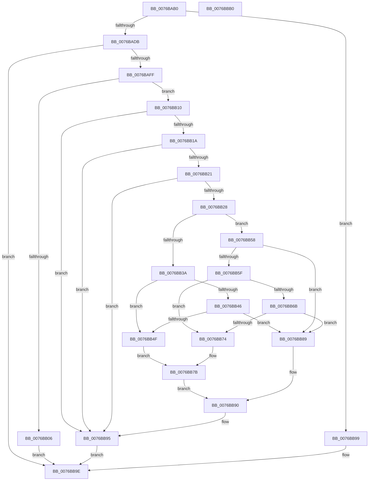

# PopAdaptiveWnfCallback

- RVA: `0x0076BAB0`–`0x0076BBB1` (길이 `257` bytes)
- VA: `0x000000014076BAB0`
- 실행 섹션: `PAGE`
- PDB 이름 있음: `예`; PDB Function 태그: `아니요`
- unwind 정보 RVA: `0x00060904`
- 디코드: `63`개 명령, `257/257` bytes 표시
- 미해석 바이트: `0` (있으면 어셈블리에 `.byte`로 보존)

> 이 문서는 커널 이미지의 기계어와 PDB 기호를 분석해 생성했습니다. 4번과 5번은 함수 원형과 자료형을 바이너리 사용 방식에서 추정한 C 해석이며 원본 소스 복구 결과는 아닙니다.

## 1. Dependencies

- 직접 호출 지점: **6**; 고유 호출 대상: **6**
- 직접 호출자로 확인된 함수: **0**
- RIP 상대 이미지 참조: **7**

### Outgoing calls
- `0x0076BAF2` → [ExQueryWnfStateData](../A4/ExQueryWnfStateData_function_00A4A480.md) (function, `0x00A4A480`)
- `0x0076BB2A` → [PopAcquireAdaptiveLock](../A3/PopAcquireAdaptiveLock_function_00A3B0E8.md) (function, `0x00A3B0E8`)
- `0x0076BB82` → [PopAdaptiveConsoleSessionOverrideTrigger](PopAdaptiveConsoleSessionOverrideTrigger_function_0076B664.md) (function, `0x0076B664`)
- `0x0076BB8B` → [PopAdaptiveConsoleSessionOverrideClear](PopAdaptiveConsoleSessionOverrideClear_function_0076B5EC.md) (function, `0x0076B5EC`)
- `0x0076BB90` → [PopReleaseAdaptiveLock](../91/PopReleaseAdaptiveLock_function_009137DC.md) (function, `0x009137DC`)
- `0x0076BBA6` → [_security_check_cookie](../../text/6A/_security_check_cookie_function_006AC640.md) (function, `0x006AC640`)

### Direct callers
- 이 함수 시작 RVA로 연결되는 직접 call은 확인되지 않았습니다. 간접 호출은 완전히 역산할 수 없습니다.

### Static image references
- `0x0076BAB4` → RVA `0x00E0A740` (`.data`; read)
- `0x0076BAC9` → RVA `0x00020970` (`.rdata`; read)
- `0x0076BB10` → RVA `0x00F08270` (`.data`; read)
- `0x0076BB3A` → RVA `0x00F081B8` (`.data`; read)
- `0x0076BB46` → RVA `0x00F081BC` (`.data`; read)
- `0x0076BB5F` → RVA `0x00F081B0` (`.data`; read)
- `0x0076BB6B` → RVA `0x00F081B4` (`.data`; read)

## 2. Other-region calls and transfers

- 다른 실행 섹션으로 향하는 call: **1**
  - `0x0076BBA6` → [_security_check_cookie](../../text/6A/_security_check_cookie_function_006AC640.md) (`PAGE` → `.text`)
- 별도 외부 분기/꼬리 이동을 확인하지 못했습니다.

## 3. Assembly (complete function range)

```asm
0076BAB0  48 83 EC 58                     sub rsp, 0x58
0076BAB4  48 8B 05 85 EC 69 00            mov rax, qword ptr [rip + 0x69ec85]
0076BABB  48 33 C4                        xor rax, rsp
0076BABE  48 89 44 24 40                  mov qword ptr [rsp + 0x40], rax
0076BAC3  48 8B 02                        mov rax, qword ptr [rdx]
0076BAC6  0F 57 C0                        xorps xmm0, xmm0
0076BAC9  48 3B 05 A0 4E 8B FF            cmp rax, qword ptr [rip - 0x74b160]
0076BAD0  0F 11 44 24 30                  movups xmmword ptr [rsp + 0x30], xmm0
0076BAD5  0F 85 BE 00 00 00               jne 0x14076bb99
0076BADB  4C 8D 4C 24 20                  lea r9, [rsp + 0x20]
0076BAE0  C7 44 24 20 10 00 00 00         mov dword ptr [rsp + 0x20], 0x10
0076BAE8  4C 8D 44 24 30                  lea r8, [rsp + 0x30]
0076BAED  48 8D 54 24 28                  lea rdx, [rsp + 0x28]
0076BAF2  E8 89 E9 2D 00                  call 0x140a4a480
0076BAF7  85 C0                           test eax, eax
0076BAF9  0F 88 9F 00 00 00               js 0x14076bb9e
0076BAFF  83 7C 24 20 10                  cmp dword ptr [rsp + 0x20], 0x10
0076BB04  73 0A                           jae 0x14076bb10
0076BB06  B8 0D 00 00 C0                  mov eax, 0xc000000d
0076BB0B  E9 8E 00 00 00                  jmp 0x14076bb9e
0076BB10  8A 05 5A C7 79 00               mov al, byte ptr [rip + 0x79c75a]
0076BB16  84 C0                           test al, al
0076BB18  74 7B                           je 0x14076bb95
0076BB1A  83 7C 24 38 00                  cmp dword ptr [rsp + 0x38], 0
0076BB1F  74 74                           je 0x14076bb95
0076BB21  83 7C 24 38 03                  cmp dword ptr [rsp + 0x38], 3
0076BB26  7D 6D                           jge 0x14076bb95
0076BB28  33 C9                           xor ecx, ecx
0076BB2A  E8 B9 F5 2C 00                  call 0x140a3b0e8
0076BB2F  BA 02 00 00 00                  mov edx, 2
0076BB34  39 54 24 38                     cmp dword ptr [rsp + 0x38], edx
0076BB38  75 1E                           jne 0x14076bb58
0076BB3A  44 8B 05 77 C6 79 00            mov r8d, dword ptr [rip + 0x79c677]
0076BB41  45 85 C0                        test r8d, r8d
0076BB44  75 09                           jne 0x14076bb4f
0076BB46  44 39 05 6F C6 79 00            cmp dword ptr [rip + 0x79c66f], r8d
0076BB4D  74 3A                           je 0x14076bb89
0076BB4F  44 8B 0D 66 C6 79 00            mov r9d, dword ptr [rip + 0x79c666]
0076BB56  EB 23                           jmp 0x14076bb7b
0076BB58  83 7C 24 38 01                  cmp dword ptr [rsp + 0x38], 1
0076BB5D  75 2A                           jne 0x14076bb89
0076BB5F  44 8B 05 4A C6 79 00            mov r8d, dword ptr [rip + 0x79c64a]
0076BB66  45 85 C0                        test r8d, r8d
0076BB69  75 09                           jne 0x14076bb74
0076BB6B  44 39 05 42 C6 79 00            cmp dword ptr [rip + 0x79c642], r8d
0076BB72  74 15                           je 0x14076bb89
0076BB74  44 8B 0D 39 C6 79 00            mov r9d, dword ptr [rip + 0x79c639]
0076BB7B  48 8B 4C 24 30                  mov rcx, qword ptr [rsp + 0x30]
0076BB80  33 D2                           xor edx, edx
0076BB82  E8 DD FA FF FF                  call 0x14076b664
0076BB87  EB 07                           jmp 0x14076bb90
0076BB89  33 C9                           xor ecx, ecx
0076BB8B  E8 5C FA FF FF                  call 0x14076b5ec
0076BB90  E8 47 7C 1A 00                  call 0x1409137dc
0076BB95  33 C0                           xor eax, eax
0076BB97  EB 05                           jmp 0x14076bb9e
0076BB99  B8 BB 00 00 C0                  mov eax, 0xc00000bb
0076BB9E  48 8B 4C 24 40                  mov rcx, qword ptr [rsp + 0x40]
0076BBA3  48 33 CC                        xor rcx, rsp
0076BBA6  E8 95 0A F4 FF                  call 0x1406ac640
0076BBAB  48 83 C4 58                     add rsp, 0x58
0076BBAF  C3                              ret
0076BBB0  CC                              int3
```

## 4. C-style interpretation (structured pseudocode)

```c
__int64 __fastcall PopAdaptiveWnfCallback(int a1, __int64 a2)
{
    __int64 result;
    __int64 v_rsp;
    unsigned __int64 v_stack_m18;
    unsigned int v_stack_m20;
    unsigned __int64 v_stack_m28;
    unsigned __int64 v_stack_m30;
    unsigned __int64 v_stack_m38;

    v_rsp = (v_rsp) - (88);
    result = (*(unsigned __int64 *)(v_rip + 6941829)) ^ (v_rsp);
    v_stack_m18 = result;
    v_stack_m28 = v_xmm0;
    if ((*(unsigned __int64 *)(a2)) != (*(unsigned __int64 *)(v_rip - 7647584))) goto loc_0076BB99;
    v_stack_m38 = 16;
    result = ExQueryWnfStateData(a1, v_stack_m30, v_stack_m28, v_stack_m38);
    if (sign_flag) goto loc_0076BB9E;
    if (v_stack_m38 >= 16) goto loc_0076BB10;
    goto loc_0076BB9E;
loc_0076BB10:
    if ((unsigned __int8)(*(unsigned __int8 *)(v_rip + 7980890)) == 0) goto loc_0076BB95;
    if (v_stack_m20 == 0) goto loc_0076BB95;
    if (v_stack_m20 >= 3) goto loc_0076BB95;
    a1 = 0;
    result = PopAcquireAdaptiveLock(a1, v_stack_m30, v_stack_m28, v_stack_m38);
    if (v_stack_m20 != 2) goto loc_0076BB58;
    if ((unsigned int)((unsigned int)(*(unsigned int *)(v_rip + 7980663))) != 0) goto loc_0076BB4F;
    if ((*(unsigned int *)(v_rip + 7980655)) == ((unsigned int)((unsigned int)(*(unsigned int *)(v_rip + 7980663))))) goto loc_0076BB89;
loc_0076BB4F:
    goto loc_0076BB7B;
loc_0076BB58:
    if (v_stack_m20 != 1) goto loc_0076BB89;
    if ((unsigned int)((unsigned int)(*(unsigned int *)(v_rip + 7980618))) != 0) goto loc_0076BB74;
    if ((*(unsigned int *)(v_rip + 7980610)) == ((unsigned int)((unsigned int)(*(unsigned int *)(v_rip + 7980618))))) goto loc_0076BB89;
loc_0076BB74:
loc_0076BB7B:
    a2 = 0;
    result = PopAdaptiveConsoleSessionOverrideTrigger(v_stack_m28, a2, (unsigned int)(*(unsigned int *)(v_rip + 7980618)), (unsigned int)(*(unsigned int *)(v_rip + 7980601)));
    goto loc_0076BB90;
loc_0076BB89:
    a1 = 0;
    result = PopAdaptiveConsoleSessionOverrideClear(a1, a2, (unsigned int)(*(unsigned int *)(v_rip + 7980618)), (unsigned int)(*(unsigned int *)(v_rip + 7980601)));
loc_0076BB90:
    result = PopReleaseAdaptiveLock(a1, a2, (unsigned int)(*(unsigned int *)(v_rip + 7980618)), (unsigned int)(*(unsigned int *)(v_rip + 7980601)));
loc_0076BB95:
    result = 0;
    goto loc_0076BB9E;
loc_0076BB99:
loc_0076BB9E:
    a1 = (v_stack_m18) ^ (v_rsp);
    result = _security_check_cookie(a1, a2, (unsigned int)(*(unsigned int *)(v_rip + 7980618)), (unsigned int)(*(unsigned int *)(v_rip + 7980601)));
    v_rsp = (v_rsp) + (88);
    return result;
}
```

## 5. (Beta) C Style

```c
int64_t PopAdaptiveWnfCallback(int32_t Arg1, void *Arg2)
{
    uint8_t *arg2 = (uint8_t *)Arg2;

    int64_t result;
    int64_t local_rsp;
    uint64_t v_stack_m18;
    uint32_t v_stack_m20;
    uint64_t v_stack_m28;
    uint64_t v_stack_m30;
    uint64_t v_stack_m38;

    local_rsp = (local_rsp) - (88);
    result = (*(uint64_t *)(v_rip + 0x69EC85)) ^ (local_rsp);
    v_stack_m18 = result;
    v_stack_m28 = v_xmm0;
    if ((*(uint64_t *)(arg2)) != (*(uint64_t *)(v_rip - 0x74B160))) goto loc_0076BB99;
    v_stack_m38 = 16;
    result = ExQueryWnfStateData(Arg1, v_stack_m30, v_stack_m28, v_stack_m38);
    if (sign_flag) goto loc_0076BB9E;
    if (v_stack_m38 >= 16) goto loc_0076BB10;
    goto loc_0076BB9E;
loc_0076BB10:
    if ((uint8_t)(*(uint8_t *)(v_rip + 0x79C75A)) == 0) goto loc_0076BB95;
    if (v_stack_m20 == 0) goto loc_0076BB95;
    if (v_stack_m20 >= 3) goto loc_0076BB95;
    Arg1 = 0;
    result = PopAcquireAdaptiveLock(Arg1, v_stack_m30, v_stack_m28, v_stack_m38);
    if (v_stack_m20 != 2) goto loc_0076BB58;
    if ((uint32_t)((uint32_t)(*(uint32_t *)(v_rip + 0x79C677))) != 0) goto loc_0076BB4F;
    if ((*(uint32_t *)(v_rip + 0x79C66F)) == ((uint32_t)((uint32_t)(*(uint32_t *)(v_rip + 0x79C677))))) goto loc_0076BB89;
loc_0076BB4F:
    goto loc_0076BB7B;
loc_0076BB58:
    if (v_stack_m20 != 1) goto loc_0076BB89;
    if ((uint32_t)((uint32_t)(*(uint32_t *)(v_rip + 0x79C64A))) != 0) goto loc_0076BB74;
    if ((*(uint32_t *)(v_rip + 0x79C642)) == ((uint32_t)((uint32_t)(*(uint32_t *)(v_rip + 0x79C64A))))) goto loc_0076BB89;
loc_0076BB74:
loc_0076BB7B:
    Arg2 = 0;
    result = PopAdaptiveConsoleSessionOverrideTrigger(v_stack_m28, Arg2, (uint32_t)(*(uint32_t *)(v_rip + 0x79C64A)), (uint32_t)(*(uint32_t *)(v_rip + 0x79C639)));
    goto loc_0076BB90;
loc_0076BB89:
    Arg1 = 0;
    result = PopAdaptiveConsoleSessionOverrideClear(Arg1, Arg2, (uint32_t)(*(uint32_t *)(v_rip + 0x79C64A)), (uint32_t)(*(uint32_t *)(v_rip + 0x79C639)));
loc_0076BB90:
    result = PopReleaseAdaptiveLock(Arg1, Arg2, (uint32_t)(*(uint32_t *)(v_rip + 0x79C64A)), (uint32_t)(*(uint32_t *)(v_rip + 0x79C639)));
loc_0076BB95:
    result = 0;
    goto loc_0076BB9E;
loc_0076BB99:
loc_0076BB9E:
    Arg1 = (v_stack_m18) ^ (local_rsp);
    result = _security_check_cookie(Arg1, Arg2, (uint32_t)(*(uint32_t *)(v_rip + 0x79C64A)), (uint32_t)(*(uint32_t *)(v_rip + 0x79C639)));
    local_rsp = (local_rsp) + (88);
    return result;
}
```

### 관측된 메모리 오프셋

구조체 형식이 확인되지 않은 접근은 인자 기준의 오프셋으로만 기록했습니다.

| 기준 인자 | 오프셋 표현 | 폭 (bit) | 접근 |
|---|---:|---:|---|
| `Arg2` | `+ 0x0` | `64` | `R` |

## 6. Execution-region graph

[열기: 2D/3D 그래프와 함수 탐색 컨트롤 패널](../../../control-panel.html?section=page&rva=0x0076BAB0&view=graph)

- 2D 그래프는 위에서 아래로 흐르고, 3D 그래프는 빈 공간을 드래그해 회전합니다. Shift+드래그는 이동, 휠은 확대·축소, 함수 노드 선택은 대상 보고서 이동입니다.

### Static fallback


