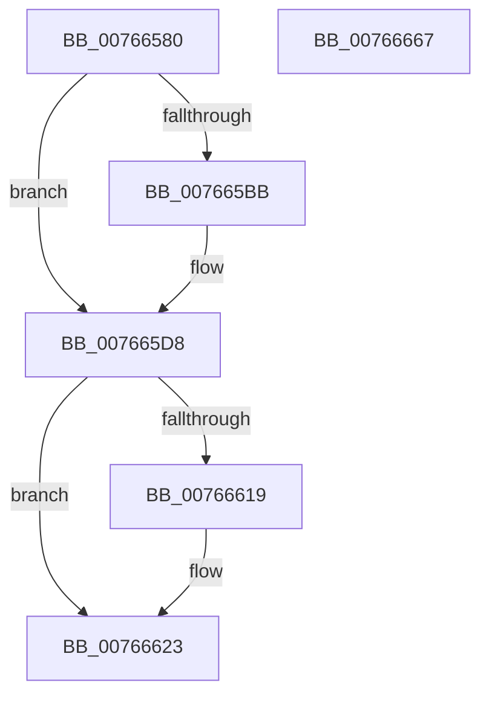

# PopBatteryAdd

- RVA: `0x00766580`–`0x00766668` (길이 `232` bytes)
- VA: `0x0000000140766580`
- 실행 섹션: `PAGE`
- PDB 이름 있음: `예`; PDB Function 태그: `아니요`
- unwind 정보 RVA: `0x000A5A24`
- 디코드: `53`개 명령, `232/232` bytes 표시
- 미해석 바이트: `0` (있으면 어셈블리에 `.byte`로 보존)

> 이 문서는 커널 이미지의 기계어와 PDB 기호를 분석해 생성했습니다. 4번과 5번은 함수 원형과 자료형을 바이너리 사용 방식에서 추정한 C 해석이며 원본 소스 복구 결과는 아닙니다.

## 1. Dependencies

- 직접 호출 지점: **12**; 고유 호출 대상: **12**
- 직접 호출자로 확인된 함수: **0**
- RIP 상대 이미지 참조: **6**

### Outgoing calls
- `0x007665A3` → [KeInitializeEvent](../../text/40/KeInitializeEvent_function_0040DD10.md) (function, `0x0040DD10`)
- `0x007665BB` → [PopAcquirePolicyLock](../../pagelk/B7/PopAcquirePolicyLock_function_00B783C0.md) (function, `0x00B783C0`)
- `0x007665C9` → [PopChangeCapability](../90/PopChangeCapability_function_0090FF48.md) (function, `0x0090FF48`)
- `0x007665CE` → [PopReleasePolicyLock](../../pagelk/B7/PopReleasePolicyLock_function_00B78410.md) (function, `0x00B78410`)
- `0x007665D3` → [PopCadNotifyBatteryPresence](PopCadNotifyBatteryPresence_function_0076FF78.md) (function, `0x0076FF78`)
- `0x00766603` → [PopPrepareIoctl](../A7/PopPrepareIoctl_function_00A74A98.md) (function, `0x00A74A98`)
- `0x00766610` → [IoSynchronousCallDriver](../../text/48/IoSynchronousCallDriver_function_00484050.md) (function, `0x00484050`)
- `0x0076662A` → [PopAcquireRwLockExclusive](../../text/43/PopAcquireRwLockExclusive_function_00430B44.md) (function, `0x00430B44`)
- `0x00766639` → [PopBatteryWaitTag](../AD/PopBatteryWaitTag_function_00AD2BF8.md) (function, `0x00AD2BF8`)
- `0x00766643` → [PopBatteryQueueWork](../../text/4A/PopBatteryQueueWork_function_004AE3DC.md) (function, `0x004AE3DC`)
- `0x0076664F` → [PopReleaseRwLock](../../text/2D/PopReleaseRwLock_function_002DFBBC.md) (function, `0x002DFBBC`)
- `0x0076665C` → [_security_check_cookie](../../text/6A/_security_check_cookie_function_006AC640.md) (function, `0x006AC640`)

### Direct callers
- 이 함수 시작 RVA로 연결되는 직접 call은 확인되지 않았습니다. 간접 호출은 완전히 역산할 수 없습니다.

### Static image references
- `0x00766586` → RVA `0x00E0A740` (`.data`; read)
- `0x007665A8` → RVA `0x00F0C030` (`.data`; read)
- `0x007665B0` → RVA `0x00F0C030` (`.data`; write)
- `0x007665C2` → RVA `0x00F0CEDE` (`.data`; read)
- `0x00766623` → RVA `0x00F0C020` (`.data`; read)
- `0x00766632` → RVA `0x00F0C038` (`.data`; write)

## 2. Other-region calls and transfers

- 다른 실행 섹션으로 향하는 call: **8**
  - `0x007665A3` → [KeInitializeEvent](../../text/40/KeInitializeEvent_function_0040DD10.md) (`PAGE` → `.text`)
  - `0x007665BB` → [PopAcquirePolicyLock](../../pagelk/B7/PopAcquirePolicyLock_function_00B783C0.md) (`PAGE` → `PAGELK`)
  - `0x007665CE` → [PopReleasePolicyLock](../../pagelk/B7/PopReleasePolicyLock_function_00B78410.md) (`PAGE` → `PAGELK`)
  - `0x00766610` → [IoSynchronousCallDriver](../../text/48/IoSynchronousCallDriver_function_00484050.md) (`PAGE` → `.text`)
  - `0x0076662A` → [PopAcquireRwLockExclusive](../../text/43/PopAcquireRwLockExclusive_function_00430B44.md) (`PAGE` → `.text`)
  - `0x00766643` → [PopBatteryQueueWork](../../text/4A/PopBatteryQueueWork_function_004AE3DC.md) (`PAGE` → `.text`)
  - `0x0076664F` → [PopReleaseRwLock](../../text/2D/PopReleaseRwLock_function_002DFBBC.md) (`PAGE` → `.text`)
  - `0x0076665C` → [_security_check_cookie](../../text/6A/_security_check_cookie_function_006AC640.md) (`PAGE` → `.text`)
- 별도 외부 분기/꼬리 이동을 확인하지 못했습니다.

## 3. Assembly (complete function range)

```asm
00766580  40 53                           push rbx
00766582  48 83 EC 40                     sub rsp, 0x40
00766586  48 8B 05 B3 41 6A 00            mov rax, qword ptr [rip + 0x6a41b3]
0076658D  48 33 C4                        xor rax, rsp
00766590  48 89 44 24 38                  mov qword ptr [rsp + 0x38], rax
00766595  45 33 C0                        xor r8d, r8d
00766598  48 8B D9                        mov rbx, rcx
0076659B  48 83 C1 50                     add rcx, 0x50
0076659F  41 8D 50 01                     lea edx, [r8 + 1]
007665A3  E8 68 77 CA FF                  call 0x14040dd10
007665A8  8B 05 82 5A 7A 00               mov eax, dword ptr [rip + 0x7a5a82]
007665AE  FF C0                           inc eax
007665B0  89 05 7A 5A 7A 00               mov dword ptr [rip + 0x7a5a7a], eax
007665B6  83 F8 01                        cmp eax, 1
007665B9  75 1D                           jne 0x1407665d8
007665BB  E8 00 1E 41 00                  call 0x140b783c0
007665C0  B2 01                           mov dl, 1
007665C2  48 8D 0D 15 69 7A 00            lea rcx, [rip + 0x7a6915]
007665C9  E8 7A 99 1A 00                  call 0x14090ff48
007665CE  E8 3D 1E 41 00                  call 0x140b78410
007665D3  E8 A0 99 00 00                  call 0x14076ff78
007665D8  48 8B 4B 38                     mov rcx, qword ptr [rbx + 0x38]
007665DC  4C 8D 4C 24 30                  lea r9, [rsp + 0x30]
007665E1  83 A3 18 01 00 00 00            and dword ptr [rbx + 0x118], 0
007665E8  45 33 C0                        xor r8d, r8d
007665EB  48 83 64 24 30 00               and qword ptr [rsp + 0x30], 0
007665F1  BA 68 40 29 00                  mov edx, 0x294068
007665F6  C7 44 24 28 08 00 00 00         mov dword ptr [rsp + 0x28], 8
007665FE  83 64 24 20 00                  and dword ptr [rsp + 0x20], 0
00766603  E8 90 E4 30 00                  call 0x140a74a98
00766608  48 8B 53 38                     mov rdx, qword ptr [rbx + 0x38]
0076660C  48 8B 4B 30                     mov rcx, qword ptr [rbx + 0x30]
00766610  E8 3B DA D1 FF                  call 0x140484050
00766615  85 C0                           test eax, eax
00766617  78 0A                           js 0x140766623
00766619  8B 44 24 34                     mov eax, dword ptr [rsp + 0x34]
0076661D  89 83 18 01 00 00               mov dword ptr [rbx + 0x118], eax
00766623  48 8D 0D F6 59 7A 00            lea rcx, [rip + 0x7a59f6]
0076662A  E8 15 A5 CC FF                  call 0x140430b44
0076662F  48 8B CB                        mov rcx, rbx
00766632  C6 05 FF 59 7A 00 01            mov byte ptr [rip + 0x7a59ff], 1
00766639  E8 BA C5 36 00                  call 0x140ad2bf8
0076663E  B9 08 00 00 00                  mov ecx, 8
00766643  E8 94 7D D4 FF                  call 0x1404ae3dc
00766648  48 8D 0D D1 59 7A 00            lea rcx, [rip + 0x7a59d1]
0076664F  E8 68 95 B7 FF                  call 0x1402dfbbc
00766654  48 8B 4C 24 38                  mov rcx, qword ptr [rsp + 0x38]
00766659  48 33 CC                        xor rcx, rsp
0076665C  E8 DF 5F F4 FF                  call 0x1406ac640
00766661  48 83 C4 40                     add rsp, 0x40
00766665  5B                              pop rbx
00766666  C3                              ret
00766667  CC                              int3
```

## 4. C-style interpretation (structured pseudocode)

```c
__int64 __fastcall PopBatteryAdd(__int64 a1, __int64 a2, int a3)
{
    __int64 result;
    __int64 v_rsp;
    unsigned __int64 v_stack_m10;
    unsigned int v_stack_m14;
    unsigned __int64 v_stack_m18;
    unsigned int v_stack_m20;
    unsigned int v_stack_m28;

    v_rsp = (v_rsp) - (64);
    result = (*(unsigned __int64 *)(v_rip + 6963635)) ^ (v_rsp);
    v_stack_m10 = result;
    a3 = 0;
    a1 = (a1) + (80);
    result = KeInitializeEvent(a1, a3 + 1, a3, a4);
    result = (unsigned int)(((unsigned int)(*(unsigned int *)(v_rip + 8018562))) + 1);
    *(unsigned int *)(v_rip + 8018554) = (unsigned int)(result);
    if (((unsigned int)(result)) == 1) {
        result = PopAcquirePolicyLock(a1, a3 + 1, a3, a4);
        a2 = 1;
        a1 = v_rip + 8022293;
        result = PopChangeCapability(a1, a2, a3, a4);
        result = PopReleasePolicyLock(a1, a2, a3, a4);
        result = PopCadNotifyBatteryPresence(a1, a2, a3, a4);
    }
    a3 = 0;
    v_stack_m20 = 8;
    result = PopPrepareIoctl(*(unsigned __int64 *)(a1 + 56), (unsigned int)(0x294068ULL), a3, v_stack_m18);
    result = IoSynchronousCallDriver(*(unsigned __int64 *)(a1 + 48), *(unsigned __int64 *)(a1 + 56), a3, v_stack_m18);
    if (!(sign_flag)) {
        result = v_stack_m14;
        *(unsigned int *)(a1 + 280) = (unsigned int)(result);
    }
    result = PopAcquireRwLockExclusive(v_rip + 8018422, *(unsigned __int64 *)(a1 + 56), a3, v_stack_m18);
    *(unsigned __int8 *)(v_rip + 8018431) = 1;
    result = PopBatteryWaitTag(a1, *(unsigned __int64 *)(a1 + 56), a3, v_stack_m18);
    result = PopBatteryQueueWork(8, *(unsigned __int64 *)(a1 + 56), a3, v_stack_m18);
    result = PopReleaseRwLock(v_rip + 8018385, *(unsigned __int64 *)(a1 + 56), a3, v_stack_m18);
    a1 = (v_stack_m10) ^ (v_rsp);
    result = _security_check_cookie(a1, *(unsigned __int64 *)(a1 + 56), a3, v_stack_m18);
    v_rsp = (v_rsp) + (64);
    return result;
}
```

## 5. (Beta) C Style

```c
int64_t PopBatteryAdd(void *Arg1, int64_t Arg2, int32_t Arg3)
{
    uint8_t *arg1 = (uint8_t *)Arg1;

    int64_t result;
    int64_t local_rsp;
    uint64_t v_stack_m10;
    uint32_t v_stack_m14;
    uint64_t v_stack_m18;
    uint32_t v_stack_m20;
    uint32_t v_stack_m28;

    local_rsp = (local_rsp) - (64);
    result = (*(uint64_t *)(v_rip + 0x6A41B3)) ^ (local_rsp);
    v_stack_m10 = result;
    Arg3 = 0;
    Arg1 = (Arg1) + (80);
    result = KeInitializeEvent(Arg1, Arg3 + 1, Arg3, a4);
    result = (uint32_t)(((uint32_t)(*(uint32_t *)(v_rip + 0x7A5A82))) + 1);
    *(uint32_t *)(v_rip + 0x7A5A7A) = (uint32_t)(result);
    if (((uint32_t)(result)) == 1) {
        result = PopAcquirePolicyLock(Arg1, Arg3 + 1, Arg3, a4);
        Arg2 = 1;
        Arg1 = v_rip + 8022293;
        result = PopChangeCapability(Arg1, Arg2, Arg3, a4);
        result = PopReleasePolicyLock(Arg1, Arg2, Arg3, a4);
        result = PopCadNotifyBatteryPresence(Arg1, Arg2, Arg3, a4);
    }
    Arg3 = 0;
    v_stack_m20 = 8;
    result = PopPrepareIoctl(*(uint64_t *)(arg1 + 0x38), (uint32_t)(0x294068ULL), Arg3, v_stack_m18);
    result = IoSynchronousCallDriver(*(uint64_t *)(arg1 + 0x30), *(uint64_t *)(arg1 + 0x38), Arg3, v_stack_m18);
    if (!(sign_flag)) {
        result = v_stack_m14;
        *(uint32_t *)(arg1 + 0x118) = (uint32_t)(result);
    }
    result = PopAcquireRwLockExclusive(v_rip + 8018422, *(uint64_t *)(arg1 + 0x38), Arg3, v_stack_m18);
    *(uint8_t *)(v_rip + 0x7A59FF) = 1;
    result = PopBatteryWaitTag(Arg1, *(uint64_t *)(arg1 + 0x38), Arg3, v_stack_m18);
    result = PopBatteryQueueWork(8, *(uint64_t *)(arg1 + 0x38), Arg3, v_stack_m18);
    result = PopReleaseRwLock(v_rip + 8018385, *(uint64_t *)(arg1 + 0x38), Arg3, v_stack_m18);
    Arg1 = (v_stack_m10) ^ (local_rsp);
    result = _security_check_cookie(Arg1, *(uint64_t *)(arg1 + 0x38), Arg3, v_stack_m18);
    local_rsp = (local_rsp) + (64);
    return result;
}
```

### 관측된 메모리 오프셋

구조체 형식이 확인되지 않은 접근은 인자 기준의 오프셋으로만 기록했습니다.

| 기준 인자 | 오프셋 표현 | 폭 (bit) | 접근 |
|---|---:|---:|---|
| `Arg1` | `+ 0x30` | `64` | `R` |
| `Arg1` | `+ 0x38` | `64` | `R` |
| `Arg1` | `+ 0x118` | `32` | `R/W` |
| `Arg1` | `+ 0x118` | `32` | `W` |

## 6. Execution-region graph

[열기: 2D/3D 그래프와 함수 탐색 컨트롤 패널](../../../control-panel.html?section=page&rva=0x00766580&view=graph)

- 2D 그래프는 위에서 아래로 흐르고, 3D 그래프는 빈 공간을 드래그해 회전합니다. Shift+드래그는 이동, 휠은 확대·축소, 함수 노드 선택은 대상 보고서 이동입니다.

### Static fallback


