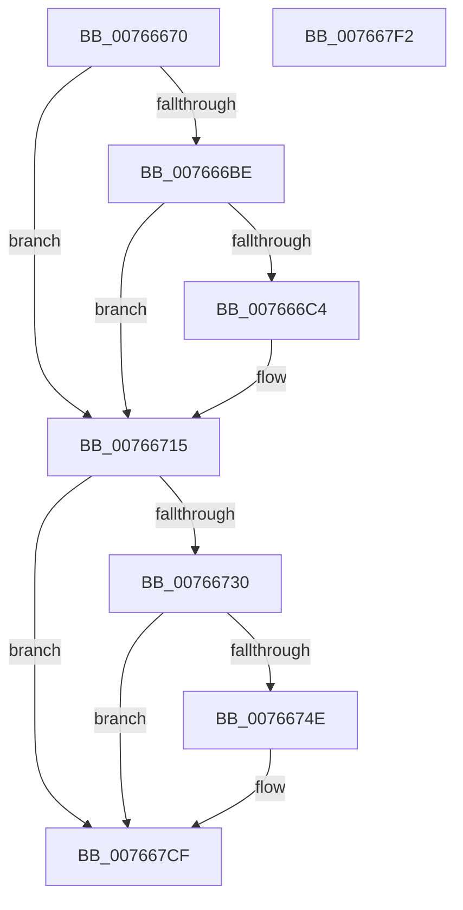

# PopBatteryChargeLimitSettingWnfCallback

- RVA: `0x00766670`–`0x007667F3` (길이 `387` bytes)
- VA: `0x0000000140766670`
- 실행 섹션: `PAGE`
- PDB 이름 있음: `예`; PDB Function 태그: `아니요`
- unwind 정보 RVA: `0x0009F188`
- 디코드: `92`개 명령, `387/387` bytes 표시
- 미해석 바이트: `0` (있으면 어셈블리에 `.byte`로 보존)

> 이 문서는 커널 이미지의 기계어와 PDB 기호를 분석해 생성했습니다. 4번과 5번은 함수 원형과 자료형을 바이너리 사용 방식에서 추정한 C 해석이며 원본 소스 복구 결과는 아닙니다.

## 1. Dependencies

- 직접 호출 지점: **5**; 고유 호출 대상: **5**
- 직접 호출자로 확인된 함수: **0**
- RIP 상대 이미지 참조: **5**

### Outgoing calls
- `0x007666B1` → [ExQueryWnfStateData](../A4/ExQueryWnfStateData_function_00A4A480.md) (function, `0x00A4A480`)
- `0x00766710` → [PopBatteryQueueWork](../../text/4A/PopBatteryQueueWork_function_004AE3DC.md) (function, `0x004AE3DC`)
- `0x00766741` → [tlgKeywordOn](../../text/42/tlgKeywordOn_function_0042EAA0.md) (function, `0x0042EAA0`)
- `0x007667CA` → [tlgWriteTransfer_EtwWriteTransfer](../../text/42/tlgWriteTransfer_EtwWriteTransfer_function_004260E0.md) (function, `0x004260E0`)
- `0x007667D8` → [_security_check_cookie](../../text/6A/_security_check_cookie_function_006AC640.md) (function, `0x006AC640`)

### Direct callers
- 이 함수 시작 RVA로 연결되는 직접 call은 확인되지 않았습니다. 간접 호출은 완전히 역산할 수 없습니다.

### Static image references
- `0x00766687` → RVA `0x00E0A740` (`.data`; read)
- `0x00766709` → RVA `0x00E0B828` (`.data`; read/write)
- `0x00766717` → RVA `0x00E0B828` (`.data`; read)
- `0x00766720` → RVA `0x00E07748` (`.data`; read)
- `0x0076675A` → RVA `0x0004C94A` (`.rdata`; read)

## 2. Other-region calls and transfers

- 다른 실행 섹션으로 향하는 call: **4**
  - `0x00766710` → [PopBatteryQueueWork](../../text/4A/PopBatteryQueueWork_function_004AE3DC.md) (`PAGE` → `.text`)
  - `0x00766741` → [tlgKeywordOn](../../text/42/tlgKeywordOn_function_0042EAA0.md) (`PAGE` → `.text`)
  - `0x007667CA` → [tlgWriteTransfer_EtwWriteTransfer](../../text/42/tlgWriteTransfer_EtwWriteTransfer_function_004260E0.md) (`PAGE` → `.text`)
  - `0x007667D8` → [_security_check_cookie](../../text/6A/_security_check_cookie_function_006AC640.md) (`PAGE` → `.text`)
- 별도 외부 분기/꼬리 이동을 확인하지 못했습니다.

## 3. Assembly (complete function range)

```asm
00766670  48 89 5C 24 10                  mov qword ptr [rsp + 0x10], rbx
00766675  48 89 7C 24 18                  mov qword ptr [rsp + 0x18], rdi
0076667A  55                              push rbp
0076667B  48 8D 6C 24 B9                  lea rbp, [rsp - 0x47]
00766680  48 81 EC D0 00 00 00            sub rsp, 0xd0
00766687  48 8B 05 B2 40 6A 00            mov rax, qword ptr [rip + 0x6a40b2]
0076668E  48 33 C4                        xor rax, rsp
00766691  48 89 45 37                     mov qword ptr [rbp + 0x37], rax
00766695  33 C0                           xor eax, eax
00766697  C7 45 A7 0C 00 00 00            mov dword ptr [rbp - 0x59], 0xc
0076669E  4C 8D 4D A7                     lea r9, [rbp - 0x59]
007666A2  48 89 45 BF                     mov qword ptr [rbp - 0x41], rax
007666A6  4C 8D 45 BF                     lea r8, [rbp - 0x41]
007666AA  89 45 C7                        mov dword ptr [rbp - 0x39], eax
007666AD  48 8D 55 AF                     lea rdx, [rbp - 0x51]
007666B1  E8 CA 3D 2E 00                  call 0x140a4a480
007666B6  33 FF                           xor edi, edi
007666B8  8B D8                           mov ebx, eax
007666BA  85 C0                           test eax, eax
007666BC  78 57                           js 0x140766715
007666BE  83 7D A7 0C                     cmp dword ptr [rbp - 0x59], 0xc
007666C2  75 51                           jne 0x140766715
007666C4  40 38 7D C3                     cmp byte ptr [rbp - 0x3d], dil
007666C8  44 8B CF                        mov r9d, edi
007666CB  8A 4D C4                        mov cl, byte ptr [rbp - 0x3c]
007666CE  8A 45 C5                        mov al, byte ptr [rbp - 0x3b]
007666D1  41 0F 95 C1                     setne r9b
007666D5  F6 D9                           neg cl
007666D7  4D 1B C0                        sbb r8, r8
007666DA  41 83 E0 02                     and r8d, 2
007666DE  F6 D8                           neg al
007666E0  8A 45 C6                        mov al, byte ptr [rbp - 0x3a]
007666E3  48 1B D2                        sbb rdx, rdx
007666E6  83 E2 04                        and edx, 4
007666E9  F6 D8                           neg al
007666EB  8B 45 C7                        mov eax, dword ptr [rbp - 0x39]
007666EE  48 1B C9                        sbb rcx, rcx
007666F1  48 C1 E0 20                     shl rax, 0x20
007666F5  49 0B C1                        or rax, r9
007666F8  83 E1 08                        and ecx, 8
007666FB  49 0B C0                        or rax, r8
007666FE  48 0B C2                        or rax, rdx
00766701  48 0B C1                        or rax, rcx
00766704  B9 00 01 00 00                  mov ecx, 0x100
00766709  48 87 05 18 51 6A 00            xchg qword ptr [rip + 0x6a5118], rax
00766710  E8 C7 7C D4 FF                  call 0x1404ae3dc
00766715  33 C0                           xor eax, eax
00766717  F0 48 0F B1 3D 08 51 6A 00      lock cmpxchg qword ptr [rip + 0x6a5108], rdi
00766720  83 3D 21 10 6A 00 05            cmp dword ptr [rip + 0x6a1021], 5
00766727  4C 8B C0                        mov r8, rax
0076672A  0F 86 9F 00 00 00               jbe 0x1407667cf
00766730  48 BA 00 00 00 00 00 40 00 00   movabs rdx, 0x400000000000
0076673A  48 8D 0D 07 10 6A 00            lea rcx, [rip + 0x6a1007]
00766741  E8 5A 83 CC FF                  call 0x14042eaa0
00766746  84 C0                           test al, al
00766748  0F 84 81 00 00 00               je 0x1407667cf
0076674E  44 89 45 A7                     mov dword ptr [rbp - 0x59], r8d
00766752  48 8D 45 A7                     lea rax, [rbp - 0x59]
00766756  48 89 45 F7                     mov qword ptr [rbp - 9], rax
0076675A  48 8D 15 E9 61 8E FF            lea rdx, [rip - 0x719e17]
00766761  49 C1 E8 20                     shr r8, 0x20
00766765  48 8D 45 B7                     lea rax, [rbp - 0x49]
00766769  48 89 45 07                     mov qword ptr [rbp + 7], rax
0076676D  48 8D 0D D4 0F 6A 00            lea rcx, [rip + 0x6a0fd4]
00766774  48 8D 45 AF                     lea rax, [rbp - 0x51]
00766778  44 89 45 B7                     mov dword ptr [rbp - 0x49], r8d
0076677C  48 89 45 17                     mov qword ptr [rbp + 0x17], rax
00766780  45 33 C9                        xor r9d, r9d
00766783  48 8D 45 BF                     lea rax, [rbp - 0x41]
00766787  48 C7 45 FF 04 00 00 00         mov qword ptr [rbp - 1], 4
0076678F  48 89 45 27                     mov qword ptr [rbp + 0x27], rax
00766793  45 33 C0                        xor r8d, r8d
00766796  48 8D 45 D7                     lea rax, [rbp - 0x29]
0076679A  48 C7 45 0F 04 00 00 00         mov qword ptr [rbp + 0xf], 4
007667A2  48 89 44 24 28                  mov qword ptr [rsp + 0x28], rax
007667A7  C7 44 24 20 06 00 00 00         mov dword ptr [rsp + 0x20], 6
007667AF  89 5D AF                        mov dword ptr [rbp - 0x51], ebx
007667B2  48 C7 45 1F 04 00 00 00         mov qword ptr [rbp + 0x1f], 4
007667BA  48 C7 45 BF 00 00 00 01         mov qword ptr [rbp - 0x41], 0x1000000
007667C2  48 C7 45 2F 08 00 00 00         mov qword ptr [rbp + 0x2f], 8
007667CA  E8 11 F9 CB FF                  call 0x1404260e0
007667CF  8B C3                           mov eax, ebx
007667D1  48 8B 4D 37                     mov rcx, qword ptr [rbp + 0x37]
007667D5  48 33 CC                        xor rcx, rsp
007667D8  E8 63 5E F4 FF                  call 0x1406ac640
007667DD  4C 8D 9C 24 D0 00 00 00         lea r11, [rsp + 0xd0]
007667E5  49 8B 5B 18                     mov rbx, qword ptr [r11 + 0x18]
007667E9  49 8B 7B 20                     mov rdi, qword ptr [r11 + 0x20]
007667ED  49 8B E3                        mov rsp, r11
007667F0  5D                              pop rbp
007667F1  C3                              ret
007667F2  CC                              int3
```

## 4. C-style interpretation (structured pseudocode)

```c
__int64 __fastcall PopBatteryChargeLimitSettingWnfCallback(void)
{
    __int64 result;
    __int64 v_rdi;
    __int64 v_rsp;
    unsigned __int64 v_stack_m18;
    unsigned __int64 v_stack_m20;
    unsigned __int64 v_stack_m28;
    unsigned __int64 v_stack_m30;
    unsigned __int64 v_stack_m38;
    unsigned __int64 v_stack_m40;
    unsigned __int64 v_stack_m48;
    unsigned __int64 v_stack_m4F;
    unsigned __int64 v_stack_m50;
    unsigned __int64 v_stack_m58;
    unsigned __int64 v_stack_m78;
    unsigned __int64 v_stack_m8;
    unsigned int v_stack_m88;
    unsigned __int8 v_stack_m89;
    unsigned __int8 v_stack_m8A;
    unsigned __int8 v_stack_m8B;
    unsigned __int8 v_stack_m8C;
    unsigned __int64 v_stack_m90;
    unsigned __int64 v_stack_m98;
    unsigned __int64 v_stack_mA0;
    unsigned int v_stack_mA8;
    unsigned __int64 v_stack_mB0;
    unsigned int v_stack_mB8;
    unsigned __int64 v_stack_p10;
    unsigned __int64 v_stack_p18;

    v_stack_p10 = v_rbx;
    v_stack_p18 = v_rdi;
    v_rsp = (v_rsp) - (208);
    result = (*(unsigned __int64 *)(v_rip + 6963378)) ^ (v_rsp);
    v_stack_m18 = result;
    result = 0;
    v_stack_mA8 = 12;
    v_stack_m90 = 0;
    v_stack_m88 = 0;
    result = ExQueryWnfStateData(a1, v_stack_mA0, v_stack_m90, v_stack_mA8);
    v_rdi = 0;
    if (sign_flag) goto loc_00766715;
    if (v_stack_mA8 == 12) {
        a4 = 0;
        a1 = v_stack_m8B;
        result = v_stack_m8A;
        a4 = (v_stack_m8C != 0) ? 1 : 0;
        a1 = (unsigned __int8)(-(a1));
        a3 = (unsigned int)((v_stack_m90) & (2));
        result = (unsigned __int8)(-(result));
        result = v_stack_m89;
        a2 = (unsigned int)((v_stack_mA0) & (4));
        result = (unsigned __int8)(-(result));
        result = v_stack_m88;
        result = (result) << (32);
        result = (result) | (a4);
        a1 = (unsigned int)((a1) & (8));
        result = (result) | (a3);
        result = (result) | (a2);
        result = (result) | (a1);
        a1 = 256;
        result = PopBatteryQueueWork(a1, a2, a3, a4);
    }
    result = 0;
    if ((*(unsigned int *)(v_rip + 6950945)) <= 5) goto loc_007667CF;
    result = tlgKeywordOn(v_rip + 6950919, a2, 0, a4);
    if ((unsigned __int8)(result) != 0) {
        v_stack_mA8 = 0;
        result = v_stack_mA8;
        v_stack_m58 = result;
        a2 = v_rip - 7446039;
        a3 = (0) >> (32);
        result = v_stack_m98;
        v_stack_m48 = result;
        a1 = v_rip + 6950868;
        result = v_stack_mA0;
        v_stack_m98 = (unsigned int)(a3);
        v_stack_m38 = result;
        a4 = 0;
        result = v_stack_m90;
        v_stack_m50 = 4;
        v_stack_m28 = result;
        a3 = 0;
        result = v_stack_m78;
        v_stack_m40 = 4;
        v_stack_mB0 = result;
        v_stack_mB8 = 6;
        v_stack_mA0 = (unsigned int)((unsigned int)((unsigned int)(result)));
        v_stack_m30 = 4;
        v_stack_m90 = 0x1000000ULL;
        v_stack_m20 = 8;
        result = tlgWriteTransfer_EtwWriteTransfer(a1, a2, a3, a4);
    }
    a1 = (v_stack_m18) ^ (v_rsp);
    result = _security_check_cookie(a1, a2, a3, a4);
    return result;
}
```

## 5. (Beta) C Style

```c
void PopBatteryChargeLimitSettingWnfCallback(void)
{
    int64_t result;
    int64_t local_rdi;
    int64_t local_rsp;
    uint64_t v_stack_m18;
    uint64_t v_stack_m20;
    uint64_t v_stack_m28;
    uint64_t v_stack_m30;
    uint64_t v_stack_m38;
    uint64_t v_stack_m40;
    uint64_t v_stack_m48;
    uint64_t v_stack_m4F;
    uint64_t v_stack_m50;
    uint64_t v_stack_m58;
    uint64_t v_stack_m78;
    uint64_t v_stack_m8;
    uint32_t v_stack_m88;
    uint8_t v_stack_m89;
    uint8_t v_stack_m8A;
    uint8_t v_stack_m8B;
    uint8_t v_stack_m8C;
    uint64_t v_stack_m90;
    uint64_t v_stack_m98;
    uint64_t v_stack_mA0;
    uint32_t v_stack_mA8;
    uint64_t v_stack_mB0;
    uint32_t v_stack_mB8;
    uint64_t v_stack_p10;
    uint64_t v_stack_p18;

    v_stack_p10 = local_rbx;
    v_stack_p18 = local_rdi;
    local_rsp = (local_rsp) - (208);
    result = (*(uint64_t *)(v_rip + 0x6A40B2)) ^ (local_rsp);
    v_stack_m18 = result;
    result = 0;
    v_stack_mA8 = 12;
    v_stack_m90 = 0;
    v_stack_m88 = 0;
    result = ExQueryWnfStateData(a1, v_stack_mA0, v_stack_m90, v_stack_mA8);
    local_rdi = 0;
    if (sign_flag) goto loc_00766715;
    if (v_stack_mA8 == 12) {
        a4 = 0;
        a1 = v_stack_m8B;
        result = v_stack_m8A;
        a4 = (v_stack_m8C != 0) ? 1 : 0;
        a1 = (uint8_t)(-(a1));
        a3 = (uint32_t)((v_stack_m90) & (2));
        result = (uint8_t)(-(result));
        result = v_stack_m89;
        a2 = (uint32_t)((v_stack_mA0) & (4));
        result = (uint8_t)(-(result));
        result = v_stack_m88;
        result = (result) << (32);
        result = (result) | (a4);
        a1 = (uint32_t)((a1) & (8));
        result = (result) | (a3);
        result = (result) | (a2);
        result = (result) | (a1);
        a1 = 256;
        result = PopBatteryQueueWork(a1, a2, a3, a4);
    }
    result = 0;
    if ((*(uint32_t *)(v_rip + 0x6A1021)) <= 5) goto loc_007667CF;
    result = tlgKeywordOn(v_rip + 6950919, a2, 0, a4);
    if ((uint8_t)(result) != 0) {
        v_stack_mA8 = 0;
        result = v_stack_mA8;
        v_stack_m58 = result;
        a2 = v_rip - 7446039;
        a3 = (0) >> (32);
        result = v_stack_m98;
        v_stack_m48 = result;
        a1 = v_rip + 6950868;
        result = v_stack_mA0;
        v_stack_m98 = (uint32_t)(a3);
        v_stack_m38 = result;
        a4 = 0;
        result = v_stack_m90;
        v_stack_m50 = 4;
        v_stack_m28 = result;
        a3 = 0;
        result = v_stack_m78;
        v_stack_m40 = 4;
        v_stack_mB0 = result;
        v_stack_mB8 = 6;
        v_stack_mA0 = (uint32_t)((uint32_t)((uint32_t)(result)));
        v_stack_m30 = 4;
        v_stack_m90 = 0x1000000ULL;
        v_stack_m20 = 8;
        result = tlgWriteTransfer_EtwWriteTransfer(a1, a2, a3, a4);
    }
    a1 = (v_stack_m18) ^ (local_rsp);
    result = _security_check_cookie(a1, a2, a3, a4);
    return result;
}
```

## 6. Execution-region graph

[열기: 2D/3D 그래프와 함수 탐색 컨트롤 패널](../../../control-panel.html?section=page&rva=0x00766670&view=graph)

- 2D 그래프는 위에서 아래로 흐르고, 3D 그래프는 빈 공간을 드래그해 회전합니다. Shift+드래그는 이동, 휠은 확대·축소, 함수 노드 선택은 대상 보고서 이동입니다.

### Static fallback


