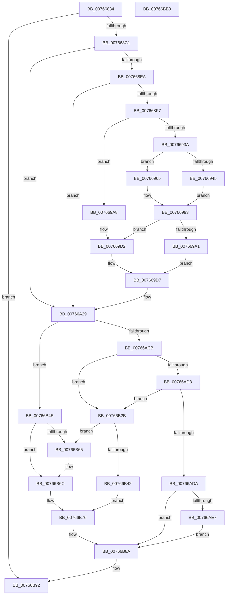

# PopBatteryInitialize

- RVA: `0x00766834`–`0x00766BB4` (길이 `896` bytes)
- VA: `0x0000000140766834`
- 실행 섹션: `PAGE`
- PDB 이름 있음: `예`; PDB Function 태그: `아니요`
- unwind 정보 RVA: `0x000CCFD4`
- 디코드: `211`개 명령, `896/896` bytes 표시
- 미해석 바이트: `0` (있으면 어셈블리에 `.byte`로 보존)

> 이 문서는 커널 이미지의 기계어와 PDB 기호를 분석해 생성했습니다. 4번과 5번은 함수 원형과 자료형을 바이너리 사용 방식에서 추정한 C 해석이며 원본 소스 복구 결과는 아닙니다.

## 1. Dependencies

- 직접 호출 지점: **10**; 고유 호출 대상: **8**
- 직접 호출자로 확인된 함수: **1**
- RIP 상대 이미지 참조: **15**

### Outgoing calls
- `0x007668A7` → [PopPrepareIoctl](../A7/PopPrepareIoctl_function_00A74A98.md) (function, `0x00A74A98`)
- `0x007668B4` → [IoSynchronousCallDriver](../../text/48/IoSynchronousCallDriver_function_00484050.md) (function, `0x00484050`)
- `0x007668DD` → [Feature_BatteryChargeLimitV2Support__private_IsEnabledDeviceUsageNoInline](../../text/5D/Feature_BatteryChargeLimitV2Support__private_IsEnabledDeviceUsageNoInline_function_005D9484.md) (function, `0x005D9484`)
- `0x00766924` → [PopPrepareIoctl](../A7/PopPrepareIoctl_function_00A74A98.md) (function, `0x00A74A98`)
- `0x00766931` → [IoSynchronousCallDriver](../../text/48/IoSynchronousCallDriver_function_00484050.md) (function, `0x00484050`)
- `0x00766A24` → [ZwUpdateWnfStateData](../../text/6B/ZwUpdateWnfStateData_function_006B0D10.md) (function, `0x006B0D10`)
- `0x00766AB2` → [DbgPrintEx](../../text/35/DbgPrintEx_function_00359290.md) (function, `0x00359290`)
- `0x00766ABE` → [Feature_Servicing_BatteryTestExempt__private_IsEnabledDeviceUsageNoInline](../../text/5D/Feature_Servicing_BatteryTestExempt__private_IsEnabledDeviceUsageNoInline_function_005D12D8.md) (function, `0x005D12D8`)
- `0x00766B24` → [tlgWriteTransfer_EtwWriteTransfer](../../text/42/tlgWriteTransfer_EtwWriteTransfer_function_004260E0.md) (function, `0x004260E0`)
- `0x00766B99` → [_security_check_cookie](../../text/6A/_security_check_cookie_function_006AC640.md) (function, `0x006AC640`)

### Direct callers
- [PopBatteryWorker](../AE/PopBatteryWorker_function_00AE1650.md) at `0x00AE1965`

### Static image references
- `0x0076684B` → RVA `0x00E0A740` (`.data`; read)
- `0x007668EA` → RVA `0x00F0C2C1` (`.data`; read)
- `0x00766A0F` → RVA `0x00020890` (`.rdata`; read)
- `0x00766A2C` → RVA `0x00B02660` (` ?? ::NNGAKEGL::`string'`; read)
- `0x00766A37` → RVA `0x00B02940` (` ?? ::NNGAKEGL::`string'`; read)
- `0x00766A41` → RVA `0x00B02510` (` ?? ::NNGAKEGL::`string'`; read)
- `0x00766ACB` → RVA `0x00E678AC` (`.data`; read)
- `0x00766ADA` → RVA `0x00E07748` (`.data`; read)
- `0x00766AEA` → RVA `0x0004C7B9` (`.rdata`; read)
- `0x00766B2B` → RVA `0x00F0C058` (`.data`; read)
- `0x00766B32` → RVA `0x00F0C050` (`.data`; read)
- `0x00766B76` → RVA `0x00F0C034` (`.data`; read/write)
- `0x00766B7C` → RVA `0x00F0C038` (`.data`; write)
- `0x00766B83` → RVA `0x00F0C058` (`.data`; write)
- `0x00766B8A` → RVA `0x00F0C0B4` (`.data`; read/write)

## 2. Other-region calls and transfers

- 다른 실행 섹션으로 향하는 call: **8**
  - `0x007668B4` → [IoSynchronousCallDriver](../../text/48/IoSynchronousCallDriver_function_00484050.md) (`PAGE` → `.text`)
  - `0x007668DD` → [Feature_BatteryChargeLimitV2Support__private_IsEnabledDeviceUsageNoInline](../../text/5D/Feature_BatteryChargeLimitV2Support__private_IsEnabledDeviceUsageNoInline_function_005D9484.md) (`PAGE` → `.text`)
  - `0x00766931` → [IoSynchronousCallDriver](../../text/48/IoSynchronousCallDriver_function_00484050.md) (`PAGE` → `.text`)
  - `0x00766A24` → [ZwUpdateWnfStateData](../../text/6B/ZwUpdateWnfStateData_function_006B0D10.md) (`PAGE` → `.text`)
  - `0x00766AB2` → [DbgPrintEx](../../text/35/DbgPrintEx_function_00359290.md) (`PAGE` → `.text`)
  - `0x00766ABE` → [Feature_Servicing_BatteryTestExempt__private_IsEnabledDeviceUsageNoInline](../../text/5D/Feature_Servicing_BatteryTestExempt__private_IsEnabledDeviceUsageNoInline_function_005D12D8.md) (`PAGE` → `.text`)
  - `0x00766B24` → [tlgWriteTransfer_EtwWriteTransfer](../../text/42/tlgWriteTransfer_EtwWriteTransfer_function_004260E0.md) (`PAGE` → `.text`)
  - `0x00766B99` → [_security_check_cookie](../../text/6A/_security_check_cookie_function_006AC640.md) (`PAGE` → `.text`)
- 별도 외부 분기/꼬리 이동을 확인하지 못했습니다.

## 3. Assembly (complete function range)

```asm
00766834  48 89 5C 24 10                  mov qword ptr [rsp + 0x10], rbx
00766839  48 89 7C 24 18                  mov qword ptr [rsp + 0x18], rdi
0076683E  55                              push rbp
0076683F  48 8D 6C 24 F0                  lea rbp, [rsp - 0x10]
00766844  48 81 EC 10 01 00 00            sub rsp, 0x110
0076684B  48 8B 05 EE 3E 6A 00            mov rax, qword ptr [rip + 0x6a3eee]
00766852  48 33 C4                        xor rax, rsp
00766855  48 89 45 00                     mov qword ptr [rbp], rax
00766859  33 C0                           xor eax, eax
0076685B  C7 44 24 28 24 00 00 00         mov dword ptr [rsp + 0x28], 0x24
00766863  0F 57 C0                        xorps xmm0, xmm0
00766866  89 45 88                        mov dword ptr [rbp - 0x78], eax
00766869  8B 41 6C                        mov eax, dword ptr [rcx + 0x6c]
0076686C  4C 8D 4D A0                     lea r9, [rbp - 0x60]
00766870  33 FF                           xor edi, edi
00766872  89 45 A0                        mov dword ptr [rbp - 0x60], eax
00766875  48 8B D9                        mov rbx, rcx
00766878  48 89 7D B8                     mov qword ptr [rbp - 0x48], rdi
0076687C  48 8B 49 38                     mov rcx, qword ptr [rcx + 0x38]
00766880  0F 57 C9                        xorps xmm1, xmm1
00766883  45 33 C0                        xor r8d, r8d
00766886  89 7D C0                        mov dword ptr [rbp - 0x40], edi
00766889  BA 44 40 29 00                  mov edx, 0x294044
0076688E  89 7D A4                        mov dword ptr [rbp - 0x5c], edi
00766891  0F 11 44 24 78                  movups xmmword ptr [rsp + 0x78], xmm0
00766896  C7 44 24 20 0C 00 00 00         mov dword ptr [rsp + 0x20], 0xc
0076689E  0F 11 45 90                     movups xmmword ptr [rbp - 0x70], xmm0
007668A2  F3 0F 7F 4D A8                  movdqu xmmword ptr [rbp - 0x58], xmm1
007668A7  E8 EC E1 30 00                  call 0x140a74a98
007668AC  48 8B 53 38                     mov rdx, qword ptr [rbx + 0x38]
007668B0  48 8B 4B 30                     mov rcx, qword ptr [rbx + 0x30]
007668B4  E8 97 D7 D1 FF                  call 0x140484050
007668B9  85 C0                           test eax, eax
007668BB  0F 88 D1 02 00 00               js 0x140766b92
007668C1  0F 10 45 A0                     movups xmm0, xmmword ptr [rbp - 0x60]
007668C5  8B 45 C0                        mov eax, dword ptr [rbp - 0x40]
007668C8  0F 10 4D B0                     movups xmm1, xmmword ptr [rbp - 0x50]
007668CC  0F 11 43 70                     movups xmmword ptr [rbx + 0x70], xmm0
007668D0  0F 11 8B 80 00 00 00            movups xmmword ptr [rbx + 0x80], xmm1
007668D7  89 83 90 00 00 00               mov dword ptr [rbx + 0x90], eax
007668DD  E8 A2 2B E7 FF                  call 0x1405d9484
007668E2  85 C0                           test eax, eax
007668E4  0F 84 3F 01 00 00               je 0x140766a29
007668EA  40 38 3D D0 59 7A 00            cmp byte ptr [rip + 0x7a59d0], dil
007668F1  0F 84 32 01 00 00               je 0x140766a29
007668F7  8B 43 6C                        mov eax, dword ptr [rbx + 0x6c]
007668FA  4C 8D 4D 90                     lea r9, [rbp - 0x70]
007668FE  48 8B 4B 38                     mov rcx, qword ptr [rbx + 0x38]
00766902  45 33 C0                        xor r8d, r8d
00766905  C7 44 24 28 10 00 00 00         mov dword ptr [rsp + 0x28], 0x10
0076690D  BA 78 40 29 00                  mov edx, 0x294078
00766912  89 45 90                        mov dword ptr [rbp - 0x70], eax
00766915  C7 44 24 20 08 00 00 00         mov dword ptr [rsp + 0x20], 8
0076691D  48 89 7D 98                     mov qword ptr [rbp - 0x68], rdi
00766921  89 7D 94                        mov dword ptr [rbp - 0x6c], edi
00766924  E8 6F E1 30 00                  call 0x140a74a98
00766929  48 8B 53 38                     mov rdx, qword ptr [rbx + 0x38]
0076692D  48 8B 4B 30                     mov rcx, qword ptr [rbx + 0x30]
00766931  E8 1A D7 D1 FF                  call 0x140484050
00766936  85 C0                           test eax, eax
00766938  78 6E                           js 0x1407669a8
0076693A  8B 4D 90                        mov ecx, dword ptr [rbp - 0x70]
0076693D  83 C8 FF                        or eax, 0xffffffff
00766940  F6 C1 06                        test cl, 6
00766943  75 20                           jne 0x140766965
00766945  89 BB 94 00 00 00               mov dword ptr [rbx + 0x94], edi
0076694B  8B CF                           mov ecx, edi
0076694D  89 83 9C 00 00 00               mov dword ptr [rbx + 0x9c], eax
00766953  8B D0                           mov edx, eax
00766955  89 83 A0 00 00 00               mov dword ptr [rbx + 0xa0], eax
0076695B  44 8B C0                        mov r8d, eax
0076695E  40 88 7C 24 7B                  mov byte ptr [rsp + 0x7b], dil
00766963  EB 2E                           jmp 0x140766993
00766965  8B 55 98                        mov edx, dword ptr [rbp - 0x68]
00766968  44 8B 45 9C                     mov r8d, dword ptr [rbp - 0x64]
0076696C  89 83 20 01 00 00               mov dword ptr [rbx + 0x120], eax
00766972  89 83 1C 01 00 00               mov dword ptr [rbx + 0x11c], eax
00766978  8B 45 94                        mov eax, dword ptr [rbp - 0x6c]
0076697B  89 93 9C 00 00 00               mov dword ptr [rbx + 0x9c], edx
00766981  44 89 83 A0 00 00 00            mov dword ptr [rbx + 0xa0], r8d
00766988  89 8B 94 00 00 00               mov dword ptr [rbx + 0x94], ecx
0076698E  C6 44 24 7B 01                  mov byte ptr [rsp + 0x7b], 1
00766993  89 83 98 00 00 00               mov dword ptr [rbx + 0x98], eax
00766999  44 8B C8                        mov r9d, eax
0076699C  F6 C1 02                        test cl, 2
0076699F  74 31                           je 0x1407669d2
007669A1  C6 44 24 7C 01                  mov byte ptr [rsp + 0x7c], 1
007669A6  EB 2F                           jmp 0x1407669d7
007669A8  83 C8 FF                        or eax, 0xffffffff
007669AB  89 BB 94 00 00 00               mov dword ptr [rbx + 0x94], edi
007669B1  89 83 98 00 00 00               mov dword ptr [rbx + 0x98], eax
007669B7  44 8B C8                        mov r9d, eax
007669BA  89 83 9C 00 00 00               mov dword ptr [rbx + 0x9c], eax
007669C0  8B D0                           mov edx, eax
007669C2  89 83 A0 00 00 00               mov dword ptr [rbx + 0xa0], eax
007669C8  44 8B C0                        mov r8d, eax
007669CB  40 88 7C 24 7B                  mov byte ptr [rsp + 0x7b], dil
007669D0  8B CF                           mov ecx, edi
007669D2  40 88 7C 24 7C                  mov byte ptr [rsp + 0x7c], dil
007669D7  8A C1                           mov al, cl
007669D9  44 89 4D 80                     mov dword ptr [rbp - 0x80], r9d
007669DD  C0 E8 02                        shr al, 2
007669E0  45 33 C9                        xor r9d, r9d
007669E3  24 01                           and al, 1
007669E5  89 55 84                        mov dword ptr [rbp - 0x7c], edx
007669E8  88 44 24 7D                     mov byte ptr [rsp + 0x7d], al
007669EC  48 8D 54 24 78                  lea rdx, [rsp + 0x78]
007669F1  8A C1                           mov al, cl
007669F3  44 89 45 88                     mov dword ptr [rbp - 0x78], r8d
007669F7  80 E1 01                        and cl, 1
007669FA  C0 E8 03                        shr al, 3
007669FD  24 01                           and al, 1
007669FF  88 4C 24 7F                     mov byte ptr [rsp + 0x7f], cl
00766A03  89 7C 24 30                     mov dword ptr [rsp + 0x30], edi
00766A07  45 8D 41 14                     lea r8d, [r9 + 0x14]
00766A0B  89 7C 24 28                     mov dword ptr [rsp + 0x28], edi
00766A0F  48 8D 0D 7A 9E 8B FF            lea rcx, [rip - 0x746186]
00766A16  88 44 24 7E                     mov byte ptr [rsp + 0x7e], al
00766A1A  40 88 7C 24 78                  mov byte ptr [rsp + 0x78], dil
00766A1F  48 89 7C 24 20                  mov qword ptr [rsp + 0x20], rdi
00766A24  E8 E7 A2 F4 FF                  call 0x1406b0d10
00766A29  8B 43 78                        mov eax, dword ptr [rbx + 0x78]
00766A2C  48 8D 15 2D BC 39 00            lea rdx, [rip + 0x39bc2d]
00766A33  40 38 7B 74                     cmp byte ptr [rbx + 0x74], dil
00766A37  48 8D 0D 02 BF 39 00            lea rcx, [rip + 0x39bf02]
00766A3E  89 45 F8                        mov dword ptr [rbp - 8], eax
00766A41  4C 8D 05 C8 BA 39 00            lea r8, [rip + 0x39bac8]
00766A48  8B 83 90 00 00 00               mov eax, dword ptr [rbx + 0x90]
00766A4E  48 0F 45 CA                     cmovne rcx, rdx
00766A52  89 44 24 68                     mov dword ptr [rsp + 0x68], eax
00766A56  4C 8B CB                        mov r9, rbx
00766A59  8B 83 8C 00 00 00               mov eax, dword ptr [rbx + 0x8c]
00766A5F  BA 02 00 00 00                  mov edx, 2
00766A64  89 44 24 60                     mov dword ptr [rsp + 0x60], eax
00766A68  8B 83 88 00 00 00               mov eax, dword ptr [rbx + 0x88]
00766A6E  89 44 24 58                     mov dword ptr [rsp + 0x58], eax
00766A72  8B 83 84 00 00 00               mov eax, dword ptr [rbx + 0x84]
00766A78  89 44 24 50                     mov dword ptr [rsp + 0x50], eax
00766A7C  8B 83 80 00 00 00               mov eax, dword ptr [rbx + 0x80]
00766A82  89 44 24 48                     mov dword ptr [rsp + 0x48], eax
00766A86  8B 43 7C                        mov eax, dword ptr [rbx + 0x7c]
00766A89  89 44 24 40                     mov dword ptr [rsp + 0x40], eax
00766A8D  48 8D 45 F8                     lea rax, [rbp - 8]
00766A91  48 89 44 24 38                  mov qword ptr [rsp + 0x38], rax
00766A96  8B 43 70                        mov eax, dword ptr [rbx + 0x70]
00766A99  48 89 4C 24 30                  mov qword ptr [rsp + 0x30], rcx
00766A9E  B9 92 00 00 00                  mov ecx, 0x92
00766AA3  89 44 24 28                     mov dword ptr [rsp + 0x28], eax
00766AA7  8B 43 6C                        mov eax, dword ptr [rbx + 0x6c]
00766AAA  89 44 24 20                     mov dword ptr [rsp + 0x20], eax
00766AAE  40 88 7D FC                     mov byte ptr [rbp - 4], dil
00766AB2  E8 D9 27 BF FF                  call 0x140359290
00766AB7  C7 43 68 03 00 00 00            mov dword ptr [rbx + 0x68], 3
00766ABE  E8 15 A8 E6 FF                  call 0x1405d12d8
00766AC3  85 C0                           test eax, eax
00766AC5  0F 84 83 00 00 00               je 0x140766b4e
00766ACB  39 3D DB 0D 70 00               cmp dword ptr [rip + 0x700ddb], edi
00766AD1  74 58                           je 0x140766b2b
00766AD3  8B 43 70                        mov eax, dword ptr [rbx + 0x70]
00766AD6  A8 10                           test al, 0x10
00766AD8  75 51                           jne 0x140766b2b
00766ADA  83 3D 67 0C 6A 00 05            cmp dword ptr [rip + 0x6a0c67], 5
00766AE1  0F 86 A3 00 00 00               jbe 0x140766b8a
00766AE7  8B 43 6C                        mov eax, dword ptr [rbx + 0x6c]
00766AEA  48 8D 15 C8 5C 8E FF            lea rdx, [rip - 0x71a338]
00766AF1  89 44 24 70                     mov dword ptr [rsp + 0x70], eax
00766AF5  48 8D 0D 4C 0C 6A 00            lea rcx, [rip + 0x6a0c4c]
00766AFC  48 8D 44 24 70                  lea rax, [rsp + 0x70]
00766B01  48 C7 45 F0 04 00 00 00         mov qword ptr [rbp - 0x10], 4
00766B09  48 89 45 E8                     mov qword ptr [rbp - 0x18], rax
00766B0D  45 33 C9                        xor r9d, r9d
00766B10  48 8D 45 C8                     lea rax, [rbp - 0x38]
00766B14  45 33 C0                        xor r8d, r8d
00766B17  48 89 44 24 28                  mov qword ptr [rsp + 0x28], rax
00766B1C  C7 44 24 20 03 00 00 00         mov dword ptr [rsp + 0x20], 3
00766B24  E8 B7 F5 CB FF                  call 0x1404260e0
00766B29  EB 5F                           jmp 0x140766b8a
00766B2B  48 8B 0D 26 55 7A 00            mov rcx, qword ptr [rip + 0x7a5526]
00766B32  48 8D 05 17 55 7A 00            lea rax, [rip + 0x7a5517]
00766B39  48 83 C3 40                     add rbx, 0x40
00766B3D  48 39 01                        cmp qword ptr [rcx], rax
00766B40  75 23                           jne 0x140766b65
00766B42  48 89 03                        mov qword ptr [rbx], rax
00766B45  48 89 4B 08                     mov qword ptr [rbx + 8], rcx
00766B49  48 89 19                        mov qword ptr [rcx], rbx
00766B4C  EB 28                           jmp 0x140766b76
00766B4E  48 8B 15 03 55 7A 00            mov rdx, qword ptr [rip + 0x7a5503]
00766B55  48 8D 05 F4 54 7A 00            lea rax, [rip + 0x7a54f4]
00766B5C  48 83 C3 40                     add rbx, 0x40
00766B60  48 39 02                        cmp qword ptr [rdx], rax
00766B63  74 07                           je 0x140766b6c
00766B65  B9 03 00 00 00                  mov ecx, 3
00766B6A  CD 29                           int 0x29
00766B6C  48 89 03                        mov qword ptr [rbx], rax
00766B6F  48 89 53 08                     mov qword ptr [rbx + 8], rdx
00766B73  48 89 1A                        mov qword ptr [rdx], rbx
00766B76  FF 05 B8 54 7A 00               inc dword ptr [rip + 0x7a54b8]
00766B7C  C6 05 B5 54 7A 00 01            mov byte ptr [rip + 0x7a54b5], 1
00766B83  48 89 1D CE 54 7A 00            mov qword ptr [rip + 0x7a54ce], rbx
00766B8A  FF 05 24 55 7A 00               inc dword ptr [rip + 0x7a5524]
00766B90  8B C7                           mov eax, edi
00766B92  48 8B 4D 00                     mov rcx, qword ptr [rbp]
00766B96  48 33 CC                        xor rcx, rsp
00766B99  E8 A2 5A F4 FF                  call 0x1406ac640
00766B9E  4C 8D 9C 24 10 01 00 00         lea r11, [rsp + 0x110]
00766BA6  49 8B 5B 18                     mov rbx, qword ptr [r11 + 0x18]
00766BAA  49 8B 7B 20                     mov rdi, qword ptr [r11 + 0x20]
00766BAE  49 8B E3                        mov rsp, r11
00766BB1  5D                              pop rbp
00766BB2  C3                              ret
00766BB3  CC                              int3
```

## 4. C-style interpretation (structured pseudocode)

```c
__int64 __fastcall PopBatteryInitialize(__int64 a1, __int64 a2, int a3)
{
    __int64 result;
    __int64 v_rbx;
    __int64 v_rdi;
    __int64 v_rsp;
    unsigned __int64 v_stack_m18;
    unsigned __int8 v_stack_m1C;
    unsigned int v_stack_m20;
    unsigned __int64 v_stack_m28;
    unsigned __int64 v_stack_m30;
    unsigned __int64 v_stack_m50;
    unsigned int v_stack_m58;
    unsigned __int64 v_stack_m60;
    unsigned __int64 v_stack_m68;
    unsigned __int64 v_stack_m70;
    unsigned int v_stack_m74;
    unsigned __int64 v_stack_m78;
    unsigned int v_stack_m7C;
    unsigned __int64 v_stack_m8;
    unsigned __int64 v_stack_m80;
    unsigned int v_stack_m84;
    unsigned __int64 v_stack_m88;
    unsigned int v_stack_m90;
    unsigned int v_stack_m94;
    unsigned int v_stack_m98;
    unsigned __int8 v_stack_m99;
    unsigned __int8 v_stack_m9A;
    unsigned __int8 v_stack_m9B;
    unsigned __int8 v_stack_m9C;
    unsigned __int8 v_stack_m9D;
    unsigned __int64 v_stack_mA0;
    unsigned int v_stack_mA8;
    unsigned int v_stack_mB0;
    unsigned int v_stack_mB8;
    unsigned int v_stack_mC0;
    unsigned int v_stack_mC8;
    unsigned int v_stack_mD0;
    unsigned int v_stack_mD8;
    unsigned __int64 v_stack_mE0;
    unsigned int v_stack_mE8;
    unsigned int v_stack_mF0;
    unsigned int v_stack_mF8;
    unsigned __int64 v_stack_p10;
    unsigned __int64 v_stack_p18;

    v_stack_p10 = v_rbx;
    v_stack_p18 = v_rdi;
    v_rsp = (v_rsp) - (272);
    result = (*(unsigned __int64 *)(v_rip + 6962926)) ^ (v_rsp);
    v_stack_m18 = result;
    result = 0;
    v_stack_mF0 = 36;
    v_stack_m90 = 0;
    v_rdi = 0;
    v_stack_m78 = (unsigned int)((unsigned int)(*(unsigned int *)(a1 + 108)));
    v_stack_m60 = 0;
    a3 = 0;
    v_stack_m58 = 0;
    v_stack_m74 = 0;
    v_stack_mA0 = v_xmm0;
    v_stack_mF8 = 12;
    v_stack_m88 = v_xmm0;
    v_stack_m70 = v_xmm1;
    result = PopPrepareIoctl(*(unsigned __int64 *)(a1 + 56), (unsigned int)(0x294044ULL), a3, v_stack_m78);
    result = IoSynchronousCallDriver(*(unsigned __int64 *)(a1 + 48), *(unsigned __int64 *)(a1 + 56), a3, v_stack_m78);
    if (sign_flag) goto loc_00766B92;
    *(unsigned __int64 *)(a1 + 112) = v_xmm0;
    *(unsigned __int64 *)(a1 + 128) = v_xmm1;
    *(unsigned int *)(a1 + 144) = (unsigned int)((unsigned int)(v_stack_m58));
    result = Feature_BatteryChargeLimitV2Support__private_IsEnabledDeviceUsageNoInline(*(unsigned __int64 *)(a1 + 48), *(unsigned __int64 *)(a1 + 56), a3, v_stack_m78);
    if ((unsigned int)(result) == 0) goto loc_00766A29;
    if ((*(unsigned __int8 *)(v_rip + 8018384)) == 0) goto loc_00766A29;
    a3 = 0;
    v_stack_mF0 = 16;
    v_stack_m88 = (unsigned int)((unsigned int)(*(unsigned int *)(a1 + 108)));
    v_stack_mF8 = 8;
    v_stack_m80 = 0;
    v_stack_m84 = 0;
    result = PopPrepareIoctl(*(unsigned __int64 *)(a1 + 56), (unsigned int)(0x294078ULL), a3, v_stack_m88);
    result = IoSynchronousCallDriver(*(unsigned __int64 *)(a1 + 48), *(unsigned __int64 *)(a1 + 56), a3, v_stack_m88);
    if (sign_flag) goto loc_007669A8;
    result = (unsigned int)((result) | (0xFFFFFFFFULL));
    if ((((unsigned __int8)((unsigned int)(v_stack_m88))) & (6)) != 0) goto loc_00766965;
    *(unsigned int *)(a1 + 148) = 0;
    *(unsigned int *)(a1 + 156) = (unsigned int)(result);
    *(unsigned int *)(a1 + 160) = (unsigned int)(result);
    v_stack_m9D = 0;
    goto loc_00766993;
loc_00766965:
    *(unsigned int *)(a1 + 288) = (unsigned int)(result);
    *(unsigned int *)(a1 + 284) = (unsigned int)(result);
    *(unsigned int *)(a1 + 156) = (unsigned int)((unsigned int)(v_stack_m80));
    *(unsigned int *)(a1 + 160) = (unsigned int)((unsigned int)(v_stack_m7C));
    *(unsigned int *)(a1 + 148) = 0;
    v_stack_m9D = 1;
loc_00766993:
    *(unsigned int *)(a1 + 152) = (unsigned int)((unsigned int)(v_stack_m84));
    if (((0) & (2)) == 0) goto loc_007669D2;
    v_stack_m9C = 1;
    goto loc_007669D7;
loc_007669A8:
    result = (unsigned int)(((unsigned int)(v_stack_m84)) | (0xFFFFFFFFULL));
    *(unsigned int *)(a1 + 148) = 0;
    *(unsigned int *)(a1 + 152) = (unsigned int)(result);
    *(unsigned int *)(a1 + 156) = (unsigned int)(result);
    *(unsigned int *)(a1 + 160) = (unsigned int)(result);
    v_stack_m9D = 0;
loc_007669D2:
    v_stack_m9C = 0;
loc_007669D7:
    v_stack_m98 = (unsigned int)((unsigned int)((unsigned int)(result)));
    result = (unsigned __int8)((0) >> (2));
    a4 = 0;
    result = (unsigned __int8)((result) & (1));
    v_stack_m94 = (unsigned int)((unsigned int)((unsigned int)(result)));
    v_stack_m9B = (unsigned __int8)(result);
    v_stack_m90 = (unsigned int)((unsigned int)((unsigned int)(result)));
    a1 = (unsigned __int8)((0) & (1));
    result = (unsigned __int8)((0) >> (3));
    result = (unsigned __int8)((result) & (1));
    v_stack_m99 = (unsigned __int8)(a1);
    v_stack_mE8 = 0;
    v_stack_mF0 = 0;
    v_stack_m9A = (unsigned __int8)(result);
    v_stack_mA0 = 0;
    v_stack_mF8 = 0;
    result = ZwUpdateWnfStateData(v_rip - 7627142, v_stack_mA0, a4 + 20, a4);
loc_00766A29:
    v_stack_m20 = (unsigned int)((unsigned int)(*(unsigned int *)(a1 + 120)));
    a1 = v_rip + 3784450;
    if ((*(unsigned __int8 *)(a1 + 116)) != 0) { a1 = v_rip + 3783725; }
    v_stack_mB0 = (unsigned int)((unsigned int)(*(unsigned int *)(a1 + 144)));
    v_stack_mB8 = (unsigned int)((unsigned int)(*(unsigned int *)(a1 + 140)));
    v_stack_mC0 = (unsigned int)((unsigned int)(*(unsigned int *)(a1 + 136)));
    v_stack_mC8 = (unsigned int)((unsigned int)(*(unsigned int *)(a1 + 132)));
    v_stack_mD0 = (unsigned int)((unsigned int)(*(unsigned int *)(a1 + 128)));
    v_stack_mD8 = (unsigned int)((unsigned int)(*(unsigned int *)(a1 + 124)));
    v_stack_mE0 = v_stack_m20;
    v_stack_mE8 = a1;
    v_stack_mF0 = (unsigned int)((unsigned int)(*(unsigned int *)(a1 + 112)));
    v_stack_mF8 = (unsigned int)((unsigned int)(*(unsigned int *)(a1 + 108)));
    v_stack_m1C = 0;
    result = DbgPrintEx(146, 2, v_rip + 3783368, a1);
    *(unsigned int *)(a1 + 104) = 3;
    result = Feature_Servicing_BatteryTestExempt__private_IsEnabledDeviceUsageNoInline(146, 2, v_rip + 3783368, a1);
    if ((unsigned int)(result) == 0) goto loc_00766B4E;
    if ((*(unsigned int *)(v_rip + 7343579)) == 0) goto loc_00766B2B;
    if ((((unsigned __int8)((unsigned int)(*(unsigned int *)(a1 + 112)))) & (16)) != 0) goto loc_00766B2B;
    if ((*(unsigned int *)(v_rip + 6949991)) <= 5) goto loc_00766B8A;
    v_stack_mA8 = (unsigned int)((unsigned int)(*(unsigned int *)(a1 + 108)));
    v_stack_m28 = 4;
    v_stack_m30 = v_stack_mA8;
    a4 = 0;
    a3 = 0;
    v_stack_mF0 = v_stack_m50;
    v_stack_mF8 = 3;
    result = tlgWriteTransfer_EtwWriteTransfer(v_rip + 6949964, v_rip - 7447352, a3, a4);
    goto loc_00766B8A;
loc_00766B2B:
    v_rbx = (a1) + (64);
    if ((*(unsigned __int64 *)(*(unsigned __int64 *)(v_rip + 8017190))) != (v_rip + 8017175)) goto loc_00766B65;
    *(unsigned __int64 *)(v_rbx) = v_rip + 8017175;
    *(unsigned __int64 *)(v_rbx + 8) = *(unsigned __int64 *)(v_rip + 8017190);
    *(unsigned __int64 *)(*(unsigned __int64 *)(v_rip + 8017190)) = v_rbx;
    goto loc_00766B76;
loc_00766B4E:
    v_rbx = (v_rbx) + (64);
    if ((*(unsigned __int64 *)(*(unsigned __int64 *)(v_rip + 8017155))) != (v_rip + 8017140)) {
        a1 = 3;
    }
    *(unsigned __int64 *)(v_rbx) = v_rip + 8017140;
    *(unsigned __int64 *)(v_rbx + 8) = *(unsigned __int64 *)(v_rip + 8017155);
    *(unsigned __int64 *)(*(unsigned __int64 *)(v_rip + 8017155)) = v_rbx;
loc_00766B76:
    *(unsigned __int8 *)(v_rip + 8017077) = 1;
    *(unsigned __int64 *)(v_rip + 8017102) = v_rbx;
loc_00766B8A:
loc_00766B92:
    a1 = (v_stack_m18) ^ (v_rsp);
    result = _security_check_cookie(a1, *(unsigned __int64 *)(v_rip + 8017155), a3, a4);
    return result;
}
```

## 5. (Beta) C Style

```c
int64_t PopBatteryInitialize(void *Arg1, int64_t Arg2, int32_t Arg3)
{
    uint8_t *arg1 = (uint8_t *)Arg1;

    int64_t result;
    int64_t local_rbx;
    int64_t local_rdi;
    int64_t local_rsp;
    uint64_t v_stack_m18;
    uint8_t v_stack_m1C;
    uint32_t v_stack_m20;
    uint64_t v_stack_m28;
    uint64_t v_stack_m30;
    uint64_t v_stack_m50;
    uint32_t v_stack_m58;
    uint64_t v_stack_m60;
    uint64_t v_stack_m68;
    uint64_t v_stack_m70;
    uint32_t v_stack_m74;
    uint64_t v_stack_m78;
    uint32_t v_stack_m7C;
    uint64_t v_stack_m8;
    uint64_t v_stack_m80;
    uint32_t v_stack_m84;
    uint64_t v_stack_m88;
    uint32_t v_stack_m90;
    uint32_t v_stack_m94;
    uint32_t v_stack_m98;
    uint8_t v_stack_m99;
    uint8_t v_stack_m9A;
    uint8_t v_stack_m9B;
    uint8_t v_stack_m9C;
    uint8_t v_stack_m9D;
    uint64_t v_stack_mA0;
    uint32_t v_stack_mA8;
    uint32_t v_stack_mB0;
    uint32_t v_stack_mB8;
    uint32_t v_stack_mC0;
    uint32_t v_stack_mC8;
    uint32_t v_stack_mD0;
    uint32_t v_stack_mD8;
    uint64_t v_stack_mE0;
    uint32_t v_stack_mE8;
    uint32_t v_stack_mF0;
    uint32_t v_stack_mF8;
    uint64_t v_stack_p10;
    uint64_t v_stack_p18;

    v_stack_p10 = local_rbx;
    v_stack_p18 = local_rdi;
    local_rsp = (local_rsp) - (272);
    result = (*(uint64_t *)(v_rip + 0x6A3EEE)) ^ (local_rsp);
    v_stack_m18 = result;
    result = 0;
    v_stack_mF0 = 36;
    v_stack_m90 = 0;
    local_rdi = 0;
    v_stack_m78 = (uint32_t)((uint32_t)(*(uint32_t *)(arg1 + 0x6C)));
    v_stack_m60 = 0;
    Arg3 = 0;
    v_stack_m58 = 0;
    v_stack_m74 = 0;
    v_stack_mA0 = v_xmm0;
    v_stack_mF8 = 12;
    v_stack_m88 = v_xmm0;
    v_stack_m70 = v_xmm1;
    result = PopPrepareIoctl(*(uint64_t *)(arg1 + 0x38), (uint32_t)(0x294044ULL), Arg3, v_stack_m78);
    result = IoSynchronousCallDriver(*(uint64_t *)(arg1 + 0x30), *(uint64_t *)(arg1 + 0x38), Arg3, v_stack_m78);
    if (sign_flag) goto loc_00766B92;
    *(uint64_t *)(arg1 + 0x70) = v_xmm0;
    *(uint64_t *)(arg1 + 0x80) = v_xmm1;
    *(uint32_t *)(arg1 + 0x90) = (uint32_t)((uint32_t)(v_stack_m58));
    result = Feature_BatteryChargeLimitV2Support__private_IsEnabledDeviceUsageNoInline(*(uint64_t *)(arg1 + 0x30), *(uint64_t *)(arg1 + 0x38), Arg3, v_stack_m78);
    if ((uint32_t)(result) == 0) goto loc_00766A29;
    if ((*(uint8_t *)(v_rip + 0x7A59D0)) == 0) goto loc_00766A29;
    Arg3 = 0;
    v_stack_mF0 = 16;
    v_stack_m88 = (uint32_t)((uint32_t)(*(uint32_t *)(arg1 + 0x6C)));
    v_stack_mF8 = 8;
    v_stack_m80 = 0;
    v_stack_m84 = 0;
    result = PopPrepareIoctl(*(uint64_t *)(arg1 + 0x38), (uint32_t)(0x294078ULL), Arg3, v_stack_m88);
    result = IoSynchronousCallDriver(*(uint64_t *)(arg1 + 0x30), *(uint64_t *)(arg1 + 0x38), Arg3, v_stack_m88);
    if (sign_flag) goto loc_007669A8;
    result = (uint32_t)((result) | (0xFFFFFFFFULL));
    if ((((uint8_t)((uint32_t)(v_stack_m88))) & (6)) != 0) goto loc_00766965;
    *(uint32_t *)(arg1 + 0x94) = 0;
    *(uint32_t *)(arg1 + 0x9C) = (uint32_t)(result);
    *(uint32_t *)(arg1 + 0xA0) = (uint32_t)(result);
    v_stack_m9D = 0;
    goto loc_00766993;
loc_00766965:
    *(uint32_t *)(arg1 + 0x120) = (uint32_t)(result);
    *(uint32_t *)(arg1 + 0x11C) = (uint32_t)(result);
    *(uint32_t *)(arg1 + 0x9C) = (uint32_t)((uint32_t)(v_stack_m80));
    *(uint32_t *)(arg1 + 0xA0) = (uint32_t)((uint32_t)(v_stack_m7C));
    *(uint32_t *)(arg1 + 0x94) = 0;
    v_stack_m9D = 1;
loc_00766993:
    *(uint32_t *)(arg1 + 0x98) = (uint32_t)((uint32_t)(v_stack_m84));
    if (((0) & (2)) == 0) goto loc_007669D2;
    v_stack_m9C = 1;
    goto loc_007669D7;
loc_007669A8:
    result = (uint32_t)(((uint32_t)(v_stack_m84)) | (0xFFFFFFFFULL));
    *(uint32_t *)(arg1 + 0x94) = 0;
    *(uint32_t *)(arg1 + 0x98) = (uint32_t)(result);
    *(uint32_t *)(arg1 + 0x9C) = (uint32_t)(result);
    *(uint32_t *)(arg1 + 0xA0) = (uint32_t)(result);
    v_stack_m9D = 0;
loc_007669D2:
    v_stack_m9C = 0;
loc_007669D7:
    v_stack_m98 = (uint32_t)((uint32_t)((uint32_t)(result)));
    result = (uint8_t)((0) >> (2));
    a4 = 0;
    result = (uint8_t)((result) & (1));
    v_stack_m94 = (uint32_t)((uint32_t)((uint32_t)(result)));
    v_stack_m9B = (uint8_t)(result);
    v_stack_m90 = (uint32_t)((uint32_t)((uint32_t)(result)));
    Arg1 = (uint8_t)((0) & (1));
    result = (uint8_t)((0) >> (3));
    result = (uint8_t)((result) & (1));
    v_stack_m99 = (uint8_t)(Arg1);
    v_stack_mE8 = 0;
    v_stack_mF0 = 0;
    v_stack_m9A = (uint8_t)(result);
    v_stack_mA0 = 0;
    v_stack_mF8 = 0;
    result = ZwUpdateWnfStateData(v_rip - 7627142, v_stack_mA0, a4 + 20, a4);
loc_00766A29:
    v_stack_m20 = (uint32_t)((uint32_t)(*(uint32_t *)(arg1 + 0x78)));
    Arg1 = v_rip + 3784450;
    if ((*(uint8_t *)(arg1 + 0x74)) != 0) { Arg1 = v_rip + 3783725; }
    v_stack_mB0 = (uint32_t)((uint32_t)(*(uint32_t *)(arg1 + 0x90)));
    v_stack_mB8 = (uint32_t)((uint32_t)(*(uint32_t *)(arg1 + 0x8C)));
    v_stack_mC0 = (uint32_t)((uint32_t)(*(uint32_t *)(arg1 + 0x88)));
    v_stack_mC8 = (uint32_t)((uint32_t)(*(uint32_t *)(arg1 + 0x84)));
    v_stack_mD0 = (uint32_t)((uint32_t)(*(uint32_t *)(arg1 + 0x80)));
    v_stack_mD8 = (uint32_t)((uint32_t)(*(uint32_t *)(arg1 + 0x7C)));
    v_stack_mE0 = v_stack_m20;
    v_stack_mE8 = Arg1;
    v_stack_mF0 = (uint32_t)((uint32_t)(*(uint32_t *)(arg1 + 0x70)));
    v_stack_mF8 = (uint32_t)((uint32_t)(*(uint32_t *)(arg1 + 0x6C)));
    v_stack_m1C = 0;
    result = DbgPrintEx(146, 2, v_rip + 3783368, Arg1);
    *(uint32_t *)(arg1 + 0x68) = 3;
    result = Feature_Servicing_BatteryTestExempt__private_IsEnabledDeviceUsageNoInline(146, 2, v_rip + 3783368, Arg1);
    if ((uint32_t)(result) == 0) goto loc_00766B4E;
    if ((*(uint32_t *)(v_rip + 0x700DDB)) == 0) goto loc_00766B2B;
    if ((((uint8_t)((uint32_t)(*(uint32_t *)(arg1 + 0x70)))) & (16)) != 0) goto loc_00766B2B;
    if ((*(uint32_t *)(v_rip + 0x6A0C67)) <= 5) goto loc_00766B8A;
    v_stack_mA8 = (uint32_t)((uint32_t)(*(uint32_t *)(arg1 + 0x6C)));
    v_stack_m28 = 4;
    v_stack_m30 = v_stack_mA8;
    a4 = 0;
    Arg3 = 0;
    v_stack_mF0 = v_stack_m50;
    v_stack_mF8 = 3;
    result = tlgWriteTransfer_EtwWriteTransfer(v_rip + 6949964, v_rip - 7447352, Arg3, a4);
    goto loc_00766B8A;
loc_00766B2B:
    local_rbx = (Arg1) + (64);
    if ((*(uint64_t *)(*(uint64_t *)(v_rip + 0x7A5526))) != (v_rip + 8017175)) goto loc_00766B65;
    *(uint64_t *)(local_rbx) = v_rip + 8017175;
    *(uint64_t *)(local_rbx + 0x8) = *(uint64_t *)(v_rip + 0x7A5526);
    *(uint64_t *)(*(uint64_t *)(v_rip + 0x7A5526)) = local_rbx;
    goto loc_00766B76;
loc_00766B4E:
    local_rbx = (local_rbx) + (64);
    if ((*(uint64_t *)(*(uint64_t *)(v_rip + 0x7A5503))) != (v_rip + 8017140)) {
        Arg1 = 3;
    }
    *(uint64_t *)(local_rbx) = v_rip + 8017140;
    *(uint64_t *)(local_rbx + 0x8) = *(uint64_t *)(v_rip + 0x7A5503);
    *(uint64_t *)(*(uint64_t *)(v_rip + 0x7A5503)) = local_rbx;
loc_00766B76:
    *(uint8_t *)(v_rip + 0x7A54B5) = 1;
    *(uint64_t *)(v_rip + 0x7A54CE) = local_rbx;
loc_00766B8A:
loc_00766B92:
    Arg1 = (v_stack_m18) ^ (local_rsp);
    result = _security_check_cookie(Arg1, *(uint64_t *)(v_rip + 0x7A5503), Arg3, a4);
    return result;
}
```

### 관측된 메모리 오프셋

구조체 형식이 확인되지 않은 접근은 인자 기준의 오프셋으로만 기록했습니다.

| 기준 인자 | 오프셋 표현 | 폭 (bit) | 접근 |
|---|---:|---:|---|
| `Arg1` | `+ 0x0` | `64` | `W` |
| `Arg1` | `+ 0x8` | `64` | `W` |
| `Arg1` | `+ 0x30` | `64` | `R` |
| `Arg1` | `+ 0x38` | `64` | `R` |
| `Arg1` | `+ 0x68` | `32` | `W` |
| `Arg1` | `+ 0x6C` | `32` | `R` |
| `Arg1` | `+ 0x70` | `32` | `R` |
| `Arg1` | `+ 0x70` | `128` | `R` |
| `Arg1` | `+ 0x74` | `8` | `R` |
| `Arg1` | `+ 0x78` | `32` | `R` |
| `Arg1` | `+ 0x7C` | `32` | `R` |
| `Arg1` | `+ 0x80` | `32` | `R` |
| `Arg1` | `+ 0x80` | `128` | `R` |
| `Arg1` | `+ 0x84` | `32` | `R` |
| `Arg1` | `+ 0x88` | `32` | `R` |
| `Arg1` | `+ 0x8C` | `32` | `R` |
| `Arg1` | `+ 0x90` | `32` | `R` |
| `Arg1` | `+ 0x90` | `32` | `W` |
| `Arg1` | `+ 0x94` | `32` | `W` |
| `Arg1` | `+ 0x98` | `32` | `W` |
| `Arg1` | `+ 0x9C` | `32` | `W` |
| `Arg1` | `+ 0xA0` | `32` | `W` |
| `Arg1` | `+ 0x11C` | `32` | `W` |
| `Arg1` | `+ 0x120` | `32` | `W` |

## 6. Execution-region graph

[열기: 2D/3D 그래프와 함수 탐색 컨트롤 패널](../../../control-panel.html?section=page&rva=0x00766834&view=graph)

- 2D 그래프는 위에서 아래로 흐르고, 3D 그래프는 빈 공간을 드래그해 회전합니다. Shift+드래그는 이동, 휠은 확대·축소, 함수 노드 선택은 대상 보고서 이동입니다.

### Static fallback


