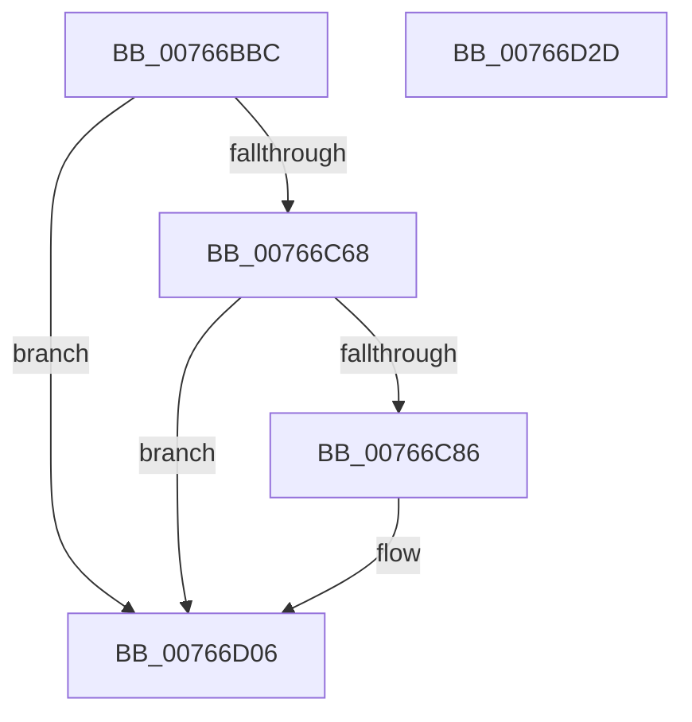

# PopBatteryPublishChargeLimitStatus

- RVA: `0x00766BBC`–`0x00766D2E` (길이 `370` bytes)
- VA: `0x0000000140766BBC`
- 실행 섹션: `PAGE`
- PDB 이름 있음: `예`; PDB Function 태그: `아니요`
- unwind 정보 RVA: `0x000CCE7C`
- 디코드: `95`개 명령, `370/370` bytes 표시
- 미해석 바이트: `0` (있으면 어셈블리에 `.byte`로 보존)

> 이 문서는 커널 이미지의 기계어와 PDB 기호를 분석해 생성했습니다. 4번과 5번은 함수 원형과 자료형을 바이너리 사용 방식에서 추정한 C 해석이며 원본 소스 복구 결과는 아닙니다.

## 1. Dependencies

- 직접 호출 지점: **4**; 고유 호출 대상: **4**
- 직접 호출자로 확인된 함수: **1**
- RIP 상대 이미지 참조: **4**

### Outgoing calls
- `0x00766C54` → [ZwUpdateWnfStateData](../../text/6B/ZwUpdateWnfStateData_function_006B0D10.md) (function, `0x006B0D10`)
- `0x00766C79` → [tlgKeywordOn](../../text/42/tlgKeywordOn_function_0042EAA0.md) (function, `0x0042EAA0`)
- `0x00766D01` → [tlgWriteTransfer_EtwWriteTransfer](../../text/42/tlgWriteTransfer_EtwWriteTransfer_function_004260E0.md) (function, `0x004260E0`)
- `0x00766D0F` → [_security_check_cookie](../../text/6A/_security_check_cookie_function_006AC640.md) (function, `0x006AC640`)

### Direct callers
- [PopBatteryWorker](../AE/PopBatteryWorker_function_00AE1650.md) at `0x00AE2282`

### Static image references
- `0x00766BD7` → RVA `0x00E0A740` (`.data`; read)
- `0x00766C4A` → RVA `0x00020AB8` (`.rdata`; read)
- `0x00766C59` → RVA `0x00E07748` (`.data`; read)
- `0x00766CD5` → RVA `0x0004C9DD` (`.rdata`; read)

## 2. Other-region calls and transfers

- 다른 실행 섹션으로 향하는 call: **4**
  - `0x00766C54` → [ZwUpdateWnfStateData](../../text/6B/ZwUpdateWnfStateData_function_006B0D10.md) (`PAGE` → `.text`)
  - `0x00766C79` → [tlgKeywordOn](../../text/42/tlgKeywordOn_function_0042EAA0.md) (`PAGE` → `.text`)
  - `0x00766D01` → [tlgWriteTransfer_EtwWriteTransfer](../../text/42/tlgWriteTransfer_EtwWriteTransfer_function_004260E0.md) (`PAGE` → `.text`)
  - `0x00766D0F` → [_security_check_cookie](../../text/6A/_security_check_cookie_function_006AC640.md) (`PAGE` → `.text`)
- 별도 외부 분기/꼬리 이동을 확인하지 못했습니다.

## 3. Assembly (complete function range)

```asm
00766BBC  48 8B C4                        mov rax, rsp
00766BBF  48 89 58 08                     mov qword ptr [rax + 8], rbx
00766BC3  48 89 70 18                     mov qword ptr [rax + 0x18], rsi
00766BC7  48 89 78 20                     mov qword ptr [rax + 0x20], rdi
00766BCB  55                              push rbp
00766BCC  48 8D 68 A1                     lea rbp, [rax - 0x5f]
00766BD0  48 81 EC E0 00 00 00            sub rsp, 0xe0
00766BD7  48 8B 05 62 3B 6A 00            mov rax, qword ptr [rip + 0x6a3b62]
00766BDE  48 33 C4                        xor rax, rsp
00766BE1  48 89 45 47                     mov qword ptr [rbp + 0x47], rax
00766BE5  83 64 24 30 00                  and dword ptr [rsp + 0x30], 0
00766BEA  8B F9                           mov edi, ecx
00766BEC  83 64 24 28 00                  and dword ptr [rsp + 0x28], 0
00766BF1  B1 01                           mov cl, 1
00766BF3  48 83 64 24 20 00               and qword ptr [rsp + 0x20], 0
00766BF9  40 8A C7                        mov al, dil
00766BFC  22 C1                           and al, cl
00766BFE  89 55 D7                        mov dword ptr [rbp - 0x29], edx
00766C01  88 45 D2                        mov byte ptr [rbp - 0x2e], al
00766C04  45 33 C9                        xor r9d, r9d
00766C07  40 8A C7                        mov al, dil
00766C0A  66 C7 45 CF 01 00               mov word ptr [rbp - 0x31], 1
00766C10  D0 E8                           shr al, 1
00766C12  8B F2                           mov esi, edx
00766C14  22 C1                           and al, cl
00766C16  48 8D 55 CF                     lea rdx, [rbp - 0x31]
00766C1A  88 45 D3                        mov byte ptr [rbp - 0x2d], al
00766C1D  45 8D 41 0C                     lea r8d, [r9 + 0xc]
00766C21  40 8A C7                        mov al, dil
00766C24  C0 E8 02                        shr al, 2
00766C27  22 C1                           and al, cl
00766C29  88 45 D4                        mov byte ptr [rbp - 0x2c], al
00766C2C  40 8A C7                        mov al, dil
00766C2F  C0 E8 04                        shr al, 4
00766C32  22 C1                           and al, cl
00766C34  88 45 D6                        mov byte ptr [rbp - 0x2a], al
00766C37  40 8A C7                        mov al, dil
00766C3A  C0 E8 03                        shr al, 3
00766C3D  22 C1                           and al, cl
00766C3F  88 45 D5                        mov byte ptr [rbp - 0x2b], al
00766C42  40 8A C7                        mov al, dil
00766C45  C0 E8 05                        shr al, 5
00766C48  22 C1                           and al, cl
00766C4A  48 8D 0D 67 9E 8B FF            lea rcx, [rip - 0x746199]
00766C51  88 45 D1                        mov byte ptr [rbp - 0x2f], al
00766C54  E8 B7 A0 F4 FF                  call 0x1406b0d10
00766C59  83 3D E8 0A 6A 00 05            cmp dword ptr [rip + 0x6a0ae8], 5
00766C60  8B D8                           mov ebx, eax
00766C62  0F 86 9E 00 00 00               jbe 0x140766d06
00766C68  48 BA 00 00 00 00 00 40 00 00   movabs rdx, 0x400000000000
00766C72  48 8D 0D CF 0A 6A 00            lea rcx, [rip + 0x6a0acf]
00766C79  E8 22 7E CC FF                  call 0x14042eaa0
00766C7E  84 C0                           test al, al
00766C80  0F 84 80 00 00 00               je 0x140766d06
00766C86  83 65 13 00                     and dword ptr [rbp + 0x13], 0
00766C8A  48 8D 45 B7                     lea rax, [rbp - 0x49]
00766C8E  83 65 23 00                     and dword ptr [rbp + 0x23], 0
00766C92  48 8D 0D AF 0A 6A 00            lea rcx, [rip + 0x6a0aaf]
00766C99  83 65 33 00                     and dword ptr [rbp + 0x33], 0
00766C9D  BA 04 00 00 00                  mov edx, 4
00766CA2  83 65 43 00                     and dword ptr [rbp + 0x43], 0
00766CA6  45 33 C9                        xor r9d, r9d
00766CA9  48 89 45 07                     mov qword ptr [rbp + 7], rax
00766CAD  45 33 C0                        xor r8d, r8d
00766CB0  48 8D 45 BB                     lea rax, [rbp - 0x45]
00766CB4  89 55 0F                        mov dword ptr [rbp + 0xf], edx
00766CB7  48 89 45 17                     mov qword ptr [rbp + 0x17], rax
00766CBB  48 8D 45 BF                     lea rax, [rbp - 0x41]
00766CBF  48 89 45 27                     mov qword ptr [rbp + 0x27], rax
00766CC3  48 8D 45 C7                     lea rax, [rbp - 0x39]
00766CC7  48 89 45 37                     mov qword ptr [rbp + 0x37], rax
00766CCB  48 8D 45 E7                     lea rax, [rbp - 0x19]
00766CCF  89 55 1F                        mov dword ptr [rbp + 0x1f], edx
00766CD2  89 55 2F                        mov dword ptr [rbp + 0x2f], edx
00766CD5  48 8D 15 01 5D 8E FF            lea rdx, [rip - 0x71a2ff]
00766CDC  48 89 44 24 28                  mov qword ptr [rsp + 0x28], rax
00766CE1  C7 44 24 20 06 00 00 00         mov dword ptr [rsp + 0x20], 6
00766CE9  89 7D B7                        mov dword ptr [rbp - 0x49], edi
00766CEC  89 75 BB                        mov dword ptr [rbp - 0x45], esi
00766CEF  89 5D BF                        mov dword ptr [rbp - 0x41], ebx
00766CF2  48 C7 45 C7 00 00 00 01         mov qword ptr [rbp - 0x39], 0x1000000
00766CFA  C7 45 3F 08 00 00 00            mov dword ptr [rbp + 0x3f], 8
00766D01  E8 DA F3 CB FF                  call 0x1404260e0
00766D06  8B C3                           mov eax, ebx
00766D08  48 8B 4D 47                     mov rcx, qword ptr [rbp + 0x47]
00766D0C  48 33 CC                        xor rcx, rsp
00766D0F  E8 2C 59 F4 FF                  call 0x1406ac640
00766D14  4C 8D 9C 24 E0 00 00 00         lea r11, [rsp + 0xe0]
00766D1C  49 8B 5B 10                     mov rbx, qword ptr [r11 + 0x10]
00766D20  49 8B 73 20                     mov rsi, qword ptr [r11 + 0x20]
00766D24  49 8B 7B 28                     mov rdi, qword ptr [r11 + 0x28]
00766D28  49 8B E3                        mov rsp, r11
00766D2B  5D                              pop rbp
00766D2C  C3                              ret
00766D2D  CC                              int3
```

## 4. C-style interpretation (structured pseudocode)

```c
__int64 __fastcall PopBatteryPublishChargeLimitStatus(int a1, int a2, __int64 a3, int a4)
{
    __int64 result;
    __int64 v_rsp;
    unsigned __int64 v_stack_m8;
    unsigned int v_stack_mB8;
    unsigned int v_stack_mC0;
    unsigned __int64 v_stack_mC8;

    *(unsigned __int64 *)(v_rsp + 8) = v_rbx;
    *(unsigned __int64 *)(v_rsp + 24) = v_rsi;
    *(unsigned __int64 *)(v_rsp + 32) = v_rdi;
    v_rsp = (v_rsp) - (224);
    result = (*(unsigned __int64 *)(v_rip + 6962018)) ^ (v_rsp);
    *(unsigned __int64 *)(v_rsp - 95 + 71) = result;
    result = (unsigned __int8)(((unsigned __int8)((unsigned int)(a1))) & (1));
    *(unsigned int *)(v_rsp - 95 - 41) = a2;
    *(unsigned __int8 *)(v_rsp - 95 - 46) = (unsigned __int8)(result);
    a4 = 0;
    *(unsigned __int16 *)(v_rsp - 95 - 49) = 1;
    result = (unsigned __int8)(((unsigned __int8)((unsigned int)(a1))) >> (1));
    result = (unsigned __int8)((result) & (1));
    *(unsigned __int8 *)(v_rsp - 95 - 45) = (unsigned __int8)(result);
    result = (unsigned __int8)(((unsigned __int8)((unsigned int)(a1))) >> (2));
    result = (unsigned __int8)((result) & (1));
    *(unsigned __int8 *)(v_rsp - 95 - 44) = (unsigned __int8)(result);
    result = (unsigned __int8)(((unsigned __int8)((unsigned int)(a1))) >> (4));
    result = (unsigned __int8)((result) & (1));
    *(unsigned __int8 *)(v_rsp - 95 - 42) = (unsigned __int8)(result);
    result = (unsigned __int8)(((unsigned __int8)((unsigned int)(a1))) >> (3));
    result = (unsigned __int8)((result) & (1));
    *(unsigned __int8 *)(v_rsp - 95 - 43) = (unsigned __int8)(result);
    result = (unsigned __int8)(((unsigned __int8)((unsigned int)(a1))) >> (5));
    result = (unsigned __int8)((result) & (1));
    *(unsigned __int8 *)(v_rsp - 95 - 47) = (unsigned __int8)(result);
    result = ZwUpdateWnfStateData(v_rip - 7627161, v_rsp - 95 - 49, a4 + 12, a4);
    if ((*(unsigned int *)(v_rip + 6949608)) <= 5) goto loc_00766D06;
    result = tlgKeywordOn(v_rip + 6949583, v_rsp - 95 - 49, a4 + 12, a4);
    if ((unsigned __int8)(result) != 0) {
        result = v_rsp - 95 - 73;
        a1 = v_rip + 6949551;
        a2 = 4;
        a4 = 0;
        *(unsigned __int64 *)(v_rsp - 95 + 7) = result;
        a3 = 0;
        result = v_rsp - 95 - 69;
        *(unsigned int *)(v_rsp - 95 + 15) = a2;
        *(unsigned __int64 *)(v_rsp - 95 + 23) = result;
        result = v_rsp - 95 - 65;
        *(unsigned __int64 *)(v_rsp - 95 + 39) = result;
        result = v_rsp - 95 - 57;
        *(unsigned __int64 *)(v_rsp - 95 + 55) = result;
        result = v_rsp - 95 - 25;
        *(unsigned int *)(v_rsp - 95 + 31) = a2;
        *(unsigned int *)(v_rsp - 95 + 47) = a2;
        a2 = v_rip - 7447295;
        v_stack_mC0 = result;
        v_stack_mC8 = 6;
        *(unsigned int *)(v_rsp - 95 - 73) = (unsigned int)((unsigned int)(a1));
        *(unsigned int *)(v_rsp - 95 - 69) = (unsigned int)((unsigned int)(a2));
        *(unsigned int *)(v_rsp - 95 - 65) = (unsigned int)((unsigned int)((unsigned int)(result)));
        *(unsigned __int64 *)(v_rsp - 95 - 57) = 0x1000000ULL;
        *(unsigned int *)(v_rsp - 95 + 63) = 8;
        result = tlgWriteTransfer_EtwWriteTransfer(a1, a2, a3, a4);
    }
    a1 = (*(unsigned __int64 *)(v_rsp - 95 + 71)) ^ (v_rsp);
    result = _security_check_cookie(a1, a2, a3, a4);
    return result;
}
```

## 5. (Beta) C Style

```c
int64_t PopBatteryPublishChargeLimitStatus(int32_t Arg1, int32_t Arg2, int64_t Arg3, int32_t Arg4)
{
    int64_t result;
    int64_t local_rsp;
    uint64_t v_stack_m8;
    uint32_t v_stack_mB8;
    uint32_t v_stack_mC0;
    uint64_t v_stack_mC8;

    *(uint64_t *)(local_rsp + 0x8) = local_rbx;
    *(uint64_t *)(local_rsp + 0x18) = local_rsi;
    *(uint64_t *)(local_rsp + 0x20) = local_rdi;
    local_rsp = (local_rsp) - (224);
    result = (*(uint64_t *)(v_rip + 0x6A3B62)) ^ (local_rsp);
    *(uint64_t *)(local_rsp - 0x5F + 0x47) = result;
    result = (uint8_t)(((uint8_t)((uint32_t)(Arg1))) & (1));
    *(uint32_t *)(local_rsp - 0x5F - 0x29) = Arg2;
    *(uint8_t *)(local_rsp - 0x5F - 0x2E) = (uint8_t)(result);
    Arg4 = 0;
    *(uint16_t *)(local_rsp - 0x5F - 0x31) = 1;
    result = (uint8_t)(((uint8_t)((uint32_t)(Arg1))) >> (1));
    result = (uint8_t)((result) & (1));
    *(uint8_t *)(local_rsp - 0x5F - 0x2D) = (uint8_t)(result);
    result = (uint8_t)(((uint8_t)((uint32_t)(Arg1))) >> (2));
    result = (uint8_t)((result) & (1));
    *(uint8_t *)(local_rsp - 0x5F - 0x2C) = (uint8_t)(result);
    result = (uint8_t)(((uint8_t)((uint32_t)(Arg1))) >> (4));
    result = (uint8_t)((result) & (1));
    *(uint8_t *)(local_rsp - 0x5F - 0x2A) = (uint8_t)(result);
    result = (uint8_t)(((uint8_t)((uint32_t)(Arg1))) >> (3));
    result = (uint8_t)((result) & (1));
    *(uint8_t *)(local_rsp - 0x5F - 0x2B) = (uint8_t)(result);
    result = (uint8_t)(((uint8_t)((uint32_t)(Arg1))) >> (5));
    result = (uint8_t)((result) & (1));
    *(uint8_t *)(local_rsp - 0x5F - 0x2F) = (uint8_t)(result);
    result = ZwUpdateWnfStateData(v_rip - 7627161, local_rsp - 95 - 49, Arg4 + 12, Arg4);
    if ((*(uint32_t *)(v_rip + 0x6A0AE8)) <= 5) goto loc_00766D06;
    result = tlgKeywordOn(v_rip + 6949583, local_rsp - 95 - 49, Arg4 + 12, Arg4);
    if ((uint8_t)(result) != 0) {
        result = local_rsp - 95 - 73;
        Arg1 = v_rip + 6949551;
        Arg2 = 4;
        Arg4 = 0;
        *(uint64_t *)(local_rsp - 0x5F + 0x7) = result;
        Arg3 = 0;
        result = local_rsp - 95 - 69;
        *(uint32_t *)(local_rsp - 0x5F + 0xF) = Arg2;
        *(uint64_t *)(local_rsp - 0x5F + 0x17) = result;
        result = local_rsp - 95 - 65;
        *(uint64_t *)(local_rsp - 0x5F + 0x27) = result;
        result = local_rsp - 95 - 57;
        *(uint64_t *)(local_rsp - 0x5F + 0x37) = result;
        result = local_rsp - 95 - 25;
        *(uint32_t *)(local_rsp - 0x5F + 0x1F) = Arg2;
        *(uint32_t *)(local_rsp - 0x5F + 0x2F) = Arg2;
        Arg2 = v_rip - 7447295;
        v_stack_mC0 = result;
        v_stack_mC8 = 6;
        *(uint32_t *)(local_rsp - 0x5F - 0x49) = (uint32_t)((uint32_t)(Arg1));
        *(uint32_t *)(local_rsp - 0x5F - 0x45) = (uint32_t)((uint32_t)(Arg2));
        *(uint32_t *)(local_rsp - 0x5F - 0x41) = (uint32_t)((uint32_t)((uint32_t)(result)));
        *(uint64_t *)(local_rsp - 0x5F - 0x39) = 0x1000000ULL;
        *(uint32_t *)(local_rsp - 0x5F + 0x3F) = 8;
        result = tlgWriteTransfer_EtwWriteTransfer(Arg1, Arg2, Arg3, Arg4);
    }
    Arg1 = (*(uint64_t *)(local_rsp - 0x5F + 0x47)) ^ (local_rsp);
    result = _security_check_cookie(Arg1, Arg2, Arg3, Arg4);
    return result;
}
```

## 6. Execution-region graph

[열기: 2D/3D 그래프와 함수 탐색 컨트롤 패널](../../../control-panel.html?section=page&rva=0x00766BBC&view=graph)

- 2D 그래프는 위에서 아래로 흐르고, 3D 그래프는 빈 공간을 드래그해 회전합니다. Shift+드래그는 이동, 휠은 확대·축소, 함수 노드 선택은 대상 보고서 이동입니다.

### Static fallback


