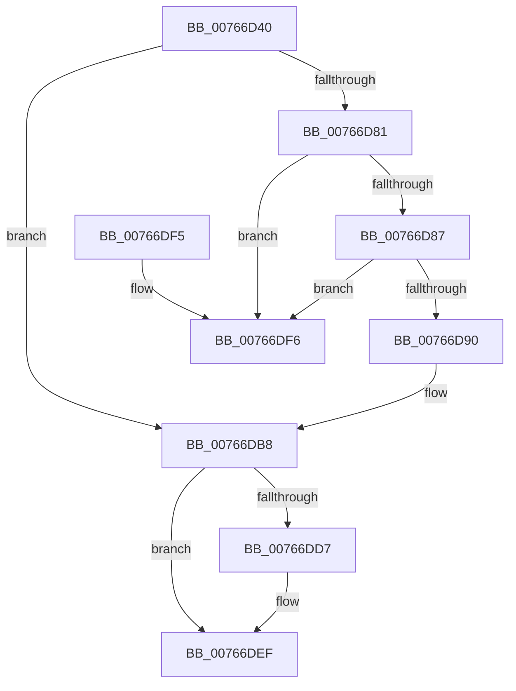

# PopBatteryRemove

- RVA: `0x00766D40`–`0x00766DFD` (길이 `189` bytes)
- VA: `0x0000000140766D40`
- 실행 섹션: `PAGE`
- PDB 이름 있음: `예`; PDB Function 태그: `아니요`
- unwind 정보 RVA: `0x0008474C`
- 디코드: `47`개 명령, `189/189` bytes 표시
- 미해석 바이트: `0` (있으면 어셈블리에 `.byte`로 보존)

> 이 문서는 커널 이미지의 기계어와 PDB 기호를 분석해 생성했습니다. 4번과 5번은 함수 원형과 자료형을 바이너리 사용 방식에서 추정한 C 해석이며 원본 소스 복구 결과는 아닙니다.

## 1. Dependencies

- 직접 호출 지점: **9**; 고유 호출 대상: **8**
- 직접 호출자로 확인된 함수: **0**
- RIP 상대 이미지 참조: **6**

### Outgoing calls
- `0x00766D4D` → [IoCancelIrp](../../text/27/IoCancelIrp_function_002720E0.md) (function, `0x002720E0`)
- `0x00766D64` → [KeWaitForSingleObject](../../text/20/KeWaitForSingleObject_function_0020E6B0.md) (function, `0x0020E6B0`)
- `0x00766D70` → [PopAcquireRwLockExclusive](../../text/43/PopAcquireRwLockExclusive_function_00430B44.md) (function, `0x00430B44`)
- `0x00766DB3` → [PopBatteryQueueWork](../../text/4A/PopBatteryQueueWork_function_004AE3DC.md) (function, `0x004AE3DC`)
- `0x00766DBD` → [PopBatteryQueueWork](../../text/4A/PopBatteryQueueWork_function_004AE3DC.md) (function, `0x004AE3DC`)
- `0x00766DC9` → [PopReleaseRwLock](../../text/2D/PopReleaseRwLock_function_002DFBBC.md) (function, `0x002DFBBC`)
- `0x00766DD7` → [PopAcquirePolicyLock](../../pagelk/B7/PopAcquirePolicyLock_function_00B783C0.md) (function, `0x00B783C0`)
- `0x00766DE5` → [PopChangeCapability](../90/PopChangeCapability_function_0090FF48.md) (function, `0x0090FF48`)
- `0x00766DEA` → [PopReleasePolicyLock](../../pagelk/B7/PopReleasePolicyLock_function_00B78410.md) (function, `0x00B78410`)

### Direct callers
- 이 함수 시작 RVA로 연결되는 직접 call은 확인되지 않았습니다. 간접 호출은 완전히 역산할 수 없습니다.

### Static image references
- `0x00766D69` → RVA `0x00F0C020` (`.data`; read)
- `0x00766DA0` → RVA `0x00F0C034` (`.data`; read/write)
- `0x00766DA6` → RVA `0x00F0C0B4` (`.data`; read/write)
- `0x00766DAC` → RVA `0x00F0C038` (`.data`; write)
- `0x00766DCE` → RVA `0x00F0C030` (`.data`; read/write)
- `0x00766DDE` → RVA `0x00F0CEDE` (`.data`; read)

## 2. Other-region calls and transfers

- 다른 실행 섹션으로 향하는 call: **8**
  - `0x00766D4D` → [IoCancelIrp](../../text/27/IoCancelIrp_function_002720E0.md) (`PAGE` → `.text`)
  - `0x00766D64` → [KeWaitForSingleObject](../../text/20/KeWaitForSingleObject_function_0020E6B0.md) (`PAGE` → `.text`)
  - `0x00766D70` → [PopAcquireRwLockExclusive](../../text/43/PopAcquireRwLockExclusive_function_00430B44.md) (`PAGE` → `.text`)
  - `0x00766DB3` → [PopBatteryQueueWork](../../text/4A/PopBatteryQueueWork_function_004AE3DC.md) (`PAGE` → `.text`)
  - `0x00766DBD` → [PopBatteryQueueWork](../../text/4A/PopBatteryQueueWork_function_004AE3DC.md) (`PAGE` → `.text`)
  - `0x00766DC9` → [PopReleaseRwLock](../../text/2D/PopReleaseRwLock_function_002DFBBC.md) (`PAGE` → `.text`)
  - `0x00766DD7` → [PopAcquirePolicyLock](../../pagelk/B7/PopAcquirePolicyLock_function_00B783C0.md) (`PAGE` → `PAGELK`)
  - `0x00766DEA` → [PopReleasePolicyLock](../../pagelk/B7/PopReleasePolicyLock_function_00B78410.md) (`PAGE` → `PAGELK`)
- 별도 외부 분기/꼬리 이동을 확인하지 못했습니다.

## 3. Assembly (complete function range)

```asm
00766D40  40 53                           push rbx
00766D42  48 83 EC 30                     sub rsp, 0x30
00766D46  48 8B D9                        mov rbx, rcx
00766D49  48 8B 49 38                     mov rcx, qword ptr [rcx + 0x38]
00766D4D  E8 8E B3 B0 FF                  call 0x1402720e0
00766D52  48 83 64 24 20 00               and qword ptr [rsp + 0x20], 0
00766D58  48 8D 4B 50                     lea rcx, [rbx + 0x50]
00766D5C  45 33 C9                        xor r9d, r9d
00766D5F  45 33 C0                        xor r8d, r8d
00766D62  33 D2                           xor edx, edx
00766D64  E8 47 79 AA FF                  call 0x14020e6b0
00766D69  48 8D 0D B0 52 7A 00            lea rcx, [rip + 0x7a52b0]
00766D70  E8 CF 9D CC FF                  call 0x140430b44
00766D75  48 83 C3 40                     add rbx, 0x40
00766D79  48 8B 0B                        mov rcx, qword ptr [rbx]
00766D7C  48 85 C9                        test rcx, rcx
00766D7F  74 37                           je 0x140766db8
00766D81  48 39 59 08                     cmp qword ptr [rcx + 8], rbx
00766D85  75 6F                           jne 0x140766df6
00766D87  48 8B 43 08                     mov rax, qword ptr [rbx + 8]
00766D8B  48 39 18                        cmp qword ptr [rax], rbx
00766D8E  75 66                           jne 0x140766df6
00766D90  48 89 08                        mov qword ptr [rax], rcx
00766D93  48 89 41 08                     mov qword ptr [rcx + 8], rax
00766D97  B9 03 00 00 00                  mov ecx, 3
00766D9C  48 83 23 00                     and qword ptr [rbx], 0
00766DA0  FF 0D 8E 52 7A 00               dec dword ptr [rip + 0x7a528e]
00766DA6  FF 05 08 53 7A 00               inc dword ptr [rip + 0x7a5308]
00766DAC  C6 05 85 52 7A 00 01            mov byte ptr [rip + 0x7a5285], 1
00766DB3  E8 24 76 D4 FF                  call 0x1404ae3dc
00766DB8  B9 08 00 00 00                  mov ecx, 8
00766DBD  E8 1A 76 D4 FF                  call 0x1404ae3dc
00766DC2  48 8D 0D 57 52 7A 00            lea rcx, [rip + 0x7a5257]
00766DC9  E8 EE 8D B7 FF                  call 0x1402dfbbc
00766DCE  83 05 5B 52 7A 00 FF            add dword ptr [rip + 0x7a525b], -1
00766DD5  75 18                           jne 0x140766def
00766DD7  E8 E4 15 41 00                  call 0x140b783c0
00766DDC  33 D2                           xor edx, edx
00766DDE  48 8D 0D F9 60 7A 00            lea rcx, [rip + 0x7a60f9]
00766DE5  E8 5E 91 1A 00                  call 0x14090ff48
00766DEA  E8 21 16 41 00                  call 0x140b78410
00766DEF  48 83 C4 30                     add rsp, 0x30
00766DF3  5B                              pop rbx
00766DF4  C3                              ret
00766DF5  CC                              int3
00766DF6  B9 03 00 00 00                  mov ecx, 3
00766DFB  CD 29                           int 0x29
```

## 4. C-style interpretation (structured pseudocode)

```c
__int64 __fastcall PopBatteryRemove(__int64 a1, int a2, int a3, int a4)
{
    __int64 result;
    __int64 v_rbx;
    __int64 v_rsp;
    unsigned __int64 v_stack_m18;

    v_rsp = (v_rsp) - (48);
    result = IoCancelIrp(*(unsigned __int64 *)(a1 + 56), a2, a3, a4);
    a4 = 0;
    a3 = 0;
    a2 = 0;
    result = KeWaitForSingleObject(a1 + 80, a2, a3, a4);
    result = PopAcquireRwLockExclusive(v_rip + 8016560, a2, a3, a4);
    v_rbx = (a1) + (64);
    if (*(unsigned __int64 *)(v_rbx) == 0) goto loc_00766DB8;
    if ((*(unsigned __int64 *)(*(unsigned __int64 *)(v_rbx) + 8)) != v_rbx) goto loc_00766DF6;
    if ((*(unsigned __int64 *)(*(unsigned __int64 *)(v_rbx + 8))) != v_rbx) goto loc_00766DF6;
    *(unsigned __int64 *)(*(unsigned __int64 *)(v_rbx + 8)) = *(unsigned __int64 *)(v_rbx);
    *(unsigned __int64 *)(*(unsigned __int64 *)(v_rbx) + 8) = *(unsigned __int64 *)(v_rbx + 8);
    *(unsigned __int8 *)(v_rip + 8016517) = 1;
    result = PopBatteryQueueWork(3, a2, a3, a4);
loc_00766DB8:
    result = PopBatteryQueueWork(8, a2, a3, a4);
    result = PopReleaseRwLock(v_rip + 8016471, a2, a3, a4);
    if ((*(unsigned __int64 *)(*(unsigned __int64 *)(v_rbx + 8))) == v_rbx) {
        result = PopAcquirePolicyLock(v_rip + 8016471, a2, a3, a4);
        a2 = 0;
        a1 = v_rip + 8020217;
        result = PopChangeCapability(a1, a2, a3, a4);
        result = PopReleasePolicyLock(a1, a2, a3, a4);
    }
    v_rsp = (v_rsp) + (48);
    return result;
loc_00766DF6:
    return result;
}
```

## 5. (Beta) C Style

```c
int64_t PopBatteryRemove(void *Arg1, int32_t Arg2, int32_t Arg3, int32_t Arg4)
{
    uint8_t *arg1 = (uint8_t *)Arg1;

    int64_t result;
    int64_t local_rbx;
    int64_t local_rsp;
    uint64_t v_stack_m18;

    local_rsp = (local_rsp) - (48);
    result = IoCancelIrp(*(uint64_t *)(arg1 + 0x38), Arg2, Arg3, Arg4);
    Arg4 = 0;
    Arg3 = 0;
    Arg2 = 0;
    result = KeWaitForSingleObject(Arg1 + 80, Arg2, Arg3, Arg4);
    result = PopAcquireRwLockExclusive(v_rip + 8016560, Arg2, Arg3, Arg4);
    local_rbx = (Arg1) + (64);
    if (*(uint64_t *)(local_rbx) == 0) goto loc_00766DB8;
    if ((*(uint64_t *)(*(uint64_t *)(local_rbx) + 0x8)) != local_rbx) goto loc_00766DF6;
    if ((*(uint64_t *)(*(uint64_t *)(local_rbx + 0x8))) != local_rbx) goto loc_00766DF6;
    *(uint64_t *)(*(uint64_t *)(local_rbx + 0x8)) = *(uint64_t *)(local_rbx);
    *(uint64_t *)(*(uint64_t *)(local_rbx) + 0x8) = *(uint64_t *)(local_rbx + 0x8);
    *(uint8_t *)(v_rip + 0x7A5285) = 1;
    result = PopBatteryQueueWork(3, Arg2, Arg3, Arg4);
loc_00766DB8:
    result = PopBatteryQueueWork(8, Arg2, Arg3, Arg4);
    result = PopReleaseRwLock(v_rip + 8016471, Arg2, Arg3, Arg4);
    if ((*(uint64_t *)(*(uint64_t *)(local_rbx + 0x8))) == local_rbx) {
        result = PopAcquirePolicyLock(v_rip + 8016471, Arg2, Arg3, Arg4);
        Arg2 = 0;
        Arg1 = v_rip + 8020217;
        result = PopChangeCapability(Arg1, Arg2, Arg3, Arg4);
        result = PopReleasePolicyLock(Arg1, Arg2, Arg3, Arg4);
    }
    local_rsp = (local_rsp) + (48);
    return result;
loc_00766DF6:
    return result;
}
```

### 관측된 메모리 오프셋

구조체 형식이 확인되지 않은 접근은 인자 기준의 오프셋으로만 기록했습니다.

| 기준 인자 | 오프셋 표현 | 폭 (bit) | 접근 |
|---|---:|---:|---|
| `Arg1` | `+ 0x0` | `64` | `R` |
| `Arg1` | `+ 0x0` | `64` | `R/W` |
| `Arg1` | `+ 0x8` | `64` | `R` |
| `Arg1` | `+ 0x38` | `64` | `R` |
| `Arg1` | `+ 0x50` | `64` | `R` |

## 6. Execution-region graph

[열기: 2D/3D 그래프와 함수 탐색 컨트롤 패널](../../../control-panel.html?section=page&rva=0x00766D40&view=graph)

- 2D 그래프는 위에서 아래로 흐르고, 3D 그래프는 빈 공간을 드래그해 회전합니다. Shift+드래그는 이동, 휠은 확대·축소, 함수 노드 선택은 대상 보고서 이동입니다.

### Static fallback


