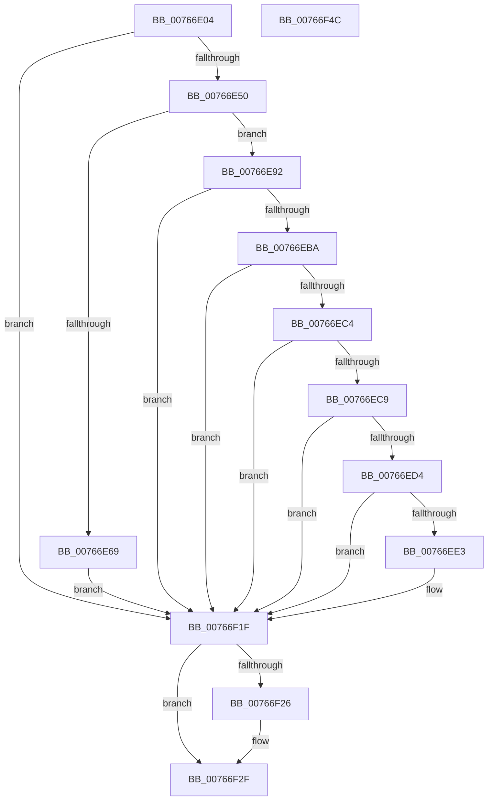

# PopBatteryTestExemptPolicyRegKeyAccess

- RVA: `0x00766E04`–`0x00766F4D` (길이 `329` bytes)
- VA: `0x0000000140766E04`
- 실행 섹션: `PAGE`
- PDB 이름 있음: `예`; PDB Function 태그: `아니요`
- unwind 정보 RVA: `0x000CCE3C`
- 디코드: `79`개 명령, `329/329` bytes 표시
- 미해석 바이트: `0` (있으면 어셈블리에 `.byte`로 보존)

> 이 문서는 커널 이미지의 기계어와 PDB 기호를 분석해 생성했습니다. 4번과 5번은 함수 원형과 자료형을 바이너리 사용 방식에서 추정한 C 해석이며 원본 소스 복구 결과는 아닙니다.

## 1. Dependencies

- 직접 호출 지점: **7**; 고유 호출 대상: **7**
- 직접 호출자로 확인된 함수: **2**
- RIP 상대 이미지 참조: **6**

### Outgoing calls
- `0x00766E43` → [PopOpenPowerKey](../../text/4B/PopOpenPowerKey_function_004B4314.md) (function, `0x004B4314`)
- `0x00766E5B` → [RtlInitUnicodeString](../../text/42/RtlInitUnicodeString_function_0042A780.md) (function, `0x0042A780`)
- `0x00766E88` → [ZwSetValueKey](../../text/6A/ZwSetValueKey_function_006ADCD0.md) (function, `0x006ADCD0`)
- `0x00766EB1` → [ZwQueryValueKey](../../text/6A/ZwQueryValueKey_function_006AD3B0.md) (function, `0x006AD3B0`)
- `0x00766F1A` → [tlgWriteTransfer_EtwWriteTransfer](../../text/42/tlgWriteTransfer_EtwWriteTransfer_function_004260E0.md) (function, `0x004260E0`)
- `0x00766F2A` → [ZwClose](../../text/6A/ZwClose_function_006AD2B0.md) (function, `0x006AD2B0`)
- `0x00766F36` → [_security_check_cookie](../../text/6A/_security_check_cookie_function_006AC640.md) (function, `0x006AC640`)

### Direct callers
- [PopBatteryUpdateTestExempt](PopBatteryUpdateTestExempt_function_00766F54.md) at `0x00766FA3`
- [PopBatteryInitPhaseTwo](../../init/C4/PopBatteryInitPhaseTwo_function_00C42148.md) at `0x00C421D0`

### Static image references
- `0x00766E16` → RVA `0x00E0A740` (`.data`; read)
- `0x00766E50` → RVA `0x00B02B50` (` ?? ::NNGAKEGL::`string'`; read)
- `0x00766E6E` → RVA `0x00E678AC` (`.data`; read)
- `0x00766ED4` → RVA `0x00E07748` (`.data`; read)
- `0x00766EDB` → RVA `0x00E678AC` (`.data`; write)
- `0x00766EE7` → RVA `0x0004C53A` (`.rdata`; read)

## 2. Other-region calls and transfers

- 다른 실행 섹션으로 향하는 call: **7**
  - `0x00766E43` → [PopOpenPowerKey](../../text/4B/PopOpenPowerKey_function_004B4314.md) (`PAGE` → `.text`)
  - `0x00766E5B` → [RtlInitUnicodeString](../../text/42/RtlInitUnicodeString_function_0042A780.md) (`PAGE` → `.text`)
  - `0x00766E88` → [ZwSetValueKey](../../text/6A/ZwSetValueKey_function_006ADCD0.md) (`PAGE` → `.text`)
  - `0x00766EB1` → [ZwQueryValueKey](../../text/6A/ZwQueryValueKey_function_006AD3B0.md) (`PAGE` → `.text`)
  - `0x00766F1A` → [tlgWriteTransfer_EtwWriteTransfer](../../text/42/tlgWriteTransfer_EtwWriteTransfer_function_004260E0.md) (`PAGE` → `.text`)
  - `0x00766F2A` → [ZwClose](../../text/6A/ZwClose_function_006AD2B0.md) (`PAGE` → `.text`)
  - `0x00766F36` → [_security_check_cookie](../../text/6A/_security_check_cookie_function_006AC640.md) (`PAGE` → `.text`)
- 별도 외부 분기/꼬리 이동을 확인하지 못했습니다.

## 3. Assembly (complete function range)

```asm
00766E04  48 89 7C 24 08                  mov qword ptr [rsp + 8], rdi
00766E09  55                              push rbp
00766E0A  48 8D 6C 24 A9                  lea rbp, [rsp - 0x57]
00766E0F  48 81 EC B0 00 00 00            sub rsp, 0xb0
00766E16  48 8B 05 23 39 6A 00            mov rax, qword ptr [rip + 0x6a3923]
00766E1D  48 33 C4                        xor rax, rsp
00766E20  48 89 45 47                     mov qword ptr [rbp + 0x47], rax
00766E24  48 83 65 DF 00                  and qword ptr [rbp - 0x21], 0
00766E29  0F 57 C0                        xorps xmm0, xmm0
00766E2C  33 C0                           xor eax, eax
00766E2E  40 8A F9                        mov dil, cl
00766E31  21 45 E7                        and dword ptr [rbp - 0x19], eax
00766E34  48 8D 4D DF                     lea rcx, [rbp - 0x21]
00766E38  0F 11 45 FF                     movups xmmword ptr [rbp - 1], xmm0
00766E3C  89 45 0F                        mov dword ptr [rbp + 0xf], eax
00766E3F  0F 11 45 EF                     movups xmmword ptr [rbp - 0x11], xmm0
00766E43  E8 CC D4 D4 FF                  call 0x1404b4314
00766E48  85 C0                           test eax, eax
00766E4A  0F 88 CF 00 00 00               js 0x140766f1f
00766E50  48 8D 15 F9 BC 39 00            lea rdx, [rip + 0x39bcf9]
00766E57  48 8D 4D EF                     lea rcx, [rbp - 0x11]
00766E5B  E8 20 39 CC FF                  call 0x14042a780
00766E60  48 8D 55 EF                     lea rdx, [rbp - 0x11]
00766E64  40 84 FF                        test dil, dil
00766E67  74 29                           je 0x140766e92
00766E69  B8 04 00 00 00                  mov eax, 4
00766E6E  48 8D 0D 37 0A 70 00            lea rcx, [rip + 0x700a37]
00766E75  89 44 24 28                     mov dword ptr [rsp + 0x28], eax
00766E79  44 8B C8                        mov r9d, eax
00766E7C  48 89 4C 24 20                  mov qword ptr [rsp + 0x20], rcx
00766E81  45 33 C0                        xor r8d, r8d
00766E84  48 8B 4D DF                     mov rcx, qword ptr [rbp - 0x21]
00766E88  E8 43 6E F4 FF                  call 0x1406adcd0
00766E8D  E9 8D 00 00 00                  jmp 0x140766f1f
00766E92  48 8B 4D DF                     mov rcx, qword ptr [rbp - 0x21]
00766E96  48 8D 45 E7                     lea rax, [rbp - 0x19]
00766E9A  48 89 44 24 28                  mov qword ptr [rsp + 0x28], rax
00766E9F  4C 8D 4D FF                     lea r9, [rbp - 1]
00766EA3  41 B8 02 00 00 00               mov r8d, 2
00766EA9  C7 44 24 20 14 00 00 00         mov dword ptr [rsp + 0x20], 0x14
00766EB1  E8 FA 64 F4 FF                  call 0x1406ad3b0
00766EB6  85 C0                           test eax, eax
00766EB8  78 65                           js 0x140766f1f
00766EBA  B8 04 00 00 00                  mov eax, 4
00766EBF  39 45 03                        cmp dword ptr [rbp + 3], eax
00766EC2  75 5B                           jne 0x140766f1f
00766EC4  39 45 07                        cmp dword ptr [rbp + 7], eax
00766EC7  75 56                           jne 0x140766f1f
00766EC9  8B 4D 0B                        mov ecx, dword ptr [rbp + 0xb]
00766ECC  3B 0D DA 09 70 00               cmp ecx, dword ptr [rip + 0x7009da]
00766ED2  74 4B                           je 0x140766f1f
00766ED4  83 3D 6D 08 6A 00 05            cmp dword ptr [rip + 0x6a086d], 5
00766EDB  89 0D CB 09 70 00               mov dword ptr [rip + 0x7009cb], ecx
00766EE1  76 3C                           jbe 0x140766f1f
00766EE3  83 65 43 00                     and dword ptr [rbp + 0x43], 0
00766EE7  48 8D 15 4C 56 8E FF            lea rdx, [rip - 0x71a9b4]
00766EEE  89 4D D7                        mov dword ptr [rbp - 0x29], ecx
00766EF1  45 33 C9                        xor r9d, r9d
00766EF4  48 8D 4D D7                     lea rcx, [rbp - 0x29]
00766EF8  89 45 3F                        mov dword ptr [rbp + 0x3f], eax
00766EFB  48 8D 45 17                     lea rax, [rbp + 0x17]
00766EFF  48 89 4D 37                     mov qword ptr [rbp + 0x37], rcx
00766F03  48 89 44 24 28                  mov qword ptr [rsp + 0x28], rax
00766F08  48 8D 0D 39 08 6A 00            lea rcx, [rip + 0x6a0839]
00766F0F  45 33 C0                        xor r8d, r8d
00766F12  C7 44 24 20 03 00 00 00         mov dword ptr [rsp + 0x20], 3
00766F1A  E8 C1 F1 CB FF                  call 0x1404260e0
00766F1F  48 83 7D DF 00                  cmp qword ptr [rbp - 0x21], 0
00766F24  74 09                           je 0x140766f2f
00766F26  48 8B 4D DF                     mov rcx, qword ptr [rbp - 0x21]
00766F2A  E8 81 63 F4 FF                  call 0x1406ad2b0
00766F2F  48 8B 4D 47                     mov rcx, qword ptr [rbp + 0x47]
00766F33  48 33 CC                        xor rcx, rsp
00766F36  E8 05 57 F4 FF                  call 0x1406ac640
00766F3B  48 8B BC 24 C0 00 00 00         mov rdi, qword ptr [rsp + 0xc0]
00766F43  48 81 C4 B0 00 00 00            add rsp, 0xb0
00766F4A  5D                              pop rbp
00766F4B  C3                              ret
00766F4C  CC                              int3
```

## 4. C-style interpretation (structured pseudocode)

```c
__int64 __fastcall PopBatteryTestExemptPolicyRegKeyAccess(unsigned __int8 a1, __int64 a2, int a3)
{
    __int64 result;
    __int64 v_rsp;
    unsigned __int64 v_stack_m18;
    unsigned int v_stack_m1C;
    unsigned int v_stack_m20;
    unsigned __int64 v_stack_m28;
    unsigned __int64 v_stack_m48;
    unsigned int v_stack_m50;
    unsigned int v_stack_m54;
    unsigned int v_stack_m58;
    unsigned int v_stack_m5C;
    unsigned __int64 v_stack_m5F;
    unsigned __int64 v_stack_m60;
    unsigned __int64 v_stack_m70;
    unsigned int v_stack_m78;
    unsigned __int64 v_stack_m80;
    unsigned int v_stack_m88;
    unsigned int v_stack_m90;
    unsigned __int64 v_stack_m98;
    unsigned __int64 v_stack_p8;

    v_stack_p8 = v_rdi;
    v_rsp = (v_rsp) - (176);
    result = (*(unsigned __int64 *)(v_rip + 6961443)) ^ (v_rsp);
    v_stack_m18 = result;
    result = 0;
    v_stack_m60 = v_xmm0;
    v_stack_m50 = 0;
    v_stack_m70 = v_xmm0;
    result = PopOpenPowerKey(v_stack_m80, a2, a3, a4);
    if (sign_flag) goto loc_00766F1F;
    result = RtlInitUnicodeString(v_stack_m70, v_rip + 3783929, a3, a4);
    if (a1 == 0) goto loc_00766E92;
    v_stack_m90 = 4;
    v_stack_m98 = v_rip + 7342647;
    a3 = 0;
    result = ZwSetValueKey(v_stack_m80, v_stack_m70, a3, 4);
    goto loc_00766F1F;
loc_00766E92:
    v_stack_m90 = v_stack_m78;
    v_stack_m98 = 20;
    result = ZwQueryValueKey(v_stack_m80, v_stack_m70, 2, v_stack_m60);
    if (sign_flag) goto loc_00766F1F;
    if (v_stack_m5C != 4) goto loc_00766F1F;
    if (v_stack_m58 != 4) goto loc_00766F1F;
    if (((unsigned int)((unsigned int)(v_stack_m54))) == (*(unsigned int *)(v_rip + 7342554))) goto loc_00766F1F;
    *(unsigned int *)(v_rip + 7342539) = (unsigned int)((unsigned int)(v_stack_m54));
    result = 4;
    if ((*(unsigned int *)(v_rip + 6948973)) >= = 5) {
        a2 = v_rip - 7449012;
        v_stack_m88 = (unsigned int)((unsigned int)(v_stack_m54));
        a4 = 0;
        a1 = v_stack_m88;
        v_stack_m20 = 4;
        result = v_stack_m48;
        v_stack_m28 = a1;
        v_stack_m90 = result;
        a1 = v_rip + 6948921;
        a3 = 0;
        v_stack_m98 = 3;
        result = tlgWriteTransfer_EtwWriteTransfer(a1, a2, a3, a4);
    }
    if (v_stack_m80 != 0) {
        a1 = v_stack_m80;
        result = ZwClose(a1, a2, a3, a4);
    }
    a1 = (v_stack_m18) ^ (v_rsp);
    result = _security_check_cookie(a1, a2, a3, a4);
    v_rsp = (v_rsp) + (176);
    return result;
}
```

## 5. (Beta) C Style

```c
int64_t PopBatteryTestExemptPolicyRegKeyAccess(uint8_t Arg1, int64_t Arg2, int32_t Arg3)
{
    int64_t result;
    int64_t local_rsp;
    uint64_t v_stack_m18;
    uint32_t v_stack_m1C;
    uint32_t v_stack_m20;
    uint64_t v_stack_m28;
    uint64_t v_stack_m48;
    uint32_t v_stack_m50;
    uint32_t v_stack_m54;
    uint32_t v_stack_m58;
    uint32_t v_stack_m5C;
    uint64_t v_stack_m5F;
    uint64_t v_stack_m60;
    uint64_t v_stack_m70;
    uint32_t v_stack_m78;
    uint64_t v_stack_m80;
    uint32_t v_stack_m88;
    uint32_t v_stack_m90;
    uint64_t v_stack_m98;
    uint64_t v_stack_p8;

    v_stack_p8 = local_rdi;
    local_rsp = (local_rsp) - (176);
    result = (*(uint64_t *)(v_rip + 0x6A3923)) ^ (local_rsp);
    v_stack_m18 = result;
    result = 0;
    v_stack_m60 = v_xmm0;
    v_stack_m50 = 0;
    v_stack_m70 = v_xmm0;
    result = PopOpenPowerKey(v_stack_m80, Arg2, Arg3, a4);
    if (sign_flag) goto loc_00766F1F;
    result = RtlInitUnicodeString(v_stack_m70, v_rip + 3783929, Arg3, a4);
    if (Arg1 == 0) goto loc_00766E92;
    v_stack_m90 = 4;
    v_stack_m98 = v_rip + 7342647;
    Arg3 = 0;
    result = ZwSetValueKey(v_stack_m80, v_stack_m70, Arg3, 4);
    goto loc_00766F1F;
loc_00766E92:
    v_stack_m90 = v_stack_m78;
    v_stack_m98 = 20;
    result = ZwQueryValueKey(v_stack_m80, v_stack_m70, 2, v_stack_m60);
    if (sign_flag) goto loc_00766F1F;
    if (v_stack_m5C != 4) goto loc_00766F1F;
    if (v_stack_m58 != 4) goto loc_00766F1F;
    if (((uint32_t)((uint32_t)(v_stack_m54))) == (*(uint32_t *)(v_rip + 0x7009DA))) goto loc_00766F1F;
    *(uint32_t *)(v_rip + 0x7009CB) = (uint32_t)((uint32_t)(v_stack_m54));
    result = 4;
    if ((*(uint32_t *)(v_rip + 0x6A086D)) >= = 5) {
        Arg2 = v_rip - 7449012;
        v_stack_m88 = (uint32_t)((uint32_t)(v_stack_m54));
        a4 = 0;
        Arg1 = v_stack_m88;
        v_stack_m20 = 4;
        result = v_stack_m48;
        v_stack_m28 = Arg1;
        v_stack_m90 = result;
        Arg1 = v_rip + 6948921;
        Arg3 = 0;
        v_stack_m98 = 3;
        result = tlgWriteTransfer_EtwWriteTransfer(Arg1, Arg2, Arg3, a4);
    }
    if (v_stack_m80 != 0) {
        Arg1 = v_stack_m80;
        result = ZwClose(Arg1, Arg2, Arg3, a4);
    }
    Arg1 = (v_stack_m18) ^ (local_rsp);
    result = _security_check_cookie(Arg1, Arg2, Arg3, a4);
    local_rsp = (local_rsp) + (176);
    return result;
}
```

## 6. Execution-region graph

[열기: 2D/3D 그래프와 함수 탐색 컨트롤 패널](../../../control-panel.html?section=page&rva=0x00766E04&view=graph)

- 2D 그래프는 위에서 아래로 흐르고, 3D 그래프는 빈 공간을 드래그해 회전합니다. Shift+드래그는 이동, 휠은 확대·축소, 함수 노드 선택은 대상 보고서 이동입니다.

### Static fallback


