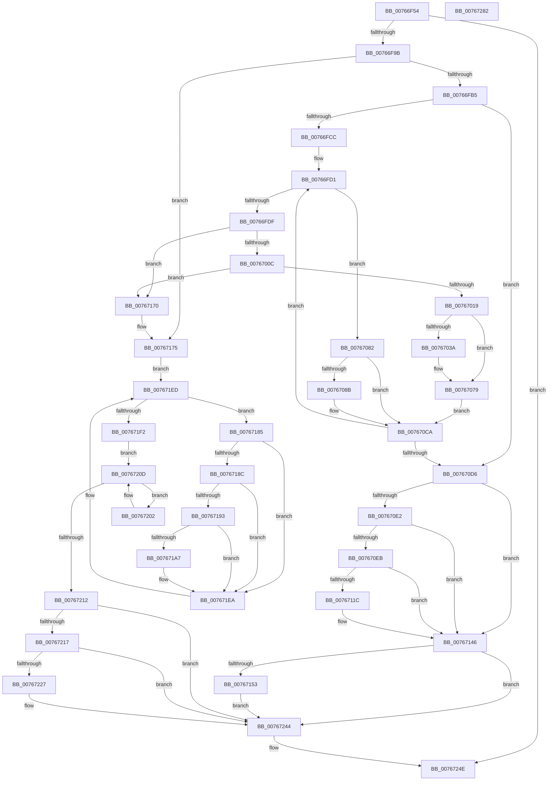

# PopBatteryUpdateTestExempt

- RVA: `0x00766F54`–`0x00767283` (길이 `815` bytes)
- VA: `0x0000000140766F54`
- 실행 섹션: `PAGE`
- PDB 이름 있음: `예`; PDB Function 태그: `아니요`
- unwind 정보 RVA: `0x000CD018`
- 디코드: `188`개 명령, `815/815` bytes 표시
- 미해석 바이트: `0` (있으면 어셈블리에 `.byte`로 보존)

> 이 문서는 커널 이미지의 기계어와 PDB 기호를 분석해 생성했습니다. 4번과 5번은 함수 원형과 자료형을 바이너리 사용 방식에서 추정한 C 해석이며 원본 소스 복구 결과는 아닙니다.

## 1. Dependencies

- 직접 호출 지점: **23**; 고유 호출 대상: **14**
- 직접 호출자로 확인된 함수: **1**
- RIP 상대 이미지 참조: **17**

### Outgoing calls
- `0x00766F8A` → [PopAcquireRwLockExclusive](../../text/43/PopAcquireRwLockExclusive_function_00430B44.md) (function, `0x00430B44`)
- `0x00766FA3` → [PopBatteryTestExemptPolicyRegKeyAccess](PopBatteryTestExemptPolicyRegKeyAccess_function_00766E04.md) (function, `0x00766E04`)
- `0x00766FE3` → [IoCancelIrp](../../text/27/IoCancelIrp_function_002720E0.md) (function, `0x002720E0`)
- `0x00766FFA` → [KeWaitForSingleObject](../../text/20/KeWaitForSingleObject_function_0020E6B0.md) (function, `0x0020E6B0`)
- `0x00767074` → [tlgWriteTransfer_EtwWriteTransfer](../../text/42/tlgWriteTransfer_EtwWriteTransfer_function_004260E0.md) (function, `0x004260E0`)
- `0x0076707B` → [PopBatteryQueueWork](../../text/4A/PopBatteryQueueWork_function_004AE3DC.md) (function, `0x004AE3DC`)
- `0x007670C5` → [tlgWriteTransfer_EtwWriteTransfer](../../text/42/tlgWriteTransfer_EtwWriteTransfer_function_004260E0.md) (function, `0x004260E0`)
- `0x007670EF` → [IoCancelIrp](../../text/27/IoCancelIrp_function_002720E0.md) (function, `0x002720E0`)
- `0x00767106` → [KeWaitForSingleObject](../../text/20/KeWaitForSingleObject_function_0020E6B0.md) (function, `0x0020E6B0`)
- `0x00767141` → [tlgWriteTransfer_EtwWriteTransfer](../../text/42/tlgWriteTransfer_EtwWriteTransfer_function_004260E0.md) (function, `0x004260E0`)
- `0x00767153` → [PopAcquirePolicyLock](../../pagelk/B7/PopAcquirePolicyLock_function_00B783C0.md) (function, `0x00B783C0`)
- `0x00767161` → [PopChangeCapability](../90/PopChangeCapability_function_0090FF48.md) (function, `0x0090FF48`)
- `0x00767166` → [PopReleasePolicyLock](../../pagelk/B7/PopReleasePolicyLock_function_00B78410.md) (function, `0x00B78410`)
- `0x00767196` → [PopBatteryWaitTag](../AD/PopBatteryWaitTag_function_00AD2BF8.md) (function, `0x00AD2BF8`)
- `0x007671E5` → [tlgWriteTransfer_EtwWriteTransfer](../../text/42/tlgWriteTransfer_EtwWriteTransfer_function_004260E0.md) (function, `0x004260E0`)
- `0x00767205` → [PopPowerAdapterReinitialize](PopPowerAdapterReinitialize_function_00767E48.md) (function, `0x00767E48`)
- `0x00767227` → [PopAcquirePolicyLock](../../pagelk/B7/PopAcquirePolicyLock_function_00B783C0.md) (function, `0x00B783C0`)
- `0x00767235` → [PopChangeCapability](../90/PopChangeCapability_function_0090FF48.md) (function, `0x0090FF48`)
- `0x0076723A` → [PopReleasePolicyLock](../../pagelk/B7/PopReleasePolicyLock_function_00B78410.md) (function, `0x00B78410`)
- `0x0076723F` → [PopCadNotifyBatteryPresence](PopCadNotifyBatteryPresence_function_0076FF78.md) (function, `0x0076FF78`)
- `0x00767249` → [PopBatteryQueueWork](../../text/4A/PopBatteryQueueWork_function_004AE3DC.md) (function, `0x004AE3DC`)
- `0x00767255` → [PopReleaseRwLock](../../text/2D/PopReleaseRwLock_function_002DFBBC.md) (function, `0x002DFBBC`)
- `0x00767263` → [_security_check_cookie](../../text/6A/_security_check_cookie_function_006AC640.md) (function, `0x006AC640`)

### Direct callers
- [PopPowerInformationInternal](../A8/PopPowerInformationInternal_function_00A8B7C0.md) at `0x00A8D308`

### Static image references
- `0x00766F6F` → RVA `0x00E0A740` (`.data`; read)
- `0x00766F83` → RVA `0x00F0C020` (`.data`; read)
- `0x00766F8F` → RVA `0x00E678AC` (`.data`; read)
- `0x00766F9D` → RVA `0x00E678AC` (`.data`; write)
- `0x00766FB5` → RVA `0x00F0C050` (`.data`; read)
- `0x00767024` → RVA `0x00F0C034` (`.data`; read/write)
- `0x0076702A` → RVA `0x00E07748` (`.data`; read)
- `0x00767031` → RVA `0x00F0C038` (`.data`; write)
- `0x0076703D` → RVA `0x0004C5BE` (`.rdata`; read)
- `0x0076708E` → RVA `0x0004C722` (`.rdata`; read)
- `0x007670D6` → RVA `0x00F0C2D8` (`.data`; read)
- `0x0076710B` → RVA `0x00F0C2D8` (`.data`; read/write)
- `0x00767128` → RVA `0x0004C750` (`.rdata`; read)
- `0x0076715A` → RVA `0x00F0CEDE` (`.data`; read)
- `0x00767175` → RVA `0x00F0C040` (`.data`; read)
- `0x007671AA` → RVA `0x0004C675` (`.rdata`; read)
- `0x007671F2` → RVA `0x00F0C2C8` (`.data`; read)

## 2. Other-region calls and transfers

- 다른 실행 섹션으로 향하는 call: **17**
  - `0x00766F8A` → [PopAcquireRwLockExclusive](../../text/43/PopAcquireRwLockExclusive_function_00430B44.md) (`PAGE` → `.text`)
  - `0x00766FE3` → [IoCancelIrp](../../text/27/IoCancelIrp_function_002720E0.md) (`PAGE` → `.text`)
  - `0x00766FFA` → [KeWaitForSingleObject](../../text/20/KeWaitForSingleObject_function_0020E6B0.md) (`PAGE` → `.text`)
  - `0x00767074` → [tlgWriteTransfer_EtwWriteTransfer](../../text/42/tlgWriteTransfer_EtwWriteTransfer_function_004260E0.md) (`PAGE` → `.text`)
  - `0x0076707B` → [PopBatteryQueueWork](../../text/4A/PopBatteryQueueWork_function_004AE3DC.md) (`PAGE` → `.text`)
  - `0x007670C5` → [tlgWriteTransfer_EtwWriteTransfer](../../text/42/tlgWriteTransfer_EtwWriteTransfer_function_004260E0.md) (`PAGE` → `.text`)
  - `0x007670EF` → [IoCancelIrp](../../text/27/IoCancelIrp_function_002720E0.md) (`PAGE` → `.text`)
  - `0x00767106` → [KeWaitForSingleObject](../../text/20/KeWaitForSingleObject_function_0020E6B0.md) (`PAGE` → `.text`)
  - `0x00767141` → [tlgWriteTransfer_EtwWriteTransfer](../../text/42/tlgWriteTransfer_EtwWriteTransfer_function_004260E0.md) (`PAGE` → `.text`)
  - `0x00767153` → [PopAcquirePolicyLock](../../pagelk/B7/PopAcquirePolicyLock_function_00B783C0.md) (`PAGE` → `PAGELK`)
  - `0x00767166` → [PopReleasePolicyLock](../../pagelk/B7/PopReleasePolicyLock_function_00B78410.md) (`PAGE` → `PAGELK`)
  - `0x007671E5` → [tlgWriteTransfer_EtwWriteTransfer](../../text/42/tlgWriteTransfer_EtwWriteTransfer_function_004260E0.md) (`PAGE` → `.text`)
  - `0x00767227` → [PopAcquirePolicyLock](../../pagelk/B7/PopAcquirePolicyLock_function_00B783C0.md) (`PAGE` → `PAGELK`)
  - `0x0076723A` → [PopReleasePolicyLock](../../pagelk/B7/PopReleasePolicyLock_function_00B78410.md) (`PAGE` → `PAGELK`)
  - `0x00767249` → [PopBatteryQueueWork](../../text/4A/PopBatteryQueueWork_function_004AE3DC.md) (`PAGE` → `.text`)
  - `0x00767255` → [PopReleaseRwLock](../../text/2D/PopReleaseRwLock_function_002DFBBC.md) (`PAGE` → `.text`)
  - `0x00767263` → [_security_check_cookie](../../text/6A/_security_check_cookie_function_006AC640.md) (`PAGE` → `.text`)
- 별도 외부 분기/꼬리 이동을 확인하지 못했습니다.

## 3. Assembly (complete function range)

```asm
00766F54  48 8B C4                        mov rax, rsp
00766F57  48 89 58 08                     mov qword ptr [rax + 8], rbx
00766F5B  48 89 70 10                     mov qword ptr [rax + 0x10], rsi
00766F5F  48 89 78 18                     mov qword ptr [rax + 0x18], rdi
00766F63  4C 89 70 20                     mov qword ptr [rax + 0x20], r14
00766F67  55                              push rbp
00766F68  48 8B EC                        mov rbp, rsp
00766F6B  48 83 EC 70                     sub rsp, 0x70
00766F6F  48 8B 05 CA 37 6A 00            mov rax, qword ptr [rip + 0x6a37ca]
00766F76  48 33 C4                        xor rax, rsp
00766F79  48 89 45 F8                     mov qword ptr [rbp - 8], rax
00766F7D  0F B6 D9                        movzx ebx, cl
00766F80  40 32 FF                        xor dil, dil
00766F83  48 8D 0D 96 50 7A 00            lea rcx, [rip + 0x7a5096]
00766F8A  E8 B5 9B CC FF                  call 0x140430b44
00766F8F  39 1D 17 09 70 00               cmp dword ptr [rip + 0x700917], ebx
00766F95  0F 84 B3 02 00 00               je 0x14076724e
00766F9B  B1 01                           mov cl, 1
00766F9D  89 1D 09 09 70 00               mov dword ptr [rip + 0x700909], ebx
00766FA3  E8 5C FE FF FF                  call 0x140766e04
00766FA8  83 3D FD 08 70 00 00            cmp dword ptr [rip + 0x7008fd], 0
00766FAF  0F 84 C0 01 00 00               je 0x140767175
00766FB5  48 8B 1D 94 50 7A 00            mov rbx, qword ptr [rip + 0x7a5094]
00766FBC  48 8D 3D 8D 50 7A 00            lea rdi, [rip + 0x7a508d]
00766FC3  48 3B DF                        cmp rbx, rdi
00766FC6  0F 84 0A 01 00 00               je 0x1407670d6
00766FCC  BE 03 00 00 00                  mov esi, 3
00766FD1  8B 43 30                        mov eax, dword ptr [rbx + 0x30]
00766FD4  4C 8B 33                        mov r14, qword ptr [rbx]
00766FD7  A8 10                           test al, 0x10
00766FD9  0F 85 A3 00 00 00               jne 0x140767082
00766FDF  48 8B 4B F8                     mov rcx, qword ptr [rbx - 8]
00766FE3  E8 F8 B0 B0 FF                  call 0x1402720e0
00766FE8  48 83 64 24 20 00               and qword ptr [rsp + 0x20], 0
00766FEE  48 8D 4B 10                     lea rcx, [rbx + 0x10]
00766FF2  45 33 C9                        xor r9d, r9d
00766FF5  45 33 C0                        xor r8d, r8d
00766FF8  33 D2                           xor edx, edx
00766FFA  E8 B1 76 AA FF                  call 0x14020e6b0
00766FFF  48 8B 0B                        mov rcx, qword ptr [rbx]
00767002  48 39 59 08                     cmp qword ptr [rcx + 8], rbx
00767006  0F 85 64 01 00 00               jne 0x140767170
0076700C  48 8B 43 08                     mov rax, qword ptr [rbx + 8]
00767010  48 39 18                        cmp qword ptr [rax], rbx
00767013  0F 85 57 01 00 00               jne 0x140767170
00767019  48 89 08                        mov qword ptr [rax], rcx
0076701C  48 89 41 08                     mov qword ptr [rcx + 8], rax
00767020  48 83 23 00                     and qword ptr [rbx], 0
00767024  FF 0D 0A 50 7A 00               dec dword ptr [rip + 0x7a500a]
0076702A  83 3D 17 07 6A 00 05            cmp dword ptr [rip + 0x6a0717], 5
00767031  C6 05 00 50 7A 00 01            mov byte ptr [rip + 0x7a5000], 1
00767038  76 3F                           jbe 0x140767079
0076703A  8B 43 2C                        mov eax, dword ptr [rbx + 0x2c]
0076703D  48 8D 15 7A 55 8E FF            lea rdx, [rip - 0x71aa86]
00767044  83 65 F4 00                     and dword ptr [rbp - 0xc], 0
00767048  48 8D 0D F9 06 6A 00            lea rcx, [rip + 0x6a06f9]
0076704F  89 45 C0                        mov dword ptr [rbp - 0x40], eax
00767052  45 33 C9                        xor r9d, r9d
00767055  48 8D 45 C0                     lea rax, [rbp - 0x40]
00767059  C7 45 F0 04 00 00 00            mov dword ptr [rbp - 0x10], 4
00767060  48 89 45 E8                     mov qword ptr [rbp - 0x18], rax
00767064  45 33 C0                        xor r8d, r8d
00767067  48 8D 45 C8                     lea rax, [rbp - 0x38]
0076706B  48 89 44 24 28                  mov qword ptr [rsp + 0x28], rax
00767070  89 74 24 20                     mov dword ptr [rsp + 0x20], esi
00767074  E8 67 F0 CB FF                  call 0x1404260e0
00767079  8B CE                           mov ecx, esi
0076707B  E8 5C 73 D4 FF                  call 0x1404ae3dc
00767080  EB 48                           jmp 0x1407670ca
00767082  83 3D BF 06 6A 00 05            cmp dword ptr [rip + 0x6a06bf], 5
00767089  76 3F                           jbe 0x1407670ca
0076708B  8B 43 2C                        mov eax, dword ptr [rbx + 0x2c]
0076708E  48 8D 15 8D 56 8E FF            lea rdx, [rip - 0x71a973]
00767095  83 65 F4 00                     and dword ptr [rbp - 0xc], 0
00767099  48 8D 0D A8 06 6A 00            lea rcx, [rip + 0x6a06a8]
007670A0  89 45 C0                        mov dword ptr [rbp - 0x40], eax
007670A3  45 33 C9                        xor r9d, r9d
007670A6  48 8D 45 C0                     lea rax, [rbp - 0x40]
007670AA  C7 45 F0 04 00 00 00            mov dword ptr [rbp - 0x10], 4
007670B1  48 89 45 E8                     mov qword ptr [rbp - 0x18], rax
007670B5  45 33 C0                        xor r8d, r8d
007670B8  48 8D 45 C8                     lea rax, [rbp - 0x38]
007670BC  48 89 44 24 28                  mov qword ptr [rsp + 0x28], rax
007670C1  89 74 24 20                     mov dword ptr [rsp + 0x20], esi
007670C5  E8 16 F0 CB FF                  call 0x1404260e0
007670CA  49 8B DE                        mov rbx, r14
007670CD  4C 3B F7                        cmp r14, rdi
007670D0  0F 85 FB FE FF FF               jne 0x140766fd1
007670D6  48 8B 1D FB 51 7A 00            mov rbx, qword ptr [rip + 0x7a51fb]
007670DD  48 85 DB                        test rbx, rbx
007670E0  74 64                           je 0x140767146
007670E2  83 BB 80 00 00 00 01            cmp dword ptr [rbx + 0x80], 1
007670E9  75 5B                           jne 0x140767146
007670EB  48 8B 4B 38                     mov rcx, qword ptr [rbx + 0x38]
007670EF  E8 EC AF B0 FF                  call 0x1402720e0
007670F4  48 83 64 24 20 00               and qword ptr [rsp + 0x20], 0
007670FA  48 8D 4B 68                     lea rcx, [rbx + 0x68]
007670FE  45 33 C9                        xor r9d, r9d
00767101  45 33 C0                        xor r8d, r8d
00767104  33 D2                           xor edx, edx
00767106  E8 A5 75 AA FF                  call 0x14020e6b0
0076710B  48 83 25 C5 51 7A 00 00         and qword ptr [rip + 0x7a51c5], 0
00767113  83 3D 2E 06 6A 00 05            cmp dword ptr [rip + 0x6a062e], 5
0076711A  76 2A                           jbe 0x140767146
0076711C  48 8D 45 C8                     lea rax, [rbp - 0x38]
00767120  45 33 C9                        xor r9d, r9d
00767123  48 89 44 24 28                  mov qword ptr [rsp + 0x28], rax
00767128  48 8D 15 21 56 8E FF            lea rdx, [rip - 0x71a9df]
0076712F  45 33 C0                        xor r8d, r8d
00767132  C7 44 24 20 02 00 00 00         mov dword ptr [rsp + 0x20], 2
0076713A  48 8D 0D 07 06 6A 00            lea rcx, [rip + 0x6a0607]
00767141  E8 9A EF CB FF                  call 0x1404260e0
00767146  48 39 3D 03 4F 7A 00            cmp qword ptr [rip + 0x7a4f03], rdi
0076714D  0F 85 F1 00 00 00               jne 0x140767244
00767153  E8 68 12 41 00                  call 0x140b783c0
00767158  33 D2                           xor edx, edx
0076715A  48 8D 0D 7D 5D 7A 00            lea rcx, [rip + 0x7a5d7d]
00767161  E8 E2 8D 1A 00                  call 0x14090ff48
00767166  E8 A5 12 41 00                  call 0x140b78410
0076716B  E9 D4 00 00 00                  jmp 0x140767244
00767170  48 8B CE                        mov rcx, rsi
00767173  CD 29                           int 0x29
00767175  48 8B 1D C4 4E 7A 00            mov rbx, qword ptr [rip + 0x7a4ec4]
0076717C  4C 8D 35 BD 4E 7A 00            lea r14, [rip + 0x7a4ebd]
00767183  EB 68                           jmp 0x1407671ed
00767185  8B 43 70                        mov eax, dword ptr [rbx + 0x70]
00767188  A8 10                           test al, 0x10
0076718A  75 5E                           jne 0x1407671ea
0076718C  48 83 7B 40 00                  cmp qword ptr [rbx + 0x40], 0
00767191  75 57                           jne 0x1407671ea
00767193  48 8B CB                        mov rcx, rbx
00767196  E8 5D BA 36 00                  call 0x140ad2bf8
0076719B  83 3D A6 05 6A 00 05            cmp dword ptr [rip + 0x6a05a6], 5
007671A2  40 B7 01                        mov dil, 1
007671A5  76 43                           jbe 0x1407671ea
007671A7  8B 43 6C                        mov eax, dword ptr [rbx + 0x6c]
007671AA  48 8D 15 C4 54 8E FF            lea rdx, [rip - 0x71ab3c]
007671B1  83 65 F4 00                     and dword ptr [rbp - 0xc], 0
007671B5  48 8D 0D 8C 05 6A 00            lea rcx, [rip + 0x6a058c]
007671BC  89 45 C0                        mov dword ptr [rbp - 0x40], eax
007671BF  45 33 C9                        xor r9d, r9d
007671C2  48 8D 45 C0                     lea rax, [rbp - 0x40]
007671C6  C7 45 F0 04 00 00 00            mov dword ptr [rbp - 0x10], 4
007671CD  48 89 45 E8                     mov qword ptr [rbp - 0x18], rax
007671D1  45 33 C0                        xor r8d, r8d
007671D4  48 8D 45 C8                     lea rax, [rbp - 0x38]
007671D8  48 89 44 24 28                  mov qword ptr [rsp + 0x28], rax
007671DD  C7 44 24 20 03 00 00 00         mov dword ptr [rsp + 0x20], 3
007671E5  E8 F6 EE CB FF                  call 0x1404260e0
007671EA  48 8B 1B                        mov rbx, qword ptr [rbx]
007671ED  49 3B DE                        cmp rbx, r14
007671F0  75 93                           jne 0x140767185
007671F2  48 8B 1D CF 50 7A 00            mov rbx, qword ptr [rip + 0x7a50cf]
007671F9  48 8D 35 C8 50 7A 00            lea rsi, [rip + 0x7a50c8]
00767200  EB 0B                           jmp 0x14076720d
00767202  48 8B CB                        mov rcx, rbx
00767205  E8 3E 0C 00 00                  call 0x140767e48
0076720A  48 8B 1B                        mov rbx, qword ptr [rbx]
0076720D  48 3B DE                        cmp rbx, rsi
00767210  75 F0                           jne 0x140767202
00767212  40 84 FF                        test dil, dil
00767215  74 2D                           je 0x140767244
00767217  48 8D 3D 32 4E 7A 00            lea rdi, [rip + 0x7a4e32]
0076721E  48 39 3D 2B 4E 7A 00            cmp qword ptr [rip + 0x7a4e2b], rdi
00767225  75 1D                           jne 0x140767244
00767227  E8 94 11 41 00                  call 0x140b783c0
0076722C  B2 01                           mov dl, 1
0076722E  48 8D 0D A9 5C 7A 00            lea rcx, [rip + 0x7a5ca9]
00767235  E8 0E 8D 1A 00                  call 0x14090ff48
0076723A  E8 D1 11 41 00                  call 0x140b78410
0076723F  E8 34 8D 00 00                  call 0x14076ff78
00767244  B9 08 00 00 00                  mov ecx, 8
00767249  E8 8E 71 D4 FF                  call 0x1404ae3dc
0076724E  48 8D 0D CB 4D 7A 00            lea rcx, [rip + 0x7a4dcb]
00767255  E8 62 89 B7 FF                  call 0x1402dfbbc
0076725A  33 C0                           xor eax, eax
0076725C  48 8B 4D F8                     mov rcx, qword ptr [rbp - 8]
00767260  48 33 CC                        xor rcx, rsp
00767263  E8 D8 53 F4 FF                  call 0x1406ac640
00767268  4C 8D 5C 24 70                  lea r11, [rsp + 0x70]
0076726D  49 8B 5B 10                     mov rbx, qword ptr [r11 + 0x10]
00767271  49 8B 73 18                     mov rsi, qword ptr [r11 + 0x18]
00767275  49 8B 7B 20                     mov rdi, qword ptr [r11 + 0x20]
00767279  4D 8B 73 28                     mov r14, qword ptr [r11 + 0x28]
0076727D  49 8B E3                        mov rsp, r11
00767280  5D                              pop rbp
00767281  C3                              ret
00767282  CC                              int3
```

## 4. C-style interpretation (structured pseudocode)

```c
__int64 __fastcall PopBatteryUpdateTestExempt(unsigned __int8 a1, int a2, int a3, int a4)
{
    __int64 result;
    __int64 v_rdi;
    __int64 v_rsp;
    unsigned __int64 v_stack_m10;
    unsigned int v_stack_m14;
    unsigned int v_stack_m18;
    unsigned __int64 v_stack_m20;
    unsigned __int64 v_stack_m40;
    unsigned int v_stack_m48;
    unsigned __int64 v_stack_m50;
    unsigned __int64 v_stack_m58;
    unsigned __int64 v_stack_m8;

    *(unsigned __int64 *)(v_rsp + 8) = v_rbx;
    *(unsigned __int64 *)(v_rsp + 16) = v_rsi;
    *(unsigned __int64 *)(v_rsp + 24) = v_rdi;
    *(unsigned __int64 *)(v_rsp + 32) = v_r14;
    v_rsp = (v_rsp) - (112);
    result = (*(unsigned __int64 *)(v_rip + 6961098)) ^ (v_rsp);
    v_stack_m10 = result;
    v_rdi = 0;
    result = PopAcquireRwLockExclusive(v_rip + 8016022, a2, a3, a4);
    if ((*(unsigned int *)(v_rip + 7342359)) == a1) goto loc_0076724E;
    *(unsigned int *)(v_rip + 7342345) = a1;
    result = PopBatteryTestExemptPolicyRegKeyAccess(1, a2, a3, a4);
    if ((*(unsigned int *)(v_rip + 7342333)) == 0) goto loc_00767175;
    if ((*(unsigned __int64 *)(v_rip + 8016020)) == (v_rip + 8016013)) goto loc_007670D6;
loc_00766FD1:
    if ((((unsigned __int8)((unsigned int)(*(unsigned int *)(*(unsigned __int64 *)(v_rip + 8016020) + 48)))) & (16)) != 0) goto loc_00767082;
    result = IoCancelIrp(*(unsigned __int64 *)(*(unsigned __int64 *)(v_rip + 8016020) - 8), a2, a3, a4);
    a4 = 0;
    a3 = 0;
    a2 = 0;
    result = KeWaitForSingleObject(*(unsigned __int64 *)(v_rip + 8016020) + 16, a2, a3, a4);
    if ((*(unsigned __int64 *)(*(unsigned __int64 *)(*(unsigned __int64 *)(v_rip + 8016020)) + 8)) != (*(unsigned __int64 *)(v_rip + 8016020))) goto loc_00767170;
    if ((*(unsigned __int64 *)(*(unsigned __int64 *)(*(unsigned __int64 *)(v_rip + 8016020) + 8))) != (*(unsigned __int64 *)(v_rip + 8016020))) goto loc_00767170;
    *(unsigned __int64 *)(*(unsigned __int64 *)(*(unsigned __int64 *)(v_rip + 8016020) + 8)) = *(unsigned __int64 *)(*(unsigned __int64 *)(v_rip + 8016020));
    *(unsigned __int64 *)(*(unsigned __int64 *)(*(unsigned __int64 *)(v_rip + 8016020)) + 8) = *(unsigned __int64 *)(*(unsigned __int64 *)(v_rip + 8016020) + 8);
    *(unsigned __int8 *)(v_rip + 8015872) = 1;
    result = *(unsigned __int64 *)(*(unsigned __int64 *)(v_rip + 8016020) + 8);
    if ((*(unsigned int *)(v_rip + 6948631)) >= = 5) {
        result = *(unsigned int *)(*(unsigned __int64 *)(v_rip + 8016020) + 44);
        a2 = v_rip - 7449222;
        a1 = v_rip + 6948601;
        v_stack_m48 = (unsigned int)(result);
        a4 = 0;
        result = v_stack_m48;
        v_stack_m18 = 4;
        v_stack_m20 = result;
        a3 = 0;
        result = v_stack_m40;
        v_stack_m50 = result;
        v_stack_m58 = 3;
        result = tlgWriteTransfer_EtwWriteTransfer(a1, a2, a3, a4);
    }
    result = PopBatteryQueueWork(3, a2, a3, a4);
    goto loc_007670CA;
loc_00767082:
    if ((*(unsigned int *)(v_rip + 6948543)) >= = 5) {
        result = *(unsigned int *)(*(unsigned __int64 *)(v_rip + 8016020) + 44);
        a2 = v_rip - 7448947;
        a1 = v_rip + 6948520;
        v_stack_m48 = (unsigned int)(result);
        a4 = 0;
        result = v_stack_m48;
        v_stack_m18 = 4;
        v_stack_m20 = result;
        a3 = 0;
        result = v_stack_m40;
        v_stack_m50 = result;
        v_stack_m58 = 3;
        result = tlgWriteTransfer_EtwWriteTransfer(a1, a2, a3, a4);
    }
    if ((*(unsigned __int64 *)(*(unsigned __int64 *)(v_rip + 8016020))) != (v_rip + 8016013)) goto loc_00766FD1;
loc_007670D6:
    if (*(unsigned __int64 *)(v_rip + 8016379) == 0) goto loc_00767146;
    if ((*(unsigned int *)(*(unsigned __int64 *)(v_rip + 8016379) + 128)) != 1) goto loc_00767146;
    result = IoCancelIrp(*(unsigned __int64 *)(*(unsigned __int64 *)(v_rip + 8016379) + 56), a2, a3, a4);
    a4 = 0;
    a3 = 0;
    a2 = 0;
    result = KeWaitForSingleObject(*(unsigned __int64 *)(v_rip + 8016379) + 104, a2, a3, a4);
    if ((*(unsigned int *)(v_rip + 6948398)) >= = 5) {
        result = v_stack_m40;
        a4 = 0;
        v_stack_m50 = result;
        a2 = v_rip - 7449055;
        a3 = 0;
        v_stack_m58 = 2;
        a1 = v_rip + 6948359;
        result = tlgWriteTransfer_EtwWriteTransfer(a1, a2, a3, a4);
    }
    if ((*(unsigned __int64 *)(v_rip + 8015619)) != (v_rip + 8016013)) goto loc_00767244;
    result = PopAcquirePolicyLock(a1, a2, a3, a4);
    a2 = 0;
    result = PopChangeCapability(v_rip + 8019325, a2, a3, a4);
    result = PopReleasePolicyLock(v_rip + 8019325, a2, a3, a4);
    goto loc_00767244;
loc_00767170:
loc_00767175:
    goto loc_007671ED;
loc_00767185:
    if ((((unsigned __int8)((unsigned int)(*(unsigned int *)(*(unsigned __int64 *)(v_rip + 8015556) + 112)))) & (16)) != 0) goto loc_007671EA;
    if ((*(unsigned __int64 *)(*(unsigned __int64 *)(v_rip + 8015556) + 64)) != 0) goto loc_007671EA;
    result = PopBatteryWaitTag(*(unsigned __int64 *)(v_rip + 8015556), a2, a3, a4);
    if ((*(unsigned int *)(v_rip + 6948262)) >= = 5) {
        result = *(unsigned int *)(*(unsigned __int64 *)(v_rip + 8015556) + 108);
        a2 = v_rip - 7449404;
        a1 = v_rip + 6948236;
        v_stack_m48 = (unsigned int)(result);
        a4 = 0;
        result = v_stack_m48;
        v_stack_m18 = 4;
        v_stack_m20 = result;
        a3 = 0;
        result = v_stack_m40;
        v_stack_m50 = result;
        v_stack_m58 = 3;
        result = tlgWriteTransfer_EtwWriteTransfer(a1, a2, a3, a4);
    }
loc_007671ED:
    if ((*(unsigned __int64 *)(*(unsigned __int64 *)(v_rip + 8015556))) != (v_rip + 8015549)) goto loc_00767185;
    goto loc_0076720D;
loc_00767202:
    result = PopPowerAdapterReinitialize(*(unsigned __int64 *)(v_rip + 8016079), a2, a3, a4);
loc_0076720D:
    if ((*(unsigned __int64 *)(*(unsigned __int64 *)(v_rip + 8016079))) != (v_rip + 8016072)) goto loc_00767202;
    if (1 == 0) goto loc_00767244;
    if ((*(unsigned __int64 *)(v_rip + 8015403)) == (v_rip + 8015410)) {
        result = PopAcquirePolicyLock(*(unsigned __int64 *)(v_rip + 8016079), a2, a3, a4);
        a2 = 1;
        a1 = v_rip + 8019113;
        result = PopChangeCapability(a1, a2, a3, a4);
        result = PopReleasePolicyLock(a1, a2, a3, a4);
        result = PopCadNotifyBatteryPresence(a1, a2, a3, a4);
    }
    result = PopBatteryQueueWork(8, a2, a3, a4);
loc_0076724E:
    result = PopReleaseRwLock(v_rip + 8015307, a2, a3, a4);
    result = 0;
    a1 = (v_stack_m10) ^ (v_rsp);
    result = _security_check_cookie(a1, a2, a3, a4);
    return result;
}
```

## 5. (Beta) C Style

```c
int64_t PopBatteryUpdateTestExempt(uint8_t Arg1, int32_t Arg2, int32_t Arg3, int32_t Arg4)
{
    int64_t result;
    int64_t local_rdi;
    int64_t local_rsp;
    uint64_t v_stack_m10;
    uint32_t v_stack_m14;
    uint32_t v_stack_m18;
    uint64_t v_stack_m20;
    uint64_t v_stack_m40;
    uint32_t v_stack_m48;
    uint64_t v_stack_m50;
    uint64_t v_stack_m58;
    uint64_t v_stack_m8;

    *(uint64_t *)(local_rsp + 0x8) = local_rbx;
    *(uint64_t *)(local_rsp + 0x10) = local_rsi;
    *(uint64_t *)(local_rsp + 0x18) = local_rdi;
    *(uint64_t *)(local_rsp + 0x20) = local_r14;
    local_rsp = (local_rsp) - (112);
    result = (*(uint64_t *)(v_rip + 0x6A37CA)) ^ (local_rsp);
    v_stack_m10 = result;
    local_rdi = 0;
    result = PopAcquireRwLockExclusive(v_rip + 8016022, Arg2, Arg3, Arg4);
    if ((*(uint32_t *)(v_rip + 0x700917)) == Arg1) goto loc_0076724E;
    *(uint32_t *)(v_rip + 0x700909) = Arg1;
    result = PopBatteryTestExemptPolicyRegKeyAccess(1, Arg2, Arg3, Arg4);
    if ((*(uint32_t *)(v_rip + 0x7008FD)) == 0) goto loc_00767175;
    if ((*(uint64_t *)(v_rip + 0x7A5094)) == (v_rip + 8016013)) goto loc_007670D6;
loc_00766FD1:
    if ((((uint8_t)((uint32_t)(*(uint32_t *)(*(uint64_t *)(v_rip + 0x7A5094) + 0x30)))) & (16)) != 0) goto loc_00767082;
    result = IoCancelIrp(*(uint64_t *)(*(uint64_t *)(v_rip + 0x7A5094) - 0x8), Arg2, Arg3, Arg4);
    Arg4 = 0;
    Arg3 = 0;
    Arg2 = 0;
    result = KeWaitForSingleObject(*(uint64_t *)(v_rip + 0x7A5094) + 16, Arg2, Arg3, Arg4);
    if ((*(uint64_t *)(*(uint64_t *)(*(uint64_t *)(v_rip + 0x7A5094)) + 0x8)) != (*(uint64_t *)(v_rip + 0x7A5094))) goto loc_00767170;
    if ((*(uint64_t *)(*(uint64_t *)(*(uint64_t *)(v_rip + 0x7A5094) + 0x8))) != (*(uint64_t *)(v_rip + 0x7A5094))) goto loc_00767170;
    *(uint64_t *)(*(uint64_t *)(*(uint64_t *)(v_rip + 0x7A5094) + 0x8)) = *(uint64_t *)(*(uint64_t *)(v_rip + 0x7A5094));
    *(uint64_t *)(*(uint64_t *)(*(uint64_t *)(v_rip + 0x7A5094)) + 0x8) = *(uint64_t *)(*(uint64_t *)(v_rip + 0x7A5094) + 0x8);
    *(uint8_t *)(v_rip + 0x7A5000) = 1;
    result = *(uint64_t *)(*(uint64_t *)(v_rip + 0x7A5094) + 0x8);
    if ((*(uint32_t *)(v_rip + 0x6A0717)) >= = 5) {
        result = *(uint32_t *)(*(uint64_t *)(v_rip + 0x7A5094) + 0x2C);
        Arg2 = v_rip - 7449222;
        Arg1 = v_rip + 6948601;
        v_stack_m48 = (uint32_t)(result);
        Arg4 = 0;
        result = v_stack_m48;
        v_stack_m18 = 4;
        v_stack_m20 = result;
        Arg3 = 0;
        result = v_stack_m40;
        v_stack_m50 = result;
        v_stack_m58 = 3;
        result = tlgWriteTransfer_EtwWriteTransfer(Arg1, Arg2, Arg3, Arg4);
    }
    result = PopBatteryQueueWork(3, Arg2, Arg3, Arg4);
    goto loc_007670CA;
loc_00767082:
    if ((*(uint32_t *)(v_rip + 0x6A06BF)) >= = 5) {
        result = *(uint32_t *)(*(uint64_t *)(v_rip + 0x7A5094) + 0x2C);
        Arg2 = v_rip - 7448947;
        Arg1 = v_rip + 6948520;
        v_stack_m48 = (uint32_t)(result);
        Arg4 = 0;
        result = v_stack_m48;
        v_stack_m18 = 4;
        v_stack_m20 = result;
        Arg3 = 0;
        result = v_stack_m40;
        v_stack_m50 = result;
        v_stack_m58 = 3;
        result = tlgWriteTransfer_EtwWriteTransfer(Arg1, Arg2, Arg3, Arg4);
    }
    if ((*(uint64_t *)(*(uint64_t *)(v_rip + 0x7A5094))) != (v_rip + 8016013)) goto loc_00766FD1;
loc_007670D6:
    if (*(uint64_t *)(v_rip + 0x7A51FB) == 0) goto loc_00767146;
    if ((*(uint32_t *)(*(uint64_t *)(v_rip + 0x7A51FB) + 0x80)) != 1) goto loc_00767146;
    result = IoCancelIrp(*(uint64_t *)(*(uint64_t *)(v_rip + 0x7A51FB) + 0x38), Arg2, Arg3, Arg4);
    Arg4 = 0;
    Arg3 = 0;
    Arg2 = 0;
    result = KeWaitForSingleObject(*(uint64_t *)(v_rip + 0x7A51FB) + 104, Arg2, Arg3, Arg4);
    if ((*(uint32_t *)(v_rip + 0x6A062E)) >= = 5) {
        result = v_stack_m40;
        Arg4 = 0;
        v_stack_m50 = result;
        Arg2 = v_rip - 7449055;
        Arg3 = 0;
        v_stack_m58 = 2;
        Arg1 = v_rip + 6948359;
        result = tlgWriteTransfer_EtwWriteTransfer(Arg1, Arg2, Arg3, Arg4);
    }
    if ((*(uint64_t *)(v_rip + 0x7A4F03)) != (v_rip + 8016013)) goto loc_00767244;
    result = PopAcquirePolicyLock(Arg1, Arg2, Arg3, Arg4);
    Arg2 = 0;
    result = PopChangeCapability(v_rip + 8019325, Arg2, Arg3, Arg4);
    result = PopReleasePolicyLock(v_rip + 8019325, Arg2, Arg3, Arg4);
    goto loc_00767244;
loc_00767170:
loc_00767175:
    goto loc_007671ED;
loc_00767185:
    if ((((uint8_t)((uint32_t)(*(uint32_t *)(*(uint64_t *)(v_rip + 0x7A4EC4) + 0x70)))) & (16)) != 0) goto loc_007671EA;
    if ((*(uint64_t *)(*(uint64_t *)(v_rip + 0x7A4EC4) + 0x40)) != 0) goto loc_007671EA;
    result = PopBatteryWaitTag(*(uint64_t *)(v_rip + 0x7A4EC4), Arg2, Arg3, Arg4);
    if ((*(uint32_t *)(v_rip + 0x6A05A6)) >= = 5) {
        result = *(uint32_t *)(*(uint64_t *)(v_rip + 0x7A4EC4) + 0x6C);
        Arg2 = v_rip - 7449404;
        Arg1 = v_rip + 6948236;
        v_stack_m48 = (uint32_t)(result);
        Arg4 = 0;
        result = v_stack_m48;
        v_stack_m18 = 4;
        v_stack_m20 = result;
        Arg3 = 0;
        result = v_stack_m40;
        v_stack_m50 = result;
        v_stack_m58 = 3;
        result = tlgWriteTransfer_EtwWriteTransfer(Arg1, Arg2, Arg3, Arg4);
    }
loc_007671ED:
    if ((*(uint64_t *)(*(uint64_t *)(v_rip + 0x7A4EC4))) != (v_rip + 8015549)) goto loc_00767185;
    goto loc_0076720D;
loc_00767202:
    result = PopPowerAdapterReinitialize(*(uint64_t *)(v_rip + 0x7A50CF), Arg2, Arg3, Arg4);
loc_0076720D:
    if ((*(uint64_t *)(*(uint64_t *)(v_rip + 0x7A50CF))) != (v_rip + 8016072)) goto loc_00767202;
    if (1 == 0) goto loc_00767244;
    if ((*(uint64_t *)(v_rip + 0x7A4E2B)) == (v_rip + 8015410)) {
        result = PopAcquirePolicyLock(*(uint64_t *)(v_rip + 0x7A50CF), Arg2, Arg3, Arg4);
        Arg2 = 1;
        Arg1 = v_rip + 8019113;
        result = PopChangeCapability(Arg1, Arg2, Arg3, Arg4);
        result = PopReleasePolicyLock(Arg1, Arg2, Arg3, Arg4);
        result = PopCadNotifyBatteryPresence(Arg1, Arg2, Arg3, Arg4);
    }
    result = PopBatteryQueueWork(8, Arg2, Arg3, Arg4);
loc_0076724E:
    result = PopReleaseRwLock(v_rip + 8015307, Arg2, Arg3, Arg4);
    result = 0;
    Arg1 = (v_stack_m10) ^ (local_rsp);
    result = _security_check_cookie(Arg1, Arg2, Arg3, Arg4);
    return result;
}
```

## 6. Execution-region graph

[열기: 2D/3D 그래프와 함수 탐색 컨트롤 패널](../../../control-panel.html?section=page&rva=0x00766F54&view=graph)

- 2D 그래프는 위에서 아래로 흐르고, 3D 그래프는 빈 공간을 드래그해 회전합니다. Shift+드래그는 이동, 휠은 확대·축소, 함수 노드 선택은 대상 보고서 이동입니다.

### Static fallback


