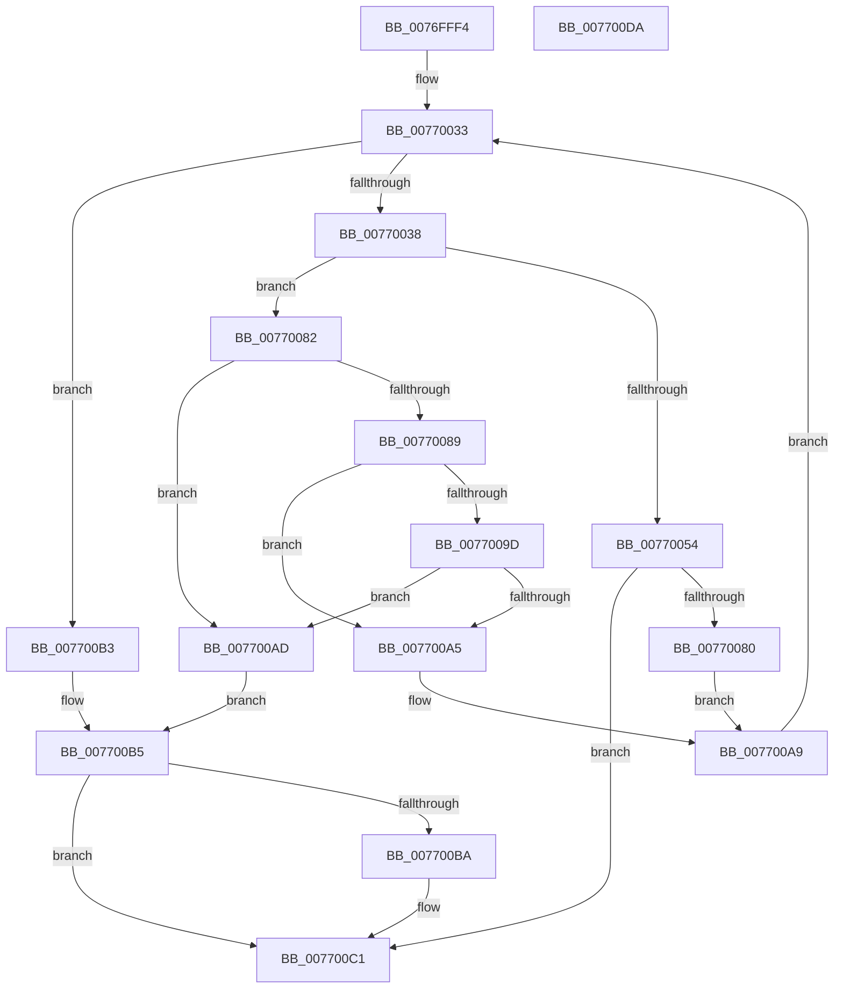

# PopBcdCopyLoaderObjectSettings

- RVA: `0x0076FFF4`–`0x007700DB` (길이 `231` bytes)
- VA: `0x000000014076FFF4`
- 실행 섹션: `PAGE`
- PDB 이름 있음: `예`; PDB Function 태그: `아니요`
- unwind 정보 RVA: `0x000CD618`
- 디코드: `76`개 명령, `231/231` bytes 표시
- 미해석 바이트: `0` (있으면 어셈블리에 `.byte`로 보존)

> 이 문서는 커널 이미지의 기계어와 PDB 기호를 분석해 생성했습니다. 4번과 5번은 함수 원형과 자료형을 바이너리 사용 방식에서 추정한 C 해석이며 원본 소스 복구 결과는 아닙니다.

## 1. Dependencies

- 직접 호출 지점: **5**; 고유 호출 대상: **4**
- 직접 호출자로 확인된 함수: **1**
- RIP 상대 이미지 참조: **0**

### Outgoing calls
- `0x00770049` → [PopBcdReadElement](../A3/PopBcdReadElement_function_00A3C740.md) (function, `0x00A3C740`)
- `0x00770064` → [BcdSetElementDataWithFlags](../A3/BcdSetElementDataWithFlags_function_00A3F080.md) (function, `0x00A3F080`)
- `0x00770071` → [ExFreePoolWithTag](../../poolcode/B8/ExFreePoolWithTag_function_00B82870.md) (function, `0x00B82870`)
- `0x0077008E` → [BiDeleteElement](../A3/BiDeleteElement_function_00A3E0F8.md) (function, `0x00A3E0F8`)
- `0x007700BC` → [ExFreePoolWithTag](../../poolcode/B8/ExFreePoolWithTag_function_00B82870.md) (function, `0x00B82870`)

### Direct callers
- [PopBcdEstablishResumeObject](../77/PopBcdEstablishResumeObject_function_007700E4.md) at `0x00770210`

### Static image references
- 디코드된 RIP-relative 메모리 참조가 없습니다.

## 2. Other-region calls and transfers

- 다른 실행 섹션으로 향하는 call: **2**
  - `0x00770071` → [ExFreePoolWithTag](../../poolcode/B8/ExFreePoolWithTag_function_00B82870.md) (`PAGE` → `POOLCODE`)
  - `0x007700BC` → [ExFreePoolWithTag](../../poolcode/B8/ExFreePoolWithTag_function_00B82870.md) (`PAGE` → `POOLCODE`)
- 별도 외부 분기/꼬리 이동을 확인하지 못했습니다.

## 3. Assembly (complete function range)

```asm
0076FFF4  48 89 5C 24 08                  mov qword ptr [rsp + 8], rbx
0076FFF9  48 89 74 24 10                  mov qword ptr [rsp + 0x10], rsi
0076FFFE  55                              push rbp
0076FFFF  57                              push rdi
00770000  41 55                           push r13
00770002  41 56                           push r14
00770004  41 57                           push r15
00770006  48 8B EC                        mov rbp, rsp
00770009  48 83 EC 40                     sub rsp, 0x40
0077000D  83 65 40 00                     and dword ptr [rbp + 0x40], 0
00770011  4C 8B F9                        mov r15, rcx
00770014  33 C9                           xor ecx, ecx
00770016  C7 45 F0 10 00 00 16            mov dword ptr [rbp - 0x10], 0x16000010
0077001D  48 89 4D 48                     mov qword ptr [rbp + 0x48], rcx
00770021  33 FF                           xor edi, edi
00770023  4C 8B F2                        mov r14, rdx
00770026  C7 45 F4 49 00 00 16            mov dword ptr [rbp - 0xc], 0x16000049
0077002D  41 BD 00 00 00 80               mov r13d, 0x80000000
00770033  83 FF 02                        cmp edi, 2
00770036  73 7B                           jae 0x1407700b3
00770038  8B 74 BD F0                     mov esi, dword ptr [rbp + rdi*4 - 0x10]
0077003C  4C 8D 4D 40                     lea r9, [rbp + 0x40]
00770040  8B D6                           mov edx, esi
00770042  4C 8D 45 48                     lea r8, [rbp + 0x48]
00770046  49 8B CF                        mov rcx, r15
00770049  E8 F2 C6 2C 00                  call 0x140a3c740
0077004E  8B D8                           mov ebx, eax
00770050  85 C0                           test eax, eax
00770052  78 2E                           js 0x140770082
00770054  8B 45 40                        mov eax, dword ptr [rbp + 0x40]
00770057  8B D6                           mov edx, esi
00770059  4C 8B 4D 48                     mov r9, qword ptr [rbp + 0x48]
0077005D  49 8B CE                        mov rcx, r14
00770060  89 44 24 20                     mov dword ptr [rsp + 0x20], eax
00770064  E8 17 F0 2C 00                  call 0x140a3f080
00770069  48 8B 4D 48                     mov rcx, qword ptr [rbp + 0x48]
0077006D  33 D2                           xor edx, edx
0077006F  8B D8                           mov ebx, eax
00770071  E8 FA 27 41 00                  call 0x140b82870
00770076  33 C9                           xor ecx, ecx
00770078  48 89 4D 48                     mov qword ptr [rbp + 0x48], rcx
0077007C  85 DB                           test ebx, ebx
0077007E  78 41                           js 0x1407700c1
00770080  EB 27                           jmp 0x1407700a9
00770082  3D 25 02 00 C0                  cmp eax, 0xc0000225
00770087  75 24                           jne 0x1407700ad
00770089  8B D6                           mov edx, esi
0077008B  49 8B CE                        mov rcx, r14
0077008E  E8 65 E0 2C 00                  call 0x140a3e0f8
00770093  8B D8                           mov ebx, eax
00770095  41 03 C5                        add eax, r13d
00770098  41 85 C5                        test r13d, eax
0077009B  75 08                           jne 0x1407700a5
0077009D  81 FB 25 02 00 C0               cmp ebx, 0xc0000225
007700A3  75 08                           jne 0x1407700ad
007700A5  48 8B 4D 48                     mov rcx, qword ptr [rbp + 0x48]
007700A9  FF C7                           inc edi
007700AB  EB 86                           jmp 0x140770033
007700AD  48 8B 4D 48                     mov rcx, qword ptr [rbp + 0x48]
007700B1  EB 02                           jmp 0x1407700b5
007700B3  33 DB                           xor ebx, ebx
007700B5  48 85 C9                        test rcx, rcx
007700B8  74 07                           je 0x1407700c1
007700BA  33 D2                           xor edx, edx
007700BC  E8 AF 27 41 00                  call 0x140b82870
007700C1  48 8B 74 24 78                  mov rsi, qword ptr [rsp + 0x78]
007700C6  8B C3                           mov eax, ebx
007700C8  48 8B 5C 24 70                  mov rbx, qword ptr [rsp + 0x70]
007700CD  48 83 C4 40                     add rsp, 0x40
007700D1  41 5F                           pop r15
007700D3  41 5E                           pop r14
007700D5  41 5D                           pop r13
007700D7  5F                              pop rdi
007700D8  5D                              pop rbp
007700D9  C3                              ret
007700DA  CC                              int3
```

## 4. C-style interpretation (structured pseudocode)

```c
__int64 __fastcall PopBcdCopyLoaderObjectSettings(__int64 a1, __int64 a2)
{
    __int64 result;
    __int64 v_rbx;
    __int64 v_rdi;
    __int64 v_rsp;
    unsigned int v_stack_m34;
    unsigned int v_stack_m38;
    unsigned int v_stack_m48;
    unsigned __int64 v_stack_p10;
    unsigned int v_stack_p18;
    unsigned __int64 v_stack_p20;
    unsigned __int64 v_stack_p8;

    v_stack_p8 = v_rbx;
    v_stack_p10 = v_rsi;
    v_rsp = (v_rsp) - (64);
    a1 = 0;
    v_stack_m38 = 0x16000010ULL;
    v_stack_p20 = 0;
    v_rdi = 0;
    v_stack_m34 = 0x16000049ULL;
loc_00770033:
    if (0 >= 2) goto loc_007700B3;
    result = PopBcdReadElement(0, (unsigned int)((unsigned int)((unsigned int)(*(unsigned int *)(v_rsp + v_rdi * 4 - 16)))), v_stack_p20, v_stack_p18);
    if (sign_flag) goto loc_00770082;
    v_stack_m48 = (unsigned int)((unsigned int)(v_stack_p18));
    result = BcdSetElementDataWithFlags(a2, (unsigned int)((unsigned int)((unsigned int)(*(unsigned int *)(v_rsp + v_rdi * 4 - 16)))), v_stack_p20, v_stack_p20);
    a2 = 0;
    result = ExFreePoolWithTag(v_stack_p20, a2, v_stack_p20, v_stack_p20);
    a1 = 0;
    v_stack_p20 = 0;
    if (sign_flag) goto loc_007700C1;
    goto loc_007700A9;
loc_00770082:
    if (((unsigned int)(result)) != 0xC0000225ULL) goto loc_007700AD;
    result = BiDeleteElement(0, (unsigned int)((unsigned int)((unsigned int)(*(unsigned int *)(v_rsp + v_rdi * 4 - 16)))), v_stack_p20, v_stack_p20);
    result = (unsigned int)((result) + ((unsigned int)((unsigned int)(0x80000000ULL))));
    if ((((unsigned int)((unsigned int)(0x80000000ULL))) & ((unsigned int)(result))) != 0) goto loc_007700A5;
    if (((unsigned int)((unsigned int)((unsigned int)(result)))) != 0xC0000225ULL) goto loc_007700AD;
loc_007700A5:
loc_007700A9:
    v_rdi = (unsigned int)((v_rdi) + 1);
    goto loc_00770033;
loc_007700AD:
    goto loc_007700B5;
loc_007700B3:
    v_rbx = 0;
loc_007700B5:
    if (v_stack_p20 != 0) {
        a2 = 0;
        result = ExFreePoolWithTag(v_stack_p20, a2, v_stack_p20, v_stack_p20);
    }
    v_rsp = (v_rsp) + (64);
    return 0;
}
```

## 5. (Beta) C Style

```c
int64_t PopBcdCopyLoaderObjectSettings(int64_t Arg1, int64_t Arg2)
{
    int64_t result;
    int64_t local_rbx;
    int64_t local_rdi;
    int64_t local_rsp;
    uint32_t v_stack_m34;
    uint32_t v_stack_m38;
    uint32_t v_stack_m48;
    uint64_t v_stack_p10;
    uint32_t v_stack_p18;
    uint64_t v_stack_p20;
    uint64_t v_stack_p8;

    v_stack_p8 = local_rbx;
    v_stack_p10 = local_rsi;
    local_rsp = (local_rsp) - (64);
    Arg1 = 0;
    v_stack_m38 = 0x16000010ULL;
    v_stack_p20 = 0;
    local_rdi = 0;
    v_stack_m34 = 0x16000049ULL;
loc_00770033:
    if (0 >= 2) goto loc_007700B3;
    result = PopBcdReadElement(0, (uint32_t)((uint32_t)((uint32_t)(*(uint32_t *)(local_rsp + local_rdi * 4 - 0x10)))), v_stack_p20, v_stack_p18);
    if (sign_flag) goto loc_00770082;
    v_stack_m48 = (uint32_t)((uint32_t)(v_stack_p18));
    result = BcdSetElementDataWithFlags(Arg2, (uint32_t)((uint32_t)((uint32_t)(*(uint32_t *)(local_rsp + local_rdi * 4 - 0x10)))), v_stack_p20, v_stack_p20);
    Arg2 = 0;
    result = ExFreePoolWithTag(v_stack_p20, Arg2, v_stack_p20, v_stack_p20);
    Arg1 = 0;
    v_stack_p20 = 0;
    if (sign_flag) goto loc_007700C1;
    goto loc_007700A9;
loc_00770082:
    if (((uint32_t)(result)) != 0xC0000225ULL) goto loc_007700AD;
    result = BiDeleteElement(0, (uint32_t)((uint32_t)((uint32_t)(*(uint32_t *)(local_rsp + local_rdi * 4 - 0x10)))), v_stack_p20, v_stack_p20);
    result = (uint32_t)((result) + ((uint32_t)((uint32_t)(0x80000000ULL))));
    if ((((uint32_t)((uint32_t)(0x80000000ULL))) & ((uint32_t)(result))) != 0) goto loc_007700A5;
    if (((uint32_t)((uint32_t)((uint32_t)(result)))) != 0xC0000225ULL) goto loc_007700AD;
loc_007700A5:
loc_007700A9:
    local_rdi = (uint32_t)((local_rdi) + 1);
    goto loc_00770033;
loc_007700AD:
    goto loc_007700B5;
loc_007700B3:
    local_rbx = 0;
loc_007700B5:
    if (v_stack_p20 != 0) {
        Arg2 = 0;
        result = ExFreePoolWithTag(v_stack_p20, Arg2, v_stack_p20, v_stack_p20);
    }
    local_rsp = (local_rsp) + (64);
    return 0;
}
```

## 6. Execution-region graph

[열기: 2D/3D 그래프와 함수 탐색 컨트롤 패널](../../../control-panel.html?section=page&rva=0x0076FFF4&view=graph)

- 2D 그래프는 위에서 아래로 흐르고, 3D 그래프는 빈 공간을 드래그해 회전합니다. Shift+드래그는 이동, 휠은 확대·축소, 함수 노드 선택은 대상 보고서 이동입니다.

### Static fallback


