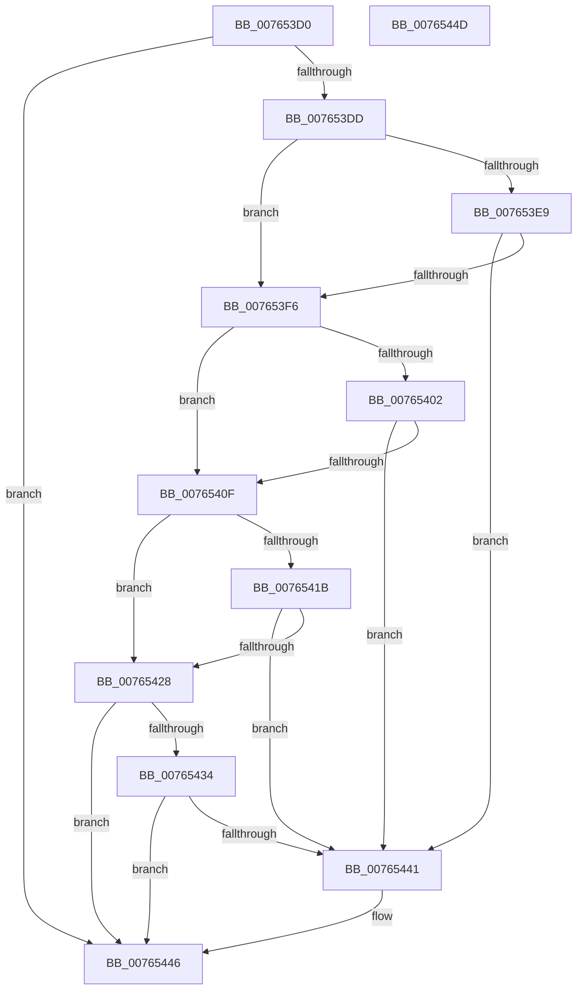

# PopBroadcastInputSuppressionCallback

- RVA: `0x007653D0`–`0x0076544E` (길이 `126` bytes)
- VA: `0x00000001407653D0`
- 실행 섹션: `PAGE`
- PDB 이름 있음: `예`; PDB Function 태그: `아니요`
- unwind 정보 RVA: `0x0005C788`
- 디코드: `33`개 명령, `126/126` bytes 표시
- 미해석 바이트: `0` (있으면 어셈블리에 `.byte`로 보존)

> 이 문서는 커널 이미지의 기계어와 PDB 기호를 분석해 생성했습니다. 4번과 5번은 함수 원형과 자료형을 바이너리 사용 방식에서 추정한 C 해석이며 원본 소스 복구 결과는 아닙니다.

## 1. Dependencies

- 직접 호출 지점: **2**; 고유 호출 대상: **2**
- 직접 호출자로 확인된 함수: **0**
- RIP 상대 이미지 참조: **8**

### Outgoing calls
- `0x007653D4` → [PopIsPlatformAoAcCapable](../../text/49/PopIsPlatformAoAcCapable_function_0049BF40.md) (function, `0x0049BF40`)
- `0x00765441` → [PopEvaluateInputSuppressionAction](PopEvaluateInputSuppressionAction_function_00765454.md) (function, `0x00765454`)

### Direct callers
- 이 함수 시작 RVA로 연결되는 직접 call은 확인되지 않았습니다. 간접 호출은 완전히 역산할 수 없습니다.

### Static image references
- `0x007653DD` → RVA `0x0001A610` (`.rdata`; read)
- `0x007653E9` → RVA `0x0001A618` (`.rdata`; read)
- `0x007653F6` → RVA `0x0001E2D8` (`.rdata`; read)
- `0x00765402` → RVA `0x0001E2E0` (`.rdata`; read)
- `0x0076540F` → RVA `0x00024C18` (`.rdata`; read)
- `0x0076541B` → RVA `0x00024C20` (`.rdata`; read)
- `0x00765428` → RVA `0x0001C130` (`.rdata`; read)
- `0x00765434` → RVA `0x0001C138` (`.rdata`; read)

## 2. Other-region calls and transfers

- 다른 실행 섹션으로 향하는 call: **1**
  - `0x007653D4` → [PopIsPlatformAoAcCapable](../../text/49/PopIsPlatformAoAcCapable_function_0049BF40.md) (`PAGE` → `.text`)
- 별도 외부 분기/꼬리 이동을 확인하지 못했습니다.

## 3. Assembly (complete function range)

```asm
007653D0  48 83 EC 28                     sub rsp, 0x28
007653D4  E8 67 6B D3 FF                  call 0x14049bf40
007653D9  84 C0                           test al, al
007653DB  74 69                           je 0x140765446
007653DD  48 8B 05 2C 52 8B FF            mov rax, qword ptr [rip - 0x74add4]
007653E4  48 3B 01                        cmp rax, qword ptr [rcx]
007653E7  75 0D                           jne 0x1407653f6
007653E9  48 8B 05 28 52 8B FF            mov rax, qword ptr [rip - 0x74add8]
007653F0  48 3B 41 08                     cmp rax, qword ptr [rcx + 8]
007653F4  74 4B                           je 0x140765441
007653F6  48 8B 05 DB 8E 8B FF            mov rax, qword ptr [rip - 0x747125]
007653FD  48 3B 01                        cmp rax, qword ptr [rcx]
00765400  75 0D                           jne 0x14076540f
00765402  48 8B 05 D7 8E 8B FF            mov rax, qword ptr [rip - 0x747129]
00765409  48 3B 41 08                     cmp rax, qword ptr [rcx + 8]
0076540D  74 32                           je 0x140765441
0076540F  48 8B 05 02 F8 8B FF            mov rax, qword ptr [rip - 0x7407fe]
00765416  48 3B 01                        cmp rax, qword ptr [rcx]
00765419  75 0D                           jne 0x140765428
0076541B  48 8B 05 FE F7 8B FF            mov rax, qword ptr [rip - 0x740802]
00765422  48 3B 41 08                     cmp rax, qword ptr [rcx + 8]
00765426  74 19                           je 0x140765441
00765428  48 8B 05 01 6D 8B FF            mov rax, qword ptr [rip - 0x7492ff]
0076542F  48 3B 01                        cmp rax, qword ptr [rcx]
00765432  75 12                           jne 0x140765446
00765434  48 8B 05 FD 6C 8B FF            mov rax, qword ptr [rip - 0x749303]
0076543B  48 3B 41 08                     cmp rax, qword ptr [rcx + 8]
0076543F  75 05                           jne 0x140765446
00765441  E8 0E 00 00 00                  call 0x140765454
00765446  33 C0                           xor eax, eax
00765448  48 83 C4 28                     add rsp, 0x28
0076544C  C3                              ret
0076544D  CC                              int3
```

## 4. C-style interpretation (structured pseudocode)

```c
__int64 __fastcall PopBroadcastInputSuppressionCallback(__int64 a1)
{
    __int64 result;
    __int64 v_rsp;

    v_rsp = (v_rsp) - (40);
    result = PopIsPlatformAoAcCapable(a1, a2, a3, a4);
    if ((unsigned __int8)(result) == 0) goto loc_00765446;
    if ((*(unsigned __int64 *)(v_rip - 7646676)) != (*(unsigned __int64 *)(a1))) goto loc_007653F6;
    if ((*(unsigned __int64 *)(v_rip - 7646680)) == (*(unsigned __int64 *)(a1 + 8))) goto loc_00765441;
loc_007653F6:
    if ((*(unsigned __int64 *)(v_rip - 7631141)) != (*(unsigned __int64 *)(a1))) goto loc_0076540F;
    if ((*(unsigned __int64 *)(v_rip - 7631145)) == (*(unsigned __int64 *)(a1 + 8))) goto loc_00765441;
loc_0076540F:
    if ((*(unsigned __int64 *)(v_rip - 7604222)) != (*(unsigned __int64 *)(a1))) goto loc_00765428;
    if ((*(unsigned __int64 *)(v_rip - 7604226)) == (*(unsigned __int64 *)(a1 + 8))) goto loc_00765441;
loc_00765428:
    if ((*(unsigned __int64 *)(v_rip - 7639807)) != (*(unsigned __int64 *)(a1))) goto loc_00765446;
    result = *(unsigned __int64 *)(v_rip - 7639811);
    if ((*(unsigned __int64 *)(v_rip - 7639811)) == (*(unsigned __int64 *)(a1 + 8))) {
        result = PopEvaluateInputSuppressionAction(a1, a2, a3, a4);
    }
    result = 0;
    v_rsp = (v_rsp) + (40);
    return result;
}
```

## 5. (Beta) C Style

```c
int64_t PopBroadcastInputSuppressionCallback(int64_t Arg1)
{
    int64_t result;
    int64_t local_rsp;

    local_rsp = (local_rsp) - (40);
    result = PopIsPlatformAoAcCapable(Arg1, a2, a3, a4);
    if ((uint8_t)(result) == 0) goto loc_00765446;
    if ((*(uint64_t *)(v_rip - 0x74ADD4)) != (*(uint64_t *)(Arg1))) goto loc_007653F6;
    if ((*(uint64_t *)(v_rip - 0x74ADD8)) == (*(uint64_t *)(Arg1 + 0x8))) goto loc_00765441;
loc_007653F6:
    if ((*(uint64_t *)(v_rip - 0x747125)) != (*(uint64_t *)(Arg1))) goto loc_0076540F;
    if ((*(uint64_t *)(v_rip - 0x747129)) == (*(uint64_t *)(Arg1 + 0x8))) goto loc_00765441;
loc_0076540F:
    if ((*(uint64_t *)(v_rip - 0x7407FE)) != (*(uint64_t *)(Arg1))) goto loc_00765428;
    if ((*(uint64_t *)(v_rip - 0x740802)) == (*(uint64_t *)(Arg1 + 0x8))) goto loc_00765441;
loc_00765428:
    if ((*(uint64_t *)(v_rip - 0x7492FF)) != (*(uint64_t *)(Arg1))) goto loc_00765446;
    result = *(uint64_t *)(v_rip - 0x749303);
    if ((*(uint64_t *)(v_rip - 0x749303)) == (*(uint64_t *)(Arg1 + 0x8))) {
        result = PopEvaluateInputSuppressionAction(Arg1, a2, a3, a4);
    }
    result = 0;
    local_rsp = (local_rsp) + (40);
    return result;
}
```

## 6. Execution-region graph

[열기: 2D/3D 그래프와 함수 탐색 컨트롤 패널](../../../control-panel.html?section=page&rva=0x007653D0&view=graph)

- 2D 그래프는 위에서 아래로 흐르고, 3D 그래프는 빈 공간을 드래그해 회전합니다. Shift+드래그는 이동, 휠은 확대·축소, 함수 노드 선택은 대상 보고서 이동입니다.

### Static fallback


