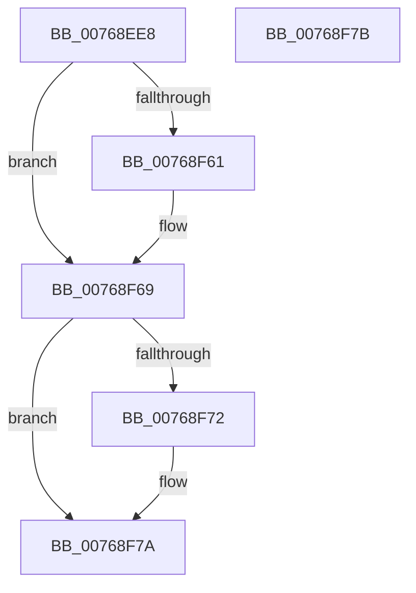

# PopBsdPowerTransitionToParam1

- RVA: `0x00768EE8`–`0x00768F7C` (길이 `148` bytes)
- VA: `0x0000000140768EE8`
- 실행 섹션: `PAGE`
- PDB 이름 있음: `예`; PDB Function 태그: `아니요`
- unwind 정보 RVA: `0x000DB714`
- 디코드: `39`개 명령, `148/148` bytes 표시
- 미해석 바이트: `0` (있으면 어셈블리에 `.byte`로 보존)

> 이 문서는 커널 이미지의 기계어와 PDB 기호를 분석해 생성했습니다. 4번과 5번은 함수 원형과 자료형을 바이너리 사용 방식에서 추정한 C 해석이며 원본 소스 복구 결과는 아닙니다.

## 1. Dependencies

- 직접 호출 지점: **0**; 고유 호출 대상: **0**
- 직접 호출자로 확인된 함수: **1**
- RIP 상대 이미지 참조: **7**

### Outgoing calls
- 직접 디코드된 call 명령이 없습니다.

### Direct callers
- [PopPowerButtonWorkCallback](../../text/5D/PopPowerButtonWorkCallback_function_005D9A70.md) at `0x005D9C70`
- [PopPowerButtonWorkCallback](../../text/5D/PopPowerButtonWorkCallback_function_005D9A70.md) at `0x005D9E11`

### Static image references
- `0x00768EE8` → RVA `0x00E6741A` (`.data`; read)
- `0x00768EF2` → RVA `0x00E6741B` (`.data`; read)
- `0x00768EFA` → RVA `0x00E6741E` (`.data`; read)
- `0x00768F04` → RVA `0x00E6741F` (`.data`; read)
- `0x00768F3B` → RVA `0x00E67418` (`.data`; read)
- `0x00768F55` → RVA `0x00E673F3` (`.data`; read)
- `0x00768F69` → RVA `0x00E673F4` (`.data`; read)

## 2. Other-region calls and transfers

- 다른 실행 섹션으로 향하는 call: **0**
- 별도 외부 분기/꼬리 이동을 확인하지 못했습니다.

## 3. Assembly (complete function range)

```asm
00768EE8  0F B6 05 2B E5 6F 00            movzx eax, byte ptr [rip + 0x6fe52b]
00768EEF  4C 8B D1                        mov r10, rcx
00768EF2  44 0F B6 05 21 E5 6F 00         movzx r8d, byte ptr [rip + 0x6fe521]
00768EFA  0F B6 15 1D E5 6F 00            movzx edx, byte ptr [rip + 0x6fe51d]
00768F01  45 8B C8                        mov r9d, r8d
00768F04  0F B6 0D 14 E5 6F 00            movzx ecx, byte ptr [rip + 0x6fe514]
00768F0B  44 33 C8                        xor r9d, eax
00768F0E  41 83 E1 3F                     and r9d, 0x3f
00768F12  41 C1 E8 02                     shr r8d, 2
00768F16  44 33 C8                        xor r9d, eax
00768F19  83 E1 80                        and ecx, 0xffffff80
00768F1C  41 C1 E1 06                     shl r9d, 6
00768F20  83 E0 3F                        and eax, 0x3f
00768F23  44 0B C8                        or r9d, eax
00768F26  C1 E1 13                        shl ecx, 0x13
00768F29  41 C1 E1 04                     shl r9d, 4
00768F2D  8B C2                           mov eax, edx
00768F2F  83 E0 0F                        and eax, 0xf
00768F32  83 E2 CF                        and edx, 0xffffffcf
00768F35  44 0B C8                        or r9d, eax
00768F38  44 0B C2                        or r8d, edx
00768F3B  0F B6 05 D6 E4 6F 00            movzx eax, byte ptr [rip + 0x6fe4d6]
00768F42  41 C1 E1 08                     shl r9d, 8
00768F46  0B C8                           or ecx, eax
00768F48  41 C1 E8 04                     shr r8d, 4
00768F4C  83 E1 F0                        and ecx, 0xfffffff0
00768F4F  45 0B C8                        or r9d, r8d
00768F52  44 0B C9                        or r9d, ecx
00768F55  80 3D 97 E4 6F 00 01            cmp byte ptr [rip + 0x6fe497], 1
00768F5C  45 89 0A                        mov dword ptr [r10], r9d
00768F5F  75 08                           jne 0x140768f69
00768F61  41 0F BA E9 1B                  bts r9d, 0x1b
00768F66  45 89 0A                        mov dword ptr [r10], r9d
00768F69  80 3D 84 E4 6F 00 01            cmp byte ptr [rip + 0x6fe484], 1
00768F70  75 08                           jne 0x140768f7a
00768F72  41 0F BA E9 1C                  bts r9d, 0x1c
00768F77  45 89 0A                        mov dword ptr [r10], r9d
00768F7A  C3                              ret
00768F7B  CC                              int3
```

## 4. C-style interpretation (structured pseudocode)

```c
__int64 __fastcall PopBsdPowerTransitionToParam1(__int64 a1)
{
    __int64 result;

    a4 = (unsigned int)(((unsigned int)((unsigned int)(*(unsigned __int8 *)(v_rip + 7333153)))) ^ ((unsigned int)(*(unsigned __int8 *)(v_rip + 7333163))));
    a4 = (unsigned int)((a4) & (63));
    a3 = (unsigned int)((*(unsigned __int8 *)(v_rip + 7333153)) >> (2));
    a4 = (unsigned int)((a4) ^ ((unsigned int)(*(unsigned __int8 *)(v_rip + 7333163))));
    a1 = (unsigned int)((*(unsigned __int8 *)(v_rip + 7333140)) & (0xFFFFFF80ULL));
    a4 = (unsigned int)((a4) << (6));
    result = (unsigned int)((*(unsigned __int8 *)(v_rip + 7333163)) & (63));
    a4 = (unsigned int)((a4) | ((unsigned int)(result)));
    a1 = (unsigned int)((a1) << (19));
    a4 = (unsigned int)((a4) << (4));
    result = (unsigned int)(((unsigned int)((unsigned int)(*(unsigned __int8 *)(v_rip + 7333149)))) & (15));
    a2 = (unsigned int)((*(unsigned __int8 *)(v_rip + 7333149)) & (0xFFFFFFCFULL));
    a4 = (unsigned int)((a4) | ((unsigned int)(result)));
    a3 = (unsigned int)((a3) | ((unsigned int)(a2)));
    a4 = (unsigned int)((a4) << (8));
    a1 = (unsigned int)((a1) | ((unsigned int)(*(unsigned __int8 *)(v_rip + 7333078))));
    a3 = (unsigned int)((a3) >> (4));
    a1 = (unsigned int)((a1) & (0xFFFFFFF0ULL));
    a4 = (unsigned int)((a4) | ((unsigned int)(a3)));
    a4 = (unsigned int)((a4) | ((unsigned int)(a1)));
    *(unsigned int *)(a1) = (unsigned int)(a4);
    if ((*(unsigned __int8 *)(v_rip + 7333015)) == 1) {
        *(unsigned int *)(a1) = (unsigned int)(a4);
    }
    if ((*(unsigned __int8 *)(v_rip + 7332996)) == 1) {
        *(unsigned int *)(a1) = (unsigned int)(a4);
    }
    return *(unsigned __int8 *)(v_rip + 7333078);
}
```

## 5. (Beta) C Style

```c
int64_t PopBsdPowerTransitionToParam1(void *Arg1)
{
    uint8_t *arg1 = (uint8_t *)Arg1;

    int64_t result;

    a4 = (uint32_t)(((uint32_t)((uint32_t)(*(uint8_t *)(v_rip + 0x6FE521)))) ^ ((uint32_t)(*(uint8_t *)(v_rip + 0x6FE52B))));
    a4 = (uint32_t)((a4) & (63));
    a3 = (uint32_t)((*(uint8_t *)(v_rip + 0x6FE521)) >> (2));
    a4 = (uint32_t)((a4) ^ ((uint32_t)(*(uint8_t *)(v_rip + 0x6FE52B))));
    Arg1 = (uint32_t)((*(uint8_t *)(v_rip + 0x6FE514)) & (0xFFFFFF80ULL));
    a4 = (uint32_t)((a4) << (6));
    result = (uint32_t)((*(uint8_t *)(v_rip + 0x6FE52B)) & (63));
    a4 = (uint32_t)((a4) | ((uint32_t)(result)));
    Arg1 = (uint32_t)((Arg1) << (19));
    a4 = (uint32_t)((a4) << (4));
    result = (uint32_t)(((uint32_t)((uint32_t)(*(uint8_t *)(v_rip + 0x6FE51D)))) & (15));
    a2 = (uint32_t)((*(uint8_t *)(v_rip + 0x6FE51D)) & (0xFFFFFFCFULL));
    a4 = (uint32_t)((a4) | ((uint32_t)(result)));
    a3 = (uint32_t)((a3) | ((uint32_t)(a2)));
    a4 = (uint32_t)((a4) << (8));
    Arg1 = (uint32_t)((Arg1) | ((uint32_t)(*(uint8_t *)(v_rip + 0x6FE4D6))));
    a3 = (uint32_t)((a3) >> (4));
    Arg1 = (uint32_t)((Arg1) & (0xFFFFFFF0ULL));
    a4 = (uint32_t)((a4) | ((uint32_t)(a3)));
    a4 = (uint32_t)((a4) | ((uint32_t)(Arg1)));
    *(uint32_t *)(arg1) = (uint32_t)(a4);
    if ((*(uint8_t *)(v_rip + 0x6FE497)) == 1) {
        *(uint32_t *)(arg1) = (uint32_t)(a4);
    }
    if ((*(uint8_t *)(v_rip + 0x6FE484)) == 1) {
        *(uint32_t *)(arg1) = (uint32_t)(a4);
    }
    return *(uint8_t *)(v_rip + 0x6FE4D6);
}
```

### 관측된 메모리 오프셋

구조체 형식이 확인되지 않은 접근은 인자 기준의 오프셋으로만 기록했습니다.

| 기준 인자 | 오프셋 표현 | 폭 (bit) | 접근 |
|---|---:|---:|---|
| `Arg1` | `+ 0x0` | `32` | `W` |

## 6. Execution-region graph

[열기: 2D/3D 그래프와 함수 탐색 컨트롤 패널](../../../control-panel.html?section=page&rva=0x00768EE8&view=graph)

- 2D 그래프는 위에서 아래로 흐르고, 3D 그래프는 빈 공간을 드래그해 회전합니다. Shift+드래그는 이동, 휠은 확대·축소, 함수 노드 선택은 대상 보고서 이동입니다.

### Static fallback


