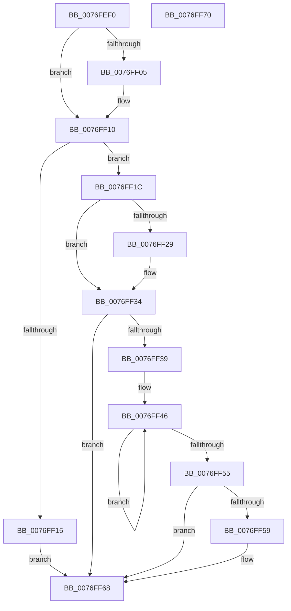

# PopCadHpmiPnpNotification

- RVA: `0x0076FEF0`–`0x0076FF71` (길이 `129` bytes)
- VA: `0x000000014076FEF0`
- 실행 섹션: `PAGE`
- PDB 이름 있음: `예`; PDB Function 태그: `아니요`
- unwind 정보 RVA: `0x0005CF00`
- 디코드: `35`개 명령, `129/129` bytes 표시
- 미해석 바이트: `0` (있으면 어셈블리에 `.byte`로 보존)

> 이 문서는 커널 이미지의 기계어와 PDB 기호를 분석해 생성했습니다. 4번과 5번은 함수 원형과 자료형을 바이너리 사용 방식에서 추정한 C 해석이며 원본 소스 복구 결과는 아닙니다.

## 1. Dependencies

- 직접 호출 지점: **1**; 고유 호출 대상: **1**
- 직접 호출자로 확인된 함수: **0**
- RIP 상대 이미지 참조: **6**

### Outgoing calls
- `0x0076FF63` → [ExQueueWorkItem](../../text/2F/ExQueueWorkItem_function_002F9520.md) (function, `0x002F9520`)

### Direct callers
- 이 함수 시작 RVA로 연결되는 직접 call은 확인되지 않았습니다. 간접 호출은 완전히 역산할 수 없습니다.

### Static image references
- `0x0076FEFC` → RVA `0x0002AEC0` (`.rdata`; read)
- `0x0076FF09` → RVA `0x0002AEC8` (`.rdata`; read)
- `0x0076FF20` → RVA `0x00013E30` (`.rdata`; read)
- `0x0076FF2D` → RVA `0x00013E38` (`.rdata`; read)
- `0x0076FF39` → RVA `0x00F07C20` (`.data`; read)
- `0x0076FF5C` → RVA `0x00F07C00` (`.data`; read)

## 2. Other-region calls and transfers

- 다른 실행 섹션으로 향하는 call: **1**
  - `0x0076FF63` → [ExQueueWorkItem](../../text/2F/ExQueueWorkItem_function_002F9520.md) (`PAGE` → `.text`)
- 별도 외부 분기/꼬리 이동을 확인하지 못했습니다.

## 3. Assembly (complete function range)

```asm
0076FEF0  40 53                           push rbx
0076FEF2  48 83 EC 20                     sub rsp, 0x20
0076FEF6  48 8B 41 14                     mov rax, qword ptr [rcx + 0x14]
0076FEFA  33 DB                           xor ebx, ebx
0076FEFC  48 2B 05 BD AF 8B FF            sub rax, qword ptr [rip - 0x745043]
0076FF03  75 0B                           jne 0x14076ff10
0076FF05  48 8B 41 1C                     mov rax, qword ptr [rcx + 0x1c]
0076FF09  48 2B 05 B8 AF 8B FF            sub rax, qword ptr [rip - 0x745048]
0076FF10  48 85 C0                        test rax, rax
0076FF13  74 07                           je 0x14076ff1c
0076FF15  BB 0D 00 00 C0                  mov ebx, 0xc000000d
0076FF1A  EB 4C                           jmp 0x14076ff68
0076FF1C  48 8B 41 04                     mov rax, qword ptr [rcx + 4]
0076FF20  48 2B 05 09 3F 8A FF            sub rax, qword ptr [rip - 0x75c0f7]
0076FF27  75 0B                           jne 0x14076ff34
0076FF29  48 8B 41 0C                     mov rax, qword ptr [rcx + 0xc]
0076FF2D  48 2B 05 04 3F 8A FF            sub rax, qword ptr [rip - 0x75c0fc]
0076FF34  48 85 C0                        test rax, rax
0076FF37  75 2F                           jne 0x14076ff68
0076FF39  0F 0D 0D E0 7C 79 00            prefetchw byte ptr [rip + 0x797ce0]
0076FF40  8B 05 DA 7C 79 00               mov eax, dword ptr [rip + 0x797cda]
0076FF46  8B C8                           mov ecx, eax
0076FF48  83 C9 02                        or ecx, 2
0076FF4B  F0 0F B1 0D CD 7C 79 00         lock cmpxchg dword ptr [rip + 0x797ccd], ecx
0076FF53  75 F1                           jne 0x14076ff46
0076FF55  85 C0                           test eax, eax
0076FF57  75 0F                           jne 0x14076ff68
0076FF59  8D 50 01                        lea edx, [rax + 1]
0076FF5C  48 8D 0D 9D 7C 79 00            lea rcx, [rip + 0x797c9d]
0076FF63  E8 B8 95 B8 FF                  call 0x1402f9520
0076FF68  8B C3                           mov eax, ebx
0076FF6A  48 83 C4 20                     add rsp, 0x20
0076FF6E  5B                              pop rbx
0076FF6F  C3                              ret
0076FF70  CC                              int3
```

## 4. C-style interpretation (structured pseudocode)

```c
__int64 __fastcall PopCadHpmiPnpNotification(__int64 a1)
{
    __int64 result;
    __int64 v_rbx;
    __int64 v_rsp;

    v_rsp = (v_rsp) - (32);
    v_rbx = 0;
    result = (*(unsigned __int64 *)(a1 + 20)) - (*(unsigned __int64 *)(v_rip - 7622723));
    if (!(condition_is_not_equal)) {
        result = *(unsigned __int64 *)(a1 + 28);
        result = (result) - (*(unsigned __int64 *)(v_rip - 7622728));
    }
    if (result == 0) goto loc_0076FF1C;
    goto loc_0076FF68;
loc_0076FF1C:
    result = (*(unsigned __int64 *)(a1 + 4)) - (*(unsigned __int64 *)(v_rip - 7717111));
    if (!(condition_is_not_equal)) {
        result = *(unsigned __int64 *)(a1 + 12);
        result = (result) - (*(unsigned __int64 *)(v_rip - 7717116));
    }
    if (result != 0) goto loc_0076FF68;
loc_0076FF46:
    a1 = (unsigned int)(((unsigned int)((unsigned int)((unsigned int)(*(unsigned int *)(v_rip + 7961818))))) | (2));
    if (condition_is_not_equal) goto loc_0076FF46;
    result = (unsigned int)(*(unsigned int *)(v_rip + 7961818));
    if ((unsigned int)((unsigned int)(*(unsigned int *)(v_rip + 7961818))) == 0) {
        a2 = (unsigned int)(*(unsigned int *)(v_rip + 7961818)) + 1;
        a1 = v_rip + 7961757;
        result = ExQueueWorkItem(a1, a2, a3, a4);
    }
    v_rsp = (v_rsp) + (32);
    return (unsigned int)((unsigned int)((unsigned int)(0xC000000DULL)));
}
```

## 5. (Beta) C Style

```c
int64_t PopCadHpmiPnpNotification(void *Arg1)
{
    uint8_t *arg1 = (uint8_t *)Arg1;

    int64_t result;
    int64_t local_rbx;
    int64_t local_rsp;

    local_rsp = (local_rsp) - (32);
    local_rbx = 0;
    result = (*(uint64_t *)(arg1 + 0x14)) - (*(uint64_t *)(v_rip - 0x745043));
    if (!(condition_is_not_equal)) {
        result = *(uint64_t *)(arg1 + 0x1C);
        result = (result) - (*(uint64_t *)(v_rip - 0x745048));
    }
    if (result == 0) goto loc_0076FF1C;
    goto loc_0076FF68;
loc_0076FF1C:
    result = (*(uint64_t *)(arg1 + 0x4)) - (*(uint64_t *)(v_rip - 0x75C0F7));
    if (!(condition_is_not_equal)) {
        result = *(uint64_t *)(arg1 + 0xC);
        result = (result) - (*(uint64_t *)(v_rip - 0x75C0FC));
    }
    if (result != 0) goto loc_0076FF68;
loc_0076FF46:
    Arg1 = (uint32_t)(((uint32_t)((uint32_t)((uint32_t)(*(uint32_t *)(v_rip + 0x797CDA))))) | (2));
    if (condition_is_not_equal) goto loc_0076FF46;
    result = (uint32_t)(*(uint32_t *)(v_rip + 0x797CDA));
    if ((uint32_t)((uint32_t)(*(uint32_t *)(v_rip + 0x797CDA))) == 0) {
        a2 = (uint32_t)(*(uint32_t *)(v_rip + 0x797CDA)) + 1;
        Arg1 = v_rip + 7961757;
        result = ExQueueWorkItem(Arg1, a2, a3, a4);
    }
    local_rsp = (local_rsp) + (32);
    return (uint32_t)((uint32_t)((uint32_t)(0xC000000DULL)));
}
```

### 관측된 메모리 오프셋

구조체 형식이 확인되지 않은 접근은 인자 기준의 오프셋으로만 기록했습니다.

| 기준 인자 | 오프셋 표현 | 폭 (bit) | 접근 |
|---|---:|---:|---|
| `Arg1` | `+ 0x4` | `64` | `R` |
| `Arg1` | `+ 0xC` | `64` | `R` |
| `Arg1` | `+ 0x14` | `64` | `R` |
| `Arg1` | `+ 0x1C` | `64` | `R` |

## 6. Execution-region graph

[열기: 2D/3D 그래프와 함수 탐색 컨트롤 패널](../../../control-panel.html?section=page&rva=0x0076FEF0&view=graph)

- 2D 그래프는 위에서 아래로 흐르고, 3D 그래프는 빈 공간을 드래그해 회전합니다. Shift+드래그는 이동, 휠은 확대·축소, 함수 노드 선택은 대상 보고서 이동입니다.

### Static fallback


