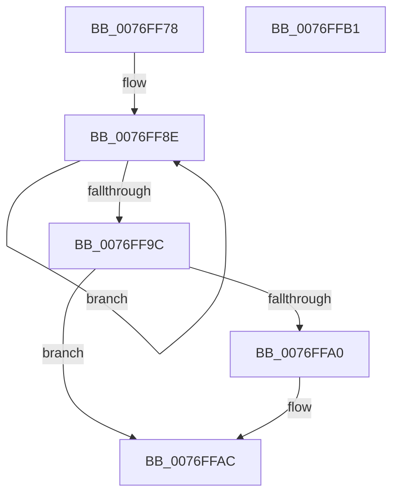

# PopCadNotifyBatteryPresence

- RVA: `0x0076FF78`–`0x0076FFB2` (길이 `58` bytes)
- VA: `0x000000014076FF78`
- 실행 섹션: `PAGE`
- PDB 이름 있음: `예`; PDB Function 태그: `아니요`
- unwind 정보 RVA: `0x0005C788`
- 디코드: `15`개 명령, `58/58` bytes 표시
- 미해석 바이트: `0` (있으면 어셈블리에 `.byte`로 보존)

> 이 문서는 커널 이미지의 기계어와 PDB 기호를 분석해 생성했습니다. 4번과 5번은 함수 원형과 자료형을 바이너리 사용 방식에서 추정한 C 해석이며 원본 소스 복구 결과는 아닙니다.

## 1. Dependencies

- 직접 호출 지점: **1**; 고유 호출 대상: **1**
- 직접 호출자로 확인된 함수: **2**
- RIP 상대 이미지 참조: **2**

### Outgoing calls
- `0x0076FFA7` → [ExQueueWorkItem](../../text/2F/ExQueueWorkItem_function_002F9520.md) (function, `0x002F9520`)

### Direct callers
- [PopBatteryAdd](PopBatteryAdd_function_00766580.md) at `0x007665D3`
- [PopBatteryUpdateTestExempt](PopBatteryUpdateTestExempt_function_00766F54.md) at `0x0076723F`

### Static image references
- `0x0076FF7C` → RVA `0x00F07C20` (`.data`; read)
- `0x0076FFA0` → RVA `0x00F07C00` (`.data`; read)

## 2. Other-region calls and transfers

- 다른 실행 섹션으로 향하는 call: **1**
  - `0x0076FFA7` → [ExQueueWorkItem](../../text/2F/ExQueueWorkItem_function_002F9520.md) (`PAGE` → `.text`)
- 별도 외부 분기/꼬리 이동을 확인하지 못했습니다.

## 3. Assembly (complete function range)

```asm
0076FF78  48 83 EC 28                     sub rsp, 0x28
0076FF7C  0F 0D 0D 9D 7C 79 00            prefetchw byte ptr [rip + 0x797c9d]
0076FF83  8B 05 97 7C 79 00               mov eax, dword ptr [rip + 0x797c97]
0076FF89  BA 01 00 00 00                  mov edx, 1
0076FF8E  8B C8                           mov ecx, eax
0076FF90  0B CA                           or ecx, edx
0076FF92  F0 0F B1 0D 86 7C 79 00         lock cmpxchg dword ptr [rip + 0x797c86], ecx
0076FF9A  75 F2                           jne 0x14076ff8e
0076FF9C  85 C0                           test eax, eax
0076FF9E  75 0C                           jne 0x14076ffac
0076FFA0  48 8D 0D 59 7C 79 00            lea rcx, [rip + 0x797c59]
0076FFA7  E8 74 95 B8 FF                  call 0x1402f9520
0076FFAC  48 83 C4 28                     add rsp, 0x28
0076FFB0  C3                              ret
0076FFB1  CC                              int3
```

## 4. C-style interpretation (structured pseudocode)

```c
__int64 __fastcall PopCadNotifyBatteryPresence(void)
{
    __int64 result;
    __int64 v_rsp;

    v_rsp = (v_rsp) - (40);
loc_0076FF8E:
    a1 = (unsigned int)(((unsigned int)((unsigned int)((unsigned int)(*(unsigned int *)(v_rip + 7961751))))) | (1));
    if (condition_is_not_equal) goto loc_0076FF8E;
    result = (unsigned int)(*(unsigned int *)(v_rip + 7961751));
    if ((unsigned int)((unsigned int)(*(unsigned int *)(v_rip + 7961751))) == 0) {
        a1 = v_rip + 7961689;
        result = ExQueueWorkItem(a1, 1, a3, a4);
    }
    v_rsp = (v_rsp) + (40);
    return result;
}
```

## 5. (Beta) C Style

```c
void PopCadNotifyBatteryPresence(void)
{
    int64_t result;
    int64_t local_rsp;

    local_rsp = (local_rsp) - (40);
loc_0076FF8E:
    a1 = (uint32_t)(((uint32_t)((uint32_t)((uint32_t)(*(uint32_t *)(v_rip + 0x797C97))))) | (1));
    if (condition_is_not_equal) goto loc_0076FF8E;
    result = (uint32_t)(*(uint32_t *)(v_rip + 0x797C97));
    if ((uint32_t)((uint32_t)(*(uint32_t *)(v_rip + 0x797C97))) == 0) {
        a1 = v_rip + 7961689;
        result = ExQueueWorkItem(a1, 1, a3, a4);
    }
    local_rsp = (local_rsp) + (40);
    return result;
}
```

## 6. Execution-region graph

[열기: 2D/3D 그래프와 함수 탐색 컨트롤 패널](../../../control-panel.html?section=page&rva=0x0076FF78&view=graph)

- 2D 그래프는 위에서 아래로 흐르고, 3D 그래프는 빈 공간을 드래그해 회전합니다. Shift+드래그는 이동, 휠은 확대·축소, 함수 노드 선택은 대상 보고서 이동입니다.

### Static fallback


