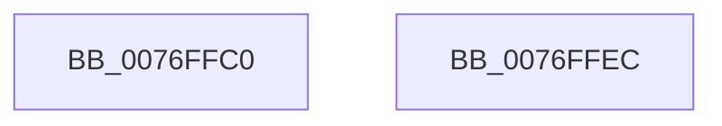

# PopCadTriggerDriverLoad

- RVA: `0x0076FFC0`–`0x0076FFED` (길이 `45` bytes)
- VA: `0x000000014076FFC0`
- 실행 섹션: `PAGE`
- PDB 이름 있음: `예`; PDB Function 태그: `아니요`
- unwind 정보 RVA: `0x0005D2F4`
- 디코드: `11`개 명령, `45/45` bytes 표시
- 미해석 바이트: `0` (있으면 어셈블리에 `.byte`로 보존)

> 이 문서는 커널 이미지의 기계어와 PDB 기호를 분석해 생성했습니다. 4번과 5번은 함수 원형과 자료형을 바이너리 사용 방식에서 추정한 C 해석이며 원본 소스 복구 결과는 아닙니다.

## 1. Dependencies

- 직접 호출 지점: **2**; 고유 호출 대상: **2**
- 직접 호출자로 확인된 함수: **0**
- RIP 상대 이미지 참조: **1**

### Outgoing calls
- `0x0076FFD8` → [RtlInitUnicodeString](../../text/42/RtlInitUnicodeString_function_0042A780.md) (function, `0x0042A780`)
- `0x0076FFE2` → [ZwLoadDriver](../../text/6A/ZwLoadDriver_function_006AF290.md) (function, `0x006AF290`)

### Direct callers
- 이 함수 시작 RVA로 연결되는 직접 call은 확인되지 않았습니다. 간접 호출은 완전히 역산할 수 없습니다.

### Static image references
- `0x0076FFC7` → RVA `0x00B03D40` (` ?? ::NNGAKEGL::`string'`; read)

## 2. Other-region calls and transfers

- 다른 실행 섹션으로 향하는 call: **2**
  - `0x0076FFD8` → [RtlInitUnicodeString](../../text/42/RtlInitUnicodeString_function_0042A780.md) (`PAGE` → `.text`)
  - `0x0076FFE2` → [ZwLoadDriver](../../text/6A/ZwLoadDriver_function_006AF290.md) (`PAGE` → `.text`)
- 별도 외부 분기/꼬리 이동을 확인하지 못했습니다.

## 3. Assembly (complete function range)

```asm
0076FFC0  48 83 EC 38                     sub rsp, 0x38
0076FFC4  0F 57 C0                        xorps xmm0, xmm0
0076FFC7  48 8D 15 72 3D 39 00            lea rdx, [rip + 0x393d72]
0076FFCE  48 8D 4C 24 20                  lea rcx, [rsp + 0x20]
0076FFD3  0F 11 44 24 20                  movups xmmword ptr [rsp + 0x20], xmm0
0076FFD8  E8 A3 A7 CB FF                  call 0x14042a780
0076FFDD  48 8D 4C 24 20                  lea rcx, [rsp + 0x20]
0076FFE2  E8 A9 F2 F3 FF                  call 0x1406af290
0076FFE7  48 83 C4 38                     add rsp, 0x38
0076FFEB  C3                              ret
0076FFEC  CC                              int3
```

## 4. C-style interpretation (structured pseudocode)

```c
__int64 __fastcall PopCadTriggerDriverLoad(void)
{
    __int64 result;
    __int64 v_rsp;
    unsigned __int64 v_stack_m18;

    v_rsp = (v_rsp) - (56);
    v_stack_m18 = v_xmm0;
    result = RtlInitUnicodeString(v_stack_m18, v_rip + 3751282, a3, a4);
    result = ZwLoadDriver(v_stack_m18, v_rip + 3751282, a3, a4);
    v_rsp = (v_rsp) + (56);
    return result;
}
```

## 5. (Beta) C Style

```c
void PopCadTriggerDriverLoad(void)
{
    int64_t result;
    int64_t local_rsp;
    uint64_t v_stack_m18;

    local_rsp = (local_rsp) - (56);
    v_stack_m18 = v_xmm0;
    result = RtlInitUnicodeString(v_stack_m18, v_rip + 3751282, a3, a4);
    result = ZwLoadDriver(v_stack_m18, v_rip + 3751282, a3, a4);
    local_rsp = (local_rsp) + (56);
    return result;
}
```

## 6. Execution-region graph

[열기: 2D/3D 그래프와 함수 탐색 컨트롤 패널](../../../control-panel.html?section=page&rva=0x0076FFC0&view=graph)

- 2D 그래프는 위에서 아래로 흐르고, 3D 그래프는 빈 공간을 드래그해 회전합니다. Shift+드래그는 이동, 휠은 확대·축소, 함수 노드 선택은 대상 보고서 이동입니다.

### Static fallback


