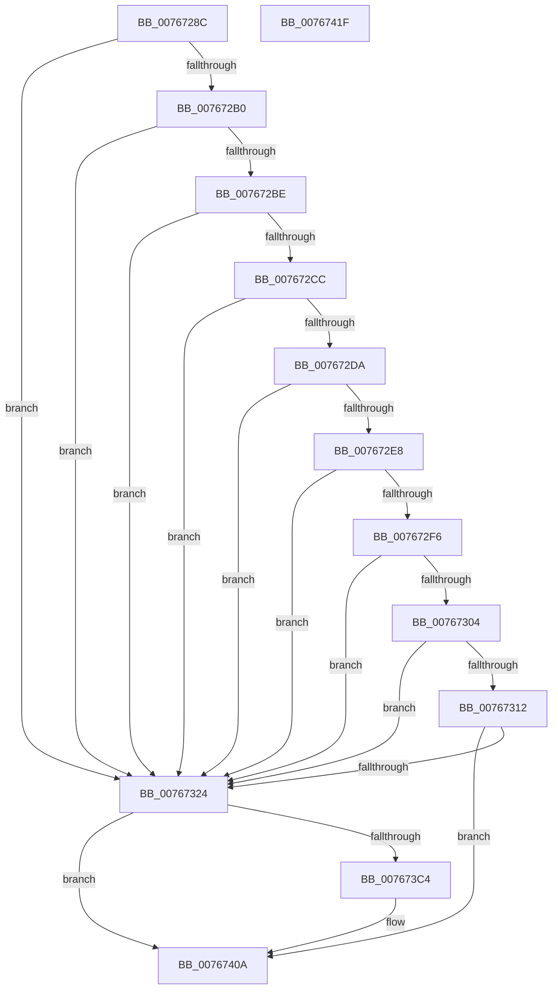

# PopCheckCachedPowerSourceStateUpdates

- RVA: `0x0076728C`–`0x00767420` (길이 `404` bytes)
- VA: `0x000000014076728C`
- 실행 섹션: `PAGE`
- PDB 이름 있음: `예`; PDB Function 태그: `아니요`
- unwind 정보 RVA: `0x000C6F20`
- 디코드: `78`개 명령, `404/404` bytes 표시
- 미해석 바이트: `0` (있으면 어셈블리에 `.byte`로 보존)

> 이 문서는 커널 이미지의 기계어와 PDB 기호를 분석해 생성했습니다. 4번과 5번은 함수 원형과 자료형을 바이너리 사용 방식에서 추정한 C 해석이며 원본 소스 복구 결과는 아닙니다.

## 1. Dependencies

- 직접 호출 지점: **3**; 고유 호출 대상: **3**
- 직접 호출자로 확인된 함수: **1**
- RIP 상대 이미지 참조: **33**

### Outgoing calls
- `0x007673B6` → [ZwUpdateWnfStateData](../../text/6B/ZwUpdateWnfStateData_function_006B0D10.md) (function, `0x006B0D10`)
- `0x00767405` → [tlgWriteTransfer_EtwWriteTransfer](../../text/42/tlgWriteTransfer_EtwWriteTransfer_function_004260E0.md) (function, `0x004260E0`)
- `0x00767412` → [_security_check_cookie](../../text/6A/_security_check_cookie_function_006AC640.md) (function, `0x006AC640`)

### Direct callers
- [PopBatteryApplyCompositeState](../AE/PopBatteryApplyCompositeState_function_00AE0CD0.md) at `0x00AE10AD`

### Static image references
- `0x00767293` → RVA `0x00E0A740` (`.data`; read)
- `0x007672A2` → RVA `0x00F0C248` (`.data`; read)
- `0x007672A8` → RVA `0x00F0C28D` (`.data`; read)
- `0x007672B0` → RVA `0x00F0C249` (`.data`; read)
- `0x007672B6` → RVA `0x00F0C28E` (`.data`; read)
- `0x007672BE` → RVA `0x00F0C250` (`.data`; read)
- `0x007672C4` → RVA `0x00F0C290` (`.data`; read)
- `0x007672CC` → RVA `0x00F0C254` (`.data`; read)
- `0x007672D2` → RVA `0x00F0C294` (`.data`; read)
- `0x007672DA` → RVA `0x00F0C268` (`.data`; read)
- `0x007672E0` → RVA `0x00F0C298` (`.data`; read)
- `0x007672E8` → RVA `0x00F0C270` (`.data`; read)
- `0x007672EE` → RVA `0x00F0C29C` (`.data`; read)
- `0x007672F6` → RVA `0x00F0C278` (`.data`; read)
- `0x007672FC` → RVA `0x00F0C2A0` (`.data`; read)
- `0x00767304` → RVA `0x00F0C27C` (`.data`; read)
- `0x0076730A` → RVA `0x00F0C2A4` (`.data`; read)
- `0x00767312` → RVA `0x00F0C280` (`.data`; read)
- `0x00767318` → RVA `0x00F0C2A8` (`.data`; read)
- `0x0076732A` → RVA `0x00F0C28C` (`.data`; read)
- `0x00767344` → RVA `0x00F0C28E` (`.data`; write)
- `0x00767354` → RVA `0x00F0C290` (`.data`; write)
- `0x00767360` → RVA `0x00F0C294` (`.data`; write)
- `0x0076736C` → RVA `0x00F0C298` (`.data`; write)
- `0x00767378` → RVA `0x00F0C29C` (`.data`; write)
- `0x00767384` → RVA `0x00F0C2A0` (`.data`; write)
- `0x00767390` → RVA `0x00F0C2A4` (`.data`; write)
- `0x0076739C` → RVA `0x00F0C28D` (`.data`; write)
- `0x007673A2` → RVA `0x00020A88` (`.rdata`; read)
- `0x007673A9` → RVA `0x00F0C2A8` (`.data`; write)
- `0x007673AF` → RVA `0x00F0C28C` (`.data`; write)
- `0x007673BB` → RVA `0x00E07748` (`.data`; read)
- `0x007673C9` → RVA `0x0004C57E` (`.rdata`; read)

## 2. Other-region calls and transfers

- 다른 실행 섹션으로 향하는 call: **3**
  - `0x007673B6` → [ZwUpdateWnfStateData](../../text/6B/ZwUpdateWnfStateData_function_006B0D10.md) (`PAGE` → `.text`)
  - `0x00767405` → [tlgWriteTransfer_EtwWriteTransfer](../../text/42/tlgWriteTransfer_EtwWriteTransfer_function_004260E0.md) (`PAGE` → `.text`)
  - `0x00767412` → [_security_check_cookie](../../text/6A/_security_check_cookie_function_006AC640.md) (`PAGE` → `.text`)
- 별도 외부 분기/꼬리 이동을 확인하지 못했습니다.

## 3. Assembly (complete function range)

```asm
0076728C  48 81 EC 88 00 00 00            sub rsp, 0x88
00767293  48 8B 05 A6 34 6A 00            mov rax, qword ptr [rip + 0x6a34a6]
0076729A  48 33 C4                        xor rax, rsp
0076729D  48 89 44 24 78                  mov qword ptr [rsp + 0x78], rax
007672A2  8A 0D A0 4F 7A 00               mov cl, byte ptr [rip + 0x7a4fa0]
007672A8  38 0D DF 4F 7A 00               cmp byte ptr [rip + 0x7a4fdf], cl
007672AE  75 74                           jne 0x140767324
007672B0  8A 05 93 4F 7A 00               mov al, byte ptr [rip + 0x7a4f93]
007672B6  38 05 D2 4F 7A 00               cmp byte ptr [rip + 0x7a4fd2], al
007672BC  75 66                           jne 0x140767324
007672BE  8B 05 8C 4F 7A 00               mov eax, dword ptr [rip + 0x7a4f8c]
007672C4  39 05 C6 4F 7A 00               cmp dword ptr [rip + 0x7a4fc6], eax
007672CA  75 58                           jne 0x140767324
007672CC  8B 05 82 4F 7A 00               mov eax, dword ptr [rip + 0x7a4f82]
007672D2  39 05 BC 4F 7A 00               cmp dword ptr [rip + 0x7a4fbc], eax
007672D8  75 4A                           jne 0x140767324
007672DA  8B 05 88 4F 7A 00               mov eax, dword ptr [rip + 0x7a4f88]
007672E0  39 05 B2 4F 7A 00               cmp dword ptr [rip + 0x7a4fb2], eax
007672E6  75 3C                           jne 0x140767324
007672E8  8B 05 82 4F 7A 00               mov eax, dword ptr [rip + 0x7a4f82]
007672EE  39 05 A8 4F 7A 00               cmp dword ptr [rip + 0x7a4fa8], eax
007672F4  75 2E                           jne 0x140767324
007672F6  8B 05 7C 4F 7A 00               mov eax, dword ptr [rip + 0x7a4f7c]
007672FC  39 05 9E 4F 7A 00               cmp dword ptr [rip + 0x7a4f9e], eax
00767302  75 20                           jne 0x140767324
00767304  8B 05 72 4F 7A 00               mov eax, dword ptr [rip + 0x7a4f72]
0076730A  39 05 94 4F 7A 00               cmp dword ptr [rip + 0x7a4f94], eax
00767310  75 12                           jne 0x140767324
00767312  8B 05 68 4F 7A 00               mov eax, dword ptr [rip + 0x7a4f68]
00767318  39 05 8A 4F 7A 00               cmp dword ptr [rip + 0x7a4f8a], eax
0076731E  0F 84 E6 00 00 00               je 0x14076740a
00767324  8A 05 1F 4F 7A 00               mov al, byte ptr [rip + 0x7a4f1f]
0076732A  48 8D 15 5B 4F 7A 00            lea rdx, [rip + 0x7a4f5b]
00767331  83 64 24 30 00                  and dword ptr [rsp + 0x30], 0
00767336  45 33 C9                        xor r9d, r9d
00767339  83 64 24 28 00                  and dword ptr [rsp + 0x28], 0
0076733E  48 83 64 24 20 00               and qword ptr [rsp + 0x20], 0
00767344  88 05 44 4F 7A 00               mov byte ptr [rip + 0x7a4f44], al
0076734A  8B 05 00 4F 7A 00               mov eax, dword ptr [rip + 0x7a4f00]
00767350  45 8D 41 20                     lea r8d, [r9 + 0x20]
00767354  89 05 36 4F 7A 00               mov dword ptr [rip + 0x7a4f36], eax
0076735A  8B 05 F4 4E 7A 00               mov eax, dword ptr [rip + 0x7a4ef4]
00767360  89 05 2E 4F 7A 00               mov dword ptr [rip + 0x7a4f2e], eax
00767366  8B 05 FC 4E 7A 00               mov eax, dword ptr [rip + 0x7a4efc]
0076736C  89 05 26 4F 7A 00               mov dword ptr [rip + 0x7a4f26], eax
00767372  8B 05 F8 4E 7A 00               mov eax, dword ptr [rip + 0x7a4ef8]
00767378  89 05 1E 4F 7A 00               mov dword ptr [rip + 0x7a4f1e], eax
0076737E  8B 05 F4 4E 7A 00               mov eax, dword ptr [rip + 0x7a4ef4]
00767384  89 05 16 4F 7A 00               mov dword ptr [rip + 0x7a4f16], eax
0076738A  8B 05 EC 4E 7A 00               mov eax, dword ptr [rip + 0x7a4eec]
00767390  89 05 0E 4F 7A 00               mov dword ptr [rip + 0x7a4f0e], eax
00767396  8B 05 E4 4E 7A 00               mov eax, dword ptr [rip + 0x7a4ee4]
0076739C  88 0D EB 4E 7A 00               mov byte ptr [rip + 0x7a4eeb], cl
007673A2  48 8D 0D DF 96 8B FF            lea rcx, [rip - 0x746921]
007673A9  89 05 F9 4E 7A 00               mov dword ptr [rip + 0x7a4ef9], eax
007673AF  C6 05 D6 4E 7A 00 00            mov byte ptr [rip + 0x7a4ed6], 0
007673B6  E8 55 99 F4 FF                  call 0x1406b0d10
007673BB  83 3D 86 03 6A 00 05            cmp dword ptr [rip + 0x6a0386], 5
007673C2  76 46                           jbe 0x14076740a
007673C4  83 64 24 74 00                  and dword ptr [rsp + 0x74], 0
007673C9  48 8D 15 AE 51 8E FF            lea rdx, [rip - 0x71ae52]
007673D0  89 44 24 40                     mov dword ptr [rsp + 0x40], eax
007673D4  48 8D 0D 6D 03 6A 00            lea rcx, [rip + 0x6a036d]
007673DB  48 8D 44 24 40                  lea rax, [rsp + 0x40]
007673E0  C7 44 24 70 04 00 00 00         mov dword ptr [rsp + 0x70], 4
007673E8  48 89 44 24 68                  mov qword ptr [rsp + 0x68], rax
007673ED  45 33 C9                        xor r9d, r9d
007673F0  48 8D 44 24 48                  lea rax, [rsp + 0x48]
007673F5  45 33 C0                        xor r8d, r8d
007673F8  48 89 44 24 28                  mov qword ptr [rsp + 0x28], rax
007673FD  C7 44 24 20 03 00 00 00         mov dword ptr [rsp + 0x20], 3
00767405  E8 D6 EC CB FF                  call 0x1404260e0
0076740A  48 8B 4C 24 78                  mov rcx, qword ptr [rsp + 0x78]
0076740F  48 33 CC                        xor rcx, rsp
00767412  E8 29 52 F4 FF                  call 0x1406ac640
00767417  48 81 C4 88 00 00 00            add rsp, 0x88
0076741E  C3                              ret
0076741F  CC                              int3
```

## 4. C-style interpretation (structured pseudocode)

```c
__int64 __fastcall PopCheckCachedPowerSourceStateUpdates(__int64 a1, __int64 a2, __int64 a3, int a4)
{
    __int64 result;
    __int64 v_rsp;
    unsigned __int64 v_stack_m10;
    unsigned int v_stack_m14;
    unsigned int v_stack_m18;
    unsigned __int64 v_stack_m20;
    unsigned __int64 v_stack_m40;
    unsigned int v_stack_m48;
    unsigned int v_stack_m58;
    unsigned int v_stack_m60;
    unsigned __int64 v_stack_m68;

    v_rsp = (v_rsp) - (136);
    result = (*(unsigned __int64 *)(v_rip + 6960294)) ^ (v_rsp);
    v_stack_m10 = result;
    if ((*(unsigned __int8 *)(v_rip + 8015839)) != ((unsigned __int8)(*(unsigned __int8 *)(v_rip + 8015776)))) goto loc_00767324;
    if ((*(unsigned __int8 *)(v_rip + 8015826)) != ((unsigned __int8)(*(unsigned __int8 *)(v_rip + 8015763)))) goto loc_00767324;
    if ((*(unsigned int *)(v_rip + 8015814)) != ((unsigned int)((unsigned int)(*(unsigned int *)(v_rip + 8015756))))) goto loc_00767324;
    if ((*(unsigned int *)(v_rip + 8015804)) != ((unsigned int)((unsigned int)(*(unsigned int *)(v_rip + 8015746))))) goto loc_00767324;
    if ((*(unsigned int *)(v_rip + 8015794)) != ((unsigned int)((unsigned int)(*(unsigned int *)(v_rip + 8015752))))) goto loc_00767324;
    if ((*(unsigned int *)(v_rip + 8015784)) != ((unsigned int)((unsigned int)(*(unsigned int *)(v_rip + 8015746))))) goto loc_00767324;
    if ((*(unsigned int *)(v_rip + 8015774)) != ((unsigned int)((unsigned int)(*(unsigned int *)(v_rip + 8015740))))) goto loc_00767324;
    if ((*(unsigned int *)(v_rip + 8015764)) != ((unsigned int)((unsigned int)(*(unsigned int *)(v_rip + 8015730))))) goto loc_00767324;
    if ((*(unsigned int *)(v_rip + 8015754)) == ((unsigned int)((unsigned int)(*(unsigned int *)(v_rip + 8015720))))) goto loc_0076740A;
loc_00767324:
    a4 = 0;
    *(unsigned __int8 *)(v_rip + 8015684) = (unsigned __int8)(*(unsigned __int8 *)(v_rip + 8015647));
    *(unsigned int *)(v_rip + 8015670) = (unsigned int)((unsigned int)(*(unsigned int *)(v_rip + 8015616)));
    *(unsigned int *)(v_rip + 8015662) = (unsigned int)((unsigned int)(*(unsigned int *)(v_rip + 8015604)));
    *(unsigned int *)(v_rip + 8015654) = (unsigned int)((unsigned int)(*(unsigned int *)(v_rip + 8015612)));
    *(unsigned int *)(v_rip + 8015646) = (unsigned int)((unsigned int)(*(unsigned int *)(v_rip + 8015608)));
    *(unsigned int *)(v_rip + 8015638) = (unsigned int)((unsigned int)(*(unsigned int *)(v_rip + 8015604)));
    *(unsigned int *)(v_rip + 8015630) = (unsigned int)((unsigned int)(*(unsigned int *)(v_rip + 8015596)));
    *(unsigned __int8 *)(v_rip + 8015595) = (unsigned __int8)(*(unsigned __int8 *)(v_rip + 8015776));
    *(unsigned int *)(v_rip + 8015609) = (unsigned int)((unsigned int)(*(unsigned int *)(v_rip + 8015588)));
    *(unsigned __int8 *)(v_rip + 8015574) = 0;
    result = ZwUpdateWnfStateData(v_rip - 7629089, v_rip + 8015707, a4 + 32, a4);
    if ((*(unsigned int *)(v_rip + 6947718)) >= = 5) {
        a2 = v_rip - 7450194;
        v_stack_m48 = (unsigned int)(result);
        a1 = v_rip + 6947693;
        result = v_stack_m48;
        v_stack_m18 = 4;
        v_stack_m20 = result;
        a4 = 0;
        result = v_stack_m40;
        a3 = 0;
        v_stack_m60 = result;
        v_stack_m68 = 3;
        result = tlgWriteTransfer_EtwWriteTransfer(a1, a2, a3, a4);
    }
    a1 = (v_stack_m10) ^ (v_rsp);
    result = _security_check_cookie(a1, a2, a3, a4);
    v_rsp = (v_rsp) + (136);
    return result;
}
```

## 5. (Beta) C Style

```c
int64_t PopCheckCachedPowerSourceStateUpdates(int64_t Arg1, int64_t Arg2, int64_t Arg3, int32_t Arg4)
{
    int64_t result;
    int64_t local_rsp;
    uint64_t v_stack_m10;
    uint32_t v_stack_m14;
    uint32_t v_stack_m18;
    uint64_t v_stack_m20;
    uint64_t v_stack_m40;
    uint32_t v_stack_m48;
    uint32_t v_stack_m58;
    uint32_t v_stack_m60;
    uint64_t v_stack_m68;

    local_rsp = (local_rsp) - (136);
    result = (*(uint64_t *)(v_rip + 0x6A34A6)) ^ (local_rsp);
    v_stack_m10 = result;
    if ((*(uint8_t *)(v_rip + 0x7A4FDF)) != ((uint8_t)(*(uint8_t *)(v_rip + 0x7A4FA0)))) goto loc_00767324;
    if ((*(uint8_t *)(v_rip + 0x7A4FD2)) != ((uint8_t)(*(uint8_t *)(v_rip + 0x7A4F93)))) goto loc_00767324;
    if ((*(uint32_t *)(v_rip + 0x7A4FC6)) != ((uint32_t)((uint32_t)(*(uint32_t *)(v_rip + 0x7A4F8C))))) goto loc_00767324;
    if ((*(uint32_t *)(v_rip + 0x7A4FBC)) != ((uint32_t)((uint32_t)(*(uint32_t *)(v_rip + 0x7A4F82))))) goto loc_00767324;
    if ((*(uint32_t *)(v_rip + 0x7A4FB2)) != ((uint32_t)((uint32_t)(*(uint32_t *)(v_rip + 0x7A4F88))))) goto loc_00767324;
    if ((*(uint32_t *)(v_rip + 0x7A4FA8)) != ((uint32_t)((uint32_t)(*(uint32_t *)(v_rip + 0x7A4F82))))) goto loc_00767324;
    if ((*(uint32_t *)(v_rip + 0x7A4F9E)) != ((uint32_t)((uint32_t)(*(uint32_t *)(v_rip + 0x7A4F7C))))) goto loc_00767324;
    if ((*(uint32_t *)(v_rip + 0x7A4F94)) != ((uint32_t)((uint32_t)(*(uint32_t *)(v_rip + 0x7A4F72))))) goto loc_00767324;
    if ((*(uint32_t *)(v_rip + 0x7A4F8A)) == ((uint32_t)((uint32_t)(*(uint32_t *)(v_rip + 0x7A4F68))))) goto loc_0076740A;
loc_00767324:
    Arg4 = 0;
    *(uint8_t *)(v_rip + 0x7A4F44) = (uint8_t)(*(uint8_t *)(v_rip + 0x7A4F1F));
    *(uint32_t *)(v_rip + 0x7A4F36) = (uint32_t)((uint32_t)(*(uint32_t *)(v_rip + 0x7A4F00)));
    *(uint32_t *)(v_rip + 0x7A4F2E) = (uint32_t)((uint32_t)(*(uint32_t *)(v_rip + 0x7A4EF4)));
    *(uint32_t *)(v_rip + 0x7A4F26) = (uint32_t)((uint32_t)(*(uint32_t *)(v_rip + 0x7A4EFC)));
    *(uint32_t *)(v_rip + 0x7A4F1E) = (uint32_t)((uint32_t)(*(uint32_t *)(v_rip + 0x7A4EF8)));
    *(uint32_t *)(v_rip + 0x7A4F16) = (uint32_t)((uint32_t)(*(uint32_t *)(v_rip + 0x7A4EF4)));
    *(uint32_t *)(v_rip + 0x7A4F0E) = (uint32_t)((uint32_t)(*(uint32_t *)(v_rip + 0x7A4EEC)));
    *(uint8_t *)(v_rip + 0x7A4EEB) = (uint8_t)(*(uint8_t *)(v_rip + 0x7A4FA0));
    *(uint32_t *)(v_rip + 0x7A4EF9) = (uint32_t)((uint32_t)(*(uint32_t *)(v_rip + 0x7A4EE4)));
    *(uint8_t *)(v_rip + 0x7A4ED6) = 0;
    result = ZwUpdateWnfStateData(v_rip - 7629089, v_rip + 8015707, Arg4 + 32, Arg4);
    if ((*(uint32_t *)(v_rip + 0x6A0386)) >= = 5) {
        Arg2 = v_rip - 7450194;
        v_stack_m48 = (uint32_t)(result);
        Arg1 = v_rip + 6947693;
        result = v_stack_m48;
        v_stack_m18 = 4;
        v_stack_m20 = result;
        Arg4 = 0;
        result = v_stack_m40;
        Arg3 = 0;
        v_stack_m60 = result;
        v_stack_m68 = 3;
        result = tlgWriteTransfer_EtwWriteTransfer(Arg1, Arg2, Arg3, Arg4);
    }
    Arg1 = (v_stack_m10) ^ (local_rsp);
    result = _security_check_cookie(Arg1, Arg2, Arg3, Arg4);
    local_rsp = (local_rsp) + (136);
    return result;
}
```

## 6. Execution-region graph

[열기: 2D/3D 그래프와 함수 탐색 컨트롤 패널](../../../control-panel.html?section=page&rva=0x0076728C&view=graph)

- 2D 그래프는 위에서 아래로 흐르고, 3D 그래프는 빈 공간을 드래그해 회전합니다. Shift+드래그는 이동, 휠은 확대·축소, 함수 노드 선택은 대상 보고서 이동입니다.

### Static fallback


