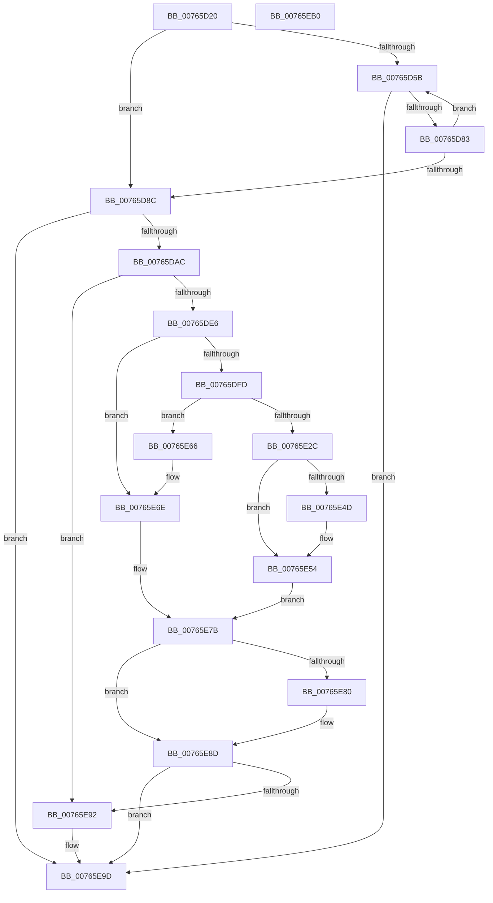

# PopConnectToPolicyDevice

- RVA: `0x00765D20`–`0x00765EB1` (길이 `401` bytes)
- VA: `0x0000000140765D20`
- 실행 섹션: `PAGE`
- PDB 이름 있음: `예`; PDB Function 태그: `아니요`
- unwind 정보 RVA: `0x000CCE24`
- 디코드: `112`개 명령, `401/401` bytes 표시
- 미해석 바이트: `0` (있으면 어셈블리에 `.byte`로 보존)

> 이 문서는 커널 이미지의 기계어와 PDB 기호를 분석해 생성했습니다. 4번과 5번은 함수 원형과 자료형을 바이너리 사용 방식에서 추정한 C 해석이며 원본 소스 복구 결과는 아닙니다.

## 1. Dependencies

- 직접 호출 지점: **11**; 고유 호출 대상: **10**
- 직접 호출자로 확인된 함수: **2**
- RIP 상대 이미지 참조: **2**

### Outgoing calls
- `0x00765D76` → [RtlCompareUnicodeStrings](../97/RtlCompareUnicodeStrings_function_009727E0.md) (function, `0x009727E0`)
- `0x00765D9B` → [ExAllocatePool2](../../poolcode/B8/ExAllocatePool2_function_00B820F0.md) (function, `0x00B820F0`)
- `0x00765DC4` → [RtlCopyUnicodeString](../../text/3F/RtlCopyUnicodeString_function_003FEF30.md) (function, `0x003FEF30`)
- `0x00765DD5` → [PopGetPolicyDeviceObject](PopGetPolicyDeviceObject_function_00765EB8.md) (function, `0x00765EB8`)
- `0x00765DEB` → [IoAllocateIrp](../../text/20/IoAllocateIrp_function_002065D0.md) (function, `0x002065D0`)
- `0x00765E23` → [IoRegisterPlugPlayNotification](../95/IoRegisterPlugPlayNotification_function_009535A0.md) (function, `0x009535A0`)
- `0x00765E3B` → [guard_dispatch_icall](../../text/6B/guard_dispatch_icall_function_006BAAD0.md) (function, `0x006BAAD0`)
- `0x00765E69` → [IoFreeIrp](../../text/24/IoFreeIrp_function_0024DF70.md) (function, `0x0024DF70`)
- `0x00765E76` → [ObfDereferenceObjectWithTag](../../text/2F/ObfDereferenceObjectWithTag_function_002F78E0.md) (function, `0x002F78E0`)
- `0x00765E88` → [ObfDereferenceObjectWithTag](../../text/2F/ObfDereferenceObjectWithTag_function_002F78E0.md) (function, `0x002F78E0`)
- `0x00765E98` → [ExFreePoolWithTag](../../poolcode/B8/ExFreePoolWithTag_function_00B82870.md) (function, `0x00B82870`)

### Direct callers
- [PopNotifyPolicyDevice](PopNotifyPolicyDevice_function_00765FF0.md) at `0x0076607C`
- [PopPolicyDeviceTargetChange](PopPolicyDeviceTargetChange_function_00766490.md) at `0x00766526`

### Static image references
- `0x00765D38` → RVA `0x00E01AE0` (`.data`; read)
- `0x00765E0A` → RVA `0x00766490` (`PopPolicyDeviceTargetChange`; read)

## 2. Other-region calls and transfers

- 다른 실행 섹션으로 향하는 call: **8**
  - `0x00765D9B` → [ExAllocatePool2](../../poolcode/B8/ExAllocatePool2_function_00B820F0.md) (`PAGE` → `POOLCODE`)
  - `0x00765DC4` → [RtlCopyUnicodeString](../../text/3F/RtlCopyUnicodeString_function_003FEF30.md) (`PAGE` → `.text`)
  - `0x00765DEB` → [IoAllocateIrp](../../text/20/IoAllocateIrp_function_002065D0.md) (`PAGE` → `.text`)
  - `0x00765E3B` → [guard_dispatch_icall](../../text/6B/guard_dispatch_icall_function_006BAAD0.md) (`PAGE` → `.text`)
  - `0x00765E69` → [IoFreeIrp](../../text/24/IoFreeIrp_function_0024DF70.md) (`PAGE` → `.text`)
  - `0x00765E76` → [ObfDereferenceObjectWithTag](../../text/2F/ObfDereferenceObjectWithTag_function_002F78E0.md) (`PAGE` → `.text`)
  - `0x00765E88` → [ObfDereferenceObjectWithTag](../../text/2F/ObfDereferenceObjectWithTag_function_002F78E0.md) (`PAGE` → `.text`)
  - `0x00765E98` → [ExFreePoolWithTag](../../poolcode/B8/ExFreePoolWithTag_function_00B82870.md) (`PAGE` → `POOLCODE`)
- 별도 외부 분기/꼬리 이동을 확인하지 못했습니다.

## 3. Assembly (complete function range)

```asm
00765D20  48 89 5C 24 08                  mov qword ptr [rsp + 8], rbx
00765D25  48 89 6C 24 10                  mov qword ptr [rsp + 0x10], rbp
00765D2A  56                              push rsi
00765D2B  57                              push rdi
00765D2C  41 56                           push r14
00765D2E  48 83 EC 40                     sub rsp, 0x40
00765D32  48 83 64 24 70 00               and qword ptr [rsp + 0x70], 0
00765D38  48 8D 05 A1 BD 69 00            lea rax, [rip + 0x69bda1]
00765D3F  48 63 E9                        movsxd rbp, ecx
00765D42  4C 8B F2                        mov r14, rdx
00765D45  48 8B F5                        mov rsi, rbp
00765D48  48 C1 E6 05                     shl rsi, 5
00765D4C  48 03 F0                        add rsi, rax
00765D4F  48 8B 46 08                     mov rax, qword ptr [rsi + 8]
00765D53  48 8B 18                        mov rbx, qword ptr [rax]
00765D56  48 3B D8                        cmp rbx, rax
00765D59  74 31                           je 0x140765d8c
00765D5B  45 0F B7 0E                     movzx r9d, word ptr [r14]
00765D5F  0F B7 53 20                     movzx edx, word ptr [rbx + 0x20]
00765D63  4D 8B 46 08                     mov r8, qword ptr [r14 + 8]
00765D67  48 8B 4B 28                     mov rcx, qword ptr [rbx + 0x28]
00765D6B  49 D1 E9                        shr r9, 1
00765D6E  48 D1 EA                        shr rdx, 1
00765D71  C6 44 24 20 01                  mov byte ptr [rsp + 0x20], 1
00765D76  E8 65 CA 20 00                  call 0x1409727e0
00765D7B  85 C0                           test eax, eax
00765D7D  0F 84 1A 01 00 00               je 0x140765e9d
00765D83  48 8B 1B                        mov rbx, qword ptr [rbx]
00765D86  48 3B 5E 08                     cmp rbx, qword ptr [rsi + 8]
00765D8A  75 CF                           jne 0x140765d5b
00765D8C  41 0F B7 16                     movzx edx, word ptr [r14]
00765D90  B9 40 00 00 00                  mov ecx, 0x40
00765D95  03 16                           add edx, dword ptr [rsi]
00765D97  44 8B 46 04                     mov r8d, dword ptr [rsi + 4]
00765D9B  E8 50 C3 41 00                  call 0x140b820f0
00765DA0  48 8B F8                        mov rdi, rax
00765DA3  48 85 C0                        test rax, rax
00765DA6  0F 84 F1 00 00 00               je 0x140765e9d
00765DAC  8B 0E                           mov ecx, dword ptr [rsi]
00765DAE  49 8B D6                        mov rdx, r14
00765DB1  48 03 C8                        add rcx, rax
00765DB4  48 89 48 28                     mov qword ptr [rax + 0x28], rcx
00765DB8  41 0F B7 0E                     movzx ecx, word ptr [r14]
00765DBC  66 89 48 22                     mov word ptr [rax + 0x22], cx
00765DC0  48 8D 48 20                     lea rcx, [rax + 0x20]
00765DC4  E8 67 91 C9 FF                  call 0x1403fef30
00765DC9  48 8D 54 24 70                  lea rdx, [rsp + 0x70]
00765DCE  89 6F 10                        mov dword ptr [rdi + 0x10], ebp
00765DD1  48 8D 4F 20                     lea rcx, [rdi + 0x20]
00765DD5  E8 DE 00 00 00                  call 0x140765eb8
00765DDA  48 8B D8                        mov rbx, rax
00765DDD  48 85 C0                        test rax, rax
00765DE0  0F 84 AC 00 00 00               je 0x140765e92
00765DE6  8A 48 4C                        mov cl, byte ptr [rax + 0x4c]
00765DE9  33 D2                           xor edx, edx
00765DEB  E8 E0 07 AA FF                  call 0x1402065d0
00765DF0  48 8B 6C 24 70                  mov rbp, qword ptr [rsp + 0x70]
00765DF5  4C 8B F0                        mov r14, rax
00765DF8  48 85 C0                        test rax, rax
00765DFB  74 71                           je 0x140765e6e
00765DFD  4C 8B 4B 08                     mov r9, qword ptr [rbx + 8]
00765E01  48 8D 4F 18                     lea rcx, [rdi + 0x18]
00765E05  48 89 4C 24 30                  mov qword ptr [rsp + 0x30], rcx
00765E0A  48 8D 05 7F 06 00 00            lea rax, [rip + 0x67f]
00765E11  33 D2                           xor edx, edx
00765E13  48 89 7C 24 28                  mov qword ptr [rsp + 0x28], rdi
00765E18  4C 8B C5                        mov r8, rbp
00765E1B  48 89 44 24 20                  mov qword ptr [rsp + 0x20], rax
00765E20  8D 4A 03                        lea ecx, [rdx + 3]
00765E23  E8 78 D7 1E 00                  call 0x1409535a0
00765E28  85 C0                           test eax, eax
00765E2A  78 3A                           js 0x140765e66
00765E2C  48 89 5F 30                     mov qword ptr [rdi + 0x30], rbx
00765E30  48 8B CF                        mov rcx, rdi
00765E33  4C 89 77 38                     mov qword ptr [rdi + 0x38], r14
00765E37  48 8B 46 10                     mov rax, qword ptr [rsi + 0x10]
00765E3B  E8 90 4C F5 FF                  call 0x1406baad0
00765E40  48 8B 46 08                     mov rax, qword ptr [rsi + 8]
00765E44  48 8B 50 08                     mov rdx, qword ptr [rax + 8]
00765E48  48 39 02                        cmp qword ptr [rdx], rax
00765E4B  74 07                           je 0x140765e54
00765E4D  B9 03 00 00 00                  mov ecx, 3
00765E52  CD 29                           int 0x29
00765E54  48 89 07                        mov qword ptr [rdi], rax
00765E57  48 89 57 08                     mov qword ptr [rdi + 8], rdx
00765E5B  48 89 3A                        mov qword ptr [rdx], rdi
00765E5E  48 89 78 08                     mov qword ptr [rax + 8], rdi
00765E62  33 FF                           xor edi, edi
00765E64  EB 15                           jmp 0x140765e7b
00765E66  49 8B CE                        mov rcx, r14
00765E69  E8 02 81 AE FF                  call 0x14024df70
00765E6E  BA 50 6F 50 64                  mov edx, 0x64506f50
00765E73  48 8B CB                        mov rcx, rbx
00765E76  E8 65 1A B9 FF                  call 0x1402f78e0
00765E7B  48 85 ED                        test rbp, rbp
00765E7E  74 0D                           je 0x140765e8d
00765E80  BA 50 6F 50 64                  mov edx, 0x64506f50
00765E85  48 8B CD                        mov rcx, rbp
00765E88  E8 53 1A B9 FF                  call 0x1402f78e0
00765E8D  48 85 FF                        test rdi, rdi
00765E90  74 0B                           je 0x140765e9d
00765E92  8B 56 04                        mov edx, dword ptr [rsi + 4]
00765E95  48 8B CF                        mov rcx, rdi
00765E98  E8 D3 C9 41 00                  call 0x140b82870
00765E9D  48 8B 5C 24 60                  mov rbx, qword ptr [rsp + 0x60]
00765EA2  48 8B 6C 24 68                  mov rbp, qword ptr [rsp + 0x68]
00765EA7  48 83 C4 40                     add rsp, 0x40
00765EAB  41 5E                           pop r14
00765EAD  5F                              pop rdi
00765EAE  5E                              pop rsi
00765EAF  C3                              ret
00765EB0  CC                              int3
```

## 4. C-style interpretation (structured pseudocode)

```c
__int64 __fastcall PopConnectToPolicyDevice(int a1, __int64 a2)
{
    __int64 result;
    __int64 v_rdi;
    __int64 v_rsi;
    __int64 v_rsp;
    unsigned __int64 v_stack_m28;
    unsigned __int64 v_stack_m30;
    unsigned __int8 v_stack_m38;
    unsigned __int64 v_stack_p10;
    unsigned __int64 v_stack_p18;
    unsigned __int64 v_stack_p8;

    v_stack_p8 = v_rbx;
    v_stack_p10 = v_rbp;
    v_rsp = (v_rsp) - (64);
    v_rsi = ((int)(a1)) << (5);
    v_rsi = (v_rsi) + (v_rip + 6929825);
    if ((*(unsigned __int64 *)(*(unsigned __int64 *)(v_rsi + 8))) == (*(unsigned __int64 *)(v_rsi + 8))) goto loc_00765D8C;
loc_00765D5B:
    a4 = (*(unsigned __int16 *)(a2)) >> (1);
    a2 = (*(unsigned __int16 *)(*(unsigned __int64 *)(*(unsigned __int64 *)(v_rsi + 8)) + 32)) >> (1);
    v_stack_m38 = 1;
    result = RtlCompareUnicodeStrings(*(unsigned __int64 *)(*(unsigned __int64 *)(*(unsigned __int64 *)(v_rsi + 8)) + 40), a2, *(unsigned __int64 *)(a2 + 8), a4);
    if ((unsigned int)(result) == 0) goto loc_00765E9D;
    if ((*(unsigned __int64 *)(*(unsigned __int64 *)(*(unsigned __int64 *)(v_rsi + 8)))) != (*(unsigned __int64 *)(v_rsi + 8))) goto loc_00765D5B;
loc_00765D8C:
    a2 = (unsigned int)((*(unsigned __int16 *)(a2)) + (*(unsigned int *)(v_rsi)));
    result = ExAllocatePool2(64, a2, (unsigned int)(*(unsigned int *)(v_rsi + 4)), a4);
    if (result == 0) goto loc_00765E9D;
    a1 = ((unsigned int)(*(unsigned int *)(v_rsi))) + (result);
    *(unsigned __int64 *)(result + 40) = a1;
    *(unsigned __int16 *)(result + 34) = (unsigned __int16)(*(unsigned __int16 *)(a2));
    result = RtlCopyUnicodeString(result + 32, a2, (unsigned int)(*(unsigned int *)(v_rsi + 4)), a4);
    *(unsigned int *)(result + 16) = (unsigned int)((int)(a1));
    result = PopGetPolicyDeviceObject(result + 32, v_stack_p18, (unsigned int)(*(unsigned int *)(v_rsi + 4)), a4);
    if (result == 0) goto loc_00765E92;
    a2 = 0;
    result = IoAllocateIrp(*(unsigned __int8 *)(result + 76), a2, (unsigned int)(*(unsigned int *)(v_rsi + 4)), a4);
    if (result == 0) goto loc_00765E6E;
    v_stack_m28 = result + 24;
    a2 = 0;
    v_stack_m30 = result;
    v_stack_m38 = v_rip + 1663;
    result = IoRegisterPlugPlayNotification(a2 + 3, a2, v_stack_p18, *(unsigned __int64 *)(result + 8));
    if (sign_flag) goto loc_00765E66;
    *(unsigned __int64 *)(result + 48) = result;
    *(unsigned __int64 *)(result + 56) = result;
    result = guard_dispatch_icall(result, a2, v_stack_p18, *(unsigned __int64 *)(result + 8));
    if ((*(unsigned __int64 *)(*(unsigned __int64 *)(*(unsigned __int64 *)(v_rsi + 8) + 8))) != (*(unsigned __int64 *)(v_rsi + 8))) {
        a1 = 3;
    }
    *(unsigned __int64 *)(result) = *(unsigned __int64 *)(v_rsi + 8);
    *(unsigned __int64 *)(result + 8) = *(unsigned __int64 *)(*(unsigned __int64 *)(v_rsi + 8) + 8);
    *(unsigned __int64 *)(*(unsigned __int64 *)(*(unsigned __int64 *)(v_rsi + 8) + 8)) = result;
    *(unsigned __int64 *)(*(unsigned __int64 *)(v_rsi + 8) + 8) = result;
    v_rdi = 0;
    goto loc_00765E7B;
loc_00765E66:
    result = IoFreeIrp(result, *(unsigned __int64 *)(*(unsigned __int64 *)(v_rsi + 8) + 8), v_stack_p18, *(unsigned __int64 *)(result + 8));
loc_00765E6E:
    result = ObfDereferenceObjectWithTag(result, (unsigned int)(0x64506F50ULL), v_stack_p18, *(unsigned __int64 *)(result + 8));
loc_00765E7B:
    if (v_stack_p18 != 0) {
        a2 = 0x64506F50ULL;
        a1 = v_stack_p18;
        result = ObfDereferenceObjectWithTag(a1, a2, v_stack_p18, *(unsigned __int64 *)(result + 8));
    }
    if (0 != 0) {
        a2 = *(unsigned int *)(v_rsi + 4);
        a1 = 0;
        result = ExFreePoolWithTag(a1, a2, v_stack_p18, *(unsigned __int64 *)(result + 8));
    }
    v_rsp = (v_rsp) + (64);
    return result;
}
```

## 5. (Beta) C Style

```c
int64_t PopConnectToPolicyDevice(int32_t Arg1, void *Arg2)
{
    uint8_t *arg2 = (uint8_t *)Arg2;

    int64_t result;
    int64_t local_rdi;
    int64_t local_rsi;
    int64_t local_rsp;
    uint64_t v_stack_m28;
    uint64_t v_stack_m30;
    uint8_t v_stack_m38;
    uint64_t v_stack_p10;
    uint64_t v_stack_p18;
    uint64_t v_stack_p8;

    v_stack_p8 = local_rbx;
    v_stack_p10 = local_rbp;
    local_rsp = (local_rsp) - (64);
    local_rsi = ((int32_t)(Arg1)) << (5);
    local_rsi = (local_rsi) + (v_rip + 6929825);
    if ((*(uint64_t *)(*(uint64_t *)(local_rsi + 0x8))) == (*(uint64_t *)(local_rsi + 0x8))) goto loc_00765D8C;
loc_00765D5B:
    a4 = (*(uint16_t *)(arg2)) >> (1);
    Arg2 = (*(uint16_t *)(*(uint64_t *)(*(uint64_t *)(local_rsi + 0x8)) + 0x20)) >> (1);
    v_stack_m38 = 1;
    result = RtlCompareUnicodeStrings(*(uint64_t *)(*(uint64_t *)(*(uint64_t *)(local_rsi + 0x8)) + 0x28), Arg2, *(uint64_t *)(arg2 + 0x8), a4);
    if ((uint32_t)(result) == 0) goto loc_00765E9D;
    if ((*(uint64_t *)(*(uint64_t *)(*(uint64_t *)(local_rsi + 0x8)))) != (*(uint64_t *)(local_rsi + 0x8))) goto loc_00765D5B;
loc_00765D8C:
    Arg2 = (uint32_t)((*(uint16_t *)(arg2)) + (*(uint32_t *)(local_rsi)));
    result = ExAllocatePool2(64, Arg2, (uint32_t)(*(uint32_t *)(local_rsi + 0x4)), a4);
    if (result == 0) goto loc_00765E9D;
    Arg1 = ((uint32_t)(*(uint32_t *)(local_rsi))) + (result);
    *(uint64_t *)(result + 0x28) = Arg1;
    *(uint16_t *)(result + 0x22) = (uint16_t)(*(uint16_t *)(arg2));
    result = RtlCopyUnicodeString(result + 32, Arg2, (uint32_t)(*(uint32_t *)(local_rsi + 0x4)), a4);
    *(uint32_t *)(result + 0x10) = (uint32_t)((int32_t)(Arg1));
    result = PopGetPolicyDeviceObject(result + 32, v_stack_p18, (uint32_t)(*(uint32_t *)(local_rsi + 0x4)), a4);
    if (result == 0) goto loc_00765E92;
    Arg2 = 0;
    result = IoAllocateIrp(*(uint8_t *)(result + 0x4C), Arg2, (uint32_t)(*(uint32_t *)(local_rsi + 0x4)), a4);
    if (result == 0) goto loc_00765E6E;
    v_stack_m28 = result + 24;
    Arg2 = 0;
    v_stack_m30 = result;
    v_stack_m38 = v_rip + 1663;
    result = IoRegisterPlugPlayNotification(Arg2 + 3, Arg2, v_stack_p18, *(uint64_t *)(result + 0x8));
    if (sign_flag) goto loc_00765E66;
    *(uint64_t *)(result + 0x30) = result;
    *(uint64_t *)(result + 0x38) = result;
    result = guard_dispatch_icall(result, Arg2, v_stack_p18, *(uint64_t *)(result + 0x8));
    if ((*(uint64_t *)(*(uint64_t *)(*(uint64_t *)(local_rsi + 0x8) + 0x8))) != (*(uint64_t *)(local_rsi + 0x8))) {
        Arg1 = 3;
    }
    *(uint64_t *)(result) = *(uint64_t *)(local_rsi + 0x8);
    *(uint64_t *)(result + 0x8) = *(uint64_t *)(*(uint64_t *)(local_rsi + 0x8) + 0x8);
    *(uint64_t *)(*(uint64_t *)(*(uint64_t *)(local_rsi + 0x8) + 0x8)) = result;
    *(uint64_t *)(*(uint64_t *)(local_rsi + 0x8) + 0x8) = result;
    local_rdi = 0;
    goto loc_00765E7B;
loc_00765E66:
    result = IoFreeIrp(result, *(uint64_t *)(*(uint64_t *)(local_rsi + 0x8) + 0x8), v_stack_p18, *(uint64_t *)(result + 0x8));
loc_00765E6E:
    result = ObfDereferenceObjectWithTag(result, (uint32_t)(0x64506F50ULL), v_stack_p18, *(uint64_t *)(result + 0x8));
loc_00765E7B:
    if (v_stack_p18 != 0) {
        Arg2 = 0x64506F50ULL;
        Arg1 = v_stack_p18;
        result = ObfDereferenceObjectWithTag(Arg1, Arg2, v_stack_p18, *(uint64_t *)(result + 0x8));
    }
    if (0 != 0) {
        Arg2 = *(uint32_t *)(local_rsi + 0x4);
        Arg1 = 0;
        result = ExFreePoolWithTag(Arg1, Arg2, v_stack_p18, *(uint64_t *)(result + 0x8));
    }
    local_rsp = (local_rsp) + (64);
    return result;
}
```

### 관측된 메모리 오프셋

구조체 형식이 확인되지 않은 접근은 인자 기준의 오프셋으로만 기록했습니다.

| 기준 인자 | 오프셋 표현 | 폭 (bit) | 접근 |
|---|---:|---:|---|
| `Arg2` | `+ 0x0` | `16` | `R` |
| `Arg2` | `+ 0x8` | `64` | `R` |

## 6. Execution-region graph

[열기: 2D/3D 그래프와 함수 탐색 컨트롤 패널](../../../control-panel.html?section=page&rva=0x00765D20&view=graph)

- 2D 그래프는 위에서 아래로 흐르고, 3D 그래프는 빈 공간을 드래그해 회전합니다. Shift+드래그는 이동, 휠은 확대·축소, 함수 노드 선택은 대상 보고서 이동입니다.

### Static fallback


