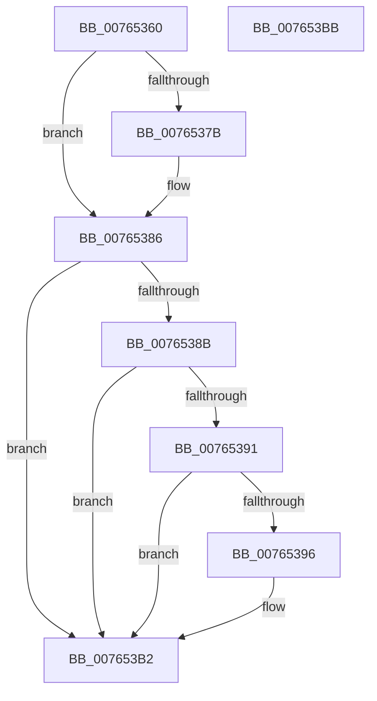

# PopDeepSleepPowerSettingCallback

- RVA: `0x00765360`–`0x007653BC` (길이 `92` bytes)
- VA: `0x0000000140765360`
- 실행 섹션: `PAGE`
- PDB 이름 있음: `예`; PDB Function 태그: `아니요`
- unwind 정보 RVA: `0x0005CF00`
- 디코드: `26`개 명령, `92/92` bytes 표시
- 미해석 바이트: `0` (있으면 어셈블리에 `.byte`로 보존)

> 이 문서는 커널 이미지의 기계어와 PDB 기호를 분석해 생성했습니다. 4번과 5번은 함수 원형과 자료형을 바이너리 사용 방식에서 추정한 C 해석이며 원본 소스 복구 결과는 아닙니다.

## 1. Dependencies

- 직접 호출 지점: **3**; 고유 호출 대상: **3**
- 직접 호출자로 확인된 함수: **0**
- RIP 상대 이미지 참조: **3**

### Outgoing calls
- `0x00765396` → [PopAcquirePolicyLock](../../pagelk/B7/PopAcquirePolicyLock_function_00B783C0.md) (function, `0x00B783C0`)
- `0x007653A5` → [PopCheckResiliencyScenarios](../A3/PopCheckResiliencyScenarios_function_00A31718.md) (function, `0x00A31718`)
- `0x007653AA` → [PopReleasePolicyLock](../../pagelk/B7/PopReleasePolicyLock_function_00B78410.md) (function, `0x00B78410`)

### Direct callers
- 이 함수 시작 RVA로 연결되는 직접 call은 확인되지 않았습니다. 간접 호출은 완전히 역산할 수 없습니다.

### Static image references
- `0x00765366` → RVA `0x000246A8` (`.rdata`; read)
- `0x0076537B` → RVA `0x000246B0` (`.rdata`; read)
- `0x0076539E` → RVA `0x00F092F2` (`.data`; read)

## 2. Other-region calls and transfers

- 다른 실행 섹션으로 향하는 call: **2**
  - `0x00765396` → [PopAcquirePolicyLock](../../pagelk/B7/PopAcquirePolicyLock_function_00B783C0.md) (`PAGE` → `PAGELK`)
  - `0x007653AA` → [PopReleasePolicyLock](../../pagelk/B7/PopReleasePolicyLock_function_00B78410.md) (`PAGE` → `PAGELK`)
- 별도 외부 분기/꼬리 이동을 확인하지 못했습니다.

## 3. Assembly (complete function range)

```asm
00765360  40 53                           push rbx
00765362  48 83 EC 20                     sub rsp, 0x20
00765366  4C 8B 0D 3B F3 8B FF            mov r9, qword ptr [rip - 0x740cc5]
0076536D  48 8B DA                        mov rbx, rdx
00765370  41 BA 0D 00 00 C0               mov r10d, 0xc000000d
00765376  4C 2B 09                        sub r9, qword ptr [rcx]
00765379  75 0B                           jne 0x140765386
0076537B  4C 8B 0D 2E F3 8B FF            mov r9, qword ptr [rip - 0x740cd2]
00765382  4C 2B 49 08                     sub r9, qword ptr [rcx + 8]
00765386  4D 85 C9                        test r9, r9
00765389  75 27                           jne 0x1407653b2
0076538B  41 83 F8 04                     cmp r8d, 4
0076538F  75 21                           jne 0x1407653b2
00765391  48 85 DB                        test rbx, rbx
00765394  74 1C                           je 0x1407653b2
00765396  E8 25 30 41 00                  call 0x140b783c0
0076539B  83 3B 00                        cmp dword ptr [rbx], 0
0076539E  0F 97 05 4D 3F 7A 00            seta byte ptr [rip + 0x7a3f4d]
007653A5  E8 6E C3 2C 00                  call 0x140a31718
007653AA  E8 61 30 41 00                  call 0x140b78410
007653AF  45 33 D2                        xor r10d, r10d
007653B2  41 8B C2                        mov eax, r10d
007653B5  48 83 C4 20                     add rsp, 0x20
007653B9  5B                              pop rbx
007653BA  C3                              ret
007653BB  CC                              int3
```

## 4. C-style interpretation (structured pseudocode)

```c
__int64 __fastcall PopDeepSleepPowerSettingCallback(__int64 a1, __int64 a2, int a3)
{
    __int64 result;
    __int64 v_r10;
    __int64 v_rsp;

    v_rsp = (v_rsp) - (32);
    a4 = (*(unsigned __int64 *)(v_rip - 7605445)) - (*(unsigned __int64 *)(a1));
    if (!(condition_is_not_equal)) {
        a4 = *(unsigned __int64 *)(v_rip - 7605458);
        a4 = (a4) - (*(unsigned __int64 *)(a1 + 8));
    }
    if (a4 != 0) goto loc_007653B2;
    if (a3 != 4) goto loc_007653B2;
    v_r10 = (unsigned int)(0xC000000DULL);
    if (a2 != 0) {
        result = PopAcquirePolicyLock(a1, a2, a3, a4);
        result = PopCheckResiliencyScenarios(a1, a2, a3, a4);
        result = PopReleasePolicyLock(a1, a2, a3, a4);
        v_r10 = 0;
    }
    v_rsp = (v_rsp) + (32);
    return 0;
}
```

## 5. (Beta) C Style

```c
int64_t PopDeepSleepPowerSettingCallback(void *Arg1, int64_t Arg2, int32_t Arg3)
{
    uint8_t *arg1 = (uint8_t *)Arg1;

    int64_t result;
    int64_t local_r10;
    int64_t local_rsp;

    local_rsp = (local_rsp) - (32);
    a4 = (*(uint64_t *)(v_rip - 0x740CC5)) - (*(uint64_t *)(arg1));
    if (!(condition_is_not_equal)) {
        a4 = *(uint64_t *)(v_rip - 0x740CD2);
        a4 = (a4) - (*(uint64_t *)(arg1 + 0x8));
    }
    if (a4 != 0) goto loc_007653B2;
    if (Arg3 != 4) goto loc_007653B2;
    local_r10 = (uint32_t)(0xC000000DULL);
    if (Arg2 != 0) {
        result = PopAcquirePolicyLock(Arg1, Arg2, Arg3, a4);
        result = PopCheckResiliencyScenarios(Arg1, Arg2, Arg3, a4);
        result = PopReleasePolicyLock(Arg1, Arg2, Arg3, a4);
        local_r10 = 0;
    }
    local_rsp = (local_rsp) + (32);
    return 0;
}
```

### 관측된 메모리 오프셋

구조체 형식이 확인되지 않은 접근은 인자 기준의 오프셋으로만 기록했습니다.

| 기준 인자 | 오프셋 표현 | 폭 (bit) | 접근 |
|---|---:|---:|---|
| `Arg1` | `+ 0x0` | `64` | `R` |
| `Arg1` | `+ 0x8` | `64` | `R` |

## 6. Execution-region graph

[열기: 2D/3D 그래프와 함수 탐색 컨트롤 패널](../../../control-panel.html?section=page&rva=0x00765360&view=graph)

- 2D 그래프는 위에서 아래로 흐르고, 3D 그래프는 빈 공간을 드래그해 회전합니다. Shift+드래그는 이동, 휠은 확대·축소, 함수 노드 선택은 대상 보고서 이동입니다.

### Static fallback


