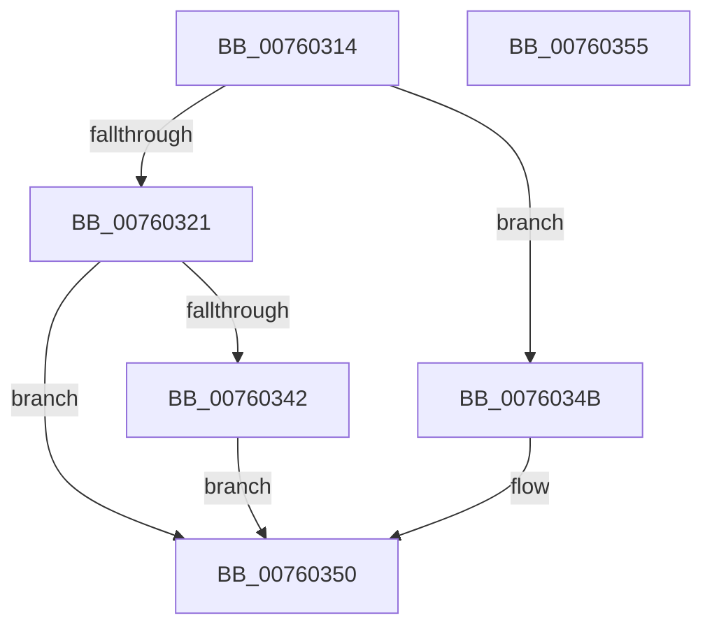

# PopDiagSleepStudyInitialize

- RVA: `0x00760314`–`0x00760356` (길이 `66` bytes)
- VA: `0x0000000140760314`
- 실행 섹션: `PAGE`
- PDB 이름 있음: `예`; PDB Function 태그: `아니요`
- unwind 정보 RVA: `0x0005C788`
- 디코드: `16`개 명령, `66/66` bytes 표시
- 미해석 바이트: `0` (있으면 어셈블리에 `.byte`로 보존)

> 이 문서는 커널 이미지의 기계어와 PDB 기호를 분석해 생성했습니다. 4번과 5번은 함수 원형과 자료형을 바이너리 사용 방식에서 추정한 C 해석이며 원본 소스 복구 결과는 아닙니다.

## 1. Dependencies

- 직접 호출 지점: **1**; 고유 호출 대상: **1**
- 직접 호출자로 확인된 함수: **1**
- RIP 상대 이미지 참조: **5**

### Outgoing calls
- `0x00760339` → [EtwRegister](../92/EtwRegister_function_00920960.md) (function, `0x00920960`)

### Direct callers
- [PopDiagInitialize](../../init/C3/PopDiagInitialize_function_00C3F2C0.md) at `0x00C3F422`

### Static image references
- `0x00760318` → RVA `0x00E67859` (`.data`; read)
- `0x00760321` → RVA `0x00F0B6B8` (`.data`; read)
- `0x0076032B` → RVA `0x00A38CB0` (`PopDiagTraceControlCallback`; read)
- `0x00760332` → RVA `0x0001BDD8` (`.rdata`; read)
- `0x00760342` → RVA `0x00E67859` (`.data`; write)

## 2. Other-region calls and transfers

- 다른 실행 섹션으로 향하는 call: **0**
- 별도 외부 분기/꼬리 이동을 확인하지 못했습니다.

## 3. Assembly (complete function range)

```asm
00760314  48 83 EC 28                     sub rsp, 0x28
00760318  80 3D 3A 75 70 00 00            cmp byte ptr [rip + 0x70753a], 0
0076031F  75 2A                           jne 0x14076034b
00760321  4C 8D 05 90 B3 7A 00            lea r8, [rip + 0x7ab390]
00760328  4D 8B C8                        mov r9, r8
0076032B  48 8D 15 7E 89 2D 00            lea rdx, [rip + 0x2d897e]
00760332  48 8D 0D 9F BA 8B FF            lea rcx, [rip - 0x744561]
00760339  E8 22 06 1C 00                  call 0x140920960
0076033E  85 C0                           test eax, eax
00760340  78 0E                           js 0x140760350
00760342  C6 05 10 75 70 00 01            mov byte ptr [rip + 0x707510], 1
00760349  EB 05                           jmp 0x140760350
0076034B  B8 18 07 00 C0                  mov eax, 0xc0000718
00760350  48 83 C4 28                     add rsp, 0x28
00760354  C3                              ret
00760355  CC                              int3
```

## 4. C-style interpretation (structured pseudocode)

```c
__int64 __fastcall PopDiagSleepStudyInitialize(void)
{
    __int64 result;
    __int64 v_rsp;

    v_rsp = (v_rsp) - (40);
    if ((*(unsigned __int8 *)(v_rip + 7370042)) != 0) goto loc_0076034B;
    result = EtwRegister(v_rip - 7619937, v_rip + 2984318, v_rip + 8041360, v_rip + 8041360);
    if (sign_flag) goto loc_00760350;
    *(unsigned __int8 *)(v_rip + 7370000) = 1;
    goto loc_00760350;
loc_0076034B:
loc_00760350:
    v_rsp = (v_rsp) + (40);
    return (unsigned int)(0xC0000718ULL);
}
```

## 5. (Beta) C Style

```c
void PopDiagSleepStudyInitialize(void)
{
    int64_t result;
    int64_t local_rsp;

    local_rsp = (local_rsp) - (40);
    if ((*(uint8_t *)(v_rip + 0x70753A)) != 0) goto loc_0076034B;
    result = EtwRegister(v_rip - 7619937, v_rip + 2984318, v_rip + 8041360, v_rip + 8041360);
    if (sign_flag) goto loc_00760350;
    *(uint8_t *)(v_rip + 0x707510) = 1;
    goto loc_00760350;
loc_0076034B:
loc_00760350:
    local_rsp = (local_rsp) + (40);
    return (uint32_t)(0xC0000718ULL);
}
```

## 6. Execution-region graph

[열기: 2D/3D 그래프와 함수 탐색 컨트롤 패널](../../../control-panel.html?section=page&rva=0x00760314&view=graph)

- 2D 그래프는 위에서 아래로 흐르고, 3D 그래프는 빈 공간을 드래그해 회전합니다. Shift+드래그는 이동, 휠은 확대·축소, 함수 노드 선택은 대상 보고서 이동입니다.

### Static fallback


