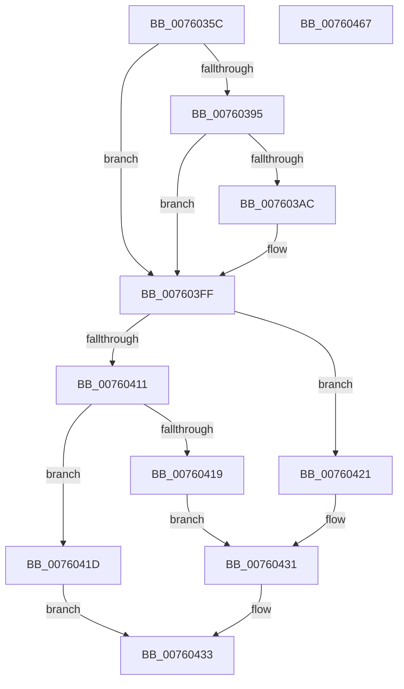

# PopDiagTraceAcDcStateChange

- RVA: `0x0076035C`–`0x00760468` (길이 `268` bytes)
- VA: `0x000000014076035C`
- 실행 섹션: `PAGE`
- PDB 이름 있음: `예`; PDB Function 태그: `아니요`
- unwind 정보 RVA: `0x000BE8B8`
- 디코드: `68`개 명령, `268/268` bytes 표시
- 미해석 바이트: `0` (있으면 어셈블리에 `.byte`로 보존)

> 이 문서는 커널 이미지의 기계어와 PDB 기호를 분석해 생성했습니다. 4번과 5번은 함수 원형과 자료형을 바이너리 사용 방식에서 추정한 C 해석이며 원본 소스 복구 결과는 아닙니다.

## 1. Dependencies

- 직접 호출 지점: **4**; 고유 호출 대상: **4**
- 직접 호출자로 확인된 함수: **1**
- RIP 상대 이미지 참조: **7**

### Outgoing calls
- `0x007603A3` → [EtwEventEnabled](../../text/39/EtwEventEnabled_function_00392450.md) (function, `0x00392450`)
- `0x007603FA` → [EtwWrite](../../text/41/EtwWrite_function_0041C720.md) (function, `0x0041C720`)
- `0x00760445` → [SshSessionManagerTraceAcDcStateChange](../77/SshSessionManagerTraceAcDcStateChange_function_0077392C.md) (function, `0x0077392C`)
- `0x00760451` → [_security_check_cookie](../../text/6A/_security_check_cookie_function_006AC640.md) (function, `0x006AC640`)

### Direct callers
- [PopUpdateAcDcState](../../text/4B/PopUpdateAcDcState_function_004B8C68.md) at `0x004B8CCE`

### Static image references
- `0x0076036C` → RVA `0x00E0A740` (`.data`; read)
- `0x0076038A` → RVA `0x00E67858` (`.data`; read)
- `0x00760395` → RVA `0x00F0B408` (`.data`; read)
- `0x0076039C` → RVA `0x00022B08` (`.rdata`; read)
- `0x007603FF` → RVA `0x00E0B579` (`.data`; read)
- `0x00760409` → RVA `0x00E67A54` (`.data`; read)
- `0x00760411` → RVA `0x00E67884` (`.data`; read)

## 2. Other-region calls and transfers

- 다른 실행 섹션으로 향하는 call: **3**
  - `0x007603A3` → [EtwEventEnabled](../../text/39/EtwEventEnabled_function_00392450.md) (`PAGE` → `.text`)
  - `0x007603FA` → [EtwWrite](../../text/41/EtwWrite_function_0041C720.md) (`PAGE` → `.text`)
  - `0x00760451` → [_security_check_cookie](../../text/6A/_security_check_cookie_function_006AC640.md) (`PAGE` → `.text`)
- 별도 외부 분기/꼬리 이동을 확인하지 못했습니다.

## 3. Assembly (complete function range)

```asm
0076035C  48 89 5C 24 08                  mov qword ptr [rsp + 8], rbx
00760361  55                              push rbp
00760362  48 8B EC                        mov rbp, rsp
00760365  48 81 EC 80 00 00 00            sub rsp, 0x80
0076036C  48 8B 05 CD A3 6A 00            mov rax, qword ptr [rip + 0x6aa3cd]
00760373  48 33 C4                        xor rax, rsp
00760376  48 89 45 F8                     mov qword ptr [rbp - 8], rax
0076037A  33 DB                           xor ebx, ebx
0076037C  89 55 B8                        mov dword ptr [rbp - 0x48], edx
0076037F  85 C9                           test ecx, ecx
00760381  44 89 45 B0                     mov dword ptr [rbp - 0x50], r8d
00760385  8B C3                           mov eax, ebx
00760387  0F 94 C0                        sete al
0076038A  38 1D C8 74 70 00               cmp byte ptr [rip + 0x7074c8], bl
00760390  89 45 C0                        mov dword ptr [rbp - 0x40], eax
00760393  74 6A                           je 0x1407603ff
00760395  48 8B 0D 6C B0 7A 00            mov rcx, qword ptr [rip + 0x7ab06c]
0076039C  48 8D 15 65 27 8C FF            lea rdx, [rip - 0x73d89b]
007603A3  E8 A8 20 C3 FF                  call 0x140392450
007603A8  84 C0                           test al, al
007603AA  74 53                           je 0x1407603ff
007603AC  48 8B 0D 55 B0 7A 00            mov rcx, qword ptr [rip + 0x7ab055]
007603B3  48 8D 45 C0                     lea rax, [rbp - 0x40]
007603B7  48 89 45 C8                     mov qword ptr [rbp - 0x38], rax
007603BB  44 8D 4B 03                     lea r9d, [rbx + 3]
007603BF  48 8D 45 B8                     lea rax, [rbp - 0x48]
007603C3  48 C7 45 D0 04 00 00 00         mov qword ptr [rbp - 0x30], 4
007603CB  48 89 45 D8                     mov qword ptr [rbp - 0x28], rax
007603CF  48 8D 15 32 27 8C FF            lea rdx, [rip - 0x73d8ce]
007603D6  48 8D 45 B0                     lea rax, [rbp - 0x50]
007603DA  48 C7 45 E0 04 00 00 00         mov qword ptr [rbp - 0x20], 4
007603E2  48 89 45 E8                     mov qword ptr [rbp - 0x18], rax
007603E6  45 33 C0                        xor r8d, r8d
007603E9  48 8D 45 C8                     lea rax, [rbp - 0x38]
007603ED  48 C7 45 F0 04 00 00 00         mov qword ptr [rbp - 0x10], 4
007603F5  48 89 44 24 20                  mov qword ptr [rsp + 0x20], rax
007603FA  E8 21 C3 CB FF                  call 0x14041c720
007603FF  38 1D 74 B1 6A 00               cmp byte ptr [rip + 0x6ab174], bl
00760405  41 0F 95 C1                     setne r9b
00760409  38 1D 45 76 70 00               cmp byte ptr [rip + 0x707645], bl
0076040F  75 10                           jne 0x140760421
00760411  38 1D 6D 74 70 00               cmp byte ptr [rip + 0x70746d], bl
00760417  74 04                           je 0x14076041d
00760419  B0 02                           mov al, 2
0076041B  EB 14                           jmp 0x140760431
0076041D  8A C3                           mov al, bl
0076041F  EB 12                           jmp 0x140760433
00760421  8A 05 5D 74 70 00               mov al, byte ptr [rip + 0x70745d]
00760427  F6 D8                           neg al
00760429  B0 02                           mov al, 2
0076042B  1A C9                           sbb cl, cl
0076042D  22 C1                           and al, cl
0076042F  FE C0                           inc al
00760431  B3 01                           mov bl, 1
00760433  44 8B 45 B0                     mov r8d, dword ptr [rbp - 0x50]
00760437  8B 55 B8                        mov edx, dword ptr [rbp - 0x48]
0076043A  8B 4D C0                        mov ecx, dword ptr [rbp - 0x40]
0076043D  88 44 24 28                     mov byte ptr [rsp + 0x28], al
00760441  88 5C 24 20                     mov byte ptr [rsp + 0x20], bl
00760445  E8 E2 34 01 00                  call 0x14077392c
0076044A  48 8B 4D F8                     mov rcx, qword ptr [rbp - 8]
0076044E  48 33 CC                        xor rcx, rsp
00760451  E8 EA C1 F4 FF                  call 0x1406ac640
00760456  48 8B 9C 24 90 00 00 00         mov rbx, qword ptr [rsp + 0x90]
0076045E  48 81 C4 80 00 00 00            add rsp, 0x80
00760465  5D                              pop rbp
00760466  C3                              ret
00760467  CC                              int3
```

## 4. C-style interpretation (structured pseudocode)

```c
__int64 __fastcall PopDiagTraceAcDcStateChange(int a1, int a2, int a3)
{
    __int64 result;
    __int64 v_rbx;
    __int64 v_rsp;
    unsigned __int64 v_stack_m10;
    unsigned __int64 v_stack_m18;
    unsigned __int64 v_stack_m20;
    unsigned __int64 v_stack_m28;
    unsigned __int64 v_stack_m30;
    unsigned __int64 v_stack_m38;
    unsigned __int64 v_stack_m40;
    unsigned int v_stack_m48;
    unsigned int v_stack_m50;
    unsigned int v_stack_m58;
    unsigned __int8 v_stack_m60;
    unsigned __int64 v_stack_m68;
    unsigned __int64 v_stack_p8;

    v_stack_p8 = v_rbx;
    v_rsp = (v_rsp) - (128);
    result = (*(unsigned __int64 *)(v_rip + 6988749)) ^ (v_rsp);
    v_stack_m10 = result;
    v_rbx = 0;
    v_stack_m50 = a2;
    v_stack_m58 = a3;
    result = (a1 == 0) ? 1 : 0;
    v_stack_m48 = (unsigned int)(result);
    if ((*(unsigned __int8 *)(v_rip + 7369928)) == 0) goto loc_007603FF;
    result = EtwEventEnabled(*(unsigned __int64 *)(v_rip + 8040556), v_rip - 7592091, a3, a4);
    if ((unsigned __int8)(result) != 0) {
        a1 = *(unsigned __int64 *)(v_rip + 8040533);
        result = v_stack_m48;
        v_stack_m40 = result;
        a4 = v_rbx + 3;
        result = v_stack_m50;
        v_stack_m38 = 4;
        v_stack_m30 = result;
        a2 = v_rip - 7592142;
        result = v_stack_m58;
        v_stack_m28 = 4;
        v_stack_m20 = result;
        a3 = 0;
        result = v_stack_m40;
        v_stack_m18 = 4;
        v_stack_m68 = result;
        result = EtwWrite(a1, a2, a3, a4);
    }
    a4 = ((*(unsigned __int8 *)(v_rip + 6992244)) != 0) ? 1 : 0;
    if ((*(unsigned __int8 *)(v_rip + 7370309)) != 0) goto loc_00760421;
    if ((*(unsigned __int8 *)(v_rip + 7369837)) == 0) goto loc_0076041D;
    goto loc_00760431;
loc_0076041D:
    goto loc_00760433;
loc_00760421:
    result = (unsigned __int8)(-(*(unsigned __int8 *)(v_rip + 7369821)));
    result = (unsigned __int8)((2) & ((unsigned __int8)(a1)));
    result = (unsigned __int8)((result) + 1);
loc_00760431:
loc_00760433:
    v_stack_m60 = (unsigned __int8)(result);
    v_stack_m68 = 1;
    result = SshSessionManagerTraceAcDcStateChange((unsigned int)(v_stack_m48), (unsigned int)(v_stack_m50), (unsigned int)(v_stack_m58), a4);
    a1 = (v_stack_m10) ^ (v_rsp);
    result = _security_check_cookie(a1, (unsigned int)(v_stack_m50), (unsigned int)(v_stack_m58), a4);
    v_rsp = (v_rsp) + (128);
    return result;
}
```

## 5. (Beta) C Style

```c
int64_t PopDiagTraceAcDcStateChange(int32_t Arg1, int32_t Arg2, int32_t Arg3)
{
    int64_t result;
    int64_t local_rbx;
    int64_t local_rsp;
    uint64_t v_stack_m10;
    uint64_t v_stack_m18;
    uint64_t v_stack_m20;
    uint64_t v_stack_m28;
    uint64_t v_stack_m30;
    uint64_t v_stack_m38;
    uint64_t v_stack_m40;
    uint32_t v_stack_m48;
    uint32_t v_stack_m50;
    uint32_t v_stack_m58;
    uint8_t v_stack_m60;
    uint64_t v_stack_m68;
    uint64_t v_stack_p8;

    v_stack_p8 = local_rbx;
    local_rsp = (local_rsp) - (128);
    result = (*(uint64_t *)(v_rip + 0x6AA3CD)) ^ (local_rsp);
    v_stack_m10 = result;
    local_rbx = 0;
    v_stack_m50 = Arg2;
    v_stack_m58 = Arg3;
    result = (Arg1 == 0) ? 1 : 0;
    v_stack_m48 = (uint32_t)(result);
    if ((*(uint8_t *)(v_rip + 0x7074C8)) == 0) goto loc_007603FF;
    result = EtwEventEnabled(*(uint64_t *)(v_rip + 0x7AB06C), v_rip - 7592091, Arg3, a4);
    if ((uint8_t)(result) != 0) {
        Arg1 = *(uint64_t *)(v_rip + 0x7AB055);
        result = v_stack_m48;
        v_stack_m40 = result;
        a4 = local_rbx + 3;
        result = v_stack_m50;
        v_stack_m38 = 4;
        v_stack_m30 = result;
        Arg2 = v_rip - 7592142;
        result = v_stack_m58;
        v_stack_m28 = 4;
        v_stack_m20 = result;
        Arg3 = 0;
        result = v_stack_m40;
        v_stack_m18 = 4;
        v_stack_m68 = result;
        result = EtwWrite(Arg1, Arg2, Arg3, a4);
    }
    a4 = ((*(uint8_t *)(v_rip + 0x6AB174)) != 0) ? 1 : 0;
    if ((*(uint8_t *)(v_rip + 0x707645)) != 0) goto loc_00760421;
    if ((*(uint8_t *)(v_rip + 0x70746D)) == 0) goto loc_0076041D;
    goto loc_00760431;
loc_0076041D:
    goto loc_00760433;
loc_00760421:
    result = (uint8_t)(-(*(uint8_t *)(v_rip + 0x70745D)));
    result = (uint8_t)((2) & ((uint8_t)(Arg1)));
    result = (uint8_t)((result) + 1);
loc_00760431:
loc_00760433:
    v_stack_m60 = (uint8_t)(result);
    v_stack_m68 = 1;
    result = SshSessionManagerTraceAcDcStateChange((uint32_t)(v_stack_m48), (uint32_t)(v_stack_m50), (uint32_t)(v_stack_m58), a4);
    Arg1 = (v_stack_m10) ^ (local_rsp);
    result = _security_check_cookie(Arg1, (uint32_t)(v_stack_m50), (uint32_t)(v_stack_m58), a4);
    local_rsp = (local_rsp) + (128);
    return result;
}
```

## 6. Execution-region graph

[열기: 2D/3D 그래프와 함수 탐색 컨트롤 패널](../../../control-panel.html?section=page&rva=0x0076035C&view=graph)

- 2D 그래프는 위에서 아래로 흐르고, 3D 그래프는 빈 공간을 드래그해 회전합니다. Shift+드래그는 이동, 휠은 확대·축소, 함수 노드 선택은 대상 보고서 이동입니다.

### Static fallback


