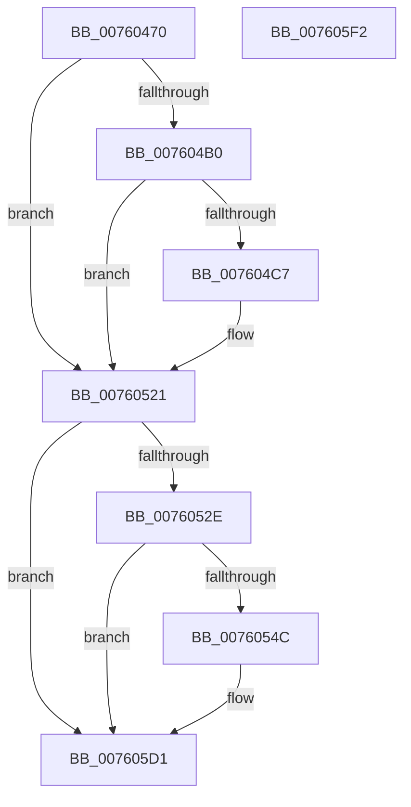

# PopDiagTraceAdaptiveBootOverridePrepared

- RVA: `0x00760470`–`0x007605F3` (길이 `387` bytes)
- VA: `0x0000000140760470`
- 실행 섹션: `PAGE`
- PDB 이름 있음: `예`; PDB Function 태그: `아니요`
- unwind 정보 RVA: `0x000CC8C0`
- 디코드: `91`개 명령, `387/387` bytes 표시
- 미해석 바이트: `0` (있으면 어셈블리에 `.byte`로 보존)

> 이 문서는 커널 이미지의 기계어와 PDB 기호를 분석해 생성했습니다. 4번과 5번은 함수 원형과 자료형을 바이너리 사용 방식에서 추정한 C 해석이며 원본 소스 복구 결과는 아닙니다.

## 1. Dependencies

- 직접 호출 지점: **5**; 고유 호출 대상: **5**
- 직접 호출자로 확인된 함수: **1**
- RIP 상대 이미지 참조: **6**

### Outgoing calls
- `0x007604BE` → [EtwEventEnabled](../../text/39/EtwEventEnabled_function_00392450.md) (function, `0x00392450`)
- `0x0076051C` → [EtwWrite](../../text/41/EtwWrite_function_0041C720.md) (function, `0x0041C720`)
- `0x0076053F` → [tlgKeywordOn](../../text/42/tlgKeywordOn_function_0042EAA0.md) (function, `0x0042EAA0`)
- `0x007605CC` → [tlgWriteTransfer_EtwWriteTransfer](../../text/42/tlgWriteTransfer_EtwWriteTransfer_function_004260E0.md) (function, `0x004260E0`)
- `0x007605D8` → [_security_check_cookie](../../text/6A/_security_check_cookie_function_006AC640.md) (function, `0x006AC640`)

### Direct callers
- [PopAdaptivePersistSystemInitatedRebootState](../../text/5D/PopAdaptivePersistSystemInitatedRebootState_function_005DC30C.md) at `0x005DC3D1`

### Static image references
- `0x0076048E` → RVA `0x00E0A740` (`.data`; read)
- `0x007604A2` → RVA `0x00E67858` (`.data`; read)
- `0x007604B0` → RVA `0x00F0B408` (`.data`; read)
- `0x007604B7` → RVA `0x00021A98` (`.rdata`; read)
- `0x00760521` → RVA `0x00E07748` (`.data`; read)
- `0x0076054F` → RVA `0x0004B5E1` (`.rdata`; read)

## 2. Other-region calls and transfers

- 다른 실행 섹션으로 향하는 call: **5**
  - `0x007604BE` → [EtwEventEnabled](../../text/39/EtwEventEnabled_function_00392450.md) (`PAGE` → `.text`)
  - `0x0076051C` → [EtwWrite](../../text/41/EtwWrite_function_0041C720.md) (`PAGE` → `.text`)
  - `0x0076053F` → [tlgKeywordOn](../../text/42/tlgKeywordOn_function_0042EAA0.md) (`PAGE` → `.text`)
  - `0x007605CC` → [tlgWriteTransfer_EtwWriteTransfer](../../text/42/tlgWriteTransfer_EtwWriteTransfer_function_004260E0.md) (`PAGE` → `.text`)
  - `0x007605D8` → [_security_check_cookie](../../text/6A/_security_check_cookie_function_006AC640.md) (`PAGE` → `.text`)
- 별도 외부 분기/꼬리 이동을 확인하지 못했습니다.

## 3. Assembly (complete function range)

```asm
00760470  48 8B C4                        mov rax, rsp
00760473  48 89 58 10                     mov qword ptr [rax + 0x10], rbx
00760477  48 89 70 20                     mov qword ptr [rax + 0x20], rsi
0076047B  44 89 40 18                     mov dword ptr [rax + 0x18], r8d
0076047F  89 48 08                        mov dword ptr [rax + 8], ecx
00760482  55                              push rbp
00760483  48 8D 68 A1                     lea rbp, [rax - 0x5f]
00760487  48 81 EC F0 00 00 00            sub rsp, 0xf0
0076048E  48 8B 05 AB A2 6A 00            mov rax, qword ptr [rip + 0x6aa2ab]
00760495  48 33 C4                        xor rax, rsp
00760498  48 89 45 47                     mov qword ptr [rbp + 0x47], rax
0076049C  83 65 9B 00                     and dword ptr [rbp - 0x65], 0
007604A0  8A DA                           mov bl, dl
007604A2  80 3D AF 73 70 00 00            cmp byte ptr [rip + 0x7073af], 0
007604A9  BE 04 00 00 00                  mov esi, 4
007604AE  74 71                           je 0x140760521
007604B0  48 8B 0D 51 AF 7A 00            mov rcx, qword ptr [rip + 0x7aaf51]
007604B7  48 8D 15 DA 15 8C FF            lea rdx, [rip - 0x73ea26]
007604BE  E8 8D 1F C3 FF                  call 0x140392450
007604C3  84 C0                           test al, al
007604C5  74 5A                           je 0x140760521
007604C7  48 8B 0D 3A AF 7A 00            mov rcx, qword ptr [rip + 0x7aaf3a]
007604CE  44 8D 4E FF                     lea r9d, [rsi - 1]
007604D2  33 C0                           xor eax, eax
007604D4  89 75 B7                        mov dword ptr [rbp - 0x49], esi
007604D7  84 DB                           test bl, bl
007604D9  89 75 C7                        mov dword ptr [rbp - 0x39], esi
007604DC  48 8D 15 B5 15 8C FF            lea rdx, [rip - 0x73ea4b]
007604E3  89 75 D7                        mov dword ptr [rbp - 0x29], esi
007604E6  0F 95 C0                        setne al
007604E9  83 65 BB 00                     and dword ptr [rbp - 0x45], 0
007604ED  83 65 CB 00                     and dword ptr [rbp - 0x35], 0
007604F1  45 33 C0                        xor r8d, r8d
007604F4  83 65 DB 00                     and dword ptr [rbp - 0x25], 0
007604F8  89 45 9B                        mov dword ptr [rbp - 0x65], eax
007604FB  48 8D 45 67                     lea rax, [rbp + 0x67]
007604FF  48 89 45 AF                     mov qword ptr [rbp - 0x51], rax
00760503  48 8D 45 9B                     lea rax, [rbp - 0x65]
00760507  48 89 45 BF                     mov qword ptr [rbp - 0x41], rax
0076050B  48 8D 45 77                     lea rax, [rbp + 0x77]
0076050F  48 89 45 CF                     mov qword ptr [rbp - 0x31], rax
00760513  48 8D 45 AF                     lea rax, [rbp - 0x51]
00760517  48 89 44 24 20                  mov qword ptr [rsp + 0x20], rax
0076051C  E8 FF C1 CB FF                  call 0x14041c720
00760521  83 3D 20 72 6A 00 05            cmp dword ptr [rip + 0x6a7220], 5
00760528  0F 86 A3 00 00 00               jbe 0x1407605d1
0076052E  48 BA 00 00 00 00 00 40 00 00   movabs rdx, 0x400000000000
00760538  48 8D 0D 09 72 6A 00            lea rcx, [rip + 0x6a7209]
0076053F  E8 5C E5 CC FF                  call 0x14042eaa0
00760544  84 C0                           test al, al
00760546  0F 84 85 00 00 00               je 0x1407605d1
0076054C  8B 45 67                        mov eax, dword ptr [rbp + 0x67]
0076054F  48 8D 15 8B B0 8E FF            lea rdx, [rip - 0x714f75]
00760556  83 65 13 00                     and dword ptr [rbp + 0x13], 0
0076055A  48 8D 0D E7 71 6A 00            lea rcx, [rip + 0x6a71e7]
00760561  83 65 23 00                     and dword ptr [rbp + 0x23], 0
00760565  45 33 C9                        xor r9d, r9d
00760568  83 65 33 00                     and dword ptr [rbp + 0x33], 0
0076056C  45 33 C0                        xor r8d, r8d
0076056F  83 65 43 00                     and dword ptr [rbp + 0x43], 0
00760573  89 45 9F                        mov dword ptr [rbp - 0x61], eax
00760576  48 8D 45 9F                     lea rax, [rbp - 0x61]
0076057A  48 89 45 07                     mov qword ptr [rbp + 7], rax
0076057E  48 8D 45 97                     lea rax, [rbp - 0x69]
00760582  48 89 45 17                     mov qword ptr [rbp + 0x17], rax
00760586  8B 45 77                        mov eax, dword ptr [rbp + 0x77]
00760589  89 45 A3                        mov dword ptr [rbp - 0x5d], eax
0076058C  48 8D 45 A3                     lea rax, [rbp - 0x5d]
00760590  48 89 45 27                     mov qword ptr [rbp + 0x27], rax
00760594  48 8D 45 A7                     lea rax, [rbp - 0x59]
00760598  48 89 45 37                     mov qword ptr [rbp + 0x37], rax
0076059C  48 8D 45 E7                     lea rax, [rbp - 0x19]
007605A0  48 89 44 24 28                  mov qword ptr [rsp + 0x28], rax
007605A5  C7 44 24 20 06 00 00 00         mov dword ptr [rsp + 0x20], 6
007605AD  89 75 0F                        mov dword ptr [rbp + 0xf], esi
007605B0  88 5D 97                        mov byte ptr [rbp - 0x69], bl
007605B3  C7 45 1F 01 00 00 00            mov dword ptr [rbp + 0x1f], 1
007605BA  89 75 2F                        mov dword ptr [rbp + 0x2f], esi
007605BD  48 C7 45 A7 00 00 00 01         mov qword ptr [rbp - 0x59], 0x1000000
007605C5  C7 45 3F 08 00 00 00            mov dword ptr [rbp + 0x3f], 8
007605CC  E8 0F 5B CC FF                  call 0x1404260e0
007605D1  48 8B 4D 47                     mov rcx, qword ptr [rbp + 0x47]
007605D5  48 33 CC                        xor rcx, rsp
007605D8  E8 63 C0 F4 FF                  call 0x1406ac640
007605DD  4C 8D 9C 24 F0 00 00 00         lea r11, [rsp + 0xf0]
007605E5  49 8B 5B 18                     mov rbx, qword ptr [r11 + 0x18]
007605E9  49 8B 73 28                     mov rsi, qword ptr [r11 + 0x28]
007605ED  49 8B E3                        mov rsp, r11
007605F0  5D                              pop rbp
007605F1  C3                              ret
007605F2  CC                              int3
```

## 4. C-style interpretation (structured pseudocode)

```c
__int64 __fastcall PopDiagTraceAdaptiveBootOverridePrepared(int a1, unsigned __int8 a2, int a3)
{
    __int64 result;
    __int64 v_rsp;
    unsigned __int64 v_stack_m8;
    unsigned __int64 v_stack_mD0;
    unsigned __int64 v_stack_mD8;

    *(unsigned __int64 *)(v_rsp + 16) = v_rbx;
    *(unsigned __int64 *)(v_rsp + 32) = v_rsi;
    *(unsigned int *)(v_rsp + 24) = a3;
    *(unsigned int *)(v_rsp + 8) = a1;
    v_rsp = (v_rsp) - (240);
    result = (*(unsigned __int64 *)(v_rip + 6988459)) ^ (v_rsp);
    *(unsigned __int64 *)(v_rsp - 95 + 71) = result;
    if ((*(unsigned __int8 *)(v_rip + 7369647)) == 0) goto loc_00760521;
    result = EtwEventEnabled(*(unsigned __int64 *)(v_rip + 8040273), v_rip - 7596582, a3, a4);
    if ((unsigned __int8)(result) != 0) {
        a1 = *(unsigned __int64 *)(v_rip + 8040250);
        a4 = 4 - 1;
        result = 0;
        *(unsigned int *)(v_rsp - 95 - 73) = 4;
        *(unsigned int *)(v_rsp - 95 - 57) = 4;
        a2 = v_rip - 7596619;
        *(unsigned int *)(v_rsp - 95 - 41) = 4;
        result = (a2 != 0) ? 1 : 0;
        a3 = 0;
        *(unsigned int *)(v_rsp - 95 - 101) = (unsigned int)(result);
        result = v_rsp - 95 + 103;
        *(unsigned __int64 *)(v_rsp - 95 - 81) = result;
        result = v_rsp - 95 - 101;
        *(unsigned __int64 *)(v_rsp - 95 - 65) = result;
        result = v_rsp - 95 + 119;
        *(unsigned __int64 *)(v_rsp - 95 - 49) = result;
        result = v_rsp - 95 - 81;
        v_stack_mD8 = result;
        result = EtwWrite(a1, a2, a3, a4);
    }
    if ((*(unsigned int *)(v_rip + 6976032)) <= 5) goto loc_007605D1;
    result = tlgKeywordOn(v_rip + 6976009, a2, a3, a4);
    if ((unsigned __int8)(result) != 0) {
        result = *(unsigned int *)(v_rsp - 95 + 103);
        a2 = v_rip - 7425909;
        a1 = v_rip + 6975975;
        a4 = 0;
        a3 = 0;
        *(unsigned int *)(v_rsp - 95 - 97) = (unsigned int)(result);
        result = v_rsp - 95 - 97;
        *(unsigned __int64 *)(v_rsp - 95 + 7) = result;
        result = v_rsp - 95 - 105;
        *(unsigned __int64 *)(v_rsp - 95 + 23) = result;
        result = *(unsigned int *)(v_rsp - 95 + 119);
        *(unsigned int *)(v_rsp - 95 - 93) = (unsigned int)(result);
        result = v_rsp - 95 - 93;
        *(unsigned __int64 *)(v_rsp - 95 + 39) = result;
        result = v_rsp - 95 - 89;
        *(unsigned __int64 *)(v_rsp - 95 + 55) = result;
        result = v_rsp - 95 - 25;
        v_stack_mD0 = result;
        v_stack_mD8 = 6;
        *(unsigned int *)(v_rsp - 95 + 15) = 4;
        *(unsigned __int8 *)(v_rsp - 95 - 105) = a2;
        *(unsigned int *)(v_rsp - 95 + 31) = 1;
        *(unsigned int *)(v_rsp - 95 + 47) = 4;
        *(unsigned __int64 *)(v_rsp - 95 - 89) = 0x1000000ULL;
        *(unsigned int *)(v_rsp - 95 + 63) = 8;
        result = tlgWriteTransfer_EtwWriteTransfer(a1, a2, a3, a4);
    }
    a1 = (*(unsigned __int64 *)(v_rsp - 95 + 71)) ^ (v_rsp);
    result = _security_check_cookie(a1, a2, a3, a4);
    return result;
}
```

## 5. (Beta) C Style

```c
int64_t PopDiagTraceAdaptiveBootOverridePrepared(int32_t Arg1, uint8_t Arg2, int32_t Arg3)
{
    int64_t result;
    int64_t local_rsp;
    uint64_t v_stack_m8;
    uint64_t v_stack_mD0;
    uint64_t v_stack_mD8;

    *(uint64_t *)(local_rsp + 0x10) = local_rbx;
    *(uint64_t *)(local_rsp + 0x20) = local_rsi;
    *(uint32_t *)(local_rsp + 0x18) = Arg3;
    *(uint32_t *)(local_rsp + 0x8) = Arg1;
    local_rsp = (local_rsp) - (240);
    result = (*(uint64_t *)(v_rip + 0x6AA2AB)) ^ (local_rsp);
    *(uint64_t *)(local_rsp - 0x5F + 0x47) = result;
    if ((*(uint8_t *)(v_rip + 0x7073AF)) == 0) goto loc_00760521;
    result = EtwEventEnabled(*(uint64_t *)(v_rip + 0x7AAF51), v_rip - 7596582, Arg3, a4);
    if ((uint8_t)(result) != 0) {
        Arg1 = *(uint64_t *)(v_rip + 0x7AAF3A);
        a4 = 4 - 1;
        result = 0;
        *(uint32_t *)(local_rsp - 0x5F - 0x49) = 4;
        *(uint32_t *)(local_rsp - 0x5F - 0x39) = 4;
        Arg2 = v_rip - 7596619;
        *(uint32_t *)(local_rsp - 0x5F - 0x29) = 4;
        result = (Arg2 != 0) ? 1 : 0;
        Arg3 = 0;
        *(uint32_t *)(local_rsp - 0x5F - 0x65) = (uint32_t)(result);
        result = local_rsp - 95 + 103;
        *(uint64_t *)(local_rsp - 0x5F - 0x51) = result;
        result = local_rsp - 95 - 101;
        *(uint64_t *)(local_rsp - 0x5F - 0x41) = result;
        result = local_rsp - 95 + 119;
        *(uint64_t *)(local_rsp - 0x5F - 0x31) = result;
        result = local_rsp - 95 - 81;
        v_stack_mD8 = result;
        result = EtwWrite(Arg1, Arg2, Arg3, a4);
    }
    if ((*(uint32_t *)(v_rip + 0x6A7220)) <= 5) goto loc_007605D1;
    result = tlgKeywordOn(v_rip + 6976009, Arg2, Arg3, a4);
    if ((uint8_t)(result) != 0) {
        result = *(uint32_t *)(local_rsp - 0x5F + 0x67);
        Arg2 = v_rip - 7425909;
        Arg1 = v_rip + 6975975;
        a4 = 0;
        Arg3 = 0;
        *(uint32_t *)(local_rsp - 0x5F - 0x61) = (uint32_t)(result);
        result = local_rsp - 95 - 97;
        *(uint64_t *)(local_rsp - 0x5F + 0x7) = result;
        result = local_rsp - 95 - 105;
        *(uint64_t *)(local_rsp - 0x5F + 0x17) = result;
        result = *(uint32_t *)(local_rsp - 0x5F + 0x77);
        *(uint32_t *)(local_rsp - 0x5F - 0x5D) = (uint32_t)(result);
        result = local_rsp - 95 - 93;
        *(uint64_t *)(local_rsp - 0x5F + 0x27) = result;
        result = local_rsp - 95 - 89;
        *(uint64_t *)(local_rsp - 0x5F + 0x37) = result;
        result = local_rsp - 95 - 25;
        v_stack_mD0 = result;
        v_stack_mD8 = 6;
        *(uint32_t *)(local_rsp - 0x5F + 0xF) = 4;
        *(uint8_t *)(local_rsp - 0x5F - 0x69) = Arg2;
        *(uint32_t *)(local_rsp - 0x5F + 0x1F) = 1;
        *(uint32_t *)(local_rsp - 0x5F + 0x2F) = 4;
        *(uint64_t *)(local_rsp - 0x5F - 0x59) = 0x1000000ULL;
        *(uint32_t *)(local_rsp - 0x5F + 0x3F) = 8;
        result = tlgWriteTransfer_EtwWriteTransfer(Arg1, Arg2, Arg3, a4);
    }
    Arg1 = (*(uint64_t *)(local_rsp - 0x5F + 0x47)) ^ (local_rsp);
    result = _security_check_cookie(Arg1, Arg2, Arg3, a4);
    return result;
}
```

## 6. Execution-region graph

[열기: 2D/3D 그래프와 함수 탐색 컨트롤 패널](../../../control-panel.html?section=page&rva=0x00760470&view=graph)

- 2D 그래프는 위에서 아래로 흐르고, 3D 그래프는 빈 공간을 드래그해 회전합니다. Shift+드래그는 이동, 휠은 확대·축소, 함수 노드 선택은 대상 보고서 이동입니다.

### Static fallback


