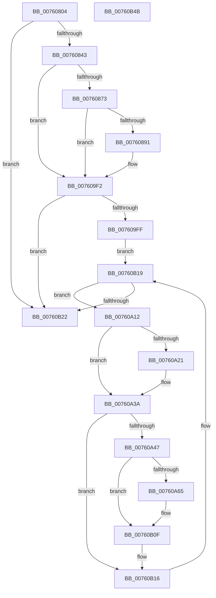

# PopDiagTraceBatteryAlarmStatus

- RVA: `0x00760804`–`0x00760B4C` (길이 `840` bytes)
- VA: `0x0000000140760804`
- 실행 섹션: `PAGE`
- PDB 이름 있음: `예`; PDB Function 태그: `아니요`
- unwind 정보 RVA: `0x000CC710`
- 디코드: `174`개 명령, `840/840` bytes 표시
- 미해석 바이트: `0` (있으면 어셈블리에 `.byte`로 보존)

> 이 문서는 커널 이미지의 기계어와 PDB 기호를 분석해 생성했습니다. 4번과 5번은 함수 원형과 자료형을 바이너리 사용 방식에서 추정한 C 해석이며 원본 소스 복구 결과는 아닙니다.

## 1. Dependencies

- 직접 호출 지점: **7**; 고유 호출 대상: **4**
- 직접 호출자로 확인된 함수: **1**
- RIP 상대 이미지 참조: **10**

### Outgoing calls
- `0x00760884` → [tlgKeywordOn](../../text/42/tlgKeywordOn_function_0042EAA0.md) (function, `0x0042EAA0`)
- `0x00760898` → [tlgCreate1Sz_char](../../text/42/tlgCreate1Sz_char_function_00427304.md) (function, `0x00427304`)
- `0x007609ED` → [tlgWriteTransfer_EtwWriteTransfer](../../text/42/tlgWriteTransfer_EtwWriteTransfer_function_004260E0.md) (function, `0x004260E0`)
- `0x00760A58` → [tlgKeywordOn](../../text/42/tlgKeywordOn_function_0042EAA0.md) (function, `0x0042EAA0`)
- `0x00760A6C` → [tlgCreate1Sz_char](../../text/42/tlgCreate1Sz_char_function_00427304.md) (function, `0x00427304`)
- `0x00760B0A` → [tlgWriteTransfer_EtwWriteTransfer](../../text/42/tlgWriteTransfer_EtwWriteTransfer_function_004260E0.md) (function, `0x004260E0`)
- `0x00760B29` → [_security_check_cookie](../../text/6A/_security_check_cookie_function_006AC640.md) (function, `0x006AC640`)

### Direct callers
- [PopBatteryApplyCompositeState](../AE/PopBatteryApplyCompositeState_function_00AE0CD0.md) at `0x00AE11A3`

### Static image references
- `0x00760823` → RVA `0x00E0A740` (`.data`; read)
- `0x00760843` → RVA `0x00F0C060` (`.data`; read)
- `0x0076084A` → RVA `0x0000B430` (`.rdata`; read)
- `0x00760858` → RVA `0x00F0C20C` (`.data`; read)
- `0x00760863` → RVA `0x00E07748` (`.data`; read)
- `0x007608AB` → RVA `0x00049D2C` (`.rdata`; read)
- `0x0076096A` → RVA `0x00F0C180` (`.data`; read)
- `0x007609F2` → RVA `0x00F0C034` (`.data`; read)
- `0x007609FF` → RVA `0x00F0C050` (`.data`; read)
- `0x00760A7F` → RVA `0x00049E66` (`.rdata`; read)

## 2. Other-region calls and transfers

- 다른 실행 섹션으로 향하는 call: **7**
  - `0x00760884` → [tlgKeywordOn](../../text/42/tlgKeywordOn_function_0042EAA0.md) (`PAGE` → `.text`)
  - `0x00760898` → [tlgCreate1Sz_char](../../text/42/tlgCreate1Sz_char_function_00427304.md) (`PAGE` → `.text`)
  - `0x007609ED` → [tlgWriteTransfer_EtwWriteTransfer](../../text/42/tlgWriteTransfer_EtwWriteTransfer_function_004260E0.md) (`PAGE` → `.text`)
  - `0x00760A58` → [tlgKeywordOn](../../text/42/tlgKeywordOn_function_0042EAA0.md) (`PAGE` → `.text`)
  - `0x00760A6C` → [tlgCreate1Sz_char](../../text/42/tlgCreate1Sz_char_function_00427304.md) (`PAGE` → `.text`)
  - `0x00760B0A` → [tlgWriteTransfer_EtwWriteTransfer](../../text/42/tlgWriteTransfer_EtwWriteTransfer_function_004260E0.md) (`PAGE` → `.text`)
  - `0x00760B29` → [_security_check_cookie](../../text/6A/_security_check_cookie_function_006AC640.md) (`PAGE` → `.text`)
- 별도 외부 분기/꼬리 이동을 확인하지 못했습니다.

## 3. Assembly (complete function range)

```asm
00760804  48 8B C4                        mov rax, rsp
00760807  48 89 58 08                     mov qword ptr [rax + 8], rbx
0076080B  48 89 70 10                     mov qword ptr [rax + 0x10], rsi
0076080F  48 89 78 20                     mov qword ptr [rax + 0x20], rdi
00760813  55                              push rbp
00760814  41 54                           push r12
00760816  41 56                           push r14
00760818  48 8D 68 88                     lea rbp, [rax - 0x78]
0076081C  48 81 EC 60 01 00 00            sub rsp, 0x160
00760823  48 8B 05 16 9F 6A 00            mov rax, qword ptr [rip + 0x6a9f16]
0076082A  48 33 C4                        xor rax, rsp
0076082D  48 89 45 50                     mov qword ptr [rbp + 0x50], rax
00760831  41 8B 00                        mov eax, dword ptr [r8]
00760834  4C 8B CA                        mov r9, rdx
00760837  4C 8B D1                        mov r10, rcx
0076083A  83 F8 01                        cmp eax, 1
0076083D  0F 87 DF 02 00 00               ja 0x140760b22
00760843  44 8B 05 16 B8 7A 00            mov r8d, dword ptr [rip + 0x7ab816]
0076084A  48 8D 35 DF AB 8A FF            lea rsi, [rip - 0x755421]
00760851  48 8B 34 C6                     mov rsi, qword ptr [rsi + rax*8]
00760855  45 33 F6                        xor r14d, r14d
00760858  44 8B 1D AD B9 7A 00            mov r11d, dword ptr [rip + 0x7ab9ad]
0076085F  41 83 E0 01                     and r8d, 1
00760863  83 3D DE 6E 6A 00 05            cmp dword ptr [rip + 0x6a6ede], 5
0076086A  41 8B FE                        mov edi, r14d
0076086D  0F 86 7F 01 00 00               jbe 0x1407609f2
00760873  48 BA 00 00 00 00 00 40 00 00   movabs rdx, 0x400000000000
0076087D  48 8D 0D C4 6E 6A 00            lea rcx, [rip + 0x6a6ec4]
00760884  E8 17 E2 CC FF                  call 0x14042eaa0
00760889  84 C0                           test al, al
0076088B  0F 84 61 01 00 00               je 0x1407609f2
00760891  48 8B D6                        mov rdx, rsi
00760894  48 8D 4D 80                     lea rcx, [rbp - 0x80]
00760898  E8 67 6A CC FF                  call 0x140427304
0076089D  48 8D 44 24 30                  lea rax, [rsp + 0x30]
007608A2  44 88 44 24 30                  mov byte ptr [rsp + 0x30], r8b
007608A7  48 89 45 90                     mov qword ptr [rbp - 0x70], rax
007608AB  48 8D 15 7A 94 8E FF            lea rdx, [rip - 0x716b86]
007608B2  48 8D 44 24 48                  lea rax, [rsp + 0x48]
007608B7  48 C7 45 98 01 00 00 00         mov qword ptr [rbp - 0x68], 1
007608BF  48 89 45 A0                     mov qword ptr [rbp - 0x60], rax
007608C3  48 8D 0D 7E 6E 6A 00            lea rcx, [rip + 0x6a6e7e]
007608CA  8B 05 90 B7 7A 00               mov eax, dword ptr [rip + 0x7ab790]
007608D0  45 33 C0                        xor r8d, r8d
007608D3  89 44 24 4C                     mov dword ptr [rsp + 0x4c], eax
007608D7  48 8D 44 24 4C                  lea rax, [rsp + 0x4c]
007608DC  48 89 45 B0                     mov qword ptr [rbp - 0x50], rax
007608E0  41 8A 01                        mov al, byte ptr [r9]
007608E3  88 44 24 31                     mov byte ptr [rsp + 0x31], al
007608E7  48 8D 44 24 31                  lea rax, [rsp + 0x31]
007608EC  48 89 45 C0                     mov qword ptr [rbp - 0x40], rax
007608F0  41 8B 41 04                     mov eax, dword ptr [r9 + 4]
007608F4  89 44 24 50                     mov dword ptr [rsp + 0x50], eax
007608F8  48 8D 44 24 50                  lea rax, [rsp + 0x50]
007608FD  48 89 45 D0                     mov qword ptr [rbp - 0x30], rax
00760901  41 8B 41 14                     mov eax, dword ptr [r9 + 0x14]
00760905  89 44 24 54                     mov dword ptr [rsp + 0x54], eax
00760909  48 8D 44 24 54                  lea rax, [rsp + 0x54]
0076090E  48 89 45 E0                     mov qword ptr [rbp - 0x20], rax
00760912  41 8B 41 08                     mov eax, dword ptr [r9 + 8]
00760916  89 44 24 58                     mov dword ptr [rsp + 0x58], eax
0076091A  48 8D 44 24 58                  lea rax, [rsp + 0x58]
0076091F  48 89 45 F0                     mov qword ptr [rbp - 0x10], rax
00760923  41 8B 41 0C                     mov eax, dword ptr [r9 + 0xc]
00760927  89 44 24 34                     mov dword ptr [rsp + 0x34], eax
0076092B  48 8D 44 24 34                  lea rax, [rsp + 0x34]
00760930  48 89 45 00                     mov qword ptr [rbp], rax
00760934  41 8B 41 10                     mov eax, dword ptr [r9 + 0x10]
00760938  45 33 C9                        xor r9d, r9d
0076093B  89 44 24 38                     mov dword ptr [rsp + 0x38], eax
0076093F  48 8D 44 24 38                  lea rax, [rsp + 0x38]
00760944  48 89 45 10                     mov qword ptr [rbp + 0x10], rax
00760948  41 8B 42 04                     mov eax, dword ptr [r10 + 4]
0076094C  89 44 24 3C                     mov dword ptr [rsp + 0x3c], eax
00760950  48 8D 44 24 3C                  lea rax, [rsp + 0x3c]
00760955  48 89 45 20                     mov qword ptr [rbp + 0x20], rax
00760959  41 8B 42 18                     mov eax, dword ptr [r10 + 0x18]
0076095D  89 44 24 40                     mov dword ptr [rsp + 0x40], eax
00760961  48 8D 44 24 40                  lea rax, [rsp + 0x40]
00760966  48 89 45 30                     mov qword ptr [rbp + 0x30], rax
0076096A  0F B6 05 0F B8 7A 00            movzx eax, byte ptr [rip + 0x7ab80f]
00760971  89 44 24 44                     mov dword ptr [rsp + 0x44], eax
00760975  48 8D 44 24 44                  lea rax, [rsp + 0x44]
0076097A  48 89 45 40                     mov qword ptr [rbp + 0x40], rax
0076097E  48 8D 44 24 60                  lea rax, [rsp + 0x60]
00760983  48 89 44 24 28                  mov qword ptr [rsp + 0x28], rax
00760988  C7 44 24 20 0F 00 00 00         mov dword ptr [rsp + 0x20], 0xf
00760990  44 89 5C 24 48                  mov dword ptr [rsp + 0x48], r11d
00760995  48 C7 45 A8 04 00 00 00         mov qword ptr [rbp - 0x58], 4
0076099D  48 C7 45 B8 04 00 00 00         mov qword ptr [rbp - 0x48], 4
007609A5  48 C7 45 C8 01 00 00 00         mov qword ptr [rbp - 0x38], 1
007609AD  48 C7 45 D8 04 00 00 00         mov qword ptr [rbp - 0x28], 4
007609B5  48 C7 45 E8 04 00 00 00         mov qword ptr [rbp - 0x18], 4
007609BD  48 C7 45 F8 04 00 00 00         mov qword ptr [rbp - 8], 4
007609C5  48 C7 45 08 04 00 00 00         mov qword ptr [rbp + 8], 4
007609CD  48 C7 45 18 04 00 00 00         mov qword ptr [rbp + 0x18], 4
007609D5  48 C7 45 28 04 00 00 00         mov qword ptr [rbp + 0x28], 4
007609DD  48 C7 45 38 04 00 00 00         mov qword ptr [rbp + 0x38], 4
007609E5  48 C7 45 48 04 00 00 00         mov qword ptr [rbp + 0x48], 4
007609ED  E8 EE 56 CC FF                  call 0x1404260e0
007609F2  83 3D 3B B6 7A 00 01            cmp dword ptr [rip + 0x7ab63b], 1
007609F9  0F 86 23 01 00 00               jbe 0x140760b22
007609FF  48 8B 1D 4A B6 7A 00            mov rbx, qword ptr [rip + 0x7ab64a]
00760A06  48 8D 05 43 B6 7A 00            lea rax, [rip + 0x7ab643]
00760A0D  E9 07 01 00 00                  jmp 0x140760b19
00760A12  8B 4B 40                        mov ecx, dword ptr [rbx + 0x40]
00760A15  FF C7                           inc edi
00760A17  41 B9 A0 86 01 00               mov r9d, 0x186a0
00760A1D  85 C9                           test ecx, ecx
00760A1F  74 19                           je 0x140760a3a
00760A21  8B 43 68                        mov eax, dword ptr [rbx + 0x68]
00760A24  33 D2                           xor edx, edx
00760A26  48 69 C0 A0 86 01 00            imul rax, rax, 0x186a0
00760A2D  48 F7 F1                        div rcx
00760A30  4C 8B C8                        mov r9, rax
00760A33  48 8D 05 16 B6 7A 00            lea rax, [rip + 0x7ab616]
00760A3A  83 3D 07 6D 6A 00 05            cmp dword ptr [rip + 0x6a6d07], 5
00760A41  0F 86 CF 00 00 00               jbe 0x140760b16
00760A47  48 BA 00 00 00 00 00 40 00 00   movabs rdx, 0x400000000000
00760A51  48 8D 0D F0 6C 6A 00            lea rcx, [rip + 0x6a6cf0]
00760A58  E8 43 E0 CC FF                  call 0x14042eaa0
00760A5D  84 C0                           test al, al
00760A5F  0F 84 AA 00 00 00               je 0x140760b0f
00760A65  48 8B D6                        mov rdx, rsi
00760A68  48 8D 4D 80                     lea rcx, [rbp - 0x80]
00760A6C  E8 93 68 CC FF                  call 0x140427304
00760A71  48 8D 44 24 44                  lea rax, [rsp + 0x44]
00760A76  44 89 4C 24 38                  mov dword ptr [rsp + 0x38], r9d
00760A7B  48 89 45 90                     mov qword ptr [rbp - 0x70], rax
00760A7F  48 8D 15 E0 93 8E FF            lea rdx, [rip - 0x716c20]
00760A86  8B 43 40                        mov eax, dword ptr [rbx + 0x40]
00760A89  48 8D 0D B8 6C 6A 00            lea rcx, [rip + 0x6a6cb8]
00760A90  89 44 24 40                     mov dword ptr [rsp + 0x40], eax
00760A94  45 33 C9                        xor r9d, r9d
00760A97  48 8D 44 24 40                  lea rax, [rsp + 0x40]
00760A9C  89 7C 24 44                     mov dword ptr [rsp + 0x44], edi
00760AA0  48 89 45 A0                     mov qword ptr [rbp - 0x60], rax
00760AA4  45 33 C0                        xor r8d, r8d
00760AA7  8B 43 68                        mov eax, dword ptr [rbx + 0x68]
00760AAA  89 44 24 3C                     mov dword ptr [rsp + 0x3c], eax
00760AAE  48 8D 44 24 3C                  lea rax, [rsp + 0x3c]
00760AB3  48 89 45 B0                     mov qword ptr [rbp - 0x50], rax
00760AB7  48 8D 44 24 38                  lea rax, [rsp + 0x38]
00760ABC  48 89 45 C0                     mov qword ptr [rbp - 0x40], rax
00760AC0  8B 43 44                        mov eax, dword ptr [rbx + 0x44]
00760AC3  89 44 24 34                     mov dword ptr [rsp + 0x34], eax
00760AC7  48 8D 44 24 34                  lea rax, [rsp + 0x34]
00760ACC  48 89 45 D0                     mov qword ptr [rbp - 0x30], rax
00760AD0  48 8D 44 24 60                  lea rax, [rsp + 0x60]
00760AD5  48 89 44 24 28                  mov qword ptr [rsp + 0x28], rax
00760ADA  C7 44 24 20 08 00 00 00         mov dword ptr [rsp + 0x20], 8
00760AE2  48 C7 45 98 04 00 00 00         mov qword ptr [rbp - 0x68], 4
00760AEA  48 C7 45 A8 04 00 00 00         mov qword ptr [rbp - 0x58], 4
00760AF2  48 C7 45 B8 04 00 00 00         mov qword ptr [rbp - 0x48], 4
00760AFA  48 C7 45 C8 04 00 00 00         mov qword ptr [rbp - 0x38], 4
00760B02  48 C7 45 D8 04 00 00 00         mov qword ptr [rbp - 0x28], 4
00760B0A  E8 D1 55 CC FF                  call 0x1404260e0
00760B0F  48 8D 05 3A B5 7A 00            lea rax, [rip + 0x7ab53a]
00760B16  48 8B 1B                        mov rbx, qword ptr [rbx]
00760B19  48 3B D8                        cmp rbx, rax
00760B1C  0F 85 F0 FE FF FF               jne 0x140760a12
00760B22  48 8B 4D 50                     mov rcx, qword ptr [rbp + 0x50]
00760B26  48 33 CC                        xor rcx, rsp
00760B29  E8 12 BB F4 FF                  call 0x1406ac640
00760B2E  4C 8D 9C 24 60 01 00 00         lea r11, [rsp + 0x160]
00760B36  49 8B 5B 20                     mov rbx, qword ptr [r11 + 0x20]
00760B3A  49 8B 73 28                     mov rsi, qword ptr [r11 + 0x28]
00760B3E  49 8B 7B 38                     mov rdi, qword ptr [r11 + 0x38]
00760B42  49 8B E3                        mov rsp, r11
00760B45  41 5E                           pop r14
00760B47  41 5C                           pop r12
00760B49  5D                              pop rbp
00760B4A  C3                              ret
00760B4B  CC                              int3
```

## 4. C-style interpretation (structured pseudocode)

```c
__int64 __fastcall PopDiagTraceBatteryAlarmStatus(__int64 a1, __int64 a2, __int64 a3)
{
    __int64 result;
    __int64 v_r14;
    __int64 v_rdi;
    __int64 v_rsp;
    unsigned __int64 v_stack_m118;
    unsigned int v_stack_m120;
    unsigned int v_stack_m124;
    unsigned int v_stack_m128;
    unsigned int v_stack_m12C;
    unsigned __int64 v_stack_m130;
    unsigned int v_stack_m134;
    unsigned int v_stack_m138;
    unsigned int v_stack_m13C;
    unsigned int v_stack_m140;
    unsigned int v_stack_m144;
    unsigned __int8 v_stack_m147;
    unsigned __int64 v_stack_m148;
    unsigned __int64 v_stack_m150;
    unsigned int v_stack_m158;
    unsigned __int64 v_stack_m18;

    *(unsigned __int64 *)(v_rsp + 8) = v_rbx;
    *(unsigned __int64 *)(v_rsp + 16) = v_rsi;
    *(unsigned __int64 *)(v_rsp + 32) = v_rdi;
    v_rsp = (v_rsp) - (352);
    result = (*(unsigned __int64 *)(v_rip + 6987542)) ^ (v_rsp);
    *(unsigned __int64 *)(v_rsp - 120 + 80) = result;
    if (((unsigned int)((unsigned int)(*(unsigned int *)(a3)))) > 1) goto loc_00760B22;
    v_r14 = 0;
    a3 = (unsigned int)(((unsigned int)(*(unsigned int *)(v_rip + 8042518))) & (1));
    if ((*(unsigned int *)(v_rip + 6975198)) <= 5) goto loc_007609F2;
    result = tlgKeywordOn(v_rip + 6975172, a2, a3, a2);
    if ((unsigned __int8)(result) != 0) {
        a2 = *(unsigned __int64 *)(v_rip - 7689249 + (unsigned int)(*(unsigned int *)(a3)) * 8);
        a1 = v_rsp - 120 - 128;
        result = tlgCreate1Sz_char(a1, a2, a3, a2);
        result = v_stack_m148;
        v_stack_m148 = (unsigned __int8)(a3);
        *(unsigned __int64 *)(v_rsp - 120 - 112) = result;
        a2 = v_rip - 7433094;
        result = v_stack_m130;
        *(unsigned __int64 *)(v_rsp - 120 - 104) = 1;
        *(unsigned __int64 *)(v_rsp - 120 - 96) = result;
        a1 = v_rip + 6975102;
        result = *(unsigned int *)(v_rip + 8042384);
        a3 = 0;
        v_stack_m12C = (unsigned int)(result);
        result = v_stack_m12C;
        *(unsigned __int64 *)(v_rsp - 120 - 80) = result;
        result = *(unsigned __int8 *)(a2);
        v_stack_m147 = (unsigned __int8)(result);
        result = v_stack_m147;
        *(unsigned __int64 *)(v_rsp - 120 - 64) = result;
        result = *(unsigned int *)(a2 + 4);
        v_stack_m128 = (unsigned int)(result);
        result = v_stack_m128;
        *(unsigned __int64 *)(v_rsp - 120 - 48) = result;
        result = *(unsigned int *)(a2 + 20);
        v_stack_m124 = (unsigned int)(result);
        result = v_stack_m124;
        *(unsigned __int64 *)(v_rsp - 120 - 32) = result;
        result = *(unsigned int *)(a2 + 8);
        v_stack_m120 = (unsigned int)(result);
        result = v_stack_m120;
        *(unsigned __int64 *)(v_rsp - 120 - 16) = result;
        result = *(unsigned int *)(a2 + 12);
        v_stack_m144 = (unsigned int)(result);
        result = v_stack_m144;
        *(unsigned __int64 *)(v_rsp - 120) = result;
        result = *(unsigned int *)(a2 + 16);
        a4 = 0;
        v_stack_m140 = (unsigned int)(result);
        result = v_stack_m140;
        *(unsigned __int64 *)(v_rsp - 120 + 16) = result;
        result = *(unsigned int *)(a1 + 4);
        v_stack_m13C = (unsigned int)(result);
        result = v_stack_m13C;
        *(unsigned __int64 *)(v_rsp - 120 + 32) = result;
        result = *(unsigned int *)(a1 + 24);
        v_stack_m138 = (unsigned int)(result);
        result = v_stack_m138;
        *(unsigned __int64 *)(v_rsp - 120 + 48) = result;
        result = *(unsigned __int8 *)(v_rip + 8042511);
        v_stack_m134 = (unsigned int)(result);
        result = v_stack_m134;
        *(unsigned __int64 *)(v_rsp - 120 + 64) = result;
        result = v_stack_m118;
        v_stack_m150 = result;
        v_stack_m158 = 15;
        v_stack_m130 = (unsigned int)((unsigned int)(*(unsigned int *)(v_rip + 8042925)));
        *(unsigned __int64 *)(v_rsp - 120 - 88) = 4;
        *(unsigned __int64 *)(v_rsp - 120 - 72) = 4;
        *(unsigned __int64 *)(v_rsp - 120 - 56) = 1;
        *(unsigned __int64 *)(v_rsp - 120 - 40) = 4;
        *(unsigned __int64 *)(v_rsp - 120 - 24) = 4;
        *(unsigned __int64 *)(v_rsp - 120 - 8) = 4;
        *(unsigned __int64 *)(v_rsp - 120 + 8) = 4;
        *(unsigned __int64 *)(v_rsp - 120 + 24) = 4;
        *(unsigned __int64 *)(v_rsp - 120 + 40) = 4;
        *(unsigned __int64 *)(v_rsp - 120 + 56) = 4;
        *(unsigned __int64 *)(v_rsp - 120 + 72) = 4;
        result = tlgWriteTransfer_EtwWriteTransfer(a1, a2, a3, a4);
    }
    if ((*(unsigned int *)(v_rip + 8042043)) <= 1) goto loc_00760B22;
    goto loc_00760B19;
loc_00760A12:
    v_rdi = (unsigned int)((0) + 1);
    result = v_rip + 8042051;
    if ((unsigned int)((unsigned int)(*(unsigned int *)(*(unsigned __int64 *)(v_rip + 8042058) + 64))) != 0) {
        result = *(unsigned int *)(*(unsigned __int64 *)(v_rip + 8042058) + 104);
        a2 = 0;
        result = (result) * (result);
        a4 = result;
        result = v_rip + 8042006;
    }
    if ((*(unsigned int *)(v_rip + 6974727)) <= 5) goto loc_00760B16;
    result = tlgKeywordOn(v_rip + 6974704, a2, a3, a4);
    if ((unsigned __int8)(result) != 0) {
        a2 = *(unsigned __int64 *)(v_rip - 7689249 + (unsigned int)(*(unsigned int *)(a3)) * 8);
        a1 = v_rsp - 120 - 128;
        result = tlgCreate1Sz_char(a1, a2, a3, a4);
        result = v_stack_m134;
        v_stack_m140 = (unsigned int)(a4);
        *(unsigned __int64 *)(v_rsp - 120 - 112) = result;
        a2 = v_rip - 7433248;
        result = *(unsigned int *)(*(unsigned __int64 *)(v_rip + 8042058) + 64);
        a1 = v_rip + 6974648;
        v_stack_m138 = (unsigned int)(result);
        a4 = 0;
        result = v_stack_m138;
        v_stack_m134 = (unsigned int)(v_rdi);
        *(unsigned __int64 *)(v_rsp - 120 - 96) = result;
        a3 = 0;
        result = *(unsigned int *)(*(unsigned __int64 *)(v_rip + 8042058) + 104);
        v_stack_m13C = (unsigned int)(result);
        result = v_stack_m13C;
        *(unsigned __int64 *)(v_rsp - 120 - 80) = result;
        result = v_stack_m140;
        *(unsigned __int64 *)(v_rsp - 120 - 64) = result;
        result = *(unsigned int *)(*(unsigned __int64 *)(v_rip + 8042058) + 68);
        v_stack_m144 = (unsigned int)(result);
        result = v_stack_m144;
        *(unsigned __int64 *)(v_rsp - 120 - 48) = result;
        result = v_stack_m118;
        v_stack_m150 = result;
        v_stack_m158 = 8;
        *(unsigned __int64 *)(v_rsp - 120 - 104) = 4;
        *(unsigned __int64 *)(v_rsp - 120 - 88) = 4;
        *(unsigned __int64 *)(v_rsp - 120 - 72) = 4;
        *(unsigned __int64 *)(v_rsp - 120 - 56) = 4;
        *(unsigned __int64 *)(v_rsp - 120 - 40) = 4;
        result = tlgWriteTransfer_EtwWriteTransfer(a1, a2, a3, a4);
    }
loc_00760B16:
loc_00760B19:
    if ((*(unsigned __int64 *)(*(unsigned __int64 *)(v_rip + 8042058))) != (v_rip + 8041786)) goto loc_00760A12;
loc_00760B22:
    a1 = (*(unsigned __int64 *)(v_rsp - 120 + 80)) ^ (v_rsp);
    result = _security_check_cookie(a1, a2, a3, a4);
    return result;
}
```

## 5. (Beta) C Style

```c
int64_t PopDiagTraceBatteryAlarmStatus(int64_t Arg1, int64_t Arg2, void *Arg3)
{
    uint8_t *arg3 = (uint8_t *)Arg3;

    int64_t result;
    int64_t local_r14;
    int64_t local_rdi;
    int64_t local_rsp;
    uint64_t v_stack_m118;
    uint32_t v_stack_m120;
    uint32_t v_stack_m124;
    uint32_t v_stack_m128;
    uint32_t v_stack_m12C;
    uint64_t v_stack_m130;
    uint32_t v_stack_m134;
    uint32_t v_stack_m138;
    uint32_t v_stack_m13C;
    uint32_t v_stack_m140;
    uint32_t v_stack_m144;
    uint8_t v_stack_m147;
    uint64_t v_stack_m148;
    uint64_t v_stack_m150;
    uint32_t v_stack_m158;
    uint64_t v_stack_m18;

    *(uint64_t *)(local_rsp + 0x8) = local_rbx;
    *(uint64_t *)(local_rsp + 0x10) = local_rsi;
    *(uint64_t *)(local_rsp + 0x20) = local_rdi;
    local_rsp = (local_rsp) - (352);
    result = (*(uint64_t *)(v_rip + 0x6A9F16)) ^ (local_rsp);
    *(uint64_t *)(local_rsp - 0x78 + 0x50) = result;
    if (((uint32_t)((uint32_t)(*(uint32_t *)(arg3)))) > 1) goto loc_00760B22;
    local_r14 = 0;
    Arg3 = (uint32_t)(((uint32_t)(*(uint32_t *)(v_rip + 0x7AB816))) & (1));
    if ((*(uint32_t *)(v_rip + 0x6A6EDE)) <= 5) goto loc_007609F2;
    result = tlgKeywordOn(v_rip + 6975172, Arg2, Arg3, Arg2);
    if ((uint8_t)(result) != 0) {
        Arg2 = *(uint64_t *)(v_rip - 0x755421 + (uint32_t)(*(uint32_t *)(arg3)) * 8);
        Arg1 = local_rsp - 120 - 128;
        result = tlgCreate1Sz_char(Arg1, Arg2, Arg3, Arg2);
        result = v_stack_m148;
        v_stack_m148 = (uint8_t)(Arg3);
        *(uint64_t *)(local_rsp - 0x78 - 0x70) = result;
        Arg2 = v_rip - 7433094;
        result = v_stack_m130;
        *(uint64_t *)(local_rsp - 0x78 - 0x68) = 1;
        *(uint64_t *)(local_rsp - 0x78 - 0x60) = result;
        Arg1 = v_rip + 6975102;
        result = *(uint32_t *)(v_rip + 0x7AB790);
        Arg3 = 0;
        v_stack_m12C = (uint32_t)(result);
        result = v_stack_m12C;
        *(uint64_t *)(local_rsp - 0x78 - 0x50) = result;
        result = *(uint8_t *)(Arg2);
        v_stack_m147 = (uint8_t)(result);
        result = v_stack_m147;
        *(uint64_t *)(local_rsp - 0x78 - 0x40) = result;
        result = *(uint32_t *)(Arg2 + 0x4);
        v_stack_m128 = (uint32_t)(result);
        result = v_stack_m128;
        *(uint64_t *)(local_rsp - 0x78 - 0x30) = result;
        result = *(uint32_t *)(Arg2 + 0x14);
        v_stack_m124 = (uint32_t)(result);
        result = v_stack_m124;
        *(uint64_t *)(local_rsp - 0x78 - 0x20) = result;
        result = *(uint32_t *)(Arg2 + 0x8);
        v_stack_m120 = (uint32_t)(result);
        result = v_stack_m120;
        *(uint64_t *)(local_rsp - 0x78 - 0x10) = result;
        result = *(uint32_t *)(Arg2 + 0xC);
        v_stack_m144 = (uint32_t)(result);
        result = v_stack_m144;
        *(uint64_t *)(local_rsp - 0x78) = result;
        result = *(uint32_t *)(Arg2 + 0x10);
        a4 = 0;
        v_stack_m140 = (uint32_t)(result);
        result = v_stack_m140;
        *(uint64_t *)(local_rsp - 0x78 + 0x10) = result;
        result = *(uint32_t *)(Arg1 + 0x4);
        v_stack_m13C = (uint32_t)(result);
        result = v_stack_m13C;
        *(uint64_t *)(local_rsp - 0x78 + 0x20) = result;
        result = *(uint32_t *)(Arg1 + 0x18);
        v_stack_m138 = (uint32_t)(result);
        result = v_stack_m138;
        *(uint64_t *)(local_rsp - 0x78 + 0x30) = result;
        result = *(uint8_t *)(v_rip + 0x7AB80F);
        v_stack_m134 = (uint32_t)(result);
        result = v_stack_m134;
        *(uint64_t *)(local_rsp - 0x78 + 0x40) = result;
        result = v_stack_m118;
        v_stack_m150 = result;
        v_stack_m158 = 15;
        v_stack_m130 = (uint32_t)((uint32_t)(*(uint32_t *)(v_rip + 0x7AB9AD)));
        *(uint64_t *)(local_rsp - 0x78 - 0x58) = 4;
        *(uint64_t *)(local_rsp - 0x78 - 0x48) = 4;
        *(uint64_t *)(local_rsp - 0x78 - 0x38) = 1;
        *(uint64_t *)(local_rsp - 0x78 - 0x28) = 4;
        *(uint64_t *)(local_rsp - 0x78 - 0x18) = 4;
        *(uint64_t *)(local_rsp - 0x78 - 0x8) = 4;
        *(uint64_t *)(local_rsp - 0x78 + 0x8) = 4;
        *(uint64_t *)(local_rsp - 0x78 + 0x18) = 4;
        *(uint64_t *)(local_rsp - 0x78 + 0x28) = 4;
        *(uint64_t *)(local_rsp - 0x78 + 0x38) = 4;
        *(uint64_t *)(local_rsp - 0x78 + 0x48) = 4;
        result = tlgWriteTransfer_EtwWriteTransfer(Arg1, Arg2, Arg3, a4);
    }
    if ((*(uint32_t *)(v_rip + 0x7AB63B)) <= 1) goto loc_00760B22;
    goto loc_00760B19;
loc_00760A12:
    local_rdi = (uint32_t)((0) + 1);
    result = v_rip + 8042051;
    if ((uint32_t)((uint32_t)(*(uint32_t *)(*(uint64_t *)(v_rip + 0x7AB64A) + 0x40))) != 0) {
        result = *(uint32_t *)(*(uint64_t *)(v_rip + 0x7AB64A) + 0x68);
        Arg2 = 0;
        result = (result) * (result);
        a4 = result;
        result = v_rip + 8042006;
    }
    if ((*(uint32_t *)(v_rip + 0x6A6D07)) <= 5) goto loc_00760B16;
    result = tlgKeywordOn(v_rip + 6974704, Arg2, Arg3, a4);
    if ((uint8_t)(result) != 0) {
        Arg2 = *(uint64_t *)(v_rip - 0x755421 + (uint32_t)(*(uint32_t *)(arg3)) * 8);
        Arg1 = local_rsp - 120 - 128;
        result = tlgCreate1Sz_char(Arg1, Arg2, Arg3, a4);
        result = v_stack_m134;
        v_stack_m140 = (uint32_t)(a4);
        *(uint64_t *)(local_rsp - 0x78 - 0x70) = result;
        Arg2 = v_rip - 7433248;
        result = *(uint32_t *)(*(uint64_t *)(v_rip + 0x7AB64A) + 0x40);
        Arg1 = v_rip + 6974648;
        v_stack_m138 = (uint32_t)(result);
        a4 = 0;
        result = v_stack_m138;
        v_stack_m134 = (uint32_t)(local_rdi);
        *(uint64_t *)(local_rsp - 0x78 - 0x60) = result;
        Arg3 = 0;
        result = *(uint32_t *)(*(uint64_t *)(v_rip + 0x7AB64A) + 0x68);
        v_stack_m13C = (uint32_t)(result);
        result = v_stack_m13C;
        *(uint64_t *)(local_rsp - 0x78 - 0x50) = result;
        result = v_stack_m140;
        *(uint64_t *)(local_rsp - 0x78 - 0x40) = result;
        result = *(uint32_t *)(*(uint64_t *)(v_rip + 0x7AB64A) + 0x44);
        v_stack_m144 = (uint32_t)(result);
        result = v_stack_m144;
        *(uint64_t *)(local_rsp - 0x78 - 0x30) = result;
        result = v_stack_m118;
        v_stack_m150 = result;
        v_stack_m158 = 8;
        *(uint64_t *)(local_rsp - 0x78 - 0x68) = 4;
        *(uint64_t *)(local_rsp - 0x78 - 0x58) = 4;
        *(uint64_t *)(local_rsp - 0x78 - 0x48) = 4;
        *(uint64_t *)(local_rsp - 0x78 - 0x38) = 4;
        *(uint64_t *)(local_rsp - 0x78 - 0x28) = 4;
        result = tlgWriteTransfer_EtwWriteTransfer(Arg1, Arg2, Arg3, a4);
    }
loc_00760B16:
loc_00760B19:
    if ((*(uint64_t *)(*(uint64_t *)(v_rip + 0x7AB64A))) != (v_rip + 8041786)) goto loc_00760A12;
loc_00760B22:
    Arg1 = (*(uint64_t *)(local_rsp - 0x78 + 0x50)) ^ (local_rsp);
    result = _security_check_cookie(Arg1, Arg2, Arg3, a4);
    return result;
}
```

### 관측된 메모리 오프셋

구조체 형식이 확인되지 않은 접근은 인자 기준의 오프셋으로만 기록했습니다.

| 기준 인자 | 오프셋 표현 | 폭 (bit) | 접근 |
|---|---:|---:|---|
| `Arg3` | `+ 0x0` | `32` | `R` |

## 6. Execution-region graph

[열기: 2D/3D 그래프와 함수 탐색 컨트롤 패널](../../../control-panel.html?section=page&rva=0x00760804&view=graph)

- 2D 그래프는 위에서 아래로 흐르고, 3D 그래프는 빈 공간을 드래그해 회전합니다. Shift+드래그는 이동, 휠은 확대·축소, 함수 노드 선택은 대상 보고서 이동입니다.

### Static fallback


