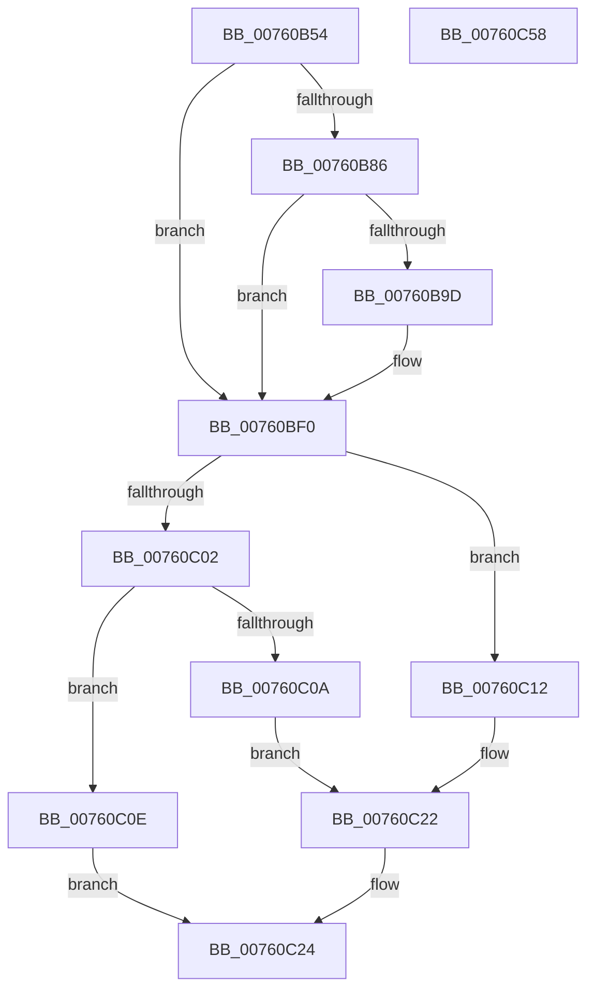

# PopDiagTraceBatteryCountChange

- RVA: `0x00760B54`–`0x00760C59` (길이 `261` bytes)
- VA: `0x0000000140760B54`
- 실행 섹션: `PAGE`
- PDB 이름 있음: `예`; PDB Function 태그: `아니요`
- unwind 정보 RVA: `0x000CC75C`
- 디코드: `65`개 명령, `261/261` bytes 표시
- 미해석 바이트: `0` (있으면 어셈블리에 `.byte`로 보존)

> 이 문서는 커널 이미지의 기계어와 PDB 기호를 분석해 생성했습니다. 4번과 5번은 함수 원형과 자료형을 바이너리 사용 방식에서 추정한 C 해석이며 원본 소스 복구 결과는 아닙니다.

## 1. Dependencies

- 직접 호출 지점: **4**; 고유 호출 대상: **4**
- 직접 호출자로 확인된 함수: **1**
- RIP 상대 이미지 참조: **7**

### Outgoing calls
- `0x00760B94` → [EtwEventEnabled](../../text/39/EtwEventEnabled_function_00392450.md) (function, `0x00392450`)
- `0x00760BEB` → [EtwWrite](../../text/41/EtwWrite_function_0041C720.md) (function, `0x0041C720`)
- `0x00760C36` → [SshSessionManagerTraceBatteryCountChange](../77/SshSessionManagerTraceBatteryCountChange_function_007739E8.md) (function, `0x007739E8`)
- `0x00760C42` → [_security_check_cookie](../../text/6A/_security_check_cookie_function_006AC640.md) (function, `0x006AC640`)

### Direct callers
- [PopBatteryApplyCompositeState](../AE/PopBatteryApplyCompositeState_function_00AE0CD0.md) at `0x00AE0DDB`

### Static image references
- `0x00760B64` → RVA `0x00E0A740` (`.data`; read)
- `0x00760B77` → RVA `0x00E67858` (`.data`; read)
- `0x00760B86` → RVA `0x00F0B408` (`.data`; read)
- `0x00760B8D` → RVA `0x00022338` (`.rdata`; read)
- `0x00760BF0` → RVA `0x00E0B579` (`.data`; read)
- `0x00760BFA` → RVA `0x00E67A54` (`.data`; read)
- `0x00760C02` → RVA `0x00E67884` (`.data`; read)

## 2. Other-region calls and transfers

- 다른 실행 섹션으로 향하는 call: **3**
  - `0x00760B94` → [EtwEventEnabled](../../text/39/EtwEventEnabled_function_00392450.md) (`PAGE` → `.text`)
  - `0x00760BEB` → [EtwWrite](../../text/41/EtwWrite_function_0041C720.md) (`PAGE` → `.text`)
  - `0x00760C42` → [_security_check_cookie](../../text/6A/_security_check_cookie_function_006AC640.md) (`PAGE` → `.text`)
- 별도 외부 분기/꼬리 이동을 확인하지 못했습니다.

## 3. Assembly (complete function range)

```asm
00760B54  48 89 5C 24 20                  mov qword ptr [rsp + 0x20], rbx
00760B59  55                              push rbp
00760B5A  48 8B EC                        mov rbp, rsp
00760B5D  48 81 EC 80 00 00 00            sub rsp, 0x80
00760B64  48 8B 05 D5 9B 6A 00            mov rax, qword ptr [rip + 0x6a9bd5]
00760B6B  48 33 C4                        xor rax, rsp
00760B6E  48 89 45 F8                     mov qword ptr [rbp - 8], rax
00760B72  33 DB                           xor ebx, ebx
00760B74  89 4D C0                        mov dword ptr [rbp - 0x40], ecx
00760B77  38 1D DB 6C 70 00               cmp byte ptr [rip + 0x706cdb], bl
00760B7D  89 55 B8                        mov dword ptr [rbp - 0x48], edx
00760B80  44 89 45 B0                     mov dword ptr [rbp - 0x50], r8d
00760B84  74 6A                           je 0x140760bf0
00760B86  48 8B 0D 7B A8 7A 00            mov rcx, qword ptr [rip + 0x7aa87b]
00760B8D  48 8D 15 A4 17 8C FF            lea rdx, [rip - 0x73e85c]
00760B94  E8 B7 18 C3 FF                  call 0x140392450
00760B99  84 C0                           test al, al
00760B9B  74 53                           je 0x140760bf0
00760B9D  48 8B 0D 64 A8 7A 00            mov rcx, qword ptr [rip + 0x7aa864]
00760BA4  48 8D 45 C0                     lea rax, [rbp - 0x40]
00760BA8  48 89 45 C8                     mov qword ptr [rbp - 0x38], rax
00760BAC  44 8D 4B 03                     lea r9d, [rbx + 3]
00760BB0  48 8D 45 B8                     lea rax, [rbp - 0x48]
00760BB4  48 C7 45 D0 04 00 00 00         mov qword ptr [rbp - 0x30], 4
00760BBC  48 89 45 D8                     mov qword ptr [rbp - 0x28], rax
00760BC0  48 8D 15 71 17 8C FF            lea rdx, [rip - 0x73e88f]
00760BC7  48 8D 45 B0                     lea rax, [rbp - 0x50]
00760BCB  48 C7 45 E0 04 00 00 00         mov qword ptr [rbp - 0x20], 4
00760BD3  48 89 45 E8                     mov qword ptr [rbp - 0x18], rax
00760BD7  45 33 C0                        xor r8d, r8d
00760BDA  48 8D 45 C8                     lea rax, [rbp - 0x38]
00760BDE  48 C7 45 F0 04 00 00 00         mov qword ptr [rbp - 0x10], 4
00760BE6  48 89 44 24 20                  mov qword ptr [rsp + 0x20], rax
00760BEB  E8 30 BB CB FF                  call 0x14041c720
00760BF0  38 1D 83 A9 6A 00               cmp byte ptr [rip + 0x6aa983], bl
00760BF6  41 0F 95 C1                     setne r9b
00760BFA  38 1D 54 6E 70 00               cmp byte ptr [rip + 0x706e54], bl
00760C00  75 10                           jne 0x140760c12
00760C02  38 1D 7C 6C 70 00               cmp byte ptr [rip + 0x706c7c], bl
00760C08  74 04                           je 0x140760c0e
00760C0A  B0 02                           mov al, 2
00760C0C  EB 14                           jmp 0x140760c22
00760C0E  8A C3                           mov al, bl
00760C10  EB 12                           jmp 0x140760c24
00760C12  8A 05 6C 6C 70 00               mov al, byte ptr [rip + 0x706c6c]
00760C18  F6 D8                           neg al
00760C1A  B0 02                           mov al, 2
00760C1C  1A C9                           sbb cl, cl
00760C1E  22 C1                           and al, cl
00760C20  FE C0                           inc al
00760C22  B3 01                           mov bl, 1
00760C24  44 8B 45 B0                     mov r8d, dword ptr [rbp - 0x50]
00760C28  8B 55 B8                        mov edx, dword ptr [rbp - 0x48]
00760C2B  8B 4D C0                        mov ecx, dword ptr [rbp - 0x40]
00760C2E  88 44 24 28                     mov byte ptr [rsp + 0x28], al
00760C32  88 5C 24 20                     mov byte ptr [rsp + 0x20], bl
00760C36  E8 AD 2D 01 00                  call 0x1407739e8
00760C3B  48 8B 4D F8                     mov rcx, qword ptr [rbp - 8]
00760C3F  48 33 CC                        xor rcx, rsp
00760C42  E8 F9 B9 F4 FF                  call 0x1406ac640
00760C47  48 8B 9C 24 A8 00 00 00         mov rbx, qword ptr [rsp + 0xa8]
00760C4F  48 81 C4 80 00 00 00            add rsp, 0x80
00760C56  5D                              pop rbp
00760C57  C3                              ret
00760C58  CC                              int3
```

## 4. C-style interpretation (structured pseudocode)

```c
__int64 __fastcall PopDiagTraceBatteryCountChange(int a1, int a2, int a3)
{
    __int64 result;
    __int64 v_rbx;
    __int64 v_rsp;
    unsigned __int64 v_stack_m10;
    unsigned __int64 v_stack_m18;
    unsigned __int64 v_stack_m20;
    unsigned __int64 v_stack_m28;
    unsigned __int64 v_stack_m30;
    unsigned __int64 v_stack_m38;
    unsigned __int64 v_stack_m40;
    unsigned int v_stack_m48;
    unsigned int v_stack_m50;
    unsigned int v_stack_m58;
    unsigned __int8 v_stack_m60;
    unsigned __int64 v_stack_m68;
    unsigned __int64 v_stack_p20;

    v_stack_p20 = v_rbx;
    v_rsp = (v_rsp) - (128);
    result = (*(unsigned __int64 *)(v_rip + 6986709)) ^ (v_rsp);
    v_stack_m10 = result;
    v_rbx = 0;
    v_stack_m48 = a1;
    v_stack_m50 = a2;
    v_stack_m58 = a3;
    if ((*(unsigned __int8 *)(v_rip + 7367899)) == 0) goto loc_00760BF0;
    result = EtwEventEnabled(*(unsigned __int64 *)(v_rip + 8038523), v_rip - 7596124, a3, a4);
    if ((unsigned __int8)(result) != 0) {
        a1 = *(unsigned __int64 *)(v_rip + 8038500);
        result = v_stack_m48;
        v_stack_m40 = result;
        a4 = v_rbx + 3;
        result = v_stack_m50;
        v_stack_m38 = 4;
        v_stack_m30 = result;
        a2 = v_rip - 7596175;
        result = v_stack_m58;
        v_stack_m28 = 4;
        v_stack_m20 = result;
        a3 = 0;
        result = v_stack_m40;
        v_stack_m18 = 4;
        v_stack_m68 = result;
        result = EtwWrite(a1, a2, a3, a4);
    }
    a4 = ((*(unsigned __int8 *)(v_rip + 6990211)) != 0) ? 1 : 0;
    if ((*(unsigned __int8 *)(v_rip + 7368276)) != 0) goto loc_00760C12;
    if ((*(unsigned __int8 *)(v_rip + 7367804)) == 0) goto loc_00760C0E;
    goto loc_00760C22;
loc_00760C0E:
    goto loc_00760C24;
loc_00760C12:
    result = (unsigned __int8)(-(*(unsigned __int8 *)(v_rip + 7367788)));
    result = (unsigned __int8)((2) & ((unsigned __int8)(a1)));
    result = (unsigned __int8)((result) + 1);
loc_00760C22:
loc_00760C24:
    v_stack_m60 = (unsigned __int8)(result);
    v_stack_m68 = 1;
    result = SshSessionManagerTraceBatteryCountChange((unsigned int)(v_stack_m48), (unsigned int)(v_stack_m50), (unsigned int)(v_stack_m58), a4);
    a1 = (v_stack_m10) ^ (v_rsp);
    result = _security_check_cookie(a1, (unsigned int)(v_stack_m50), (unsigned int)(v_stack_m58), a4);
    v_rsp = (v_rsp) + (128);
    return result;
}
```

## 5. (Beta) C Style

```c
int64_t PopDiagTraceBatteryCountChange(int32_t Arg1, int32_t Arg2, int32_t Arg3)
{
    int64_t result;
    int64_t local_rbx;
    int64_t local_rsp;
    uint64_t v_stack_m10;
    uint64_t v_stack_m18;
    uint64_t v_stack_m20;
    uint64_t v_stack_m28;
    uint64_t v_stack_m30;
    uint64_t v_stack_m38;
    uint64_t v_stack_m40;
    uint32_t v_stack_m48;
    uint32_t v_stack_m50;
    uint32_t v_stack_m58;
    uint8_t v_stack_m60;
    uint64_t v_stack_m68;
    uint64_t v_stack_p20;

    v_stack_p20 = local_rbx;
    local_rsp = (local_rsp) - (128);
    result = (*(uint64_t *)(v_rip + 0x6A9BD5)) ^ (local_rsp);
    v_stack_m10 = result;
    local_rbx = 0;
    v_stack_m48 = Arg1;
    v_stack_m50 = Arg2;
    v_stack_m58 = Arg3;
    if ((*(uint8_t *)(v_rip + 0x706CDB)) == 0) goto loc_00760BF0;
    result = EtwEventEnabled(*(uint64_t *)(v_rip + 0x7AA87B), v_rip - 7596124, Arg3, a4);
    if ((uint8_t)(result) != 0) {
        Arg1 = *(uint64_t *)(v_rip + 0x7AA864);
        result = v_stack_m48;
        v_stack_m40 = result;
        a4 = local_rbx + 3;
        result = v_stack_m50;
        v_stack_m38 = 4;
        v_stack_m30 = result;
        Arg2 = v_rip - 7596175;
        result = v_stack_m58;
        v_stack_m28 = 4;
        v_stack_m20 = result;
        Arg3 = 0;
        result = v_stack_m40;
        v_stack_m18 = 4;
        v_stack_m68 = result;
        result = EtwWrite(Arg1, Arg2, Arg3, a4);
    }
    a4 = ((*(uint8_t *)(v_rip + 0x6AA983)) != 0) ? 1 : 0;
    if ((*(uint8_t *)(v_rip + 0x706E54)) != 0) goto loc_00760C12;
    if ((*(uint8_t *)(v_rip + 0x706C7C)) == 0) goto loc_00760C0E;
    goto loc_00760C22;
loc_00760C0E:
    goto loc_00760C24;
loc_00760C12:
    result = (uint8_t)(-(*(uint8_t *)(v_rip + 0x706C6C)));
    result = (uint8_t)((2) & ((uint8_t)(Arg1)));
    result = (uint8_t)((result) + 1);
loc_00760C22:
loc_00760C24:
    v_stack_m60 = (uint8_t)(result);
    v_stack_m68 = 1;
    result = SshSessionManagerTraceBatteryCountChange((uint32_t)(v_stack_m48), (uint32_t)(v_stack_m50), (uint32_t)(v_stack_m58), a4);
    Arg1 = (v_stack_m10) ^ (local_rsp);
    result = _security_check_cookie(Arg1, (uint32_t)(v_stack_m50), (uint32_t)(v_stack_m58), a4);
    local_rsp = (local_rsp) + (128);
    return result;
}
```

## 6. Execution-region graph

[열기: 2D/3D 그래프와 함수 탐색 컨트롤 패널](../../../control-panel.html?section=page&rva=0x00760B54&view=graph)

- 2D 그래프는 위에서 아래로 흐르고, 3D 그래프는 빈 공간을 드래그해 회전합니다. Shift+드래그는 이동, 휠은 확대·축소, 함수 노드 선택은 대상 보고서 이동입니다.

### Static fallback


